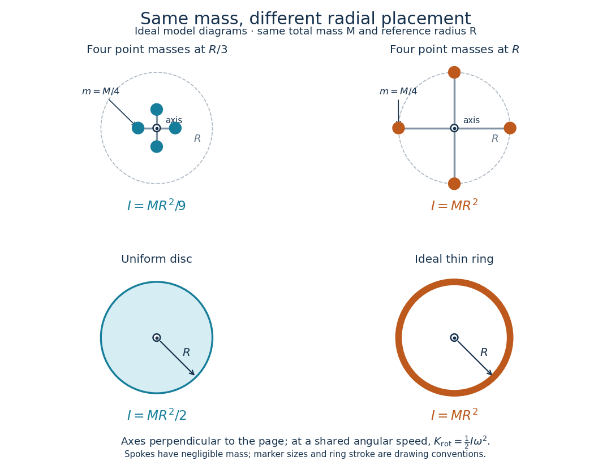

# Moment of inertia

↑ **Parent:** [Rigid body dynamics](rigid-body-dynamics-split.md)  
ⓦ [Wiki](https://en.wikipedia.org/wiki/Moment_of_inertia)

The [moment of inertia](moment-of-inertia.md) about a specified axis measures how a [mass](mass.md) distribution resists changes of [angular velocity](angular-velocity.md) about that axis. For [point masses](point-mass.md) $m_i$ at perpendicular distances $r_{\perp i}$, or a continuous distribution with [mass density](density.md) $\rho$,

$$
I=\sum_i m_i r_{\perp i}^2,
\qquad I=\int r_\perp^2\,dm=\int r_\perp^2\rho\,dV.
$$

Its [SI](international-system-of-units.md) unit is $\mathrm{kg\,m^2}$. The distance is to the entire axis, not to one point on it: moving a [point mass](point-mass.md) along the axis leaves its contribution unchanged. The [moment of inertia](moment-of-inertia.md) depends on both the distribution and the chosen axis; it is not determined by total [mass](mass.md) alone. About an axis fixed in an [inertial frame](inertial-frame.md), a [rigid body](rigid-body-dynamics-split.md) with larger [moment of inertia](moment-of-inertia.md) has smaller [angular acceleration](angular-acceleration.md) under the same net axial [torque](torque.md), and greater [rotational kinetic energy](rotational-kinetic-energy.md) at the same [angular speed](angular-speed.md).[Chapter 19: Center of Mass; Moment of Inertia](the-feynman-lectures-on-physics-volume-i-by-richard-feynman-and-others/chapter-19-center-of-mass-moment-of-inertia.md)

For a simple model, put four equal [point masses](point-mass.md) of total [mass](mass.md) $M$ on light rigid spokes at radius $a$. Their [moment of inertia](moment-of-inertia.md) is $Ma^2$. Doubling $a$ quadruples the [moment of inertia](moment-of-inertia.md) without changing $M$. The illustrated placements $a=R/3$ and $a=R$ give $MR^2/9$ and $MR^2$. Actual spokes and finite-sized weights contribute their own [moments of inertia](moment-of-inertia.md); the [point mass](point-mass.md) model neglects them. Repositioning weights during rotation also breaks the fixed-distribution assumption, so it requires a separate [work](work.md) and [angular momentum](angular-momentum.md) calculation.

**[Figure 3](#image-same-total-mass-different-radial-placement-and-moment-of-inertia). Same total mass, different radial placement and moment of inertia**. Original model diagrams, not experimental data. The upper pair has four equal [point masses](point-mass.md) on negligible-mass spokes, at $R/3$ and $R$ from a perpendicular central axis. The lower pair compares a uniform disc with an ideal thin ring of the same [mass](mass.md) $M$ and outer radius $R$. The displayed [moments of inertia](moment-of-inertia.md) determine [rotational kinetic energy](rotational-kinetic-energy.md) at a shared [angular speed](angular-speed.md). The visible thickness of the ring and size of the point markers are only drawing conventions.

The [moment of inertia of a uniform disc](moment-of-inertia-of-a-uniform-disc.md) follows by dividing it into concentric [annuli](annulus-mathematics.md): $dm=(2M/R^2)r\,dr$ and $I=\int_0^R r^2(2M/R^2)r\,dr=MR^2/2$. For an ideal thin ring every [mass](mass.md) element is at $R$, so $I=MR^2$. A ring of finite radial thickness instead uses the [moment of inertia of a uniform annulus](moment-of-inertia-of-a-uniform-annulus.md), $I=M(R^2+b^2)/2$, with inner radius $b$. A [moment of inertia](moment-of-inertia.md) is thus a compact summary of radial placement rather than a complete description of shape. For several joined pieces, their [moments of inertia](moment-of-inertia.md) add only when each is calculated about the same axis.[§10.5](university-physics-volume-1-by-william-moebs-and-others/10-5-calculating-moments-of-inertia.md)

A [physical pendulum](physical-pendulum.md) makes the [moment of inertia](moment-of-inertia.md) measurable through timing. Martín Monteiro, Cecilia Stari, Cecilia Cabeza and Arturo C. Martí used a metal bar with suspension holes $1.0\,\mathrm{cm}$ apart and an attached smartphone. They report bar length $1.199\,\mathrm m$, bar [mass](mass.md) $0.2518\,\mathrm{kg}$ and phone [mass](mass.md) $0.1311\,\mathrm{kg}$. Changing the suspension hole changes the pivot axis. Their readouts were phone [gyroscope](gyroscope.md) [angular velocity](angular-velocity.md) records, analyzed by [autocorrelation](autocorrelation.md) or a fit to a [sinusoid](sinusoid.md), and an independent photogate; the logged records for the [sinusoid](sinusoid.md) fits lasted $10\,\mathrm s$. They observed agreement between the three timing methods and the geometry-based model, including a minimum of [oscillation period](period-of-an-oscillation.md) as the suspension point varied. These are reported apparatus details and observations, not measurements made for this article.[Experimental analysis of a physical pendulum with variable suspension point by Martín Monteiro and others](experimental-analysis-of-a-physical-pendulum-with-variable-suspension-point-by-martin-monteiro-and-others.md)

To infer a [moment of inertia](moment-of-inertia.md) from such a measurement, determine the total [mass](mass.md) $M_{\mathrm{tot}}$ including every attached part, locate the assembly's [centre of mass](center-of-mass.md) $G$, and measure its distance $h>0$ below the horizontal pivot $O$. Record successive crossings in the same direction, or the elapsed [time](time-in-physics.md) $t_N$ for $N$ complete [oscillations](oscillation.md), giving [oscillation period](period-of-an-oscillation.md) $P=t_N/N$. The [physical pendulum](physical-pendulum.md) model with a fixed pivot, a [uniform gravitational field](uniform-gravitational-field.md), negligible [friction](friction.md) and the [small-angle approximation](small-angle-approximation.md) gives

$$
I_O\ddot\theta=-M_{\mathrm{tot}}gh\sin\theta,
\qquad P\simeq2\pi\sqrt{\frac{I_O}{M_{\mathrm{tot}}gh}},
\qquad I_{O,\mathrm{inferred}}=M_{\mathrm{tot}}gh\left(\frac{P}{2\pi}\right)^2.
$$

The crossing times, [masses](mass.md) and geometric distances are the measured inputs; $I_{O,\mathrm{inferred}}$ is an inference conditional on this model, while an [integral](integral-split.md) over the assumed shape supplies an independent model prediction. The [parallel axis theorem](parallel-axis-theorem.md) converts the inferred pivot [moment of inertia](moment-of-inertia.md) to one about a parallel axis through $G$. The controls and interpretation of that comparison are described there. An axial measurement determines one scalar [moment of inertia](moment-of-inertia.md), not the complete [inertia tensor](inertia-tensor.md) needed for general rotation.

**Table of contents**

- [Density-power cylindrical moment of inertia](density-power-cylindrical-moment-of-inertia.md)
- [Axial moment of inertia of a hollow cylinder](axial-moment-of-inertia-of-a-hollow-cylinder.md)
- [Axial moment of inertia of a solid of revolution](axial-moment-of-inertia-of-a-solid-of-revolution.md)
- [Moment-of-inertia triangle inequalities](moment-of-inertia-triangle-inequalities.md)
- [Moment of inertia of a uniform square plate](moment-of-inertia-of-a-uniform-square-plate.md)
  - [Off-axis angular momentum of a square lamina](off-axis-angular-momentum-of-a-square-lamina.md)
  - [In-plane inertia isotropy of a square plate](in-plane-inertia-isotropy-of-a-square-plate.md)
- [Moment of inertia of a uniform solid hemisphere](moment-of-inertia-of-a-uniform-solid-hemisphere.md)
- [Moment of inertia of a uniform solid cylinder](moment-of-inertia-of-a-uniform-solid-cylinder.md)
- [Reflected inertia of a no-slip wheel and roller](reflected-inertia-of-a-no-slip-wheel-and-roller.md)
- [Moment of inertia of a uniform annulus](moment-of-inertia-of-a-uniform-annulus.md)
- [Moment of inertia of a uniform disc](moment-of-inertia-of-a-uniform-disc.md)
- [Moment of inertia of a uniform solid sphere](moment-of-inertia-of-a-uniform-solid-sphere.md)
- [Mass second-moment tensor](mass-second-moment-tensor.md)
- [Inertia tensor](inertia-tensor.md)
  - [Inertia tensor of a uniform cube](inertia-tensor-of-a-uniform-cube.md)
  - [Inertia tensor of a displaced uniform ball](inertia-tensor-of-a-displaced-uniform-ball.md)
  - [Positive second-moment matrix test for an inertia tensor](positive-second-moment-matrix-test-for-an-inertia-tensor.md)
  - [Inertia tensor of a sheared rectangular lamina](inertia-tensor-of-a-sheared-rectangular-lamina.md)
  - [Inertia tensor of paired point masses](inertia-tensor-of-paired-point-masses.md)
  - [Rotational inertia measurement with a falling mass](rotational-inertia-measurement-with-a-falling-mass.md)
    - [Rotary encoder](rotary-encoder.md)
  - [Tensor parallel-axis theorem](tensor-parallel-axis-theorem.md)
  - [Principal moment of inertia](principal-moment-of-inertia.md)
    - [Rotational energy ellipsoid](rotational-energy-ellipsoid.md)
    - [Degeneracy of principal moments of inertia](degeneracy-of-principal-moments-of-inertia.md)
  - [Poinsot's ellipsoid](poinsot-s-ellipsoid.md)
    - [Herpolhode](herpolhode.md)
    - [Polhode](polhode.md)
- [Parallel axis theorem](parallel-axis-theorem.md)
  - [Tangent-axis inertia of a spherical shell](tangent-axis-inertia-of-a-spherical-shell.md)
- [Perpendicular axis theorem](perpendicular-axis-theorem.md)
- [Angular rocket equation](angular-rocket-equation.md)
- [Moment of inertia of a solid cone about its vertex](moment-of-inertia-of-a-solid-cone-about-its-vertex.md)
- [Moment of inertia of a pointed cubic-profile solid of revolution](moment-of-inertia-of-a-pointed-cubic-profile-solid-of-revolution.md)

## ↑ Ancestors (5)

1. [Rigid body dynamics](rigid-body-dynamics-split.md)
2. [Classical mechanics](classical-mechanics-split.md)
3. [Branches of physics](branches-of-physics.md)
4. [Physics](physics-split.md)
5. [Codex Wiki](split.md)

## ← Incoming links (173)

- [Adhesive collision of two equal discs](adhesive-collision-of-two-equal-discs.md)
- [Angular acceleration](angular-acceleration.md)
- [Axial moment of inertia of a hollow cylinder](axial-moment-of-inertia-of-a-hollow-cylinder.md)
- [Axial moment of inertia of a solid of revolution](axial-moment-of-inertia-of-a-solid-of-revolution.md)
- [Bell-clapper loss of contact](bell-clapper-loss-of-contact.md)
- [Calibrated Einstein-de Haas torsion response](calibrated-einstein-de-haas-torsion-response.md)
- [Cavendish torsion balance](cavendish-torsion-balance.md)
- [Centrifugal distortion](centrifugal-distortion.md)
- [Classical mechanics](classical-mechanics-split.md)
- [Conservation of angular momentum](conservation-of-angular-momentum.md)
- [Constant-power rotational acceleration](constant-power-rotational-acceleration.md)
- [Counterbalanced gyroscope precession](counterbalanced-gyroscope-precession.md)
- [Coupled torsional pendulums](coupled-torsional-pendulums.md)
- [Damped pendulum](damped-pendulum.md)
- [Damped torsional oscillation](damped-torsional-oscillation.md)
- [Degeneracy of principal moments of inertia](degeneracy-of-principal-moments-of-inertia.md)
- [Density-power cylindrical moment of inertia](density-power-cylindrical-moment-of-inertia.md)
- [Diatomic molecule](diatomic-molecule.md)
- [Einstein-de Haas experiment](einstein-de-haas-experiment.md)
- [Elastic eccentric impact of a thin disc](elastic-eccentric-impact-of-a-thin-disc.md)
- [Endpoint collision of two freely rotating equal rods](endpoint-collision-of-two-freely-rotating-equal-rods.md)
- [Equipartition theorem](equipartition-theorem.md)
- [Euclidean free-particle bridge amplitude](euclidean-free-particle-bridge-amplitude.md)
- [Faraday induction-ring experiment](faraday-induction-ring-experiment.md)
- [Finite-radius spherical pendulum bob](finite-radius-spherical-pendulum-bob.md)
- [Galvanometer readout of an induction pulse](galvanometer-readout-of-an-induction-pulse.md)
- [Gyrocompass oscillation](gyrocompass-oscillation.md)
- [Inertia tensor](inertia-tensor.md)
- [Inertia tensor of paired point masses](inertia-tensor-of-paired-point-masses.md)
- [Isotope shift of a linear rotor](isotope-shift-of-a-linear-rotor.md)
- [Kinetic energy decomposition about the center of mass](kinetic-energy-decomposition-about-the-center-of-mass.md)
- [Linear rigid rotor](linear-rigid-rotor.md)
- [Magnetomechanical angular momentum balance](magnetomechanical-angular-momentum-balance.md)
- [Major-axis relaxation theorem](major-axis-relaxation-theorem.md)
- [Mass distribution](mass-distribution.md)
- [Molecular structure from rotational constants](molecular-structure-from-rotational-constants.md)
- [Moment of inertia](moment-of-inertia.md)
- [Moment of inertia of a polytropic star](moment-of-inertia-of-a-polytropic-star.md)
- [Moment of inertia of a uniform annulus](moment-of-inertia-of-a-uniform-annulus.md)
- [Moment of inertia of a uniform disc](moment-of-inertia-of-a-uniform-disc.md)
- [Moment of inertia of a uniform solid cylinder](moment-of-inertia-of-a-uniform-solid-cylinder.md)
- [Moment of inertia of a uniform solid hemisphere](moment-of-inertia-of-a-uniform-solid-hemisphere.md)
- [Moment of inertia of a uniform solid sphere](moment-of-inertia-of-a-uniform-solid-sphere.md)
- [Moment of inertia of a uniform square plate](moment-of-inertia-of-a-uniform-square-plate.md)
- [Moment-of-inertia uncertainty for an annulus](moment-of-inertia-uncertainty-for-an-annulus.md)
- [Nuclear rotational band](nuclear-rotational-band.md)
- [Nuclear rotational inertia relative to a rigid sphere](nuclear-rotational-inertia-relative-to-a-rigid-sphere.md)
- [Oblate symmetric top](oblate-symmetric-top.md)
- [Ortho-para conversion heat](ortho-para-conversion-heat.md)
- [Oscillation of a uniformly wound coil](oscillation-of-a-uniformly-wound-coil.md)
- [Parahydrogen](parahydrogen.md)
- [Parallel axis theorem](parallel-axis-theorem.md)
- [Solution](past-exam-of-the-chemistry-a-course-of-the-university-of-cambridge/2021/paper-1/a3/a/iii/solution.md)
- [Solution](past-exam-of-the-chemistry-a-course-of-the-university-of-cambridge/2021/paper-1/a3/b/iv/solution.md)
- [Solution](past-exam-of-the-chemistry-a-course-of-the-university-of-cambridge/2022/paper-1/a3/a/iii/solution.md)
- [Solution](past-exam-of-the-chemistry-a-course-of-the-university-of-cambridge/2024/paper-1/a1/b/i/solution.md)
- [Solution](past-exam-of-the-chemistry-a-course-of-the-university-of-cambridge/2025/paper-2/a7/b/iii/solution.md)
- [Solution](past-exam-of-the-chemistry-a-course-of-the-university-of-cambridge/2025/paper-2/a8/c/i/solution.md)
- [Solution](past-exam-of-the-chemistry-course-of-the-year-3-of-the-natural-sciences-course-of-the-university-of-cambridge/2021/paper-2a/section-b/21/c/iii/solution.md)
- [Solution](past-exam-of-the-chemistry-course-of-the-year-3-of-the-natural-sciences-course-of-the-university-of-cambridge/2022/paper-2b/section-b/35/c/i/solution.md)
- [Solution](past-exam-of-the-mathematics-course-of-the-university-of-cambridge/2002/ia/paper-4/12e/solution.md)
- [Solution](past-exam-of-the-mathematics-course-of-the-university-of-cambridge/2004/ia/paper-4/12a/solution.md)
- [Solution](past-exam-of-the-mathematics-course-of-the-university-of-cambridge/2005/ia/paper-4/10c/solution.md)
- [Solution](past-exam-of-the-mathematics-course-of-the-university-of-cambridge/2006/ia/paper-4/11c/solution.md)
- [Solution](past-exam-of-the-mathematics-course-of-the-university-of-cambridge/2008/ia/paper-4/12b/solution.md)
- [Solution](past-exam-of-the-mathematics-course-of-the-university-of-cambridge/2009/ia/paper-4/11a/solution.md)
- [Solution](past-exam-of-the-mathematics-course-of-the-university-of-cambridge/2010/ia/paper-4/9b/solution.md)
- [Solution](past-exam-of-the-mathematics-course-of-the-university-of-cambridge/2012/ia/paper-4/11b/b/solution.md)
- [Solution](past-exam-of-the-mathematics-course-of-the-university-of-cambridge/2013/ia/paper-4/10b/a/solution.md)
- [Solution](past-exam-of-the-mathematics-course-of-the-university-of-cambridge/2013/ia/paper-4/10b/b/solution.md)
- [Solution](past-exam-of-the-mathematics-course-of-the-university-of-cambridge/2013/iii/paper-56/1/solution.md)
- [Solution](past-exam-of-the-mathematics-course-of-the-university-of-cambridge/2014/ia/paper-4/11c/solution.md)
- [Solution](past-exam-of-the-mathematics-course-of-the-university-of-cambridge/2014/iii/paper-50/2/c/solution.md)
- [Solution](past-exam-of-the-mathematics-course-of-the-university-of-cambridge/2014/iii/paper-58/3/solution.md)
- [Solution](past-exam-of-the-mathematics-course-of-the-university-of-cambridge/2015/ia/paper-4/3c/solution.md)
- [Solution](past-exam-of-the-mathematics-course-of-the-university-of-cambridge/2017/ia/paper-4/3a/solution.md)
- [Solution](past-exam-of-the-mathematics-course-of-the-university-of-cambridge/2017/ii/paper-3/13c/a/solution.md)
- [Solution](past-exam-of-the-mathematics-course-of-the-university-of-cambridge/2017/iii/paper-308/3/solution.md)
- [Solution](past-exam-of-the-mathematics-course-of-the-university-of-cambridge/2018/iii/paper-308/2/solution.md)
- [Solution](past-exam-of-the-mathematics-course-of-the-university-of-cambridge/2020/ia/paper-2/11c/solution.md)
- [Solution](past-exam-of-the-mathematics-course-of-the-university-of-cambridge/2021/ia/paper-4/4c/solution.md)
- [Solution](past-exam-of-the-mathematics-course-of-the-university-of-cambridge/2022/ia/paper-4/11c/a/i/solution.md)
- [Solution](past-exam-of-the-mathematics-course-of-the-university-of-cambridge/2025/ia/paper-4/11b/solution.md)
- [Solution](past-exam-of-the-mathematics-course-of-the-year-2-of-the-natural-sciences-course-of-the-university-of-cambridge/2016/paper-2/6/d/solution.md)
- [Solution](past-exam-of-the-mathematics-course-of-the-year-2-of-the-natural-sciences-course-of-the-university-of-cambridge/2019/paper-2/7/c/solution.md)
- [Solution](past-exam-of-the-mathematics-course-of-the-year-2-of-the-natural-sciences-course-of-the-university-of-cambridge/2023/paper-2/7/a/solution.md)
- [Solution](past-exam-of-the-mathematics-course-of-the-year-2-of-the-natural-sciences-course-of-the-university-of-cambridge/2023/paper-2/7/b/solution.md)
- [Solution](past-exam-of-the-optics-and-electrodynamics-course-of-the-university-of-cambridge/2022/section-b/5/c/solution.md)
- [Solution](past-exam-of-the-particle-and-nuclear-physics-course-of-the-university-of-cambridge/2015/paper-1/1/a/solution.md)
- [Solution](past-exam-of-the-physics-a-course-of-the-university-of-cambridge/2015/paper-1/section-b/b9/solution.md)
- [Solution](past-exam-of-the-physics-a-course-of-the-university-of-cambridge/2018/paper-1/section-a/a4/solution.md)
- [Solution](past-exam-of-the-physics-a-course-of-the-university-of-cambridge/2022/paper-1/section-c/c8/a/solution.md)
- [Solution](past-exam-of-the-physics-b-course-of-the-university-of-cambridge/2010/paper-1/section-b/b8/c/solution.md)
- [Solution](past-exam-of-the-physics-b-course-of-the-university-of-cambridge/2010/paper-2a/section-c/c11/solution.md)
- [Solution](past-exam-of-the-physics-b-course-of-the-university-of-cambridge/2011/paper-2/section-a/a5/solution.md)
- [Solution](past-exam-of-the-physics-b-course-of-the-university-of-cambridge/2011/paper-2/section-c/c11/solution.md)
- [Solution](past-exam-of-the-physics-b-course-of-the-university-of-cambridge/2012/paper-1/section-c/c10/solution.md)
- [Solution](past-exam-of-the-physics-b-course-of-the-university-of-cambridge/2014/paper-1/section-a/a1/solution.md)
- [Solution](past-exam-of-the-physics-b-course-of-the-university-of-cambridge/2014/paper-2/section-a/a3/solution.md)
- [Solution](past-exam-of-the-physics-b-course-of-the-university-of-cambridge/2015/paper-1/section-c/12/solution.md)
- [Solution](past-exam-of-the-physics-b-course-of-the-university-of-cambridge/2016/paper-1/section-b/b7/solution.md)
- [Solution](past-exam-of-the-physics-b-course-of-the-university-of-cambridge/2016/paper-1/section-c/c12/solution.md)
- [Solution](past-exam-of-the-physics-b-course-of-the-university-of-cambridge/2016/paper-2/section-a/a3/solution.md)
- [Solution](past-exam-of-the-physics-b-course-of-the-university-of-cambridge/2016/paper-2/section-b/b9/solution.md)
- [Solution](past-exam-of-the-physics-b-course-of-the-university-of-cambridge/2018/paper-1/section-c/c12/c/solution.md)
- [Solution](past-exam-of-the-physics-b-course-of-the-university-of-cambridge/2018/paper-1/section-c/c12/torsional-waves/solution.md)
- [Solution](past-exam-of-the-physics-b-course-of-the-university-of-cambridge/2019/paper-1/section-b/b6/solution.md)
- [Solution](past-exam-of-the-physics-b-course-of-the-university-of-cambridge/2019/paper-2/section-b/b8/b/solution.md)
- [Solution](past-exam-of-the-physics-b-course-of-the-university-of-cambridge/2021/paper-1/section-b/b7/b/solution.md)
- [Solution](past-exam-of-the-physics-b-course-of-the-university-of-cambridge/2021/paper-1/section-b/b7/e/solution.md)
- [Solution](past-exam-of-the-physics-b-course-of-the-university-of-cambridge/2021/paper-2/section-b/b6/c/solution.md)
- [Solution](past-exam-of-the-physics-b-course-of-the-university-of-cambridge/2021/paper-2/section-c/c9/c/solution.md)
- [Solution](past-exam-of-the-physics-b-course-of-the-university-of-cambridge/2021/paper-2/section-c/c9/e/solution.md)
- [Solution](past-exam-of-the-physics-b-course-of-the-university-of-cambridge/2022/paper-1/section-b/b6/e/solution.md)
- [Solution](past-exam-of-the-physics-b-course-of-the-university-of-cambridge/2022/paper-1/section-b/b7/a/solution.md)
- [Solution](past-exam-of-the-physics-course-of-the-year-1-of-the-natural-sciences-course-of-the-university-of-cambridge/2011/paper-1/section-b/b8/solution.md)
- [Solution](past-exam-of-the-physics-course-of-the-year-1-of-the-natural-sciences-course-of-the-university-of-cambridge/2013/paper-1/section-a/3/solution.md)
- [Solution](past-exam-of-the-physics-course-of-the-year-1-of-the-natural-sciences-course-of-the-university-of-cambridge/2013/paper-1/section-b/b9/solution.md)
- [Solution](past-exam-of-the-physics-course-of-the-year-1-of-the-natural-sciences-course-of-the-university-of-cambridge/2014/paper-1/b7/solution.md)
- [Solution](past-exam-of-the-physics-course-of-the-year-1-of-the-natural-sciences-course-of-the-university-of-cambridge/2014/paper-1/b9/solution.md)
- [Solution](past-exam-of-the-physics-course-of-the-year-1-of-the-natural-sciences-course-of-the-university-of-cambridge/2016/paper-1/section-b/b7/solution.md)
- [Solution](past-exam-of-the-physics-course-of-the-year-1-of-the-natural-sciences-course-of-the-university-of-cambridge/2018/section-b/8/solution.md)
- [Solution](past-exam-of-the-physics-course-of-the-year-1-of-the-natural-sciences-course-of-the-university-of-cambridge/2019/section-b/6/solution.md)
- [Solution](past-exam-of-the-physics-course-of-the-year-1-of-the-natural-sciences-course-of-the-university-of-cambridge/2021/section-b/6/solution.md)
- [Solution](past-exam-of-the-physics-course-of-the-year-1-of-the-natural-sciences-course-of-the-university-of-cambridge/2022/section-b/6/b/solution.md)
- [Solution](past-exam-of-the-physics-course-of-the-year-1-of-the-natural-sciences-course-of-the-university-of-cambridge/2024/paper-1/section-a/3/solution.md)
- [Solution](past-exam-of-the-physics-course-of-the-year-1-of-the-natural-sciences-course-of-the-university-of-cambridge/2024/paper-1/section-b/8/a/solution.md)
- [Solution](past-exam-of-the-physics-course-of-the-year-4-of-the-natural-sciences-course-of-the-university-of-cambridge/2012/paper-1/section-a/a2/solution.md)
- [Solution](past-exam-of-the-physics-course-of-the-year-4-of-the-natural-sciences-course-of-the-university-of-cambridge/2016/paper-1/section-b/b3/solution.md)
- [Solution](past-exam-of-the-physics-of-the-earth-as-a-planet-course-of-the-university-of-cambridge/2016/paper-1/2/b/solution.md)
- [Solution](past-exam-of-the-relativistic-astrophysics-and-cosmology-course-of-the-university-of-cambridge/2014/paper-1/1/solution.md)
- [Solution](past-exam-of-the-relativistic-astrophysics-and-cosmology-course-of-the-university-of-cambridge/2015/paper-1/3/c/solution.md)
- [Solution](past-exam-of-the-soft-condensed-matter-course-of-the-university-of-cambridge/2018/section-b/b3/solution.md)
- [Solution](past-exam-of-the-theoretical-physics-i-course-of-the-university-of-cambridge/2016/paper-1/1/b/solution.md)
- [Photogate measurement of acceleration down an incline](photogate-measurement-of-acceleration-down-an-incline.md)
- [Planar lamina](planar-lamina.md)
- [Planar rigid rotor](planar-rigid-rotor.md)
- [Polar second moment of area](polar-second-moment-of-area.md)
- [Principal moment of inertia](principal-moment-of-inertia.md)
- [Pulsar spin-down](pulsar-spin-down.md)
- [Quasi-static tether contraction](quasi-static-tether-contraction.md)
- [Radial density inversion of the Earth](radial-density-inversion-of-the-earth.md)
- [Radiative spin-down of a rotating electric dipole](radiative-spin-down-of-a-rotating-electric-dipole.md)
- [Radius change at constant angular momentum](radius-change-at-constant-angular-momentum.md)
- [Reflected inertia of a no-slip wheel and roller](reflected-inertia-of-a-no-slip-wheel-and-roller.md)
- [Rigid rotation minimizes kinetic energy at fixed angular momentum](rigid-rotation-minimizes-kinetic-energy-at-fixed-angular-momentum.md)
- [Rolling inside a fixed circular cylinder](rolling-inside-a-fixed-circular-cylinder.md)
- [Rolling-time factor on a straight incline](rolling-time-factor-on-a-straight-incline.md)
- [Rotary encoder](rotary-encoder.md)
- [Rotational constant](rotational-constant.md)
- [Rotational energy](rotational-energy.md)
- [Rotational equation of motion](rotational-equation-of-motion.md)
- [Rotational inertia measurement with a falling mass](rotational-inertia-measurement-with-a-falling-mass.md)
- [Rotational kinetic energy](rotational-kinetic-energy.md)
- [Rotational partition function](rotational-partition-function.md)
- [Rotational partition functions of hydrogen](rotational-partition-functions-of-hydrogen.md)
- [Rotational temperature](rotational-temperature.md)
- [Scalar second mass moment](scalar-second-mass-moment.md)
- [Secular tidal torque](secular-tidal-torque.md)
- [Simple pendulum](simple-pendulum-split.md)
- [Small-angle magnetic dipole oscillation](small-angle-magnetic-dipole-oscillation.md)
- [Small oscillations inside a circular cylinder](small-oscillations-inside-a-circular-cylinder.md)
- [Spinning-wheel precession experiment](spinning-wheel-precession-experiment.md)
- [Spring-mounted rolling cylinder](spring-mounted-rolling-cylinder.md)
- [Stopping angle under constant resisting torque](stopping-angle-under-constant-resisting-torque.md)
- [Tangent-axis inertia of a spherical shell](tangent-axis-inertia-of-a-spherical-shell.md)
- [Tangential-exhaust rotor with a fixed dry inertia](tangential-exhaust-rotor-with-a-fixed-dry-inertia.md)
- [Torsion constant](torsion-constant.md)
- [Torsion pendulum](torsion-pendulum.md)
- [Torsional measurement of a complex shear modulus](torsional-measurement-of-a-complex-shear-modulus.md)
- [Torsional wave equation in a circular shaft](torsional-wave-equation-in-a-circular-shaft.md)
- [Torsional waves in a solid circular rod](torsional-waves-in-a-solid-circular-rod.md)
- [Uniform disc pivoted at its rim](uniform-disc-pivoted-at-its-rim.md)
