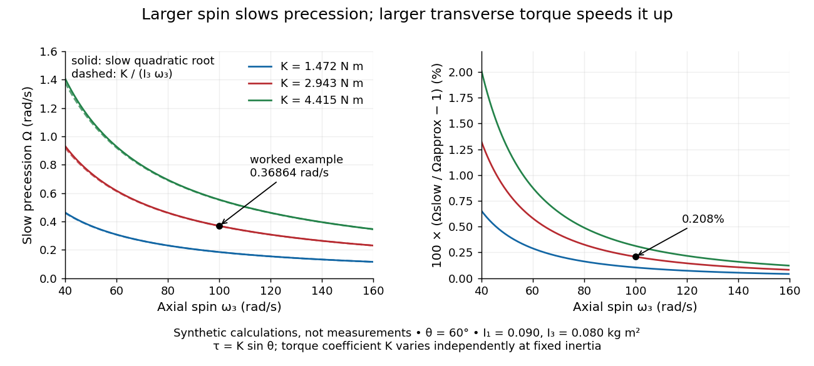

# Momentum

↑ **Parent:** [Classical mechanics](classical-mechanics.md)  
ⓦ [Wiki](https://en.wikipedia.org/wiki/Momentum)

For a nonrelativistic [point mass](classical-mechanics.md#point-mass) of fixed [mass](classical-mechanics.md#mass) $m>0$, measured in an [inertial frame](mathematical-physics.md#inertial-frame), its [momentum](momentum.md) is

$$
\mathbf p=m\mathbf v.
$$

[Momentum](momentum.md) is a [vector](vector-space.md#vector) pointing along the [velocity](classical-mechanics.md#velocity), with [International System of Units](physics.md#international-system-of-units) unit $\mathrm{kg\,m/s}$. Doubling either [mass](classical-mechanics.md#mass) or [velocity](classical-mechanics.md#velocity) doubles [momentum](momentum.md). In one dimension, a chosen positive direction makes $p=mv$ a signed quantity: a $2\,\mathrm{kg}$ body moving right at $3\,\mathrm{m/s}$ has $p=+6\,\mathrm{kg\,m/s}$; moving left at the same [speed](classical-mechanics.md#speed) gives $p=-6\,\mathrm{kg\,m/s}$. [OpenStax University Physics Volume 1, section 9.1: Linear Momentum](https://openstax.org/books/university-physics-volume-1/pages/9-1-linear-momentum)

For a collection, total [momentum](momentum.md) is the [vector](vector-space.md#vector) sum $\mathbf P=\sum_i m_i\mathbf v_i$. Two equal [masses](classical-mechanics.md#mass) moving with opposite [velocities](classical-mechanics.md#velocity) can have zero total [momentum](momentum.md) while both have positive [kinetic energy](energy.md#kinetic-energy). Direction is therefore essential when using [momentum conservation](#momentum-conservation); adding [speeds](classical-mechanics.md#speed) instead of signed [velocities](classical-mechanics.md#velocity) gives the wrong balance.

[Newton's second law](force.md#newton-s-second-law) connects the net [force](force.md) on one fixed-[mass](classical-mechanics.md#mass) [point mass](classical-mechanics.md#point-mass) to its [momentum](momentum.md) through $\mathbf F_{\mathrm{net}}=d\mathbf p/dt$. Integrating that change gives [impulse](classical-mechanics.md#impulse). Here $\mathbf p$ denotes [mechanical momentum](#mechanical-momentum); when [canonical momentum](hamiltonian-mechanics.md#canonical-momentum) differs from [mass](classical-mechanics.md#mass) times [velocity](classical-mechanics.md#velocity), the distinction in [mechanical momentum](#mechanical-momentum) below applies. The nonrelativistic formula also has a limited regime: [special relativity](special-relativity.md) is needed at [speeds](classical-mechanics.md#speed) comparable with the [speed of light](special-relativity.md#speed-of-light).

**Table of contents**

- [Mechanical momentum](#mechanical-momentum)
- [Momentum conservation](#momentum-conservation)
  - [Equal-mass fragmentation energy budget](#equal-mass-fragmentation-energy-budget)
  - [Nearly cancelling recoil momenta in payload ejection](#nearly-cancelling-recoil-momenta-in-payload-ejection)
  - [Recoil](#recoil)
- [Rocket equation](#rocket-equation)
  - [Constant-rate retro-rocket landing](#constant-rate-retro-rocket-landing)
  - [Rocket exhaust speed](#rocket-exhaust-speed)
  - [Rocket propellant](#rocket-propellant)
    - [Rocket dry mass](#rocket-dry-mass)
  - [Rocket mass ratio](#rocket-mass-ratio)
  - [Rocket thrust](#rocket-thrust)
  - [Constant-burn rocket with ground friction](#constant-burn-rocket-with-ground-friction)
  - [Constant mass-loss propulsion with quadratic drag](#constant-mass-loss-propulsion-with-quadratic-drag)
  - [Zero-relative-velocity mass shedding](#zero-relative-velocity-mass-shedding)
  - [Dust-collecting rocket](#dust-collecting-rocket)
    - [Rocket equation with stationary mass accretion](#rocket-equation-with-stationary-mass-accretion)
      - [Equal-intake-fuel mass-loading rocket](#equal-intake-fuel-mass-loading-rocket)
      - [Equal-rate rocket burning and accretion](#equal-rate-rocket-burning-and-accretion)
  - [Relativistic rocket equation](#relativistic-rocket-equation)
    - [Photon rocket](#photon-rocket)
      - [Photon-rocket fuel for acceleration and braking](#photon-rocket-fuel-for-acceleration-and-braking)
  - [Two-stage rocket with proportional fuel and body masses](#two-stage-rocket-with-proportional-fuel-and-body-masses)
  - [Forward-exhaust rocket equation](#forward-exhaust-rocket-equation)
- [Angular momentum](#angular-momentum)
  - [Angular momentum addition](#angular-momentum-addition)
  - [Angular momentum under an origin shift](#angular-momentum-under-an-origin-shift)
  - [Central axis of a momentum system](#central-axis-of-a-momentum-system)
  - [Gyroscope](#gyroscope)
    - [Gyroscopic roll torque in a turning vehicle](#gyroscopic-roll-torque-in-a-turning-vehicle)
    - [Gyrocompass](#gyrocompass)
      - [Gyrocompass oscillation](#gyrocompass-oscillation)
    - [Gyroscope vector geometry](#gyroscope-vector-geometry)
    - [Spinning-wheel precession experiment](#spinning-wheel-precession-experiment)
    - [Slow steady gyroscope precession](#slow-steady-gyroscope-precession)
      - [Counterbalanced gyroscope precession](#counterbalanced-gyroscope-precession)
    - [Gyroscope direction reference](#gyroscope-direction-reference)
  - [Magnetic axial angular-momentum invariant](#magnetic-axial-angular-momentum-invariant)
  - [Angular momentum decay under uniform linear drag](#angular-momentum-decay-under-uniform-linear-drag)
  - [Generalized angular momentum in a radial monopole field](#generalized-angular-momentum-in-a-radial-monopole-field)
  - [Conservation of angular momentum](#conservation-of-angular-momentum)
    - [Quasi-static tether contraction](#quasi-static-tether-contraction)
    - [Radius change at constant angular momentum](#radius-change-at-constant-angular-momentum)
    - [Angular-momentum flux](#angular-momentum-flux)
    - [Central-force radial turning point](#central-force-radial-turning-point)
      - [Attractive and repulsive inverse-square closest approaches](#attractive-and-repulsive-inverse-square-closest-approaches)
  - [Angular momentum transport](#angular-momentum-transport)
  - [Torque](#torque)
    - [Stopping angle under constant resisting torque](#stopping-angle-under-constant-resisting-torque)
    - [Constant-power rotation against dry friction](#constant-power-rotation-against-dry-friction)
    - [Angular impulse](#angular-impulse)
    - [Lever arm](#lever-arm)
    - [Couple (mechanics)](#couple-mechanics)
    - [Moment balance](#moment-balance)
  - [Areal velocity](#areal-velocity)
    - [Signed swept area](#signed-swept-area)
    - [Equal-time sectors of a Kepler ellipse](#equal-time-sectors-of-a-kepler-ellipse)
    - [Orbital observations behind the area law](#orbital-observations-behind-the-area-law)
      - [Armillary sphere](#armillary-sphere)
      - [Ecliptic longitude](#ecliptic-longitude)
    - [Torque criterion for constant areal velocity](#torque-criterion-for-constant-areal-velocity)
      - [Torque-driven circular swept area](#torque-driven-circular-swept-area)
- [Momentum space](#momentum-space)

## Mechanical momentum

↑ **Parent:** [Momentum](momentum.md)

For a charged particle minimally coupled to a magnetic [vector potential](multivariable-calculus.md#vector-potential), the mechanical momentum is $\boldsymbol\pi=\mathbf p-q\mathbf A$, with $\mathbf p$ the [canonical momentum](hamiltonian-mechanics.md#canonical-momentum). It is the [mass](classical-mechanics.md#mass) times [velocity](classical-mechanics.md#velocity) in nonrelativistic mechanics.

## Momentum conservation

↑ **Parent:** [Momentum](momentum.md)

[Momentum conservation](#momentum-conservation) states that total [momentum](momentum.md) stays constant when the net [force](force.md) exerted from outside the chosen collection is zero. Use a closed collection, meaning the same fixed-[mass](classical-mechanics.md#mass) [point masses](classical-mechanics.md#point-mass) are followed throughout, and an [inertial frame](mathematical-physics.md#inertial-frame). Then

$$
\mathbf P=\sum_i\mathbf p_i,\qquad
\frac{d\mathbf P}{dt}=\sum_i\mathbf F_i^{\mathrm{ext}}.
$$

To see why, sum [Newton's second law](force.md#newton-s-second-law) over the members. If $\mathbf F_{ij}$ is the [force](force.md) on member $i$ from member $j$, [Newton's third law](force.md#newton-s-third-law) assumes $\mathbf F_{ij}=-\mathbf F_{ji}$. Each pair cancels in the total:

$$
\frac{d\mathbf P}{dt}
=\sum_i\mathbf F_i^{\mathrm{ext}}
+\sum_{i<j}(\mathbf F_{ij}+\mathbf F_{ji})
=\sum_i\mathbf F_i^{\mathrm{ext}}.
$$

The internal [forces](force.md) act on different bodies and can change their individual [momenta](momentum.md); their contributions cancel only in the collection's sum. An [isolated system](thermodynamics.md#isolated-system) has no external interaction, but balanced external [forces](force.md) also suffice for [momentum conservation](#momentum-conservation). A [closed system](thermodynamics.md#closed-system) merely excluding matter exchange need not have conserved [momentum](momentum.md). [OpenStax University Physics Volume 1, section 9.3: Conservation of Linear Momentum](https://openstax.org/books/university-physics-volume-1/pages/9-3-conservation-of-linear-momentum)

The usefulness is that the detailed internal [forces](force.md) during a [collision](classical-mechanics.md#collision) need not be known. Both an [elastic collision](classical-mechanics.md#elastic-collision) and a [perfectly inelastic collision](classical-mechanics.md#perfectly-inelastic-collision) obey the same isolated [momentum](momentum.md) balance; [kinetic energy](energy.md#kinetic-energy) conservation is an additional condition for the [elastic collision](classical-mechanics.md#elastic-collision). If the external [impulse](classical-mechanics.md#impulse) is small but nonzero, the total [momentum](momentum.md) change is correspondingly small. For a [variable-mass system](classical-mechanics.md#variable-mass-system) exchanging matter, the entering or leaving [momentum](momentum.md) must also be included.

In a translation-invariant field theory, integrating over the spacetime zero mode enforces momentum conservation at interactions and scattering amplitudes.

### Equal-mass fragmentation energy budget

↑ **Parent:** [Momentum conservation](#momentum-conservation)

If a mass m moving at u splits into equal fragments at velocities $u\pm w$, [conservation of momentum](#momentum-conservation) fixes their centre-of-mass velocity. Their kinetic energy increases by $mw^2/2$, independent of u. Thus an internal release energy Q gives $w=\sqrt{2Q/m}$. A front fragment must exceed a leading target's speed to close a pre-existing separation; merely matching speed does not intercept it. This kinematic result does not specify subsequent capture or braking.

### Nearly cancelling recoil momenta in payload ejection

↑ **Parent:** [Momentum conservation](#momentum-conservation)

For downward pre-ejection speed $v_0$, total mass $M_0$, payload mass $m_p$, and downward payload speed $v_p$ in the original inertial frame, the remaining body's upward speed is $(m_pv_p-M_0v_0)/(M_0-m_p)$. When the numerator nearly cancels, distinguishing total initial mass from final body mass is essential.

### Recoil

↑ **Parent:** [Momentum conservation](#momentum-conservation)

Recoil is the motion acquired by a body when it exchanges [momentum](momentum.md) with an emitted, absorbed or scattered particle. For isolated emission from a body initially at rest, [momentum conservation](#momentum-conservation) makes the remaining body acquire the opposite momentum. If its final [mass](classical-mechanics.md#mass) is $M$ and the recoil is nonrelativistic, its [kinetic energy](energy.md#kinetic-energy) is $E_R\simeq p^2/(2M)$. A [photon](quantum-mechanics.md#photon) of [energy](energy.md) $E_\gamma$ has momentum magnitude $E_\gamma/c$, so $E_R\simeq E_\gamma^2/(2Mc^2)$. The transition energy is shared between the photon and the recoiling body; [nuclear recoil](atomic-nucleus.md#nuclear-recoil) is an important example.

## Rocket equation

↑ **Parent:** [Momentum](momentum.md)

The ideal [rocket equation](#rocket-equation) gives the change in signed [velocity](classical-mechanics.md#velocity) produced by ejecting [rocket propellant](#rocket-propellant). Assume one-dimensional [Newtonian mechanics](newtonian-mechanics.md) in an [inertial frame](mathematical-physics.md#inertial-frame), no external [force](force.md), and a fixed positive [rocket exhaust speed](#rocket-exhaust-speed) $u$ directed rearward relative to the instantaneous rocket. The rocket's instantaneous [mass](classical-mechanics.md#mass) $M$ includes its remaining [rocket propellant](#rocket-propellant); burning it gives $dM<0$. For initial and final [masses](classical-mechanics.md#mass) $M_{\mathrm{initial}}\ge M_{\mathrm{final}}>0$,

$$
M\,dv=-u\,dM,\qquad
\Delta v=v_{\mathrm{final}}-v_{\mathrm{initial}}
=u\ln\frac{M_{\mathrm{initial}}}{M_{\mathrm{final}}}.
$$

Here $\ln$ is the [natural logarithm](calculus.md#natural-logarithm), and its argument is the [rocket mass ratio](#rocket-mass-ratio). This is the constant-[rocket exhaust speed](#rocket-exhaust-speed), zero-pressure-correction version of the ideal [rocket equation](#rocket-equation). [NASA Glenn Research Center: Ideal Rocket Equation](https://www1.grc.nasa.gov/beginners-guide-to-aeronautics/ideal-rocket-equation/)

For a toy rocket with $u=2\,\mathrm{km/s}$, $M_{\mathrm{initial}}=1000\,\mathrm{kg}$ and [rocket dry mass](#rocket-dry-mass) $M_{\mathrm{final}}=250\,\mathrm{kg}$ after all [rocket propellant](#rocket-propellant) is spent, the [rocket mass ratio](#rocket-mass-ratio) is $4$ and

$$
\Delta v=2\ln4\,\mathrm{km/s}\simeq2.7725887\,\mathrm{km/s}.
$$

Burning from $1000$ to $500\,\mathrm{kg}$ gains $2\ln2\,\mathrm{km/s}\simeq1.3863\,\mathrm{km/s}$. Burning from $500$ to $250\,\mathrm{kg}$ gains exactly the same [velocity](classical-mechanics.md#velocity) increment, using only $250\,\mathrm{kg}$ of [rocket propellant](#rocket-propellant) instead of $500\,\mathrm{kg}$. Both burns halve the remaining [mass](classical-mechanics.md#mass). The second burn accelerates a lighter rocket; equal fractional [mass](classical-mechanics.md#mass) losses give equal [velocity](classical-mechanics.md#velocity) gains.

**[Figure 1](#image-equal-mass-halvings-give-equal-ideal-velocity-gains-for-an-exhaust-speed-of-2-kilometres-per-second). Equal mass halvings give equal ideal velocity gains for an exhaust speed of 2 kilometres per second**.

The [natural logarithm](calculus.md#natural-logarithm) makes the [rocket equation](#rocket-equation) both useful and revealing: multiplying successive [rocket mass ratios](#rocket-mass-ratio) adds their [velocity](classical-mechanics.md#velocity) gains. Conversely, the required [rocket mass ratio](#rocket-mass-ratio) is the [exponential function](calculus.md#exponential-function) $M_{\mathrm{initial}}/M_{\mathrm{final}}=e^{\Delta v/u}$. Each extra $u\ln2$ of ideal [velocity](classical-mechanics.md#velocity) gain doubles the required initial [mass](classical-mechanics.md#mass) for fixed final [mass](classical-mechanics.md#mass). This explains why a larger [rocket exhaust speed](#rocket-exhaust-speed) is valuable and why carrying ever more [rocket propellant](#rocket-propellant) has diminishing returns. Changing the burn duration alone does not change this ideal endpoint result.

For a short proof outline, follow the rocket together with a tiny parcel about to be expelled. Before ejection, their total [momentum](momentum.md) is $Mv$. After ejection, the remaining rocket has [mass](classical-mechanics.md#mass) $M+dM$ and [velocity](classical-mechanics.md#velocity) $v+dv$, while the parcel has positive [mass](classical-mechanics.md#mass) $-dM$ and, to first order, inertial [velocity](classical-mechanics.md#velocity) $v-u$. [Momentum conservation](#momentum-conservation) gives

$$
Mv=(M+dM)(v+dv)+(-dM)(v-u),\qquad
0=M\,dv+u\,dM+dM\,dv.
$$

Discarding the second-order product $dM\,dv$ gives $M\,dv=-u\,dM$; taking the [integral](integral.md) gives $\Delta v=-u\int_{M_{\mathrm{initial}}}^{M_{\mathrm{final}}}dM/M$. Evaluating the [integral](integral.md) yields the [natural logarithm](calculus.md#natural-logarithm) above. This is a [variable-mass system](classical-mechanics.md#variable-mass-system) calculation: the rocket alone is not a [closed system](thermodynamics.md#closed-system), and its [momentum](momentum.md) changes as the expelled material carries away [momentum](momentum.md). The fixed collection consisting of the rocket and all its expelled material has conserved total [momentum](momentum.md) when external [forces](force.md) vanish.

**[Figure 2](#image-momentum-balance-for-a-tiny-expelled-parcel-rearward-relative-exhaust-can-still-move-forward-in-the-inertial-frame). Momentum balance for a tiny expelled parcel: rearward relative exhaust can still move forward in the inertial frame**.

Fixed [rocket exhaust speed](#rocket-exhaust-speed) means fixed relative [speed](classical-mechanics.md#speed) at release, not fixed inertial [velocity](classical-mechanics.md#velocity). As the rocket's [velocity](classical-mechanics.md#velocity) $v$ changes, newly emitted material has changing inertial [velocity](classical-mechanics.md#velocity) $v-u$; previously released parcels coast at their own release [velocities](classical-mechanics.md#velocity) in this ideal model. If $v>u$, the exhaust even moves forward in the [inertial frame](mathematical-physics.md#inertial-frame), although it is emitted rearward relative to the rocket. No surrounding medium is needed for this exchange of [momentum](momentum.md).

Real flight adds [gravity](physics.md#gravity), [drag force](fluid-mechanics.md#drag-physics) and possibly a [pressure](pressure.md) correction to [rocket thrust](#rocket-thrust). A varying [rocket thrust](#rocket-thrust) due solely to a changing [mass loss rate](mathematical-physics.md#mass-loss-rate) still gives the same ideal [rocket equation](#rocket-equation) if $u$ is constant; it changes the [acceleration](classical-mechanics.md#acceleration) and burn duration. A changing [rocket exhaust speed](#rocket-exhaust-speed) instead requires $\Delta v=-\int u\,dM/M$, and external [forces](force.md) require their own contribution to the [velocity](classical-mechanics.md#velocity) change. The existing [constant mass-loss propulsion with quadratic drag](#constant-mass-loss-propulsion-with-quadratic-drag) and [constant-burn rocket with ground friction](#constant-burn-rocket-with-ground-friction) illustrate such additional [forces](force.md); the [forward-exhaust rocket equation](#forward-exhaust-rocket-equation) reverses the ejection direction and therefore the sign of the recoil.

### Constant-rate retro-rocket landing

↑ **Parent:** [Rocket equation](#rocket-equation)

With downward [speed](classical-mechanics.md#speed) $v$, downward relative exhaust [speed](classical-mechanics.md#speed) $v_E>0$ and [mass](classical-mechanics.md#mass) $M=M_0-\alpha t$, the ideal vertical equation is $\dot v=g-\alpha v_E/M$. Integration gives $v=v_0+gt+v_E\log(M/M_0)$. Height follows from $\dot h=-v$; its touchdown condition must be imposed together with the final fuel fraction.

### Rocket exhaust speed

↑ **Parent:** [Rocket equation](#rocket-equation)

The [rocket exhaust speed](#rocket-exhaust-speed) is the magnitude of the emitted material's [velocity](classical-mechanics.md#velocity) relative to the instantaneous rocket. In the ideal rearward-ejection convention of the [rocket equation](#rocket-equation), a rocket with inertial [velocity](classical-mechanics.md#velocity) $v$ emits material with inertial [velocity](classical-mechanics.md#velocity) $v-u$ to first order. A constant $u$ does not make $v-u$ constant.

### Rocket propellant

↑ **Parent:** [Rocket equation](#rocket-equation)

[Rocket propellant](#rocket-propellant) is the onboard material expelled to produce [rocket thrust](#rocket-thrust). A chemical rocket normally carries both fuel and oxidizer; both contribute to its [mass](classical-mechanics.md#mass) and to the expelled material. In the ideal [rocket equation](#rocket-equation), $M(t)=M_{\mathrm{dry}}+M_{\mathrm{propellant}}(t)$, with fixed [rocket dry mass](#rocket-dry-mass) and decreasing remaining [rocket propellant](#rocket-propellant). [NASA Glenn Research Center: Rocket Thrust](https://www1.grc.nasa.gov/beginners-guide-to-aeronautics/rocket-thrust/)

#### Rocket dry mass

↑ **Parent:** [Rocket propellant](#rocket-propellant)

In this ideal [rocket equation](#rocket-equation) model, [rocket dry mass](#rocket-dry-mass) is the [mass](classical-mechanics.md#mass) remaining after all usable [rocket propellant](#rocket-propellant) has been expelled: structure, engines and payload. It is the final [mass](classical-mechanics.md#mass) in the worked example; if [rocket propellant](#rocket-propellant) remains at shutdown, the final [mass](classical-mechanics.md#mass) is larger than the [rocket dry mass](#rocket-dry-mass).

### Rocket mass ratio

↑ **Parent:** [Rocket equation](#rocket-equation)

The [rocket mass ratio](#rocket-mass-ratio) compares the initial and final total rocket [masses](classical-mechanics.md#mass) for a burn. It is [dimensionless](physics.md#dimensionless-quantity), and the ideal [rocket equation](#rocket-equation) becomes $\Delta v=u\ln R$. For the same fixed [rocket exhaust speed](#rocket-exhaust-speed), two successive burns with [rocket mass ratios](#rocket-mass-ratio) $R_1$ and $R_2$ have combined [rocket mass ratio](#rocket-mass-ratio) $R_1R_2$ and total [velocity](classical-mechanics.md#velocity) gain $u\ln R_1+u\ln R_2$.

### Rocket thrust

↑ **Parent:** [Rocket equation](#rocket-equation)

[Rocket thrust](#rocket-thrust) is the propulsive [force](force.md) associated with ejecting [rocket propellant](#rocket-propellant). In the ideal [rocket equation](#rocket-equation) with no [pressure](pressure.md) correction, $T=u(-\dot M)$, where $\dot M=dM/dt<0$ is the signed rate of change of rocket [mass](classical-mechanics.md#mass) and $-\dot M$ is the positive [mass loss rate](mathematical-physics.md#mass-loss-rate). For $u=2000\,\mathrm{m/s}$ and $\dot M=-5\,\mathrm{kg/s}$, $T=10000\,\mathrm N$. With no other [force](force.md), the [acceleration](classical-mechanics.md#acceleration) is $T/M$: initially $10\,\mathrm{m/s^2}$ for $M=1000\,\mathrm{kg}$, rising as [mass](classical-mechanics.md#mass) falls if this [rocket thrust](#rocket-thrust) stays constant.

A real exhaust outlet can also contribute a [pressure](pressure.md) term: $T=u(-\dot M)+A_e(p_e-p_a)$, with exit [area](differential-geometry.md#surface-area) $A_e$, exit [pressure](pressure.md) $p_e$ and ambient [pressure](pressure.md) $p_a$. The ideal formula here assumes that term vanishes; it must not silently absorb this correction while still interpreting $u$ as the actual relative [rocket exhaust speed](#rocket-exhaust-speed). [NASA Glenn Research Center: Rocket Thrust and its pressure correction](https://www1.grc.nasa.gov/beginners-guide-to-aeronautics/rocket-thrust/)

### Constant-burn rocket with ground friction

↑ **Parent:** [Rocket equation](#rocket-equation)

For fuel mass rate $s>0$ and backward relative exhaust speed $u$, a rocket sliding on a horizontal plane has remaining mass $q(t)$ and satisfies the displayed [rocket equation](#rocket-equation) with [kinetic friction](newtonian-mechanics.md#kinetic-friction). Integration over a sliding interval gives $v(t)-v(t_0)=u\log[q(t_0)/q(t)]-\mu g(t-t_0)$. From initial rest, immediate forward sliding additionally requires thrust to overcome [static friction](force.md#static-friction). If both friction coefficients equal $\mu$, motion starts only when $su>\mu gq(t)$. An algebraically negative sliding speed is not the physical solution at rest.

### Constant mass-loss propulsion with quadratic drag

↑ **Parent:** [Rocket equation](#rocket-equation)

A body ejecting [mass](classical-mechanics.md#mass) at constant rate $Q>0$ and relative exhaust [speed](classical-mechanics.md#speed) $V>0$, against [quadratic drag](fluid-mechanics.md#quadratic-drag) $\alpha u^2$, has remaining [mass](classical-mechanics.md#mass) $m=m_0-Qt$. A short-interval [momentum](momentum.md) balance gives $m\dot u=QV-\alpha u^2$. From rest, [separation of variables](partial-differential-equation.md#separation-of-variables) gives

$$
u(t)=\sqrt{\frac{QV}{\alpha}}\tanh\left(\sqrt{\frac{\alpha V}{Q}}\log\frac{m_0}{m_0-Qt}\right).
$$

For final [mass](classical-mechanics.md#mass) $m_f>0$, this formula applies until $t=(m_0-m_f)/Q$. The zero-drag limit is the [rocket equation](#rocket-equation) $u_f=V\log(m_0/m_f)$. Two [dimensionless variables](mathematics.md#dimensionless-variable) are $\alpha V/Q$ and $m_0/m_f$.

### Zero-relative-velocity mass shedding

↑ **Parent:** [Rocket equation](#rocket-equation)

When matter leaves a moving body with zero instantaneous relative [velocity](classical-mechanics.md#velocity), it carries the body's current [momentum](momentum.md) per unit mass but creates no additional recoil term. A short-interval [momentum](momentum.md) balance including the newly released material gives $q\dot v=F_{\rm ext}$ for the remaining body's mass $q(t)$. The expression $\frac d{dt}(qv)=F_{\rm ext}$ omits the outgoing momentum flux. Nonzero relative ejection [velocity](classical-mechanics.md#velocity) instead produces the thrust term of the [rocket equation](#rocket-equation).

### Dust-collecting rocket

↑ **Parent:** [Rocket equation](#rocket-equation)

A classical rocket ejecting fuel at rate $\alpha>0$ and relative exhaust [speed](classical-mechanics.md#speed) $u>0$, while collecting stationary dust of [mass](classical-mechanics.md#mass) $\beta\,dx$ per traveled distance, obeys

$$
\dot m=\beta v-\alpha,\qquad m\dot v=\alpha u-\beta v^2.
$$

These are [mass conservation](continuum-mechanics.md#mass-conservation) and [momentum conservation](#momentum-conservation) for the rocket, incoming dust and outgoing gas. The dust-loading term supplies the [momentum](momentum.md) needed to accelerate incoming stationary material. Put $\lambda=\sqrt{\alpha/(\beta u)}$ and $V=\lambda u$. While the engines operate and $0\leq v<V$, an initially stationary rocket satisfies

$$
\frac m{m_0}=\left(\frac{V-v}{V}\right)^{(\lambda-1)/2}\left(\frac{V+v}{V}\right)^{-(\lambda+1)/2}.
$$

For $\lambda>1$, continuing to $V$ would drive total [mass](classical-mechanics.md#mass) to zero. For $0<\lambda<1$, total [mass](classical-mechanics.md#mass) instead grows without bound and $V$ is approached only after infinite time under indefinitely maintained thrust. In both cases a finite fuel supply runs out before that limiting [speed](classical-mechanics.md#speed). Total stored [mass](classical-mechanics.md#mass) must not be confused with remaining fuel.

#### Rocket equation with stationary mass accretion

↑ **Parent:** [Dust-collecting rocket](#dust-collecting-rocket)

For a [rocket equation](#rocket-equation) with exhaust mass rate $\dot m$ and incoming stationary mass rate $\dot D$, mass balance is $\dot M=\dot D-\dot m$. A short-interval [momentum conservation](#momentum-conservation) calculation gives $M\dot v=u\dot m-v\dot D$. Constant time rates $\dot D=\alpha$, $\dot m=\beta$ give $M\dot v+\alpha v=u\beta$, unlike a constant accretion rate per distance, whose incoming mass rate is proportional to speed. For unequal rates and initial rest, $v=(u\beta/\alpha)[1-(M/M_0)^{\alpha/(\beta-\alpha)}]$.

##### Equal-intake-fuel mass-loading rocket

↑ **Parent:** [Rocket equation with stationary mass accretion](#rocket-equation-with-stationary-mass-accretion)

A Newtonian rocket collecting stationary matter at rate $\mu$ and combining it with the same rate of carried fuel ejects [mass](classical-mechanics.md#mass) at rate $2\mu$. If relative exhaust [speed](classical-mechanics.md#speed) is $u_0$, [momentum conservation](#momentum-conservation) gives the title equation and [mass conservation](continuum-mechanics.md#mass-conservation) gives $\dot m=-\mu$. With constant $\mu$ and initial rest, $m=m_i-\mu t$ and $u=2u_0\mu t/m_i$. The limiting [speed](classical-mechanics.md#speed) $2u_0$ would require zero remaining [mass](classical-mechanics.md#mass) in this ideal solution; positive dry [mass](classical-mechanics.md#mass) terminates it sooner. A constant collection rate per time is distinct from a constant collection cross-section through a uniform medium.

##### Equal-rate rocket burning and accretion

↑ **Parent:** [Rocket equation with stationary mass accretion](#rocket-equation-with-stationary-mass-accretion)

If stationary mass arrives at the same constant time rate as fuel is ejected, total rocket mass stays fixed. The [rocket equation with stationary mass accretion](#rocket-equation-with-stationary-mass-accretion) is then $M_0\dot v+\alpha v=\alpha u$. For initial rest, speed approaches the relative exhaust speed exponentially with relaxation time $M_0/\alpha$. This is the regular equal-rate limit of the unequal-rate mass-power formula.

### Relativistic rocket equation

↑ **Parent:** [Rocket equation](#rocket-equation)

For collinear motion without external forces, a rocket ejecting material backwards at constant speed $u$ in its instantaneous rest frame obeys $m\gamma^2\,dv+u\,dm=0$. Here $m$ is the rocket's [rest mass](special-relativity.md#invariant-mass), including stored [internal energy](internal-energy.md), and $\gamma$ is its [Lorentz factor](special-relativity.md#lorentz-factor) in the chosen [inertial frame](mathematical-physics.md#inertial-frame). The equation follows from [momentum conservation](#momentum-conservation), [conservation of relativistic energy](special-relativity.md#conservation-of-relativistic-energy), and the [relativistic velocity-addition formula](special-relativity.md#velocity-addition-formula); expelled rest mass is not simply the decrease in rocket rest mass.

#### Photon rocket

↑ **Parent:** [Relativistic rocket equation](#relativistic-rocket-equation)

A [photon rocket](#photon-rocket) converts stored mass-energy into a collimated beam of [photons](quantum-mechanics.md#photon). In its instantaneous [rest frame](mathematical-physics.md#rest-frame), [energy](energy.md) conservation gives $c^2dM=-dE_\gamma$, and [momentum conservation](#momentum-conservation) gives $Mc\,d\eta=dE_\gamma/c$. Therefore a monotone change in [rapidity](special-relativity.md#rapidity) costs $M_f/M_i=e^{-|\Delta\eta|}$. The rocket's [rest mass](special-relativity.md#invariant-mass) includes its fuel and stored [internal energy](internal-energy.md); inefficiency or an angular spread of the exhaust increases the fuel requirement.

##### Photon-rocket fuel for acceleration and braking

↑ **Parent:** [Photon rocket](#photon-rocket)

Accelerating from rest to [rapidity](special-relativity.md#rapidity) $\eta$ and braking to rest requires two separate photon-rocket burns. Their mass ratios multiply, giving $M_f/M_i=e^{-2\eta}$. For ideal equal-mass matter–[antimatter](relativistic-quantum-field.md#antimatter) annihilation, the initial [antimatter](relativistic-quantum-field.md#antimatter) mass fraction is $(1-e^{-2\eta})/2$. Braking fuel must be carried and accelerated during the first burn.

### Two-stage rocket with proportional fuel and body masses

↑ **Parent:** [Rocket equation](#rocket-equation)

For zero initial [velocity](classical-mechanics.md#velocity), body [masses](classical-mechanics.md#mass) $kM,(1-k)M$ and fuel [masses](classical-mechanics.md#mass) $km_0,(1-k)m_0$, the [rocket equation](#rocket-equation) gives the displayed final second-stage [speed](classical-mechanics.md#speed) after burning the first-stage fuel, discarding its body without impulse, and burning the second-stage fuel. It assumes $M>0$ and $0\le k<1$. The speed exceeds the single-stage value when $0<k<1$ and fuel is positive. Its limit as $k\to1^-$ concerns a surviving second stage of vanishing [mass](classical-mechanics.md#mass); at $k=1$ no such stage exists.

### Forward-exhaust rocket equation

↑ **Parent:** [Rocket equation](#rocket-equation)

If a vehicle moving at speed $v$ ejects mass forward at relative speed $u>0$, then

$$
M\,dv=u\,dM.
$$

As $dM<0$, the vehicle slows down.

## Angular momentum

↑ **Parent:** [Momentum](momentum.md)  
ⓦ [Wiki](https://en.wikipedia.org/wiki/Angular_momentum)

[Angular momentum](#angular-momentum) measures how a [point mass](classical-mechanics.md#point-mass)'s [momentum](momentum.md) passes around a chosen origin. Motion straight toward or away from that origin contributes zero; transverse [momentum](momentum.md) contributes more when it passes farther away. The picture shows the sign convention before the calculation.

**[Figure 3](#image-positive-negative-and-zero-angular-momentum-about-the-same-origin). Positive, negative and zero angular momentum about the same origin**.

Fix an origin $O$ and nonrotating axes in an [inertial frame](mathematical-physics.md#inertial-frame). For a nonrelativistic [point mass](classical-mechanics.md#point-mass) of constant [mass](classical-mechanics.md#mass) $m>0$, let $\mathbf r$ be its [position](classical-mechanics.md#position) from $O$ and $\mathbf p=m\mathbf v$ its [mechanical momentum](#mechanical-momentum) in that same [reference frame](mathematical-physics.md#reference-frame). Its [angular momentum](#angular-momentum) is the [cross product](vector-space.md#cross-product)

$$
\mathbf L_O=\mathbf r\times\mathbf p,\qquad
|\mathbf L_O|=rp\sin\phi.
$$

Here $r=|\mathbf r|$, $p=|\mathbf p|$, and $\phi\in[0,\pi]$ is the [angle](geometry-and-topology.md#angle) between them. The [right-hand rule](electromagnetism.md#right-hand-rule) gives the direction: curl from $\mathbf r$ toward $\mathbf p$, and the thumb points along $\mathbf L_O$. Thus [angular momentum](#angular-momentum) is an [axial vector](vector-space.md#pseudovector), perpendicular to both [position](classical-mechanics.md#position) and [momentum](momentum.md). Its [International System of Units](physics.md#international-system-of-units) unit is $\mathrm{kg\,m^2/s}$. A [point mass](classical-mechanics.md#point-mass) need not follow a [circle](topology.md#circle) to have [angular momentum](#angular-momentum).[section 11.2: Angular Momentum](physics-bibliography.md#university-physics-volume-1-by-william-moebs-and-others/11-2-angular-momentum)

With $x$ rightward, $y$ upward, and $+z$ out of the page, the [cross product](vector-space.md#cross-product) gives $L_z=xp_y-yp_x$. Take

$$
\mathbf r=(2,0,0)\,\mathrm m,\qquad
\mathbf p=(0,3,0)\,\mathrm{kg\,m/s}.
$$

Then $\mathbf L_O=(0,0,6)\,\mathrm{kg\,m^2/s}$. Reversing the [momentum](momentum.md) makes $L_z=-6\,\mathrm{kg\,m^2/s}$; radial [momentum](momentum.md) $\mathbf p=(3,0,0)\,\mathrm{kg\,m/s}$ gives $\mathbf L_O=\mathbf0$. The factor $r\sin\phi$ is the [lever arm](#lever-arm) to the line through the particle parallel to its [momentum](momentum.md).

For motion in the $xy$ plane, [plane polar coordinates](classical-mechanics.md#plane-polar-coordinates) give $\mathbf v=\dot r\widehat{\mathbf r}+r\dot\theta\widehat{\boldsymbol\theta}$, with $\widehat{\mathbf r}\times\widehat{\boldsymbol\theta}=\widehat{\mathbf z}$. Consequently

$$
L_z=mr^2\dot\theta,\qquad r^2\dot\theta=\frac{L_z}{m}.
$$

The signed [angular velocity](rigid-body-dynamics.md#angular-velocity) $\dot\theta$ is positive counterclockwise viewed from $+z$ toward the plane, with $\theta$ measured in [radians](geometry-and-topology.md#radian). Radial [velocity](classical-mechanics.md#velocity) does not enter the [cross product](vector-space.md#cross-product). Under [conservation of angular momentum](#conservation-of-angular-momentum), this relation predicts faster angular motion at smaller $r$ and constant [areal velocity](#areal-velocity) $\dot A=L_z/(2m)$ for consistently oriented swept [area](differential-geometry.md#surface-area). That is the geometric content of [Kepler's second law](mathematical-physics.md#kepler-s-second-law).

For several [point masses](classical-mechanics.md#point-mass), add their [angular momenta](#angular-momentum) about the same origin: $\mathbf L_O=\sum_i\mathbf r_i\times\mathbf p_i$. The origin matters: [angular momentum under an origin shift](#angular-momentum-under-an-origin-shift) explains why the same moving particle can have different values about two fixed points. The [central axis of a momentum system](#central-axis-of-a-momentum-system) and [angular momentum decomposition about the centre of mass](classical-mechanics.md#angular-momentum-decomposition-about-the-centre-of-mass) make this dependence useful.

### Angular momentum addition

↑ **Parent:** [Angular momentum](#angular-momentum)

Coupling two quantum angular momenta $j_1,j_2$ into total $j=|j_1-j_2|,\ldots,j_1+j_2$. Scalar products follow from $2\mathbf J_1\cdot\mathbf J_2=\mathbf J^2-\mathbf J_1^2-\mathbf J_2^2$.

### Angular momentum under an origin shift

↑ **Parent:** [Angular momentum](#angular-momentum)

Move the fixed origin from $O$ to $O'=O+\mathbf a$, keeping the axes parallel and the [inertial frame](mathematical-physics.md#inertial-frame)'s [velocity](classical-mechanics.md#velocity) measurements unchanged. The new [positions](classical-mechanics.md#position) are $\mathbf r'_i=\mathbf r_i-\mathbf a$, so distributivity of the [cross product](vector-space.md#cross-product) gives

$$
\mathbf L_{O'}=\sum_i(\mathbf r_i-\mathbf a)\times\mathbf p_i
=\mathbf L_O-\mathbf a\times\mathbf P,\qquad
\mathbf P=\sum_i\mathbf p_i.
$$

Here $\mathbf P$ is total [linear momentum](momentum.md). For the [angular momentum](#angular-momentum) example with $\mathbf a=(1,0,0)\,\mathrm m$, the new [position](classical-mechanics.md#position) is $(1,0,0)\,\mathrm m$ and $L_{O',z}=6-3=3\,\mathrm{kg\,m^2/s}$. If total [momentum](momentum.md) is zero, [angular momentum](#angular-momentum) is independent of this origin shift. A moving origin additionally contributes $-\dot{\mathbf a}\times\mathbf P$ when this expression is differentiated while retaining the original [momenta](momentum.md); see [angular momentum about the centre of mass](classical-mechanics.md#angular-momentum-about-the-centre-of-mass) for an important case where that term vanishes.

### Central axis of a momentum system

↑ **Parent:** [Angular momentum](#angular-momentum)

For nonzero total [momentum](momentum.md) $\mathbf P$, translating the origin by $\mathbf b$ changes [angular momentum](#angular-momentum) to $\mathbf L-\mathbf b\times\mathbf P$. The displayed line of origins makes this vector parallel to $\mathbf P$, equal to $(\mathbf L\cdot\mathbf P)\mathbf P/|\mathbf P|^2$. The invariant $\mathbf L\cdot\mathbf P$ cannot be removed by translation; if it is zero, angular momentum vanishes on this line.

### Gyroscope

↑ **Parent:** [Angular momentum](#angular-momentum)  
ⓦ [Wiki](https://en.wikipedia.org/wiki/Gyroscope)

A [gyroscope](#gyroscope) is a rotating instrument whose rapidly spinning, nearly symmetric rotor provides a direction reference through its [angular momentum](#angular-momentum). In an [inertial frame](mathematical-physics.md#inertial-frame), negligible external [torque](#torque) approximately preserves that direction by [conservation of angular momentum](#conservation-of-angular-momentum). A transverse [torque](#torque) turns the [angular momentum](#angular-momentum) instead: the surprising sideways motion of a supported spinning wheel is [precession](rigid-body-dynamics.md#precession). An ideal freely falling test gyroscope in [general relativity](general-relativity.md) has its spin undergo [parallel transport](vector-bundle.md#parallel-transport) along its [timelike geodesic](general-relativity.md#timelike-geodesic). Comparing that direction with distant reference axes measures [Lense-Thirring precession](black-hole.md#lense-thirring-precession); the direction need not remain fixed in arbitrary rotating coordinates.

A [gyroscope direction reference](#gyroscope-direction-reference) is useful precisely because its direction can persist while its housing turns. A [spinning-wheel precession experiment](#spinning-wheel-precession-experiment) deliberately supplies gravitational [torque](#torque) to reveal how that persistence fails. The [gyroscope vector geometry](#gyroscope-vector-geometry) explains the direction, and [slow steady gyroscope precession](#slow-steady-gyroscope-precession) gives a numerical prediction with a check on its assumptions.

#### Gyroscopic roll torque in a turning vehicle

↑ **Parent:** [Gyroscope](#gyroscope)

A flywheel's spin [angular momentum](#angular-momentum) $\mathbf L_f$ must turn with the vehicle. The vehicle supplies [torque](#torque) $\boldsymbol\Omega\times\mathbf L_f$ to maintain this [precession](rigid-body-dynamics.md#precession), and experiences the opposite reaction [torque](#torque). With right-handed axes $x$ forward, $y$ left and $z$ up, a left turn has $\boldsymbol\Omega=+\Omega\widehat{\mathbf z}$. A transverse flywheel with $\mathbf L_f=-L_f\widehat{\mathbf y}$ then produces body [torque](#torque) $-\Omega L_f\widehat{\mathbf x}$, opposing outward roll. Its magnitude is $L_fv/R_b$ for turn radius $R_b$. Reversing the flywheel reverses the effect.

#### Gyrocompass

↑ **Parent:** [Gyroscope](#gyroscope)  
ⓦ [Wiki](https://en.wikipedia.org/wiki/Gyrocompass)

A [gyrocompass](#gyrocompass) uses a spinning [gyroscope](#gyroscope) and [Earth's rotation](planetary-science.md#earth-s-rotation) to identify geographical north. In an ideal model whose axle is constrained to the local horizontal plane but free to turn about the vertical, the northward direction of the spin [angular momentum](#angular-momentum) is stable away from the poles; the opposite spin direction is unstable. A real settling instrument also requires damping. This is different from merely preserving an initial inertial orientation with a freely mounted [gyroscope](#gyroscope).

##### Gyrocompass oscillation

↑ **Parent:** [Gyrocompass](#gyrocompass)

For a rapidly spinning [gyrocompass](#gyrocompass) with axle constrained horizontally, take azimuth $\theta$ positive from north towards west and positive spin [angular momentum](#angular-momentum) $J_s=I_1\omega$. In the terrestrial [rotating reference frame](mathematical-physics.md#rotating-reference-frame), the vertical component of the [torque](#torque) equation, with zero external vertical [torque](#torque), is $I_2\ddot\theta+J_s\Omega_E\cos\lambda\sin\theta\simeq0$. Here $I_2$ is the vertical [moment of inertia](rigid-body-dynamics.md#moment-of-inertia) and terms of order $\Omega_E^2$ have been neglected. The [small-angle approximation](geometry-and-topology.md#small-angle-approximation) about $\theta=0$ gives [simple harmonic motion](classical-mechanics.md#simple-harmonic-motion) with the displayed squared [angular frequency](lagrangian-mechanics.md#angular-frequency). Linearizing about $\theta=\pi$ reverses its sign and gives an unstable [equilibrium](dynamical-systems.md#equilibrium-point-of-a-dynamical-system). At the poles this restoring effect vanishes. For a thin rotationally symmetric flywheel, the [perpendicular axis theorem](rigid-body-dynamics.md#perpendicular-axis-theorem) gives $I_1=2I_2$.

#### Gyroscope vector geometry

↑ **Parent:** [Gyroscope](#gyroscope)

Choose a fixed support point $O$ and nonrotating axes in an [inertial frame](mathematical-physics.md#inertial-frame). All [angular momenta](#angular-momentum), [torques](#torque), and [moments of inertia](rigid-body-dynamics.md#moment-of-inertia) below refer to $O$. Let $\widehat{\mathbf e}$ point along the axle from $O$ toward the [centre of mass](classical-mechanics.md#center-of-mass), and let $\widehat{\mathbf z}$ point vertically upward. Write $\theta$ for their [angle](geometry-and-topology.md#angle). For a rapidly spinning [symmetric top](rigid-body-dynamics.md#symmetric-top), the dominant [angular momentum](#angular-momentum) is $\mathbf L_O\simeq L_s\widehat{\mathbf e}$, where $L_s=I_3\omega_3$ is signed and $I_3$ is the axial [principal moment of inertia](rigid-body-dynamics.md#principal-moment-of-inertia). The sign of the axial [angular velocity](rigid-body-dynamics.md#angular-velocity) $\omega_3$ follows the [right-hand rule](electromagnetism.md#right-hand-rule).

**[Figure 4](#image-a-fixed-wheel-support-separates-the-downward-gravitational-force-from-the-transverse-torque-and-sideways-precession). A fixed wheel support separates the downward gravitational force from the transverse torque and sideways precession**.

With [mass](classical-mechanics.md#mass) $M$, [centre of mass](classical-mechanics.md#center-of-mass) distance $d$, and constant [gravitational acceleration](newton-s-law-of-universal-gravitation.md#gravitational-acceleration) $g$, the gravitational [force](force.md) and its [torque](#torque) are

$$
\mathbf r=d\widehat{\mathbf e},\qquad \mathbf F_g=-Mg\widehat{\mathbf z},\qquad
\boldsymbol\tau_O=\mathbf r\times\mathbf F_g=Mgd\,\widehat{\mathbf z}\times\widehat{\mathbf e}.
$$

An ideal support applies a [force](force.md) at $O$, so its [lever arm](#lever-arm) and [torque](#torque) about $O$ vanish. At the instant the axle lies in the $xz$ plane with a positive $x$ component, the gravitational [torque](#torque) points along $+y$. It adds $d\mathbf L_O=\boldsymbol\tau_O\,dt$ toward $+y$, rather than along the downward [force](force.md). The [dot product](inner-product.md#dot-product) identity $d|\mathbf L_O|^2/dt=2\mathbf L_O\cdot\boldsymbol\tau_O$ shows why perpendicular [torque](#torque) changes direction without instantly changing magnitude. This vector balance and the slow-turning relation $\boldsymbol\tau_O=\boldsymbol\Omega\times\mathbf L_O$ are developed in [Chapter 20: Rotation in space](physics-bibliography.md#the-feynman-lectures-on-physics-volume-i-by-richard-feynman-and-others/chapter-20-rotation-in-space) (sections 20-2 and 20-3, equations 20.13–20.15).

For steady [precession](rigid-body-dynamics.md#precession) about the vertical, $\boldsymbol\Omega=\Omega\widehat{\mathbf z}$ and $d\widehat{\mathbf e}/dt=\Omega\widehat{\mathbf z}\times\widehat{\mathbf e}$. Equating the two [cross products](vector-space.md#cross-product) gives

$$
\Omega\simeq\frac{Mgd}{L_s}=\frac{Mgd}{I_3\omega_3},\qquad
|\boldsymbol\tau_O|=Mgd\sin\theta.
$$

The [angular momentum](#angular-momentum) tip traces a [circle](topology.md#circle) of [radius](topology.md#radius) $|L_s|\sin\theta$: its sideways [speed](classical-mechanics.md#speed) is $|\Omega L_s|\sin\theta$. Both that [radius](topology.md#radius) and the gravitational [lever arm](#lever-arm) contain $\sin\theta$, explaining its cancellation for $0<\theta<\pi$. Exactly vertical alignment has zero gravitational [torque](#torque) and no distinguishable azimuthal [precession](rigid-body-dynamics.md#precession) to infer by this cancellation. Positive $L_s$ gives positive [precession](rigid-body-dynamics.md#precession), counterclockwise viewed from above; reversing the spin reverses the slow [precession](rigid-body-dynamics.md#precession). [University Physics Volume 1, section 11.4, equation 11.12 and the torque and precession-circle derivation](physics-bibliography.md#university-physics-volume-1-by-william-moebs-and-others/11-4-precession-of-a-gyroscope)

#### Spinning-wheel precession experiment

↑ **Parent:** [Gyroscope](#gyroscope)

[Purdue's Bicycle Wheel Gyroscope demonstration](https://www.physics.purdue.edu/demos/display_page.php?item=1Q-30) uses a bicycle wheel on a long axle, with a ball at one end seated in a freely rotating socket on a heavy stand. Spin the wheel by hand or with the supplied motor, seat the ball, and release the nearly horizontal axle. The readout is the axle sweeping around the vertical while the wheel continues spinning. Compare with the stopped wheel, which falls when one end is released; reverse the spin with the same support and the [precession](rigid-body-dynamics.md#precession) reverses. These are the page's documented apparatus, presentation, and reversal checks. [1Q-30, apparatus paragraph, Directions, and Suggestions for Presentation; page updated 30 November 2023](physics-bibliography.md#bicycle-wheel-gyroscope-by-purdue-university-department-of-physics-and-astronomy)

An alternative in [Physics Demonstrations by Julien Clinton Sprott](https://sprott.physics.wisc.edu/demobook/CHAPTER1.HTM) (section 1.3, Materials and Procedure) suspends one axle end by stainless steel wire and a fishing-line swivel. The swivel allows [precession](rigid-body-dynamics.md#precession) without winding up the suspension. Sprott describes the axle bobbing as [nutation](rigid-body-dynamics.md#nutation) and [precession](rigid-body-dynamics.md#precession) becoming faster as spin decreases. A suspended support can move, whereas the calculation here assumes a fixed $O$; use the socket version for the closest realization. [section 1.3, Bicycle Wheel Gyroscope: Materials, Procedure, and Discussion](physics-bibliography.md#physics-demonstrations-a-sourcebook-for-teachers-of-physics-1996-online-manuscript-by-julien-clinton-sprott/bicycle-wheel-gyroscope-section-1-3)

A proposed quantitative extension is to record an overhead view of an axle marker against a fixed [angle](geometry-and-topology.md#angle) scale, together with a side view for $\theta(t)$. Time successive overhead passages to estimate $\Omega=2\pi/T$; count passages of a rim mark to estimate $|\omega_3|=2\pi f$. Record the spin sense too. Measure $M$ and the [centre of mass](classical-mechanics.md#center-of-mass) offset $d$ of the whole moving assembly, and determine its axial [moment of inertia](rigid-body-dynamics.md#moment-of-inertia) $I_3$ independently. Wheel, axle, support, release [angle](geometry-and-topology.md#angle), and observation interval should stay the same between spin trials. Measuring both $\Omega$ and $\theta(t)$ distinguishes azimuthal [precession](rigid-body-dynamics.md#precession) from [nutation](rigid-body-dynamics.md#nutation); an overhead movie alone can miss the latter. These camera readouts and parameter checks are proposed here, not reported measurements from the demonstration pages.

For slow [precession](rigid-body-dynamics.md#precession), compare $\Omega I_3\omega_3$ with $Mgd$, and test whether reversing $\omega_3$ reverses $\Omega$ with nearly unchanged magnitude. A brief interval minimizes spin loss from [friction](newtonian-mechanics.md#friction); repeat at several starting spin rates rather than interpreting an entire slowing run as one steady state. A suspension restoring [torque](#torque) governed by its [torsion constant](classical-mechanics.md#torsion-constant), socket [friction](newtonian-mechanics.md#friction), support motion, a misplaced [centre of mass](classical-mechanics.md#center-of-mass), and a push at release can all supply extra [torque](#torque) or change the initial conditions. The swivel reduces the twist that activates the suspension's [torsion constant](classical-mechanics.md#torsion-constant); it does not demonstrate zero [torque](#torque).

Steady [precession](rigid-body-dynamics.md#precession) keeps $\theta$ constant; [nutation](rigid-body-dynamics.md#nutation) changes $\theta$ while the axle may also precess. Sudden release generally excites both. A small initial drop is consistent with [conservation of energy](mathematical-physics.md#conservation-of-energy) and conserved vertical [angular momentum](#angular-momentum): some [gravitational potential energy](energy.md#gravitational-energy) supplies the motion around the vertical, and the axial contribution to vertical [angular momentum](#angular-momentum) adjusts. Bearing [friction](newtonian-mechanics.md#friction) may damp the bobbing, but an ideal undamped [heavy symmetric top](rigid-body-dynamics.md#heavy-symmetric-top) need not settle into steady [precession](rigid-body-dynamics.md#precession). [Chapter 20: Rotation in space](physics-bibliography.md#the-feynman-lectures-on-physics-volume-i-by-richard-feynman-and-others/chapter-20-rotation-in-space) explicitly distinguishes uniform [precession](rigid-body-dynamics.md#precession) from release transients and [nutation](rigid-body-dynamics.md#nutation) (section 20-3, paragraphs following equation 20.15).[section 20-3: sudden release, nutation, and the small drop needed for precessional angular momentum](physics-bibliography.md#the-feynman-lectures-on-physics-volume-i-by-richard-feynman-and-others/chapter-20-rotation-in-space)

#### Slow steady gyroscope precession

↑ **Parent:** [Gyroscope](#gyroscope)

Model the assembly as a [heavy symmetric top](rigid-body-dynamics.md#heavy-symmetric-top) with a fixed frictionless support, a uniform [gravitational field](physics.md#gravitational-field), and [centre of mass](classical-mechanics.md#center-of-mass) on its symmetry axis. Assume constant spin, negligible [damping](wave-equation.md#damping), and initial conditions prepared for [uniform precession of a heavy symmetric top](rigid-body-dynamics.md#uniform-precession-of-a-heavy-symmetric-top). Large spin means the transverse [angular momentum](#angular-momentum) from [precession](rigid-body-dynamics.md#precession) is small: $I_1|\Omega|\sin\theta\ll|I_3\omega_3|$. Also require $|\Omega|\ll|\omega_3|$. A large spin rate alone does not select steady motion after an arbitrary release.

For an original illustrative calculation, stipulate

$$
M=2.0\,\mathrm{kg},\quad d=0.15\,\mathrm m,\quad g=9.81\,\mathrm{m/s^2},\quad
I_3=0.080\,\mathrm{kg\,m^2},\quad I_1=I_2=0.090\,\mathrm{kg\,m^2},\quad
\omega_3=100\,\mathrm{rad/s},\quad\theta=60^\circ.
$$

The transverse [principal moments of inertia](rigid-body-dynamics.md#principal-moment-of-inertia) $I_1,I_2$ are about the pivot, including the [parallel axis theorem](rigid-body-dynamics.md#parallel-axis-theorem) contribution. These inputs give

$$
L_s=8.0\,\mathrm{kg\,m^2/s},\quad K=Mgd=2.943\,\mathrm{N\,m},\quad
|\boldsymbol\tau_O|=K\sin60^\circ=2.5487\,\mathrm{N\,m},
$$

$$
\Omega_0=K/L_s=0.367875\,\mathrm{rad/s},\qquad T_0=2\pi/\Omega_0\simeq17.080\,\mathrm s.
$$

The ratio $\Omega_0/\omega_3=0.00368$ is small; the more direct [angular momentum](#angular-momentum) ratio $I_1\Omega_0\sin60^\circ/L_s=0.00358$ is small too. These are model calculations, not experimental results.

Check the approximation against the existing exact [uniform precession of a heavy symmetric top](rigid-body-dynamics.md#uniform-precession-of-a-heavy-symmetric-top) condition. Its total [angular momentum](#angular-momentum) is

$$
\mathbf L_O=I_1\Omega(\widehat{\mathbf z}-\cos\theta\widehat{\mathbf e})+L_s\widehat{\mathbf e}.
$$

At constant $\theta,\Omega,L_s$, differentiating this expression and equating it to the gravitational [torque](#torque) gives

$$
I_1\cos\theta\,\Omega^2-L_s\Omega+K=0.
$$

For $L_s>0$ the slow solution can be evaluated without subtracting two nearly equal numbers:

$$
\Omega_{\mathrm{slow}}=\frac{2K}{L_s+\sqrt{L_s^2-4I_1K\cos\theta}}
\simeq0.368639\,\mathrm{rad/s}.
$$

It exceeds $\Omega_0$ by about $0.208\%$. The other solution is about $177.409\,\mathrm{rad/s}$ and violates the assumed slow [precession](rigid-body-dynamics.md#precession); the quadratic's two roots must not be conflated. Its [discriminant](polynomial.md#discriminant) must be nonnegative for these steady solutions to exist.

**[Figure 5](#image-synthetic-steady-precession-calculations-larger-spin-slows-the-drift-and-larger-transverse-torque-speeds-it-up). Synthetic steady-precession calculations: larger spin slows the drift and larger transverse torque speeds it up**.

The original curves hold $I_1,I_3,\theta$ fixed and vary spin and the imposed [torque](#torque) coefficient $K$ in $\boldsymbol\tau_O=K\widehat{\mathbf z}\times\widehat{\mathbf e}$. For gravity alone, $K=Mgd$; the other curves are hypothetical changes in the transverse [torque](#torque), not observations of this wheel. Solid curves use the slow quadratic root; dashed curves use $K/(I_3\omega_3)$. The second panel displays their relative difference. Increasing spin improves this approximation for the parameters shown. It does not remove [nutation](rigid-body-dynamics.md#nutation) caused by inappropriate initial conditions.

##### Counterbalanced gyroscope precession

↑ **Parent:** [Slow steady gyroscope precession](#slow-steady-gyroscope-precession)

Let a horizontal [gyroscope](#gyroscope) have signed spin [angular momentum](#angular-momentum) $L_x$ along the axle. The disk's [centre of mass](classical-mechanics.md#center-of-mass) is at $+l\widehat{\mathbf x}$ and a counterweight is at $-l_c\widehat{\mathbf x}$. Gravity supplies [torque](#torque) $g(ml-m_cl_c)\widehat{\mathbf y}$. Since $\boldsymbol\tau=\boldsymbol\Omega\times\mathbf L$, steady horizontal [precession](rigid-body-dynamics.md#precession) gives the displayed signed vertical [angular velocity](rigid-body-dynamics.md#angular-velocity). Neglect the axle's [mass](classical-mechanics.md#mass) and the counterweight's axial spin [moment of inertia](rigid-body-dynamics.md#moment-of-inertia). The zero-torque choice $m_cl_c=ml$ allows the axle to remain fixed. Moving the counterweight through this position reverses the gravitational [torque](#torque) and the associated slow [precession](rigid-body-dynamics.md#precession).

#### Gyroscope direction reference

↑ **Parent:** [Gyroscope](#gyroscope)

For a rotor spinning about a [principal axis](rigid-body-dynamics.md#principal-axis) with its support at the [centre of mass](classical-mechanics.md#center-of-mass), uniform [gravity](physics.md#gravity) supplies no [torque](#torque) about that centre. With other external [torques](#torque) negligible, [conservation of angular momentum](#conservation-of-angular-momentum) preserves its direction in an [inertial frame](mathematical-physics.md#inertial-frame). A mount that permits free axis motion lets the housing rotate relative to that persistent direction, giving an orientation reference when external landmarks are unavailable. This is the useful limit opposite to the deliberately off-centre support in the [spinning-wheel precession experiment](#spinning-wheel-precession-experiment). It supplies a direction, not a position or a full three-axis orientation from one axis alone.

For a small accumulated transverse [torque](#torque) about the [centre of mass](classical-mechanics.md#center-of-mass), the change in the direction [unit vector](vector-space.md#unit-vector) is, to first order,

$$
\Delta\widehat{\mathbf L}\simeq\frac{1}{L}\int\boldsymbol\tau_\perp\,dt,\qquad
\boldsymbol\tau_\perp=\boldsymbol\tau-(\boldsymbol\tau\cdot\widehat{\mathbf L})\widehat{\mathbf L},\qquad L=|\mathbf L|.
$$

Here $L$ is approximately constant over the short interval. Large [angular momentum](#angular-momentum) reduces drift for the same integrated transverse [torque](#torque); parallel [torque](#torque) instead changes its magnitude. For $L=8.0\,\mathrm{kg\,m^2/s}$, a constant transverse [torque](#torque) of $0.010\,\mathrm{N\,m}$ over $1.0\,\mathrm s$ produces approximately $0.00125\,\mathrm{rad}$, or $0.0716^\circ$, of direction change. This is another synthetic calculation. The persistent direction belongs to an [inertial frame](mathematical-physics.md#inertial-frame); its components can change in a rotating [reference frame](mathematical-physics.md#reference-frame) even with zero external [torque](#torque).

### Magnetic axial angular-momentum invariant

↑ **Parent:** [Angular momentum](#angular-momentum)

A charged particle in a uniform field $\boldsymbol B=B\boldsymbol e_z$ and an axially symmetric potential conserves the displayed canonical angular momentum, with $\rho$ the distance from the field axis and $q$ its charge. It follows directly by differentiating the expression and using the [Lorentz force](relativistic-electromagnetism.md#lorentz-force). For charge $q=-e$, the equivalent invariant is $m(\dot{\boldsymbol r}\times\boldsymbol r)\cdot\boldsymbol B+e|\boldsymbol r\times\boldsymbol B|^2/2$. A radial restoring force has no axial torque.

### Angular momentum decay under uniform linear drag

↑ **Parent:** [Angular momentum](#angular-momentum)

Consider particles of the same constant mass $m$, interacting through equal-and-opposite central internal forces, with external forces $F_i=-k\dot r_i$ for constant $k$. About a fixed point $a$, internal pair [torques](#torque) cancel and the external [torque](#torque) is $G_a=-k\sum_i(r_i-a)\times\dot r_i=-(k/m)L_a$. Hence $\dot L_a=-(k/m)L_a$ and the displayed exponential decay follows. The same result holds for [angular momentum about the centre of mass](classical-mechanics.md#angular-momentum-about-the-centre-of-mass), because the moving-origin term $-\dot R\times P=-\dot R\times M\dot R$ vanishes. Unequal masses do not generally permit factoring out a single $k/m$.

### Generalized angular momentum in a radial monopole field

↑ **Parent:** [Angular momentum](#angular-momentum)

For a radial conservative force plus the magnetic-type force $\dot{\mathbf r}\times(\mu\mathbf r/r^3)$, the torque equals $\mu\,d\widehat{\mathbf r}/dt$. Subtracting $\mu\widehat{\mathbf r}$ from ordinary [angular momentum](#angular-momentum) therefore produces a constant vector. Its dot product with $\widehat{\mathbf r}$ is $-\mu$, so motion lies on a cone about that vector. At $\mu=0$, ordinary planar [central force](mathematical-physics.md#central-force) motion is recovered. This is the classical radial [magnetic monopole](mathematical-physics.md#magnetic-monopole) angular-momentum correction.

### Conservation of angular momentum

↑ **Parent:** [Angular momentum](#angular-momentum)

[Conservation of angular momentum](#conservation-of-angular-momentum) says that total [angular momentum](#angular-momentum) stays fixed when the net external [torque](#torque) about the chosen fixed inertial origin vanishes. Individual [angular momenta](#angular-momentum) and [angular velocities](rigid-body-dynamics.md#angular-velocity) can change. The [radius change at constant angular momentum](#radius-change-at-constant-angular-momentum) below makes this distinction visible: pulling two rotating [point masses](classical-mechanics.md#point-mass) inward lowers the [moment of inertia](rigid-body-dynamics.md#moment-of-inertia), raises the [angular velocity](rigid-body-dynamics.md#angular-velocity), and supplies [work](energy.md#work) that increases the [kinetic energy](energy.md#kinetic-energy).

**[Figure 6](#image-pulling-two-point-masses-inward-preserves-angular-momentum-and-adds-three-joules-of-kinetic-energy). Pulling two point masses inward preserves angular momentum and adds three joules of kinetic energy**.

Follow the same constant-[mass](classical-mechanics.md#mass) [point masses](classical-mechanics.md#point-mass) throughout, in an [inertial frame](mathematical-physics.md#inertial-frame), with all [positions](classical-mechanics.md#position) measured from a fixed origin $O$. If the internal pair [forces](force.md) are opposite and central, meaning directed along each pair's separation, then

$$
\mathbf L_O=\sum_i\mathbf r_i\times\mathbf p_i,\qquad
\frac{d\mathbf L_O}{dt}=\boldsymbol\tau_O^{\mathrm{ext}}
=\sum_i\mathbf r_i\times\mathbf F_i^{\mathrm{ext}}.
$$

Thus zero net external [torque](#torque) throughout an interval implies constant total [angular momentum](#angular-momentum) throughout that interval. A vanishing external [torque](#torque) component, such as $\tau_z^{\mathrm{ext}}=0$, conserves the corresponding $L_z$ even when the other components change. This is the balance law for a fixed collection; [angular-momentum flux](#angular-momentum-flux) must also be accounted for when matter crosses its boundary. [OpenStax University Physics Volume 1, section 11.3: Conservation of Angular Momentum](https://openstax.org/books/university-physics-volume-1/pages/11-3-conservation-of-angular-momentum)

The central qualification is essential. Write $\mathbf F_{ij}$ for the internal [force](force.md) on member $i$ from member $j$. Under [Newton's third law](force.md#newton-s-third-law), $\mathbf F_{ji}=-\mathbf F_{ij}$, but the sum of their [torques](#torque) is

$$
\mathbf r_i\times\mathbf F_{ij}+\mathbf r_j\times\mathbf F_{ji}
=(\mathbf r_i-\mathbf r_j)\times\mathbf F_{ij}.
$$

This vanishes when $\mathbf F_{ij}$ is parallel to $\mathbf r_i-\mathbf r_j$. Equal-and-opposite [forces](force.md) alone do not suffice: two opposite transverse [forces](force.md) with separated lines of action form a [couple](#couple-mechanics) with nonzero [torque](#torque). Cancellation of the internal pair [torques](#torque), together with [Newton's second law](force.md#newton-s-second-law), proves the total balance above.

For one [point mass](classical-mechanics.md#point-mass) under a [central force](mathematical-physics.md#central-force) about $O$, $\mathbf F=f(r)\widehat{\mathbf r}$ gives $\boldsymbol\tau_O=\mathbf r\times\mathbf F=\mathbf0$. The [force](force.md) may still change the [speed](classical-mechanics.md#speed) and [kinetic energy](energy.md#kinetic-energy); its zero [torque](#torque) preserves [angular momentum](#angular-momentum). With nonzero $\mathbf L_O$, $\mathbf r\cdot\mathbf L_O=0$ keeps the motion in a fixed plane. Choosing the $z$ axis perpendicular to that plane, $r^2\dot\theta=L_z/m$ governs its angular progress. This removes an unknown from the [central-force radial turning point](#central-force-radial-turning-point) calculation and helps reduce the [Kepler orbit](celestial-mechanics.md#kepler-orbit) to a radial problem.

There is a historical geometric version of this result. In Book I, Section II, Proposition I of the _Principia_, Newton proves that motion under a [central force](mathematical-physics.md#central-force) toward a fixed centre stays in a plane and sweeps equal [areas](differential-geometry.md#surface-area) in equal [times](classical-mechanics.md#time-in-physics), using successive central [impulses](classical-mechanics.md#impulse) and equal [triangle](euclidean-geometry.md#triangle) [areas](differential-geometry.md#surface-area). [Newton, Principia, Book I, Proposition I, Motte translation, 1846 edition](https://en.wikisource.org/wiki/The_Mathematical_Principles_of_Natural_Philosophy_(1846)/BookI-II) In the modern notation above, constant [areal velocity](#areal-velocity) is $\dot A=L_z/(2m)$: the old geometric proof and the [angular momentum](#angular-momentum) calculation express the same invariant.

#### Quasi-static tether contraction

↑ **Parent:** [Conservation of angular momentum](#conservation-of-angular-momentum)

For two equal [point masses](classical-mechanics.md#point-mass) $m$ joined by a light tether of length $l$, the central [moment of inertia](rigid-body-dynamics.md#moment-of-inertia) is $ml^2/2$. With conserved [angular momentum](#angular-momentum) $L$, the rotational [kinetic energy](energy.md#kinetic-energy) is $L^2/(ml^2)$. Slow, smooth contraction gives $\dot E_{\rm rot}=-T\dot l$ with the displayed leading [tension](force.md#tension). The exact radial correction is $E_{\rm rad}=m\dot l^2/4$ and $T=2L^2/(ml^3)-m\ddot l/2$, so the total [work-energy theorem](energy.md#work-energy-theorem) remains exact for non-quasi-static schedules too.

#### Radius change at constant angular momentum

↑ **Parent:** [Conservation of angular momentum](#conservation-of-angular-momentum)

Place two equal [point masses](classical-mechanics.md#point-mass) of $1\,\mathrm{kg}$ each on opposite sides of a fixed origin, at equal [radius](topology.md#radius) $r$, and let them share a signed [angular velocity](rigid-body-dynamics.md#angular-velocity) $\omega=\dot\theta$ in a plane. Their total [mass](classical-mechanics.md#mass) is $M=2\,\mathrm{kg}$ and their [moment of inertia](rigid-body-dynamics.md#moment-of-inertia) about the perpendicular axis is $I=Mr^2$. Radial pulling [forces](force.md) have zero [torque](#torque) about that origin, so

$$
L_z=I\omega=Mr^2\omega=\mathrm{constant},\qquad
K_{\mathrm{rot}}=\frac12I\omega^2=\frac{L_z^2}{2I}.
$$

Take an initial [radius](topology.md#radius) $r_i=1\,\mathrm m$ and [angular velocity](rigid-body-dynamics.md#angular-velocity) $\omega_i=1\,\mathrm{rad/s}$, and a final [radius](topology.md#radius) $r_f=0.5\,\mathrm m$. Then

$$
I_i=2\,\mathrm{kg\,m^2},\quad I_f=0.5\,\mathrm{kg\,m^2},\quad
L_z=2\,\mathrm{kg\,m^2/s},\quad \omega_f=4\,\mathrm{rad/s},
$$

and

$$
K_i=1\,\mathrm J,\qquad K_f=4\,\mathrm J,\qquad W=K_f-K_i=+3\,\mathrm J.
$$

These are endpoint states with $\dot r_i=\dot r_f=0$. During the pull, the full [kinetic energy](energy.md#kinetic-energy) also contains radial motion: $K=M\dot r^2/2+K_{\mathrm{rot}}$. Assume the pulling apparatus supplies all net [work](energy.md#work) to the two [point masses](classical-mechanics.md#point-mass); the [work-energy theorem](energy.md#work-energy-theorem) then fixes its net [work](energy.md#work) at $+3\,\mathrm J$, including any radial acceleration and braking. Each [mass](classical-mechanics.md#mass) spirals inward during the pull, allowing its inward [force](force.md) to do positive [work](energy.md#work). [Conservation of angular momentum](#conservation-of-angular-momentum) therefore predicts the final [angular velocity](rigid-body-dynamics.md#angular-velocity) without requiring [kinetic energy](energy.md#kinetic-energy) conservation. For an apparatus included in a larger system, its stored [energy](energy.md) supplies the increase consistently with [conservation of energy](mathematical-physics.md#conservation-of-energy). OpenStax uses the same mechanism to explain a skater pulling her arms inward. [OpenStax, section 11.3: work during a change of moment of inertia](https://openstax.org/books/university-physics-volume-1/pages/11-3-conservation-of-angular-momentum)

#### Angular-momentum flux

↑ **Parent:** [Conservation of angular momentum](#conservation-of-angular-momentum)

The rate at which [angular momentum](#angular-momentum) crosses a surface, including advection and stresses. With positive inward [mass accretion rate](astrophysical-black-hole.md#mass-accretion-rate), the net inward flux in a steady [accretion disk](astrophysical-disk.md#accretion-disk) is $\dot M h-\mathcal G$.

#### Central-force radial turning point

↑ **Parent:** [Conservation of angular momentum](#conservation-of-angular-momentum)

For unit mass in a [central force](mathematical-physics.md#central-force) with potential $\Phi(r)$ and conserved angular momentum $L$, a radial turning point $r_*$ has zero radial speed and therefore satisfies

$$
E=\frac{L^2}{2r_*^2}+\Phi(r_*).
$$

##### Attractive and repulsive inverse-square closest approaches

↑ **Parent:** [Central-force radial turning point](#central-force-radial-turning-point)

For unit [mass](classical-mechanics.md#mass), incoming [speed](classical-mechanics.md#speed) $v>0$, [impact parameter](classical-mechanics.md#impact-parameter) $b>0$, and [potential energy](energy.md#potential-energy) $\mp\kappa/r$, put $q=\kappa/v^2>0$. At closest approach, [conservation of energy](mathematical-physics.md#conservation-of-energy) and [conservation of angular momentum](#conservation-of-angular-momentum) give the displayed radii and tangential [speeds](classical-mechanics.md#speed) $u_\mp=bv/p_\mp$. Consequently $p_-p_+=b^2$ and $u_-u_+=v^2$. These relations compare equal force magnitudes. The attractive radial case $b=0$ is a singular collision, so the speed-product statement does not extend to that endpoint.

### Angular momentum transport

↑ **Parent:** [Angular momentum](#angular-momentum)

Angular momentum transport moves angular momentum between locations through matter, stresses, waves, or fields. An [accretion disk](astrophysical-disk.md#accretion-disk) must transport angular momentum outward for most of its mass to move inward.

### Torque

↑ **Parent:** [Angular momentum](#angular-momentum)  
ⓦ [Wiki](https://en.wikipedia.org/wiki/Torque)

[Torque](#torque) measures a [force](force.md)'s turning effect about a specified origin. The geometry in the [angular momentum](#angular-momentum) diagram applies with [force](force.md) replacing [momentum](momentum.md): transverse [forces](force.md) give positive or negative [torque](#torque), while a radial [force](force.md) gives zero. A longer perpendicular [lever arm](#lever-arm) makes the same [force](force.md) more effective, explaining why pushing near the end of a handle is useful.

For a [force](force.md) $\mathbf F$ applied at [position](classical-mechanics.md#position) $\mathbf r$ from a fixed origin $O$ in an [inertial frame](mathematical-physics.md#inertial-frame), its [torque](#torque), or [moment of force](#torque), is

$$
\boldsymbol\tau_O=\mathbf r\times\mathbf F,\qquad
|\boldsymbol\tau_O|=rF\sin\phi=F\ell.
$$

Here $F=|\mathbf F|$, $\phi$ is the [angle](geometry-and-topology.md#angle) between [position](classical-mechanics.md#position) and [force](force.md), and $\ell=r\sin\phi$ is the perpendicular [lever arm](#lever-arm). Direction follows the [right-hand rule](electromagnetism.md#right-hand-rule); in the $xy$ plane $\tau_z=xF_y-yF_x$, positive counterclockwise as viewed from $+z$. The [International System of Units](physics.md#international-system-of-units) unit is $\mathrm{N\,m}=\mathrm{kg\,m^2/s^2}$. Although [torque](#torque) and [energy](energy.md) have the same [physical dimensions](mathematical-physics.md#physical-dimension), [torque](#torque) is an [axial vector](vector-space.md#pseudovector) and [energy](energy.md) is a [scalar](vector-space.md#scalar); their roles differ.

For $\mathbf r=(2,0,0)\,\mathrm m$ and $\mathbf F=(0,3,0)\,\mathrm N$, $\tau_z=+6\,\mathrm{N\,m}$. Applying the same [force](force.md) at $(1,0,0)\,\mathrm m$ gives $+3\,\mathrm{N\,m}$; reversing it gives a negative [torque](#torque); directing it along $\mathbf r$ gives zero. More generally, sum $\mathbf r_i\times\mathbf F_i$ to find the total [torque](#torque) about one common origin.

For a constant-[mass](classical-mechanics.md#mass) [point mass](classical-mechanics.md#point-mass), the [product rule](calculus.md#product-rule) and [Newton's second law](force.md#newton-s-second-law) show why net [torque](#torque) changes [angular momentum](#angular-momentum):

$$
\frac{d\mathbf L_O}{dt}
=\mathbf v\times(m\mathbf v)+\mathbf r\times\frac{d\mathbf p}{dt}
=\mathbf r\times\mathbf F_{\mathrm{net}}
=\boldsymbol\tau_O^{\mathrm{net}}.
$$

The first [cross product](vector-space.md#cross-product) vanishes because its factors are parallel. For a collection with canceling internal [torques](#torque), the remaining sum is external [torque](#torque), giving [conservation of angular momentum](#conservation-of-angular-momentum) when it vanishes.[section 11.2: torque and the angular momentum balance](physics-bibliography.md#university-physics-volume-1-by-william-moebs-and-others/11-2-angular-momentum)

A nonzero [torque](#torque) can turn the direction of [angular momentum](#angular-momentum) as well as change its magnitude. Indeed, the [dot product](inner-product.md#dot-product) gives $d|\mathbf L_O|^2/dt=2\mathbf L_O\cdot\boldsymbol\tau_O$: a perpendicular [torque](#torque) changes direction without instantaneously changing the magnitude. This is the geometry behind [gyroscope](#gyroscope) [precession](rigid-body-dynamics.md#precession). For a rapidly spinning [symmetric top](rigid-body-dynamics.md#symmetric-top) with a fixed tip, [centre of mass](classical-mechanics.md#center-of-mass) distance $d$ from the tip, [mass](classical-mechanics.md#mass) $M$, and spin-dominated [angular momentum](#angular-momentum) magnitude $L\simeq I\omega$, the slow steady [precession](rigid-body-dynamics.md#precession) approximation gives $\Omega\simeq Mgd/L$, where $g$ is [gravitational acceleration](newton-s-law-of-universal-gravitation.md#gravitational-acceleration). [OpenStax University Physics Volume 1, section 11.4: Precession of a Gyroscope](physics-bibliography.md#university-physics-volume-1-by-william-moebs-and-others/11-4-precession-of-a-gyroscope) This is an approximation with $\Omega\ll\omega$; the [uniform precession of a heavy symmetric top](rigid-body-dynamics.md#uniform-precession-of-a-heavy-symmetric-top) retains contributions omitted by the spin-dominated estimate.

#### Stopping angle under constant resisting torque

↑ **Parent:** [Torque](#torque)

A rigid body's axial [moment of inertia](rigid-body-dynamics.md#moment-of-inertia) $I$ and a constant resisting [torque](#torque) $\tau_f>0$ give constant [angular acceleration](rigid-body-dynamics.md#angular-acceleration) $-\tau_f/I$. Hence $t_{\rm stop}=I\omega_0/\tau_f$ and the [angular displacement](classical-mechanics.md#angular-displacement) is the displayed expression. Equivalently, the lost [rotational kinetic energy](energy.md#rotational-kinetic-energy) $I\omega_0^2/2$ equals the resisting work $\tau_f\Delta\phi$. The total number of revolutions is $\Delta\phi/(2\pi)$; the number of whole revolutions completed is its [floor function](calculus.md#floor-function).

#### Constant-power rotation against dry friction

↑ **Parent:** [Torque](#torque)

For positive [angular velocity](rigid-body-dynamics.md#angular-velocity), a motor delivering constant mechanical [power](energy.md#power) $P$ produces [torque](#torque) $P/\omega$. With constant opposing [kinetic friction](newtonian-mechanics.md#kinetic-friction) torque $\tau_f$, [angular momentum](#angular-momentum) balance gives the displayed equation and a steady speed $\omega_*=P/\tau_f$. A small increase in speed reduces the driving torque below the friction torque, making this equilibrium stable within the model. The constant-power idealization is singular at exact rest and requires a separate starting regime in a real motor.

#### Angular impulse

↑ **Parent:** [Torque](#torque)

The [time integral](integral.md#time-integral) of [torque](#torque) about a specified origin equals the change in [angular momentum](#angular-momentum) about that origin under the usual fixed-origin [inertial frame](mathematical-physics.md#inertial-frame) balance. Its units are $\mathrm{N\,m\,s}$, equivalently $\mathrm{kg\,m^2\,s^{-1}}$. For rotation about a fixed [principal axis](rigid-body-dynamics.md#principal-axis), the magnitude is $I\Delta\omega$.

#### Lever arm

↑ **Parent:** [Torque](#torque)

The [lever arm](#lever-arm) of a nonzero [force](force.md) about an origin is the shortest distance from that origin to the line through the application point parallel to the [force](force.md). Its length is $\ell=|\mathbf r\times\widehat{\mathbf F}|$, with [unit vector](vector-space.md#unit-vector) $\widehat{\mathbf F}=\mathbf F/|\mathbf F|$. Thus [torque](#torque) magnitude is $F\ell$, maximal at a right [angle](geometry-and-topology.md#angle) for fixed $r$ and $F$, and zero if the line passes through the origin. Sliding the application point along that line leaves [torque](#torque) unchanged, since $(\mathbf r+s\widehat{\mathbf F})\times\mathbf F=\mathbf r\times\mathbf F$. The same perpendicular-distance construction gives [angular momentum](#angular-momentum) magnitude $p\ell$ for a line parallel to nonzero [momentum](momentum.md) through the particle.

#### Couple (mechanics)

↑ **Parent:** [Torque](#torque)  
ⓦ [Wiki](https://en.wikipedia.org/wiki/Couple_(mechanics))

A pair of equal and opposite [forces](force.md) acting along distinct lines has zero resultant [force](force.md) but a nonzero [torque](#torque). If $\mathbf F$ acts at $\mathbf x_1$ and $-\mathbf F$ at $\mathbf x_2$, the total [torque](#torque) about any origin is $(\mathbf x_1-\mathbf x_2)\times\mathbf F$. Shifting that origin changes the moment by the [cross product](vector-space.md#cross-product) of the shift with the resultant [force](force.md), which is zero. A prescribed [couple](#couple-mechanics) therefore specifies a pure turning moment independently of its reference point. In [Stokes flow](stokes-flow.md) it can drive a [rotating sphere in Stokes flow](stokes-flow.md#rotating-sphere-in-stokes-flow) without a directly imposed translational [force](force.md).

#### Moment balance

↑ **Parent:** [Torque](#torque)

Moment balance equates the rate of change of angular momentum to applied torques. A static slender rod obeys $\partial_s\mathbf M+\mathbf t\times\mathbf F+\mathbf m=0$.

### Areal velocity

↑ **Parent:** [Angular momentum](#angular-momentum)  
ⓦ [Wiki](https://en.wikipedia.org/wiki/Areal_velocity)

Areal velocity measures how fast a [position](classical-mechanics.md#position) [vector](vector-space.md#vector) from a chosen origin sweeps [signed swept area](#signed-swept-area). It connects a geometric picture of motion to [angular momentum](#angular-momentum): a long [position](classical-mechanics.md#position) [vector](vector-space.md#vector) with slow transverse motion can sweep the same [area](differential-geometry.md#surface-area) per unit [time](classical-mechanics.md#time-in-physics) as a short one with fast transverse motion. Constancy requires a dynamical condition, given by the [torque criterion for constant areal velocity](#torque-criterion-for-constant-areal-velocity).

Choose a fixed origin $O$ in an [inertial frame](mathematical-physics.md#inertial-frame) and a fixed [plane](geometry-and-topology.md#plane) through $O$, with constant [unit vector](vector-space.md#unit-vector) $\mathbf n$ normal to it. For a differentiable trajectory in that [plane](geometry-and-topology.md#plane), let $\mathbf r(t)$ be [position](classical-mechanics.md#position) relative to $O$ and $\mathbf v=\dot{\mathbf r}$ its [velocity](classical-mechanics.md#velocity). Positive swept [area](differential-geometry.md#surface-area) follows the [right-hand rule](electromagnetism.md#right-hand-rule) about $\mathbf n$. In positively oriented Cartesian coordinates in the [plane](geometry-and-topology.md#plane), and in [plane polar coordinates](classical-mechanics.md#plane-polar-coordinates) with [angle](geometry-and-topology.md#angle) $\theta$ in [radians](geometry-and-topology.md#radian),

$$
\dot A=\frac12\mathbf n\cdot(\mathbf r\times\mathbf v)
=\frac12(x\dot y-y\dot x)
=\frac12r^2\dot\theta.
$$

Here the [dot product](inner-product.md#dot-product) selects the normal component of the [cross product](vector-space.md#cross-product). Motion away from or towards $O$ alone contributes no [area](differential-geometry.md#surface-area). The signed [specific angular momentum](celestial-mechanics.md#specific-angular-momentum) component $h_n=\mathbf n\cdot(\mathbf r\times\mathbf v)$ obeys

$$
\dot A=\frac{h_n}{2}=\frac{L_n}{2m}
$$

for a constant [mass](classical-mechanics.md#mass) $m$. If $\mathbf n$ is chosen along a nonzero conserved [specific angular momentum](celestial-mechanics.md#specific-angular-momentum) [vector](vector-space.md#vector), then $h_n=h=|\mathbf r\times\mathbf v|$ and the familiar positive formula is $\dot A=h/2$. Reversing the orientation changes the sign; the instantaneous unsigned swept-[area](differential-geometry.md#surface-area) rate is $|\dot A|$.

#### Signed swept area

↑ **Parent:** [Areal velocity](#areal-velocity)

Signed swept area counts the [area](differential-geometry.md#surface-area) traversed by a [position](classical-mechanics.md#position) [vector](vector-space.md#vector), positively or negatively according to its direction of turning. For a continuously differentiable planar trajectory, its accumulated value relative to $t_0$ is the [line integral](multivariable-calculus.md#line-integral)

$$
A(t)-A(t_0)=\frac12\int_{t_0}^t\mathbf n\cdot(\mathbf r(s)\times\dot{\mathbf r}(s))\,ds.
$$

A short segment contributes the oriented [triangle](euclidean-geometry.md#triangle) [area](differential-geometry.md#surface-area) $\tfrac12\mathbf n\cdot(\mathbf r\times d\mathbf r)$; taking its [time](classical-mechanics.md#time-in-physics) [derivative](calculus.md#derivative) gives [areal velocity](#areal-velocity). Repeated turns count repeated [area](differential-geometry.md#surface-area); a reversal subtracts it. Thus this quantity need not equal the [area](differential-geometry.md#surface-area) of the union of all previously swept regions. The origin matters: the relevant origin for [Kepler's second law](mathematical-physics.md#kepler-s-second-law) is the attracting focus of the [ellipse](euclidean-geometry.md#ellipse), rather than its geometric centre.

#### Equal-time sectors of a Kepler ellipse

↑ **Parent:** [Areal velocity](#areal-velocity)

Take an illustrative [elliptic Kepler orbit](celestial-mechanics.md#elliptic-orbit) with [semi-major axis](celestial-mechanics.md#semi-major-axis) $a=1$, [orbital eccentricity](celestial-mechanics.md#orbital-eccentricity) $e=0.6$ and [gravitational parameter](newton-s-law-of-universal-gravitation.md#standard-gravitational-parameter) $\mu=1$, in consistent dimensionless units. Its [semi-minor axis](celestial-mechanics.md#semi-minor-axis) is $b=a\sqrt{1-e^2}=0.8$, [mean motion](celestial-mechanics.md#mean-motion) is $n=\sqrt{\mu/a^3}=1$, and [specific angular momentum](celestial-mechanics.md#specific-angular-momentum) magnitude is $h=\sqrt{\mu a(1-e^2)}=0.8$. About the attracting focus,

$$
\dot A=0.4,\qquad \Delta A=0.4\,\Delta t.
$$

The two sectors below each span $\Delta t=0.5$, giving $\Delta A=0.2$. Near [periapsis](celestial-mechanics.md#periapsis) the short radius sweeps a wide [angle](geometry-and-topology.md#angle); near [apoapsis](celestial-mechanics.md#apoapsis) the long radius sweeps a narrow [angle](geometry-and-topology.md#angle). Constant [areal velocity](#areal-velocity) therefore does not require constant [angular velocity](rigid-body-dynamics.md#angular-velocity) or constant [speed](classical-mechanics.md#speed).

**[Figure 7](#image-equal-time-intervals-sweep-equal-areas-about-the-focus-of-an-illustrative-elliptic-kepler-orbit). Equal time intervals sweep equal areas about the focus of an illustrative elliptic Kepler orbit**.

To compute the sectors without mistaking equal [angles](geometry-and-topology.md#angle) for equal [times](classical-mechanics.md#time-in-physics), parametrize the [ellipse](euclidean-geometry.md#ellipse) by [eccentric anomaly](celestial-mechanics.md#eccentric-anomaly) $E$:

$$
x=a(\cos E-e),\qquad y=b\sin E,\qquad
A(E_2)-A(E_1)=\frac{ab}{2}\bigl(E_2-E_1-e(\sin E_2-\sin E_1)\bigr).
$$

This follows by integrating $\tfrac12(x\,dy-y\,dx)$. [Kepler's equation](celestial-mechanics.md#kepler-s-equation) gives $E-e\sin E=M=n(t-t_{\mathrm p})$, with [mean anomaly](celestial-mechanics.md#mean-anomaly) $M$ measured from [periapsis](celestial-mechanics.md#periapsis) [time](classical-mechanics.md#time-in-physics) $t_{\mathrm p}$. Consequently $\Delta A=abn\Delta t/2=h\Delta t/2$. The displayed sectors use [mean anomaly](celestial-mechanics.md#mean-anomaly) intervals $[-0.25,0.25]$ and $[\pi-0.25,\pi+0.25]$, rather than equal [eccentric anomaly](celestial-mechanics.md#eccentric-anomaly) increments.

#### Orbital observations behind the area law

↑ **Parent:** [Areal velocity](#areal-velocity)

Why infer an [area](differential-geometry.md#surface-area) law from [astronomy](astronomy.md)? In the authored account [The great Martian catastrophe and how Kepler fixed it by Owen Gingerich](physics-bibliography.md#the-great-martian-catastrophe-and-how-kepler-fixed-it-by-owen-gingerich), a 13 August 1593 [Mars](astrophysics.md#mars) observation has [ecliptic longitude](#ecliptic-longitude) $346^\circ7.5'$, against predicted $342^\circ0'$ and $351^\circ26'$. These are Earth-based directions with a date, not measured Sun-based [areas](differential-geometry.md#surface-area). The observer's [armillary sphere](#armillary-sphere) used graduated circles and sighting arms to read [declination](astrophysics.md#declination); reversing it allowed a second reading. Comparing [stars](stellar-astrophysics.md#star) at different altitudes exposed [refraction](optics.md#refraction), and a planet-based check revealed an erroneous solar correction table. The apparent [Mars](astrophysics.md#mars) distance signal had been contaminated by that correction. [Johannes Kepler](astronomy.md#johannes-kepler) subsequently corrected the observer's [Earth](planetary-science.md#earth) [orbit](dynamical-systems.md#orbit-dynamical-system), then tested [Mars](astrophysics.md#mars) trajectories. The account describes typical angular errors of $2'$ or less ($120$ [arcseconds](geometry-and-topology.md#arcsecond)): small residuals needed care.[pp. 51-53: Fig. 2, refraction checks, 13 August log table, Earth-orbit correction and angular errors](physics-bibliography.md#the-great-martian-catastrophe-and-how-kepler-fixed-it-by-owen-gingerich)

The Tufts class notes [Kepler's Astronomia Nova and the Orbit of Mars](physics-bibliography.md#the-newtonian-revolution-part-one-philosophy-167-science-before-newton-s-principia/kepler-s-astronomia-nova-and-the-orbit-of-mars) explain the key limitation: an [area](differential-geometry.md#surface-area) requires a trajectory and distances, so [Kepler's second law](mathematical-physics.md#kepler-s-second-law) cannot be directly tested from angular observations alone. They describe checking the combined [ellipse](euclidean-geometry.md#ellipse) and [area](differential-geometry.md#surface-area) law against 28 dated observations around seven oppositions during 1583-1595, using an [Earth](planetary-science.md#earth) model to predict Earth-based directions; agreement improved greatly but some discrepancies remained.[p. 20, items 3-5, and pp. 26-27, section IV.D: predictions, residuals and dependence of the area test on a trajectory](physics-bibliography.md#the-newtonian-revolution-part-one-philosophy-167-science-before-newton-s-principia/kepler-s-astronomia-nova-and-the-orbit-of-mars)

The inferential chain is useful today too: recover relative [positions](classical-mechanics.md#position) and [times](classical-mechanics.md#time-in-physics), compare swept [areas](differential-geometry.md#surface-area), and ask what [forces](force.md) are compatible with their evolution. Agreement with equal [areas](differential-geometry.md#surface-area) supports zero [torque](#torque) about the chosen origin under the assumptions below; it alone does not identify an [inverse-square law](physics.md#inverse-square-law). Recovering the radial [force](force.md) also needs the trajectory and its timing, as in [inferring an inverse-square force from Kepler laws](celestial-mechanics.md#inferring-an-inverse-square-force-from-kepler-laws). The two diagrams here are calculated examples, not the historical measurements.

##### Armillary sphere

↑ **Parent:** [Orbital observations behind the area law](#orbital-observations-behind-the-area-law)  
ⓦ [Wiki](https://en.wikipedia.org/wiki/Armillary_sphere)

##### Ecliptic longitude

↑ **Parent:** [Orbital observations behind the area law](#orbital-observations-behind-the-area-law)

An angular coordinate around the [celestial sphere](astrophysics.md#celestial-sphere) measured along the [Earth](planetary-science.md#earth)'s orbital reference [plane](geometry-and-topology.md#plane). An Earth-based [ecliptic longitude](#ecliptic-longitude) specifies a viewing direction; it does not by itself give a body's distance or its Sun-based [position](classical-mechanics.md#position).

#### Torque criterion for constant areal velocity

↑ **Parent:** [Areal velocity](#areal-velocity)

Assume a constant positive [mass](classical-mechanics.md#mass) $m$, a twice differentiable trajectory in the fixed [plane](geometry-and-topology.md#plane), a fixed origin in an [inertial frame](mathematical-physics.md#inertial-frame), and [Newton's second law](force.md#newton-s-second-law) for the net [force](force.md). The [product rule](calculus.md#product-rule) gives the short proof

$$
2\ddot A=\mathbf n\cdot\frac{d}{dt}(\mathbf r\times\mathbf v)
=\mathbf n\cdot(\mathbf r\times\mathbf a)
=\frac{\tau_n}{m},\qquad
\boldsymbol\tau=\mathbf r\times\mathbf F_{\mathrm{net}}.
$$

The term $\mathbf v\times\mathbf v$ vanishes. This is the planar [angular momentum](#angular-momentum) balance written in [area](differential-geometry.md#surface-area) language.[Section 11.2, equations 11.5-11.6: particle angular momentum and its torque balance](physics-bibliography.md#university-physics-volume-1-by-william-moebs-and-others)

On a connected [time](classical-mechanics.md#time-in-physics) interval, [areal velocity](#areal-velocity) is constant if and only if $\tau_n=0$ throughout. Since both [position](classical-mechanics.md#position) and [acceleration](classical-mechanics.md#acceleration) lie in the fixed [plane](geometry-and-topology.md#plane), the net [torque](#torque) has only that normal component. For $r\ne0$, zero net [torque](#torque) is therefore equivalent to net [force](force.md) parallel to $\mathbf r$: its instantaneous direction is central, possibly inward, outward or zero. This diagnoses the net [force](force.md) along this motion, not its dependence on [position](classical-mechanics.md#position) or [time](classical-mechanics.md#time-in-physics) elsewhere. Opposing transverse [forces](force.md) may cancel.

A [central force](mathematical-physics.md#central-force) about a fixed origin gives [conservation of angular momentum](#conservation-of-angular-momentum), irrespective of its radial dependence: an [inverse-square law](physics.md#inverse-square-law) is sufficient but unnecessary. With nonzero conserved [angular momentum](#angular-momentum), $\mathbf r\cdot\mathbf L=0$ fixes the [orbital plane](celestial-mechanics.md#orbital-plane). Zero [angular momentum](#angular-momentum) gives radial motion and zero [areal velocity](#areal-velocity); it does not select a unique [orbital plane](celestial-mechanics.md#orbital-plane). The converse needs the fixed-plane assumption: a constant projected [areal velocity](#areal-velocity) in three dimensions only constrains one [torque](#torque) component. Also, $r=0$ makes the instantaneous [torque](#torque) vanish regardless of [force](force.md) and makes [plane polar coordinates](classical-mechanics.md#plane-polar-coordinates) singular. A moving origin or changing plane requires additional terms.

##### Torque-driven circular swept area

↑ **Parent:** [Torque criterion for constant areal velocity](#torque-criterion-for-constant-areal-velocity)

A path along a [circle](topology.md#circle) can have variable [areal velocity](#areal-velocity). As an illustrative controlled trajectory, keep a [point mass](classical-mechanics.md#point-mass) on a [circle](topology.md#circle) of radius $R$ with [angle](geometry-and-topology.md#angle)

$$
\theta(t)=\omega_0t+\frac12\alpha t^2.
$$

Its [acceleration in polar coordinates](classical-mechanics.md#acceleration-in-polar-coordinates) and the required net [force](force.md) are

$$
\mathbf a=-R(\omega_0+\alpha t)^2\mathbf e_r+R\alpha\mathbf e_\theta,
\qquad \mathbf F_{\mathrm{net}}=m\mathbf a,
$$

where $\mathbf e_r$ and $\mathbf e_\theta$ are the radial and transverse [unit vectors](vector-space.md#unit-vector). A circular guide can supply the radial [force](force.md), while a tangential drive supplies $mR\alpha$. Hence

$$
\tau_n=mR^2\alpha,\qquad
\dot A=\frac{R^2}{2}(\omega_0+\alpha t),\qquad
\ddot A=\frac{R^2\alpha}{2}.
$$

For $R=m=\omega_0=\alpha=1$ in illustrative units, the three equal [time](classical-mechanics.md#time-in-physics) intervals $[0,0.5]$, $[0.5,1]$ and $[1,1.5]$ sweep [areas](differential-geometry.md#surface-area) $0.3125$, $0.4375$ and $0.5625$. Their difference comes from the transverse [force](force.md)'s positive [torque](#torque), even though the radius and path shape stay fixed. The [area](differential-geometry.md#surface-area) under each [areal velocity](#areal-velocity) graph segment equals the corresponding swept [area](differential-geometry.md#surface-area).

**[Figure 8](#image-a-transverse-force-gives-increasing-areal-velocity-and-unequal-swept-areas-in-equal-times). A transverse force gives increasing areal velocity and unequal swept areas in equal times**.

## Momentum space

↑ **Parent:** [Momentum](momentum.md)

A [vector space](vector-space.md) whose [coordinates](vector-space.md#coordinate-linear-algebra) are the components of a [particle](physics.md#particle-physics)'s [momentum](momentum.md); a distribution in [momentum space](#momentum-space) describes [momenta](momentum.md) rather than positions.

## ↑ Ancestors (4)

1. [Classical mechanics](classical-mechanics.md)
2. [Branches of physics](physics.md#branches-of-physics)
3. [Physics](physics.md)
4. [Codex Wiki](README.md)

## ← Incoming links (716)

- [2001 isolated attosecond pulse experiment](laser.md#2001-isolated-attosecond-pulse-experiment)
- [Absolute pressure in Boyle's law](second-law-of-thermodynamics.md#absolute-pressure-in-boyle-s-law)
- [Accumulated free-streaming distance in a radiation-dominated universe](linear-cosmological-density-perturbation.md#accumulated-free-streaming-distance-in-a-radiation-dominated-universe)
- [Alfvén-resonant vorticity in a parallel magnetic shear flow](ideal-magnetohydrodynamics.md#alfven-resonant-vorticity-in-a-parallel-magnetic-shear-flow)
- [Alvarez hydrogen-bubble-chamber reconstruction and resonances](particle-detection.md#alvarez-hydrogen-bubble-chamber-reconstruction-and-resonances)
- [Anderson positron track experiment](relativistic-electromagnetism.md#anderson-positron-track-experiment)
- [Angular momentum](#angular-momentum)
- [Angular momentum under an origin shift](#angular-momentum-under-an-origin-shift)
- [Angular size under a collinear relativistic boost](mathematical-physics.md#angular-size-under-a-collinear-relativistic-boost)
- [Antiproton mass from momentum and velocity](relativistic-quantum-field.md#antiproton-mass-from-momentum-and-velocity)
- [Attosecond physics](laser.md#attosecond-physics)
- [Attosecond streaking](laser.md#attosecond-streaking)
- [Ballistic radiation damage](engineering.md#ballistic-radiation-damage)
- [BCS population above the normal-state Fermi surface](fermi-liquid.md#bcs-population-above-the-normal-state-fermi-surface)
- [BCS quasiparticle](fermi-liquid.md#bcs-quasiparticle)
- [BCS quasiparticle spectrum](fermi-liquid.md#bcs-quasiparticle-spectrum)
- [Beam cooling](particle-accelerator.md#beam-cooling)
- [Beam spin polarization](angular-momentum-operator.md#beam-spin-polarization)
- [Black-body radiation](statistical-physics.md#black-body-radiation)
- [Bogoliubov theory](quantum-ideal-gas-statistics.md#bogoliubov-theory)
- [Bothe-Geiger coincidence experiment](electromagnetic-radiation.md#bothe-geiger-coincidence-experiment)
- [Boundary work and mean-flow energy of an internal wave](gravity-wave.md#boundary-work-and-mean-flow-energy-of-an-internal-wave)
- [Boyle's law](second-law-of-thermodynamics.md#boyle-s-law)
- [Breathing Gaussian state in a harmonic oscillator](quantum-harmonic-oscillator.md#breathing-gaussian-state-in-a-harmonic-oscillator)
- [Breit frame](standard-model.md#breit-frame)
- [Brillouin magnetization formula](electromagnetism.md#brillouin-magnetization-formula)
- [Bubble-chamber stereo reconstruction](particle-detection.md#bubble-chamber-stereo-reconstruction)
- [Bubble-chamber track readout](particle-detection.md#bubble-chamber-track-readout)
- [Calorimeter (particle physics)](particle-detection.md#calorimeter-particle-physics)
- [Canonical angular momentum across a solenoid fringe](hamiltonian-mechanics.md#canonical-angular-momentum-across-a-solenoid-fringe)
- [Canonical momenta for a squared coordinate](symplectic-geometry.md#canonical-momenta-for-a-squared-coordinate)
- [Central axis of a momentum system](#central-axis-of-a-momentum-system)
- [Centre-of-mass zero mode of a harmonic chain](classical-mechanics.md#centre-of-mass-zero-mode-of-a-harmonic-chain)
- [Centre of percussion](rigid-body-dynamics.md#centre-of-percussion)
- [Chadwick neutron discovery experiment](neutron.md#chadwick-neutron-discovery-experiment)
- [Chamberlain-Segrè antiproton identification](relativistic-quantum-field.md#chamberlain-segre-antiproton-identification)
- [Charge-sign ambiguity of a curved track](relativistic-electromagnetism.md#charge-sign-ambiguity-of-a-curved-track)
- [Chirped Gaussian wave packet](quantum-theory.md#chirped-gaussian-wave-packet)
- [Classical mechanics](classical-mechanics.md)
- [Collision invariant](boltzmann-equation.md#collision-invariant)
- [Comoving momentum](linear-cosmological-density-perturbation.md#comoving-momentum)
- [Comoving perturbations of a homologously collapsing cloud](astrophysics.md#comoving-perturbations-of-a-homologously-collapsing-cloud)
- [Compactification in string theory](string-theory.md#compactification-in-string-theory)
- [Complementary invariant masses in a sequential decay](special-relativity.md#complementary-invariant-masses-in-a-sequential-decay)
- [Complex scalar mode inversion](scalar-field-theory.md#complex-scalar-mode-inversion)
- [Compression ratio of a perpendicular magnetohydrodynamic shock](ideal-magnetohydrodynamics.md#compression-ratio-of-a-perpendicular-magnetohydrodynamic-shock)
- [Compton recoil kinematics](mathematical-physics.md#compton-recoil-kinematics)
- [Compton scattering](mathematical-physics.md#compton-scattering)
- [Compton wavelength](mathematical-physics.md#compton-wavelength)
- [Conditional motional heating and recoil averaging](atomic-physics.md#conditional-motional-heating-and-recoil-averaging)
- [Constant mass-loss propulsion with quadratic drag](#constant-mass-loss-propulsion-with-quadratic-drag)
- [Continuum limit of a harmonic chain](classical-mechanics.md#continuum-limit-of-a-harmonic-chain)
- [Convective overshoot](convection.md#convective-overshoot)
- [Cooper-pair pseudospin coherent state](fermi-liquid.md#cooper-pair-pseudospin-coherent-state)
- [Covariant photon Fock space](relativistic-quantum-field.md#covariant-photon-fock-space)
- [Davisson–Germer experiment](quantum-scattering.md#davisson-germer-experiment)
- [de Broglie wavelength](wave-function.md#de-broglie-wavelength)
- [Degenerate-electron pressure crossover](stellar-astrophysics.md#degenerate-electron-pressure-crossover)
- [Degenerate Lagrangian](lagrangian-mechanics.md#degenerate-lagrangian)
- [Delayed-pumping model of Sisyphus friction](atomic-physics.md#delayed-pumping-model-of-sisyphus-friction)
- [Derivative jump of a free scalar time-ordered two-point function](quantum-field-theory.md#derivative-jump-of-a-free-scalar-time-ordered-two-point-function)
- [Displacement equation for a parallel magnetic shear flow](ideal-magnetohydrodynamics.md#displacement-equation-for-a-parallel-magnetic-shear-flow)
- [Doppler cooling](atomic-physics.md#doppler-cooling)
- [Doppler cooling force](atomic-physics.md#doppler-cooling-force)
- [Doppler cooling limit](atomic-physics.md#doppler-cooling-limit)
- [Drift chamber](particle-detection.md#drift-chamber)
- [Drude model](electric-charge.md#drude-model)
- [Dust-collecting rocket](#dust-collecting-rocket)
- [Easy-plane XXZ antiferromagnetic spin-wave spectrum](critical-phenomenon.md#easy-plane-xxz-antiferromagnetic-spin-wave-spectrum)
- [Einstein field equations](einstein-field-equations.md)
- [Einstein photoelectric equation](quantum-mechanics.md#einstein-photoelectric-equation)
- [Elastic collision](classical-mechanics.md#elastic-collision)
- [Elastic eccentric impact of a thin disc](classical-mechanics.md#elastic-eccentric-impact-of-a-thin-disc)
- [Electromagnetic field momentum](electromagnetism.md#electromagnetic-field-momentum)
- [Electromagnetic radiation](electromagnetic-radiation.md)
- [Electron accelerating-voltage wavelength](wave-function.md#electron-accelerating-voltage-wavelength)
- [Electron optics](optics.md#electron-optics)
- [Electronic stopping](particle-detection.md#electronic-stopping)
- [Elliptic bob path at zero horizontal momentum](lagrangian-mechanics.md#elliptic-bob-path-at-zero-horizontal-momentum)
- [Endpoint momentum flux in elongated-body recoil](biological-fluid-dynamics.md#endpoint-momentum-flux-in-elongated-body-recoil)
- [Energy gap](linear-operator-theory.md#energy-gap)
- [Energy resolution](physics.md#energy-resolution)
- [Envelope function approximation](semiconductor.md#envelope-function-approximation)
- [Equal interaction forces and unequal accelerations](force.md#equal-interaction-forces-and-unequal-accelerations)
- [Equality case of the Heisenberg uncertainty relation](quantum-theory.md#equality-case-of-the-heisenberg-uncertainty-relation)
- [Equipartition theorem](canonical-ensemble.md#equipartition-theorem)
- [Exceptional massless ground states of a bosonic circle](bosonic-string-theory.md#exceptional-massless-ground-states-of-a-bosonic-circle)
- [External force](force.md#external-force)
- [Fermi contours of an isotropic Rashba band](atomic-physics.md#fermi-contours-of-an-isotropic-rashba-band)
- [Fermi energy](quantum-ideal-gas-statistics.md#fermi-energy)
- [Fermi energy of a model electron gas](quantum-ideal-gas-statistics.md#fermi-energy-of-a-model-electron-gas)
- [Fermi momentum](quantum-ideal-gas-statistics.md#fermi-momentum)
- [Fermi motion](quantum-ideal-gas-statistics.md#fermi-motion)
- [Fermi sea](quantum-ideal-gas-statistics.md#fermi-sea)
- [Fermi wavevector](quantum-ideal-gas-statistics.md#fermi-wavevector)
- [Feynman-gauge Maxwell kinetic density after a boundary-term subtraction](relativistic-quantum-field.md#feynman-gauge-maxwell-kinetic-density-after-a-boundary-term-subtraction)
- [Finite canonical partition function at the bosonic Hagedorn threshold](string-theory.md#finite-canonical-partition-function-at-the-bosonic-hagedorn-threshold)
- [Finite-row electron diffraction model](quantum-scattering.md#finite-row-electron-diffraction-model)
- [First-order canonical removal of a cubic oscillator perturbation](hamiltonian-mechanics.md#first-order-canonical-removal-of-a-cubic-oscillator-perturbation)
- [First-order stellar radiation force on a blackbody grain](planetary-science.md#first-order-stellar-radiation-force-on-a-blackbody-grain)
- [Fixed-target antiproton production threshold](relativistic-quantum-field.md#fixed-target-antiproton-production-threshold)
- [Force density](force.md#force-density)
- [Four-momentum of a free real scalar field](classical-field-theory.md#four-momentum-of-a-free-real-scalar-field)
- [Fourier Green function in a spatially varying background](green-s-function.md#fourier-green-function-in-a-spatially-varying-background)
- [Free molecular flow](kinetic-theory.md#free-molecular-flow)
- [From Heisenberg arrays to Born-Jordan commutation](quantum-mechanics.md#from-heisenberg-arrays-to-born-jordan-commutation)
- [Galactic feedback](galaxy.md#galactic-feedback)
- [Gargamelle](standard-model.md#gargamelle)
- [Generalized eigenfunction](linear-operator-theory.md#generalized-eigenfunction)
- [Goldstone theorem](quantum-field-theory.md#goldstone-theorem)
- [Harmonic-oscillator dipole response to switched radiation](electrostatics.md#harmonic-oscillator-dipole-response-to-switched-radiation)
- [Harmonic-oscillator recoil matrix element](atomic-physics.md#harmonic-oscillator-recoil-matrix-element)
- [Heisenberg's microscope](quantum-theory.md#heisenberg-s-microscope)
- [Heisenberg uncertainty relation](quantum-theory.md#heisenberg-uncertainty-relation)
- [Helicity content of a quantized Weyl field](relativistic-quantum-field.md#helicity-content-of-a-quantized-weyl-field)
- [Hofstadter nuclear electron scattering experiment](atomic-nucleus.md#hofstadter-nuclear-electron-scattering-experiment)
- [Homogeneous massive-scalar equation in an expanding universe](wave-equation.md#homogeneous-massive-scalar-equation-in-an-expanding-universe)
- [Hydrodynamic impulse](vorticity.md#hydrodynamic-impulse)
- [Hydrogen bubble chamber](particle-detection.md#hydrogen-bubble-chamber)
- [Ideal gas](ideal-gas.md)
- [Ideal gas pressure from wall collisions](ideal-gas.md#ideal-gas-pressure-from-wall-collisions)
- [Ideal magnetohydrodynamic equations](ideal-magnetohydrodynamics.md#ideal-magnetohydrodynamic-equations)
- [Impulse](classical-mechanics.md#impulse)
- [Inductive impulse outside a switched solenoid](electromagnetism.md#inductive-impulse-outside-a-switched-solenoid)
- [Inelastic X-ray scattering](quantum-scattering.md#inelastic-x-ray-scattering)
- [Inertia](classical-mechanics.md#inertia)
- [Infinite-well ground-state uncertainty product](quantum-mechanics.md#infinite-well-ground-state-uncertainty-product)
- [Integer-mode expansion with parallel D-brane endpoints](bosonic-string-theory.md#integer-mode-expansion-with-parallel-d-brane-endpoints)
- [Internal force](force.md#internal-force)
- [Internal-force cancellation in system momentum](force.md#internal-force-cancellation-in-system-momentum)
- [Invariant-mass resolution](particle-detection.md#invariant-mass-resolution)
- [Invariant-mass selection of bubble-chamber events](particle-detection.md#invariant-mass-selection-of-bubble-chamber-events)
- [Inviscid flow](fluid-mechanics.md#inviscid-flow)
- [Ising-chain Bogoliubov diagonalization](spin-model.md#ising-chain-bogoliubov-diagonalization)
- [Ising-chain Nambu spinor](quantum-field-theory.md#ising-chain-nambu-spinor)
- [Isothermal-galaxy momentum-balance shell threshold](astrophysical-black-hole.md#isothermal-galaxy-momentum-balance-shell-threshold)
- [Isothermal shock](compressible-flow.md#isothermal-shock)
- [Killing vector field](killing-vector-field.md)
- [Kinematic viscosity](dynamic-viscosity.md#kinematic-viscosity)
- [Kinetic estimates of gas transport coefficients](kinetic-theory.md#kinetic-estimates-of-gas-transport-coefficients)
- [Kinetic theory](kinetic-theory.md)
- [Kink–antikink attraction from the stress tensor](classical-field-theory-soliton.md#kink-antikink-attraction-from-the-stress-tensor)
- [Kurie plot](physics.md#kurie-plot)
- [Laboratory frame](mathematical-physics.md#laboratory-frame)
- [Landau criterion](statistical-physics.md#landau-criterion)
- [Landau quasiparticle energy functional](fermi-liquid.md#landau-quasiparticle-energy-functional)
- [Laser cooling](atomic-physics.md#laser-cooling)
- [Left-handed massless plane-wave spinor](relativistic-quantum-field.md#left-handed-massless-plane-wave-spinor)
- [Lever arm](#lever-arm)
- [Light-Majorana exchange in neutrinoless double beta decay](physics.md#light-majorana-exchange-in-neutrinoless-double-beta-decay)
- [Lithium reaction laboratory recoil](particle-accelerator.md#lithium-reaction-laboratory-recoil)
- [Little group with mixed string boundary conditions](special-relativity.md#little-group-with-mixed-string-boundary-conditions)
- [Local subtraction with a sharp momentum cutoff](perturbative-quantum-field-theory.md#local-subtraction-with-a-sharp-momentum-cutoff)
- [Longitudinal projector of a vector field](relativistic-quantum-field.md#longitudinal-projector-of-a-vector-field)
- [Magnetic neutron diffraction](electromagnetism.md#magnetic-neutron-diffraction)
- [Magnetic rigidity](relativistic-electromagnetism.md#magnetic-rigidity)
- [Magnetic spectrometer](optical-instrument.md#magnetic-spectrometer)
- [Magnetization of the quantum XX chain](statistical-physics.md#magnetization-of-the-quantum-xx-chain)
- [Mark Kasevich](physicist.md#mark-kasevich)
- [Mass threshold after photon absorption](special-relativity.md#mass-threshold-after-photon-absorption)
- [Massive scalar bubble pole in four dimensions](perturbative-quantum-field-theory.md#massive-scalar-bubble-pole-in-four-dimensions)
- [Massive-vector propagators at large momentum](perturbative-quantum-field-theory.md#massive-vector-propagators-at-large-momentum)
- [Massless scalar bubble pole](perturbative-quantum-field-theory.md#massless-scalar-bubble-pole)
- [Maximum deflection in soft-photon capture](special-relativity.md#maximum-deflection-in-soft-photon-capture)
- [Maximum elastic recoil energy fraction](neutron.md#maximum-elastic-recoil-energy-fraction)
- [Maxwell molecule collision operator](boltzmann-equation.md#maxwell-molecule-collision-operator)
- [Mean velocity of a kinetic distribution](kinetic-theory.md#mean-velocity-of-a-kinetic-distribution)
- [Microstate](statistical-physics.md#microstate)
- [Missing transverse momentum](particle-detection.md#missing-transverse-momentum)
- [Momentum](momentum.md)
- [Momentum-bin Kurie ordinate](physics.md#momentum-bin-kurie-ordinate)
- [Momentum conservation](#momentum-conservation)
- [Momentum-conserving supernova-remnant expansion](galaxy.md#momentum-conserving-supernova-remnant-expansion)
- [Momentum density](stress-energy-tensor.md#momentum-density)
- [Momentum diffusion](dynamic-viscosity.md#momentum-diffusion)
- [Momentum relaxation time](electric-charge.md#momentum-relaxation-time)
- [Momentum representation in quantum mechanics](wave-function.md#momentum-representation-in-quantum-mechanics)
- [Momentum space](#momentum-space)
- [Momentum-space propagator in a uniform force](quantum-system.md#momentum-space-propagator-in-a-uniform-force)
- [Momentum variance of a discontinuous top hat](wave-function.md#momentum-variance-of-a-discontinuous-top-hat)
- [Momentum-winding duality of a quantum rotor](quantum-mechanics.md#momentum-winding-duality-of-a-quantum-rotor)
- [Nambu superconductivity and chiral symmetry analogy](quantum-field-theory.md#nambu-superconductivity-and-chiral-symmetry-analogy)
- [Neutral Coulomb pair in a uniform magnetic field](quantum-theory.md#neutral-coulomb-pair-in-a-uniform-magnetic-field)
- [Neutral current](standard-model.md#neutral-current)
- [Neutron](neutron.md)
- [Neutron-proton radiative capture](nuclear-force.md#neutron-proton-radiative-capture)
- [Neutron scattering kinematics](neutron.md#neutron-scattering-kinematics)
- [Newton's laws of motion](force.md#newton-s-laws-of-motion)
- [Newton's second law](force.md#newton-s-second-law)
- [Newton's third law](force.md#newton-s-third-law)
- [Nobel Prize in Physics in 1929](nobel-prize-in-physics.md#nobel-prize-in-physics-in-1929)
- [Non-Boussinesq triangular-profile line-plume balances](turbulent-plume.md#non-boussinesq-triangular-profile-line-plume-balances)
- [Nonlinear Boltzmann collision operator](boltzmann-equation.md#nonlinear-boltzmann-collision-operator)
- [Nuclear Fermi gas model](quantum-ideal-gas-statistics.md#nuclear-fermi-gas-model)
- [Nuclear recoil](atomic-nucleus.md#nuclear-recoil)
- [Nuclear-recoil kinematics of WIMP scattering](atomic-nucleus.md#nuclear-recoil-kinematics-of-wimp-scattering)
- [Nuclear stopping](particle-detection.md#nuclear-stopping)
- [One-loop massive phi-fourth counterterms](scalar-field-theory.md#one-loop-massive-phi-fourth-counterterms)
- [One-loop proper vertices of massless phi-fourth theory](scalar-field-theory.md#one-loop-proper-vertices-of-massless-phi-fourth-theory)
- [Operator-valued distribution](quantum-field-theory.md#operator-valued-distribution)
- [Optical scattering force](optics.md#optical-scattering-force)
- [Optical trap position readout](optics.md#optical-trap-position-readout)
- [Optical tweezers](optics.md#optical-tweezers)
- [Ornstein-Uhlenbeck moment equations](probability-theory.md#ornstein-uhlenbeck-moment-equations)
- [Oscillator ground-state density in a comparison wavelength](quantum-harmonic-oscillator.md#oscillator-ground-state-density-in-a-comparison-wavelength)
- [Outgoing analytic branch of Klein-Gordon step momentum](wave-equation.md#outgoing-analytic-branch-of-klein-gordon-step-momentum)
- [Overdamped trap relaxation after an inertial boundary layer](analysis.md#overdamped-trap-relaxation-after-an-inertial-boundary-layer)
- [Pair mass versus collision energy](particle-detection.md#pair-mass-versus-collision-energy)
- [Pair production](perturbative-quantum-field-theory.md#pair-production)
- [Parity violation](standard-model.md#parity-violation)
- [Solution](past-exam-of-the-advanced-quantum-condensed-matter-physics-course-of-the-university-of-cambridge/2015/paper-1.md#1/d/solution)
- [Solution](past-exam-of-the-advanced-quantum-condensed-matter-physics-course-of-the-university-of-cambridge/2016/paper-1.md#1/a/solution)
- [Solution](past-exam-of-the-advanced-quantum-condensed-matter-physics-course-of-the-university-of-cambridge/2016/paper-1.md#1/solution)
- [Solution](past-exam-of-the-advanced-quantum-condensed-matter-physics-course-of-the-university-of-cambridge/2016/paper-1.md#2/solution)
- [Solution](past-exam-of-the-advanced-quantum-physics-course-of-the-university-of-cambridge/2012/paper-1.md#2/a/solution)
- [Solution](past-exam-of-the-advanced-quantum-physics-course-of-the-university-of-cambridge/2015/paper-1.md#2/b/solution)
- [Solution](past-exam-of-the-advanced-quantum-physics-course-of-the-university-of-cambridge/2016/paper-1.md#1/a/solution)
- [Solution](past-exam-of-the-advanced-quantum-physics-course-of-the-university-of-cambridge/2016/paper-1.md#4/solution)
- [Solution](past-exam-of-the-advanced-quantum-physics-course-of-the-university-of-cambridge/2018.md#section-b/b3/solution)
- [Solution](past-exam-of-the-advanced-quantum-physics-course-of-the-university-of-cambridge/2018.md#section-b/b4/solution)
- [Solution](past-exam-of-the-advanced-quantum-physics-course-of-the-university-of-cambridge/2021.md#section-b/5/b/solution)
- [Solution](past-exam-of-the-astrophysical-fluid-dynamics-course-of-the-university-of-cambridge/2012/paper-1.md#2/a/solution)
- [Solution](past-exam-of-the-astrophysical-fluid-dynamics-course-of-the-university-of-cambridge/2012/paper-1.md#3/solution)
- [Solution](past-exam-of-the-astrophysical-fluid-dynamics-course-of-the-university-of-cambridge/2013/paper-1.md#3/solution)
- [Solution](past-exam-of-the-astrophysical-fluid-dynamics-course-of-the-university-of-cambridge/2014/paper-1.md#2/a/solution)
- [Solution](past-exam-of-the-astrophysical-fluid-dynamics-course-of-the-university-of-cambridge/2014/paper-1.md#4/solution)
- [Solution](past-exam-of-the-astrophysical-fluid-dynamics-course-of-the-university-of-cambridge/2015/paper-1.md#2/a/solution)
- [Solution](past-exam-of-the-astrophysical-fluid-dynamics-course-of-the-university-of-cambridge/2018.md#section-b/b2/solution)
- [Solution](past-exam-of-the-astrophysical-fluid-dynamics-course-of-the-university-of-cambridge/2021.md#section-a/1/solution)
- [Solution](past-exam-of-the-astrophysical-fluid-dynamics-course-of-the-university-of-cambridge/2021.md#section-b/4/a/solution)
- [Solution](past-exam-of-the-atomic-and-optical-physics-course-of-the-university-of-cambridge/2012/paper-1.md#3/a/solution)
- [Solution](past-exam-of-the-atomic-and-optical-physics-course-of-the-university-of-cambridge/2013/paper-1.md#1/solution)
- [Solution](past-exam-of-the-atomic-and-optical-physics-course-of-the-university-of-cambridge/2014/paper-1.md#3/b/solution)
- [Solution](past-exam-of-the-atomic-and-optical-physics-course-of-the-university-of-cambridge/2016/paper-1.md#2/b/solution)
- [Solution](past-exam-of-the-atomic-and-optical-physics-course-of-the-university-of-cambridge/2016/paper-1.md#2/c/solution)
- [Solution](past-exam-of-the-atomic-and-optical-physics-course-of-the-university-of-cambridge/2016/paper-1.md#3/solution)
- [Solution](past-exam-of-the-formation-of-structure-in-the-universe-course-of-the-university-of-cambridge/2012/paper-1.md#1/c/solution)
- [Solution](past-exam-of-the-formation-of-structure-in-the-universe-course-of-the-university-of-cambridge/2013/paper-1.md#1/c/solution)
- [Solution](past-exam-of-the-formation-of-structure-in-the-universe-course-of-the-university-of-cambridge/2013/paper-1.md#1/d/solution)
- [Solution](past-exam-of-the-formation-of-structure-in-the-universe-course-of-the-university-of-cambridge/2014/paper-1.md#3/c/solution)
- [Solution](past-exam-of-the-frontiers-of-experimental-condensed-matter-physics-course-of-the-university-of-cambridge/2013/paper-1.md#1/a/solution)
- [Solution](past-exam-of-the-frontiers-of-experimental-condensed-matter-physics-course-of-the-university-of-cambridge/2013/paper-1.md#1/c/solution)
- [Solution](past-exam-of-the-frontiers-of-experimental-condensed-matter-physics-course-of-the-university-of-cambridge/2013/paper-1.md#2/b/solution)
- [Solution](past-exam-of-the-gauge-field-theory-course-of-the-university-of-cambridge/2012/paper-1.md#1/a/solution)
- [Solution](past-exam-of-the-gauge-field-theory-course-of-the-university-of-cambridge/2012/paper-1.md#1/solution)
- [Solution](past-exam-of-the-gauge-field-theory-course-of-the-university-of-cambridge/2012/paper-1.md#2/solution)
- [Solution](past-exam-of-the-gauge-field-theory-course-of-the-university-of-cambridge/2013/paper-1.md#1/solution)
- [Solution](past-exam-of-the-gauge-field-theory-course-of-the-university-of-cambridge/2014/paper-1.md#2/solution)
- [Solution](past-exam-of-the-gauge-field-theory-course-of-the-university-of-cambridge/2014/paper-1.md#3/b/solution)
- [Solution](past-exam-of-the-gauge-field-theory-course-of-the-university-of-cambridge/2016/paper-1.md#2/a/solution)
- [Solution](past-exam-of-the-mathematics-course-of-the-university-of-cambridge/2001/ia/paper-4.md#10a/solution)
- [Solution](past-exam-of-the-mathematics-course-of-the-university-of-cambridge/2001/ia/paper-4.md#4a/solution)
- [Solution](past-exam-of-the-mathematics-course-of-the-university-of-cambridge/2001/iii/paper-35.md#2/solution)
- [Solution](past-exam-of-the-mathematics-course-of-the-university-of-cambridge/2001/iii/paper-43.md#1/a/solution)
- [Solution](past-exam-of-the-mathematics-course-of-the-university-of-cambridge/2001/iii/paper-43.md#3/b/solution)
- [Solution](past-exam-of-the-mathematics-course-of-the-university-of-cambridge/2001/iii/paper-45.md#1/ii/solution)
- [Solution](past-exam-of-the-mathematics-course-of-the-university-of-cambridge/2001/iii/paper-59.md#2/solution)
- [Solution](past-exam-of-the-mathematics-course-of-the-university-of-cambridge/2001/iii/paper-59.md#4/solution)
- [Solution](past-exam-of-the-mathematics-course-of-the-university-of-cambridge/2001/iii/paper-62.md#1/solution)
- [Solution](past-exam-of-the-mathematics-course-of-the-university-of-cambridge/2001/iii/paper-62.md#3/solution)
- [Solution](past-exam-of-the-mathematics-course-of-the-university-of-cambridge/2001/iii/paper-62.md#4/solution)
- [Solution](past-exam-of-the-mathematics-course-of-the-university-of-cambridge/2002/iii/paper-52.md#4/a/solution)
- [Solution](past-exam-of-the-mathematics-course-of-the-university-of-cambridge/2002/iii/paper-52.md#4/c/solution)
- [Solution](past-exam-of-the-mathematics-course-of-the-university-of-cambridge/2002/iii/paper-52.md#5/a/solution)
- [Solution](past-exam-of-the-mathematics-course-of-the-university-of-cambridge/2002/iii/paper-52.md#5/b/solution)
- [Solution](past-exam-of-the-mathematics-course-of-the-university-of-cambridge/2002/iii/paper-52.md#5/c/solution)
- [Solution](past-exam-of-the-mathematics-course-of-the-university-of-cambridge/2002/iii/paper-52.md#6/a/solution)
- [Solution](past-exam-of-the-mathematics-course-of-the-university-of-cambridge/2002/iii/paper-52.md#6/b/solution)
- [Solution](past-exam-of-the-mathematics-course-of-the-university-of-cambridge/2002/iii/paper-52.md#6/c/solution)
- [Solution](past-exam-of-the-mathematics-course-of-the-university-of-cambridge/2002/iii/paper-62.md#3/solution)
- [Solution](past-exam-of-the-mathematics-course-of-the-university-of-cambridge/2002/iii/paper-65.md#1/solution)
- [Solution](past-exam-of-the-mathematics-course-of-the-university-of-cambridge/2002/iii/paper-65.md#3/solution)
- [Solution](past-exam-of-the-mathematics-course-of-the-university-of-cambridge/2002/iii/paper-66.md#2/solution)
- [Solution](past-exam-of-the-mathematics-course-of-the-university-of-cambridge/2002/iii/paper-66.md#4/a/solution)
- [Solution](past-exam-of-the-mathematics-course-of-the-university-of-cambridge/2002/iii/paper-67.md#1/solution)
- [Solution](past-exam-of-the-mathematics-course-of-the-university-of-cambridge/2002/iii/paper-70.md#1/solution)
- [Solution](past-exam-of-the-mathematics-course-of-the-university-of-cambridge/2003/ia/paper-4.md#4e/solution)
- [Solution](past-exam-of-the-mathematics-course-of-the-university-of-cambridge/2003/ib/paper-3.md#10a/solution)
- [Solution](past-exam-of-the-mathematics-course-of-the-university-of-cambridge/2003/iii/paper-48.md#1/solution)
- [Solution](past-exam-of-the-mathematics-course-of-the-university-of-cambridge/2003/iii/paper-48.md#3/i/solution)
- [Solution](past-exam-of-the-mathematics-course-of-the-university-of-cambridge/2003/iii/paper-48.md#3/ii/solution)
- [Solution](past-exam-of-the-mathematics-course-of-the-university-of-cambridge/2003/iii/paper-50.md#2/solution)
- [Solution](past-exam-of-the-mathematics-course-of-the-university-of-cambridge/2003/iii/paper-50.md#3/solution)
- [Solution](past-exam-of-the-mathematics-course-of-the-university-of-cambridge/2003/iii/paper-50.md#5/a/solution)
- [Solution](past-exam-of-the-mathematics-course-of-the-university-of-cambridge/2003/iii/paper-64.md#1/solution)
- [Solution](past-exam-of-the-mathematics-course-of-the-university-of-cambridge/2003/iii/paper-64.md#2/solution)
- [Solution](past-exam-of-the-mathematics-course-of-the-university-of-cambridge/2003/iii/paper-64.md#3/solution)
- [Solution](past-exam-of-the-mathematics-course-of-the-university-of-cambridge/2003/iii/paper-75.md#1/solution)
- [Solution](past-exam-of-the-mathematics-course-of-the-university-of-cambridge/2003/iii/paper-75.md#2/a/solution)
- [Solution](past-exam-of-the-mathematics-course-of-the-university-of-cambridge/2003/iii/paper-75.md#2/b/solution)
- [Solution](past-exam-of-the-mathematics-course-of-the-university-of-cambridge/2003/iii/paper-75.md#3/i/solution)
- [Solution](past-exam-of-the-mathematics-course-of-the-university-of-cambridge/2003/iii/paper-77.md#1/solution)
- [Solution](past-exam-of-the-mathematics-course-of-the-university-of-cambridge/2004/iii/paper-44.md#3/b/solution)
- [Solution](past-exam-of-the-mathematics-course-of-the-university-of-cambridge/2004/iii/paper-44.md#3/d/solution)
- [Solution](past-exam-of-the-mathematics-course-of-the-university-of-cambridge/2004/iii/paper-44.md#4/solution)
- [Solution](past-exam-of-the-mathematics-course-of-the-university-of-cambridge/2004/iii/paper-75.md#4/a/solution)
- [Solution](past-exam-of-the-mathematics-course-of-the-university-of-cambridge/2004/iii/paper-75.md#4/b/solution)
- [Solution](past-exam-of-the-mathematics-course-of-the-university-of-cambridge/2004/iii/paper-75.md#5/a/solution)
- [Solution](past-exam-of-the-mathematics-course-of-the-university-of-cambridge/2004/iii/paper-75.md#6/b/solution)
- [Solution](past-exam-of-the-mathematics-course-of-the-university-of-cambridge/2005/ib/paper-1.md#4g/solution)
- [Solution](past-exam-of-the-mathematics-course-of-the-university-of-cambridge/2005/ii/paper-1.md#36e/solution)
- [Solution](past-exam-of-the-mathematics-course-of-the-university-of-cambridge/2005/iii/paper-49.md#1/solution)
- [Solution](past-exam-of-the-mathematics-course-of-the-university-of-cambridge/2005/iii/paper-49.md#2/solution)
- [Solution](past-exam-of-the-mathematics-course-of-the-university-of-cambridge/2005/iii/paper-49.md#3/solution)
- [Solution](past-exam-of-the-mathematics-course-of-the-university-of-cambridge/2005/iii/paper-54.md#1/solution)
- [Solution](past-exam-of-the-mathematics-course-of-the-university-of-cambridge/2005/iii/paper-54.md#2/solution)
- [Solution](past-exam-of-the-mathematics-course-of-the-university-of-cambridge/2005/iii/paper-54.md#3/solution)
- [Solution](past-exam-of-the-mathematics-course-of-the-university-of-cambridge/2005/iii/paper-54.md#4/b/solution)
- [Solution](past-exam-of-the-mathematics-course-of-the-university-of-cambridge/2006/ib/paper-1.md#4b/solution)
- [Solution](past-exam-of-the-mathematics-course-of-the-university-of-cambridge/2006/ii/paper-1.md#15c/c/solution)
- [Solution](past-exam-of-the-mathematics-course-of-the-university-of-cambridge/2006/ii/paper-1.md#32d/solution)
- [Solution](past-exam-of-the-mathematics-course-of-the-university-of-cambridge/2006/ii/paper-1.md#36b/solution)
- [Solution](past-exam-of-the-mathematics-course-of-the-university-of-cambridge/2006/iii/paper-49.md#2/solution)
- [Solution](past-exam-of-the-mathematics-course-of-the-university-of-cambridge/2006/iii/paper-49.md#3/solution)
- [Solution](past-exam-of-the-mathematics-course-of-the-university-of-cambridge/2006/iii/paper-49.md#4/solution)
- [Solution](past-exam-of-the-mathematics-course-of-the-university-of-cambridge/2006/iii/paper-62.md#1/b/solution)
- [Solution](past-exam-of-the-mathematics-course-of-the-university-of-cambridge/2006/iii/paper-62.md#1/c/solution)
- [Solution](past-exam-of-the-mathematics-course-of-the-university-of-cambridge/2006/iii/paper-71.md#3/a/solution)
- [Solution](past-exam-of-the-mathematics-course-of-the-university-of-cambridge/2006/iii/paper-77.md#1/solution)
- [Solution](past-exam-of-the-mathematics-course-of-the-university-of-cambridge/2006/iii/paper-77.md#2/solution)
- [Solution](past-exam-of-the-mathematics-course-of-the-university-of-cambridge/2006/iii/paper-77.md#3/solution)
- [Solution](past-exam-of-the-mathematics-course-of-the-university-of-cambridge/2006/iii/paper-77.md#4/i/solution)
- [Solution](past-exam-of-the-mathematics-course-of-the-university-of-cambridge/2007/ia/paper-4.md#3c/solution)
- [Solution](past-exam-of-the-mathematics-course-of-the-university-of-cambridge/2007/iii/paper-51.md#2/solution)
- [Solution](past-exam-of-the-mathematics-course-of-the-university-of-cambridge/2007/iii/paper-66.md#3/b/solution)
- [Solution](past-exam-of-the-mathematics-course-of-the-university-of-cambridge/2008/ia/paper-4.md#9b/solution)
- [Solution](past-exam-of-the-mathematics-course-of-the-university-of-cambridge/2008/iii/paper-48.md#3/d/solution)
- [Solution](past-exam-of-the-mathematics-course-of-the-university-of-cambridge/2008/iii/paper-55.md#1/solution)
- [Solution](past-exam-of-the-mathematics-course-of-the-university-of-cambridge/2008/iii/paper-59.md#3/ii/solution)
- [Solution](past-exam-of-the-mathematics-course-of-the-university-of-cambridge/2008/iii/paper-59.md#4/solution)
- [Solution](past-exam-of-the-mathematics-course-of-the-university-of-cambridge/2008/iii/paper-59.md#5/i/solution)
- [Solution](past-exam-of-the-mathematics-course-of-the-university-of-cambridge/2008/iii/paper-59.md#5/iv/solution)
- [Solution](past-exam-of-the-mathematics-course-of-the-university-of-cambridge/2008/iii/paper-59.md#5/v/solution)
- [Solution](past-exam-of-the-mathematics-course-of-the-university-of-cambridge/2008/iii/paper-86.md#3/solution)
- [Solution](past-exam-of-the-mathematics-course-of-the-university-of-cambridge/2008/iii/paper-86.md#5/solution)
- [Solution](past-exam-of-the-mathematics-course-of-the-university-of-cambridge/2008/iii/paper-87.md#1/i/solution)
- [Solution](past-exam-of-the-mathematics-course-of-the-university-of-cambridge/2008/iii/paper-87.md#1/ii/solution)
- [Solution](past-exam-of-the-mathematics-course-of-the-university-of-cambridge/2008/iii/paper-87.md#1/iii/solution)
- [Solution](past-exam-of-the-mathematics-course-of-the-university-of-cambridge/2009/iii/paper-81.md#1/solution)
- [Solution](past-exam-of-the-mathematics-course-of-the-university-of-cambridge/2010/ia/paper-4.md#12b/solution)
- [Solution](past-exam-of-the-mathematics-course-of-the-university-of-cambridge/2010/iii/paper-56.md#1/solution)
- [Solution](past-exam-of-the-mathematics-course-of-the-university-of-cambridge/2010/iii/paper-56.md#4/solution)
- [Solution](past-exam-of-the-mathematics-course-of-the-university-of-cambridge/2010/iii/paper-71.md#3/d/solution)
- [Solution](past-exam-of-the-mathematics-course-of-the-university-of-cambridge/2011/ia/paper-4.md#11b/solution)
- [Solution](past-exam-of-the-mathematics-course-of-the-university-of-cambridge/2012/iii/paper-50.md#2/solution)
- [Solution](past-exam-of-the-mathematics-course-of-the-university-of-cambridge/2012/iii/paper-50.md#3/solution)
- [Solution](past-exam-of-the-mathematics-course-of-the-university-of-cambridge/2012/iii/paper-7.md#4/solution)
- [Solution](past-exam-of-the-mathematics-course-of-the-university-of-cambridge/2012/iii/paper-73.md#3/i/solution)
- [Solution](past-exam-of-the-mathematics-course-of-the-university-of-cambridge/2012/iii/paper-73.md#3/iii/solution)
- [Solution](past-exam-of-the-mathematics-course-of-the-university-of-cambridge/2012/iii/paper-73.md#3/v/solution)
- [Solution](past-exam-of-the-mathematics-course-of-the-university-of-cambridge/2012/iii/paper-73.md#3/vi/solution)
- [Solution](past-exam-of-the-mathematics-course-of-the-university-of-cambridge/2013/ia/paper-4.md#12b/a/solution)
- [Solution](past-exam-of-the-mathematics-course-of-the-university-of-cambridge/2013/ia/paper-4.md#12b/b/solution)
- [Solution](past-exam-of-the-mathematics-course-of-the-university-of-cambridge/2013/ia/paper-4.md#3b/solution)
- [Solution](past-exam-of-the-mathematics-course-of-the-university-of-cambridge/2013/iii/paper-6.md#5/d/solution)
- [Solution](past-exam-of-the-mathematics-course-of-the-university-of-cambridge/2013/iii/paper-75.md#1/c/ii/solution)
- [Solution](past-exam-of-the-mathematics-course-of-the-university-of-cambridge/2013/iii/paper-75.md#3/d/solution)
- [Solution](past-exam-of-the-mathematics-course-of-the-university-of-cambridge/2014/ia/paper-4.md#12c/solution)
- [Solution](past-exam-of-the-mathematics-course-of-the-university-of-cambridge/2014/ia/paper-4.md#3c/solution)
- [Solution](past-exam-of-the-mathematics-course-of-the-university-of-cambridge/2014/ia/paper-4.md#9c/solution)
- [Solution](past-exam-of-the-mathematics-course-of-the-university-of-cambridge/2014/iii/paper-40.md#1/v/solution)
- [Solution](past-exam-of-the-mathematics-course-of-the-university-of-cambridge/2014/iii/paper-40.md#3/iv/solution)
- [Solution](past-exam-of-the-mathematics-course-of-the-university-of-cambridge/2014/iii/paper-40.md#4/solution)
- [Solution](past-exam-of-the-mathematics-course-of-the-university-of-cambridge/2014/iii/paper-44.md#2/a/solution)
- [Solution](past-exam-of-the-mathematics-course-of-the-university-of-cambridge/2014/iii/paper-46.md#2/solution)
- [Solution](past-exam-of-the-mathematics-course-of-the-university-of-cambridge/2014/iii/paper-46.md#3/solution)
- [Solution](past-exam-of-the-mathematics-course-of-the-university-of-cambridge/2014/iii/paper-46.md#4/solution)
- [Solution](past-exam-of-the-mathematics-course-of-the-university-of-cambridge/2014/iii/paper-47.md#1/solution)
- [Solution](past-exam-of-the-mathematics-course-of-the-university-of-cambridge/2014/iii/paper-47.md#2/v/solution)
- [Solution](past-exam-of-the-mathematics-course-of-the-university-of-cambridge/2014/iii/paper-47.md#3/solution)
- [Solution](past-exam-of-the-mathematics-course-of-the-university-of-cambridge/2015/iii/paper-50.md#2/solution)
- [Solution](past-exam-of-the-mathematics-course-of-the-university-of-cambridge/2015/iii/paper-74.md#1/a/solution)
- [Solution](past-exam-of-the-mathematics-course-of-the-university-of-cambridge/2015/iii/paper-74.md#2/b/solution)
- [Solution](past-exam-of-the-mathematics-course-of-the-university-of-cambridge/2015/iii/paper-74.md#4/a/solution)
- [Solution](past-exam-of-the-mathematics-course-of-the-university-of-cambridge/2015/iii/paper-74.md#4/c/solution)
- [Solution](past-exam-of-the-mathematics-course-of-the-university-of-cambridge/2015/iii/paper-74.md#4/d/solution)
- [Solution](past-exam-of-the-mathematics-course-of-the-university-of-cambridge/2015/iii/paper-8.md#3/b/solution)
- [Solution](past-exam-of-the-mathematics-course-of-the-university-of-cambridge/2016/ia/paper-4.md#9b/a/solution)
- [Solution](past-exam-of-the-mathematics-course-of-the-university-of-cambridge/2016/ia/paper-4.md#9b/b/solution)
- [Solution](past-exam-of-the-mathematics-course-of-the-university-of-cambridge/2016/iii/paper-301.md#1/solution)
- [Solution](past-exam-of-the-mathematics-course-of-the-university-of-cambridge/2016/iii/paper-306.md#1/i/solution)
- [Solution](past-exam-of-the-mathematics-course-of-the-university-of-cambridge/2016/iii/paper-306.md#1/ii/solution)
- [Solution](past-exam-of-the-mathematics-course-of-the-university-of-cambridge/2016/iii/paper-306.md#2/ii/solution)
- [Solution](past-exam-of-the-mathematics-course-of-the-university-of-cambridge/2016/iii/paper-306.md#3/ii/solution)
- [Solution](past-exam-of-the-mathematics-course-of-the-university-of-cambridge/2016/iii/paper-306.md#4/i/solution)
- [Solution](past-exam-of-the-mathematics-course-of-the-university-of-cambridge/2016/iii/paper-306.md#4/ii/solution)
- [Solution](past-exam-of-the-mathematics-course-of-the-university-of-cambridge/2016/iii/paper-314.md#1/solution)
- [Solution](past-exam-of-the-mathematics-course-of-the-university-of-cambridge/2016/iii/paper-314.md#2/solution)
- [Solution](past-exam-of-the-mathematics-course-of-the-university-of-cambridge/2016/iii/paper-314.md#4/solution)
- [Solution](past-exam-of-the-mathematics-course-of-the-university-of-cambridge/2017/ia/paper-4.md#9a/a/solution)
- [Solution](past-exam-of-the-mathematics-course-of-the-university-of-cambridge/2017/ib/paper-4.md#6b/a/solution)
- [Solution](past-exam-of-the-mathematics-course-of-the-university-of-cambridge/2017/ii/paper-3.md#35d/solution)
- [Solution](past-exam-of-the-mathematics-course-of-the-university-of-cambridge/2017/iii/paper-301.md#1/b/solution)
- [Solution](past-exam-of-the-mathematics-course-of-the-university-of-cambridge/2017/iii/paper-301.md#1/c/solution)
- [Solution](past-exam-of-the-mathematics-course-of-the-university-of-cambridge/2017/iii/paper-301.md#1/d/solution)
- [Solution](past-exam-of-the-mathematics-course-of-the-university-of-cambridge/2017/iii/paper-301.md#3/solution)
- [Solution](past-exam-of-the-mathematics-course-of-the-university-of-cambridge/2017/iii/paper-305.md#1/b/solution)
- [Solution](past-exam-of-the-mathematics-course-of-the-university-of-cambridge/2017/iii/paper-306.md#1/solution)
- [Solution](past-exam-of-the-mathematics-course-of-the-university-of-cambridge/2017/iii/paper-306.md#3/solution)
- [Solution](past-exam-of-the-mathematics-course-of-the-university-of-cambridge/2017/iii/paper-308.md#1/solution)
- [Solution](past-exam-of-the-mathematics-course-of-the-university-of-cambridge/2017/iii/paper-308.md#3/solution)
- [Solution](past-exam-of-the-mathematics-course-of-the-university-of-cambridge/2017/iii/paper-316.md#2/ii/solution)
- [Solution](past-exam-of-the-mathematics-course-of-the-university-of-cambridge/2017/iii/paper-316.md#3/iii/solution)
- [Solution](past-exam-of-the-mathematics-course-of-the-university-of-cambridge/2017/iii/paper-317.md#4/solution)
- [Solution](past-exam-of-the-mathematics-course-of-the-university-of-cambridge/2017/iii/paper-343.md#1/iv/solution)
- [Solution](past-exam-of-the-mathematics-course-of-the-university-of-cambridge/2018/iii/paper-306.md#2/i/solution)
- [Solution](past-exam-of-the-mathematics-course-of-the-university-of-cambridge/2018/iii/paper-306.md#2/ii/solution)
- [Solution](past-exam-of-the-mathematics-course-of-the-university-of-cambridge/2018/iii/paper-306.md#2/iii/solution)
- [Solution](past-exam-of-the-mathematics-course-of-the-university-of-cambridge/2018/iii/paper-308.md#2/solution)
- [Solution](past-exam-of-the-mathematics-course-of-the-university-of-cambridge/2018/iii/paper-317.md#3/i/solution)
- [Solution](past-exam-of-the-mathematics-course-of-the-university-of-cambridge/2018/iii/paper-345.md#1/a/solution)
- [Solution](past-exam-of-the-mathematics-course-of-the-university-of-cambridge/2018/iii/paper-345.md#2/b/solution)
- [Solution](past-exam-of-the-mathematics-course-of-the-university-of-cambridge/2018/iii/paper-345.md#2/c/solution)
- [Solution](past-exam-of-the-mathematics-course-of-the-university-of-cambridge/2018/iii/paper-345.md#3/b/solution)
- [Solution](past-exam-of-the-mathematics-course-of-the-university-of-cambridge/2018/iii/paper-345.md#3/c/solution)
- [Solution](past-exam-of-the-mathematics-course-of-the-university-of-cambridge/2019/ia/paper-4.md#11a/b/solution)
- [Solution](past-exam-of-the-mathematics-course-of-the-university-of-cambridge/2019/ia/paper-4.md#11a/c/solution)
- [Solution](past-exam-of-the-mathematics-course-of-the-university-of-cambridge/2021/ia/paper-4.md#12c/solution)
- [Solution](past-exam-of-the-mathematics-course-of-the-university-of-cambridge/2021/ia/paper-4.md#3c/solution)
- [Solution](past-exam-of-the-mathematics-course-of-the-university-of-cambridge/2023/ia/paper-4.md#10c/b/solution)
- [Solution](past-exam-of-the-mathematics-course-of-the-university-of-cambridge/2023/ia/paper-4.md#11c/solution)
- [Solution](past-exam-of-the-mathematics-course-of-the-university-of-cambridge/2023/ia/paper-4.md#3c/solution)
- [Solution](past-exam-of-the-mathematics-course-of-the-university-of-cambridge/2023/ib/paper-1.md#16c/a/ii/solution)
- [Solution](past-exam-of-the-mathematics-course-of-the-university-of-cambridge/2023/ib/paper-1.md#16c/b/i/solution)
- [Solution](past-exam-of-the-mathematics-course-of-the-university-of-cambridge/2023/ib/paper-2.md#16d/a/solution)
- [Solution](past-exam-of-the-mathematics-course-of-the-university-of-cambridge/2024/ia/paper-4.md#12c/c/solution)
- [Solution](past-exam-of-the-mathematics-course-of-the-university-of-cambridge/2024/ib/paper-3.md#4c/solution)
- [Solution](past-exam-of-the-mathematics-course-of-the-university-of-cambridge/2024/ib/paper-4.md#16d/solution)
- [Solution](past-exam-of-the-mathematics-course-of-the-university-of-cambridge/2024/ii/paper-1.md#36b/b/solution)
- [Solution](past-exam-of-the-mathematics-course-of-the-university-of-cambridge/2024/ii/paper-1.md#39c/solution)
- [Solution](past-exam-of-the-mathematics-course-of-the-university-of-cambridge/2024/ii/paper-1.md#40d/a/solution)
- [Solution](past-exam-of-the-mathematics-course-of-the-university-of-cambridge/2024/ii/paper-3.md#35b/b/solution)
- [Solution](past-exam-of-the-mathematics-course-of-the-university-of-cambridge/2024/ii/paper-3.md#36d/b/solution)
- [Solution](past-exam-of-the-mathematics-course-of-the-university-of-cambridge/2024/ii/paper-3.md#39d/a/solution)
- [Solution](past-exam-of-the-mathematics-course-of-the-university-of-cambridge/2024/ii/paper-3.md#39d/b/iii/solution)
- [Solution](past-exam-of-the-mathematics-course-of-the-university-of-cambridge/2024/ii/paper-4.md#39d/a/solution)
- [Solution](past-exam-of-the-mathematics-course-of-the-university-of-cambridge/2025/ib/paper-1.md#16d/ii/solution)
- [Solution](past-exam-of-the-mathematics-course-of-the-university-of-cambridge/2025/ib/paper-3.md#6c/solution)
- [Solution](past-exam-of-the-mathematics-course-of-the-university-of-cambridge/2025/ii/paper-1.md#40a/a/solution)
- [Solution](past-exam-of-the-mathematics-course-of-the-university-of-cambridge/2026/ib/paper-3.md#16a/solution)
- [Solution](past-exam-of-the-mathematics-course-of-the-university-of-cambridge/2026/ib/paper-4.md#16a/solution)
- [Solution](past-exam-of-the-mathematics-course-of-the-university-of-cambridge/2026/ii/paper-1.md#33b/c/solution)
- [Solution](past-exam-of-the-mathematics-course-of-the-university-of-cambridge/2026/ii/paper-4.md#36d/a/solution)
- [Solution](past-exam-of-the-mathematics-course-of-the-university-of-cambridge/2026/ii/paper-4.md#39c/a/solution)
- [Solution](past-exam-of-the-mathematics-course-of-the-university-of-cambridge/2026/ii/paper-4.md#39c/b/solution)
- [Solution](past-exam-of-the-medical-physics-course-of-the-university-of-cambridge/2012/paper-1.md#3/d/solution)
- [Solution](past-exam-of-the-mphil-in-micro-and-nanotechnology-enterprise-course-of-the-university-of-cambridge/2018/paper-2.md#section-b/19/iv/solution)
- [Solution](past-exam-of-the-mphil-in-micro-and-nanotechnology-enterprise-course-of-the-university-of-cambridge/2020/paper-2.md#section-a-ii/16/i/solution)
- [Solution](past-exam-of-the-mphil-in-micro-and-nanotechnology-enterprise-course-of-the-university-of-cambridge/2023/paper-2.md#section-a-iii/19/i/solution)
- [Solution](past-exam-of-the-mphil-in-nuclear-energy-course-of-the-university-of-cambridge/2021/paper-ne1.md#1/a/solution)
- [Solution](past-exam-of-the-optics-and-electrodynamics-course-of-the-university-of-cambridge/2017.md#4/solution)
- [Solution](past-exam-of-the-particle-and-nuclear-physics-course-of-the-university-of-cambridge/2012/paper-1.md#1/b/solution)
- [Solution](past-exam-of-the-particle-and-nuclear-physics-course-of-the-university-of-cambridge/2012/paper-1.md#2/b/solution)
- [Solution](past-exam-of-the-particle-and-nuclear-physics-course-of-the-university-of-cambridge/2012/paper-1.md#2/c/solution)
- [Solution](past-exam-of-the-particle-and-nuclear-physics-course-of-the-university-of-cambridge/2012/paper-1.md#4/iii/solution)
- [Solution](past-exam-of-the-particle-and-nuclear-physics-course-of-the-university-of-cambridge/2013/paper-1.md#2/b/solution)
- [Solution](past-exam-of-the-particle-and-nuclear-physics-course-of-the-university-of-cambridge/2013/paper-1.md#4/solution)
- [Solution](past-exam-of-the-particle-and-nuclear-physics-course-of-the-university-of-cambridge/2014/paper-1.md#2/b/solution)
- [Solution](past-exam-of-the-particle-and-nuclear-physics-course-of-the-university-of-cambridge/2014/paper-1.md#2/c/solution)
- [Solution](past-exam-of-the-particle-and-nuclear-physics-course-of-the-university-of-cambridge/2015/paper-1.md#2/a/solution)
- [Solution](past-exam-of-the-particle-and-nuclear-physics-course-of-the-university-of-cambridge/2015/paper-1.md#3/solution)
- [Solution](past-exam-of-the-particle-and-nuclear-physics-course-of-the-university-of-cambridge/2015/paper-1.md#4/i/solution)
- [Solution](past-exam-of-the-particle-and-nuclear-physics-course-of-the-university-of-cambridge/2015/paper-1.md#4/iv/solution)
- [Solution](past-exam-of-the-particle-and-nuclear-physics-course-of-the-university-of-cambridge/2016/paper-1.md#1/c/solution)
- [Solution](past-exam-of-the-particle-and-nuclear-physics-course-of-the-university-of-cambridge/2016/paper-1.md#2/b/solution)
- [Solution](past-exam-of-the-particle-and-nuclear-physics-course-of-the-university-of-cambridge/2016/paper-1.md#3/b/solution)
- [Solution](past-exam-of-the-particle-and-nuclear-physics-course-of-the-university-of-cambridge/2016/paper-1.md#4/e/solution)
- [Solution](past-exam-of-the-particle-and-nuclear-physics-course-of-the-university-of-cambridge/2021.md#section-b/4/a/solution)
- [Solution](past-exam-of-the-particle-and-nuclear-physics-course-of-the-university-of-cambridge/2021.md#section-b/5/c/solution)
- [Solution](past-exam-of-the-particle-and-nuclear-physics-course-of-the-university-of-cambridge/2021.md#section-b/5/e/solution)
- [Solution](past-exam-of-the-particle-and-nuclear-physics-course-of-the-university-of-cambridge/2022.md#section-b/6/e/solution)
- [Solution](past-exam-of-the-particle-astrophysics-course-of-the-university-of-cambridge/2012/paper-1.md#1/solution)
- [Solution](past-exam-of-the-particle-astrophysics-course-of-the-university-of-cambridge/2013/paper-1.md#2/b/solution)
- [Solution](past-exam-of-the-particle-astrophysics-course-of-the-university-of-cambridge/2016/paper-1.md#2/solution)
- [Solution](past-exam-of-the-particle-astrophysics-course-of-the-university-of-cambridge/2016/paper-1.md#3/b/solution)
- [Solution](past-exam-of-the-physics-a-course-of-the-university-of-cambridge/2010/paper-2.md#section-c/c10/a/solution)
- [Solution](past-exam-of-the-physics-a-course-of-the-university-of-cambridge/2010/paper-2.md#section-c/c10/b/solution)
- [Solution](past-exam-of-the-physics-a-course-of-the-university-of-cambridge/2011/paper-1.md#section-c/c10/a/solution)
- [Solution](past-exam-of-the-physics-a-course-of-the-university-of-cambridge/2012/paper-1.md#section-b/b7/solution)
- [Solution](past-exam-of-the-physics-a-course-of-the-university-of-cambridge/2012/paper-1.md#section-c/c11/c/solution)
- [Solution](past-exam-of-the-physics-a-course-of-the-university-of-cambridge/2012/paper-2.md#section-c/c10/solution)
- [Solution](past-exam-of-the-physics-a-course-of-the-university-of-cambridge/2012/paper-2.md#section-d/d13/a/solution)
- [Solution](past-exam-of-the-physics-a-course-of-the-university-of-cambridge/2013/paper-1.md#section-b/b6/solution)
- [Solution](past-exam-of-the-physics-a-course-of-the-university-of-cambridge/2013/paper-1.md#section-c/c11/a/solution)
- [Solution](past-exam-of-the-physics-a-course-of-the-university-of-cambridge/2014/paper-1.md#section-a/3/solution)
- [Solution](past-exam-of-the-physics-a-course-of-the-university-of-cambridge/2014/paper-1.md#section-c/c11/a/solution)
- [Solution](past-exam-of-the-physics-a-course-of-the-university-of-cambridge/2016/paper-1.md#section-b/b7/solution)
- [Solution](past-exam-of-the-physics-a-course-of-the-university-of-cambridge/2016/paper-2.md#section-c/c10/solution)
- [Solution](past-exam-of-the-physics-a-course-of-the-university-of-cambridge/2017/paper-1.md#section-c/c11/b/solution)
- [Solution](past-exam-of-the-physics-a-course-of-the-university-of-cambridge/2018/paper-1.md#section-b/b9/a/solution)
- [Solution](past-exam-of-the-physics-a-course-of-the-university-of-cambridge/2018/paper-1.md#section-b/b9/d/solution)
- [Solution](past-exam-of-the-physics-a-course-of-the-university-of-cambridge/2019/paper-1.md#section-b/b8/d/solution)
- [Solution](past-exam-of-the-physics-a-course-of-the-university-of-cambridge/2019/paper-1.md#section-c/c10/solution)
- [Solution](past-exam-of-the-physics-a-course-of-the-university-of-cambridge/2019/paper-2.md#section-a/5/solution)
- [Solution](past-exam-of-the-physics-a-course-of-the-university-of-cambridge/2021/paper-2.md#section-c/c8/a/solution)
- [Solution](past-exam-of-the-physics-a-course-of-the-university-of-cambridge/2021/paper-2.md#section-d/d9/a/solution)
- [Solution](past-exam-of-the-physics-a-course-of-the-university-of-cambridge/2022/paper-1.md#section-a/2/solution)
- [Solution](past-exam-of-the-physics-a-course-of-the-university-of-cambridge/2022/paper-1.md#section-b/b6/a/solution)
- [Solution](past-exam-of-the-physics-b-course-of-the-university-of-cambridge/2010/paper-2a.md#section-d/d14/solution)
- [Solution](past-exam-of-the-physics-b-course-of-the-university-of-cambridge/2012/paper-2.md#section-b/b7/solution)
- [Solution](past-exam-of-the-physics-b-course-of-the-university-of-cambridge/2012/paper-2.md#section-b/b8/b/solution)
- [Solution](past-exam-of-the-physics-b-course-of-the-university-of-cambridge/2012/paper-2.md#section-b/b9/solution)
- [Solution](past-exam-of-the-physics-b-course-of-the-university-of-cambridge/2013/paper-2.md#section-b/b8/b/solution)
- [Solution](past-exam-of-the-physics-b-course-of-the-university-of-cambridge/2013/paper-2.md#section-b/b8/d/solution)
- [Solution](past-exam-of-the-physics-b-course-of-the-university-of-cambridge/2014/paper-2.md#section-b/b9/solution)
- [Solution](past-exam-of-the-physics-b-course-of-the-university-of-cambridge/2014/paper-2.md#section-c/c13/solution)
- [Solution](past-exam-of-the-physics-b-course-of-the-university-of-cambridge/2015/paper-1.md#section-a/a3/solution)
- [Solution](past-exam-of-the-physics-b-course-of-the-university-of-cambridge/2015/paper-1.md#section-c/13/solution)
- [Solution](past-exam-of-the-physics-b-course-of-the-university-of-cambridge/2016/paper-2.md#section-c/c12/b/solution)
- [Solution](past-exam-of-the-physics-b-course-of-the-university-of-cambridge/2017/paper-2.md#section-b/b8/b/solution)
- [Solution](past-exam-of-the-physics-b-course-of-the-university-of-cambridge/2017/paper-2.md#section-b/b9/solution)
- [Solution](past-exam-of-the-physics-b-course-of-the-university-of-cambridge/2017/paper-2.md#section-c/c13/solution)
- [Solution](past-exam-of-the-physics-course-of-the-year-1-of-the-natural-sciences-course-of-the-university-of-cambridge/2010/paper-1.md#section-b/b9/solution)
- [Solution](past-exam-of-the-physics-course-of-the-year-1-of-the-natural-sciences-course-of-the-university-of-cambridge/2010/paper-1.md#section-d/d13/solution)
- [Solution](past-exam-of-the-physics-course-of-the-year-1-of-the-natural-sciences-course-of-the-university-of-cambridge/2011/paper-1.md#section-b/b7/i/solution)
- [Solution](past-exam-of-the-physics-course-of-the-year-1-of-the-natural-sciences-course-of-the-university-of-cambridge/2012/paper-1.md#section-b/b8/solution)
- [Solution](past-exam-of-the-physics-course-of-the-year-1-of-the-natural-sciences-course-of-the-university-of-cambridge/2012/paper-1.md#section-b/b9/solution)
- [Solution](past-exam-of-the-physics-course-of-the-year-1-of-the-natural-sciences-course-of-the-university-of-cambridge/2013/paper-1.md#section-a/1/b/solution)
- [Solution](past-exam-of-the-physics-course-of-the-year-1-of-the-natural-sciences-course-of-the-university-of-cambridge/2013/paper-1.md#section-b/b8/solution)
- [Solution](past-exam-of-the-physics-course-of-the-year-1-of-the-natural-sciences-course-of-the-university-of-cambridge/2013/paper-1.md#section-e/e15/b/solution)
- [Solution](past-exam-of-the-physics-course-of-the-year-1-of-the-natural-sciences-course-of-the-university-of-cambridge/2014/paper-1.md#b8/solution)
- [Solution](past-exam-of-the-physics-course-of-the-year-1-of-the-natural-sciences-course-of-the-university-of-cambridge/2014/paper-1.md#b9/solution)
- [Solution](past-exam-of-the-physics-course-of-the-year-1-of-the-natural-sciences-course-of-the-university-of-cambridge/2015/paper-1.md#section-b/b8/solution)
- [Solution](past-exam-of-the-physics-course-of-the-year-1-of-the-natural-sciences-course-of-the-university-of-cambridge/2015/paper-1.md#section-b/b9/a/solution)
- [Solution](past-exam-of-the-physics-course-of-the-year-1-of-the-natural-sciences-course-of-the-university-of-cambridge/2015/paper-1.md#section-b/b9/b/solution)
- [Solution](past-exam-of-the-physics-course-of-the-year-1-of-the-natural-sciences-course-of-the-university-of-cambridge/2015/paper-1.md#section-b/b9/solution)
- [Solution](past-exam-of-the-physics-course-of-the-year-1-of-the-natural-sciences-course-of-the-university-of-cambridge/2016/paper-1.md#section-a/a1/solution)
- [Solution](past-exam-of-the-physics-course-of-the-year-1-of-the-natural-sciences-course-of-the-university-of-cambridge/2016/paper-1.md#section-a/a6/solution)
- [Solution](past-exam-of-the-physics-course-of-the-year-1-of-the-natural-sciences-course-of-the-university-of-cambridge/2017.md#section-b/8/solution)
- [Solution](past-exam-of-the-physics-course-of-the-year-1-of-the-natural-sciences-course-of-the-university-of-cambridge/2017.md#section-e/15/a/solution)
- [Solution](past-exam-of-the-physics-course-of-the-year-1-of-the-natural-sciences-course-of-the-university-of-cambridge/2018.md#section-a/5/solution)
- [Solution](past-exam-of-the-physics-course-of-the-year-1-of-the-natural-sciences-course-of-the-university-of-cambridge/2018.md#section-b/7/solution)
- [Solution](past-exam-of-the-physics-course-of-the-year-1-of-the-natural-sciences-course-of-the-university-of-cambridge/2018.md#section-b/9/solution)
- [Solution](past-exam-of-the-physics-course-of-the-year-1-of-the-natural-sciences-course-of-the-university-of-cambridge/2019.md#section-b/9/solution)
- [Solution](past-exam-of-the-physics-course-of-the-year-1-of-the-natural-sciences-course-of-the-university-of-cambridge/2022.md#section-b/7/b/solution)
- [Solution](past-exam-of-the-physics-course-of-the-year-1-of-the-natural-sciences-course-of-the-university-of-cambridge/2022.md#section-b/7/d/solution)
- [Solution](past-exam-of-the-physics-course-of-the-year-4-of-the-natural-sciences-course-of-the-university-of-cambridge/2012/paper-1.md#section-b/b4/solution)
- [Solution](past-exam-of-the-physics-course-of-the-year-4-of-the-natural-sciences-course-of-the-university-of-cambridge/2013/paper-1.md#section-a/a3/solution)
- [Solution](past-exam-of-the-physics-course-of-the-year-4-of-the-natural-sciences-course-of-the-university-of-cambridge/2014/paper-1.md#a6/solution)
- [Solution](past-exam-of-the-physics-course-of-the-year-4-of-the-natural-sciences-course-of-the-university-of-cambridge/2014/paper-1.md#b4/c/solution)
- [Solution](past-exam-of-the-physics-course-of-the-year-4-of-the-natural-sciences-course-of-the-university-of-cambridge/2015/paper-1.md#section-b/b2/c/solution)
- [Solution](past-exam-of-the-physics-course-of-the-year-4-of-the-natural-sciences-course-of-the-university-of-cambridge/2016/paper-1.md#section-a/a4/solution)
- [Solution](past-exam-of-the-physics-course-of-the-year-4-of-the-natural-sciences-course-of-the-university-of-cambridge/2016/paper-1.md#section-a/a9/solution)
- [Solution](past-exam-of-the-physics-course-of-the-year-4-of-the-natural-sciences-course-of-the-university-of-cambridge/2016/paper-1.md#section-b/b1/a/solution)
- [Solution](past-exam-of-the-physics-course-of-the-year-4-of-the-natural-sciences-course-of-the-university-of-cambridge/2016/paper-1.md#section-b/b2/a/solution)
- [Solution](past-exam-of-the-physics-course-of-the-year-4-of-the-natural-sciences-course-of-the-university-of-cambridge/2016/paper-1.md#section-b/b5/solution)
- [Solution](past-exam-of-the-physics-course-of-the-year-4-of-the-natural-sciences-course-of-the-university-of-cambridge/2016/paper-1.md#section-b/b7/solution)
- [Solution](past-exam-of-the-physics-course-of-the-year-4-of-the-natural-sciences-course-of-the-university-of-cambridge/2016/paper-1.md#section-b/b8/solution)
- [Solution](past-exam-of-the-quantum-condensed-matter-course-of-the-university-of-cambridge/2012.md#2/b/solution)
- [Solution](past-exam-of-the-quantum-condensed-matter-course-of-the-university-of-cambridge/2013.md#1/b/solution)
- [Solution](past-exam-of-the-quantum-condensed-matter-course-of-the-university-of-cambridge/2013.md#2/c/solution)
- [Solution](past-exam-of-the-quantum-condensed-matter-course-of-the-university-of-cambridge/2014.md#2/b/solution)
- [Solution](past-exam-of-the-quantum-condensed-matter-course-of-the-university-of-cambridge/2014.md#3/solution)
- [Solution](past-exam-of-the-quantum-condensed-matter-course-of-the-university-of-cambridge/2016.md#3/solution)
- [Solution](past-exam-of-the-quantum-condensed-matter-course-of-the-university-of-cambridge/2016.md#4/solution)
- [Solution](past-exam-of-the-quantum-condensed-matter-course-of-the-university-of-cambridge/2017.md#2/b/solution)
- [Solution](past-exam-of-the-quantum-condensed-matter-course-of-the-university-of-cambridge/2017.md#2/c/solution)
- [Solution](past-exam-of-the-quantum-condensed-matter-course-of-the-university-of-cambridge/2017.md#3/solution)
- [Solution](past-exam-of-the-quantum-condensed-matter-course-of-the-university-of-cambridge/2017.md#4/solution)
- [Solution](past-exam-of-the-quantum-condensed-matter-field-theory-course-of-the-university-of-cambridge/2013/paper-1.md#1/a/solution)
- [Solution](past-exam-of-the-quantum-condensed-matter-field-theory-course-of-the-university-of-cambridge/2013/paper-1.md#1/b/solution)
- [Solution](past-exam-of-the-quantum-condensed-matter-field-theory-course-of-the-university-of-cambridge/2013/paper-1.md#2/a/solution)
- [Solution](past-exam-of-the-quantum-condensed-matter-field-theory-course-of-the-university-of-cambridge/2013/paper-1.md#3/d/solution)
- [Solution](past-exam-of-the-quantum-condensed-matter-field-theory-course-of-the-university-of-cambridge/2015/paper-1.md#1/e/solution)
- [Solution](past-exam-of-the-quantum-condensed-matter-field-theory-course-of-the-university-of-cambridge/2015/paper-1.md#2/b/solution)
- [Solution](past-exam-of-the-quantum-condensed-matter-field-theory-course-of-the-university-of-cambridge/2016/paper-1.md#2/a/solution)
- [Solution](past-exam-of-the-quantum-condensed-matter-field-theory-course-of-the-university-of-cambridge/2016/paper-1.md#2/c/solution)
- [Solution](past-exam-of-the-quantum-condensed-matter-field-theory-course-of-the-university-of-cambridge/2016/paper-1.md#3/d/solution)
- [Solution](past-exam-of-the-relativistic-astrophysics-and-cosmology-course-of-the-university-of-cambridge/2013/paper-1.md#3/d/solution)
- [Solution](past-exam-of-the-relativistic-astrophysics-and-cosmology-course-of-the-university-of-cambridge/2014/paper-1.md#3/a/solution)
- [Solution](past-exam-of-the-relativistic-astrophysics-and-cosmology-course-of-the-university-of-cambridge/2014/paper-1.md#3/c/solution)
- [Solution](past-exam-of-the-relativistic-astrophysics-and-cosmology-course-of-the-university-of-cambridge/2016/paper-1.md#1/solution)
- [Solution](past-exam-of-the-relativistic-astrophysics-and-cosmology-course-of-the-university-of-cambridge/2016/paper-1.md#3/a/solution)
- [Solution](past-exam-of-the-relativistic-astrophysics-and-cosmology-course-of-the-university-of-cambridge/2016/paper-1.md#3/d/solution)
- [Solution](past-exam-of-the-relativity-course-of-the-university-of-cambridge/2012/paper-1.md#1/a/solution)
- [Solution](past-exam-of-the-relativity-course-of-the-university-of-cambridge/2012/paper-1.md#1/b/solution)
- [Solution](past-exam-of-the-relativity-course-of-the-university-of-cambridge/2014/paper-1.md#1/a/solution)
- [Solution](past-exam-of-the-relativity-course-of-the-university-of-cambridge/2017.md#3/b/solution)
- [Solution](past-exam-of-the-relativity-course-of-the-university-of-cambridge/2018.md#section-a/1/a/solution)
- [Solution](past-exam-of-the-relativity-course-of-the-university-of-cambridge/2019.md#section-a/1/solution)
- [Solution](past-exam-of-the-relativity-course-of-the-university-of-cambridge/2019.md#section-b/b4/solution)
- [Solution](past-exam-of-the-relativity-course-of-the-university-of-cambridge/2022.md#section-b/5/e/solution)
- [Solution](past-exam-of-the-soft-matter-and-biological-physics-course-of-the-university-of-cambridge/2012/paper-1.md#3/a/solution)
- [Solution](past-exam-of-the-soft-matter-and-biological-physics-course-of-the-university-of-cambridge/2015/paper-1.md#3/solution)
- [Solution](past-exam-of-the-superconductivity-and-quantum-coherence-course-of-the-university-of-cambridge/2012/paper-1.md#1/b/solution)
- [Solution](past-exam-of-the-superconductivity-and-quantum-coherence-course-of-the-university-of-cambridge/2012/paper-1.md#2/solution)
- [Solution](past-exam-of-the-superconductivity-and-quantum-coherence-course-of-the-university-of-cambridge/2013/paper-1.md#1/c/solution)
- [Solution](past-exam-of-the-superconductivity-and-quantum-coherence-course-of-the-university-of-cambridge/2013/paper-1.md#2/solution)
- [Solution](past-exam-of-the-superconductivity-and-quantum-coherence-course-of-the-university-of-cambridge/2014/paper-1.md#1/b/solution)
- [Solution](past-exam-of-the-superconductivity-and-quantum-coherence-course-of-the-university-of-cambridge/2015/paper-1.md#2/solution)
- [Solution](past-exam-of-the-theoretical-physics-i-course-of-the-university-of-cambridge/2012/paper-1.md#1/b/solution)
- [Solution](past-exam-of-the-theoretical-physics-i-course-of-the-university-of-cambridge/2012/paper-1.md#2/d/solution)
- [Solution](past-exam-of-the-theoretical-physics-i-course-of-the-university-of-cambridge/2012/paper-1.md#3/c/solution)
- [Solution](past-exam-of-the-theoretical-physics-i-course-of-the-university-of-cambridge/2013/paper-1.md#2/b/solution)
- [Solution](past-exam-of-the-theoretical-physics-i-course-of-the-university-of-cambridge/2013/paper-1.md#2/d/solution)
- [Solution](past-exam-of-the-theoretical-physics-i-course-of-the-university-of-cambridge/2013/paper-1.md#3/a/solution)
- [Solution](past-exam-of-the-theoretical-physics-i-course-of-the-university-of-cambridge/2014/paper-1.md#3/e/solution)
- [Solution](past-exam-of-the-theoretical-physics-i-course-of-the-university-of-cambridge/2014/paper-1.md#5/b/solution)
- [Uniform field shift](past-exam-of-the-theoretical-physics-i-course-of-the-university-of-cambridge/2017.md#1/b/uniform-field-shift)
- [Waveform dilation](past-exam-of-the-theoretical-physics-i-course-of-the-university-of-cambridge/2017.md#1/b/waveform-dilation)
- [Solution](past-exam-of-the-theoretical-physics-i-course-of-the-university-of-cambridge/2017.md#1/d/solution)
- [Solution](past-exam-of-the-theoretical-physics-i-course-of-the-university-of-cambridge/2017.md#2/b/solution)
- [Solution](past-exam-of-the-theoretical-physics-i-course-of-the-university-of-cambridge/2022.md#2/c/solution)
- [Solution](past-exam-of-the-theoretical-physics-ii-course-of-the-university-of-cambridge/2012/paper-1.md#3/c/solution)
- [Solution](past-exam-of-the-theoretical-physics-ii-course-of-the-university-of-cambridge/2012/paper-1.md#5/a/solution)
- [Solution](past-exam-of-the-theoretical-physics-ii-course-of-the-university-of-cambridge/2013/paper-1.md#2/a/solution)
- [Solution](past-exam-of-the-theoretical-physics-ii-course-of-the-university-of-cambridge/2013/paper-1.md#2/b/solution)
- [Solution](past-exam-of-the-theoretical-physics-ii-course-of-the-university-of-cambridge/2014/paper-1.md#4/d/solution)
- [Solution](past-exam-of-the-theoretical-physics-ii-course-of-the-university-of-cambridge/2015/paper-1.md#4/d/solution)
- [Solution](past-exam-of-the-theoretical-physics-ii-course-of-the-university-of-cambridge/2017.md#1/b/solution)
- [Solution](past-exam-of-the-theoretical-physics-ii-course-of-the-university-of-cambridge/2019.md#1/d/solution)
- [Solution](past-exam-of-the-thermal-and-statistical-physics-course-of-the-university-of-cambridge/2012/paper-1.md#1/a/solution)
- [Solution](past-exam-of-the-thermal-and-statistical-physics-course-of-the-university-of-cambridge/2017.md#4/solution)
- [Solution](past-exam-of-the-thermal-and-statistical-physics-course-of-the-university-of-cambridge/2019.md#section-b/6/solution)
- [Pendulum with a freely sliding support](lagrangian-mechanics.md#pendulum-with-a-freely-sliding-support)
- [Perfectly inelastic collision](classical-mechanics.md#perfectly-inelastic-collision)
- [Perpendicular magnetohydrodynamic shock](ideal-magnetohydrodynamics.md#perpendicular-magnetohydrodynamic-shock)
- [Photon absorption](quantum-mechanics.md#photon-absorption)
- [Photon gas](statistical-physics.md#photon-gas)
- [Photon-photon pair production](perturbative-quantum-field-theory.md#photon-photon-pair-production)
- [Photon-scattering recoil heating](optics.md#photon-scattering-recoil-heating)
- [Physical momentum in an FRW universe](linear-cosmological-density-perturbation.md#physical-momentum-in-an-frw-universe)
- [Pion decay at rest in emulsion](photography.md#pion-decay-at-rest-in-emulsion)
- [Polarized beta-decay angular distribution](standard-model.md#polarized-beta-decay-angular-distribution)
- [Potential-source and wake decomposition of sphere Oseen flow](stokes-flow.md#potential-source-and-wake-decomposition-of-sphere-oseen-flow)
- [Preparation uncertainty](quantum-theory.md#preparation-uncertainty)
- [Pressure](pressure.md)
- [Pressure-driven channel flow](viscous-fluid-flow.md#pressure-driven-channel-flow)
- [Pressure tensor](pressure.md#pressure-tensor)
- [Prismatic triangular-channel shallow water equations](reduced-gravity.md#prismatic-triangular-channel-shallow-water-equations)
- [Proper-time acceleration by reflected laser light](pressure.md#proper-time-acceleration-by-reflected-laser-light)
- [Proton exclusion by magnetic rigidity and range](relativistic-electromagnetism.md#proton-exclusion-by-magnetic-rigidity-and-range)
- [Quadratic-norm proof of the Heisenberg uncertainty relation](quantum-theory.md#quadratic-norm-proof-of-the-heisenberg-uncertainty-relation)
- [Quantization of a periodic soliton coordinate](classical-field-theory-soliton.md#quantization-of-a-periodic-soliton-coordinate)
- [Quantum operator ordering](quantum-mechanics.md#quantum-operator-ordering)
- [Quantum time-reversal operator](quantum-system.md#quantum-time-reversal-operator)
- [Quark-line flavour rearrangement](standard-model.md#quark-line-flavour-rearrangement)
- [Quasiparticle residue](fermi-liquid.md#quasiparticle-residue)
- [Radial massless Dirac spin texture](atomic-physics.md#radial-massless-dirac-spin-texture)
- [Radial momentum operator](mathematical-physics.md#radial-momentum-operator)
- [Radiation pressure](pressure.md#radiation-pressure)
- [Radiation pressure of a directed beam](pressure.md#radiation-pressure-of-a-directed-beam)
- [Radiation pressure of an isotropic photon gas](pressure.md#radiation-pressure-of-an-isotropic-photon-gas)
- [Radiation reaction](electromagnetic-radiation.md#radiation-reaction)
- [Radiative losses in unresolved stellar feedback](galaxy.md#radiative-losses-in-unresolved-stellar-feedback)
- [Radiative shock](transport-equation.md#radiative-shock)
- [Rankine-Hugoniot conditions](transport-equation.md#rankine-hugoniot-conditions)
- [Rapidity](special-relativity.md#rapidity)
- [Rashba effect](atomic-physics.md#rashba-effect)
- [Rashba spin texture](atomic-physics.md#rashba-spin-texture)
- [Rayleigh optical gradient force](optics.md#rayleigh-optical-gradient-force)
- [Razor-thin fluid disk dispersion relation](galaxy.md#razor-thin-fluid-disk-dispersion-relation)
- [Recoil](#recoil)
- [Recoil correction in elongated-body theory](biological-fluid-dynamics.md#recoil-correction-in-elongated-body-theory)
- [Recoil-free nuclear transition](mossbauer-effect.md#recoil-free-nuclear-transition)
- [Redshifting of peculiar momentum](cosmology.md#redshifting-of-peculiar-momentum)
- [Reduced Brillouin zone](bloch-s-theorem.md#reduced-brillouin-zone)
- [Relativistic detuning of a cyclotron](particle-accelerator.md#relativistic-detuning-of-a-cyclotron)
- [Relativistic matter-wave velocities](wave-function.md#relativistic-matter-wave-velocities)
- [Renormalization of spontaneously broken gauge theories](perturbative-quantum-field-theory.md#renormalization-of-spontaneously-broken-gauge-theories)
- [Renormalized momentum of a condensate](quantum-ideal-gas-statistics.md#renormalized-momentum-of-a-condensate)
- [Residual resistivity](electric-charge.md#residual-resistivity)
- [Resolution of the identity](inner-product.md#resolution-of-the-identity)
- [Rest frame](mathematical-physics.md#rest-frame)
- [Right-angle Compton scattering in the centre-of-momentum frame](special-relativity.md#right-angle-compton-scattering-in-the-centre-of-momentum-frame)
- [Robertson-Schrödinger uncertainty relation](quantum-theory.md#robertson-schrodinger-uncertainty-relation)
- [Rocket equation](#rocket-equation)
- [Roton](statistical-physics.md#roton)
- [Saffman integral](turbulence.md#saffman-integral)
- [Schrödinger equation](mathematical-physics.md#schrodinger-equation)
- [Schwarzschild photon escape cone](schwarzschild-spacetime.md#schwarzschild-photon-escape-cone)
- [Scope of Boltzmann's entropy formula](entropy.md#scope-of-boltzmann-s-entropy-formula)
- [Shift current of an elastic rod](classical-field-theory.md#shift-current-of-an-elastic-rod)
- [Simple harmonic motion](classical-mechanics.md#simple-harmonic-motion)
- [Simulated two-track invariant-mass example](particle-detection.md#simulated-two-track-invariant-mass-example)
- [Sisyphus cooling](atomic-physics.md#sisyphus-cooling)
- [SLAC-MIT spectrometer readout and corrections](standard-model.md#slac-mit-spectrometer-readout-and-corrections)
- [Smooth-cutoff scalar propagator](scalar-field-theory.md#smooth-cutoff-scalar-propagator)
- [SPEAR Mark I tau discovery experiment](standard-model.md#spear-mark-i-tau-discovery-experiment)
- [Spin-independent WIMP-nucleus scattering](cosmology.md#spin-independent-wimp-nucleus-scattering)
- [Spin-triplet p-wave pairing](statistical-physics.md#spin-triplet-p-wave-pairing)
- [Static density stiffness versus an excitation gap](quantum-ideal-gas-statistics.md#static-density-stiffness-versus-an-excitation-gap)
- [Stationary trapped Brownian displacement](gaussian-process.md#stationary-trapped-brownian-displacement)
- [Stimulated Raman transition](atomic-physics.md#stimulated-raman-transition)
- [Stokes flow](stokes-flow.md)
- [Symplectic basis](bilinear-form.md#symplectic-basis)
- [Synchrotron](particle-accelerator.md#synchrotron)
- [Tau-pair electron-muon missing-energy signature](standard-model.md#tau-pair-electron-muon-missing-energy-signature)
- [Tau-pair missing-mass teaching model](standard-model.md#tau-pair-missing-mass-teaching-model)
- [Thermal and electrical relaxation times in metals](heat.md#thermal-and-electrical-relaxation-times-in-metals)
- [Thermal winding instability of a closed bosonic string](string-theory.md#thermal-winding-instability-of-a-closed-bosonic-string)
- [Thin-shell approximation for a spherical blast wave](compressible-flow.md#thin-shell-approximation-for-a-spherical-blast-wave)
- [Third-law interaction pair](force.md#third-law-interaction-pair)
- [Thomson charge-to-mass experiment](relativistic-electromagnetism.md#thomson-charge-to-mass-experiment)
- [Time-sliced equivalence of phase-space and configuration-space path integrals](quantum-field-theory.md#time-sliced-equivalence-of-phase-space-and-configuration-space-path-integrals)
- [Top-hat wavefunction](wave-function.md#top-hat-wavefunction)
- [Torque](#torque)
- [Translation separation in a magnetic field gradient](quantum-mechanics.md#translation-separation-in-a-magnetic-field-gradient)
- [Translational dynamics of a phi-four kink](classical-field-theory-soliton.md#translational-dynamics-of-a-phi-four-kink)
- [Translational symmetry](physics.md#translational-symmetry)
- [Transverse momentum](particle-detection.md#transverse-momentum)
- [Transverse projector of a vector field](relativistic-quantum-field.md#transverse-projector-of-a-vector-field)
- [Triangular-profile line plume](turbulent-plume.md#triangular-profile-line-plume)
- [Turbulent energy spectrum](turbulence.md#turbulent-energy-spectrum)
- [Two-cart force-probe test of Newton's third law](force.md#two-cart-force-probe-test-of-newton-s-third-law)
- [Two-pion kaon event reconstruction](quantum-field-theory.md#two-pion-kaon-event-reconstruction)
- [Vacuum energy sign of a fermionic oscillator](perturbative-quantum-field-theory.md#vacuum-energy-sign-of-a-fermionic-oscillator)
- [Vector-particle polarization](special-relativity.md#vector-particle-polarization)
- [von Neumann measurement interaction](quantum-measurement.md#von-neumann-measurement-interaction)
- [Weak Boltzmann collision identity](boltzmann-equation.md#weak-boltzmann-collision-identity)
- [Weak interaction](standard-model.md#weak-interaction)
- [WKB validity condition](analysis.md#wkb-validity-condition)
- [Worldline einbein](hamiltonian-mechanics.md#worldline-einbein)
- [Wu experiment](standard-model.md#wu-experiment)
- [Zeeman energy](electromagnetism.md#zeeman-energy)
- [Zero-relative-velocity mass shedding](#zero-relative-velocity-mass-shedding)
