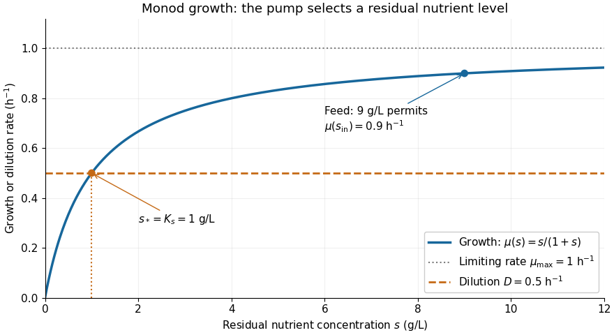

# Monod equation

↑ **Parent:** [Mathematical biology](mathematical-biology-split.md)  
ⓦ [Wiki](https://en.wikipedia.org/wiki/Monod_equation)

The [Monod equation](monod-equation.md) is an empirical saturating law for the [specific growth rate](specific-growth-rate.md) of a culture limited by one nutrient. Write $s\ge0$ for its residual nutrient [concentration](concentration.md), $\mu_{\max}>0$ for the limiting [specific growth rate](specific-growth-rate.md), and $K_s>0$ for the nutrient [concentration](concentration.md) at half that rate:

$$
\mu(s)=\mu_{\max}\frac{s}{K_s+s},\qquad \mu(K_s)=\frac{\mu_{\max}}2.
$$

Here $\mu$ and $\mu_{\max}$ have units of inverse time, whereas $K_s$ has the same units as $s$. The notation $K(C)$ in the title denotes the same growth function, with $C=s$, $K_{\max}=\mu_{\max}$ and $K_0=K_s$. For $s\ll K_s$, $\mu(s)\approx(\mu_{\max}/K_s)s$; for $s\gg K_s$, $\mu(s)$ approaches $\mu_{\max}$. Its [derivative](derivative.md) $\mu'(s)=\mu_{\max}K_s/(K_s+s)^2$ is positive: more nutrient increases the [specific growth rate](specific-growth-rate.md), with progressively smaller increments.

For example, take $\mu_{\max}=1\,\mathrm{h}^{-1}$ and $K_s=1\,\mathrm{g}\,\mathrm{L}^{-1}$. Nutrient [concentrations](concentration.md) of $0$, $1$ and $9\,\mathrm{g}\,\mathrm{L}^{-1}$ give [specific growth rates](specific-growth-rate.md) $0$, $0.5$ and $0.9\,\mathrm{h}^{-1}$. In a [chemostat](chemostat.md) with [dilution rate](dilution-rate.md) $D=0.5\,\mathrm{h}^{-1}$, the intersection $\mu(s)=D$ selects the residual nutrient [concentration](concentration.md) $s=1\,\mathrm{g}\,\mathrm{L}^{-1}$, provided the feed can supply enough nutrient for a positive [biomass concentration](biomass-concentration.md).

**[Figure 1](#image-monod-equation-growth-curve-and-the-dilution-rate-selecting-a-chemostat-steady-state). Monod equation growth curve and the dilution rate selecting a chemostat steady state**.

The [Monod equation](monod-equation.md) is useful because two measurable parameters describe both nutrient scarcity and saturation. It assumes the other conditions affecting growth remain controlled and does not represent inhibition at high nutrient [concentration](concentration.md). Although its formula resembles the [Michaelis-Menten equation](michaelis-menten-equation.md), a whole culture's [specific growth rate](specific-growth-rate.md) combines many processes; the resemblance alone does not derive it from [Michaelis-Menten kinetics](michaelis-menten-kinetics.md) or identify $K_s$ with a [Michaelis constant](michaelis-constant.md).

In his 1949 review, Monod presents the hyperbolic rate law as an empirical fit in equation (2), pp. 383-384, and discusses the difficulty of identifying a single growth-controlling reaction. His reported division rates use doublings per unit time; the natural-exponential [specific growth rate](specific-growth-rate.md) used here is that division rate multiplied by $\ln2$. [Jacques Monod, The Growth of Bacterial Cultures, Annual Review of Microbiology 3 (1949), 371-394, DOI: 10.1146/annurev.mi.03.100149.002103](https://garcialab.berkeley.edu/courses/papers/Monod1949.pdf).

**Table of contents**

- [Specific growth rate](specific-growth-rate.md)

## ↑ Ancestors (4)

1. [Mathematical biology](mathematical-biology-split.md)
2. [Branches of physics](branches-of-physics.md)
3. [Physics](physics-split.md)
4. [Codex Wiki](split.md)

## ← Incoming links (6)

- [Chemostat](chemostat.md)
- [Chemostat steady state](chemostat-steady-state.md)
- [Chemostat washout](chemostat-washout.md)
- [Monod chemostat equilibrium and relaxation](monod-chemostat-equilibrium-and-relaxation.md)
- [Monod equation](monod-equation.md)
- [Solution](past-exam-of-the-mathematics-course-of-the-university-of-cambridge/2007/ii/paper-1/6b/solution.md)
