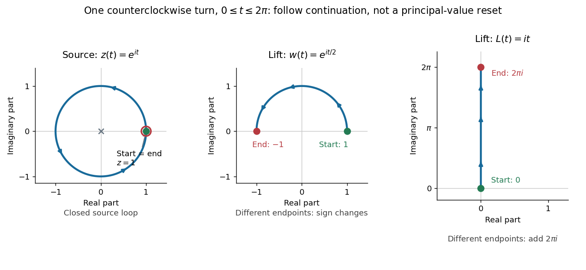

# Monodromy

↑ **Parent:** [Complex analysis](complex-analysis-split.md)  
ⓦ [Wiki](https://en.wikipedia.org/wiki/Monodromy)

Monodromy records how a [germ of a holomorphic function](germ-of-a-holomorphic-function.md) changes after [analytic continuation](analytic-continuation.md) around a closed path. The source point returns to itself, but the continued [germ of a holomorphic function](germ-of-a-holomorphic-function.md) need not. For $z(t)=e^{it}$, $0\le t\le2\pi$, starting with [holomorphic square root](holomorphic-square-root.md) value $1$ gives $w(t)=e^{it/2}$ and hence $w(2\pi)=-1$; starting with [complex logarithm](complex-logarithm.md) value $0$ gives $L(t)=it$ and hence $L(2\pi)=2\pi i$. After $m$ counterclockwise turns the values are $(-1)^m$ and $2\pi im$. Thus [monodromy](monodromy.md) exchanges the two square-root [branches of a multivalued function](branch-of-a-multivalued-function.md), whereas it shifts through infinitely many logarithm [branches of a multivalued function](branch-of-a-multivalued-function.md). [Rosales, Branch Points and Branch Cuts, section 1 and Example 2.4](https://math.mit.edu/classes/18.305/Notes/n00Branch_Points_B_Cuts.pdf)

**[Figure 2](#image-one-closed-loop-in-the-source-plane-lifts-to-an-open-semicircle-for-the-square-root-and-an-open-vertical-segment-for-the-logarithm). One closed loop in the source plane lifts to an open semicircle for the square root and an open vertical segment for the logarithm**.

The three panels use the same parameter $t$. They show [analytic continuation](analytic-continuation.md) through local [holomorphic](holomorphic-function.md) patches, including across a chosen [branch cut](branch-cut.md); repeatedly evaluating the [principal logarithm](principal-complex-logarithm.md) would instead reset its [imaginary part](imaginary-part.md) at the cut. [Monodromy](monodromy.md) makes the obstruction to a global [branch of a multivalued function](branch-of-a-multivalued-function.md) visible and motivates the use of [Riemann surfaces](riemann-surfaces.md) as domains on which continued values stay distinct.

**Table of contents**

- [Isomonodromic deformation](isomonodromic-deformation.md)
- [Formal monodromy](formal-monodromy.md)
  - [Formal monodromy correction to an entire-system Stokes product](formal-monodromy-correction-to-an-entire-system-stokes-product.md)
- [Monodromy eigenfunction Laurent representation](monodromy-eigenfunction-laurent-representation.md)

## ↑ Ancestors (5)

1. [Complex analysis](complex-analysis-split.md)
2. [Analysis](analysis-split.md)
3. [Area of mathematics](area-of-mathematics.md)
4. [Mathematics](mathematics-split.md)
5. [Codex Wiki](split.md)

## ← Incoming links (28)

- [Analytic continuation](analytic-continuation.md)
- [Branch of a multivalued function](branch-of-a-multivalued-function.md)
- [Branched surface action from two generators](branched-surface-action-from-two-generators.md)
- [Formal monodromy](formal-monodromy.md)
- [Formal monodromy correction to an entire-system Stokes product](formal-monodromy-correction-to-an-entire-system-stokes-product.md)
- [Holomorphic logarithm](holomorphic-logarithm.md)
- [Holomorphic square root](holomorphic-square-root.md)
- [Isomonodromic deformation](isomonodromic-deformation.md)
- [Local system](local-system.md)
- [Monodromy](monodromy.md)
- [Monodromy eigenfunction Laurent representation](monodromy-eigenfunction-laurent-representation.md)
- [Monodromy of hyperplane sections of a smooth curve](monodromy-of-hyperplane-sections-of-a-smooth-curve.md)
- [Solution](past-exam-of-the-mathematics-course-of-the-university-of-cambridge/2002/iii/paper-3/2/solution.md)
- [Solution](past-exam-of-the-mathematics-course-of-the-university-of-cambridge/2002/iii/paper-3/4/a/solution.md)
- [Solution](past-exam-of-the-mathematics-course-of-the-university-of-cambridge/2003/iii/paper-28/1/solution.md)
- [Solution](past-exam-of-the-mathematics-course-of-the-university-of-cambridge/2003/iii/paper-28/3/solution.md)
- [Solution](past-exam-of-the-mathematics-course-of-the-university-of-cambridge/2003/iii/paper-8/1/solution.md)
- [Solution](past-exam-of-the-mathematics-course-of-the-university-of-cambridge/2003/iii/paper-8/2/solution.md)
- [Solution](past-exam-of-the-mathematics-course-of-the-university-of-cambridge/2006/iii/paper-18/5/solution.md)
- [Solution](past-exam-of-the-mathematics-course-of-the-university-of-cambridge/2007/ii/paper-1/8b/solution.md)
- [Solution](past-exam-of-the-mathematics-course-of-the-university-of-cambridge/2007/ii/paper-3/8b/ii/solution.md)
- [Solution](past-exam-of-the-mathematics-course-of-the-university-of-cambridge/2008/iii/paper-12/2/solution.md)
- [Solution](past-exam-of-the-mathematics-course-of-the-university-of-cambridge/2009/iii/paper-22/5/solution.md)
- [Solution](past-exam-of-the-mathematics-course-of-the-university-of-cambridge/2018/ib/paper-3/4a/b/i/solution.md)
- [Pochhammer contour](pochhammer-contour.md)
- [Residue and monodromy of a constant Fuchsian system](residue-and-monodromy-of-a-constant-fuchsian-system.md)
- [Rigid ramification type](rigid-ramification-type.md)
- [Smoothness criterion from cone-monodromy cycles](smoothness-criterion-from-cone-monodromy-cycles.md)
