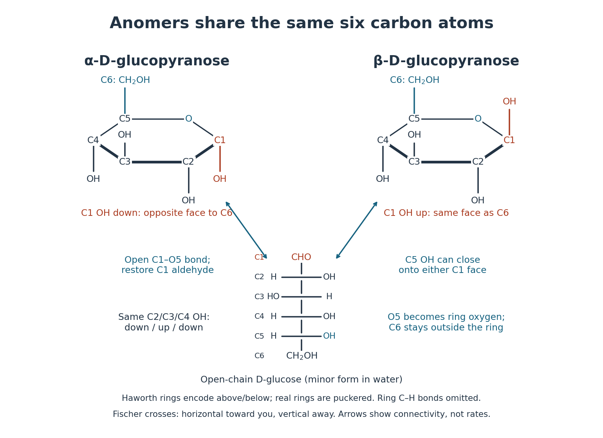

# Monosaccharide ring-chain interconversion

↑ **Parent:** [Monosaccharide](monosaccharide.md)

In [water](water.md), D-[glucose](glucose.md) mainly occupies cyclic forms. The C5 [hydroxy group](hydroxy-group.md) adds to the C1 [aldehyde](aldehyde.md), forming a cyclic [hemiacetal](hemiacetal.md); reversible opening restores the [aldehyde](aldehyde.md). Reclosure can give either [anomer](anomer.md). Their changing proportions cause [mutarotation](mutarotation.md), the approach of [optical rotation](optical-rotation.md) to an equilibrium value. This pathway involves changing [chemical bonds](chemical-bond-split.md), rather than simply rotating a [hydroxy group](hydroxy-group.md) about a single [chemical bond](chemical-bond-split.md).[McMurry, Organic Chemistry, §25.5: intramolecular hemiacetal formation and final mutarotation discussion](organic-chemistry-by-john-mcmurry/25-5-cyclic-structures-of-monosaccharides-anomers.md)

**[Figure 6](#image-two-d-glucose-anomers-connect-through-the-same-open-chain-aldose). Two D-glucose anomers connect through the same open-chain aldose**. Original [Haworth projections](haworth-projection.md) share an open-chain [Fischer projection](fischer-projection.md). Both rings have the C5 $\mathrm{CH_2OH}$ group up and C2/C3/C4 [hydroxy groups](hydroxy-group.md) down/up/down. The C1 [hydroxy group](hydroxy-group.md) is down in alpha-D-glucopyranose and up in beta-D-glucopyranose. Ring [carbon](carbon.md)-[hydrogen](hydrogen.md) [chemical bonds](chemical-bond-split.md) are omitted. Arrows indicate reversible connectivity, not measured [reaction rates](reaction-rate.md) or relative populations. The [Haworth projection](haworth-projection.md) is symbolic; actual rings are puckered.

In this conventional [Haworth projection](haworth-projection.md), C5's $\mathrm{CH_2OH}$ group points up. The alpha [anomer](anomer.md)'s C1 [hydroxy group](hydroxy-group.md) points down, on the opposite face; the beta [anomer](anomer.md)'s points up, on the same face. C2/C3/C4 retain down/up/down [hydroxy groups](hydroxy-group.md). These are above/below relationships to a reference ring plane, not a claim that the ring is physically flat.[Nomenclature of Carbohydrates (Recommendations 1996) by Alan D. McNaught; IUPAC–IUBMB, Nomenclature of Carbohydrates (1996), 2-Carb-5.4 and 5.7: Haworth representation and nonplanar conformations](nomenclature-of-carbohydrates-recommendations-1996-by-alan-d-mcnaught/2-carb-5-cyclic-forms-and-their-representation.md)

The [anomeric carbon](anomeric-carbon.md) is C1, the existing [carbonyl group](carbonyl-group.md) [carbon](carbon.md) that becomes a new [stereocenter](stereocenter.md); no extra [carbon](carbon.md) [chemical atom](atom-physics.md) appears. The two [anomers](anomer.md) differ at that centre while retaining the other configurations.[Nomenclature of Carbohydrates (Recommendations 1996) by Alan D. McNaught; IUPAC–IUBMB, Nomenclature of Carbohydrates (1996), 2-Carb-6.1–6.2: anomeric centre and configurational relationship](nomenclature-of-carbohydrates-recommendations-1996-by-alan-d-mcnaught/2-carb-6-anomeric-forms-use-of-alpha-and-beta.md)

Trace the ring as C1–C2–C3–C4–C5–O5–C1, where O5 denotes the [oxygen](oxygen.md) originally in the C5 [hydroxy group](hydroxy-group.md). It contains five [carbon](carbon.md) [chemical atoms](atom-physics.md) and one [oxygen](oxygen.md); C6 remains attached outside the ring. The C1 [carbonyl group](carbonyl-group.md) [oxygen](oxygen.md) becomes the C1 [hydroxy group](hydroxy-group.md) [oxygen](oxygen.md). This accounts for every [oxygen](oxygen.md): O5 in the ring and five [hydroxy groups](hydroxy-group.md) at C1, C2, C3, C4 and C6. Ring closure preserves $\mathrm C_6\mathrm H_{12}\mathrm O_6$. A six-membered ring and a six-[carbon](carbon.md) [sugar](sugar.md) are thus different counts.

**Table of contents**

- [Glucose mutarotation experiment](glucose-mutarotation-experiment.md)

## ↑ Ancestors (6)

1. [Monosaccharide](monosaccharide.md)
2. [Sugar](sugar.md)
3. [Carbohydrate](carbohydrate.md)
4. [Chemical substance](chemical-substance-split.md)
5. [Chemistry](chemistry-split.md)
6. [Codex Wiki](split.md)

## ← Incoming links (3)

- [Aldohexose](aldohexose.md)
- [Monosaccharide](monosaccharide.md)
- [Mutarotation](mutarotation.md)
