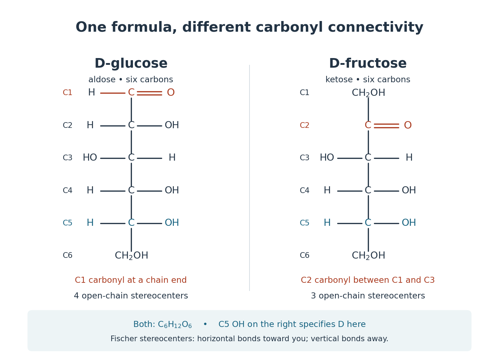

# Monosaccharide

↑ **Parent:** [Sugar](sugar.md)  
ⓦ [Wiki](https://en.wikipedia.org/wiki/Monosaccharide)

A [monosaccharide](monosaccharide.md) is a single-unit [carbohydrate](carbohydrate.md) that cannot be split into smaller [sugars](sugar.md) by [hydrolysis](hydrolysis.md). [Ribose](ribose.md), [deoxyribose](deoxyribose.md), and [glucose](glucose.md) are examples. The unit is a whole [molecule](molecule-split.md) containing many [chemical atoms](atom-physics.md); a [disaccharide](disaccharide.md) instead contains two linked [monosaccharide](monosaccharide.md) units.[McMurry, Organic Chemistry, §25.1: simple and complex carbohydrates](organic-chemistry-by-john-mcmurry/25-1-classification-of-carbohydrates.md)

Classification combines [carbon](carbon.md) count with open-chain connectivity. An [aldose](aldose.md) has an [aldehyde](aldehyde.md) group; a [ketose](ketose.md) has a [ketone](ketone.md) group. Thus [glucose](glucose.md) is an [aldohexose](aldohexose.md), while [fructose](fructose.md) is a six-[carbon](carbon.md) [ketose](ketose.md). These names describe the open-chain reference forms even when cyclic forms predominate in [water](water.md).[McMurry, Organic Chemistry, §25.1: aldoses, ketoses and carbon-count classification](organic-chemistry-by-john-mcmurry/25-1-classification-of-carbohydrates.md)

**[Figure 5](#image-open-chain-d-glucose-and-d-fructose-the-same-molecular-formula-different-carbonyl-group-connectivity). Open-chain D-glucose and D-fructose: the same molecular formula, different carbonyl group connectivity**. Original numbered [Fischer projections](fischer-projection.md). At tetrahedral [stereocenters](stereocenter.md), horizontal [chemical bonds](chemical-bond-split.md) point toward the viewer and vertical [chemical bonds](chemical-bond-split.md) away. The [carbonyl group](carbonyl-group.md) [carbon](carbon.md) is not a tetrahedral [stereocenter](stereocenter.md). The C5 [hydroxy group](hydroxy-group.md) on the right specifies D here; D does not specify the sign of [optical rotation](optical-rotation.md). These reference structures do not show relative abundances in [water](water.md).

Check the distinction by counting the groups in the drawings. Open-chain [glucose](glucose.md) contains one $\mathrm{CHO}$, four $\mathrm{CHOH}$ and one $\mathrm{CH_2OH}$ group. Open-chain [fructose](fructose.md) contains two $\mathrm{CH_2OH}$, three $\mathrm{CHOH}$ and one $\mathrm{C{=}O}$ group. The respective [hydrogen](hydrogen.md) totals are $1+4(2)+3=12$ and $2(3)+3(2)=12$; each structure also has six [carbon](carbon.md) and six [oxygen](oxygen.md) [chemical atoms](atom-physics.md). Their shared [molecular formula](molecular-formula.md) $\mathrm C_6\mathrm H_{12}\mathrm O_6$ therefore cannot identify the [carbonyl group](carbonyl-group.md) position or the [stereochemistry](stereochemistry-split.md).

The beauty is that a familiar [sugar](sugar.md) name can embrace an interconverting family of forms. [Monosaccharide ring-chain interconversion](monosaccharide-ring-chain-interconversion.md) connects those drawings to [mutarotation](mutarotation.md), a change visible with [polarimetry](polarimetry.md). Spatial arrangement also matters to biology: an [enzyme](enzyme-split.md)'s [active site](active-site.md) encounters a particular arrangement of [hydroxy groups](hydroxy-group.md), rather than merely an inventory of [chemical atoms](atom-physics.md). The existing [enzyme](enzyme-split.md) and [chirality](chirality-chemistry.md) articles explain that recognition principle.

**Table of contents**

- [Aldopentose](aldopentose.md)
- [Aldohexose](aldohexose.md)
- [Monosaccharide ring-chain interconversion](monosaccharide-ring-chain-interconversion.md)
  - [Glucose mutarotation experiment](glucose-mutarotation-experiment.md)
- [Aldose](aldose.md)
- [Ketose](ketose.md)

## ↑ Ancestors (5)

1. [Sugar](sugar.md)
2. [Carbohydrate](carbohydrate.md)
3. [Chemical substance](chemical-substance-split.md)
4. [Chemistry](chemistry-split.md)
5. [Codex Wiki](split.md)

## ← Incoming links (12)

- [Anomer](anomer.md)
- [Carbohydrate](carbohydrate.md)
- [Deoxyribose](deoxyribose.md)
- [Disaccharide](disaccharide.md)
- [Glucose](glucose.md)
- [Haworth projection](haworth-projection.md)
- [Monosaccharide](monosaccharide.md)
- [Oligosaccharide](oligosaccharide.md)
- [Solution](past-exam-of-the-biochemistry-course-of-the-university-of-cambridge/2025/paper-4/section-ii/4/solution.md)
- [Polysaccharide](polysaccharide.md)
- [Ribose](ribose.md)
- [Sugar](sugar.md)
