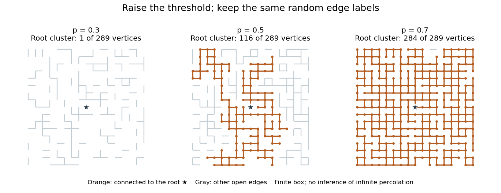

# Monotone coupling of Bernoulli percolation

↑ **Parent:** [Percolation theory](percolation-theory-split.md)

Assign each [edge](edge-of-a-graph.md) $e$ an [independent](independent-random-variables.md) [uniform distribution](continuous-uniform-distribution.md) label $U_e$ on $[0,1]$. At parameter $p$, declare $e$ open exactly when $U_e\leq p$. Each open/closed decision then has the required [Bernoulli distribution](bernoulli-distribution.md), and different [edge](edge-of-a-graph.md) decisions are [independent](independent-random-variables.md). The same construction applies to [site percolation](site-percolation-split.md) with labels on [vertices](vertex-graph-theory.md).

Keep those labels fixed when increasing $p$. For $p\leq q$, every $p$-open [edge](edge-of-a-graph.md) is also $q$-open, so every $p$-open [graph path](path-in-a-graph.md) survives and each [percolation cluster](percolation-cluster.md) can only gain [vertices](vertex-graph-theory.md). This [coupling of probability distributions](coupling.md) compares complete configurations on one [probability space](probability-space-split.md), rather than comparing two unrelated pictures. Any [increasing event](increasing-event.md), such as an [open path](open-path-in-bond-percolation.md) between specified [vertices](vertex-graph-theory.md), consequently has a nondecreasing [probability](probability.md).

**[Figure 2](#image-one-set-of-random-edge-labels-gives-nested-root-clusters-as-the-opening-probability-increases). One set of random edge labels gives nested root clusters as the opening probability increases**.

The three panels use one seeded collection of labels on a finite $17\times17$ [square lattice](square-lattice.md) box. Colored [edges](edge-of-a-graph.md) and dots show the central root's [percolation cluster](percolation-cluster.md); gray [edges](edge-of-a-graph.md) are open but disconnected from it. A [percolation cluster](percolation-cluster.md) can grow by many [vertices](vertex-graph-theory.md) when one newly opened [edge](edge-of-a-graph.md) joins it to another large [percolation cluster](percolation-cluster.md). The panels illustrate a nested construction, not an estimate of $\theta(p)$ or a proof of the [Harris-Kesten theorem](harris-kesten-theorem.md).

**Table of contents**

- [Finite-box comparison for percolation parameters](finite-box-comparison-for-percolation-parameters.md)
- [Coupled onset parameter for origin percolation](coupled-onset-parameter-for-origin-percolation.md)
- [Sprinkling coupling for Bernoulli percolation](sprinkling-coupling-for-bernoulli-percolation.md)

## ↑ Ancestors (6)

1. [Percolation theory](percolation-theory-split.md)
2. [Probability theory](probability-theory-split.md)
3. [Probability and statistics](probability-and-statistics-split.md)
4. [Area of mathematics](area-of-mathematics.md)
5. [Mathematics](mathematics-split.md)
6. [Codex Wiki](split.md)

## ← Incoming links (16)

- [Coupled onset parameter for origin percolation](coupled-onset-parameter-for-origin-percolation.md)
- [Finite-box comparison for percolation parameters](finite-box-comparison-for-percolation-parameters.md)
- [Solution](past-exam-of-the-mathematics-course-of-the-university-of-cambridge/2003/iii/paper-30/5/solution.md)
- [Solution](past-exam-of-the-mathematics-course-of-the-university-of-cambridge/2007/iii/paper-13/5/iii/solution.md)
- [Solution](past-exam-of-the-mathematics-course-of-the-university-of-cambridge/2014/iii/paper-28/1/solution.md)
- [Solution](past-exam-of-the-mathematics-course-of-the-university-of-cambridge/2016/iii/paper-204/3/b/solution.md)
- [Solution](past-exam-of-the-mathematics-course-of-the-university-of-cambridge/2016/iii/paper-204/3/c/solution.md)
- [Solution](past-exam-of-the-mathematics-course-of-the-university-of-cambridge/2016/iii/paper-204/3/d/solution.md)
- [Solution](past-exam-of-the-mathematics-course-of-the-university-of-cambridge/2016/iii/paper-204/3/e/solution.md)
- [Solution](past-exam-of-the-mathematics-course-of-the-university-of-cambridge/2016/iii/paper-204/4/b/solution.md)
- [Solution](past-exam-of-the-mathematics-course-of-the-university-of-cambridge/2017/iii/paper-214/2/a/solution.md)
- [Solution](past-exam-of-the-mathematics-course-of-the-university-of-cambridge/2021/iii/paper-204/2/d/solution.md)
- [Percolation critical probability](percolation-critical-probability.md)
- [Percolation probability](percolation-probability.md)
- [Right continuity of percolation probability](right-continuity-of-percolation-probability.md)
- [Supercritical continuity of percolation probability](supercritical-continuity-of-percolation-probability.md)
