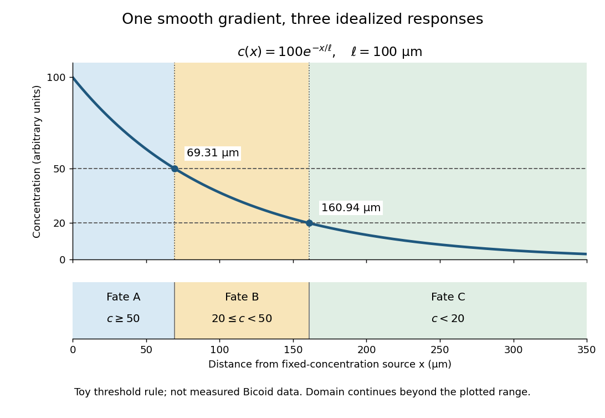

# Morphogen gradient

↑ **Parent:** [Morphogen](morphogen.md)

A [morphogen gradient](morphogen-gradient.md) is a spatially varying [concentration](concentration.md) profile of a [morphogen](morphogen.md). The profile $c(x)$ specifies the local amount; its mathematical [gradient](gradient.md), $c'(x)$ in one dimension, specifies how rapidly that amount changes with position. In the simplest positional interpretation, a [biological cell](biological-cell-split.md) responds to its local [concentration](concentration.md), without having to measure the [gradient](gradient.md) across itself. Production, transport and removal together determine a [morphogen gradient](morphogen-gradient.md).

For a worked example, take a stationary one-dimensional tissue occupying $x\geq0$, constant [diffusion coefficient](diffusion-coefficient.md) $D>0$, and uniform [first-order reaction](first-order-reaction.md) removal at rate $k>0$. At [steady state](steady-state.md), this specialization of the [morphogen reaction-diffusion equation](morphogen-reaction-diffusion-equation.md) gives the [ordinary differential equation](ordinary-differential-equation.md) and [boundary conditions](boundary-condition.md)

$$
D\frac{d^2c}{dx^2}-kc=0,\qquad c(0)=c_0,\qquad \lim_{x\to\infty}c(x)=0.
$$

Here $D$ has units of length squared per time, $k$ has units of inverse time, and $c_0$ is a prescribed source [concentration](concentration.md). The [Dirichlet boundary condition](dirichlet-boundary-condition.md) fixes the [concentration](concentration.md) at $x=0$. It does not prescribe a source [flux](flux.md); any required [flux](flux.md) follows from the solution. These assumptions define a toy [morphogen gradient](morphogen-gradient.md), not a universal account of transport during [biological development](biological-development.md).

Define the [diffusion length](diffusion-length.md) $\ell=\sqrt{D/k}$. Substitution into the [ordinary differential equation](ordinary-differential-equation.md) shows that its general solution is $A e^{x/\ell}+B e^{-x/\ell}$. The vanishing [boundary condition](boundary-condition.md) at infinity forces $A=0$, and the source [Dirichlet boundary condition](dirichlet-boundary-condition.md) forces $B=c_0$. Hence

$$
c(x)=c_0e^{-x/\ell},\qquad \ell=\sqrt{D/k}.
$$

Over every additional [diffusion length](diffusion-length.md), the [concentration](concentration.md) falls by the same factor $e^{-1}$. Faster [diffusion](diffusion.md) increases $\ell$; faster removal decreases $\ell$. This makes the [diffusion length](diffusion-length.md) a useful bridge between microscopic transport and the spatial reach of a [morphogen gradient](morphogen-gradient.md).

Choose $c_0=100$ arbitrary [concentration](concentration.md) units and $\ell=100\,\mu\mathrm m$, where $1\,\mu\mathrm m=10^{-6}\,\mathrm m$. Then $c(x)=100e^{-x/(100\,\mu\mathrm m)}$: at $x=0$, $100\,\mu\mathrm m$ and $200\,\mu\mathrm m$, the [concentrations](concentration.md) are $100$, approximately $36.79$ and approximately $13.53$. The following diagram combines this [morphogen gradient](morphogen-gradient.md) with the idealized responses calculated under [morphogen response threshold](morphogen-response-threshold.md).

**[Figure 29](#image-a-toy-morphogen-gradient-and-three-idealized-developmental-bands). A toy morphogen gradient and three idealized developmental bands**. The [steady state](steady-state.md) profile uses $c_0=100$ arbitrary [concentration](concentration.md) units and [diffusion length](diffusion-length.md) $100\,\mu\mathrm m$. [Morphogen response thresholds](morphogen-response-threshold.md) at $50$ and $20$ place the boundaries at approximately $69.31$ and $160.94\,\mu\mathrm m$. The lower strip shows assigned fates A, B and C, not measured tissues. The plotted domain ends at $350\,\mu\mathrm m$; the mathematical domain continues to infinity.

**Table of contents**

- [Morphogen source-diffusion-degradation model](morphogen-source-diffusion-degradation-model.md)

## ↑ Ancestors (3)

1. [Morphogen](morphogen.md)
2. [Biology](biology-split.md)
3. [Codex Wiki](split.md)

## ← Incoming links (4)

- [Morphogen](morphogen.md)
- [Morphogen gradient](morphogen-gradient.md)
- [Morphogen response threshold](morphogen-response-threshold.md)
- [Solution](past-exam-of-the-zoology-course-of-the-university-of-cambridge/2025/paper-zl6/4/solution.md)
