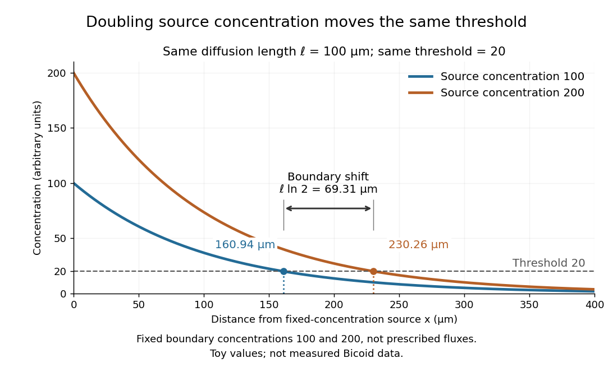

# Morphogen response threshold

↑ **Parent:** [Morphogen](morphogen.md)

A [morphogen response threshold](morphogen-response-threshold.md) is a [concentration](concentration.md) level used to distinguish developmental responses to a [morphogen](morphogen.md). In an idealized threshold model, otherwise equivalent [biological cells](biological-cell-split.md) exposed to $c\geq\theta$ take one response and those exposed to $c<\theta$ take another. Two [morphogen response thresholds](morphogen-response-threshold.md) can assign three bands: fate A for $c\geq50$, fate B for $20\leq c<50$, and fate C for $c<20$, all in the toy arbitrary [concentration](concentration.md) units. The A/B/C labels specify a response rule, not named cell types or a claim that every [morphogen](morphogen.md) produces sharp boundaries. See the positional-information model in Gilbert's reference under [morphogen](morphogen.md).

For the decreasing [morphogen gradient](morphogen-gradient.md) $c(x)=c_0e^{-x/\ell}$ and $0<\theta<c_0$, solve $c(x_\theta)=\theta$ using the [natural logarithm](natural-logarithm.md):

$$
x_\theta=\ell\ln\!\left(\frac{c_0}{\theta}\right).
$$

With $c_0=100$ and [diffusion length](diffusion-length.md) $\ell=100\,\mu\mathrm m$, the [morphogen response thresholds](morphogen-response-threshold.md) $50$ and $20$ give

$$
x_{50}=100\ln2\,\mu\mathrm m\approx69.3147\,\mu\mathrm m,\qquad x_{20}=100\ln5\,\mu\mathrm m\approx160.9438\,\mu\mathrm m.
$$

Thus fate A occupies $0\leq x\leq x_{50}$, fate B occupies $x_{50}<x\leq x_{20}$, and fate C occupies $x>x_{20}$ in this idealization. The equality convention belongs to the response rule. If $\theta=c_0$, the crossing is at the source; if $\theta>c_0$, that [morphogen response threshold](morphogen-response-threshold.md) is never reached anywhere in the tissue.

Now double the prescribed source [concentration](concentration.md) from $c_0$ to $2c_0$, keeping $D$, $k$, [diffusion length](diffusion-length.md) $\ell$ and a fixed [morphogen response threshold](morphogen-response-threshold.md) $0<\theta<c_0$ unchanged. The whole [morphogen gradient](morphogen-gradient.md) doubles, but the boundary moves by an additive distance:

$$
\Delta x_\theta=\ell\ln\!\left(\frac{2c_0}{\theta}\right)-\ell\ln\!\left(\frac{c_0}{\theta}\right)=\ell\ln2.
$$

For $\theta=20$, the crossing moves from $160.9438\,\mu\mathrm m$ to $100\ln10\,\mu\mathrm m\approx230.2585\,\mu\mathrm m$, a shift of $69.3147\,\mu\mathrm m$. Every fixed [morphogen response threshold](morphogen-response-threshold.md) below the original source [concentration](concentration.md) shifts by this same distance in the toy model. The example compares two [Dirichlet boundary conditions](dirichlet-boundary-condition.md), $c(0)=100$ and $c(0)=200$; doubling an experimentally supplied source [flux](flux.md) is a different boundary specification.

**[Figure 30](#image-doubling-source-concentration-shifts-a-toy-morphogen-response-threshold-boundary). Doubling source concentration shifts a toy morphogen response threshold boundary**. Profiles with source [concentrations](concentration.md) $100$ and $200$ share [diffusion length](diffusion-length.md) $100\,\mu\mathrm m$. The same [morphogen response threshold](morphogen-response-threshold.md) $20$ is crossed at approximately $160.94$ and $230.26\,\mu\mathrm m$. The arrow marks the predicted $69.31\,\mu\mathrm m$ shift. Source strength here means prescribed boundary [concentration](concentration.md), with all numbers arbitrary and illustrative.

These calculations are useful because they separate changes in source [concentration](concentration.md), [diffusion length](diffusion-length.md) and response rule. Their limits are equally concrete: growing tissues change the geometry, a [transient response](transient-response.md) can precede [steady state](steady-state.md), molecular fluctuations can blur a boundary, and [signaling feedback](signaling-feedback.md) or altered transport can change the [morphogen gradient](morphogen-gradient.md) or its interpretation. A local instantaneous [morphogen response threshold](morphogen-response-threshold.md) need not capture exposure duration, [signaling adaptation](signaling-adaptation.md) or the receiving [biological cell](biological-cell-split.md)'s state. Experiments on cultured human [biological cells](biological-cell-split.md) found different responses to the level and rate of change of developmental signals, illustrating why signal dynamics can matter. [Heemskerk et al., Rapid changes in morphogen concentration control self-organized patterning in human embryonic stem cells, eLife 8 (2019), e40526: primary experiments](https://pmc.ncbi.nlm.nih.gov/articles/PMC6398983/) Quantitative measurements of bicoid [protein](protein-split.md) and its downstream [gene expression](gene-expression.md) also make precision a question for experiment, rather than something guaranteed by drawing threshold lines. [Gregor et al., Probing the limits to positional information, Cell 130 (2007), 153–164: primary measurements](https://pmc.ncbi.nlm.nih.gov/articles/PMC2253670/) [Morphogen gradients](morphogen-gradient.md) provide one mechanism for spatial patterning in [biological development](biological-development.md), alongside other signals and interactions.

## ↑ Ancestors (3)

1. [Morphogen](morphogen.md)
2. [Biology](biology-split.md)
3. [Codex Wiki](split.md)

## ← Incoming links (3)

- [Morphogen](morphogen.md)
- [Morphogen gradient](morphogen-gradient.md)
- [Morphogen response threshold](morphogen-response-threshold.md)
