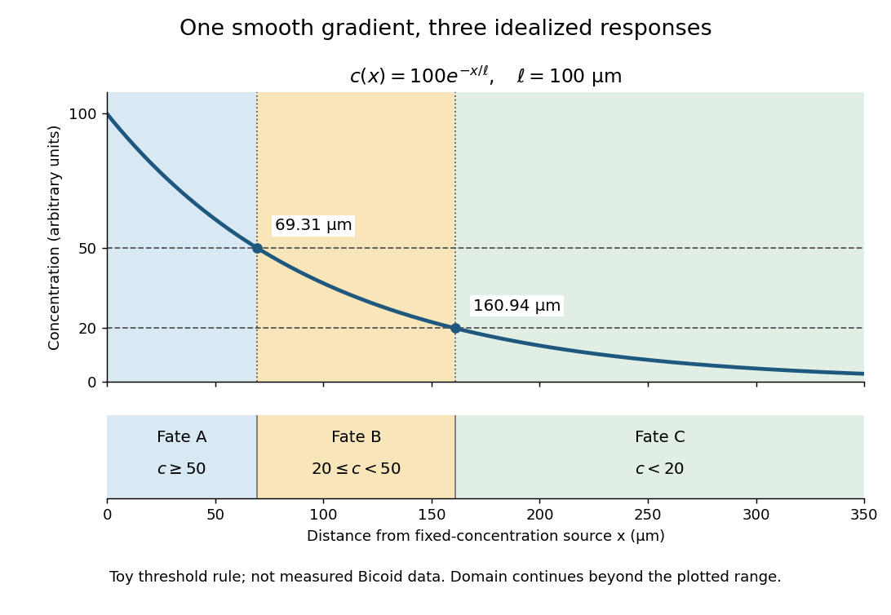
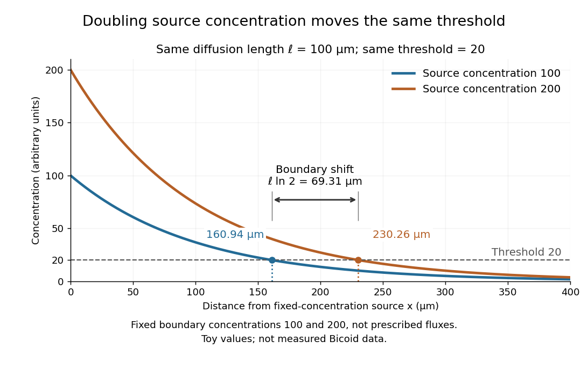

# Morphogen

↑ **Parent:** [Biology](biology.md)  
ⓦ [Wiki](https://en.wikipedia.org/wiki/Morphogen)

A [morphogen](morphogen.md) is a signal whose spatial [concentration](mathematical-physics.md#concentration) helps specify different [biological cell](biological-cell.md) fates or behaviors during [biological development](developmental-biology.md#biological-development). A [morphogen gradient](#morphogen-gradient) provides a positional cue: [biological cells](biological-cell.md) at different distances from a source experience different local [concentrations](mathematical-physics.md#concentration) and can follow different developmental pathways. A spatial [concentration](mathematical-physics.md#concentration) variation alone does not establish that a substance is a [morphogen](morphogen.md); its graded developmental effects matter. See [Alberts et al., Molecular Biology of the Cell, 4th edition (2002): morphogens as graded developmental signals](https://www.ncbi.nlm.nih.gov/books/NBK26825/).

The beautiful idea is that one distributed signal can help organize several regions of a developing body. A continuous [morphogen gradient](#morphogen-gradient) can supply the input for distinct domains of [gene expression](molecular-genetics.md#gene-expression), rather than requiring a separate signal for every position. A [morphogen response threshold](#morphogen-response-threshold) is a useful idealization of that interpretation: high, intermediate and low [concentrations](mathematical-physics.md#concentration) are assigned different outcomes. The [morphogen reaction-diffusion equation](diffusion-equation.md#morphogen-reaction-diffusion-equation) describes one way to generate a [morphogen gradient](#morphogen-gradient); the equation is a model of transport and reaction, while the [morphogen](morphogen.md) is the signal being transported.

Detection and interpretation also depend on the receiving [biological cell](biological-cell.md). For an extracellular [morphogen](morphogen.md), [receptors](protein.md#receptor-biochemistry) and [signal transduction](signal-transduction.md) connect the local [concentration](mathematical-physics.md#concentration) to a response; [receptor binding occupancy](protein.md#receptor-binding-occupancy) is only one step in that connection. The same [morphogen gradient](#morphogen-gradient) can be interpreted differently in different tissues because their developmental context differs. Thus a [morphogen response threshold](#morphogen-response-threshold) summarizes a particular response in a particular context, rather than being a universal property of the signal. See [Scott F. Gilbert, Developmental Biology, 6th edition (2000): positional information and context-dependent interpretation](https://www.ncbi.nlm.nih.gov/books/NBK9968/).

An important experimental example came in 1988. Wolfgang Driever and Christiane Nüsslein-Volhard used antibodies to examine the bicoid [protein](protein.md) in early fruit-fly embryos. They reported a [concentration](mathematical-physics.md#concentration) profile approximately described by an [exponential function](calculus.md#exponential-function), highest at the front, with the [protein](protein.md) concentrated in [cell nuclei](biological-cell.md#cell-nucleus). Their abstract proposed [diffusion](thermodynamics.md#diffusion) from localized [messenger RNA](polymer.md#messenger-rna) and dispersed degradation as a likely origin of the [morphogen gradient](#morphogen-gradient), rather than proving a unique transport mechanism. [Driever and Nüsslein-Volhard, A gradient of bicoid protein in Drosophila embryos, Cell 54 (1988), 83–93: primary abstract](https://pubmed.ncbi.nlm.nih.gov/3383244/)

In a companion study, Driever and Nüsslein-Volhard genetically changed the amount and distribution of bicoid [messenger RNA](polymer.md#messenger-rna), measured the resulting [protein](protein.md) [morphogen gradient](#morphogen-gradient), and compared developmental maps. Increased local bicoid [protein](protein.md) levels shifted prospective anterior structures toward the rear; decreased levels shifted them toward the front. This linked a measured [concentration](mathematical-physics.md#concentration) profile to positional effects in [biological development](developmental-biology.md#biological-development). The toy calculations below illustrate that logic with arbitrary numbers, not measured bicoid parameters. [Driever and Nüsslein-Volhard, The bicoid protein determines position in the Drosophila embryo in a concentration-dependent manner, Cell 54 (1988), 95–104: primary abstract](https://pubmed.ncbi.nlm.nih.gov/3383245/)

**Table of contents**

- [Retinoic acid](#retinoic-acid)
- [Sonic hedgehog](#sonic-hedgehog)
  - [ZRS enhancer](#zrs-enhancer)
- [Morphogen gradient](#morphogen-gradient)
  - [Morphogen source-diffusion-degradation model](#morphogen-source-diffusion-degradation-model)
- [Morphogen response threshold](#morphogen-response-threshold)

## Retinoic acid

↑ **Parent:** [Morphogen](morphogen.md)

A signalling derivative of vitamin A involved in stage- and tissue-dependent patterning.

## Sonic hedgehog

↑ **Parent:** [Morphogen](morphogen.md)

A signalling protein important in [vertebrate](organism.md#vertebrate) pattern formation, including the [limb](anatomy.md#vertebrate-limb). Signal duration, position and responding tissue affect interpretation of digit-patterning experiments.

### ZRS enhancer

↑ **Parent:** [Sonic hedgehog](#sonic-hedgehog)

A long-range regulatory element contributing to limb expression of Sonic hedgehog. Evolutionary changes in its activity provide a testable example of altered developmental deployment.

## Morphogen gradient

↑ **Parent:** [Morphogen](morphogen.md)

A [morphogen gradient](#morphogen-gradient) is a spatially varying [concentration](mathematical-physics.md#concentration) profile of a [morphogen](morphogen.md). The profile $c(x)$ specifies the local amount; its mathematical [gradient](multivariable-calculus.md#gradient), $c'(x)$ in one dimension, specifies how rapidly that amount changes with position. In the simplest positional interpretation, a [biological cell](biological-cell.md) responds to its local [concentration](mathematical-physics.md#concentration), without having to measure the [gradient](multivariable-calculus.md#gradient) across itself. Production, transport and removal together determine a [morphogen gradient](#morphogen-gradient).

For a worked example, take a stationary one-dimensional tissue occupying $x\geq0$, constant [diffusion coefficient](brownian-motion.md#diffusion-coefficient) $D>0$, and uniform [first-order reaction](chemical-kinetics.md#first-order-reaction) removal at rate $k>0$. At [steady state](dynamical-systems.md#steady-state), this specialization of the [morphogen reaction-diffusion equation](diffusion-equation.md#morphogen-reaction-diffusion-equation) gives the [ordinary differential equation](differential-equation.md#ordinary-differential-equation) and [boundary conditions](differential-equation.md#boundary-condition)

$$
D\frac{d^2c}{dx^2}-kc=0,\qquad c(0)=c_0,\qquad \lim_{x\to\infty}c(x)=0.
$$

Here $D$ has units of length squared per time, $k$ has units of inverse time, and $c_0$ is a prescribed source [concentration](mathematical-physics.md#concentration). The [Dirichlet boundary condition](differential-equation.md#dirichlet-boundary-condition) fixes the [concentration](mathematical-physics.md#concentration) at $x=0$. It does not prescribe a source [flux](mathematical-physics.md#flux); any required [flux](mathematical-physics.md#flux) follows from the solution. These assumptions define a toy [morphogen gradient](#morphogen-gradient), not a universal account of transport during [biological development](developmental-biology.md#biological-development).

Define the [diffusion length](mathematical-biology.md#diffusion-length) $\ell=\sqrt{D/k}$. Substitution into the [ordinary differential equation](differential-equation.md#ordinary-differential-equation) shows that its general solution is $A e^{x/\ell}+B e^{-x/\ell}$. The vanishing [boundary condition](differential-equation.md#boundary-condition) at infinity forces $A=0$, and the source [Dirichlet boundary condition](differential-equation.md#dirichlet-boundary-condition) forces $B=c_0$. Hence

$$
c(x)=c_0e^{-x/\ell},\qquad \ell=\sqrt{D/k}.
$$

Over every additional [diffusion length](mathematical-biology.md#diffusion-length), the [concentration](mathematical-physics.md#concentration) falls by the same factor $e^{-1}$. Faster [diffusion](thermodynamics.md#diffusion) increases $\ell$; faster removal decreases $\ell$. This makes the [diffusion length](mathematical-biology.md#diffusion-length) a useful bridge between microscopic transport and the spatial reach of a [morphogen gradient](#morphogen-gradient).

Choose $c_0=100$ arbitrary [concentration](mathematical-physics.md#concentration) units and $\ell=100\,\mu\mathrm m$, where $1\,\mu\mathrm m=10^{-6}\,\mathrm m$. Then $c(x)=100e^{-x/(100\,\mu\mathrm m)}$: at $x=0$, $100\,\mu\mathrm m$ and $200\,\mu\mathrm m$, the [concentrations](mathematical-physics.md#concentration) are $100$, approximately $36.79$ and approximately $13.53$. The following diagram combines this [morphogen gradient](#morphogen-gradient) with the idealized responses calculated under [morphogen response threshold](#morphogen-response-threshold).

**[Figure 1](#image-a-toy-morphogen-gradient-and-three-idealized-developmental-bands). A toy morphogen gradient and three idealized developmental bands**. The [steady state](dynamical-systems.md#steady-state) profile uses $c_0=100$ arbitrary [concentration](mathematical-physics.md#concentration) units and [diffusion length](mathematical-biology.md#diffusion-length) $100\,\mu\mathrm m$. [Morphogen response thresholds](#morphogen-response-threshold) at $50$ and $20$ place the boundaries at approximately $69.31$ and $160.94\,\mu\mathrm m$. The lower strip shows assigned fates A, B and C, not measured tissues. The plotted domain ends at $350\,\mu\mathrm m$; the mathematical domain continues to infinity.

### Morphogen source-diffusion-degradation model

↑ **Parent:** [Morphogen gradient](#morphogen-gradient)

An idealized model balancing localized production, [diffusion](thermodynamics.md#diffusion) and degradation. In one dimension at [steady state](dynamical-systems.md#steady-state), away from the source, $Dc^{\prime\prime}-kc=0$ gives $c(x)=c_0e^{-x/\lambda}$ with $\lambda=\sqrt{D/k}$. Tissue geometry and time-dependent source distributions can invalidate a simple point-source interpretation.

## Morphogen response threshold

↑ **Parent:** [Morphogen](morphogen.md)

A [morphogen response threshold](#morphogen-response-threshold) is a [concentration](mathematical-physics.md#concentration) level used to distinguish developmental responses to a [morphogen](morphogen.md). In an idealized threshold model, otherwise equivalent [biological cells](biological-cell.md) exposed to $c\geq\theta$ take one response and those exposed to $c<\theta$ take another. Two [morphogen response thresholds](#morphogen-response-threshold) can assign three bands: fate A for $c\geq50$, fate B for $20\leq c<50$, and fate C for $c<20$, all in the toy arbitrary [concentration](mathematical-physics.md#concentration) units. The A/B/C labels specify a response rule, not named cell types or a claim that every [morphogen](morphogen.md) produces sharp boundaries. See the positional-information model in Gilbert's reference under [morphogen](morphogen.md).

For the decreasing [morphogen gradient](#morphogen-gradient) $c(x)=c_0e^{-x/\ell}$ and $0<\theta<c_0$, solve $c(x_\theta)=\theta$ using the [natural logarithm](calculus.md#natural-logarithm):

$$
x_\theta=\ell\ln\!\left(\frac{c_0}{\theta}\right).
$$

With $c_0=100$ and [diffusion length](mathematical-biology.md#diffusion-length) $\ell=100\,\mu\mathrm m$, the [morphogen response thresholds](#morphogen-response-threshold) $50$ and $20$ give

$$
x_{50}=100\ln2\,\mu\mathrm m\approx69.3147\,\mu\mathrm m,\qquad x_{20}=100\ln5\,\mu\mathrm m\approx160.9438\,\mu\mathrm m.
$$

Thus fate A occupies $0\leq x\leq x_{50}$, fate B occupies $x_{50}<x\leq x_{20}$, and fate C occupies $x>x_{20}$ in this idealization. The equality convention belongs to the response rule. If $\theta=c_0$, the crossing is at the source; if $\theta>c_0$, that [morphogen response threshold](#morphogen-response-threshold) is never reached anywhere in the tissue.

Now double the prescribed source [concentration](mathematical-physics.md#concentration) from $c_0$ to $2c_0$, keeping $D$, $k$, [diffusion length](mathematical-biology.md#diffusion-length) $\ell$ and a fixed [morphogen response threshold](#morphogen-response-threshold) $0<\theta<c_0$ unchanged. The whole [morphogen gradient](#morphogen-gradient) doubles, but the boundary moves by an additive distance:

$$
\Delta x_\theta=\ell\ln\!\left(\frac{2c_0}{\theta}\right)-\ell\ln\!\left(\frac{c_0}{\theta}\right)=\ell\ln2.
$$

For $\theta=20$, the crossing moves from $160.9438\,\mu\mathrm m$ to $100\ln10\,\mu\mathrm m\approx230.2585\,\mu\mathrm m$, a shift of $69.3147\,\mu\mathrm m$. Every fixed [morphogen response threshold](#morphogen-response-threshold) below the original source [concentration](mathematical-physics.md#concentration) shifts by this same distance in the toy model. The example compares two [Dirichlet boundary conditions](differential-equation.md#dirichlet-boundary-condition), $c(0)=100$ and $c(0)=200$; doubling an experimentally supplied source [flux](mathematical-physics.md#flux) is a different boundary specification.

**[Figure 2](#image-doubling-source-concentration-shifts-a-toy-morphogen-response-threshold-boundary). Doubling source concentration shifts a toy morphogen response threshold boundary**. Profiles with source [concentrations](mathematical-physics.md#concentration) $100$ and $200$ share [diffusion length](mathematical-biology.md#diffusion-length) $100\,\mu\mathrm m$. The same [morphogen response threshold](#morphogen-response-threshold) $20$ is crossed at approximately $160.94$ and $230.26\,\mu\mathrm m$. The arrow marks the predicted $69.31\,\mu\mathrm m$ shift. Source strength here means prescribed boundary [concentration](mathematical-physics.md#concentration), with all numbers arbitrary and illustrative.

These calculations are useful because they separate changes in source [concentration](mathematical-physics.md#concentration), [diffusion length](mathematical-biology.md#diffusion-length) and response rule. Their limits are equally concrete: growing tissues change the geometry, a [transient response](dynamical-systems.md#transient-response) can precede [steady state](dynamical-systems.md#steady-state), molecular fluctuations can blur a boundary, and [signaling feedback](signal-transduction.md#signaling-feedback) or altered transport can change the [morphogen gradient](#morphogen-gradient) or its interpretation. A local instantaneous [morphogen response threshold](#morphogen-response-threshold) need not capture exposure duration, [signaling adaptation](signal-transduction.md#signaling-adaptation) or the receiving [biological cell](biological-cell.md)'s state. Experiments on cultured human [biological cells](biological-cell.md) found different responses to the level and rate of change of developmental signals, illustrating why signal dynamics can matter. [Heemskerk et al., Rapid changes in morphogen concentration control self-organized patterning in human embryonic stem cells, eLife 8 (2019), e40526: primary experiments](https://pmc.ncbi.nlm.nih.gov/articles/PMC6398983/) Quantitative measurements of bicoid [protein](protein.md) and its downstream [gene expression](molecular-genetics.md#gene-expression) also make precision a question for experiment, rather than something guaranteed by drawing threshold lines. [Gregor et al., Probing the limits to positional information, Cell 130 (2007), 153–164: primary measurements](https://pmc.ncbi.nlm.nih.gov/articles/PMC2253670/) [Morphogen gradients](#morphogen-gradient) provide one mechanism for spatial patterning in [biological development](developmental-biology.md#biological-development), alongside other signals and interactions.

## ↑ Ancestors (2)

1. [Biology](biology.md)
2. [Codex Wiki](README.md)

## ← Incoming links (7)

- [Morphogen](morphogen.md)
- [Morphogen gradient](#morphogen-gradient)
- [Morphogen reaction-diffusion equation](diffusion-equation.md#morphogen-reaction-diffusion-equation)
- [Morphogen response threshold](#morphogen-response-threshold)
- [Solution](past-exam-of-the-genetics-course-of-the-university-of-cambridge/2024/paper-2.md#4/solution)
- [Solution](past-exam-of-the-genetics-course-of-the-university-of-cambridge/2025/paper-2.md#4/solution)
- [Solution](past-exam-of-the-genetics-course-of-the-university-of-cambridge/2025/paper-2.md#5/solution)
