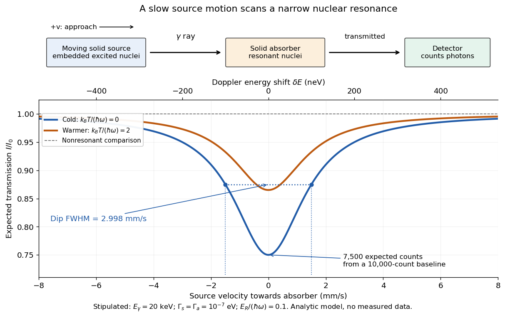

# Mössbauer effect

↑ **Parent:** [Nuclear physics](physics.md#nuclear-physics)  
ⓦ [Wiki](https://en.wikipedia.org/wiki/Mössbauer_effect)

A nucleus bound in a solid can emit or absorb a [photon](quantum-mechanics.md#photon) without exciting lattice vibrations, transferring momentum to the solid as a whole. The resulting recoil energy is negligible compared with the isolated-nucleus recoil, making very narrow resonant emission and absorption lines observable. The [Pound-Rebka experiment](general-relativity.md#pound-rebka-experiment) uses this effect to resolve the small frequency shift from [gravitational redshift](general-relativity.md#gravitational-redshift).

The striking feature is the combination of a large [photon](quantum-mechanics.md#photon) [energy](energy.md) and a tiny [natural linewidth](atomic-physics.md#natural-linewidth): an [atomic nucleus](atomic-nucleus.md) can act as an extraordinarily selective [energy](energy.md) filter. The [Mössbauer effect](mossbauer-effect.md) supplies a narrow shared [emission line](stellar-astrophysics.md#emission-line) and [absorption line](stellar-astrophysics.md#absorption-line) even when [nuclear recoil](atomic-nucleus.md#nuclear-recoil) would separate the corresponding free-nucleus lines. A slow mechanical motion can then tune their overlap through the [Doppler effect](wave.md#doppler-effect). The [Pound-Rebka experiment](general-relativity.md#pound-rebka-experiment) is an application to [general relativity](general-relativity.md); the discovery experiment below concerns the recoil-free process itself.

**Table of contents**

- [Recoil-free nuclear transition](#recoil-free-nuclear-transition)
  - [Lamb-Mössbauer factor](#lamb-mossbauer-factor)
- [Mössbauer velocity scan](#mossbauer-velocity-scan)
- [Mössbauer discovery experiment](#mossbauer-discovery-experiment)

## Recoil-free nuclear transition

↑ **Parent:** [Mössbauer effect](mossbauer-effect.md)

A [recoil-free nuclear transition](#recoil-free-nuclear-transition) emits or absorbs a [gamma ray](quantum-mechanics.md#gamma-ray) while leaving the internal vibrational state of the surrounding [solid](thermodynamics.md#solid) unchanged. It belongs to the elastic part of the process: no [phonon](quantum-ideal-gas-statistics.md#phonon) is created or destroyed. The [photon](quantum-mechanics.md#photon) still carries [momentum](momentum.md) $p=E_\gamma/c$, where $c$ is the [speed of light](special-relativity.md#speed-of-light). The emitting [solid](thermodynamics.md#solid) takes momentum $-\mathbf p$; the absorbing [solid](thermodynamics.md#solid) takes $+\mathbf p$. [Conservation of momentum](momentum.md#momentum-conservation) holds for each event.

Why does an isolated [atomic nucleus](atomic-nucleus.md) pose a problem? Start with an [excited state](energy-eigenvalue.md#excited-state) at rest and let $E_0$ be its transition [energy](energy.md), with nuclear [mass](classical-mechanics.md#mass) $M$ and $E_0\ll Mc^2$. [Conservation of momentum](momentum.md#momentum-conservation) gives a recoil momentum of magnitude $p$; its nonrelativistic [kinetic energy](energy.md#kinetic-energy) is therefore

$$
E_R=\frac{p^2}{2M}=\frac{E_\gamma^2}{2Mc^2}\simeq\frac{E_0^2}{2Mc^2}.
$$

By [conservation of energy](mathematical-physics.md#conservation-of-energy), emission spends part of $E_0$ on [nuclear recoil](atomic-nucleus.md#nuclear-recoil), whereas absorption must supply both $E_0$ and the final [kinetic energy](energy.md#kinetic-energy). To leading order,

$$
E_{\mathrm{em}}\simeq E_0-E_R,\qquad E_{\mathrm{abs}}\simeq E_0+E_R,\qquad E_{\mathrm{abs}}-E_{\mathrm{em}}\simeq2E_R.
$$

Thus the relevant comparison is $2E_R$ against the overlapping [spectral line](stellar-astrophysics.md#spectral-line) widths, rather than $E_R/E_0$ alone. If $2E_R$ greatly exceeds the widths, the isolated-nucleus lines have negligible overlap. Finite [Lorentzian line shape](stellar-astrophysics.md#lorentzian-line-shape) tails mean that this is suppression, rather than an absolute prohibition on absorption.

For a bound [atomic nucleus](atomic-nucleus.md), the recoil-free channel transfers [momentum](momentum.md) to the [center of mass](classical-mechanics.md#center-of-mass) of the emitting or absorbing [solid](thermodynamics.md#solid), with negligible [kinetic energy](energy.md#kinetic-energy) $p^2/(2M_{\mathrm{solid}})$. Other channels exchange [phonons](quantum-ideal-gas-statistics.md#phonon) and carry substantial [energy](energy.md) into or out of the internal vibrations. A large $M_{\mathrm{solid}}$ makes the elastic channel's [energy](energy.md) cost small; the vibrational [quantum state](quantum-system.md#quantum-state) determines its probability. Merely replacing $M$ by a large [mass](classical-mechanics.md#mass) in the free-particle formula does not calculate that probability.

Here is a deliberately stipulated teaching system, independent of historical isotope data: $E_0=20\,\mathrm{keV}$, $Mc^2=10^{11}\,\mathrm{eV}$, and a single-line [natural linewidth](atomic-physics.md#natural-linewidth) $\Gamma_E=10^{-7}\,\mathrm{eV}$ measured as an [energy](energy.md) [full width at half maximum](analysis.md#full-width-at-half-maximum). These give $E_R=0.002\,\mathrm{eV}$ and $2E_R/\Gamma_E=40{,}000$. A [solid](thermodynamics.md#solid) of $10^{12}$ such nuclear [masses](classical-mechanics.md#mass) has elastic recoil [energy](energy.md) $2\times10^{-15}\,\mathrm{eV}$, far below $\Gamma_E$. In this article $\Gamma_E$ is an [energy](energy.md) width; the corresponding lifetime is $\tau=\hbar/\Gamma_E$, with $\hbar$ the [Planck constant](quantum-mechanics.md#planck-constant) divided by $2\pi$.

<h3 id="lamb-mossbauer-factor">Lamb-Mössbauer factor</h3>

↑ **Parent:** [Recoil-free nuclear transition](#recoil-free-nuclear-transition)

The [Lamb-Mössbauer factor](#lamb-mossbauer-factor) $f$ is the fraction in the coherent elastic line. In the harmonic-lattice approximation it is a [Debye–Waller factor](quantum-ideal-gas-statistics.md#debye-waller-factor). Write the displacement of the emitting or absorbing [atomic nucleus](atomic-nucleus.md) relative to its equilibrium site as $\mathbf u$, put $u_\parallel=\widehat{\mathbf k}\cdot\mathbf u$, and define the angular [wavenumber](wave-equation.md#wavenumber) $k=E_\gamma/(\hbar c)$. Choose the equilibrium site so that $\langle u_\parallel\rangle=0$. Its directional displacement [variance](variance.md) is $\sigma_\parallel^2=\langle u_\parallel^2\rangle$. A harmonic [solid](thermodynamics.md#solid) in [thermal equilibrium](thermal-equilibrium.md) has a [Gaussian distribution](probability-distribution.md#normal-distribution) for this displacement, whose [characteristic function](characteristic-function.md) gives the elastic amplitude

$$
\left\langle e^{iku_\parallel}\right\rangle=\exp\left(-\frac{k^2\sigma_\parallel^2}{2}\right).
$$

Taking the squared magnitude gives the intensity fraction

$$
f=\left|\left\langle e^{iku_\parallel}\right\rangle\right|^2=\exp\left(-k^2\langle u_\parallel^2\rangle\right).
$$

The factor $1/2$ belongs to the amplitude exponent; it disappears when the amplitude is squared. For an isotropic [solid](thermodynamics.md#solid), $\langle u_\parallel^2\rangle=\langle|\mathbf u|^2\rangle/3$, so an equivalent expression is $f=\exp[-k^2\langle|\mathbf u|^2\rangle/3]$. Directional and three-dimensional mean squared displacements must not be substituted for one another without this factor.

An [Einstein solid](heat.md#einstein-solid) approximation replaces the vibrational spectrum by one positive [angular frequency](lagrangian-mechanics.md#angular-frequency) $\omega$. For the directional [quantum harmonic oscillator](quantum-harmonic-oscillator.md), with the same effective [mass](classical-mechanics.md#mass) $M$ as in $E_R$,

$$
\langle u_\parallel^2\rangle=\frac{\hbar}{2M\omega}(2\bar n+1),\qquad \bar n=\frac{1}{e^{\hbar\omega/(k_BT)}-1}.
$$

Here $k_B$ is the [Boltzmann constant](thermodynamics.md#boltzmann-constant) and $T$ is [temperature](temperature.md). This follows by taking the [expected value](expected-value.md) of $u_\parallel^2$ in each oscillator [energy eigenstate](energy-eigenvalue.md#energy-eigenstate), $\hbar(n+1/2)/(M\omega)$, and averaging with the [Boltzmann distribution](thermodynamics.md#boltzmann-distribution). Substitution gives

$$
f(T)=\exp\left[-\frac{E_R}{\hbar\omega}\coth\left(\frac{\hbar\omega}{2k_BT}\right)\right],\qquad f(0)=\exp\left(-\frac{E_R}{\hbar\omega}\right)<1.
$$

The zero-[temperature](temperature.md) limit retains [zero-point energy](quantum-harmonic-oscillator.md#zero-point-energy) and a nonzero displacement [variance](variance.md). Cooling therefore increases the [recoil-free fraction](#lamb-mossbauer-factor) towards a limit below one for finite $E_R/(\hbar\omega)>0$. At high [temperature](temperature.md), the exponent tends to $-2E_Rk_BT/(\hbar\omega)^2$. This is a single-frequency approximation to a harmonic lattice's coherent elastic weight, not a complete description of all zero-net-[energy](energy.md) processes of an isolated oscillator. Real vibrational spectra, directional binding and anharmonic motion can change its predictions.

Extend the stipulated teaching system by choosing $\hbar\omega=0.020\,\mathrm{eV}$, so $\eta=E_R/(\hbar\omega)=0.1$. Then $f(0)=0.90484$, while $f=0.80542$ at $k_BT=\hbar\omega$. If source and absorber are independent, the fraction of events eligible for recoil-free emission followed by recoil-free absorption contains the product $f_s f_a$; this gives $0.81873$ for two zero-[temperature](temperature.md) copies. It is not the total probability of absorption, which also depends on the number of resonant [atomic nuclei](atomic-nucleus.md), geometry and [spectral line](stellar-astrophysics.md#spectral-line) overlap.

**[Figure 1](#image-free-recoil-separates-the-lines-lattice-binding-supplies-an-elastic-fraction). Free recoil separates the lines; lattice binding supplies an elastic fraction**. Original model using only the stipulated teaching parameters. Left: peak-normalized [Lorentzian line shapes](stellar-astrophysics.md#lorentzian-line-shape) of the isolated [atomic nucleus](atomic-nucleus.md), separated by $2E_R=0.004\,\mathrm{eV}$; each physical width is $10^{-7}\,\mathrm{eV}$, with an inset resolving one peak. Right: [Lamb-Mössbauer factor](#lamb-mossbauer-factor) in the [Einstein solid](heat.md#einstein-solid) approximation for three choices of $E_R/(\hbar\omega)$. Every zero-[temperature](temperature.md) intercept is below one. No historical trace is reproduced.

<h2 id="mossbauer-velocity-scan">Mössbauer velocity scan</h2>

↑ **Parent:** [Mössbauer effect](mossbauer-effect.md)

Let $v$ be the source [velocity](classical-mechanics.md#velocity) towards the absorber, positive for approach along the [photon](quantum-mechanics.md#photon) direction. A first-order [Lorentz transformation](special-relativity.md#lorentz-transformation) of the [photon](quantum-mechanics.md#photon) [energy](energy.md) gives $E'=E+vp$; hence, for $|v|\ll c$,

$$
\delta E\simeq E_\gamma\frac{v}{c}.
$$

Moving the source shifts its [emission line](stellar-astrophysics.md#emission-line) through the stationary [absorption line](stellar-astrophysics.md#absorption-line). A minimum in transmitted [photon](quantum-mechanics.md#photon) counts marks their strongest overlap. The absorber is the narrow [energy](energy.md) discriminator; the downstream [particle detector](particle-detection.md#particle-detector) only needs to count the transmitted [gamma rays](quantum-mechanics.md#gamma-ray).

For a thin absorber with unsplit [Lorentzian line shapes](stellar-astrophysics.md#lorentzian-line-shape), the overlap is a [convolution](fourier-analysis.md#convolution) of the source and absorber profiles. The combined [full width at half maximum](analysis.md#full-width-at-half-maximum) is $W=\Gamma_s+\Gamma_a$. A simple expected transmission model is

$$
\frac{I(v)}{I_0}=1-\frac{A}{1+\left[2E_\gamma(v-v_0)/(cW)\right]^2},\qquad 0<A<1.
$$

Here $I_0$ is the off-resonance intensity, $v_0$ encodes a relative shift of the two transition [energies](energy.md), and $A$ includes the resonant absorber strength and $f_s f_a$. The convolution result can be checked by multiplying the [Fourier transforms](fourier-transform.md) of two [Cauchy distributions](probability-distribution.md#cauchy-distribution): their exponential decay constants add. The width of the absorption dip in [velocity](classical-mechanics.md#velocity) is $cW/E_\gamma$, rather than the width of one individual [spectral line](stellar-astrophysics.md#spectral-line) converted to [velocity](classical-mechanics.md#velocity).

For the teaching system with $\Gamma_s=\Gamma_a=\Gamma_E$ and $v_0=0$, the dip's [full width at half maximum](analysis.md#full-width-at-half-maximum) is $2.9979\,\mathrm{mm\,s^{-1}}$. Stipulate $A=0.25$ at zero [temperature](temperature.md) and $10{,}000$ expected off-resonance counts per equal-duration bin: the central bin then has $7{,}500$ expected counts, and the half-depth bins have $8{,}750$. These are model expectations, without sampled counting noise. Holding all other parameters fixed while heating both lattices to $k_BT=2\hbar\omega$ multiplies $A$ by $[f(T)/f(0)]^2$. This isolates how a falling [recoil-free fraction](#lamb-mossbauer-factor) weakens the dip.

**[Figure 2](#image-mechanical-velocity-scans-an-absorption-line-much-narrower-than-detector-resolution). Mechanical velocity scans an absorption line much narrower than detector resolution**. Original ideal transmission model, with schematic source, absorber and counting detector. Both curves use the same stipulated [energy](energy.md) widths; heating changes only $f_s f_a$. Dashed markers show the cold curve's half-depth positions. This is a new analytic teaching scan, not a historical measurement or a fit. The upper scale converts [velocity](classical-mechanics.md#velocity) to [Doppler effect](wave.md#doppler-effect) [energy](energy.md) shift.

The thin-absorber model is deliberately limited. A thick absorber can saturate and broaden the dip; unresolved [hyperfine structure](quantum-mechanics.md#hyperfine-structure) can create multiple components. Differences in chemical surroundings can shift the centers, and uncontrolled motion can smear them. These effects must be modeled before interpreting an observed width as a [natural linewidth](atomic-physics.md#natural-linewidth). Their sensitivity also makes the [Mössbauer effect](mossbauer-effect.md) useful: a small displacement of a narrow dip can reveal a small change in the local nuclear environment.

<h2 id="mossbauer-discovery-experiment">Mössbauer discovery experiment</h2>

↑ **Parent:** [Mössbauer effect](mossbauer-effect.md)

[Rudolf Ludwig Mössbauer](physicist.md#rudolf-ludwig-mossbauer) found the effect during his Heidelberg work in 1957.[CV, opening paragraphs: Heidelberg discovery in 1957](physics-bibliography.md#rudolf-ludwig-mossbauer-cv-by-lindau-nobel-laureate-meetings) His 1961 lecture _Recoilless nuclear resonance absorption of gamma radiation_ describes crystalline preparations using the $129\,\mathrm{keV}$ transition of the [iridium](chemical-substance.md#iridium) [isotope](chemical-substance.md#isotope) $^{191}\mathrm{Ir}$. Separate cryostats, lead collimation and a [particle scintillation](physics.md#scintillation-physics) detector measured transmission. Liquid-air cooling of both preparations enhanced absorption; cooling only the source against a room-temperature absorber slightly reduced it. A rotating source cryostat supplied nearly constant projected velocities over selected arcs. Centimetres per second suppressed absorption relative to zero [velocity](classical-mechanics.md#velocity); a nonresonant absorber supplied the comparison. This tested a narrow common emission/absorption [energy](energy.md) beyond the detector's resolution. Temperature data alone had not established its width. The lecture cites the initial and direct-verification publications from 1958.[Authorized 2012 reprint, pp. 6–8, 13–15, 17; Figs. 1.3–1.4, 1.7–1.8](physics-bibliography.md#recoilless-nuclear-resonance-absorption-of-gamma-radiation-by-rudolf-ludwig-mossbauer)

## ↑ Ancestors (3)

1. [Nuclear physics](physics.md#nuclear-physics)
2. [Physics](physics.md)
3. [Codex Wiki](README.md)

## ← Incoming links (7)

- [Mössbauer effect](mossbauer-effect.md)
- [Mössbauer velocity scan](#mossbauer-velocity-scan)
- [Nobel Prize in Physics in 1961](nobel-prize-in-physics.md#nobel-prize-in-physics-in-1961)
- [Solution](past-exam-of-the-mathematics-course-of-the-university-of-cambridge/2002/iii/paper-72.md#2/solution)
- [Solution](past-exam-of-the-mathematics-course-of-the-university-of-cambridge/2010/iii/paper-52.md#1/b/solution)
- [Solution](past-exam-of-the-relativity-course-of-the-university-of-cambridge/2017.md#2/a/solution)
- [Pound-Rebka experiment](general-relativity.md#pound-rebka-experiment)
