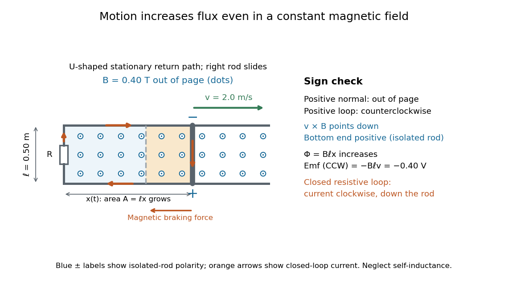

# Motional electromotive force

↑ **Parent:** [Electromotive force](electromotive-force.md)

[Motional electromotive force](motional-electromotive-force.md) is the contribution $\oint_C(\mathbf v\times\mathbf B)\cdot d\mathbf l$ from an [electrical conductor](electrical-conductor.md) moving with local [velocity](velocity.md) $\mathbf v$ through a [magnetic field](magnetic-field-split.md). The [cross product](cross-product.md) comes from the magnetic part of the [Lorentz force](lorentz-force.md). For a straight rod of length $\ell$, perpendicular to both its [velocity](velocity.md) and a uniform [magnetic field](magnetic-field-split.md), its magnitude is $B\ell v$. The sign depends on the direction of integration along the rod. [OpenStax University Physics 2, §13.3: motional emf](https://openstax.org/books/university-physics-volume-2/pages/13-3-motional-emf).

For a computed example, take $\ell=0.50\,\mathrm m$, [velocity](velocity.md) $\mathbf v=2.0\widehat{\mathbf x}\,\mathrm{m/s}$ to the right, and [magnetic field](magnetic-field-split.md) $\mathbf B=0.40\widehat{\mathbf z}\,\mathrm T$ out of the page. The rod lies along $y$. Then

$$
\mathbf v\times\mathbf B=-0.80\widehat{\mathbf y}\,\mathrm{V/m},\qquad
\int_{\mathrm{top}}^{\mathrm{bottom}}(\mathbf v\times\mathbf B)\cdot d\mathbf l
=B\ell v=0.40\,\mathrm V.
$$

Positive [electric charge](electric-charge-split.md) is driven downward. For an isolated rod after charge separation has equilibrated, $\mathbf E=-\mathbf v\times\mathbf B$ inside it, and the [electric potential difference](electric-potential-difference.md) is $V_{\mathrm{bottom}}-V_{\mathrm{top}}=+0.40\,\mathrm V$; the bottom is positive. This open-circuit statement does not imply a sustained [electric current](electric-current.md).

Close the rod's path with stationary U-shaped rails and an [electrical resistance](electrical-resistance.md) $R>0$ at the left. With out-of-page [unit normal](unit-normal.md), the positive loop direction is counterclockwise, hence upward along the rod. If the rod's horizontal position is $x(t)$, the enclosed [area](surface-area.md) is $A=\ell x$ and the external [magnetic flux](magnetic-flux.md) is $\Phi_{\mathrm{ext}}=B\ell x$. Thus

$$
\mathcal E_{\mathrm{CCW}}=-B\ell\dot x=-0.40\,\mathrm V,\qquad
I_{\mathrm{CCW}}=-\frac{0.40\,\mathrm V}{R}.
$$

Here the resistive approximation neglects [self-inductance](self-inductance.md). The negative [electric current](electric-current.md) is clockwise, downward along the rod, consistent with the charge-separation calculation and [Lenz's law](lenz-s-law.md).

**[Figure 10](#image-motional-electromotive-force-from-a-rod-sliding-right-through-an-out-of-page-magnetic-field). Motional electromotive force from a rod sliding right through an out-of-page magnetic field**. The U-shaped return path closes the [electrical circuit](electrical-circuit-split.md) to the left of the rod. Increasing [area](surface-area.md) increases positive [magnetic flux](magnetic-flux.md); orange arrows show the clockwise induced [electric current](electric-current.md). The rod's bottom end is positive in the isolated-rod limit. The [electromotive force](electromotive-force.md) has magnitude $0.40\,\mathrm V$, or signed value $-0.40\,\mathrm V$ for counterclockwise orientation.

The closed-loop result illustrates why the moving-circuit form of [Faraday's law of induction](faraday-s-law-of-induction.md) includes [motional electromotive force](motional-electromotive-force.md): the [magnetic field](magnetic-field-split.md) is constant in time, so the [electric field](electric-field-split.md) circulation alone would miss this drive. Its mechanical consequence is [electromagnetic braking of a sliding rod](electromagnetic-braking-of-a-sliding-rod.md).

**Table of contents**

- [Inductive oscillation of a sliding rod on inclined rails](inductive-oscillation-of-a-sliding-rod-on-inclined-rails.md)
  - [Resistive long-time drift of an inductive sliding rod](resistive-long-time-drift-of-an-inductive-sliding-rod.md)
- [Magnetic power balance on an expanding circular guide](magnetic-power-balance-on-an-expanding-circular-guide.md)
- [Electromagnetic braking of a sliding rod](electromagnetic-braking-of-a-sliding-rod.md)
- [Magnetic flux transport for a moving circuit](magnetic-flux-transport-for-a-moving-circuit.md)

## ↑ Ancestors (7)

1. [Electromotive force](electromotive-force.md)
2. [Electric current](electric-current.md)
3. [Electric charge](electric-charge-split.md)
4. [Electromagnetism](electromagnetism-split.md)
5. [Branches of physics](branches-of-physics.md)
6. [Physics](physics-split.md)
7. [Codex Wiki](split.md)

## ← Incoming links (16)

- [Electromagnetic induction](electromagnetic-induction.md)
- [Electromotive force](electromotive-force.md)
- [Faraday's law of induction](faraday-s-law-of-induction.md)
- [Homopolar generator](homopolar-generator.md)
- [Lenz's law](lenz-s-law.md)
- [Motional electromotive force](motional-electromotive-force.md)
- [Solution](past-exam-of-the-mathematics-course-of-the-university-of-cambridge/2006/ib/paper-4/7g/solution.md)
- [Solution](past-exam-of-the-mathematics-course-of-the-university-of-cambridge/2007/ib/paper-4/7e/solution.md)
- [Solution](past-exam-of-the-mathematics-course-of-the-university-of-cambridge/2008/ib/paper-2/17b/i/solution.md)
- [Solution](past-exam-of-the-mathematics-course-of-the-university-of-cambridge/2014/ib/paper-2/6a/solution.md)
- [Solution](past-exam-of-the-mathematics-course-of-the-university-of-cambridge/2016/ib/paper-3/17d/a/solution.md)
- [Solution](past-exam-of-the-mathematics-course-of-the-university-of-cambridge/2016/ib/paper-3/17d/b/i/solution.md)
- [Solution](past-exam-of-the-physics-b-course-of-the-university-of-cambridge/2010/paper-2a/section-b/b7/solution.md)
- [Solution](past-exam-of-the-physics-course-of-the-year-4-of-the-natural-sciences-course-of-the-university-of-cambridge/2016/paper-1/section-b/b3/solution.md)
- [Resistive long-time drift of an inductive sliding rod](resistive-long-time-drift-of-an-inductive-sliding-rod.md)
- [Resistive magnetic entry of a falling loop](resistive-magnetic-entry-of-a-falling-loop.md)
