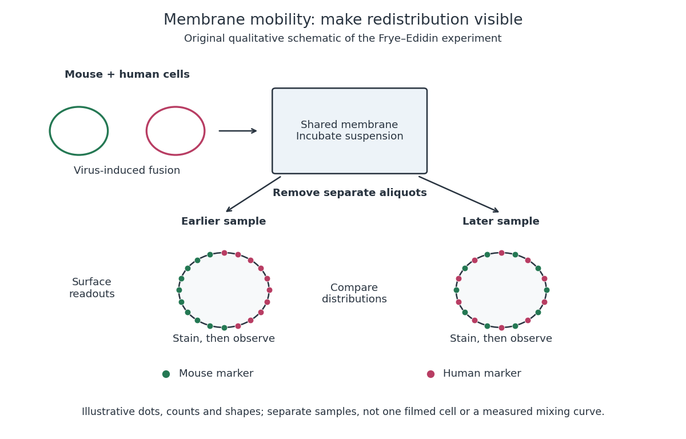

# Mouse-human heterokaryon membrane-mixing experiment

↑ **Parent:** [Lateral mobility of membrane proteins](lateral-mobility-of-membrane-proteins.md)

In 1970 [Larry Frye](larry-frye.md) and [Michael Edidin](michael-edidin.md) fused mouse C11D and human VA-2 [cell lines](cell-line.md) with [Sendai virus](sendai-virus.md), forming [heterokaryons](heterokaryon.md). Suspensions were maintained in a shaking water bath at $37\,{}^\circ\mathrm{C}$. Removed aliquots were stained by indirect [immunofluorescence](immunofluorescence.md): [antibodies](antibody.md) against parental surface [antigens](antigen.md), then differently fluorescent secondary [antibodies](antibody.md). A Leitz Ortholux [fluorescence microscope](fluorescence-microscope.md) used a mercury lamp and color-selecting filters. Green mouse and red human surface patterns became intermixed.[Frye and Edidin, The rapid intermixing of cell surface antigens after formation of mouse-human heterokaryons, pp. 319–325: Summary, Cell fusion, Fluorescent staining, Fluorescence microscopy, Table 1, time-course results](the-rapid-intermixing-of-cell-surface-antigens-after-formation-of-mouse-human-heterokaryons-by-larry-frye-and-michael-edidin.md)

Same-species fusions tested [antibody specificity](antibody-specificity.md); stable hybrid lines supplied a two-color control. Inhibitors of [biological translation](translation-biology.md) did not prevent mixing; lowering [temperature](temperature-split.md) inhibited it. These observations supported lateral redistribution over rapid synthesis. The authors could not conclusively exclude passage through [cytoplasm](cytoplasm.md) and return. The readout compared populations, not trajectories of a continuously observed individual [biological cell](biological-cell-split.md), and did not establish unrestricted motion of every [membrane protein](membrane-protein.md).[pp. 324–331: specificity controls, inhibitor studies, temperature dependence and Discussion of mechanisms iii and iv](the-rapid-intermixing-of-cell-surface-antigens-after-formation-of-mouse-human-heterokaryons-by-larry-frye-and-michael-edidin.md)

**[Figure 3](#image-separate-time-point-samples-reveal-changing-surface-distributions). Separate time-point samples reveal changing surface distributions**. Original qualitative schematic of the [mouse-human heterokaryon membrane-mixing experiment](mouse-human-heterokaryon-membrane-mixing-experiment.md). Dot counts and shapes are illustrative; separate samples show distributions rather than individual trajectories or measured mixing curves.

The decisive design idea is to begin with spatially distinguishable material. A uniformly labeled surface can look unchanged while its components move. Bringing together differently identifiable parental surfaces creates an initial pattern whose loss reveals redistribution; [antibody specificity](antibody-specificity.md) makes that loss interpretable. [Membrane topology](membrane-topology.md) asks which side a part faces, whereas this experiment asks where it can move along that side.

## ↑ Ancestors (6)

1. [Lateral mobility of membrane proteins](lateral-mobility-of-membrane-proteins.md)
2. [Membrane protein](membrane-protein.md)
3. [Cell membrane](cell-membrane-split.md)
4. [Biological cell](biological-cell-split.md)
5. [Biology](biology-split.md)
6. [Codex Wiki](split.md)

## ← Incoming links (1)

- [Mouse-human heterokaryon membrane-mixing experiment](mouse-human-heterokaryon-membrane-mixing-experiment.md)
