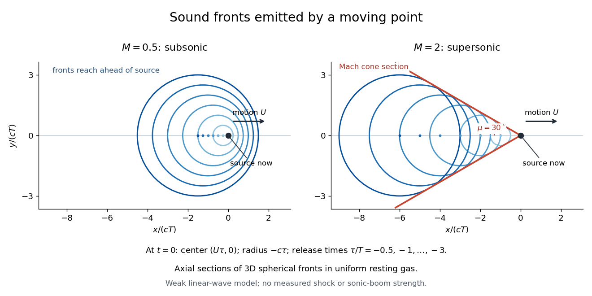

# Moving-point acoustic wavefronts

↑ **Parent:** [Mach number](mach-number.md)

Take a steady moving point source in uniform resting [gas](gas.md), with constant [sound speed](speed-of-sound.md) $c$ and source [velocity](velocity.md) $U\mathbf e_x$. Place the source at the origin at the current [time](time-in-physics.md) $t=0$. In the [linear acoustics](linear-acoustics-split.md) model, an emission at an earlier [time](time-in-physics.md) $\tau<0$ has a spherical [wavefront](wavefront.md) centered at $(U\tau,0,0)$ with radius $-c\tau$. An axial cross-section is the [circle](circle.md) in the displayed equation. It is centered at the old release position, not the source's present position. The circles describe the geometry of weak [acoustic waves](acoustic-wave.md), not a measured [shock wave](shock-wave.md) or its [pressure](pressure-split.md) jump.

For $M=0.5$, every old [circle](circle.md) contains the present source because its center is $U|\tau|$ from the origin while its radius is the larger distance $c|\tau|$. It reaches ahead of the source. For $M=2$, the rightmost point of every old [circle](circle.md) is $(U-c)\tau<0$: the source outruns all of its old [wavefronts](wavefront.md). The continuously emitted [wavefronts](wavefront.md) have a common [geometric envelope](envelope-mathematics.md), the [Mach cone](mach-cone.md). The plotted discrete release times sample this continuous family; rotating the axial section about the motion axis recovers the three-dimensional construction.

**[Figure 1](#image-subsonic-and-supersonic-acoustic-wavefronts-from-a-moving-point). Subsonic and supersonic acoustic wavefronts from a moving point**. Original axial cross-sections at $t=0$ for [Mach numbers](mach-number.md) $0.5$ and $2$. With an arbitrary positive [time](time-in-physics.md) scale $T$, the sampled release times are $\tau/T=-0.5,-1,\ldots,-3$. Each [circle](circle.md) has center $(U\tau,0)$ and radius $-c\tau$; red lines give the [Mach cone](mach-cone.md) section. This weak [linear acoustics](linear-acoustics-split.md) model predicts geometry, not measured [shock wave](shock-wave.md) or [sonic boom](sonic-boom.md) strength.

## ↑ Ancestors (6)

1. [Mach number](mach-number.md)
2. [Compressible flow](compressible-flow-split.md)
3. [Fluid mechanics](fluid-mechanics-split.md)
4. [Branches of physics](branches-of-physics.md)
5. [Physics](physics-split.md)
6. [Codex Wiki](split.md)

## ← Incoming links (4)

- [Doppler effect](doppler-effect.md)
- [Mach angle](mach-angle.md)
- [Mach cone](mach-cone.md)
- [Sonic flow](sonic-flow.md)
