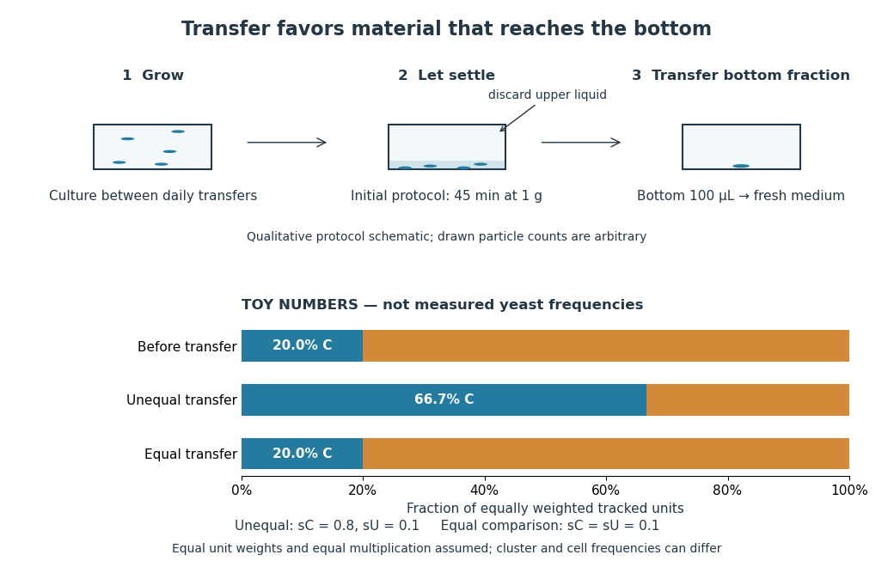

# Multicellular organism

↑ **Parent:** [Organism](organism-split.md)  
ⓦ [Wiki](https://en.wikipedia.org/wiki/Multicellular_organism)

A [multicellular organism](multicellular-organism.md) has a body of multiple [biological cells](biological-cell-split.md) whose growth and activities are integrated into the life of the whole [organism](organism-split.md). Extensive [cell differentiation](cellular-differentiation.md) is common in complex examples, but specialized [biological cells](biological-cell-split.md) are not a prerequisite for every simple form. Ask how the body develops, how its parts cooperate and how it produces descendants, rather than counting attached [biological cells](biological-cell-split.md) alone. The boundary with a [biological colony](colony-biology.md) depends on the degree of integration and the criteria being investigated; there is no universal cell-count threshold. See the Queller and Strassmann account cited under [unicellular organism](unicellular-organism.md).

Specialization makes the whole capable of combinations that one general-purpose [biological cell](biological-cell-split.md) cannot achieve in the same way. In an [animal](animal.md), a [neuron](neuron.md) transmits signals while a [red blood cell](red-blood-cell.md) carries [oxygen](oxygen.md); each still requires a working [cell membrane](cell-membrane-split.md) and [metabolism](metabolism.md). A mature mammalian [red blood cell](red-blood-cell.md) lacks a [cell nucleus](cell-nucleus.md) and [mitochondria](mitochondria.md), illustrating how a useful part need not retain the equipment of a self-reproducing [organism](organism-split.md). See [Clark, Douglas and Choi, Biology 2e, 40.2: red blood cell specialization](https://openstax.org/books/biology-2e/pages/40-2-components-of-the-blood). [Cell differentiation](cellular-differentiation.md) generally involves different [gene expression](gene-expression.md), rather than a different inherited [genome](genome.md) for each function. [Biological development](biological-development.md) must coordinate growth, position, interactions and specialization: increasing the number of [biological cells](biological-cell-split.md) is only one component. See [Alberts et al., Molecular Biology of the Cell, chapter 21 (2002): construction of multicellular bodies](https://www.ncbi.nlm.nih.gov/books/NBK21046/).

**A motivating experiment: select for a property of groups.** Ratcliff, Denison, Borrello and Travisano's 2012 study began with [Saccharomyces cerevisiae](saccharomyces-cerevisiae.md) growing as [unicellular organisms](unicellular-organism.md). Daily transfer favored rapidly settling material. Their initial protocol allowed a $10\,\mathrm{mL}$ culture to settle for $45\,\mathrm{min}$, discarded the upper $9.9\,\mathrm{mL}$, and transferred the bottom $100\,\mathrm{\mu L}$ into fresh medium. After seven days, they instead sampled $1.5\,\mathrm{mL}$ and centrifuged it at $100$ times gravitational acceleration for $10\,\mathrm{s}$, again transferring the bottom $100\,\mathrm{\mu L}$. Faster settling made it more likely that a lineage would seed tomorrow's culture; the procedure selected a physical outcome without specifying how it must arise. These protocol details are explicitly recounted in [Gulli, Herron and Ratcliff, Evolution of altruistic cooperation among nascent multicellular organisms (2019): original settling protocol](https://academic.oup.com/evolut/article/73/5/1012/6727309).

**[Figure 2](#image-settling-selection-and-an-explicitly-stipulated-enrichment-example). Settling selection and an explicitly stipulated enrichment example**. Original qualitative transfer schematic with toy numerical bars. The workflow represents the initial settling protocol described above. The lower panel assumes equally weighted tracked units and transfer probabilities $0.8$ and $0.1$; these values and the resulting frequencies are invented for explanation, not fitted to [snowflake yeast](snowflake-yeast.md) measurements. The equal-transfer comparison is a model control, distinct from the experimental comparisons described below.

The primary 2012 paper reports [snowflake yeast](snowflake-yeast.md) dominating all ten initial replicate populations by 60 transfers. To distinguish the joining of previously separate [biological cells](biological-cell-split.md) from [clonal development](clonal-development.md), the researchers enzymatically separated clusters and followed individual [biological cells](biological-cell-split.md) for $16\,\mathrm{h}$: attached descendants rebuilt clusters, with no such joining observed. Staining localized attachments at bud scars. Time-lapse observations also showed clusters releasing smaller multicellular offspring, called propagules; small clusters grew before they reproduced. See [Ratcliff et al., Experimental evolution of multicellularity (2012), figures 1–3: emergence, development and reproduction](https://pmc.ncbi.nlm.nih.gov/articles/PMC3277146/).

The experimental comparisons ask different questions. Competition with the [unicellular organism](unicellular-organism.md) ancestor showed a reported $34\%$ advantage under settling selection. Without settling selection, the estimated $10\%$ disadvantage had a one-sided $P=0.06$, so it was suggestive rather than decisive evidence of a cost. Separately, three populations derived from one evolved isolate retained the cluster form through 35 transfers without settling selection. That persistence tests stability, not whether clusters always outperform single [biological cells](biological-cell-split.md). See Ratcliff et al. (2012), figure 2 and the cluster-formation results cited above.

A 2015 follow-up added a causal test: deleting the [gene](gene.md) ACE2 in the [unicellular organism](unicellular-organism.md) ancestor produced [snowflake yeast](snowflake-yeast.md), while supplying functional ACE2 to one evolved isolate restored separation into single [biological cells](biological-cell-split.md). Sequence changes altering the encoded [protein](protein-split.md) were found in ACE2 in five of ten examined lineages; the study did not identify that same sequence-change mechanism in every lineage. The deletion and restoration comparisons support a mechanism beyond the observation that clusters settle quickly. See [Ratcliff, Fankhauser, Rogers, Greig and Travisano, Origins of multicellular evolvability in snowflake yeast (2015), figure 1](https://www.nature.com/articles/ncomms7102).

**What follows, and what does not.** The evidence supports inherited cluster formation, [clonal development](clonal-development.md) and a reproducing collective whose properties can respond to [natural selection](natural-selection.md). Calling these simple [multicellular organisms](multicellular-organism.md) recognizes those demonstrated properties; it does not turn every clump into an [animal](animal.md) or establish animal-like [cell differentiation](cellular-differentiation.md). This laboratory route also does not reconstruct the actual ancestry of [animals](animal.md) or show that complex [developmental integration](developmental-integration.md) must follow. The interesting achievement is narrower and testable: a change in how descendants remain connected creates a new scale at which growth and [reproductive success](reproductive-success.md) can be measured.

For the toy figure, let $p$ be the fraction of tracked units of type C before transfer and let $s_C,s_U$ be the respective [probabilities](probability.md) of transfer for C and U. Assume equally weighted units and equal multiplication between transfers. When overall transfer [probability](probability.md) is nonzero, conditioning on transfer gives

$$
p_{\mathrm{after}}=\frac{p s_C}{p s_C+(1-p)s_U}.
$$

With $p=1/5$, $s_C=4/5$ and $s_U=1/10$, the numerator is $4/25$ and the denominator $6/25$, giving $p_{\mathrm{after}}=2/3$. If both types have the same nonzero transfer [probability](probability.md), the fraction stays $1/5$. This is [conditional probability](conditional-probability.md), not a model of the full experimental life cycle: real cluster sizes, growth and fragmentation affect which quantity a frequency measures. In particular, a fraction of clusters is not automatically a fraction of [biological cells](biological-cell-split.md).

**Table of contents**

- [Germline-soma differentiation](germline-soma-differentiation.md)
- [Clonal development](clonal-development.md)
  - [Snowflake yeast](snowflake-yeast.md)
- [Developmental integration](developmental-integration.md)
  - [Cellular differentiation](cellular-differentiation.md)
    - [Mesenchymal-to-epithelial transition](mesenchymal-to-epithelial-transition.md)
    - [Epithelial-mesenchymal plasticity](epithelial-mesenchymal-plasticity.md)
    - [Epithelial-to-mesenchymal transition](epithelial-to-mesenchymal-transition.md)
    - [Competence window](competence-window.md)
    - [Conditional specification](conditional-specification.md)
    - [Autonomous specification](autonomous-specification.md)
    - [Cell fate](cell-fate.md)
      - [Developmental commitment](developmental-commitment.md)
      - [Cell fate plasticity](cell-fate-plasticity.md)
        - [Intestinal stem-cell plasticity](intestinal-stem-cell-plasticity.md)
        - [Transdifferentiation](transdifferentiation.md)
        - [Dedifferentiation](dedifferentiation.md)
      - [Cell determination](cell-determination.md)
      - [Cell specification](cell-specification.md)
      - [Fate map](fate-map.md)
    - [Terminal differentiation](terminal-differentiation.md)
    - [Cellular reprogramming](cellular-reprogramming.md)
      - [Epigenetic reprogramming](epigenetic-reprogramming.md)
      - [Somatic cell nuclear transfer](somatic-cell-nuclear-transfer.md)
        - [Intestinal nucleus transfer experiment](intestinal-nucleus-transfer-experiment.md)

## ↑ Ancestors (3)

1. [Organism](organism-split.md)
2. [Biology](biology-split.md)
3. [Codex Wiki](split.md)

## ← Incoming links (6)

- [Animal](animal.md)
- [Clonal development](clonal-development.md)
- [Developmental integration](developmental-integration.md)
- [Multicellular organism](multicellular-organism.md)
- [Organism](organism-split.md)
- [Snowflake yeast](snowflake-yeast.md)
