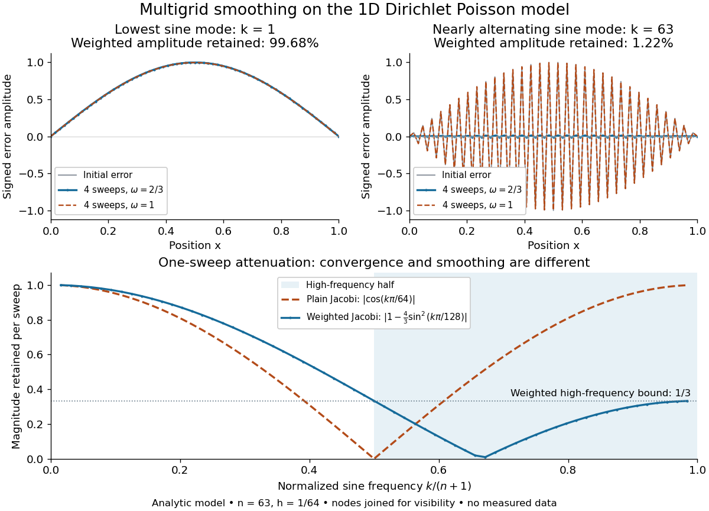

# Multigrid method

↑ **Parent:** [Numerical analysis](numerical-analysis.md)  
ⓦ [Wiki](https://en.wikipedia.org/wiki/Multigrid_method)

A [multigrid method](multigrid-method.md) solves a [linear system](linear-algebra.md#system-of-linear-equations) by combining local relaxation with [coarse-grid correction](#coarse-grid-correction) on a hierarchy of [meshes](finite-element-method.md#finite-element-mesh). The key is to divide the work by scale: a suitable relaxation removes rapidly oscillating [approximation error](numerical-analysis.md#approximation-error), while [coarse-grid correction](#coarse-grid-correction) addresses slowly varying [approximation error](numerical-analysis.md#approximation-error) that relaxation barely changes. A broad error hump occupies many fine-grid points but fewer coarse-grid points; it becomes easier to resolve by relaxation after enough coarsening. This complementary action is why [multigrid methods](multigrid-method.md) are useful for large [finite difference method](finite-difference.md#finite-difference-method) and [finite element method](finite-element-method.md) systems.

For a concrete model, take the one-dimensional [Poisson equation](partial-differential-equation.md#poisson-s-equation) with homogeneous [Dirichlet boundary conditions](differential-equation.md#dirichlet-boundary-condition):

$$
-u''(x)=f(x),\qquad 0<x<1,\qquad u(0)=u(1)=0.
$$

Use $n$ interior points $x_j=jh$, $h=1/(n+1)$, and the centered [finite difference](finite-difference.md) system

$$
(A_hu_h)_j=\frac{2u_{h,j}-u_{h,j-1}-u_{h,j+1}}{h^2}=b_{h,j},\qquad b_{h,j}=f(x_j),\qquad u_{h,0}=u_{h,n+1}=0.
$$

Thus $A_h=h^{-2}\operatorname{tridiag}(-1,2,-1)$ is a [symmetric matrix](linear-algebra.md#symmetric-matrix) and a [positive-definite matrix](quadratic-form.md#positive-definite-matrix). The minus sign in $-u''$ fixes this positive convention; changing both $A_h$ and $b_h$ to their negatives leaves the relaxation update unchanged. For $f=1$, the [linear system](linear-algebra.md#system-of-linear-equations) has the exact discrete solution $u_{h,j}=x_j(1-x_j)/2$, since the centered [finite difference](finite-difference.md) is exact on this [quadratic polynomial](polynomial.md#quadratic-polynomial). In general, the exact discrete solution need not equal the sampled continuous solution: solving the [linear system](linear-algebra.md#system-of-linear-equations) removes algebraic [approximation error](numerical-analysis.md#approximation-error), not the [global discretization error](numerical-analysis.md#global-discretization-error).

Let $u_h^*$ solve $A_hu_h^*=b_h$, let $v_h$ be the current approximation, and define the signed [approximation error](numerical-analysis.md#approximation-error) $e_h=u_h^*-v_h$. The [linear-system residual](gradient-descent.md#linear-system-residual) is $r_h=b_h-A_hv_h$, so $A_he_h=r_h$. In particular, a [linear-system residual](gradient-descent.md#linear-system-residual) is available without knowing $u_h^*$; it supplies the right-hand side for a correction equation. With $D=2h^{-2}I$, a [weighted Jacobi method](numerical-linear-algebra.md#weighted-jacobi-method) sweep is

$$
v_h\leftarrow v_h+\omega D^{-1}r_h,\qquad e_h\leftarrow S_\omega e_h,\qquad S_\omega=I-\omega D^{-1}A_h.
$$

The [sine](geometry-and-topology.md#sine) [eigenvectors](linear-operator-theory.md#eigenvector) shared by $A_h$ and the [iteration matrix](numerical-linear-algebra.md#iteration-matrix) $S_\omega$ are $w_j^{(k)}=\sin(k\pi j/(n+1))$, $1\leq k\leq n$. Their [eigenvalues](linear-operator-theory.md#eigenvalue) are

$$
\lambda_k(A_h)=4h^{-2}\sin^2\frac{k\pi}{2(n+1)},\qquad \mu_k(S_\omega)=1-2\omega\sin^2\frac{k\pi}{2(n+1)}.
$$

For $n=63$, one [weighted Jacobi method](numerical-linear-algebra.md#weighted-jacobi-method) sweep with $\omega=2/3$ multiplies the lowest [Fourier frequency](discrete-fourier-transform.md#fourier-frequency) mode $k=1$ by about $0.999197$, but the highest [Fourier frequency](discrete-fourier-transform.md#fourier-frequency) mode $k=63$ by about $-0.332530$. Four sweeps retain about $99.68\%$ of the first amplitude and $1.22\%$ of the second. The sign reversal of the second amplitude is harmless when its magnitude shrinks. However, the plain [Jacobi method](numerical-linear-algebra.md#jacobi-method), $\omega=1$, has factor $\cos(k\pi/(n+1))$: at $k=63$ it is about $-0.998795$. A nearly alternating mode near the grid's Nyquist limit therefore persists almost as strongly as the smoothest mode. Plain [Jacobi method](numerical-linear-algebra.md#jacobi-method) convergence on a fixed [Dirichlet boundary condition](differential-equation.md#dirichlet-boundary-condition) grid does not imply effective smoothing.[Introduction to Multigrid Methods by Long Chen](mathematics-bibliography.md#introduction-to-multigrid-methods-by-long-chen) The [high-frequency smoothing factor of weighted Jacobi](numerical-linear-algebra.md#high-frequency-smoothing-factor-of-weighted-jacobi) is uniformly at most $1/3$ for $\omega=2/3$ and $k\geq(n+1)/2$; the [exact finite-grid high-frequency Jacobi smoothing optimum](numerical-linear-algebra.md#exact-finite-grid-high-frequency-jacobi-smoothing-optimum) distinguishes this convenient uniform choice from the finite-grid optimum.[CS267: Supplemental Notes for Lecture 17 — How Multigrid Damps High Frequencies by James Demmel](mathematics-bibliography.md#cs267-supplemental-notes-for-lecture-17-how-multigrid-damps-high-frequencies-by-james-demmel)

**[Figure 1](#image-analytic-poisson-error-modes-weighted-jacobi-damps-short-wavelengths-while-plain-jacobi-struggles-near-the-nyquist-limit). Analytic Poisson error modes: weighted Jacobi damps short wavelengths while plain Jacobi struggles near the Nyquist limit**.

One two-grid cycle applies a few [weighted Jacobi method](numerical-linear-algebra.md#weighted-jacobi-method) sweeps, computes the [linear-system residual](gradient-descent.md#linear-system-residual), performs [coarse-grid correction](#coarse-grid-correction), and applies a few more sweeps. The first relaxation makes the remaining [approximation error](numerical-analysis.md#approximation-error) easier to represent on a coarse [mesh](finite-element-method.md#finite-element-mesh); the last relaxation damps oscillatory components left after the transferred correction. In a [geometric multigrid V-cycle](#geometric-multigrid-v-cycle), replace the expensive exact coarse solve by one recursive cycle on the coarse correction equation, starting its correction from zero. Repeat until a tiny coarsest [linear system](linear-algebra.md#system-of-linear-equations) can be solved directly, then return through the levels by adding each interpolated correction and post-smoothing. The descent and return give the cycle its V shape.[slides 59–63](mathematics-bibliography.md#a-multigrid-tutorial-lecture-slides-by-william-l-briggs)

For this one-dimensional model, fixed sweep counts and bounded local [finite difference](finite-difference.md) and transfer work give a [geometric multigrid V-cycle](#geometric-multigrid-v-cycle) cost proportional to $n+n/2+n/4+\cdots<2n$, hence $O(n)$ in [Big O notation](real-analysis.md#big-o-notation). A fixed error reduction also needs a contraction factor bounded below one independently of $h$; per-cycle work alone does not establish that. Starting from arbitrary [approximation error](numerical-analysis.md#approximation-error) and demanding a relative reduction $\varepsilon$ generally adds a factor proportional to $\log(1/\varepsilon)$ in the cycle count. [Full multigrid](#full-multigrid) uses coarse solutions as initial guesses on successively finer [meshes](finite-element-method.md#finite-element-mesh) to target the [global discretization error](numerical-analysis.md#global-discretization-error) efficiently. The [two-grid Poisson factor with weighted Jacobi](#two-grid-poisson-factor-with-weighted-jacobi) illustrates favorable convergence for this model. Other [partial differential equations](partial-differential-equation.md), strong [anisotropy](continuum-mechanics.md#anisotropy), or poorly chosen coarse spaces and relaxation can defeat these choices; a linear-work guarantee for arbitrary [linear systems](linear-algebra.md#system-of-linear-equations) does not follow.

A historical example of the multilevel viewpoint is Achi Brandt's April 1977 paper, which analyzes adaptive [meshes](finite-element-method.md#finite-element-mesh) and reports numerical experiments on linear and nonlinear [boundary value problems](boundary-value-problem.md). This is a documented development of the approach, not a claim that the paper was its first invention.[pp. 333–390; abstract](mathematics-bibliography.md#multi-level-adaptive-solutions-to-boundary-value-problems-by-achi-brandt) The figure above is generated from the displayed [eigenvalues](linear-operator-theory.md#eigenvalue), with lines joining discrete nodes; it contains no experimental measurements.

**Table of contents**

- [Full multigrid](#full-multigrid)
- [Two-grid Poisson factor with weighted Jacobi](#two-grid-poisson-factor-with-weighted-jacobi)
- [Geometric multigrid V-cycle](#geometric-multigrid-v-cycle)
- [Full-weighting restriction](#full-weighting-restriction)
- [Coarse-grid correction](#coarse-grid-correction)
  - [Galerkin coarse-grid operator](#galerkin-coarse-grid-operator)

## Full multigrid

↑ **Parent:** [Multigrid method](multigrid-method.md)

Full multigrid solves first on a coarse mesh, interpolates that approximation to the next finer mesh, and applies a fixed number of [geometric multigrid V-cycles](#geometric-multigrid-v-cycle) before proceeding to the next level. If interpolation introduces only the expected discretization-scale error and the cycle count reduces the inherited error sufficiently at every level, the final algebraic error matches the fine-grid discretization error. The geometric sum of level costs is then $O(N)$, unlike reducing an arbitrary fine-grid initial error by an arbitrarily small tolerance.

## Two-grid Poisson factor with weighted Jacobi

↑ **Parent:** [Multigrid method](multigrid-method.md)

For the one-dimensional [Poisson equation](partial-differential-equation.md#poisson-s-equation), use linear interpolation, [full-weighting restriction](#full-weighting-restriction), an exact coarse solve, and one pre- and one post-sweep of [weighted Jacobi](numerical-linear-algebra.md#weighted-jacobi-method) with weight $2/3$. On a pair of harmonics $\theta,\theta+\pi$, put $s=\sin^2(\theta/2)$ and $c=1-s$. The coarse correction is $C=\left(\begin{smallmatrix}s&-c\\-s&c\end{smallmatrix}\right)$, and the smoother is $S=\operatorname{diag}(1-4s/3,1-4c/3)$. The rank-one error operator $SCS$ has nonzero eigenvalue $s(1-4s/3)^2+c(1-4c/3)^2=1/9$. This exact harmonic calculation illustrates mesh-independent two-grid contraction for the constant-coefficient model; it is not an unconditional result for arbitrary operators or transfer choices.

## Geometric multigrid V-cycle

↑ **Parent:** [Multigrid method](multigrid-method.md)

A geometric multigrid V-cycle pre-smooths an approximate solution, restricts its residual, recursively solves the coarse error equation once from zero, prolongs and adds that error correction, and post-smooths. The recursion ends in a direct solve on a small coarsest grid. With fixed sweep counts and bounded stencil work, coarsening in $d$ dimensions gives total work $O(N)\sum_{j\geq0}2^{-dj}=O(N)$ per cycle. A mesh-independent convergence factor also requires compatible coarse approximation and effective smoothing; linear work alone does not prove convergence.

## Full-weighting restriction

↑ **Parent:** [Multigrid method](multigrid-method.md)

Full-weighting restriction transfers a fine-grid residual to a coarser grid by local averaging. In one dimension its weights are $(1,2,1)/4$; in two dimensions they are the tensor-product stencil $\left(\begin{smallmatrix}1&2&1\\2&4&2\\1&2&1\end{smallmatrix}\right)/16$. For linear or bilinear interpolation $P$ and coarsening by two in every direction, it equals $2^{-d}P^T$ in unweighted coordinates. This scaling makes restriction the adjoint of interpolation for mesh-weighted inner products.

## Coarse-grid correction

↑ **Parent:** [Multigrid method](multigrid-method.md)

A [coarse-grid correction](#coarse-grid-correction) improves a fine-grid approximation by solving a smaller equation for the part of its [approximation error](numerical-analysis.md#approximation-error) representable on a coarse [mesh](finite-element-method.md#finite-element-mesh). Use the signed convention $e_h=u_h^*-v_h$ and the [linear-system residual](gradient-descent.md#linear-system-residual) $r_h=b_h-A_hv_h=A_he_h$. A prolongation [linear map](vector-space.md#linear-map) $P:\mathbb{R}^m\to\mathbb{R}^n$ interpolates coarse corrections into fine-grid corrections, and a restriction [linear map](vector-space.md#linear-map) $R:\mathbb{R}^n\to\mathbb{R}^m$ transfers the [linear-system residual](gradient-descent.md#linear-system-residual). Solve $A_Hz_H=Rr_h$ exactly or approximately and update $v_h\leftarrow v_h+Pz_H$. The plus sign follows from defining the [approximation error](numerical-analysis.md#approximation-error) as exact minus approximate. It is the correction equation's right-hand side $Rr_h$, rather than merely restricted solution values, that determines the update.

For the [multigrid method](multigrid-method.md) model $A_h=h^{-2}\operatorname{tridiag}(-1,2,-1)$, take $n=2m+1$, so $H=2h$ and the coarse nodes coincide with every second fine node. Use [linear interpolation](function.md#linear-interpolation) with zero boundary corrections $z_0=z_{m+1}=0$:

$$
(Pz)_{2i}=z_i\quad(1\leq i\leq m),\qquad (Pz)_{2i+1}=\frac{z_i+z_{i+1}}{2}\quad(0\leq i\leq m).
$$

Use [full-weighting restriction](#full-weighting-restriction) for the interior [linear-system residual](gradient-descent.md#linear-system-residual):

$$
(Rr)_i=\frac{r_{2i-1}+2r_{2i}+r_{2i+1}}4\quad(1\leq i\leq m),\qquad R=\frac12P^T.
$$

Here $P^T$ is the [matrix transpose](vector-space.md#transpose) in ordinary unweighted coordinates. With these specific transfers, the [Galerkin coarse-grid operator](#galerkin-coarse-grid-operator) is

$$
A_H=RA_hP=H^{-2}\operatorname{tridiag}(-1,2,-1).
$$

Thus it equals the rediscretized [Poisson equation](partial-differential-equation.md#poisson-s-equation) operator on this constant-coefficient one-dimensional [mesh](finite-element-method.md#finite-element-mesh). The equality is special to the stated model and transfers. In particular, dropping $h^{-2}$ from the fine [matrix](vector-space.md#matrix) while using $H^{-2}$ on the coarse [mesh](finite-element-method.md#finite-element-mesh) changes the correction unless the right-hand sides and transfers are rescaled consistently.

Take seven interior points, $h=1/8$, three coarse unknowns, and the deliberately constructed [approximation error](numerical-analysis.md#approximation-error)

$$
z=(1,2,1)^T,\qquad e_h=Pz=(1/2,1,3/2,2,3/2,1,1/2)^T.
$$

For example, choose $b_h=0$, so $u_h^*=0$ and $v_h=-e_h$. Direct [matrix](vector-space.md#matrix) multiplication gives

$$
r_h=A_he_h=(0,0,0,64,0,0,0)^T,\qquad Rr_h=(0,32,0)^T,\qquad A_H=16\begin{pmatrix}2&-1&0\\-1&2&-1\\0&-1&2\end{pmatrix}.
$$

The exact coarse solve returns $z_H=z$, so adding $Pz_H$ removes the entire chosen [approximation error](numerical-analysis.md#approximation-error). A broad triangular error can have a sharply localized [linear-system residual](gradient-descent.md#linear-system-residual): the latter measures discrete curvature, not error height. This is why the two should not be confused. A smooth [sine](geometry-and-topology.md#sine) mode instead has [linear-system residual](gradient-descent.md#linear-system-residual) $\lambda_k(A_h)e_h$, so interpreting its magnitude also requires the [eigenvalue](linear-operator-theory.md#eigenvalue) and the equation's scaling.

**[Figure 2](#image-constructed-seven-point-poisson-example-residual-restriction-coarse-solve-interpolation-and-the-error-remaining-after-exact-or-partial-correction). Constructed seven-point Poisson example: residual restriction, coarse solve, interpolation, and the error remaining after exact or partial correction**.

The algebra explains the exact cancellation beyond this example. Assume $P$ has linearly independent columns and choose an invertible [Galerkin coarse-grid operator](#galerkin-coarse-grid-operator) $A_H=RA_hP$. With an exact coarse solve, the [iteration matrix](numerical-linear-algebra.md#iteration-matrix) for the remaining [approximation error](numerical-analysis.md#approximation-error) is

$$
e_h^{\mathrm{new}}=Ce_h,\qquad C=I-PA_H^{-1}RA_h,\qquad CP=0,\qquad C^2=C,\qquad RA_hC=0.
$$

The short proof is to substitute $RA_hP=A_H$. Thus every vector in the [column space](vector-space.md#column-space) of $P$ is eliminated, and the corrected [linear-system residual](gradient-descent.md#linear-system-residual) restricts to zero. These are exact [projection](vector-space.md#projection-linear-algebra) identities, not a statement that every visually smooth vector belongs to that [column space](vector-space.md#column-space). If $A_h$ is a [symmetric matrix](linear-algebra.md#symmetric-matrix) and a [positive-definite matrix](quadratic-form.md#positive-definite-matrix), and $R=cP^T$ with $c>0$, then $A_H$ is also a [positive-definite matrix](quadratic-form.md#positive-definite-matrix). Moreover $P^TA_hCe_h=0$: $C$ is an [orthogonal projection](hilbert-space.md#orthogonal-projection) onto the complement of the [column space](vector-space.md#column-space) of $P$ in the [energy norm](finite-element-method.md#energy-norm) $\|q\|_{A_h}=\sqrt{q^TA_hq}$. Equivalently, the added correction is the best approximation to $e_h$ from that [column space](vector-space.md#column-space) in this [energy norm](finite-element-method.md#energy-norm). Without these symmetry and transfer assumptions, the [projection](vector-space.md#projection-linear-algebra) need not be orthogonal.[Introduction to Multigrid Methods by Long Chen](mathematics-bibliography.md#introduction-to-multigrid-methods-by-long-chen)

For an approximate coarse solve represented by a fixed [linear map](vector-space.md#linear-map) $B_H$, replace $A_H^{-1}$ by $B_H$. Then

$$
C_B=I-PB_HRA_h,\qquad C_BP=P(I-B_HA_H).
$$

There is no exact cancellation of coarse-representable [approximation error](numerical-analysis.md#approximation-error) unless $B_HA_H=I$ on the relevant directions. For the triangular example, deliberately returning half the exact correction, $B_H=\tfrac12 A_H^{-1}$, leaves $e_h/2$, as the figure shows. This controlled mathematical comparison illustrates an incomplete coarse solve; it is not a measured performance result or a prescription for a [geometric multigrid V-cycle](#geometric-multigrid-v-cycle). More generally, if $z_H^*=A_H^{-1}Rr_h$, then an approximate $z_H$ leaves $Ce_h+P(z_H^*-z_H)$, separating the nonrepresentable remainder from the coarse-solve defect.

With pre- and post-relaxation [iteration matrices](numerical-linear-algebra.md#iteration-matrix) $S_{\mathrm{pre}}$ and $S_{\mathrm{post}}$, a two-grid error step has [iteration matrix](numerical-linear-algebra.md#iteration-matrix) $E=S_{\mathrm{post}}C_BS_{\mathrm{pre}}$. A [geometric multigrid V-cycle](#geometric-multigrid-v-cycle) supplies $B_H$ by one recursive coarse cycle from zero, with a direct solve only at the bottom. Effective smoothing, a coarse [column space](vector-space.md#column-space) that approximates the surviving [approximation error](numerical-analysis.md#approximation-error), and a sufficiently accurate coarse correction must work together. Coarsening alone supplies no convergence guarantee, and correcting an arbitrary fine-grid vector exactly would require a coarse [column space](vector-space.md#column-space) large enough to contain it.

### Galerkin coarse-grid operator

↑ **Parent:** [Coarse-grid correction](#coarse-grid-correction)

A Galerkin coarse-grid operator is obtained by composing interpolation, the fine operator and residual restriction. With $R=cP^T$, $c>0$, and positive-definite $A_h$, the exact [coarse-grid correction](#coarse-grid-correction) $I-P(RA_hP)^{-1}RA_h$ is the energy-orthogonal projection onto the complement of the coarse space. Indeed it annihilates every vector $Pz$, and its corrected error $e'$ satisfies $P^TA_he'=0$. These identities explain why compatible transfers remove representable smooth error rather than merely averaging an approximate solution.

## ↑ Ancestors (5)

1. [Numerical analysis](numerical-analysis.md)
2. [Analysis](analysis.md)
3. [Area of mathematics](mathematics.md#area-of-mathematics)
4. [Mathematics](mathematics.md)
5. [Codex Wiki](README.md)

## ← Incoming links (8)

- [Coarse-grid correction](#coarse-grid-correction)
- [Gauss-Seidel method](numerical-linear-algebra.md#gauss-seidel-method)
- [Jacobi method](numerical-linear-algebra.md#jacobi-method)
- [Multigrid method](multigrid-method.md)
- [Solution](past-exam-of-the-mathematics-course-of-the-university-of-cambridge/2003/iii/paper-67.md#6/solution)
- [Solution](past-exam-of-the-mathematics-course-of-the-university-of-cambridge/2003/iii/paper-67.md#7/solution)
- [Solution](past-exam-of-the-mathematics-course-of-the-university-of-cambridge/2015/ii/paper-2.md#37e/b/solution)
- [Weighted Jacobi method for the one-dimensional Poisson equation](numerical-linear-algebra.md#weighted-jacobi-method-for-the-one-dimensional-poisson-equation)
