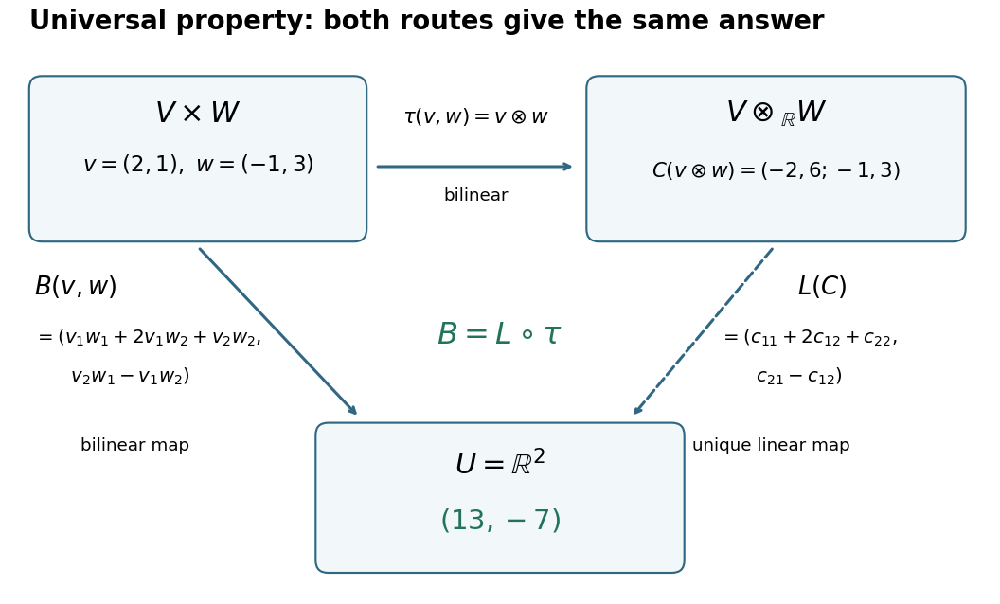

# Multilinear algebra

↑ **Parent:** [Linear algebra](linear-algebra.md)  
ⓦ [Wiki](https://en.wikipedia.org/wiki/Multilinear_algebra)

Multilinear algebra studies maps linear in each of several arguments, including determinants, tensors, and exterior products.

**Table of contents**

- [Index notation](#index-notation)
- [Coalgebra](#coalgebra)
  - [Coideal](#coideal)
  - [Measuring coalgebra](#measuring-coalgebra)
    - [Universal measuring coalgebra](#universal-measuring-coalgebra)
  - [Group-like element](#group-like-element)
  - [Comodule](#comodule)
    - [Comodule tensor transformation formula](#comodule-tensor-transformation-formula)
      - [Multiplication compatibility for a comodule tensor transformation](#multiplication-compatibility-for-a-comodule-tensor-transformation)
    - [Corestriction functor for comodules](#corestriction-functor-for-comodules)
      - [Comodule natural transformation formula](#comodule-natural-transformation-formula)
    - [Coaction](#coaction)
  - [Convolution product for coalgebra maps](#convolution-product-for-coalgebra-maps)
  - [Sweedler notation](#sweedler-notation)
- [Multilinear map](#multilinear-map)
  - [Bilinear map](#bilinear-map)
    - [Bilinearity](#bilinearity)
    - [Symmetric bilinear diagonal-parallel lemma](#symmetric-bilinear-diagonal-parallel-lemma)
    - [Derivative of a continuous bilinear map](#derivative-of-a-continuous-bilinear-map)
    - [Rank bound for a nonsingular complex bilinear map](#rank-bound-for-a-nonsingular-complex-bilinear-map)
    - [Complex bilinear dimension bound](#complex-bilinear-dimension-bound)
- [Alternating multilinear map](#alternating-multilinear-map)
  - [Alternating trilinear form](#alternating-trilinear-form)
- [Tensor product](#tensor-product)
  - [Universal property of a tensor product](#universal-property-of-a-tensor-product)
  - [Tensor-product basis](#tensor-product-basis)
    - [Tensor-product coefficient matrix](#tensor-product-coefficient-matrix)
  - [Separability of a tensor](#separability-of-a-tensor)
  - [Two-factor tensor rank](#two-factor-tensor-rank)
  - [Tensor algebra](#tensor-algebra)
    - [Truncated tensor algebra](#truncated-tensor-algebra)
    - [Tensor power](#tensor-power)
      - [Tensor square](#tensor-square)
    - [Symmetric algebra](#symmetric-algebra)
      - [Symmetric power](#symmetric-power)
        - [Weight-transfer proof of irreducibility of symmetric powers](#weight-transfer-proof-of-irreducibility-of-symmetric-powers)
        - [Symmetric powers of the three-dimensional SU2 representation](#symmetric-powers-of-the-three-dimensional-su2-representation)
        - [Character generating series of symmetric powers](#character-generating-series-of-symmetric-powers)
        - [Symmetric square](#symmetric-square)
          - [Traceless symmetric square of the defining even orthogonal representation](#traceless-symmetric-square-of-the-defining-even-orthogonal-representation)
            - [Tensor-square decomposition of the defining even orthogonal representation](#tensor-square-decomposition-of-the-defining-even-orthogonal-representation)
          - [Symmetric square of a direct sum](#symmetric-square-of-a-direct-sum)
          - [Symmetric trace-free square of the defining orthogonal representation](#symmetric-trace-free-square-of-the-defining-orthogonal-representation)
- [Exterior algebra](#exterior-algebra)
  - [Bivector](#bivector)
    - [Simple bivector](#simple-bivector)
  - [Exterior product](#exterior-product)
  - [Polynomial polyvector field](#polynomial-polyvector-field)
    - [Schouten-Nijenhuis bracket](#schouten-nijenhuis-bracket)
  - [Grassmann algebra](#grassmann-algebra)
    - [Grassmann parity](#grassmann-parity)
    - [Grassmann derivative](#grassmann-derivative)
    - [Left Grassmann derivative](#left-grassmann-derivative)
    - [Grassmann variable](#grassmann-variable)
  - [Exterior power](#exterior-power)
    - [Exterior square](#exterior-square)
      - [Exterior square of a direct sum](#exterior-square-of-a-direct-sum)
      - [Symplectic contraction of an exterior square](#symplectic-contraction-of-an-exterior-square)
        - [Primitive exterior square](#primitive-exterior-square)
- [Tensor](#tensor)
  - [Axisymmetric second-order tensor](#axisymmetric-second-order-tensor)
  - [Contravariant tensor](#contravariant-tensor)
  - [Tensor index antisymmetrization](#tensor-index-antisymmetrization)
  - [Tensor index symmetrization](#tensor-index-symmetrization)
  - [Axially invariant second-rank tensor](#axially-invariant-second-rank-tensor)
    - [Smallest axial rotation group forcing second-rank transverse isotropy](#smallest-axial-rotation-group-forcing-second-rank-transverse-isotropy)
  - [Cartesian tensor](#cartesian-tensor)
    - [Cartesian second-rank tensor](#cartesian-second-rank-tensor)
      - [Symmetric tensor decomposition relative to an axis](#symmetric-tensor-decomposition-relative-to-an-axis)
      - [Symmetric gradient and curl decomposition](#symmetric-gradient-and-curl-decomposition)
      - [Cubically invariant second-rank tensor](#cubically-invariant-second-rank-tensor)
      - [Scalar, symmetric-traceless and axial tensor decomposition](#scalar-symmetric-traceless-and-axial-tensor-decomposition)
      - [Divergence of a Cartesian second-rank tensor](#divergence-of-a-cartesian-second-rank-tensor)
      - [Oriented-axis invariant Cartesian tensor](#oriented-axis-invariant-cartesian-tensor)
        - [Alignment of current and field in an axisymmetric conductor](#alignment-of-current-and-field-in-an-axisymmetric-conductor)
      - [Coordinate half-turn invariance of a second-rank tensor](#coordinate-half-turn-invariance-of-a-second-rank-tensor)
  - [Composition of mixed tensors](#composition-of-mixed-tensors)
  - [Pseudotensor](#pseudotensor)
  - [Symmetric tensor](#symmetric-tensor)
    - [Principal axes of a planar rank-one tensor block](#principal-axes-of-a-planar-rank-one-tensor-block)
    - [Axisymmetric symmetric rank-two tensor](#axisymmetric-symmetric-rank-two-tensor)
      - [Weighted chord tensor of a sphere](#weighted-chord-tensor-of-a-sphere)
    - [Polarization spanning of symmetric tensors](#polarization-spanning-of-symmetric-tensors)
    - [Symmetric second-rank tensor](#symmetric-second-rank-tensor)
  - [Quotient theorem for Cartesian tensors](#quotient-theorem-for-cartesian-tensors)
    - [Symmetric-test criterion for a third-rank Cartesian tensor](#symmetric-test-criterion-for-a-third-rank-cartesian-tensor)
    - [Scalar contraction test for a Cartesian tensor](#scalar-contraction-test-for-a-cartesian-tensor)
      - [Antisymmetric contraction test for an antisymmetric tensor](#antisymmetric-contraction-test-for-an-antisymmetric-tensor)
      - [Blindness of symmetric contraction tests to antisymmetric arrays](#blindness-of-symmetric-contraction-tests-to-antisymmetric-arrays)
  - [Traceless second-rank tensor](#traceless-second-rank-tensor)
  - [Slice rank](#slice-rank)
    - [Diagonal tensor](#diagonal-tensor)
      - [Slice rank of a diagonal tensor](#slice-rank-of-a-diagonal-tensor)
  - [Covariance and contravariance of vectors](#covariance-and-contravariance-of-vectors)
    - [Covariant tensor](#covariant-tensor)
  - [Kronecker delta](#kronecker-delta)
  - [Antisymmetric second-rank tensor](#antisymmetric-second-rank-tensor)
    - [Axial vector of an antisymmetric second-rank tensor](#axial-vector-of-an-antisymmetric-second-rank-tensor)
  - [Antisymmetric tensor](#antisymmetric-tensor)
    - [Lagrange multiplier for antisymmetry](#lagrange-multiplier-for-antisymmetry)
    - [Vanishing odd complete contractions of an antisymmetric matrix](#vanishing-odd-complete-contractions-of-an-antisymmetric-matrix)
    - [Totally antisymmetric tensor](#totally-antisymmetric-tensor)
  - [Isotropic tensor](#isotropic-tensor)
    - [Isotropic orientation fourth moment](#isotropic-orientation-fourth-moment)
    - [Isotropic fourth-rank tensor](#isotropic-fourth-rank-tensor)
    - [Isotropic rank-three tensor and reflections](#isotropic-rank-three-tensor-and-reflections)
    - [Isotropic fourth moment of a ball](#isotropic-fourth-moment-of-a-ball)
    - [Isotropic elasticity on tensor components](#isotropic-elasticity-on-tensor-components)
    - [Isotropic contractions of a fourth-rank tensor](#isotropic-contractions-of-a-fourth-rank-tensor)
    - [Isotropic third-rank tensor](#isotropic-third-rank-tensor)
    - [Isotropic second-rank tensor](#isotropic-second-rank-tensor)
      - [Isotropic second moment of a ball](#isotropic-second-moment-of-a-ball)
  - [Einstein notation](#einstein-notation)
    - [Dummy index](#dummy-index)
- [Tensor contraction](#tensor-contraction)
  - [Metric trace](#metric-trace)
- [Reciprocal basis](#reciprocal-basis)
  - [Reciprocal basis involution](#reciprocal-basis-involution)
  - [Orientation of an orthonormal reciprocal basis](#orientation-of-an-orthonormal-reciprocal-basis)
- [Scalar triple product](#scalar-triple-product)
  - [Intersection parameters from scalar triple products](#intersection-parameters-from-scalar-triple-products)
  - [Four-vector scalar triple product identity](#four-vector-scalar-triple-product-identity)
  - [Cross products with a common vector](#cross-products-with-a-common-vector)
  - [Squared scalar triple product from cyclic cross products](#squared-scalar-triple-product-from-cyclic-cross-products)
- [Orientation of a vector space](#orientation-of-a-vector-space)
  - [Oriented volume](#oriented-volume)
- [Determinant](#determinant)
  - [Two-dimensional cross product](#two-dimensional-cross-product)
    - [Planar orientation test](#planar-orientation-test)
  - [Determinant is not additive](#determinant-is-not-additive)
  - [Laplace expansion](#laplace-expansion)
  - [Nonintersecting lattice-path determinant](#nonintersecting-lattice-path-determinant)
  - [Determinant of the minimum-index matrix](#determinant-of-the-minimum-index-matrix)
  - [Cauchy–Binet formula](#cauchy-binet-formula)
  - [Cramer's rule](#cramer-s-rule)
  - [Hadamard determinant inequality](#hadamard-determinant-inequality)
  - [Pfaffian](#pfaffian)
  - [Determinant of a complex block representation](#determinant-of-a-complex-block-representation)
  - [Jacobi determinant derivative formula](#jacobi-determinant-derivative-formula)
  - [Derivative of the determinant](#derivative-of-the-determinant)
    - [Jacobi's formula](#jacobi-s-formula)
    - [Second derivative of the determinant](#second-derivative-of-the-determinant)
  - [Log-determinant](#log-determinant)
  - [Multilinearity of the determinant](#multilinearity-of-the-determinant)
  - [Multiplicativity of the determinant](#multiplicativity-of-the-determinant)
  - [Leibniz formula for determinants](#leibniz-formula-for-determinants)
  - [Tridiagonal determinant recurrence](#tridiagonal-determinant-recurrence)
    - [Fixed-end spring-chain determinant and its repeated-root limit](#fixed-end-spring-chain-determinant-and-its-repeated-root-limit)
      - [Sine eigenvectors of the fixed-end spring chain](#sine-eigenvectors-of-the-fixed-end-spring-chain)

## Index notation

↑ **Parent:** [Multilinear algebra](multilinear-algebra.md)

Index notation describes [vectors](vector-space.md#vector), [matrices](vector-space.md#matrix) and [tensors](#tensor) by their components relative to a chosen [basis](vector-space.md#basis). For example, [matrix multiplication](vector-space.md#matrix-multiplication) reads $(AB)_{ij}=\sum_kA_{ik}B_{kj}$. The free indices $i,j$ identify the resulting component, while $k$ is summed. An explicit summation sign avoids depending on an implicit [Einstein summation convention](#einstein-notation).

## Coalgebra

↑ **Parent:** [Multilinear algebra](multilinear-algebra.md)  
ⓦ [Wiki](https://en.wikipedia.org/wiki/Coalgebra)

A [comonoid](category-theory.md#comonoid) in the [monoidal category](category-theory.md#monoidal-category) of [modules](module-theory.md#module-mathematics) over a [commutative ring](commutative-algebra.md#commutative-ring), with tensor $\otimes_k$ and unit $k$.

### Coideal

↑ **Parent:** [Coalgebra](#coalgebra)

A [linear subspace](vector-space.md#vector-subspace) $I$ of a [coalgebra](#coalgebra) satisfying the displayed conditions. These are exactly the conditions for the [comultiplication](category-theory.md#comultiplication) and [counit](category-theory.md#counit) to descend to the quotient [vector space](vector-space.md) $C/I$. An ideal that is also a coideal in a [bialgebra](commutative-algebra.md#bialgebra) gives a quotient [bialgebra](commutative-algebra.md#bialgebra).

### Measuring coalgebra

↑ **Parent:** [Coalgebra](#coalgebra)

For unital [algebras over a field](algebra-over-a-field.md) $A,B$, a [coalgebra](#coalgebra) $C$ measures $A$ into $B$ when a linear map $p:C\to\operatorname{Hom}_k(A,B)$ satisfies the displayed identity and $p(c)(1_A)=\varepsilon(c)1_B$. [Group-like elements](#group-like-element) therefore act by unital [algebra homomorphisms over a field](algebra-over-a-field.md#algebra-homomorphism-over-a-field).

#### Universal measuring coalgebra

↑ **Parent:** [Measuring coalgebra](#measuring-coalgebra)

A terminal [measuring coalgebra](#measuring-coalgebra): every measuring map from $C$ factors uniquely through its universal measuring map by a [coalgebra](#coalgebra) homomorphism $C\to P(A,B)$. Composition of universal measurings makes $P(A,A)$ a [bialgebra](commutative-algebra.md#bialgebra), with the identity map providing its unit.

### Group-like element

↑ **Parent:** [Coalgebra](#coalgebra)

An element of a [coalgebra](#coalgebra) satisfying the displayed identities. A [group-like element](#group-like-element) in a [Hopf algebra](algebra-over-a-field.md#hopf-algebra) is invertible with inverse its [antipode](algebra-over-a-field.md#antipode) image.

### Comodule

↑ **Parent:** [Coalgebra](#coalgebra)  
ⓦ [Wiki](https://en.wikipedia.org/wiki/Comodule)

A right comodule is an object $M$ with a [coaction](#coaction) $\rho:M\to M\otimes C$ satisfying the coassociativity and [counit](category-theory.md#counit) laws. This definition extends from [coalgebras](#coalgebra) to [comonoids](category-theory.md#comonoid) in a [monoidal category](category-theory.md#monoidal-category).

#### Comodule tensor transformation formula

↑ **Parent:** [Comodule](#comodule)

A natural underlying transformation of tensor bifunctors on right [comodules](#comodule) over a [field](algebra.md#field) has components $\varphi_{M,N}(u\otimes v)=\sum u_{(0)}\otimes v_{(0)}\gamma(u_{(1)},v_{(1)})$. Recover $\gamma=(\varepsilon\otimes\varepsilon)\varphi_{H,H}$; colinearity and monoidal axioms impose further equations.

##### Multiplication compatibility for a comodule tensor transformation

↑ **Parent:** [Comodule tensor transformation formula](#comodule-tensor-transformation-formula)

For a transformation from the tensor built using $n$ to the tensor built using $m$, colinearity is $m*\gamma=\gamma*n$: $\sum m(a_{(1)},b_{(1)})\gamma(a_{(2)},b_{(2)})=\sum\gamma(a_{(1)},b_{(1)})n(a_{(2)},b_{(2)})$. Scalar maps enter this [convolution product for coalgebra maps](#convolution-product-for-coalgebra-maps) via the common algebra unit.

#### Corestriction functor for comodules

↑ **Parent:** [Comodule](#comodule)

A [comonoid morphism](category-theory.md#comonoid-morphism) $f:H\to K$ induces a [functor](functor.md) $f_*$ on right [comodules](#comodule), replacing $\rho$ by $(1\otimes f)\rho$ and preserving underlying objects and arrows. For [bimonoids](category-theory.md#bimonoid), it is strict monoidal exactly when $f$ is also a [monoid morphism](category-theory.md#monoid-morphism).

##### Comodule natural transformation formula

↑ **Parent:** [Corestriction functor for comodules](#corestriction-functor-for-comodules)

A [natural transformation](functor.md#natural-transformation) between corestriction functors over a [field](algebra.md#field) has components $\beta_M(u)=\sum u_{(0)}\alpha(u_{(1)})$, recovered by $\alpha=\varepsilon\beta_H$. Monoidality forces $\alpha$ to be a unital [algebra homomorphism over a field](algebra-over-a-field.md#algebra-homomorphism-over-a-field); for a [Hopf algebra](algebra-over-a-field.md#hopf-algebra), $\alpha S$ supplies the inverse.

#### Coaction

↑ **Parent:** [Comodule](#comodule)

The structure map of a [comodule](#comodule); a right coaction satisfies $(\rho\otimes1)\rho=(1\otimes\Delta)\rho$ with coherent parentheses, and $(1\otimes\varepsilon)\rho$ is the inverse right [unitor](category-theory.md#unitor).

### Convolution product for coalgebra maps

↑ **Parent:** [Coalgebra](#coalgebra)

For a [coalgebra](#coalgebra) $C$ and a unital associative [algebra over a commutative ring](commutative-algebra.md#algebra-over-a-commutative-ring) $A$, maps $f,g:C\to A$ have convolution $f*g=m_A(f\otimes g)\Delta_C$, with unit $j_A\varepsilon_C$. The two-sided convolution inverse of $1_H$ is the [antipode](algebra-over-a-field.md#antipode).

### Sweedler notation

↑ **Parent:** [Coalgebra](#coalgebra)

The notation $\Delta h=\sum h_{(1)}\otimes h_{(2)}$ suppresses the summation index of a [comultiplication](category-theory.md#comultiplication); iterated indices use coassociativity. For a [comodule](#comodule), write $\rho(u)=\sum u_{(0)}\otimes u_{(1)}$.

## Multilinear map

↑ **Parent:** [Multilinear algebra](multilinear-algebra.md)  
ⓦ [Wiki](https://en.wikipedia.org/wiki/Multilinear_map)

A [multilinear map](#multilinear-map) $F:V_1\times\cdots\times V_r\to W$ is a map between [vector spaces](vector-space.md) that is linear in each argument when all other arguments are fixed. For example the evaluation $(\omega,v)\mapsto\omega(v)$ is bilinear, and the [determinant](#determinant) is multilinear in its columns. The [universal property of a tensor product](#universal-property-of-a-tensor-product) replaces this separate linearity by a single [linear map](vector-space.md#linear-map) from $V_1\otimes\cdots\otimes V_r$.

### Bilinear map

↑ **Parent:** [Multilinear map](#multilinear-map)

A bilinear map is a map $B:V\times W\to U$ between [vector spaces](vector-space.md) that is [linear](vector-space.md#linearity) in each argument when the other is fixed. The nonlinear [temperature](temperature.md) [advection](fluid-mechanics.md#advection) can be written as the diagonal of a bilinear map, $\mathcal N(\phi,\chi)=-\mathbf u[\phi]\cdot\nabla\chi$, when [velocity](classical-mechanics.md#velocity) depends linearly on [temperature](temperature.md). Unlike a [bilinear form](bilinear-form.md), its output need not be a scalar.

#### Bilinearity

↑ **Parent:** [Bilinear map](#bilinear-map)

A map $B:V\times W\to Z$ between [vector spaces](vector-space.md) is bilinear when it is [linear](vector-space.md#linearity) in either argument with the other held fixed. A scalar-valued [bilinear form](bilinear-form.md) is the case $V=W$ and $Z$ is the scalar field. Checking [bilinearity](#bilinearity) is one of the algebraic steps in verifying a real [inner product](inner-product.md); being a [symmetric bilinear form](bilinear-form.md#symmetric-bilinear-form) and having positive squared [norm](normed-vector-space.md#norm) impose further conditions.

#### Symmetric bilinear diagonal-parallel lemma

↑ **Parent:** [Bilinear map](#bilinear-map)

Let $S:W\times W\to W$ be a symmetric [bilinear map](#bilinear-map) on a finite-dimensional real [vector space](vector-space.md). If $S(v,v)$ is parallel to $v$ for every $v$, then it has the displayed form for one [covector](dual-space.md#covector) $V$. Write $S(e_i,e_i)=\alpha_i e_i$ in a [basis](vector-space.md#basis). Applying the condition to $e_i+e_j$ and $e_i-e_j$ excludes every component outside their span and gives $S(e_i,e_j)=(\alpha_j e_i+\alpha_i e_j)/2$. Set $V(e_i)=\alpha_i/2$ and extend by [bilinearity](#bilinearity). Dimension one follows by the same definition. The [trace](linear-algebra.md#matrix-trace) identity $S^a{}_{ac}=(n+1)V_c$ proves uniqueness without depending on the chosen [basis](vector-space.md#basis).

#### Derivative of a continuous bilinear map

↑ **Parent:** [Bilinear map](#bilinear-map)

A continuous bilinear map obeys $\|f(h,k)\|\le C\|h\|\|k\|$. Expanding $f(a+h,b+k)$ leaves the displayed linear term and remainder $f(h,k)$. For product [norm](normed-vector-space.md#norm) $\rho=(\|h\|^2+\|k\|^2)^{1/2}$, the remainder has [norm](normed-vector-space.md#norm) at most $C\rho^2/2$, hence is $o(\rho)$. This proves the [Fréchet derivative](multivariable-calculus.md#frechet-derivative) formula.

#### Rank bound for a nonsingular complex bilinear map

↑ **Parent:** [Bilinear map](#bilinear-map)

Let $U,V$ be nonzero finite-dimensional complex [vector spaces](vector-space.md), and let $\phi:U\otimes V\to W$ have injective restrictions when either nonzero factor is fixed. It induces a map from $\mathbb{CP}^{a-1}\times\mathbb{CP}^{b-1}$ to $\mathbb{CP}^{r-1}$, where $a=\dim U$, $b=\dim V$, and $r=\operatorname{rank}\phi$. Pullback of the degree-two generator is $x+y$, since both factor restrictions are projective linear embeddings. Its $(a+b-2)$th power is $\binom{a+b-2}{a-1}x^{a-1}y^{b-1}\ne0$ in integral [cohomology](cohomology.md). The target must therefore have complex dimension at least $a+b-2$. Positivity of both factor dimensions is necessary; a zero factor can make the claimed inequality false.

#### Complex bilinear dimension bound

↑ **Parent:** [Bilinear map](#bilinear-map)

For nonzero finite-dimensional complex [vector spaces](vector-space.md) $U,V$, suppose a [bilinear map](#bilinear-map) never vanishes on a pair of nonzero vectors. Equivalently, each map obtained by fixing one nonzero argument is injective. If its associated map on $U\otimes V$ has image dimension $r$, projectivization gives a map to $\mathbb{CP}^{r-1}$ whose positive degree-two class pulls back to $x+y$. The nonzero top power $(x+y)^{\dim U+\dim V-2}$ in the product [cohomology ring of complex projective space](algebraic-topology.md#cohomology-ring-of-complex-projective-space) proves the bound. Multiplication of polynomials of bounded degree attains equality. Nonzero hypotheses matter: with a zero factor, slice conditions can be vacuous.

## Alternating multilinear map

↑ **Parent:** [Multilinear algebra](multilinear-algebra.md)

An alternating multilinear map vanishes whenever two arguments are equal. Swapping two arguments reverses its sign.

### Alternating trilinear form

↑ **Parent:** [Alternating multilinear map](#alternating-multilinear-map)

An alternating trilinear form is a scalar-valued map, linear in three arguments, which vanishes whenever two arguments agree. In characteristic zero, interchanging two arguments negates its value, while cyclic permutation preserves it. For a [symmetric bilinear form](bilinear-form.md#symmetric-bilinear-form) $B$ on a [Lie algebra](lie-algebra.md), the tensor $B([x,y],z)$ is alternating exactly when $B$ is an [invariant bilinear form on a Lie algebra](lie-algebra.md#invariant-bilinear-form-on-a-lie-algebra).

## Tensor product

↑ **Parent:** [Multilinear algebra](multilinear-algebra.md)  
ⓦ [Wiki](https://en.wikipedia.org/wiki/Tensor_product)

A [tensor product](#tensor-product) turns a [bilinear map](#bilinear-map) into a [linear map](vector-space.md#linear-map). For [vector spaces](vector-space.md) $V,W$ over the same [field](algebra.md#field) $F$, its elements are finite sums of [pure tensors](module-theory.md#pure-tensor) $v\otimes w$, subject to [bilinearity](#bilinearity):

$$
\begin{aligned}
(v+v')\otimes w&=v\otimes w+v'\otimes w,\\
v\otimes(w+w')&=v\otimes w+v\otimes w',\\
(av)\otimes w&=a(v\otimes w)=v\otimes(aw).
\end{aligned}
$$

The [scalar](vector-space.md#scalar) $a$ belongs to $F$; writing $V\otimes_F W$ makes this choice explicit. These rules preserve separate [linearity](vector-space.md#linearity) while allowing arbitrary [linear combinations](vector-space.md#linear-combination) of products.[§9D, 9.71–9.74, printed pp. 372–373: tensor products, bilinearity, and bases](mathematics-bibliography.md#linear-algebra-done-right-by-sheldon-axler-4th-edition)

For a concrete example, take $V=W=\mathbb R^2$, with [basis vectors](vector-space.md#basis-vector) $e_1,e_2$ in the first copy and $f_1,f_2$ in the second. The four [tensor-product basis](#tensor-product-basis) elements are

$$
e_1\otimes f_1,\quad e_1\otimes f_2,\quad e_2\otimes f_1,\quad e_2\otimes f_2.
$$

The [pure tensor](module-theory.md#pure-tensor) made from $v=2e_1+e_2$ and $w=-f_1+3f_2$ expands to

$$
v\otimes w=-2e_1\otimes f_1+6e_1\otimes f_2-e_2\otimes f_1+3e_2\otimes f_2.
$$

Each [basis vector](vector-space.md#basis-vector) in one factor can interact with each [basis vector](vector-space.md#basis-vector) in the other. This is why [dimensions](vector-space.md#dimension-vector-space) multiply; the [tensor-product coefficient matrix](#tensor-product-coefficient-matrix) displays these four interactions as a two-by-two grid.

The [tensor product](#tensor-product) is different from the [Cartesian product](set-theory.md#cartesian-product) $V\times W$. With componentwise [vector addition](vector-space.md#vector-addition) and [scalar multiplication](vector-space.md#scalar-multiplication), the latter contains pairs and has [dimension](vector-space.md#dimension-vector-space) $\dim V+\dim W$. The map $\tau(v,w)=v\otimes w$ is [bilinear](#bilinear-map), generally neither [linear](vector-space.md#linearity) on that [Cartesian product](set-theory.md#cartesian-product) nor [injective](algebra.md#injective-function) nor [surjective](algebra.md#surjective-function). In our example, $\tau(2v,2w)=4\tau(v,w)$, and $\tau(2v,w/2)=\tau(v,w)$; the [separability of a tensor](#separability-of-a-tensor) explains why some outputs cannot be reached at all. Both spaces happen to have [dimension](vector-space.md#dimension-vector-space) four when $V=W=\mathbb R^2$, but this coincidence does not identify their structures.

### Universal property of a tensor product

↑ **Parent:** [Tensor product](#tensor-product)

For a [bilinear map](#bilinear-map) $B:V\times W\to U$, there is exactly one [linear map](vector-space.md#linear-map) $L:V\otimes_F W\to U$ satisfying $L(v\otimes w)=B(v,w)$. Equivalently, $B=L\circ\tau$, where $\tau(v,w)=v\otimes w$. The [universal property of a tensor product](#universal-property-of-a-tensor-product) concerns the [vector space](vector-space.md) together with this distinguished [bilinear map](#bilinear-map).[§9D, Theorem 9.79(a), printed p. 375: unique linear factorization](mathematics-bibliography.md#linear-algebra-done-right-by-sheldon-axler-4th-edition)

Here is a complete calculation over the [real numbers](arithmetic.md#real-number). Define the [bilinear map](#bilinear-map)

$$
B(v,w)=\bigl(v_1w_1+2v_1w_2+v_2w_2,\ v_2w_1-v_1w_2\bigr).
$$

Its values on pairs of [basis vectors](vector-space.md#basis-vector) determine $L$ on the four [tensor-product basis](#tensor-product-basis) elements:

$$
\begin{aligned}
L(e_1\otimes f_1)&=(1,0),&L(e_1\otimes f_2)&=(2,-1),\\
L(e_2\otimes f_1)&=(0,1),&L(e_2\otimes f_2)&=(1,0).
\end{aligned}
$$

Consequently, for $t=\sum_{i,j=1}^2c_{ij}e_i\otimes f_j$,

$$
L(t)=(c_{11}+2c_{12}+c_{22},\ c_{21}-c_{12}).
$$

For $v=(2,1)$ and $w=(-1,3)$, the direct calculation gives $B(v,w)=(-2+12+3,-1-6)=(13,-7)$. Using the expansion of $v\otimes w$ instead gives $L(v\otimes w)=-2(1,0)+6(2,-1)-(0,1)+3(1,0)=(13,-7)$. The [linear map](vector-space.md#linear-map) also handles a nonseparable [tensor](#tensor) such as $t=e_1\otimes f_1+e_2\otimes f_2$: $L(t)=(2,0)$, even though no single pair has $v\otimes w=t$.

**[Figure 1](#image-a-bilinear-calculation-factors-through-one-linear-map-on-four-tensor-coefficients). A bilinear calculation factors through one linear map on four tensor coefficients**.

A short proof uses a [tensor-product basis](#tensor-product-basis): assign $L(e_i\otimes f_j)=B(e_i,f_j)$ and extend by [linearity](vector-space.md#linearity). Expanding both inputs verifies $L(v\otimes w)=B(v,w)$ by [bilinearity](#bilinearity); the assigned values on a [basis](vector-space.md#basis) force uniqueness. More generally, every [multilinear map](#multilinear-map) $F:V_1\times\cdots\times V_r\to U$ factors uniquely through a [linear map](vector-space.md#linear-map) from $V_1\otimes\cdots\otimes V_r$. This lets formulas involving several inputs define [linear maps](vector-space.md#linear-map) without choosing [coordinates](vector-space.md#coordinate-linear-algebra); [tensor contraction](#tensor-contraction) uses the evaluation pairing between a [vector](vector-space.md#vector) and a [covector](dual-space.md#covector).

### Tensor-product basis

↑ **Parent:** [Tensor product](#tensor-product)

If $(e_1,\ldots,e_m)$ and $(f_1,\ldots,f_n)$ are [bases](vector-space.md#basis) of [finite-dimensional vector spaces](vector-space.md#finite-dimensional-vector-space) $V,W$ over $F$, then the $mn$ products $e_i\otimes f_j$ form a [basis](vector-space.md#basis) of $V\otimes_F W$. There is one independent [coordinate](vector-space.md#coordinate-linear-algebra) for every pair of indices.[§9D, Theorems 9.72 and 9.74, printed pp. 372–373: dimension and tensor-product basis](mathematics-bibliography.md#linear-algebra-done-right-by-sheldon-axler-4th-edition)

For a proof outline, [bilinearity](#bilinearity) expands each [pure tensor](module-theory.md#pure-tensor) as

$$
\left(\sum_i v_ie_i\right)\otimes\left(\sum_j w_jf_j\right)=\sum_{i,j}v_iw_j(e_i\otimes f_j),
$$

so these products form a [spanning set](vector-space.md#spanning-set). For [linear independence](vector-space.md#linear-independence), take the [coordinate functionals](dual-space.md#coordinate-functional) $e^k,f^\ell$ from the two [dual bases](dual-space.md#dual-basis). The [bilinear map](#bilinear-map) $(v,w)\mapsto e^k(v)f^\ell(w)$ induces a [linear functional](dual-space.md#linear-functional) $\lambda_{k\ell}$ on the [tensor product](#tensor-product), satisfying $\lambda_{k\ell}(e_i\otimes f_j)=\delta_{ki}\delta_{\ell j}$. Applying it to a proposed zero [linear combination](vector-space.md#linear-combination) selects just $c_{k\ell}$, forcing every coefficient to vanish. Thus [dimensions](vector-space.md#dimension-vector-space) multiply, rather than add. This finite-dimensional count includes a zero factor, whose [tensor product](#tensor-product) has [dimension](vector-space.md#dimension-vector-space) zero.

#### Tensor-product coefficient matrix

↑ **Parent:** [Tensor-product basis](#tensor-product-basis)

After choosing [ordered bases](vector-space.md#ordered-basis), identify a [tensor](#tensor) $t=\sum_{i,j}c_{ij}e_i\otimes f_j$ with its [matrix](vector-space.md#matrix) $C(t)=(c_{ij})$. This is a [linear isomorphism](vector-space.md#linear-isomorphism) between $V\otimes_F W$ and the [vector space](vector-space.md) of $m$-by-$n$ [matrices](vector-space.md#matrix): each [tensor-product basis](#tensor-product-basis) element becomes the [matrix](vector-space.md#matrix) with one entry equal to one and all others zero. In particular, a [pure tensor](module-theory.md#pure-tensor) has the [outer product](vector-space.md#outer-product) coefficient formula

$$
C(v\otimes w)=vw^T,\qquad C\bigl((2,1)\otimes(-1,3)\bigr)=\begin{pmatrix}-2&6\\-1&3\end{pmatrix}.
$$

Here $v,w$ on the right denote column [coordinate vectors](vector-space.md#coordinate-vector). The identification depends on the chosen [bases](vector-space.md#basis), while the [tensor](#tensor) itself does not. Over the [complex numbers](complex-analysis.md#complex-number), the same formula uses the ordinary [transpose](vector-space.md#transpose) $w^T$, with no [complex conjugation](complex-analysis.md#complex-conjugation); replacing it by the [conjugate transpose](linear-operator-theory.md#conjugate-transpose) $w^*$ would conjugate the [scalar](vector-space.md#scalar) in the second input, violating [bilinearity](#bilinearity).

**[Figure 2](#image-a-pure-tensor-has-an-outer-product-coefficient-grid-while-the-identity-grid-needs-two-pure-tensors). A pure tensor has an outer-product coefficient grid, while the identity grid needs two pure tensors**.

### Separability of a tensor

↑ **Parent:** [Tensor product](#tensor-product)

In a two-factor [tensor product](#tensor-product) over a [field](algebra.md#field), a [pure tensor](module-theory.md#pure-tensor) is also called a separable or decomposable [tensor](#tensor): it can be expressed as one product $v\otimes w$. Every [tensor](#tensor) is a finite sum of [pure tensors](module-theory.md#pure-tensor), but a sum need not itself be a [pure tensor](module-theory.md#pure-tensor).[§3, printed p. 9: elementary, simple, decomposable, and pure tensors; Example 2.1, printed pp. 4–5: outer products do not fill the matrix space](mathematics-bibliography.md#tensor-products-i-by-keith-conrad)

For [finite-dimensional vector spaces](vector-space.md#finite-dimensional-vector-space), the [tensor-product coefficient matrix](#tensor-product-coefficient-matrix) gives a decisive test: a nonzero [tensor](#tensor) is a [pure tensor](module-theory.md#pure-tensor) exactly when its [matrix rank](vector-space.md#matrix-rank) is one. Indeed, every column of $vw^T$ is a [scalar multiple](vector-space.md#scalar-multiple) of $v$. Conversely, if all columns of a nonzero [matrix](vector-space.md#matrix) are multiples of one nonzero column $v$, collect their multipliers in $w$ to obtain $C=vw^T$. The zero [tensor](#tensor) is also a [pure tensor](module-theory.md#pure-tensor), for example $0\otimes w$, but its [matrix rank](vector-space.md#matrix-rank) is zero.

In $\mathbb R^2\otimes_{\mathbb R}\mathbb R^2$, the [tensor](#tensor)

$$
t=e_1\otimes f_1+e_2\otimes f_2,\qquad C(t)=\begin{pmatrix}1&0\\0&1\end{pmatrix},
$$

is nonseparable: its [matrix rank](vector-space.md#matrix-rank) is two and its [determinant](#determinant) is one, whereas $\det(vw^T)=0$. Directly, trying $t=(ae_1+be_2)\otimes(cf_1+df_2)$ requires $ac=bd=1$ and $ad=bc=0$. The first two equations force all four [scalars](vector-space.md#scalar) nonzero, contradicting the others. In contrast, products sharing a factor do combine: $e_1\otimes f_1+e_1\otimes f_2=e_1\otimes(f_1+f_2)$. Thus being written as two summands alone does not establish nonseparability.

### Two-factor tensor rank

↑ **Parent:** [Tensor product](#tensor-product)

The [two-factor tensor rank](#two-factor-tensor-rank) is the smallest number of [pure tensors](module-theory.md#pure-tensor) whose sum equals $t$, with zero allowed as the empty sum. For two [finite-dimensional vector spaces](vector-space.md#finite-dimensional-vector-space) over the same [field](algebra.md#field), it equals the [matrix rank](vector-space.md#matrix-rank) of the [tensor-product coefficient matrix](#tensor-product-coefficient-matrix). A sum of $r$ [outer products](vector-space.md#outer-product) has [column space](vector-space.md#column-space) contained in the span of their $r$ first factors, so its [matrix rank](vector-space.md#matrix-rank) is at most $r$. Conversely, choose a [basis](vector-space.md#basis) $u_1,\ldots,u_r$ for the [column space](vector-space.md#column-space), express each column in that [basis](vector-space.md#basis), and collect the coefficients into row [vectors](vector-space.md#vector) $w_k^T$. This yields $C=\sum_{k=1}^ru_kw_k^T$, hence a sum of $r$ [pure tensors](module-theory.md#pure-tensor).

The [pure tensor](module-theory.md#pure-tensor) $(2,1)\otimes(-1,3)$ therefore has [two-factor tensor rank](#two-factor-tensor-rank) one, whereas $e_1\otimes f_1+e_2\otimes f_2$ has [two-factor tensor rank](#two-factor-tensor-rank) two. Both have two factors: the number of factors and the minimum number of product summands are different counts. Over the [real numbers](arithmetic.md#real-number), the [singular value decomposition](linear-algebra.md#singular-value-decomposition) supplies a useful decomposition $C=\sum_k\sigma_ku_kv_k^T$, with one nonzero term per [matrix rank](vector-space.md#matrix-rank). The two-factor rank equality does not extend to three or more factors by merely choosing one [matrix](vector-space.md#matrix) layout.

### Tensor algebra

↑ **Parent:** [Tensor product](#tensor-product)  
ⓦ [Wiki](https://en.wikipedia.org/wiki/Tensor_algebra)

The tensor algebra of a [vector space](vector-space.md) $V$ is the [graded algebra](commutative-algebra.md#graded-algebra)

$$
T(V)=\bigoplus_{n\geq0}V^{\otimes n},
$$

with multiplication given by concatenation of tensors.

#### Truncated tensor algebra

↑ **Parent:** [Tensor algebra](#tensor-algebra)

The truncated [tensor algebra](#tensor-algebra) discards products of degree greater than $N$. Its multiplication is $(a\otimes b)^{(k)}=\sum_{j=0}^k a^{(j)}\otimes b^{(k-j)}$. Every element with scalar part $1$ is invertible by a finite geometric series in its positive-degree part. Truncated exponential and logarithm are finite polynomials.

#### Tensor power

↑ **Parent:** [Tensor algebra](#tensor-algebra)

The nth tensor power is the iterated [tensor product of modules](module-theory.md#tensor-product-of-modules) $V^{\otimes n}=V\otimes\cdots\otimes V$.

##### Tensor square

↑ **Parent:** [Tensor power](#tensor-power)

The tensor square is the second [tensor power](#tensor-power) $V^{\otimes2}=V\otimes V$. Over a field of characteristic different from two it decomposes as the [direct sum](vector-space.md#direct-sum) of the [symmetric square](#symmetric-square) and [exterior square](#exterior-square).

#### Symmetric algebra

↑ **Parent:** [Tensor algebra](#tensor-algebra)  
ⓦ [Wiki](https://en.wikipedia.org/wiki/Symmetric_algebra)

The symmetric algebra is the quotient of $T(V)$ by the ideal generated by $v\otimes w-w\otimes v$. It is graded by [symmetric powers](#symmetric-power):

$$
S(V)=\bigoplus_{n\geq0}S^nV.
$$

##### Symmetric power

↑ **Parent:** [Symmetric algebra](#symmetric-algebra)  
ⓦ [Wiki](https://en.wikipedia.org/wiki/Symmetric_power)

The nth symmetric power $S^nV$ is the quotient of $V^{\otimes n}$ that identifies tensors differing by a permutation of their factors. Equivalently, over characteristic zero it is the subspace of symmetric tensors.

###### Weight-transfer proof of irreducibility of symmetric powers

↑ **Parent:** [Symmetric power](#symmetric-power)

In the [symmetric power](#symmetric-power) $\operatorname{Sym}^m\mathbb C^n$ of the defining [unitary group](topological-group.md#unitary-group) representation, diagonal [torus](topological-surface.md#torus) weights are indexed by nonnegative integer tuples summing to $m$, with one monomial per [weight space](semisimple-lie-algebra.md#weight-space). Torus averaging extracts a monomial from any nonzero invariant complex subspace. The complexified [Lie algebra](lie-algebra.md) acts by $E_{ij}=x_i\partial_{x_j}$ on the symmetric algebra. Whenever $a_j>0$, the displayed action moves one unit of degree from $j$ to $i$ with nonzero coefficient. Finite transfers connect every degree-$m$ monomial, so the subspace is the entire representation. The case $m=0$ is the one-dimensional trivial representation. This proof needs neither the [Weyl character formula](semisimple-lie-algebra.md#weyl-character-formula) nor the [Weyl dimension formula](semisimple-lie-algebra.md#weyl-dimension-formula).

###### Symmetric powers of the three-dimensional SU2 representation

↑ **Parent:** [Symmetric power](#symmetric-power)

The three-dimensional irreducible [representation](representation-theory.md#group-representation) $V_2$ of [SU(2)](topological-group.md#su-2-group) has weights $2,0,-2$. Thus the [character](representation-theory.md#character-of-a-representation) of its $n$th [symmetric power](#symmetric-power) is $\sum_{a+b+c=n}t^{2(a-c)}$. Its weight $2\ell$ has multiplicity $\lfloor(n-|\ell|)/2\rfloor+1$ for $|\ell|\leq n$. Subtracting adjacent weight multiplicities gives one copy of each $V_{2n},V_{2n-4},\ldots$. The invariant subspace is one-dimensional for even $n$ and zero for odd $n$.

###### Character generating series of symmetric powers

↑ **Parent:** [Symmetric power](#symmetric-power)

For [eigenvalues](linear-operator-theory.md#eigenvalue) $\lambda_1,\ldots,\lambda_d$ of a finite-order linear action, its [symmetric power](#symmetric-power) characters satisfy $\sum_{n\geq0}\chi_{S^nV}t^n=\prod_j(1-\lambda_jt)^{-1}$. The denominator is the alternating generating [polynomial](polynomial.md) of its [exterior power](#exterior-power) characters.

###### Symmetric square

↑ **Parent:** [Symmetric power](#symmetric-power)

The symmetric square is the quotient of $V\otimes V$ by $v\otimes w-w\otimes v$, and records symmetric tensors of rank two.

###### Traceless symmetric square of the defining even orthogonal representation

↑ **Parent:** [Symmetric square](#symmetric-square)

For $n\geq2$, contraction with the invariant [symmetric bilinear form](bilinear-form.md#symmetric-bilinear-form) splits off the trivial line in the [symmetric square](#symmetric-square) of the defining [special orthogonal group](linear-algebra.md#special-orthogonal-group) [representation](representation-theory.md#group-representation). Its [null space](kernel-of-a-linear-map.md) is the traceless [symmetric square](#symmetric-square). It contains a [highest-weight vector](semisimple-lie-algebra.md#highest-weight-vector) of [weight](semisimple-lie-algebra.md#weight-representation-theory) $2e_1$, and the [Weyl dimension formula](semisimple-lie-algebra.md#weyl-dimension-formula) gives $(n+1)(2n-1)$, exactly its [dimension](vector-space.md#dimension-vector-space). [Complete reducibility of compact-group representations](representation-theory.md#complete-reducibility-of-compact-group-representations) therefore makes that [null space](kernel-of-a-linear-map.md) [irreducible](representation-theory.md#irreducible-representation). The entire [symmetric square](#symmetric-square) is reducible because of the invariant line.

###### Tensor-square decomposition of the defining even orthogonal representation

↑ **Parent:** [Traceless symmetric square of the defining even orthogonal representation](#traceless-symmetric-square-of-the-defining-even-orthogonal-representation)

For $V=\mathbb C^{2n}$, $n\geq3$, the [symmetric square](#symmetric-square) splits into an invariant line and its irreducible traceless part of highest weight $2\varepsilon_1$. The [exterior square of the defining orthogonal representation](semisimple-lie-algebra.md#exterior-square-of-the-defining-orthogonal-representation) is the adjoint module of highest weight $\varepsilon_1+\varepsilon_2$. For $n=2$, the exterior square splits instead into highest weights $\varepsilon_1-\varepsilon_2$ and $\varepsilon_1+\varepsilon_2$. This exception reflects that [so4 Lie algebra](semisimple-lie-algebra.md#so4-lie-algebra) is semisimple but not simple.

###### Symmetric square of a direct sum

↑ **Parent:** [Symmetric square](#symmetric-square)

Over every [field](algebra.md#field), including [characteristic two](algebra.md#characteristic-two), there is a natural isomorphism

$$
S^2(V\oplus W)\cong S^2V\oplus(V\otimes W)\oplus S^2W.
$$

The middle summand maps $v\otimes w$ to the mixed product $vw$. Monomial [bases](vector-space.md#basis) prove bijectivity, and the [Leibniz rule](calculus.md#leibniz-rule) makes the map equivariant for [Lie algebra representations](lie-algebra.md#lie-algebra-representation).

###### Symmetric trace-free square of the defining orthogonal representation

↑ **Parent:** [Symmetric square](#symmetric-square)

For the defining real representation of $SO(d)$, the [symmetric square](#symmetric-square) splits as a scalar trace plus symmetric trace-free tensors: $\operatorname{Sym}^2(\mathbb R^d)=\mathbb R\oplus\operatorname{Sym}_0^2(\mathbb R^d)$. The trace projection is $S\mapsto S-(\operatorname{tr}S)I/d$, so the second summand has dimension $d(d+1)/2-1$.

For $d\geq3$ the trace-free summand is an irreducible real [group representation](representation-theory.md#group-representation). To see this, diagonalize a nonzero symmetric trace-free matrix in a nonzero invariant subspace. Two diagonal entries differ. Infinitesimal rotation in their plane yields a nonzero symmetric off-diagonal matrix; rotations carry it to every coordinate pair, and a rotation through $\pi/4$ produces a difference of two diagonal entries. These off-diagonal matrices and diagonal differences span all symmetric trace-free matrices, so the invariant subspace is the whole summand. For $d=24$, its dimension is 299, the third-level nontrivial multiplet of the [lowest levels of a fully transverse ND bosonic string](bosonic-string-theory.md#lowest-levels-of-a-fully-transverse-nd-bosonic-string).

## Exterior algebra

↑ **Parent:** [Multilinear algebra](multilinear-algebra.md)  
ⓦ [Wiki](https://en.wikipedia.org/wiki/Exterior_algebra)

The [exterior algebra](#exterior-algebra) of a [vector space](vector-space.md) $V$ combines [scalars](vector-space.md#scalar), [vectors](vector-space.md#vector), and higher-dimensional oriented elements in one [graded algebra](commutative-algebra.md#graded-algebra). In a finite-dimensional [vector space](vector-space.md) it is

$$
\Lambda^\bullet V=\bigoplus_{k=0}^{\dim V}\Lambda^kV
$$

with multiplication given by the [exterior product](#exterior-product). Degree zero is the scalar [field](algebra.md#field), degree one is $V$, and degree two is the space of [bivectors](#bivector). Multiplication adds degrees: combining two [vectors](vector-space.md#vector) produces a [bivector](#bivector), rather than another ordinary [vector](vector-space.md#vector).[Exterior Powers, §10: exterior algebra and its grading](mathematics-bibliography.md#exterior-powers-by-keith-conrad)

The essential rule is **$v\wedge v=0$**. Repeating the same direction cannot produce a nonzero oriented area. [Bilinearity](#bilinearity) then gives $u\wedge v=-v\wedge u$: expand $(u+v)\wedge(u+v)=0$ and remove the two zero self-products. The alternating rule remains part of the definition in [characteristic two](algebra.md#characteristic-two), where sign reversal alone would not force a self-product to vanish.

If $V=\mathbb R^2$ with [standard basis](vector-space.md#standard-basis) $e_1,e_2$, every element of its [exterior algebra](#exterior-algebra) has the form

$$
a+be_1+ce_2+d(e_1\wedge e_2).
$$

There are four independent [coefficients](vector-space.md#coefficient): one scalar, two vector components, and one area component. In $\mathbb R^3$, the respective degree dimensions are $1,3,3,1$, giving eight components in total. More generally, the [exterior power](#exterior-power) basis gives total [dimension](vector-space.md#dimension-vector-space) $\sum_{k=0}^n\binom nk=2^n$.

This language is useful when direction and orientation matter together. [Determinants](#determinant) measure the action on top-degree [exterior powers](#exterior-power); [differential forms](differential-form.md) use exterior powers of a [dual space](dual-space.md) to describe quantities integrated along paths, surfaces, and higher-dimensional regions. The [Grassmann algebra](#grassmann-algebra) viewpoint also makes the sign changes in anticommuting generators systematic. A single multiplication rule connects geometry and algebra.

### Bivector

↑ **Parent:** [Exterior algebra](#exterior-algebra)  
ⓦ [Wiki](https://en.wikipedia.org/wiki/Bivector)

A [bivector](#bivector) is an element of the second [exterior power](#exterior-power) $\Lambda^2V$. A [simple bivector](#simple-bivector) is one [exterior product](#exterior-product) $u\wedge v$; in real [Euclidean space](normed-vector-space.md#euclidean-norm), it records the oriented area generated by those two [vectors](vector-space.md#vector). A general [bivector](#bivector) is a sum of such elements and need not describe just one plane. Covariant counterparts are [differential two-forms](differential-form.md#2-form), which take two [vectors](vector-space.md#vector) as inputs rather than belonging to $\Lambda^2V$.

In $\mathbb R^3$, choose

$$
u=(1,2,0),\qquad v=(0,1,3).
$$

Expanding by [bilinearity](#bilinearity) gives

$$
B=u\wedge v=e_1\wedge e_2+3e_1\wedge e_3+6e_2\wedge e_3.
$$

The three [coefficients](vector-space.md#coefficient) are signed areas of the projections onto the $xy$, $xz$, and $yz$ coordinate planes. They are three components of one [bivector](#bivector), not the three coordinates of either input [vector](vector-space.md#vector).

**[Figure 3](#image-one-bivector-has-three-coordinate-plane-area-components-in-three-dimensions). One bivector has three coordinate-plane area components in three dimensions**. Original [parallelogram](euclidean-geometry.md#parallelogram) generated by $u=(1,2,0)$ and $v=(0,1,3)$. The three planar panels show its projected signed areas $1$, $3$, and $6$ in the coordinate orders $xy$, $xz$, and $yz$. With the usual [dot product](inner-product.md#dot-product), the full area is $\sqrt{46}$; projected areas are components, so they are not added to obtain that area.

With the usual [dot product](inner-product.md#dot-product) and a fixed [orientation of a vector space](#orientation-of-a-vector-space), the [cross product](vector-space.md#cross-product) represents this area element by the [normal vector](differential-geometry.md#normal-vector) $(6,-3,1)$. The order of the components matters: $e_1\wedge e_2$ corresponds to $e_3$, while $e_1\wedge e_3$ corresponds to $-e_2$. The [Gram determinant](inner-product.md#gram-determinant) checks the full area:

$$
\|u\wedge v\|^2
=\|u\|^2\|v\|^2-(u\cdot v)^2
=5\cdot10-2^2=46.
$$

Here the [norm](normed-vector-space.md#norm) on [bivectors](#bivector) is the one induced by the [Euclidean inner product](inner-product.md#dot-product). The [exterior product](#exterior-product) exists without that metric and in arbitrary dimension; the familiar [cross product](vector-space.md#cross-product) description relies on the additional three-dimensional geometry.

#### Simple bivector

↑ **Parent:** [Bivector](#bivector)

A [simple bivector](#simple-bivector) can be expressed as one [exterior product](#exterior-product) of two [vectors](vector-space.md#vector). Changing the pair need not change its area element: $u\wedge(v+cu)=u\wedge v$ for every [scalar](vector-space.md#scalar) $c$, by [bilinearity](#bilinearity) and $u\wedge u=0$. This operation shears the represented [parallelogram](euclidean-geometry.md#parallelogram) while preserving its oriented area.

Every [bivector](#bivector) in a real vector space of [dimension](vector-space.md#dimension-vector-space) at most three is simple, but this fails in [dimension](vector-space.md#dimension-vector-space) four. For an [ordered basis](vector-space.md#ordered-basis) $e_1,\ldots,e_4$, consider

$$
B=e_1\wedge e_2+e_3\wedge e_4.
$$

The two components describe independent coordinate planes. Their square is

$$
B\wedge B=2e_1\wedge e_2\wedge e_3\wedge e_4\ne0,
$$

whereas $(u\wedge v)\wedge(u\wedge v)=0$ because the factors repeat. Thus this $B$ cannot be one [simple bivector](#simple-bivector). Over the [real numbers](arithmetic.md#real-number) in [dimension](vector-space.md#dimension-vector-space) four, the converse also holds: a nonzero [bivector](#bivector) with $B\wedge B=0$ is simple. The nonzero factor two is important; that criterion cannot be applied unchanged in [characteristic two](algebra.md#characteristic-two).

### Exterior product

↑ **Parent:** [Exterior algebra](#exterior-algebra)

The [exterior product](#exterior-product), also called the [wedge product](#exterior-product), combines oriented elements through the multiplication

$$
\Lambda^pV\otimes\Lambda^qV\longrightarrow\Lambda^{p+q}V.
$$

For two [vectors](vector-space.md#vector), it is [bilinear](#bilinear-map) and alternating:

$$
(au+bv)\wedge w=a(u\wedge w)+b(v\wedge w),\qquad
u\wedge(av+bw)=a(u\wedge v)+b(u\wedge w),\qquad
u\wedge u=0.
$$

These rules imply $v\wedge u=-u\wedge v$. They distinguish the [exterior product](#exterior-product) from both the symmetric [dot product](inner-product.md#dot-product) and the unconstrained [tensor product](#tensor-product).[§9B, Definition 9.27 and Theorem 9.30, printed pp. 347–348: alternation and the sign of a swap](mathematics-bibliography.md#linear-algebra-done-right-by-sheldon-axler-4th-edition)

In an oriented orthonormal plane, write $u=(a,b)$ and $v=(c,d)$. Expanding in its [standard basis](vector-space.md#standard-basis) gives

$$
u\wedge v=(ad-bc)e_1\wedge e_2.
$$

The [determinant](#determinant) $ad-bc$ is the signed area of the [parallelogram](euclidean-geometry.md#parallelogram) formed by the two inputs. Its [absolute value](real-analysis.md#absolute-value) is the ordinary area. Reversing the input order reverses the sign; parallel inputs produce zero.

For the original example $u=(3,1)$ and $v=(1,2)$,

$$
u\wedge v=\boxed{5e_1\wedge e_2},\qquad
v\wedge u=-5e_1\wedge e_2.
$$

Replacing $v$ by $v+u=(4,3)$ changes the shape but preserves the product: $3\cdot3-1\cdot4=5$. Both [parallelograms](euclidean-geometry.md#parallelogram) have the same oriented area element. If $v=2u$, the [exterior product](#exterior-product) is zero, since $u\wedge(2u)=2(u\wedge u)=0$.

**[Figure 4](#image-an-exterior-product-records-signed-area-and-survives-a-shear). An exterior product records signed area and survives a shear**. Original [parallelograms](euclidean-geometry.md#parallelogram) generated by $u=(3,1)$ with $v=(1,2)$ and with $v+u=(4,3)$. Both have signed area $5$ in the chosen Cartesian orientation. Reversing the order of the two input [vectors](vector-space.md#vector) gives $-5$. The vertices and arrows are illustrative geometry, rather than measured data.

The same rule adds directions in higher dimensions. With $w=(2,-1,1)$ and the three-dimensional inputs under [bivector](#bivector),

$$
u\wedge v\wedge w
=\det\begin{pmatrix}1&0&2\\2&1&-1\\0&3&1\end{pmatrix}
e_1\wedge e_2\wedge e_3
=16e_1\wedge e_2\wedge e_3.
$$

Its [coefficient](vector-space.md#coefficient) is the [oriented volume](#oriented-volume) of the three-dimensional [parallelepiped](euclidean-geometry.md#parallelepiped). Repeating or linearly depending on earlier inputs collapses the volume, giving zero.

For [homogeneous elements of a graded algebra](commutative-algebra.md#homogeneous-element-of-a-graded-algebra) of degrees $p,q$, the general commutation rule is

$$
\alpha\wedge\beta=(-1)^{pq}\beta\wedge\alpha.
$$

Swapping a [bivector](#bivector) with another [bivector](#bivector) therefore produces a positive sign, since $pq=4$. It is the number of individual vector swaps that controls the sign, not a rule that every pair of objects must anticommute.

### Polynomial polyvector field

↑ **Parent:** [Exterior algebra](#exterior-algebra)

For a [polynomial ring](commutative-algebra.md#polynomial-ring) $A$, a degree-$p$ polynomial polyvector field is an element of $\bigwedge_A^p\operatorname{Der}_k(A)$. Its product is the [exterior product](#exterior-product). Together with the [Schouten-Nijenhuis bracket](#schouten-nijenhuis-bracket) these spaces form a [Gerstenhaber algebra](commutative-algebra.md#gerstenhaber-algebra).

#### Schouten-Nijenhuis bracket

↑ **Parent:** [Polynomial polyvector field](#polynomial-polyvector-field)

The left Schouten-Nijenhuis bracket on [polynomial polyvector fields](#polynomial-polyvector-field) is the degree-minus-one [Gerstenhaber bracket](associative-algebra.md#gerstenhaber-bracket) extending the [commutator](lie-algebra.md#commutator) of [derivations](associative-algebra.md#derivation-of-an-algebra) and $[D,f]=D(f)$ by graded antisymmetry and the left [graded Leibniz rule](commutative-algebra.md#graded-leibniz-rule). For $\Pi=\partial_X\wedge\partial_Y$, this convention gives $[h\Pi,f]=h(f_Y\partial_X-f_X\partial_Y)$ and $[F\partial_X+G\partial_Y,h\Pi]=(D(h)-h(F_X+G_Y))\Pi$. A right insertion convention reverses the degree-two-with-function formula.

### Grassmann algebra

↑ **Parent:** [Exterior algebra](#exterior-algebra)  
ⓦ [Wiki](https://en.wikipedia.org/wiki/Grassmann_algebra)

A Grassmann algebra is an exterior algebra regarded as an algebra of anticommuting generators. Its odd elements satisfy $\theta_i\theta_j=-\theta_j\theta_i$.

#### Grassmann parity

↑ **Parent:** [Grassmann algebra](#grassmann-algebra)

The parity grading records whether a homogeneous element has even or odd Grassmann degree. Homogeneous elements obey $XY=(-1)^{|X||Y|}YX$. An odd differential uses the [graded Leibniz rule](commutative-algebra.md#graded-leibniz-rule); this is the sign bookkeeping behind [left-acting BRST differential](relativistic-quantum-field.md#left-acting-brst-differential) calculations.

#### Grassmann derivative

↑ **Parent:** [Grassmann algebra](#grassmann-algebra)

A [Grassmann derivative](#grassmann-derivative) is an odd differentiation operation on a [Grassmann algebra](#grassmann-algebra). A [left Grassmann derivative](#left-grassmann-derivative) obeys $\partial_\theta^L(ab)=(\partial_\theta^La)b+(-1)^{|a|}a(\partial_\theta^Lb)$ for homogeneous $a$. Right derivatives use the corresponding right-sided product rule. Their placement must be fixed when differentiating fermionic sources in a [generating functional](perturbative-quantum-field-theory.md#generating-functional), since commuting ordinary derivatives would lose [fermionic signs](perturbative-quantum-field-theory.md#fermionic-sign).

#### Left Grassmann derivative

↑ **Parent:** [Grassmann algebra](#grassmann-algebra)

Left differentiation with respect to an odd [Grassmann variable](#grassmann-variable) is the odd linear operation $\partial_\theta^L\theta=1$, with zero derivative on every other generator. For a homogeneous element $a$ of parity $|a|$, it obeys the graded product rule

$$
\partial_\theta^L(ab)=(\partial_\theta^La)b+(-1)^{|a|}a(\partial_\theta^Lb).
$$

For independent odd generators, $\partial_{\bar\theta}^L(\theta\bar\theta)=-\theta$. This sign comes from moving the derivative through the first odd factor in the [Grassmann algebra](#grassmann-algebra). It fixes chirality in the [chiral-superfield component expansion](supersymmetry.md#chiral-superfield-component-expansion); an ordinary commuting-variable product rule would give the wrong sign.

#### Grassmann variable

↑ **Parent:** [Grassmann algebra](#grassmann-algebra)

A Grassmann variable is an odd generator $\theta$ of a [Grassmann algebra](#grassmann-algebra). In characteristic zero it obeys $\theta^2=0$, so functions of finitely many Grassmann variables have finite Taylor expansions.

### Exterior power

↑ **Parent:** [Exterior algebra](#exterior-algebra)

The $k$th [exterior power](#exterior-power) $\Lambda^kV$ is the [quotient vector space](vector-space.md#quotient-vector-space) of the [tensor power](#tensor-power) $V^{\otimes k}$ that makes every elementary tensor with two equal factors zero. More precisely, take the [quotient vector space](vector-space.md#quotient-vector-space) by the [linear span](vector-space.md#linear-span) of all such tensors. Its elementary products $v_1\wedge\cdots\wedge v_k$ turn alternating [multilinear maps](#multilinear-map) into [linear maps](vector-space.md#linear-map): every alternating $k$-linear map on $V$ factors uniquely through $\Lambda^kV$.[Exterior Powers, §3, Definition 3.1 and Theorem 3.3: quotient construction and universal property](mathematics-bibliography.md#exterior-powers-by-keith-conrad)

If $e_1,\ldots,e_n$ is an [ordered basis](vector-space.md#ordered-basis), the increasing products

$$
e_{i_1}\wedge\cdots\wedge e_{i_k},\qquad
1\leq i_1<\cdots<i_k\leq n
$$

form a [basis](vector-space.md#basis) of $\Lambda^kV$. There is one for each $k$-element choice of basis directions, so

$$
\boxed{\dim\Lambda^kV=\binom nk}.
$$

Repeated directions vanish; products with a different order can be sorted using their sign. Coordinate [determinants](#determinant) distinguish the remaining increasing products, establishing [linear independence](vector-space.md#linear-independence).[Exterior Powers, §4, Theorem 4.2: basis and rank of an exterior power](mathematics-bibliography.md#exterior-powers-by-keith-conrad)

For $V=\mathbb R^3$, a [basis](vector-space.md#basis) of $\Lambda^2V$ is $e_1\wedge e_2,e_1\wedge e_3,e_2\wedge e_3$. This explains the three [bivector](#bivector) components in the worked example. The top [exterior power](#exterior-power) $\Lambda^3V$ has one basis element, $e_1\wedge e_2\wedge e_3$, while $\Lambda^4V=0$: four independent directions cannot fit into that [vector space](vector-space.md). By convention $\Lambda^0V$ is the scalar [field](algebra.md#field), even when $V$ has [dimension](vector-space.md#dimension-vector-space) zero.

#### Exterior square

↑ **Parent:** [Exterior power](#exterior-power)

The exterior square is the quotient of $V\otimes V$ by tensors $v\otimes v$, and records antisymmetric tensors of rank two.

##### Exterior square of a direct sum

↑ **Parent:** [Exterior square](#exterior-square)

The [exterior square](#exterior-square) of a [direct sum](vector-space.md#direct-sum) splits into wedges of two vectors from $V$, two from $W$, or one from each. The mixed map sends $v\otimes w$ to $(v,0)\wedge(0,w)$. A combined [basis](vector-space.md#basis) proves it is an isomorphism, and the [exterior-power Lie algebra representation](lie-algebra.md#exterior-power-lie-algebra-representation) proves equivariance for modules. No division by $2$ is used.

##### Symplectic contraction of an exterior square

↑ **Parent:** [Exterior square](#exterior-square)

For a [symplectic vector space](bilinear-form.md#symplectic-vector-space) $(V,\omega)$, contraction is the map $c:\Lambda^2V\to\mathbb C$ defined by $c(v\wedge w)=\omega(v,w)$. It is equivariant for the [symplectic Lie algebra](semisimple-lie-algebra.md#symplectic-lie-algebra). In dimension four its five-dimensional [kernel](kernel-of-a-linear-map.md) is irreducible of [highest weight](semisimple-lie-algebra.md#highest-weight-of-a-representation) $\omega_2$, while the invariant inverse-form bivector spans a complementary [trivial Lie algebra representation](lie-algebra.md#trivial-lie-algebra-representation).

###### Primitive exterior square

↑ **Parent:** [Symplectic contraction of an exterior square](#symplectic-contraction-of-an-exterior-square)

The primitive exterior square of a [symplectic vector space](bilinear-form.md#symplectic-vector-space) is the [kernel](kernel-of-a-linear-map.md) of its [symplectic contraction of an exterior square](#symplectic-contraction-of-an-exterior-square). In [dimension](vector-space.md#dimension-vector-space) four, the invariant inverse-form bivector $\Omega$ has nonzero wedge square. Choose $\operatorname{vol}=\Omega\wedge\Omega/2$; the [symmetric bilinear form](bilinear-form.md#symmetric-bilinear-form) $\xi\wedge\eta=B(\xi,\eta)\operatorname{vol}$ is [nondegenerate](bilinear-form.md#nondegenerate-bilinear-form) on $\Lambda^2V$. The primitive subspace is $\Omega^\perp$, and therefore inherits a nondegenerate form of dimension five. The [symplectic Lie algebra](semisimple-lie-algebra.md#symplectic-lie-algebra) acts on it by infinitesimal [orthogonal transformations](linear-algebra.md#orthogonal-transformation).

## Tensor

↑ **Parent:** [Multilinear algebra](multilinear-algebra.md)  
ⓦ [Wiki](https://en.wikipedia.org/wiki/Tensor)

A rank-$n$ tensor on a vector space $V$ is a multilinear map of $n$ vector or covector arguments, equivalently an element of an $n$-fold tensor product. Its components transform by one copy of the change-of-basis matrix for each index.

### Axisymmetric second-order tensor

↑ **Parent:** [Tensor](#tensor)

A Cartesian [tensor](#tensor) invariant under all proper [rotations](riemannian-geometry.md#rotation-mathematics) fixing a unit [vector](vector-space.md#vector) $n$ is axisymmetric. Without assuming a [symmetric tensor](#symmetric-tensor), its general second-order form is the displayed combination of the transverse identity, axial projector and axial antisymmetric part. For $n=e_3$ this is

$$
T=\begin{pmatrix}\alpha&\omega&0\\-\omega&\alpha&0\\0&0&\beta\end{pmatrix}.
$$

Indeed, imposing $RTR^T=T$ for a quarter-turn about $e_3$ forces $T_{11}=T_{22}$, $T_{12}=-T_{21}$ and all mixed axial-transverse entries to vanish. The planar block is a linear combination of the identity and the planar rotation generator, so it commutes with every rotation about the axis. Thus quarter-turn invariance already suffices for a second-order tensor. A [symmetric tensor](#symmetric-tensor) has $\omega=0$, recovering the [axisymmetric symmetric rank-two tensor](#axisymmetric-symmetric-rank-two-tensor) form. The antisymmetric term is allowed because only proper rotations about the fixed axis are imposed.

### Contravariant tensor

↑ **Parent:** [Tensor](#tensor)

A [contravariant tensor](#contravariant-tensor) transforms with one forward coordinate Jacobian for each upper index. A [Lorentz four-vector](special-relativity.md#four-vector) is the rank-one example; the [electromagnetic field tensor](relativistic-electromagnetism.md#electromagnetic-field-tensor) with two upper indices is a rank-two example. Lower-index [covariant tensors](#covariant-tensor) transform with inverse Jacobians, and full contractions yield scalars. Index position specifies a transformation law rather than implying that the numerical components are invariant.

### Tensor index antisymmetrization

↑ **Parent:** [Tensor](#tensor)

Antisymmetrization over selected [tensor](#tensor) indices averages their permutations with the [sign of a permutation](finite-group-theory.md#sign-of-a-permutation). Square brackets denote it, for example $T_{[ab]}=(T_{ab}-T_{ba})/2$. It projects onto the alternating part. Antisymmetrized second derivatives of a scalar vanish for a [torsion-free connection](vector-bundle.md#torsion-free-connection), but antisymmetrized later derivatives act on a tensor and can produce [curvature](differential-geometry.md#curvature).

### Tensor index symmetrization

↑ **Parent:** [Tensor](#tensor)

Symmetrization over $r$ selected [tensor](#tensor) indices is the average over all $r!$ permutations, with every sign positive. Parentheses denote this operation, for example $T_{(ab)}=(T_{ab}+T_{ba})/2$. It is a [projection](vector-space.md#projection-linear-algebra) onto the symmetric part and commutes with a [covariant derivative](general-relativity.md#covariant-derivative) acting on indices outside the parentheses.

### Axially invariant second-rank tensor

↑ **Parent:** [Tensor](#tensor)

A [Cartesian second-rank tensor](#cartesian-second-rank-tensor) invariant under every proper rotation preserving an unoriented axis $n$ has this form. Rotations about the axis give a planar block $aI+bJ$ and eliminate mixed axial-planar entries. A half-turn about a transverse axis reverses $J$, forcing $b=0$. If only rotations about the oriented axis are imposed, this planar antisymmetric term may survive.

#### Smallest axial rotation group forcing second-rank transverse isotropy

↑ **Parent:** [Axially invariant second-rank tensor](#axially-invariant-second-rank-tensor)

The six-element [dihedral group](finite-group-theory.md#dihedral-group) generated by the displayed rotations already forces every invariant second-rank [tensor](#tensor) to have the same form as an [axially invariant second-rank tensor](#axially-invariant-second-rank-tensor). The axial threefold rotation eliminates mixed entries and leaves only a planar scalar plus a planar antisymmetric part; the transverse half-turn eliminates the latter. No smaller finite [subgroup](group.md#subgroup) suffices: cyclic rotation [groups](group.md) retain an axial antisymmetric [tensor](#tensor), while a four-element noncyclic rotation [group](group.md) retains arbitrary diagonal [tensors](#tensor) along its three mutually perpendicular half-turn axes.

### Cartesian tensor

↑ **Parent:** [Tensor](#tensor)

A Cartesian tensor has components in each [orthonormal basis](inner-product.md#orthonormal-basis) of a [Euclidean space](normed-vector-space.md#euclidean-norm), related by the displayed rule under an orthogonal component change $R$. Each index contributes one transformation matrix. The Euclidean inner product identifies upper and lower indices in orthonormal coordinates, so the distinction between covariant and contravariant components does not change this rule. An [isotropic tensor](#isotropic-tensor) has unchanged components under all proper [rotations](riemannian-geometry.md#rotation-mathematics); requiring invariance under reflections as well excludes the ordinary odd-parity cases. A [Cartesian second-rank tensor](#cartesian-second-rank-tensor) is the matrix case, with transformation $T'=RTR^T$.

#### Cartesian second-rank tensor

↑ **Parent:** [Cartesian tensor](#cartesian-tensor)

A Cartesian second-rank tensor has component matrix $T$ in each [orthonormal basis](inner-product.md#orthonormal-basis), with transformation $T\prime=RTR^T$ under an orthogonal component change $R$. Both indices transform; this is why assigning arbitrary matrices independently in different bases does not define a [tensor](#tensor). The [determinant](#determinant), [trace](linear-algebra.md#matrix-trace), and [Frobenius inner product](inner-product.md#frobenius-inner-product) with another such tensor are unchanged by these basis transformations.

##### Symmetric tensor decomposition relative to an axis

↑ **Parent:** [Cartesian second-rank tensor](#cartesian-second-rank-tensor)

For a real symmetric [Cartesian second-rank tensor](#cartesian-second-rank-tensor) $T$ and a nonzero [vector](vector-space.md#vector) $A$, require $B\cdot A=0$ and $C$ symmetric and traceless with $CA=0$. Put $q=A^TA$, $s=A^TTA$, $t=\operatorname{tr}T$, and $P=I-AA^T/q$. The unique decomposition is

$$
\alpha=\frac{t-s/q}{2},\quad\beta=\frac{3s/q-t}{2q},\quad B=\frac{TA}{q}-\frac{sA}{q^2},\quad C=PTP-\alpha P.
$$

The [orthogonal projection](hilbert-space.md#orthogonal-projection) $P$ isolates the plane perpendicular to $A$. Splitting $I=P+AA^T/q$ on both sides of $T$ gives its longitudinal, mixed and transverse blocks, proving reconstruction. The transverse [trace](linear-algebra.md#matrix-trace) fixes $\alpha$, the longitudinal component fixes $\beta$, and the mixed block fixes $B$, proving uniqueness. The remaining transverse block $C$ has two degrees of freedom. Together $\alpha,\beta,B,C$ carry $1+1+2+2=6$ components, the number in a symmetric three-by-three [matrix](vector-space.md#matrix).

##### Symmetric gradient and curl decomposition

↑ **Parent:** [Cartesian second-rank tensor](#cartesian-second-rank-tensor)

For a differentiable three-dimensional [vector field](multivariable-calculus.md#vector-field) $F$, split its gradient [tensor](#tensor) into symmetric and antisymmetric parts. The symmetric part is $S_{ij}=(\partial_iF_j+\partial_jF_i)/2$. Contracting the antisymmetric part with the [Levi-Civita symbol](multivariable-calculus.md#levi-civita-symbol) gives the [axial vector](vector-space.md#pseudovector) $u_k=\epsilon_{kij}\partial_iF_j/2=(\nabla\times F)_k/2$, proving the decomposition. If $\nabla\cdot F=0$, the divergence of the symmetric part is $\partial_jS_{ij}=\Delta F_i/2$. This lets a vector [Laplacian](multivariable-calculus.md#laplacian) be converted into a boundary integral of a symmetric [tensor](#tensor) by the [divergence theorem](multivariable-calculus.md#divergence-theorem).

##### Cubically invariant second-rank tensor

↑ **Parent:** [Cartesian second-rank tensor](#cartesian-second-rank-tensor)

A [Cartesian second-rank tensor](#cartesian-second-rank-tensor) in three dimensions invariant under quarter-turn [rotations](riemannian-geometry.md#rotation-mathematics) about all three coordinate axes is a scalar multiple of the [identity matrix](vector-space.md#identity-matrix). Squaring the quarter-turns gives coordinate half-turns; invariance under these forces every off-diagonal component to vanish. The quarter-turns then equate the three diagonal components. This conclusion does not require the original [tensor](#tensor) to be symmetric.

##### Scalar, symmetric-traceless and axial tensor decomposition

↑ **Parent:** [Cartesian second-rank tensor](#cartesian-second-rank-tensor)

Every three-dimensional [Cartesian second-rank tensor](#cartesian-second-rank-tensor) splits into scalar, symmetric-traceless, and antisymmetric parts. Their coefficients are $P=P_{kk}/3$, $S_{ij}=(P_{ij}+P_{ji})/2-P\delta_{ij}$, and $A_k=\epsilon_{kij}P_{ij}/2$. The epsilon contraction identity reconstructs the antisymmetric part and proves uniqueness. Under proper rotations $A$ behaves as a vector, but under reflections it is an [axial vector](vector-space.md#pseudovector).

##### Divergence of a Cartesian second-rank tensor

↑ **Parent:** [Cartesian second-rank tensor](#cartesian-second-rank-tensor)

For a constant orthogonal Cartesian coordinate change $x'=Rx$, a [Cartesian second-rank tensor](#cartesian-second-rank-tensor) obeys $T'_{ij}=R_{ik}R_{jl}T_{kl}$. The [chain rule](calculus.md#chain-rule) gives $\partial'_j=R_{jm}\partial_m$. Consequently $\partial'_jT'_{ij}=R_{ik}R_{jl}R_{jm}\partial_mT_{kl}=R_{ik}\partial_lT_{kl}$, the transformation rule for a [vector](vector-space.md#vector). Under non-Cartesian position-dependent coordinate changes, partial derivatives must be replaced by the appropriate [covariant derivative](general-relativity.md#covariant-derivative).

##### Oriented-axis invariant Cartesian tensor

↑ **Parent:** [Cartesian second-rank tensor](#cartesian-second-rank-tensor)

A [Cartesian second-rank tensor](#cartesian-second-rank-tensor) invariant under all rotations about an oriented unit axis $n$ has the displayed form. A half-turn about the axis eliminates the mixed axial-transverse entries, and a quarter-turn makes the transverse block a scalar matrix plus an antisymmetric planar rotation generator. Conversely both transverse terms commute with every rotation about the axis. The antisymmetric term is allowed unless symmetry or an additional axis-reversing rotation is imposed. This differs from an [axially invariant second-rank tensor](#axially-invariant-second-rank-tensor) for an unoriented axis.

###### Alignment of current and field in an axisymmetric conductor

↑ **Parent:** [Oriented-axis invariant Cartesian tensor](#oriented-axis-invariant-cartesian-tensor)

For a real [conductivity tensor](electric-charge.md#conductivity-tensor) invariant under every rotation about a unit vector $n$, the [electric current density](electric-charge.md#current-density) is $J=aE_\perp+dE_\parallel+h\,n\times E_\perp$. Its [collinearity](euclidean-geometry.md#collinearity) with a nonzero real [electric field](electric-field.md) $E$ has three cases. Axial fields are always mapped to an axial current. Purely transverse fields give a collinear current exactly when $h=0$, equivalently when this [tensor](#tensor) is symmetric. Fields with nonzero axial and transverse parts require both $h=0$ and $a=d$, making the [tensor](#tensor) isotropic. The zero [vector](vector-space.md#vector) is included as a scalar multiple; requiring a nonzero current also requires the relevant scalar conductivity to be nonzero.

To prove necessity, take the [dot product](inner-product.md#dot-product) of $J=\lambda E$ with $n\times E_\perp$. If $E_\perp\ne0$ this gives $h=0$; the transverse and axial equations then respectively give $\lambda=a$ and, when $E_\parallel\ne0$, $\lambda=d$. Reversing these steps proves sufficiency. Rotations about the axis alone permit $h\ne0$; symmetry under a transverse half-turn would eliminate this antisymmetric term.

##### Coordinate half-turn invariance of a second-rank tensor

↑ **Parent:** [Cartesian second-rank tensor](#cartesian-second-rank-tensor)

A [Cartesian second-rank tensor](#cartesian-second-rank-tensor) invariant under half-turns about all three coordinate axes is diagonal. Each half-turn has diagonal signs, and each off-diagonal entry changes sign under at least one of them. Invariance therefore kills all off-diagonal entries. It does not make the diagonal entries equal: that requires additional rotational invariance, as for an [isotropic second-rank tensor](#isotropic-second-rank-tensor).

### Composition of mixed tensors

↑ **Parent:** [Tensor](#tensor)

A type-$(1,1)$ [tensor](#tensor) identifies with an [endomorphism](algebra.md#endomorphism) of a finite-dimensional [vector space](vector-space.md). Composing two such maps produces another type-$(1,1)$ [tensor](#tensor), because $(X,\eta)\mapsto\eta(B(A(X)))$ is a [multilinear map](#multilinear-map). In output-first components the result is $C^a{}_b=B^a{}_cA^c{}_b$; the contracted index implements composition, and a basis change conjugates the corresponding matrices.

### Pseudotensor

↑ **Parent:** [Tensor](#tensor)

Under an orthogonal coordinate transformation $R$, a Cartesian pseudotensor has the usual [tensor](#tensor) transformation law multiplied by $\det R$. Thus proper [rotation matrices](linear-algebra.md#rotation-matrix) act as on ordinary tensors, while an orientation-reversing change contributes an extra minus sign. Interpreted as a rank-three pseudotensor, the [Levi-Civita symbol](multivariable-calculus.md#levi-civita-symbol) has the same numerical components in every orthonormal frame, because its ordinary three-index transformation already contributes a factor $\det R$.

### Symmetric tensor

↑ **Parent:** [Tensor](#tensor)  
ⓦ [Wiki](https://en.wikipedia.org/wiki/Symmetric_tensor)

A symmetric [tensor](#tensor) is unchanged by every [permutation](combinatorics.md#permutation) of its slots. A [symmetric second-rank tensor](#symmetric-second-rank-tensor) is the rank-two case; symmetry for higher rank requires invariance under every such slot exchange.

#### Principal axes of a planar rank-one tensor block

↑ **Parent:** [Symmetric tensor](#symmetric-tensor)

For $v=(a,b,0)$ with $r=\sqrt{a^2+b^2}>0$, the [symmetric tensor](#symmetric-tensor) $S=vv^T+cr^2e_3e_3^T$ has [principal axes](rigid-body-dynamics.md#principal-axis)

$$
e_r=\frac1r(a,b,0),\qquad e_\theta=\frac1r(-b,a,0),\qquad e_3=(0,0,1),
$$

with [eigenvalues](linear-operator-theory.md#eigenvalue) $r^2,0,cr^2$, respectively. This follows directly from the [outer product](vector-space.md#outer-product): $vv^Tv=r^2v$, while it annihilates vectors perpendicular to $v$. The orthogonal matrix with rows $e_r^T,e_\theta^T,e_3^T$ gives $MSM^T=\operatorname{diag}(r^2,0,cr^2)$.

If $a,b$ depend on position, this is a pointwise eigenframe, not necessarily one fixed Cartesian change of axes throughout space. For $v=0$, the displayed tensor vanishes and every orthonormal basis is a principal basis. Subtracting a scalar multiple of the identity leaves its eigenvectors unchanged and shifts every eigenvalue by the same amount; this is a simple case of [coaxial symmetric tensors](linear-algebra.md#coaxial-symmetric-tensors).

#### Axisymmetric symmetric rank-two tensor

↑ **Parent:** [Symmetric tensor](#symmetric-tensor)

A [symmetric tensor](#symmetric-tensor) invariant under rotations about a fixed nonzero vector $y$ has the form $\alpha I+\beta yy^T$. Choose the third coordinate axis parallel to $y$: rotation by a half-turn makes the mixed axial-transverse entries vanish, and all transverse rotations make the transverse block a scalar multiple of the identity. Its two transverse eigenvalues are $\alpha$ and its axial eigenvalue is $\alpha+\beta|y|^2$. The [trace](linear-algebra.md#matrix-trace) and the quadratic contraction $y^TTy$ determine these two coefficients. Full isotropy holds exactly when $\beta=0$.

##### Weighted chord tensor of a sphere

↑ **Parent:** [Axisymmetric symmetric rank-two tensor](#axisymmetric-symmetric-rank-two-tensor)

For $|y|=a$ and $n>-1$, this surface integral is finite: near $x=y$ its integrand has size $O(|x-y|^{2n})$ and the two-dimensional area element supplies one further power of distance. Rotational covariance and symmetry make it an [axisymmetric symmetric rank-two tensor](#axisymmetric-symmetric-rank-two-tensor). Put $K=\pi(2a)^{2n+2}$. Polar integration about the $y$ axis gives $\operatorname{tr}T=K/(n+1)$ and $y^TTy=a^2K/(n+2)$. Solving $3\alpha+\beta a^2=\operatorname{tr}T$ and $\alpha+\beta a^2=y^TTy/a^2$ gives $\alpha=K/[2(n+1)(n+2)]$ and $\beta=\alpha(2n+1)/a^2$. Thus the weighted chord tensor becomes an [isotropic tensor](#isotropic-tensor) exactly at $n=-1/2$.

#### Polarization spanning of symmetric tensors

↑ **Parent:** [Symmetric tensor](#symmetric-tensor)

Over a field of [characteristic zero](algebra.md#characteristic-zero), degree-$n$ [symmetric tensors](#symmetric-tensor) are spanned by pure powers $a^{\otimes n}$. Inclusion-exclusion expands $\sum_{J\subseteq[n]}(-1)^{n-|J|}(\sum_{j\in J}a_j)^{\otimes n}$ into the sum of all [permutation](combinatorics.md#permutation) orderings of $a_1\otimes\cdots\otimes a_n$. Every surviving term uses each of the $n$ labels once. This converts an invariant-tensor spanning problem into pure [tensor powers](#tensor-power).

#### Symmetric second-rank tensor

↑ **Parent:** [Symmetric tensor](#symmetric-tensor)

A second-rank tensor is symmetric when $T_{ij}=T_{ji}$. Every second-rank tensor has the unique decomposition

$$
T_{ij}=\frac{T_{ij}+T_{ji}}2+\frac{T_{ij}-T_{ji}}2
$$

into symmetric and antisymmetric parts.

### Quotient theorem for Cartesian tensors

↑ **Parent:** [Tensor](#tensor)

Suppose an array $T_{ij}$ is specified in each right-handed [orthonormal basis](inner-product.md#orthonormal-basis). If $w_i=T_{ij}v_j$ transforms as a [vector](vector-space.md#vector) for every [vector](vector-space.md#vector) $v$, then $T$ is a second-order Cartesian [tensor](#tensor) under those [basis](vector-space.md#basis) changes. Indeed $v'=Rv$, $w'=Rw$ imply $T'Rv=RTv$ for every $v$, hence $T'=RTR^T$. The condition on every test [vector](vector-space.md#vector) is essential; one contraction is insufficient.

#### Symmetric-test criterion for a third-rank Cartesian tensor

↑ **Parent:** [Quotient theorem for Cartesian tensors](#quotient-theorem-for-cartesian-tensors)

If contraction of an array with every [symmetric second-rank tensor](#symmetric-second-rank-tensor) is a [vector](vector-space.md#vector) in every orthonormal frame, its part symmetric in the contracted slots obeys the rank-three [tensor](#tensor) transformation law. The difference between its proposed transformation and actual components is symmetric and contracts to zero against every symmetric [matrix](vector-space.md#matrix), so it vanishes. The antisymmetric part is invisible, by the [blindness of symmetric contraction tests to antisymmetric arrays](#blindness-of-symmetric-contraction-tests-to-antisymmetric-arrays), and need not be tensorial.

#### Scalar contraction test for a Cartesian tensor

↑ **Parent:** [Quotient theorem for Cartesian tensors](#quotient-theorem-for-cartesian-tensors)

If an array specified in each [orthonormal basis](inner-product.md#orthonormal-basis) has invariant [Frobenius inner product](inner-product.md#frobenius-inner-product) with every [Cartesian second-rank tensor](#cartesian-second-rank-tensor), it transforms as such a tensor. For a component change $R$, invariance says $(R^TA\prime R-A):B=0$ for every matrix $B$. Nondegeneracy of the [Frobenius inner product](inner-product.md#frobenius-inner-product) forces the difference to vanish. Testing every tensor, rather than a single selected tensor, is essential.

##### Antisymmetric contraction test for an antisymmetric tensor

↑ **Parent:** [Scalar contraction test for a Cartesian tensor](#scalar-contraction-test-for-a-cartesian-tensor)

If an array is antisymmetric in every [orthonormal basis](inner-product.md#orthonormal-basis) and its contractions with every [antisymmetric second-rank tensor](#antisymmetric-second-rank-tensor) are invariant scalars, it obeys the [Cartesian second-rank tensor](#cartesian-second-rank-tensor) transformation law. The difference $D=R^TA\prime R-A$ is antisymmetric and orthogonal to every antisymmetric test matrix. Choosing the test matrix equal to $D$ gives $D:D=0$, hence $D=0$. The [Frobenius inner product](inner-product.md#frobenius-inner-product) is nondegenerate on the antisymmetric subspace.

##### Blindness of symmetric contraction tests to antisymmetric arrays

↑ **Parent:** [Scalar contraction test for a Cartesian tensor](#scalar-contraction-test-for-a-cartesian-tensor)

The [Frobenius inner product](inner-product.md#frobenius-inner-product) of a symmetric matrix and an antisymmetric matrix is zero. Thus invariant contractions of an array with all [symmetric second-rank tensors](#symmetric-second-rank-tensor) test only its symmetric part; an arbitrary basis-dependent antisymmetric part is invisible. A nonzero antisymmetric matrix in one basis and the zero matrix in another passes all such tests with scalar zero but is not a [Cartesian second-rank tensor](#cartesian-second-rank-tensor).

### Traceless second-rank tensor

↑ **Parent:** [Tensor](#tensor)

A second-rank Cartesian [tensor](#tensor) is traceless when the contraction $T_{ii}$ vanishes. For a [symmetric second-rank tensor](#symmetric-second-rank-tensor), this is equivalent to its [eigenvalues](linear-operator-theory.md#eigenvalue) summing to zero. The orientational [nematic order parameter](critical-phenomenon.md#nematic-order-parameter) is both symmetric and traceless, excluding an isotropic scalar contribution.

### Slice rank

↑ **Parent:** [Tensor](#tensor)  
ⓦ [Wiki](https://en.wikipedia.org/wiki/Slice_rank)

For finite sets $X,Y,Z$ and a field $F$, a three-variable tensor $T:X\times Y\times Z\to F$ has slice rank at most $r$ when it is a sum of $r$ terms, each of which separates one variable from the other two. Such terms have one of the forms

$$
a(x)b(y,z),\qquad c(y)d(x,z),\qquad e(z)h(x,y).
$$

The slice rank is the least possible $r$.

#### Diagonal tensor

↑ **Parent:** [Slice rank](#slice-rank)

A three-variable tensor is diagonal when it vanishes unless its three arguments are equal.

##### Slice rank of a diagonal tensor

↑ **Parent:** [Diagonal tensor](#diagonal-tensor)

If

$$
T(x,y,z)=\begin{cases}c_x&x=y=z,\\0&\text{otherwise},\end{cases}
$$

on a finite set $X$, and every $c_x$ is nonzero, then the [slice rank](#slice-rank) of $T$ is $|X|$. The upper bound uses one $x$-slice for each diagonal entry. For the lower bound, restrict any shorter slice decomposition to a common kernel of the coefficient functions in two slice directions; the remaining diagonal matrix has rank larger than the number of slices available in the third direction, a contradiction.

### Covariance and contravariance of vectors

↑ **Parent:** [Tensor](#tensor)  
ⓦ [Wiki](https://en.wikipedia.org/wiki/Covariance_and_contravariance_of_vectors)

Covariance and contravariance describe how vector and covector components transform when a basis changes.

#### Covariant tensor

↑ **Parent:** [Covariance and contravariance of vectors](#covariance-and-contravariance-of-vectors)

A covariant tensor is multilinear in vector arguments and transforms with one covariant index for each argument.

### Kronecker delta

↑ **Parent:** [Tensor](#tensor)  
ⓦ [Wiki](https://en.wikipedia.org/wiki/Kronecker_delta)

The Kronecker delta is $\delta_{ij}=1$ when $i=j$ and zero otherwise. It is the component matrix of the identity map in a basis.

### Antisymmetric second-rank tensor

↑ **Parent:** [Tensor](#tensor)

A second-rank Cartesian tensor is antisymmetric when its components form a [skew-symmetric matrix](linear-algebra.md#skew-symmetric-matrix), $T_{ij}=-T_{ji}$. Orthogonal coordinate changes preserve this property because $T'=RTR^T$ implies $(T')^T=RT^TR^T=-T'$.

#### Axial vector of an antisymmetric second-rank tensor

↑ **Parent:** [Antisymmetric second-rank tensor](#antisymmetric-second-rank-tensor)

In three-dimensional Euclidean space, contracting an [antisymmetric second-rank tensor](#antisymmetric-second-rank-tensor) with the [Levi-Civita symbol](multivariable-calculus.md#levi-civita-symbol) gives an [axial vector](vector-space.md#pseudovector). The epsilon contraction identity proves the inverse formula: $\frac12\epsilon_{kij}\epsilon_{klm}A_{lm}=\frac12(A_{ij}-A_{ji})=A_{ij}$. With this index convention,

$$
A=\begin{pmatrix}0&a_3&-a_2\\-a_3&0&a_1\\a_2&-a_1&0\end{pmatrix},\qquad Ax=x\times a.
$$

Thus $A$ is minus the [cross-product matrix](linear-algebra.md#cross-product-matrix) for $a\times x$. Proper rotations transform $a$ as a vector; an orientation-reversing orthogonal change adds a determinant sign. Stating the index convention prevents a sign ambiguity when converting an antisymmetric tensor into a cross-product operator.

### Antisymmetric tensor

↑ **Parent:** [Tensor](#tensor)  
ⓦ [Wiki](https://en.wikipedia.org/wiki/Antisymmetric_tensor)

An [antisymmetric tensor](#antisymmetric-tensor) changes sign under exchange of two indices in a specified subset of its indices. A [totally antisymmetric tensor](#totally-antisymmetric-tensor) has this property for every pair of indices.

#### Lagrange multiplier for antisymmetry

↑ **Parent:** [Antisymmetric tensor](#antisymmetric-tensor)

To vary an [antisymmetric tensor](#antisymmetric-tensor) without treating its entries as independent physical variables, temporarily allow an unrestricted array $M^{\mu\nu}$ and add $\lambda_{\mu\nu}(M^{\mu\nu}+M^{\nu\mu})/2$ to the [Lagrangian density](classical-field-theory.md#lagrangian-density), with symmetric [Lagrange multiplier](mathematical-optimization.md#lagrange-multiplier) $\lambda$. Variation of $\lambda$ enforces antisymmetry. The antisymmetric part of the unrestricted $M$ equation eliminates $\lambda$ and gives the physical [Euler-Lagrange field equation](classical-field-theory.md#euler-lagrange-field-equation). Equivalently, vary only the six independent entries in four spacetime dimensions. Quadratic contractions must be differentiated before applying antisymmetry, or their factors and signs can be lost.

#### Vanishing odd complete contractions of an antisymmetric matrix

↑ **Parent:** [Antisymmetric tensor](#antisymmetric-tensor)

For a real [antisymmetric matrix](linear-algebra.md#skew-symmetric-matrix), [transpose](vector-space.md#transpose) gives $\operatorname{tr}(A^{2j+1})=\operatorname{tr}((-A)^{2j+1})=-\operatorname{tr}(A^{2j+1})$, so this [trace](linear-algebra.md#matrix-trace) vanishes. Every complete pairwise [tensor contraction](#tensor-contraction) of copies of $A$, using the Euclidean [Kronecker delta](#kronecker-delta), splits into closed index cycles. Each cycle is a trace of a power of $A$, up to a sign from index order. An odd total number of copies forces an odd-length cycle, so the whole contraction vanishes. This assertion concerns pairwise index contraction with the metric; inserting additional tensors would be a different claim.

#### Totally antisymmetric tensor

↑ **Parent:** [Antisymmetric tensor](#antisymmetric-tensor)

A tensor changes sign whenever two indices are interchanged. In three dimensions, a rank-two antisymmetric tensor is $A_{ij}=a_k\epsilon_{kij}$, a rank-three one is $A_{ijk}=a\epsilon_{ijk}$, and every totally antisymmetric tensor of rank greater than three vanishes.

### Isotropic tensor

↑ **Parent:** [Tensor](#tensor)  
ⓦ [Wiki](https://en.wikipedia.org/wiki/Isotropic_tensor)

An isotropic tensor is invariant under every proper orthogonal change of basis. A rank-four isotropic tensor has the form

$$
T_{ijkl}=a\delta_{ij}\delta_{kl}
+b\delta_{ik}\delta_{jl}
+c\delta_{il}\delta_{jk}.
$$

Rank-five isotropic pseudotensors are formed by multiplying one Kronecker delta by one Levi-Civita symbol and permuting the five indices.

#### Isotropic orientation fourth moment

↑ **Parent:** [Isotropic tensor](#isotropic-tensor)

For a uniformly distributed [unit vector](vector-space.md#unit-vector) in three dimensions, $\langle u_iu_ju_ku_l\rangle=(\delta_{ij}\delta_{kl}+\delta_{ik}\delta_{jl}+\delta_{il}\delta_{jk})/15$. Contracting indices fixes the coefficient. This identity is useful for incoherent scattering averages and random-axis material models.

#### Isotropic fourth-rank tensor

↑ **Parent:** [Isotropic tensor](#isotropic-tensor)

Every three-dimensional fourth-rank [Cartesian tensor](#cartesian-tensor) invariant under all proper [rotations](riemannian-geometry.md#rotation-mathematics) has the displayed form, without assuming index-interchange symmetry. Half-turns about the coordinate axes force every nonzero component to contain each coordinate label an even number of times. The surviving patterns have four equal labels or two equal pairs. Axis permutations identify the latter with $c_{1122}=\alpha$, $c_{1212}=\beta$ and $c_{1221}=\gamma$, while all four-equal components share a value $A$.

Evaluate the component with four copies of $(e_1+e_2)/\sqrt2$. Multilinearity gives $(A+\alpha+\beta+\gamma)/2$, which must equal $A$ by rotational invariance. Hence $A=\alpha+\beta+\gamma$, proving the formula. Conversely each pairing of [Kronecker deltas](#kronecker-delta) is invariant under any orthogonal transformation. For symmetric strain only $\alpha$ and $\beta+\gamma$ matter, giving the two [Lamé parameters](elasticity-physics.md#lame-parameter) of [isotropic elasticity on tensor components](#isotropic-elasticity-on-tensor-components).

#### Isotropic rank-three tensor and reflections

↑ **Parent:** [Isotropic tensor](#isotropic-tensor)

In three-dimensional [Euclidean space](normed-vector-space.md#euclidean-norm), a rank-three [tensor](#tensor) invariant under every proper [rotation](riemannian-geometry.md#rotation-mathematics) is a scalar multiple of the [Levi-Civita symbol](multivariable-calculus.md#levi-civita-symbol). The distinction between proper [rotations](riemannian-geometry.md#rotation-mathematics) and all [orthogonal transformations](linear-algebra.md#orthogonal-transformation) matters: $R_{ia}R_{jb}R_{kc}\epsilon_{abc}=(\det R)\epsilon_{ijk}$. A polar [tensor](#tensor) of odd rank invariant under every [orthogonal transformation](linear-algebra.md#orthogonal-transformation) must vanish, since the transformation $R=-I$ changes its sign. A nonzero invariant rank-three object under reflections is instead a [pseudotensor](#pseudotensor), whose transformation law includes the extra determinant factor.

#### Isotropic fourth moment of a ball

↑ **Parent:** [Isotropic tensor](#isotropic-tensor)

Here $V_d$ is the volume of the unit ball in $d$-dimensional [Euclidean space](normed-vector-space.md#euclidean-norm). Rotational invariance makes the integral an [isotropic tensor](#isotropic-tensor), while complete symmetry in its four indices equates the three coefficients. Contracting $i=j$ and $k=l$ gives $d(d+2)$ times their common value. The same contraction of the integral is $\int_{|x|\le R}|x|^4\,d^dx=dV_dR^{d+4}/(d+4)$, proving the formula. For $d=3,R=1$ the coefficient is $4\pi/105$. This is the fourth-order counterpart of the [isotropic second moment of a ball](#isotropic-second-moment-of-a-ball).

#### Isotropic elasticity on tensor components

↑ **Parent:** [Isotropic tensor](#isotropic-tensor)

The rank-four law $c_{ijkl}=\alpha\delta_{ij}\delta_{kl}+\beta\delta_{ik}\delta_{jl}+\gamma\delta_{il}\delta_{jk}$ sends a strain array to $P_{ij}=\alpha\delta_{ij}T_{kk}+\beta T_{ij}+\gamma T_{ji}$. Applying the [scalar, symmetric-traceless and axial tensor decomposition](#scalar-symmetric-traceless-and-axial-tensor-decomposition) gives the displayed independent actions on the three components. The inverse requires all relevant coefficients nonzero. Restricting to a [symmetric second-rank tensor](#symmetric-second-rank-tensor) eliminates the axial part and gives $P_{ij}=\alpha\delta_{ij}T_{kk}+(\beta+\gamma)T_{ij}$. Without that symmetry restriction the two-parameter form is not generally valid.

#### Isotropic contractions of a fourth-rank tensor

↑ **Parent:** [Isotropic tensor](#isotropic-tensor)

Contract an [isotropic tensor](#isotropic-tensor) with the [Kronecker delta](#kronecker-delta) or the [Levi-Civita symbol](multivariable-calculus.md#levi-civita-symbol), using invariance under proper rotations. The three displayed contractions have ranks one, two and three. The only isotropic vector is zero; an [isotropic second-rank tensor](#isotropic-second-rank-tensor) is a scalar delta, and an [isotropic third-rank tensor](#isotropic-third-rank-tensor) is a scalar epsilon. For $T_{ijkl}=\alpha\delta_{ij}\delta_{kl}+\beta\delta_{ik}\delta_{jl}+\gamma\delta_{il}\delta_{jk}$, direct contraction gives $\mu=3\alpha+\beta+\gamma$ and $\nu=\beta-\gamma$.

#### Isotropic third-rank tensor

↑ **Parent:** [Isotropic tensor](#isotropic-tensor)

A rank-three Cartesian [tensor](#tensor) invariant under every proper [rotation matrix](linear-algebra.md#rotation-matrix) in three dimensions is a multiple of the [Levi-Civita symbol](multivariable-calculus.md#levi-civita-symbol). Half-turns about coordinate axes force every nonzero component to contain each coordinate label once, and quarter-turns make these components alternating. Conversely, the [determinant](#determinant) formula $R_{ia}R_{jb}R_{kc}\epsilon_{abc}=(\det R)\epsilon_{ijk}$ proves invariance when $\det R=1$. Requiring invariance under reflections as an ordinary tensor forces $b=0$; invariance under proper rotations alone permits nonzero $b$.

#### Isotropic second-rank tensor

↑ **Parent:** [Isotropic tensor](#isotropic-tensor)

A second-rank Cartesian [tensor](#tensor) invariant under every proper [rotation matrix](linear-algebra.md#rotation-matrix) is a scalar multiple of the [Kronecker delta](#kronecker-delta). Half-turns about the coordinate axes kill its off-diagonal entries, and quarter-turns make its diagonal entries equal. A tensor of the form $v_iw_j$ is an [outer product](vector-space.md#outer-product) with matrix rank at most one, so it is isotropic in three dimensions only when it vanishes, equivalently when $v=0$ or $w=0$.

##### Isotropic second moment of a ball

↑ **Parent:** [Isotropic second-rank tensor](#isotropic-second-rank-tensor)

Here $V_d$ is the [volume](geometry-and-topology.md#volume) of the unit ball in $d$-dimensional [Euclidean space](normed-vector-space.md#euclidean-norm). Rotational symmetry makes the integral an [isotropic second-rank tensor](#isotropic-second-rank-tensor) $C\delta_{ij}$. Taking its [trace](linear-algebra.md#matrix-trace) gives $dC=\int_{|x|\le R}|x|^2\,d^dx=dV_d\int_0^Rr^{d+1}dr$. This proves the formula. For a constant [matrix](vector-space.md#matrix) $M$, contraction gives $\int x^TMx\,d^dx=V_dR^{d+2}\operatorname{tr}M/(d+2)$. In three dimensions the coefficient is $4\pi R^5/15$.

### Einstein notation

↑ **Parent:** [Tensor](#tensor)  
ⓦ [Wiki](https://en.wikipedia.org/wiki/Einstein_notation)

Einstein notation sums automatically over an index repeated once up and once down, or twice in Euclidean coordinates.

#### Dummy index

↑ **Parent:** [Einstein notation](#einstein-notation)

A dummy index is summed over its full specified range. Its name can be changed consistently without changing the expression, as in $A_{ij}B_{ij}=A_{ji}B_{ji}$. A free index specifies a component and cannot be renamed in only one term of an equation. Relabelling dummy indices is useful for [tensor contraction](#tensor-contraction) arguments involving a [symmetric tensor](#symmetric-tensor) and an [antisymmetric tensor](#antisymmetric-tensor).

## Tensor contraction

↑ **Parent:** [Multilinear algebra](multilinear-algebra.md)  
ⓦ [Wiki](https://en.wikipedia.org/wiki/Tensor_contraction)

### Metric trace

↑ **Parent:** [Tensor contraction](#tensor-contraction)

The metric trace contracts two indices of a covariant rank-two tensor: $T=g^{\mu\nu}T_{\mu\nu}$. For the metric itself in $D$ dimensions, $g^{\mu\nu}g_{\mu\nu}=D$.

## Reciprocal basis

↑ **Parent:** [Multilinear algebra](multilinear-algebra.md)

For a basis $e_1,e_2,e_3$ with [scalar triple product](#scalar-triple-product) $\Delta$, the reciprocal vectors are cyclic cross products divided by $\Delta$ and satisfy $f_i\cdot e_j=\delta_{ij}$. This construction is used for the basis of a [reciprocal lattice](quantum-scattering.md#reciprocal-lattice).

### Reciprocal basis involution

↑ **Parent:** [Reciprocal basis](#reciprocal-basis)

For a three-dimensional [basis](vector-space.md#basis) with nonzero [scalar triple product](#scalar-triple-product) $\Delta$, its [reciprocal basis](#reciprocal-basis) satisfies $\widehat e_2\times\widehat e_3=e_1/\Delta$ and the cyclic analogues. Consequently its [scalar triple product](#scalar-triple-product) is $1/\Delta$, and taking the [reciprocal basis](#reciprocal-basis) again recovers the original [basis](vector-space.md#basis). The coordinates of $V$ in the original [basis](vector-space.md#basis) are $V\cdot\widehat e_i$; in the [reciprocal basis](#reciprocal-basis) they are $V\cdot e_i$.

### Orientation of an orthonormal reciprocal basis

↑ **Parent:** [Reciprocal basis](#reciprocal-basis)

For a real basis matrix $E$ with basis vectors as rows, the [reciprocal basis](#reciprocal-basis) has row matrix $E^{-T}$. If either basis is [orthonormal](inner-product.md#orthonormal-set), both are, and $E^{-T}=E$. Thus $E$ is an [orthogonal matrix](linear-algebra.md#orthogonal-matrix), with determinant either $1$ or $-1$. It is a [rotation matrix](linear-algebra.md#rotation-matrix) precisely when the original ordered basis is positively oriented relative to the reference coordinates. For example, $\operatorname{diag}(1,1,-1)$ is its own orthonormal reciprocal basis matrix but is an [improper orthogonal transformation](linear-algebra.md#improper-orthogonal-transformation).

## Scalar triple product

↑ **Parent:** [Multilinear algebra](multilinear-algebra.md)  
ⓦ [Wiki](https://en.wikipedia.org/wiki/Scalar_triple_product)

The scalar triple product $a\cdot(b\times c)$ is the signed volume of the parallelepiped spanned by three vectors.

### Intersection parameters from scalar triple products

↑ **Parent:** [Scalar triple product](#scalar-triple-product)

Consider [lines](euclidean-geometry.md#straight-line) $r=a+sm$ and $r=b+tn$ with nonzero direction [vectors](vector-space.md#vector). If they intersect, then $a-b=tn-sm$, so the necessary coplanarity condition is $[a-b,m,n]=0$. For nonparallel directions it is also sufficient, since the [orthogonal complement](hilbert-space.md#orthogonal-complement) of $m\times n$ is the [linear span](vector-space.md#linear-span) of $m,n$. For parallel directions the condition alone is insufficient: distinct parallel [lines](euclidean-geometry.md#straight-line) also satisfy it.

Assume intersection and $D=[a,m,n]\ne0$. Take the [scalar triple products](#scalar-triple-product) $[a,b,n]$ and $[a,b,m]$ of $b=a+sm-tn$. The [scalar triple product](#scalar-triple-product) is an [alternating multilinear map](#alternating-multilinear-map), giving respectively $sD$ and $tD$, proving the title formulas. The nonzero denominator fixes a convenient determinant chart; intersections with $D=0$ can still exist and require a different auxiliary [vector](vector-space.md#vector) or another method.

### Four-vector scalar triple product identity

↑ **Parent:** [Scalar triple product](#scalar-triple-product)

For four [vectors](vector-space.md#vector) in three-dimensional real [Euclidean space](normed-vector-space.md#euclidean-norm), write $[a,b,c]=a\cdot(b\times c)$. Expand the same [cross product](vector-space.md#cross-product) in two ways using the [vector triple product identity](multivariable-calculus.md#vector-triple-product):

$$
(a\times b)\times(c\times d)
=[a,b,d]c-[a,b,c]d
=[a,c,d]b-[b,c,d]a.
$$

Rearrangement gives the displayed identity. It expresses [linear dependence](vector-space.md#linear-dependence) of four [vectors](vector-space.md#vector) in three [dimensions](vector-space.md#dimension-vector-space) with explicit [determinant](#determinant) coefficients and remains valid when some or all of those coefficients vanish.

### Cross products with a common vector

↑ **Parent:** [Scalar triple product](#scalar-triple-product)

The [cross product](vector-space.md#cross-product) of two [cross products](vector-space.md#cross-product) sharing their first vector is parallel to that vector, with scalar factor equal to the [scalar triple product](#scalar-triple-product). In [suffix notation](#einstein-notation), use $\epsilon_{ijk}\epsilon_{kpq}=\delta_{ip}\delta_{jq}-\delta_{iq}\delta_{jp}$. The component of the double [cross product](vector-space.md#cross-product) becomes $A_i\epsilon_{q\ell m}C_qA_\ell B_m-C_i\epsilon_{p\ell m}A_pA_\ell B_m$. The second term vanishes by antisymmetry of the [Levi-Civita symbol](multivariable-calculus.md#levi-civita-symbol); the first equals $A_i(A\cdot(B\times C))$, proving the identity even when the vectors are dependent.

### Squared scalar triple product from cyclic cross products

↑ **Parent:** [Scalar triple product](#scalar-triple-product)

Apply the [vector triple product identity](multivariable-calculus.md#vector-triple-product) with first vector $b\times c$. Its contraction with $c$ vanishes, so $(b\times c)\times(c\times a)=[a\cdot(b\times c)]c$. Dotting with $a\times b$ gives the square of the [scalar triple product](#scalar-triple-product). This is also the [Gram determinant](inner-product.md#gram-determinant) of $a,b,c$, hence is nonnegative even when the vectors are linearly dependent.

## Orientation of a vector space

↑ **Parent:** [Multilinear algebra](multilinear-algebra.md)

An orientation of a finite-dimensional real vector space distinguishes its ordered bases into two classes according to the sign of their change-of-basis determinant.

### Oriented volume

↑ **Parent:** [Orientation of a vector space](#orientation-of-a-vector-space)

An oriented volume retains the sign of a determinant; reversing the orientation changes that sign.

## Determinant

↑ **Parent:** [Multilinear algebra](multilinear-algebra.md)  
ⓦ [Wiki](https://en.wikipedia.org/wiki/Determinant)

The [determinant](#determinant) assigns a [scalar](vector-space.md#scalar) to a square [matrix](vector-space.md#matrix). For a [linear map](vector-space.md#linear-map) on the real [plane](geometry-and-topology.md#plane), it measures signed [area](differential-geometry.md#surface-area) scaling: its [absolute value](real-analysis.md#absolute-value) tells how much [area](differential-geometry.md#surface-area) grows, and its sign records whether the [orientation of a vector space](#orientation-of-a-vector-space) is preserved or reversed. In three dimensions, the same idea measures signed [volume](geometry-and-topology.md#volume). Over a [field](algebra.md#field), a square [matrix](vector-space.md#matrix) is an [invertible matrix](linear-algebra.md#invertible-matrix) exactly when its [determinant](#determinant) is nonzero. These are two views of one phenomenon: losing an independent direction collapses full-dimensional [volume](geometry-and-topology.md#volume) and makes the original input impossible to recover uniquely.[Elman, Lectures on Abstract Algebra, section 121: determinant and inverse](https://www.math.ucla.edu/~rse/algebra_book.pdf#page=716)

Start with an explicit [matrix](vector-space.md#matrix) and its action on a [vector](vector-space.md#vector):

$$
\begin{gathered}
A=\begin{pmatrix}2&1\\1&3\end{pmatrix},\qquad
A\begin{pmatrix}x\\y\end{pmatrix}
=\begin{pmatrix}2x+y\\x+3y\end{pmatrix},\\
\det\begin{pmatrix}a&b\\c&d\end{pmatrix}=ad-bc,\qquad
\det A=2\cdot3-1\cdot1=5.
\end{gathered}
$$

The columns are the images of the [standard basis](vector-space.md#standard-basis) [vectors](vector-space.md#vector): $Ae_1=(2,1)^T$ and $Ae_2=(1,3)^T$. Consequently the unit [square](euclidean-geometry.md#square) with corners $(0,0),(1,0),(1,1),(0,1)$ becomes the [parallelogram](euclidean-geometry.md#parallelogram) with corners $(0,0),(2,1),(3,4),(1,3)$. Its [area](differential-geometry.md#surface-area) is five. Every small patch of this [square](euclidean-geometry.md#square) undergoes the same [linear map](vector-space.md#linear-map), so the factor describes the whole deformation, rather than just one specially chosen boundary. The [matrix](vector-space.md#matrix) mixes horizontal and vertical components, but its [determinant](#determinant) compresses that combined effect into one [area](differential-geometry.md#surface-area) factor.[MIT calculus notes, section 4.1: determinants and area](https://ocw.mit.edu/ans7870/18/18.013a/textbook/HTML/chapter04/section01.html)

Now exchange the columns:

$$
A_{\rm swap}=\begin{pmatrix}1&2\\3&1\end{pmatrix},\qquad
\det A_{\rm swap}=1\cdot1-2\cdot3=-5.
$$

The [parallelogram](euclidean-geometry.md#parallelogram) occupies exactly the same region, but its generating [vectors](vector-space.md#vector) arrive in the opposite order. Moving from the first column to the second now turns clockwise rather than counterclockwise. Ordinary [area](differential-geometry.md#surface-area) remains five; the [oriented volume](#oriented-volume) in two dimensions changes sign. A negative [determinant](#determinant) therefore signals reversed [orientation of a vector space](#orientation-of-a-vector-space), not a negative amount of material. Keeping the sign makes successive reversals calculable: two reversals restore the original [orientation of a vector space](#orientation-of-a-vector-space).

Compare a [singular matrix](linear-algebra.md#singular-matrix):

$$
C=\begin{pmatrix}1&2\\2&4\end{pmatrix},\qquad
\det C=1\cdot4-2\cdot2=0,\qquad
C\begin{pmatrix}x\\y\end{pmatrix}=(x+2y)\begin{pmatrix}1\\2\end{pmatrix}.
$$

Its columns are [linearly dependent](vector-space.md#linear-dependence): the second is twice the first. The unit [square](euclidean-geometry.md#square) collapses onto the segment from $(0,0)$ to $(3,6)$, which has zero [area](differential-geometry.md#surface-area) despite nonzero length. Since $C(-2,1)^T=0$, the [kernel of a linear map](kernel-of-a-linear-map.md) contains a nonzero [vector](vector-space.md#vector); inputs differing by that [vector](vector-space.md#vector) have identical outputs. The collapsed picture explains why an [inverse matrix](matrix-inverse.md) cannot exist.

**[Figure 5](#image-the-unit-square-determinant-five-reversed-orientation-and-collapse-to-zero-area). The unit square, determinant five, reversed orientation, and collapse to zero area**.

For $A$, recovery is possible, and the complete [matrix multiplication](vector-space.md#matrix-multiplication) check is

$$
A^{-1}=\frac15\begin{pmatrix}3&-1\\-1&2\end{pmatrix},\qquad
AA^{-1}=\frac15
\begin{pmatrix}2\cdot3+1(-1)&2(-1)+1\cdot2\\1\cdot3+3(-1)&1(-1)+3\cdot2\end{pmatrix}
=\begin{pmatrix}1&0\\0&1\end{pmatrix}=I.
$$

Here $I$ is the [identity matrix](vector-space.md#identity-matrix). The [inverse matrix](matrix-inverse.md) restores the original [square](euclidean-geometry.md#square), shrinking its [area](differential-geometry.md#surface-area) by $1/5$. Generally, the [adjugate identity](linear-algebra.md#adjugate-identity) gives $A^{-1}=\operatorname{adj}(A)/\det A$ whenever the [determinant](#determinant) is nonzero over a [field](algebra.md#field); this is why the denominator matters.[MIT calculus notes, section 4.4: determinant and inverse](https://ocw.mit.edu/ans7870/18/18.013a/textbook/HTML/chapter04/section04.html)

The [multiplicativity of the determinant](#multiplicativity-of-the-determinant) describes two successive deformations. [Matrix multiplication](vector-space.md#matrix-multiplication) means that $AB$ applies $B$ first, then $A$. Take

$$
B=\begin{pmatrix}1&0\\0&2\end{pmatrix},\qquad
AB=\begin{pmatrix}2\cdot1+1\cdot0&2\cdot0+1\cdot2\\1\cdot1+3\cdot0&1\cdot0+3\cdot2\end{pmatrix}
=\begin{pmatrix}2&2\\1&6\end{pmatrix}.
$$

The first [linear map](vector-space.md#linear-map) doubles [area](differential-geometry.md#surface-area); the second multiplies the resulting [area](differential-geometry.md#surface-area) by five. Thus the unit [square](euclidean-geometry.md#square) passes through [areas](differential-geometry.md#surface-area) $1,2,10$, with the last [parallelogram](euclidean-geometry.md#parallelogram) bounded by $(0,0),(2,1),(4,7),(2,6)$. Direct calculation agrees:

$$
\det B=2,\qquad \det(AB)=2\cdot6-2\cdot1=10=\det A\det B.
$$

This explains physically why [area](differential-geometry.md#surface-area) factors multiply instead of adding. The general identity holds for square [matrices](vector-space.md#matrix) of the same size, including [singular matrices](linear-algebra.md#singular-matrix). If either stage loses a direction, later processing cannot recover the discarded information.[MIT calculus notes, section 32.4: determinant products](https://ocw.mit.edu/ans7870/18/18.013a/textbook/HTML/chapter32/section04.html)

**[Figure 6](#image-successive-linear-maps-multiply-area-factors-one-becomes-two-then-ten). Successive linear maps multiply area factors: one becomes two, then ten**.

The same interpretation works in three dimensions without drawing a new picture. The [diagonal matrix](linear-algebra.md#diagonal-matrix)

$$
D=\begin{pmatrix}2&0&0\\0&3&0\\0&0&-1\end{pmatrix},\qquad
\det D=2\cdot3\cdot(-1)=-6
$$

sends the unit [cube](euclidean-geometry.md#cube) to a rectangular box with side lengths two, three, and one. Its ordinary [volume](geometry-and-topology.md#volume) is six. The minus sign comes from reversing the third direction, so the [oriented volume](#oriented-volume) is minus six. Replacing the last diagonal entry by zero flattens the [cube](euclidean-geometry.md#cube) into a planar region: its [area](differential-geometry.md#surface-area) may be positive, but its three-dimensional [volume](geometry-and-topology.md#volume) is zero. This distinction matters whenever a [linear map](vector-space.md#linear-map) changes shape: the [determinant](#determinant) measures size in the full input [dimension](vector-space.md#dimension-vector-space), rather than the size of whichever lower-dimensional object remains.

The [determinant](#determinant) measures neither [trace](linear-algebra.md#matrix-trace) nor [perimeter](inverse-problem.md#perimeter). For $A$, the [trace](linear-algebra.md#matrix-trace) happens also to be five, but the [identity matrix](vector-space.md#identity-matrix) in two dimensions has [trace](linear-algebra.md#matrix-trace) two and [determinant](#determinant) one. The first [parallelogram](euclidean-geometry.md#parallelogram) above has [perimeter](inverse-problem.md#perimeter) $2(\sqrt5+\sqrt{10})$, compared with four for the unit [square](euclidean-geometry.md#square); boundary length follows a different rule. Nor does [determinant](#determinant) one require every length to stay fixed: the [diagonal matrix](linear-algebra.md#diagonal-matrix) $\operatorname{diag}(2,1/2)$ preserves [area](differential-geometry.md#surface-area) while stretching one direction and compressing the other.

These properties make the [determinant](#determinant) useful when coordinates obscure what a deformation does. A nonzero [determinant](#determinant) certifies that [linearly independent](vector-space.md#linear-independence) input directions remain distinguishable; its magnitude counts the [area](differential-geometry.md#surface-area) or [volume](geometry-and-topology.md#volume) represented by a transformed cell. That second role reappears in the [change of variables formula](multivariable-calculus.md#change-of-variables-formula), where the [Jacobian determinant](multivariable-calculus.md#jacobian-determinant) corrects the sizes of small cells. Signed [volume](geometry-and-topology.md#volume) also separates a deformation that reverses the [orientation of a vector space](#orientation-of-a-vector-space) from one that merely stretches it, even when both give identical ordinary [volume](geometry-and-topology.md#volume) factors.[MIT calculus notes, section 24.2: the Jacobian area factor](https://ocw.mit.edu/ans7870/18/18.013a/textbook/HTML/chapter24/section02.html)

For general $n$, regard the columns $v_1,\ldots,v_n$ as ordered arguments. The [determinant](#determinant) is the unique [alternating multilinear map](#alternating-multilinear-map) to the [scalar](vector-space.md#scalar) [field](algebra.md#field) normalized by $\det I=1$. The [multilinearity of the determinant](#multilinearity-of-the-determinant) means [linearity](vector-space.md#linearity) in each column separately, with all others held fixed:

$$
\det(\ldots,\alpha u+\beta v,\ldots)
=\alpha\det(\ldots,u,\ldots)+\beta\det(\ldots,v,\ldots).
$$

Alternation means equal columns give zero; exchanging columns negates the result. Normalization sets the [oriented volume](#oriented-volume) of the [standard basis](vector-space.md#standard-basis) to one. These properties also hold in rows. For real three-dimensional columns, their [determinant](#determinant) is the [scalar triple product](#scalar-triple-product), and its [absolute value](real-analysis.md#absolute-value) is the enclosed [volume](geometry-and-topology.md#volume). Over other [fields](algebra.md#field), the algebraic definition still works even without a geometric notion of positive [volume](geometry-and-topology.md#volume).[Barwick, MIT 18.06 Lecture 22: the determinant axioms](https://web.mit.edu/18.06/www/Spring16/lecture22.pdf)

Separate [linearity](vector-space.md#linearity) does not mean the [determinant](#determinant) is a [linear map](vector-space.md#linear-map) on the whole [matrix](vector-space.md#matrix). Scaling every column of an $n$-by-$n$ [matrix](vector-space.md#matrix) by $t$ gives $\det(tA)=t^n\det A$. For our two-dimensional example, $\det(2A)=4\det A=20$: doubling both directions quadruples [area](differential-geometry.md#surface-area). The power records how many independent directions are being scaled together.

The properties suggest practical computations. Adding a multiple of one column to another preserves the [determinant](#determinant): the extra term has repeated columns and vanishes. This is the algebra behind an [area](differential-geometry.md#surface-area)-preserving [shear mapping](vector-space.md#shear-mapping). Alternatively, expansion along a row uses [cofactors](linear-algebra.md#cofactor), each a [matrix minor](vector-space.md#minor-linear-algebra) multiplied by a sign:

$$
\det A=\sum_{j=1}^n a_{ij}(-1)^{i+j}\det A^{(ij)},
$$

where $A^{(ij)}$ deletes row $i$ and column $j$. The [Leibniz formula for determinants](#leibniz-formula-for-determinants) supplies the general entry formula. Both calculations encode the same geometric invariant; the defining properties explain their structure without requiring memorization of a separate recipe for every size.[MIT calculus notes, section 4.3: cofactor expansion](https://ocw.mit.edu/ans7870/18/18.013a/textbook/HTML/chapter04/section03.html)

### Two-dimensional cross product

↑ **Parent:** [Determinant](#determinant)

For planar vectors $u=(u_x,u_y)$ and $v=(v_x,v_y)$, the scalar $u\times v=u_xv_y-u_yv_x$ is the [determinant](#determinant) of their coordinate columns. It equals the perpendicular component of the three-dimensional [cross product](vector-space.md#cross-product) after embedding the plane in three dimensions. Its sign records orientation, and its absolute value is twice the [area](differential-geometry.md#surface-area) of the [triangle](euclidean-geometry.md#triangle) spanned by $u,v$.

#### Planar orientation test

↑ **Parent:** [Two-dimensional cross product](#two-dimensional-cross-product)

For planar points $A,B,P$, the sign of $(B-A)\times(P-A)$, using the [two-dimensional cross product](#two-dimensional-cross-product), determines which side of the directed line from $A$ to $B$ contains $P$. Zero means collinearity. A point is strictly inside a nondegenerate [triangle](euclidean-geometry.md#triangle) exactly when these signs for its three cyclically ordered sides are all strictly positive or all strictly negative.

### Determinant is not additive

↑ **Parent:** [Determinant](#determinant)

For $A=B=I_2$, $\det(A+B)=\det(2I_2)=4$, while $\det A+\det B=2$. The [determinant](#determinant) is multilinear in its separate columns, rather than a linear function of the matrix as a whole. Expanding the columns of a sum introduces mixed terms that the proposed additive identity omits.

### Laplace expansion

↑ **Parent:** [Determinant](#determinant)

Expand the [determinant](#determinant) along any fixed row $i$ using the displayed formula, where $A^{(i,j)}$ deletes row $i$ and column $j$. The signed [matrix minors](vector-space.md#minor-linear-algebra) are its [cofactors](linear-algebra.md#cofactor). Applying the same formula to the [transpose](vector-space.md#transpose) gives the column expansion. The row formula follows from the [Leibniz formula for determinants](#leibniz-formula-for-determinants) by grouping [permutations](combinatorics.md#permutation) according to the selected column in row $i$. For a [lower triangular matrix](linear-algebra.md#lower-triangular-matrix), expanding along the first row reduces the determinant to $A_{11}$ times a smaller triangular determinant; induction gives the product of all diagonal entries, even when some vanish.

### Nonintersecting lattice-path determinant

↑ **Parent:** [Determinant](#determinant)

For a weighted acyclic directed graph, let $M_{ij}$ be the sum of path weights from $A_j$ to $B_i$. Expanding $\det M$ gives a signed sum of path families. At the first intersection in a fixed topological order, swap the two path tails. The operation preserves weight and reverses the endpoint [permutation](combinatorics.md#permutation)'s sign, so intersecting families cancel. Only vertex-disjoint families remain. If planarity forces these families to join identically indexed endpoints, their sum has positive sign. Applied to northeast paths with horizontal weight $x_r$ at height $r$, this gives the skew [Jacobi–Trudi identity](combinatorics.md#jacobi-trudi-identity).

### Determinant of the minimum-index matrix

↑ **Parent:** [Determinant](#determinant)

Let $L$ be the [triangular matrix](linear-algebra.md#triangular-matrix) with $L_{ij}=1$ for $j\leq i$ and zero otherwise. Then $(LL^T)_{ij}=\min(i,j)$ and $\det L=1$, so the [determinant](#determinant) of $LL^T$ is one. More generally, for $0=t_0<t_1<\cdots<t_n$, the [matrix](vector-space.md#matrix) with entries $\min(t_i,t_j)$ factors as $L\operatorname{diag}(t_k-t_{k-1})L^T$ and has [determinant](#determinant) $\prod_k(t_k-t_{k-1})$. This is the finite-dimensional structure behind the [Brownian covariance kernel](random-variable.md#brownian-covariance-kernel).

<h3 id="cauchy-binet-formula">Cauchy–Binet formula</h3>

↑ **Parent:** [Determinant](#determinant)  
ⓦ [Wiki](https://en.wikipedia.org/wiki/Cauchy–Binet_formula)

For [matrices](vector-space.md#matrix) $A\in\mathbb R^{r\times m}$ and $B\in\mathbb R^{m\times r}$ with $r\leq m$,

$$
\det(AB)=\sum_{\substack{S\subseteq\{1,\ldots,m\}\\|S|=r}}\det A_{:,S}\det B_{S,:},
$$

where the indices of $S$ are taken in increasing order. To prove it, write the $j$th column of $AB$ as $\sum_q B_{qj}A_{:,q}$ and expand its [determinant](#determinant) by multilinearity. Terms with a repeated $q$ vanish by alternation. For each remaining index set $S=\{s_1<\cdots<s_r\}$, collect all permutations $q_j=s_{\sigma(j)}$. The factor from $A$ is $\operatorname{sgn}(\sigma)\det A_{:,S}$; the sum of the products $\operatorname{sgn}(\sigma)\prod_j B_{s_{\sigma(j)},j}$ is $\det B_{S,:}$. This proves the formula. Applying it to selected rows and columns proves that a product of compatible [totally nonnegative matrices](vector-space.md#total-nonnegativity-of-a-matrix) is totally nonnegative.

<h3 id="cramer-s-rule">Cramer's rule</h3>

↑ **Parent:** [Determinant](#determinant)  
ⓦ [Wiki](https://en.wikipedia.org/wiki/Cramer's_rule)

For an invertible square [matrix](vector-space.md#matrix) $A$ and $Ax=b$, replace column $i$ by $b$ to form $A_i$. Multilinearity of the [determinant](#determinant) and $b=\sum_jx_j A_{\cdot j}$ give $\det A_i=x_i\det A$: all other summands have repeated columns and vanish. Division gives the formula. With integer coefficients this supplies explicit rational solutions and, together with the [Hadamard determinant inequality](#hadamard-determinant-inequality), bounds their numerators and denominators.

### Hadamard determinant inequality

↑ **Parent:** [Determinant](#determinant)

For a square [matrix](vector-space.md#matrix) with row vectors $r_i$, the absolute [determinant](#determinant) is at most the product of the [Euclidean norms](normed-vector-space.md#euclidean-norm) of its rows. If the rows are dependent the [determinant](#determinant) is zero. Otherwise [Gram-Schmidt process](inner-product.md#gram-schmidt-process) leaves the [determinant](#determinant) unchanged and replaces each row by its component orthogonal to its predecessors. The resulting orthogonal rows have lengths no greater than the original rows, and their volume is their product. This proves the inequality; equality holds for mutually orthogonal rows.

### Pfaffian

↑ **Parent:** [Determinant](#determinant)  
ⓦ [Wiki](https://en.wikipedia.org/wiki/Pfaffian)

For an antisymmetric $2n\times2n$ matrix, the Pfaffian is $\operatorname{Pf}(A)=(2^nn!)^{-1}\sum_{\sigma\in S_{2n}}\operatorname{sgn}(\sigma)\prod_{j=1}^n A_{\sigma(2j-1),\sigma(2j)}$. Equivalently, it is the coefficient of the top exterior power of the associated alternating form, with the usual factorial normalization. Its square is the [determinant](#determinant). In size four it is $a_{12}a_{34}-a_{13}a_{24}+a_{14}a_{23}$, so its vanishing characterizes the simple nonzero [bivectors](#bivector) of the [Klein quadric](differential-geometry.md#klein-quadric).

### Determinant of a complex block representation

↑ **Parent:** [Determinant](#determinant)

The block matrix $M=\begin{pmatrix}A&-B\\B&A\end{pmatrix}$ is similar over $\mathbb C$ to $\operatorname{diag}(A+iB,A-iB)$ via $T=\begin{pmatrix}I&I\\-iI&iI\end{pmatrix}$. Therefore its [determinant](#determinant) is $\det(A+iB)\det(A-iB)$ for arbitrary square matrices $A,B$. The argument uses a constant [change-of-basis matrix](linear-algebra.md#change-of-basis-matrix) and [multiplicativity of the determinant](#multiplicativity-of-the-determinant).

### Jacobi determinant derivative formula

↑ **Parent:** [Determinant](#determinant)

For a differentiable invertible [matrix](vector-space.md#matrix) $A(t)$, $\frac d{dt}\log\det A=\operatorname{tr}(A^{-1}\dot A)$ wherever a consistent logarithm is defined. In particular a positive spatial [metric tensor](general-relativity.md#metric-tensor) satisfies $h^{ij}\dot h_{ij}=\dot h/h$. This separates its local volume change from shape change.

### Derivative of the determinant

↑ **Parent:** [Determinant](#determinant)

For an invertible [matrix](vector-space.md#matrix) $A$ and any [matrix](vector-space.md#matrix) $H$,

$$
D(\det)_A(H)=\det(A)\operatorname{tr}(A^{-1}H).
$$

Indeed $\det(A+tH)=\det(A)\det(I+tA^{-1}H)$, and multilinearity shows that the linear coefficient of $\det(I+tB)$ is $\operatorname{tr}B$. At a singular [matrix](vector-space.md#matrix) the [derivative](calculus.md#derivative) is instead written $\operatorname{tr}(\operatorname{adj}(A)H)$; this [polynomial](polynomial.md) formula holds for all $A$.

<h4 id="jacobi-s-formula">Jacobi's formula</h4>

↑ **Parent:** [Derivative of the determinant](#derivative-of-the-determinant)  
ⓦ [Wiki](https://en.wikipedia.org/wiki/Jacobi's_formula)

For an arbitrary square [matrix](vector-space.md#matrix) $A$, the [derivative of the determinant](#derivative-of-the-determinant) in direction $H$ is the displayed expression. Differentiating the [determinant](#determinant)'s [multilinear](#multilinear-map) expansion gives the sum of entries of $H$ weighted by their cofactors, equal to the displayed [trace](linear-algebra.md#matrix-trace). If $A$ is invertible, $\operatorname{adj}(A)=(\det A)A^{-1}$ gives $(\det A)\operatorname{tr}(A^{-1}H)$, and division by $\det A$ gives the [Jacobi determinant derivative formula](#jacobi-determinant-derivative-formula) for the logarithmic [derivative](calculus.md#derivative). The adjugate expression remains valid at singular [matrices](vector-space.md#matrix).

#### Second derivative of the determinant

↑ **Parent:** [Derivative of the determinant](#derivative-of-the-determinant)

The [derivative of the determinant](#derivative-of-the-determinant) at an invertible [matrix](vector-space.md#matrix) is $D\det_A(K)=\det A\operatorname{tr}(A^{-1}K)$. At $A=I+H$, use $\det(I+H)=1+\operatorname{tr}H+O(\|H\|^2)$ and $(I+H)^{-1}=I-H+O(\|H\|^2)$. Differentiating the first derivative gives the displayed symmetric [bilinear map](#bilinear-map). More generally $D^2\det_A(H,K)=\det A[\operatorname{tr}(A^{-1}H)\operatorname{tr}(A^{-1}K)-\operatorname{tr}(A^{-1}HA^{-1}K)]$.

### Log-determinant

↑ **Parent:** [Determinant](#determinant)

On [positive-definite matrices](quadratic-form.md#positive-definite-matrix), the log-determinant has differential $d\log\det A=\operatorname{Tr}(A^{-1}dA)$ and is a [strictly concave function](real-analysis.md#strictly-concave-function).

### Multilinearity of the determinant

↑ **Parent:** [Determinant](#determinant)

The determinant is linear in each row and in each column when all the others are held fixed.

### Multiplicativity of the determinant

↑ **Parent:** [Determinant](#determinant)

The determinant is multiplicative: for square matrices of the same size, $\det(AB)=\det(A)\det(B)$.

### Leibniz formula for determinants

↑ **Parent:** [Determinant](#determinant)  
ⓦ [Wiki](https://en.wikipedia.org/wiki/Leibniz_formula_for_determinants)

For an $n$ by $n$ matrix,

$$
\det A=\sum_{\sigma\in S_n}\operatorname{sgn}(\sigma)
\prod_{i=1}^na_{i,\sigma(i)}.
$$

### Tridiagonal determinant recurrence

↑ **Parent:** [Determinant](#determinant)

For diagonal entries $a_i$, superdiagonal entries $b_i$, and subdiagonal entries $c_i$, the leading principal determinants satisfy

$$
d_n=a_nd_{n-1}-b_{n-1}c_{n-1}d_{n-2},
\qquad d_0=1,\quad d_1=a_1.
$$

#### Fixed-end spring-chain determinant and its repeated-root limit

↑ **Parent:** [Tridiagonal determinant recurrence](#tridiagonal-determinant-recurrence)

For $N$ equal masses joined to fixed walls by equal springs, the stiffness matrix has diagonal $2k$ and adjacent entries $-k$. Its characteristic [determinant](#determinant) obeys $D_N=dD_{N-1}-k^2D_{N-2}$, $d=2k-m\omega^2$, $D_0=1$, $D_1=d$. If $\beta_1+\beta_2=d$ and $\beta_1\beta_2=k^2$, then $D_N=(\beta_1^{N+1}-\beta_2^{N+1})/(\beta_1-\beta_2)$ for distinct roots. At a repeated root $\beta=\pm k$, the correct limit is $(N+1)\beta^N$, which is nonzero. Thus the apparent ratio solution $\beta_1/\beta_2=1$ must be excluded. Writing $d=2k\cos q$ gives $D_N=k^N\sin[(N+1)q]/\sin q$, the [Chebyshev polynomial of the second kind](numerical-analysis.md#chebyshev-polynomial-of-the-second-kind). There are exactly $N$ distinct positive normal frequencies $2\sqrt{k/m}\sin[j\pi/(2(N+1))]$, $1\leq j\leq N$.

##### Sine eigenvectors of the fixed-end spring chain

↑ **Parent:** [Fixed-end spring-chain determinant and its repeated-root limit](#fixed-end-spring-chain-determinant-and-its-repeated-root-limit)

For $N$ identical masses between fixed walls with equal springs, the dimensionless stiffness matrix has diagonal entries $2$ and adjacent entries $-1$. Its normalized [eigenvectors](linear-operator-theory.md#eigenvector) and [eigenvalues](linear-operator-theory.md#eigenvalue) are

$$
a_i^{(j)}=\sqrt{\frac{2}{N+1}}\sin\frac{ij\pi}{N+1},\qquad
\lambda_j=2-2\cos\frac{j\pi}{N+1},\qquad 1\leq i,j\leq N.
$$

Extend each vector by $a_0=a_{N+1}=0$. The sine addition identity gives $2a_i-a_{i-1}-a_{i+1}=\lambda_j a_i$, including the fixed-end rows. The finite sine [orthogonality](inner-product.md#orthogonal-vectors) identity supplies the normalization and makes distinct vectors orthogonal. The [normal mode](wave-equation.md#normal-mode) angular frequencies are $\omega_j=\sqrt{k\lambda_j/m}$ for mass $m$ and spring constant $k$. This complements the [fixed-end spring-chain determinant and its repeated-root limit](#fixed-end-spring-chain-determinant-and-its-repeated-root-limit) with the spatial mode shapes.

## ↑ Ancestors (5)

1. [Linear algebra](linear-algebra.md)
2. [Algebra](algebra.md)
3. [Area of mathematics](mathematics.md#area-of-mathematics)
4. [Mathematics](mathematics.md)
5. [Codex Wiki](README.md)
