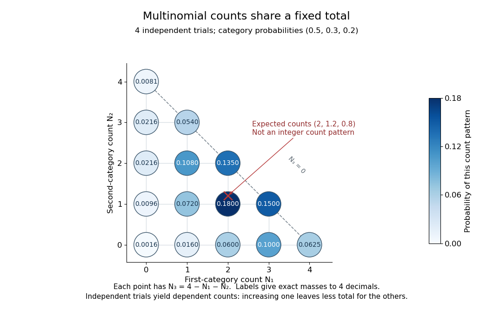

# Multinomial distribution

↑ **Parent:** [Discrete probability distribution](discrete-probability-distribution-split.md)  
ⓦ [Wiki](https://en.wikipedia.org/wiki/Multinomial_distribution)

A [multinomial distribution](multinomial-distribution.md) describes category counts from $n$ [independent](independent-random-variables.md) trials, each choosing exactly one of $k$ categories with the same [probabilities](probability.md) $p_1,\ldots,p_k$. Require $n\geq0$ to be an [integer](integer-split.md), $p_i\geq0$, and $\sum_i p_i=1$. If $N_i$ counts the trials in category $i$, then $\sum_iN_i=n$ and

$$
\mathbb P(N_1=n_1,\ldots,N_k=n_k)
=\frac{n!}{n_1!\cdots n_k!}\prod_{i=1}^k p_i^{n_i},
\qquad n_i\geq0,\quad\sum_i n_i=n.
$$

The $n_i$ are [integers](integer-split.md), and the mass is zero for other count patterns. A category with $p_i=0$ has count zero [almost surely](almost-sure-convergence.md), with $0^0=1$ in this formula. For a specified ordered trial [sequence](sequence.md), [independence](independent-random-variables.md) gives the [product of numbers](product-of-numbers.md) $\prod_i p_i^{n_i}$; the [multinomial coefficient](multinomial-coefficient.md) counts the different [sequences](sequence.md) with that same count pattern.

For four trials with category [probabilities](probability.md) $(1/2,3/10,1/5)$, the count pattern $(2,1,1)$ can occur in $4!/(2!1!1!)=12$ orders, each of [probability](probability.md) $(1/2)^2(3/10)(1/5)=0.015$. Thus its total [probability](probability.md) is $12(0.015)=0.18$. This is a constructed independent-trial example, distinct from drawing four objects without replacement from a ten-object population of composition $(5,3,2)$, where the [multivariate hypergeometric distribution](multivariate-hypergeometric-distribution.md) gives $2/7$.

**[Figure 11](#image-three-category-counts-from-four-independent-trials-every-point-fixes-the-third-count-through-the-total). Three category counts from four independent trials: every point fixes the third count through the total**.

The diagram shows all fifteen possible count patterns. [Coordinates](coordinate-linear-algebra.md) $(N_1,N_2)$ determine $N_3=4-N_1-N_2$; the triangle is a constraint on [integer](integer-split.md) counts, not a continuous [probability density](probability-density.md). The [mode](mode-statistics.md) is $(N_1,N_2,N_3)=(2,1,1)$, where the [probability mass function](probability-mass-function.md) is largest, but the [expected values](expected-value-split.md) $(2,1.2,0.8)$ are not a possible count pattern.

Each single count has a [binomial distribution](binomial-distribution.md), because recording category $i$ versus all other categories reduces every trial to a [Bernoulli trial](bernoulli-trial.md). Consequently,

$$
\mathbb E N_i=np_i,\qquad
\operatorname{Var}(N_i)=np_i(1-p_i),\qquad
\operatorname{Cov}(N_i,N_j)=-np_ip_j\quad(i\ne j).
$$

These statements about the joint count model are summarized in Aditya Guntuboyina's lecture notes.[Guntuboyina, Berkeley STAT 238, lecture 12: multinomial distribution](https://stat238.berkeley.edu/spring-2026/lecturetwelve238spring2026/)

Independent trials do not make the resulting counts [independent random variables](independent-random-variables.md). Within one trial the [indicator random variables](indicator-random-variable.md) for two distinct categories cannot both equal one, so their product is zero and their [covariance](covariance.md) is $-p_ip_j$. Summing over independent trials gives $-np_ip_j$. In the four-trial example, the [variances](variance-split.md) are $(1,0.84,0.64)$ and the pairwise [covariances](covariance.md) are $-0.6,-0.4,-0.24$. Knowing that all four trials were in the first category fixes the other two counts at zero.

The attraction is that one formula describes any fixed-total list of category counts while preserving the constraint that they add up to $n$. It underlies [multinomial likelihood](multinomial-likelihood.md) calculations and [uniform balls-in-bins allocation](uniform-balls-in-bins-allocation.md). The [multinomial aggregation](multinomial-aggregation.md) rule lets us merge categories without leaving this family of [probability distributions](probability-distribution-split.md). Allowing independent category counts with an unfixed total instead leads to a different model, related through [Poisson-multinomial conditioning](poisson-multinomial-conditioning.md).

**Table of contents**

- [Multinomial aggregation](multinomial-aggregation.md)
- [Constrained Poisson and multinomial likelihood equivalence](constrained-poisson-and-multinomial-likelihood-equivalence.md)
- [Negative multinomial distribution](negative-multinomial-distribution.md)
  - [Finite-sample bias in a negative multinomial probability estimator](finite-sample-bias-in-a-negative-multinomial-probability-estimator.md)
- [Multinomial central limit theorem](multinomial-central-limit-theorem.md)
- [Uniform balls-in-bins allocation](uniform-balls-in-bins-allocation.md)
  - [Poisson limit for occupancy fractions](poisson-limit-for-occupancy-fractions.md)
- [Multinomial likelihood](multinomial-likelihood.md)
  - [Multinomial deviance](multinomial-deviance.md)
- [Categorical distribution](categorical-distribution.md)

## ↑ Ancestors (7)

1. [Discrete probability distribution](discrete-probability-distribution-split.md)
2. [Probability distribution](probability-distribution-split.md)
3. [Probability theory](probability-theory-split.md)
4. [Probability and statistics](probability-and-statistics-split.md)
5. [Area of mathematics](area-of-mathematics.md)
6. [Mathematics](mathematics-split.md)
7. [Codex Wiki](split.md)

## ← Incoming links (36)

- [Categorical distribution](categorical-distribution.md)
- [Categorical thinning of a Poisson claim count](categorical-thinning-of-a-poisson-claim-count.md)
- [Conditional multinomial sufficient statistics](conditional-multinomial-sufficient-statistics.md)
- [Constrained Poisson and multinomial likelihood equivalence](constrained-poisson-and-multinomial-likelihood-equivalence.md)
- [Discrete-time multi-state model](discrete-time-multi-state-model.md)
- [EM for merged multinomial cells](em-for-merged-multinomial-cells.md)
- [Exact bootstrap distribution for three observations](exact-bootstrap-distribution-for-three-observations.md)
- [Gamma-integrated baseline Poisson likelihood](gamma-integrated-baseline-poisson-likelihood.md)
- [Multinomial aggregation](multinomial-aggregation.md)
- [Multinomial collision proof of three-dimensional walk transience](multinomial-collision-proof-of-three-dimensional-walk-transience.md)
- [Multinomial deviance](multinomial-deviance.md)
- [Multinomial distribution](multinomial-distribution.md)
- [Multivariate hypergeometric distribution](multivariate-hypergeometric-distribution.md)
- [Solution](past-exam-of-the-mathematics-course-of-the-university-of-cambridge/2004/ib/paper-2/10h/solution.md)
- [Solution](past-exam-of-the-mathematics-course-of-the-university-of-cambridge/2004/iii/paper-29/2/solution.md)
- [Solution](past-exam-of-the-mathematics-course-of-the-university-of-cambridge/2004/iii/paper-40/6/i/solution.md)
- [Solution](past-exam-of-the-mathematics-course-of-the-university-of-cambridge/2004/iii/paper-41/1/iii/solution.md)
- [Solution](past-exam-of-the-mathematics-course-of-the-university-of-cambridge/2005/ib/paper-1/7d/solution.md)
- [Solution](past-exam-of-the-mathematics-course-of-the-university-of-cambridge/2005/ib/paper-4/9d/solution.md)
- [Solution](past-exam-of-the-mathematics-course-of-the-university-of-cambridge/2006/ib/paper-3/8c/a/solution.md)
- [Solution](past-exam-of-the-mathematics-course-of-the-university-of-cambridge/2006/iii/paper-47/6/b/solution.md)
- [Solution](past-exam-of-the-mathematics-course-of-the-university-of-cambridge/2008/iii/paper-47/6/b/i/solution.md)
- [Solution](past-exam-of-the-mathematics-course-of-the-university-of-cambridge/2013/iii/paper-34/2/h/solution.md)
- [Solution](past-exam-of-the-mathematics-course-of-the-university-of-cambridge/2013/iii/paper-34/3/a/solution.md)
- [Solution](past-exam-of-the-mathematics-course-of-the-university-of-cambridge/2013/iii/paper-34/3/d/solution.md)
- [Solution](past-exam-of-the-mathematics-course-of-the-university-of-cambridge/2016/ia/paper-2/10f/a/solution.md)
- [Solution](past-exam-of-the-mathematics-course-of-the-university-of-cambridge/2017/ib/paper-1/7h/b/solution.md)
- [Solution](past-exam-of-the-mathematics-course-of-the-university-of-cambridge/2017/ib/paper-4/9h/solution.md)
- [Solution](past-exam-of-the-mathematics-course-of-the-university-of-cambridge/2017/ii/paper-4/5j/a/solution.md)
- [Solution](past-exam-of-the-mathematics-course-of-the-university-of-cambridge/2017/ii/paper-4/5j/b/solution.md)
- [Solution](past-exam-of-the-mathematics-course-of-the-university-of-cambridge/2024/iii/paper-221/1/i/b/solution.md)
- [Poisson offspring clusters directed by their parent process](poisson-offspring-clusters-directed-by-their-parent-process.md)
- [Poisson surrogate for a conditional multinomial model](poisson-surrogate-for-a-conditional-multinomial-model.md)
- [Poisson trick](poisson-trick.md)
- [Rao-Blackwellization of a multinomial probability product](rao-blackwellization-of-a-multinomial-probability-product.md)
- [Uniform balls-in-bins allocation](uniform-balls-in-bins-allocation.md)
