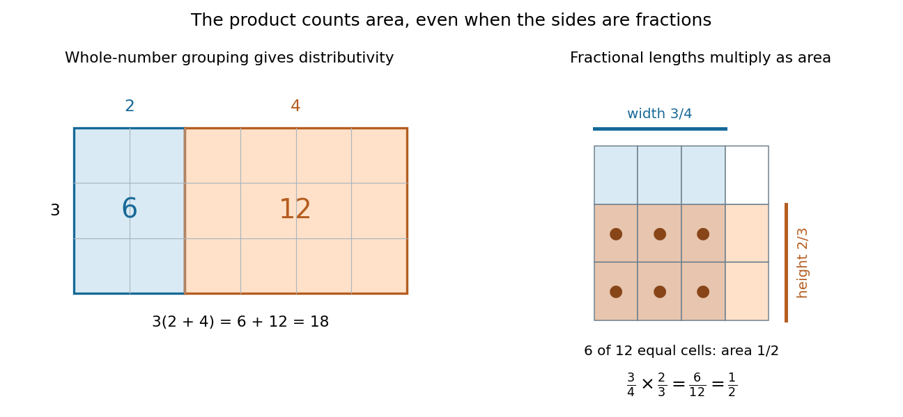

# Multiplication

↑ **Parent:** [Arithmetic](arithmetic-split.md)  
ⓦ [Wiki](https://en.wikipedia.org/wiki/Multiplication)

Multiplication combines two factors into their [product of numbers](product-of-numbers.md). For a [natural number](natural-number.md) $n$, $nx$ is the [sum](sum.md) of $n$ copies of $x$; with no copies the result is zero. This repeated-[addition](addition.md) interpretation directly explains integer grouping, while [multiplication](multiplication.md) of arbitrary [real numbers](real-number.md) also describes scaling by noninteger factors.

A [rectangle](rectangle.md) of side [lengths](length.md) $3$ and $6$ has [area](surface-area.md) $18$. Split the second side into [lengths](length.md) $2$ and $4$. The two [areas](surface-area.md) are $6$ and $12$, giving the visible identity

$$
3(2+4)=3\cdot2+3\cdot4=18.
$$

Rotating the same [rectangle](rectangle.md) interchanges the sides without changing its [area](surface-area.md), explaining $3\cdot6=6\cdot3$. These pictures illustrate [distributivity](distributive-property.md) and [commutativity](commutativity.md) for ordinary positive [numbers](number.md); [matrix multiplication](matrix-multiplication.md) and other operations require their own rules.

**[Figure 9](#image-partitioning-a-rectangle-explains-distributivity-partitioning-a-unit-square-gives-an-exact-product-of-fractions). Partitioning a rectangle explains distributivity; partitioning a unit square gives an exact product of fractions**.

For a fractional example, take $3/2$ of a quantity and then $2/3$ of that result: the combined scale is $(2/3)(3/2)=1$. The two [fractions](fraction.md) are [multiplicative inverses](multiplicative-inverse.md). In the unit [square](square.md) on the right, the overlap of a strip occupying $3/4$ of the width with one occupying $2/3$ of the height contains six of twelve equal cells. Its [area](surface-area.md) is $(3/4)(2/3)=1/2$. The product stays exact even though the [decimal expansion](decimal-expansion.md) of $2/3$ repeats. [OpenStax, Prealgebra 2e, equal-part models of fractions](https://openstax.org/books/prealgebra-2e/pages/4-1-visualize-fractions)

**Table of contents**

- [Product of numbers](product-of-numbers.md)
- [Exponentiation](exponentiation.md)
  - [Cube of a number](cube-of-a-number.md)
  - [Exponent](exponent.md)
  - [Square of a number](square-of-a-number.md)
  - [Hyperoperation](hyperoperation.md)
- [Empty product](empty-product.md)
- [Multiplicative inverse](multiplicative-inverse.md)

## ↑ Ancestors (4)

1. [Arithmetic](arithmetic-split.md)
2. [Area of mathematics](area-of-mathematics.md)
3. [Mathematics](mathematics-split.md)
4. [Codex Wiki](split.md)

## ← Incoming links (70)

- [Abstract syntax tree precedence example](abstract-syntax-tree-precedence-example.md)
- [Abstract syntax tree source location](abstract-syntax-tree-source-location.md)
- [Addition](addition.md)
- [Arithmetic](arithmetic-split.md)
- [Binary powering multiplication count](binary-powering-multiplication-count.md)
- [Bit cost of modular exponentiation](bit-cost-of-modular-exponentiation.md)
- [Chinese remainder theorem](chinese-remainder-theorem.md)
- [Commutative ring](commutative-ring.md)
- [Complex number](complex-number.md)
- [Complex plane](complex-plane.md)
- [Congruence modulo an ideal](congruence-modulo-an-ideal.md)
- [Constant folding](constant-folding.md)
- [Degree of a polynomial](degree-of-a-polynomial.md)
- [Divisibility](divisibility.md)
- [Division (mathematics)](division-mathematics.md)
- [Empty product](empty-product.md)
- [Empty sum](empty-sum.md)
- [Euclid's lemma](euclid-s-lemma.md)
- [Euler's theorem](euler-s-theorem.md)
- [Exponent reduction for units](exponent-reduction-for-units.md)
- [Exponent vector](exponent-vector.md)
- [Exponential generating function](exponential-generating-function.md)
- [Exponentiation](exponentiation.md)
- [Exponentiation by squaring](exponentiation-by-squaring.md)
- [Field with four elements](field-with-four-elements.md)
- [Finite field](finite-field.md)
- [Fundamental theorem of arithmetic](fundamental-theorem-of-arithmetic.md)
- [Gaussian binomial coefficient](gaussian-binomial-coefficient.md)
- [Geometric mean](geometric-mean.md)
- [Growth factor](growth-factor.md)
- [Horner's method](horner-s-method.md)
- [Hyperoperation](hyperoperation.md)
- [Identity element](identity-element.md)
- [Integer arithmetic](integer-arithmetic.md)
- [Interval arithmetic operations](interval-arithmetic-operations.md)
- [Interval square range](interval-square-range.md)
- [Karatsuba digit-operation cost](karatsuba-digit-operation-cost.md)
- [Karatsuba multiplication](karatsuba-multiplication.md)
- [Karatsuba practical crossover](karatsuba-practical-crossover.md)
- [Karatsuba recursion termination](karatsuba-recursion-termination.md)
- [Karatsuba three-product identity](karatsuba-three-product-identity.md)
- [LU factorization and solve costs](lu-factorization-and-solve-costs.md)
- [Matrix ring](matrix-ring.md)
- [Modular arithmetic](modular-arithmetic.md)
- [Modular congruence](modular-congruence.md)
- [Modular exponentiation](modular-exponentiation.md)
- [Modulus](modulus.md)
- [Multiplication](multiplication.md)
- [Multiplicative group of a finite field](multiplicative-group-of-a-finite-field.md)
- [Number line](number-line.md)
- [P-adic number](p-adic-number.md)
- [P-adic valuation](p-adic-valuation.md)
- [Solution](past-exam-of-the-mathematics-course-of-the-university-of-cambridge/2005/iii/paper-6/3/solution.md)
- [Solution](past-exam-of-the-mathematics-course-of-the-university-of-cambridge/2022/ii/paper-2/18h/a/solution.md)
- [Polar form of a complex number](polar-form-of-a-complex-number.md)
- [Polynomial](polynomial-split.md)
- [Prime field](prime-field.md)
- [Prime number](prime-number.md)
- [Prime valuation](prime-valuation.md)
- [Product of numbers](product-of-numbers.md)
- [Residue class](residue-class.md)
- [Ring](ring.md)
- [Spreadsheet formula](spreadsheet-formula.md)
- [Topological group](topological-group-split.md)
- [Total number of prime factors](total-number-of-prime-factors.md)
- [Triangular number](triangular-number.md)
- [Tridiagonal solve costs](tridiagonal-solve-costs.md)
- [Unit modulo n](unit-modulo-n.md)
- [Unit roundoff](unit-roundoff.md)
- [Weierstrass approximation theorem](weierstrass-approximation-theorem.md)
