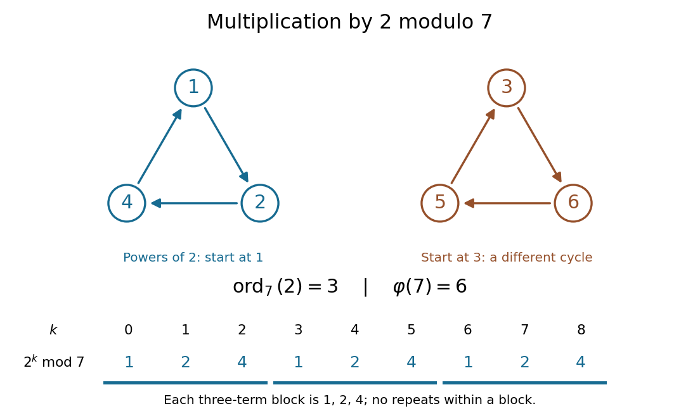

# Multiplicative order

↑ **Parent:** [Number theory](number-theory-split.md)  
ⓦ [Wiki](https://en.wikipedia.org/wiki/Multiplicative_order)

For [coprime integers](coprime-integers.md) $a,n$ with $n>1$, the [multiplicative order](multiplicative-order.md) is the least [positive integer](positive-integer.md) $d$ such that

$$
d=\operatorname{ord}_n(a),\qquad a^d\equiv1\pmod n.
$$

It counts the distinct powers in the [cyclic subgroup](cyclic-subgroup.md) generated by the [congruence class](congruence-class.md) of $a$. Thus it is an [order of a group element](order-of-a-group-element.md) in the [unit group](unit-group.md) $(\mathbb Z/n\mathbb Z)^\times$.[pp. 153 and 156–157, Theorem 6.29](a-computational-introduction-to-number-theory-and-algebra-by-victor-shoup.md)

For example, the [modular exponentiation](modular-exponentiation.md) $2^k\bmod7$, starting at $k=0$, produces $1,2,4,1,2,4,\ldots$. The first return to one takes three steps, so $\operatorname{ord}_7(2)=3$. Starting at the [congruence class](congruence-class.md) three and repeatedly multiplying by two instead gives $3,6,5,3,\ldots$: these are the other three [units](unit-in-a-ring.md) modulo seven, outside the [cyclic subgroup](cyclic-subgroup.md) generated by two.

**[Figure 44](#image-multiplication-by-two-modulo-seven-has-two-cycles-its-powers-follow-the-cycle-through-one). Multiplication by two modulo seven has two cycles; its powers follow the cycle through one**.

[Euler's theorem](euler-s-theorem.md) guarantees a return to one at exponent $\varphi(n)$, where $\varphi$ is [Euler's totient function](euler-totient-function.md). Thus the [multiplicative order](multiplicative-order.md) exists for every [unit](unit-in-a-ring.md).[p. 1, Theorem 1.2; pp. 2–3, permutation of the units and cancellation](euler%E2%80%99s-theorem-by-keith-conrad.md) In fact,

$$
\operatorname{ord}_n(a)\mid\varphi(n).
$$

By [Lagrange's theorem](lagrange-s-theorem.md), the size of the [cyclic subgroup](cyclic-subgroup.md) divides the size of the [unit group](unit-group.md), which is [Euler's totient function](euler-totient-function.md). For two modulo seven, this is $3\mid6$; the [multiplicative order](multiplicative-order.md) need not equal [Euler's totient function](euler-totient-function.md). If $a\equiv1\pmod n$, its [multiplicative order](multiplicative-order.md) is one.

The [coprime integers](coprime-integers.md) hypothesis is necessary: if $a^d=1+kn$, any common [divisor](divisor.md) of $a$ and $n$ divides one. For instance, powers of two modulo eight give $1,2,4,0,0,\ldots$, with no positive-exponent return to one. This [sequence](sequence.md) eventually settles, but two has no [multiplicative order](multiplicative-order.md) modulo eight.

**Table of contents**

- [Decimal period from multiplicative order](decimal-period-from-multiplicative-order.md)
- [Cyclic decimal divisibility](cyclic-decimal-divisibility.md)
- [Periodic modular exponentiation](periodic-modular-exponentiation.md)
  - [Order as the exact period of modular exponentiation](order-as-the-exact-period-of-modular-exponentiation.md)
- [Order verification from divisors](order-verification-from-divisors.md)

## ↑ Ancestors (4)

1. [Number theory](number-theory-split.md)
2. [Area of mathematics](area-of-mathematics.md)
3. [Mathematics](mathematics-split.md)
4. [Codex Wiki](split.md)

## ← Incoming links (43)

- [Candidate-denominator gcd post-processing](candidate-denominator-gcd-post-processing.md)
- [Carmichael function](carmichael-function.md)
- [Decimal period from multiplicative order](decimal-period-from-multiplicative-order.md)
- [Euler's theorem](euler-s-theorem.md)
- [Exponent reduction for units](exponent-reduction-for-units.md)
- [Fermat number](fermat-number.md)
- [Finite quotients of cyclic squaring presentations](finite-quotients-of-cyclic-squaring-presentations.md)
- [Multiplicative order](multiplicative-order.md)
- [Order as the exact period of modular exponentiation](order-as-the-exact-period-of-modular-exponentiation.md)
- [Solution](past-exam-of-the-mathematics-course-of-the-university-of-cambridge/2001/ia/paper-4/7e/b/solution.md)
- [Solution](past-exam-of-the-mathematics-course-of-the-university-of-cambridge/2001/ia/paper-4/7e/c/solution.md)
- [Solution](past-exam-of-the-mathematics-course-of-the-university-of-cambridge/2002/ia/paper-4/8b/solution.md)
- [Solution](past-exam-of-the-mathematics-course-of-the-university-of-cambridge/2002/iii/paper-33/5/solution.md)
- [Solution](past-exam-of-the-mathematics-course-of-the-university-of-cambridge/2003/iii/paper-36/3/solution.md)
- [Solution](past-exam-of-the-mathematics-course-of-the-university-of-cambridge/2005/ii/paper-2/1h/solution.md)
- [Solution](past-exam-of-the-mathematics-course-of-the-university-of-cambridge/2005/iii/paper-58/2/iii/solution.md)
- [Solution](past-exam-of-the-mathematics-course-of-the-university-of-cambridge/2006/iii/paper-3/4/solution.md)
- [Solution](past-exam-of-the-mathematics-course-of-the-university-of-cambridge/2007/ia/paper-5/12/ii/solution.md)
- [Solution](past-exam-of-the-mathematics-course-of-the-university-of-cambridge/2010/ii/paper-4/1g/solution.md)
- [Solution](past-exam-of-the-mathematics-course-of-the-university-of-cambridge/2012/ia/paper-4/6d/solution.md)
- [Solution](past-exam-of-the-mathematics-course-of-the-university-of-cambridge/2013/iii/paper-58/1/a/solution.md)
- [Solution](past-exam-of-the-mathematics-course-of-the-university-of-cambridge/2014/iii/paper-4/3/solution.md)
- [Solution](past-exam-of-the-mathematics-course-of-the-university-of-cambridge/2015/ii/paper-4/1h/solution.md)
- [Solution](past-exam-of-the-mathematics-course-of-the-university-of-cambridge/2016/iii/paper-104/6/c/solution.md)
- [Solution](past-exam-of-the-mathematics-course-of-the-university-of-cambridge/2016/iii/paper-324/1/i/solution.md)
- [Solution](past-exam-of-the-mathematics-course-of-the-university-of-cambridge/2016/iii/paper-324/1/ii/solution.md)
- [Solution](past-exam-of-the-mathematics-course-of-the-university-of-cambridge/2016/iii/paper-324/1/iii/solution.md)
- [Solution](past-exam-of-the-mathematics-course-of-the-university-of-cambridge/2017/ii/paper-1/1g/solution.md)
- [Solution](past-exam-of-the-mathematics-course-of-the-university-of-cambridge/2017/ii/paper-3/1g/solution.md)
- [Solution](past-exam-of-the-mathematics-course-of-the-university-of-cambridge/2019/ii/paper-2/18f/solution.md)
- [Solution](past-exam-of-the-mathematics-course-of-the-university-of-cambridge/2019/ii/paper-3/11i/a/solution.md)
- [Solution](past-exam-of-the-mathematics-course-of-the-university-of-cambridge/2019/ii/paper-3/18f/solution.md)
- [Solution](past-exam-of-the-mathematics-course-of-the-university-of-cambridge/2019/ii/paper-4/10d/a/solution.md)
- [Solution](past-exam-of-the-mathematics-course-of-the-university-of-cambridge/2019/ii/paper-4/10d/b/solution.md)
- [Solution](past-exam-of-the-mathematics-course-of-the-university-of-cambridge/2021/ii/paper-1/1i/solution.md)
- [Solution](past-exam-of-the-mathematics-course-of-the-university-of-cambridge/2023/ii/paper-3/10d/a/solution.md)
- [Solution](past-exam-of-the-mathematics-course-of-the-university-of-cambridge/2023/ii/paper-3/10d/b/solution.md)
- [Solution](past-exam-of-the-mathematics-course-of-the-university-of-cambridge/2023/ii/paper-3/10d/d/solution.md)
- [Solution](past-exam-of-the-mathematics-course-of-the-university-of-cambridge/2024/ia/paper-4/5e/iii/solution.md)
- [Solution](past-exam-of-the-mathematics-course-of-the-university-of-cambridge/2025/iii/paper-324/1/b/ii/solution.md)
- [Pépin's test](pepin-s-test.md)
- [Prime divisor of a Fermat number](prime-divisor-of-a-fermat-number.md)
- [Stronger prime-divisor congruence for Fermat numbers](stronger-prime-divisor-congruence-for-fermat-numbers.md)
