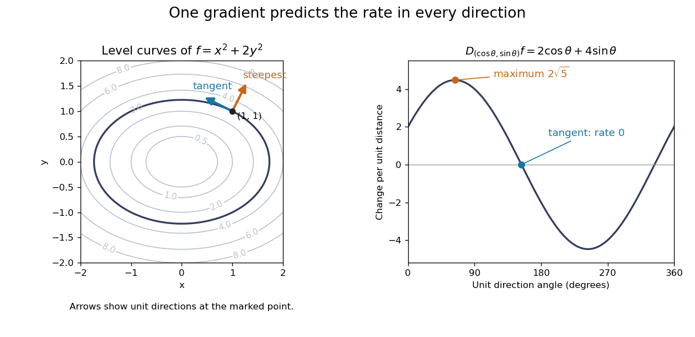
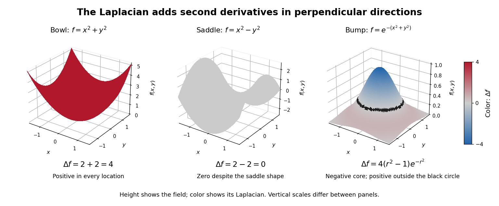
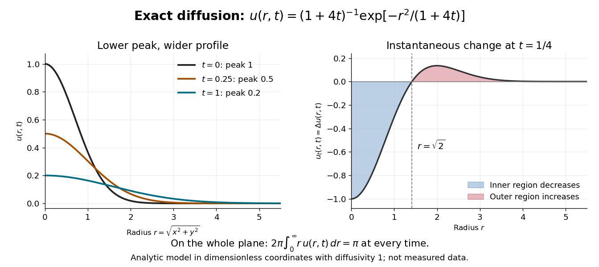
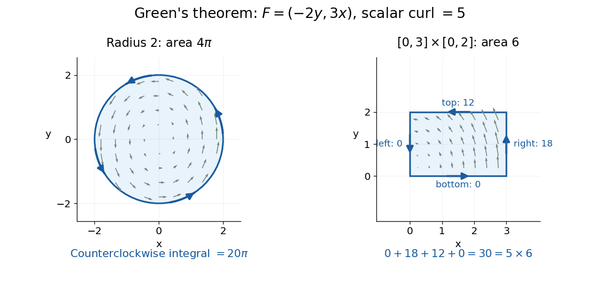
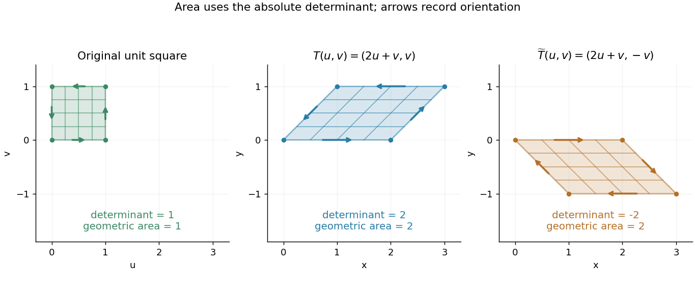

# Multivariable calculus

↑ **Parent:** [Calculus](calculus.md)  
ⓦ [Wiki](https://en.wikipedia.org/wiki/Multivariable_calculus)

Multivariable calculus extends differentiation and integration to functions of several variables.

**Table of contents**

- [Volume integral](#volume-integral)
  - [Volume of a solid with affine thickness](#volume-of-a-solid-with-affine-thickness)
- [Fundamental theorem of calculus along a line segment](#fundamental-theorem-of-calculus-along-a-line-segment)
- [Partial derivative](#partial-derivative)
  - [Partial derivatives do not imply continuity](#partial-derivatives-do-not-imply-continuity)
  - [Mixed partial derivative](#mixed-partial-derivative)
    - [Unequal mixed partial derivatives](#unequal-mixed-partial-derivatives)
    - [Symmetry of second derivatives](#symmetry-of-second-derivatives)
  - [Time derivative](#time-derivative)
  - [Spatial derivative](#spatial-derivative)
  - [Directional derivative](#directional-derivative)
    - [Directional derivatives do not imply differentiability](#directional-derivatives-do-not-imply-differentiability)
    - [Directional derivative of a convex function is sublinear](#directional-derivative-of-a-convex-function-is-sublinear)
  - [Gradient](#gradient)
    - [Gradient of a radial function](#gradient-of-a-radial-function)
    - [Gradient of a dot product](#gradient-of-a-dot-product)
    - [Gradient field](#gradient-field)
  - [Total differential](#total-differential)
- [Hessian matrix](#hessian-matrix)
  - [Quadratic growth from a bounded Hessian](#quadratic-growth-from-a-bounded-hessian)
  - [Higher-order test for separated extrema](#higher-order-test-for-separated-extrema)
  - [Negative semidefinite matrix](#negative-semidefinite-matrix)
  - [Second-derivative test](#second-derivative-test)
    - [Existence of second partial derivatives does not justify the Hessian test](#existence-of-second-partial-derivatives-does-not-justify-the-hessian-test)
    - [Critical points escaping to infinity in a Gaussian-weighted bilinear function](#critical-points-escaping-to-infinity-in-a-gaussian-weighted-bilinear-function)
  - [Nondegenerate critical point](#nondegenerate-critical-point)
- [Vector calculus](#vector-calculus)
  - [Euclidean scalar-gradient stress identity](#euclidean-scalar-gradient-stress-identity)
  - [Vector Analysis (book)](#vector-analysis-book)
  - [Dot-product gradient identity](#dot-product-gradient-identity)
  - [Helmholtz decomposition](#helmholtz-decomposition)
  - [Divergence of a cross product](#divergence-of-a-cross-product)
  - [Vector field](#vector-field)
    - [Flow of a vector field](#flow-of-a-vector-field)
    - [Time-dependent vector field](#time-dependent-vector-field)
      - [Finite-time flow completeness on a compact manifold](#finite-time-flow-completeness-on-a-compact-manifold)
    - [Radial dilation tangency to homogeneous zero sets](#radial-dilation-tangency-to-homogeneous-zero-sets)
    - [Divergence and curl of a radial vector field](#divergence-and-curl-of-a-radial-vector-field)
      - [Radial power-law flux through a spherical shell](#radial-power-law-flux-through-a-spherical-shell)
    - [Azimuthal inverse-radius vector field](#azimuthal-inverse-radius-vector-field)
    - [Integral curve of a vector field](#integral-curve-of-a-vector-field)
      - [Curvature of an integral curve of a vector field](#curvature-of-an-integral-curve-of-a-vector-field)
    - [Axisymmetric vector field](#axisymmetric-vector-field)
    - [Solenoidal vector field](#solenoidal-vector-field)
      - [Solenoidal flux depends on the oriented boundary](#solenoidal-flux-depends-on-the-oriented-boundary)
      - [Poloidal-toroidal decomposition](#poloidal-toroidal-decomposition)
        - [Poloidal magnetic energy bound by the radial scalar gradient](#poloidal-magnetic-energy-bound-by-the-radial-scalar-gradient)
  - [Spherically symmetric function](#spherically-symmetric-function)
  - [Helicity conservation by tangent boundary conditions](#helicity-conservation-by-tangent-boundary-conditions)
  - [Divergence](#divergence)
    - [Divergence of a Riemannian vector field](#divergence-of-a-riemannian-vector-field)
    - [Cylindrically radial divergence](#cylindrically-radial-divergence)
    - [Distributional divergence](#distributional-divergence)
    - [Divergence in polar coordinates](#divergence-in-polar-coordinates)
    - [Product rule for divergence](#product-rule-for-divergence)
    - [Total divergence](#total-divergence)
      - [Total divergences in a variational principle](#total-divergences-in-a-variational-principle)
    - [Divergence of a curl is zero](#divergence-of-a-curl-is-zero)
  - [Curl](#curl)
    - [Curl of a gradient](#curl-of-a-gradient)
    - [Irrotational vector field](#irrotational-vector-field)
    - [Vector potential](#vector-potential)
      - [Radial vector potential of a solenoidal vector field](#radial-vector-potential-of-a-solenoidal-vector-field)
    - [Curl of the curl identity](#curl-of-the-curl-identity)
  - [Laplacian](#laplacian)
    - [Rotational invariance of the Laplacian](#rotational-invariance-of-the-laplacian)
    - [Laplacian as departure from a local average](#laplacian-as-departure-from-a-local-average)
    - [Gaussian diffusion of a smooth initial profile](#gaussian-diffusion-of-a-smooth-initial-profile)
    - [Laplacian in polar coordinates](#laplacian-in-polar-coordinates)
      - [Cartesian second derivatives in polar coordinates](#cartesian-second-derivatives-in-polar-coordinates)
    - [Product rule for the Laplacian](#product-rule-for-the-laplacian)
    - [Biharmonic operator](#biharmonic-operator)
      - [Clamped biharmonic problem](#clamped-biharmonic-problem)
      - [Biharmonic equation](#biharmonic-equation)
        - [Separated polar solutions of the biharmonic equation](#separated-polar-solutions-of-the-biharmonic-equation)
        - [Complex analytic representation of biharmonic functions](#complex-analytic-representation-of-biharmonic-functions)
        - [Spherical mean of a biharmonic function](#spherical-mean-of-a-biharmonic-function)
  - [Divergence and curl of a cross product](#divergence-and-curl-of-a-cross-product)
    - [Curl of a cross product](#curl-of-a-cross-product)
  - [Levi-Civita symbol](#levi-civita-symbol)
    - [Rotation invariance of the Levi-Civita symbol](#rotation-invariance-of-the-levi-civita-symbol)
    - [Contraction of two Levi-Civita symbols](#contraction-of-two-levi-civita-symbols)
      - [Levi-Civita formulas for a three-dimensional determinant and inverse](#levi-civita-formulas-for-a-three-dimensional-determinant-and-inverse)
    - [Lagrange identity for the cross product](#lagrange-identity-for-the-cross-product)
    - [Triple product](#triple-product)
      - [Vector triple product](#vector-triple-product)
  - [Feasible inner products with two unit vectors](#feasible-inner-products-with-two-unit-vectors)
  - [Conservative vector field](#conservative-vector-field)
    - [Integrating-factor equation for a planar vector field](#integrating-factor-equation-for-a-planar-vector-field)
    - [Periods obstruct a periodic potential](#periods-obstruct-a-periodic-potential)
    - [Potential of a conservative vector field](#potential-of-a-conservative-vector-field)
      - [Radial integral potential for a curl-free field](#radial-integral-potential-for-a-curl-free-field)
  - [Divergence theorem](#divergence-theorem)
    - [Vector curl form of the divergence theorem](#vector-curl-form-of-the-divergence-theorem)
    - [Conical flux by closing with a cap](#conical-flux-by-closing-with-a-cap)
    - [Flux of a vector field with an integrable tangential singularity](#flux-of-a-vector-field-with-an-integrable-tangential-singularity)
    - [Polynomial flux through a half-ellipsoid](#polynomial-flux-through-a-half-ellipsoid)
    - [Removing a singular axis in a flux integral](#removing-a-singular-axis-in-a-flux-integral)
    - [Gradient volume-to-boundary identity](#gradient-volume-to-boundary-identity)
    - [Vector gradient form of the divergence theorem](#vector-gradient-form-of-the-divergence-theorem)
    - [Boundary integral of position and normal components](#boundary-integral-of-position-and-normal-components)
    - [An entire bounded vector field cannot have nonzero constant divergence](#an-entire-bounded-vector-field-cannot-have-nonzero-constant-divergence)
    - [Riemannian divergence theorem](#riemannian-divergence-theorem)
  - [Fundamental theorem for line integrals](#fundamental-theorem-for-line-integrals)
    - [Path independence](#path-independence)
      - [Coinciding path integrals need not imply a conservative field](#coinciding-path-integrals-need-not-imply-a-conservative-field)
      - [Agreement of two path integrals does not imply conservativeness](#agreement-of-two-path-integrals-does-not-imply-conservativeness)
  - [Stokes theorem](#stokes-theorem)
    - [Cross-product form of Stokes theorem](#cross-product-form-of-stokes-theorem)
    - [Circulation around a hole in an oriented surface](#circulation-around-a-hole-in-an-oriented-surface)
    - [Vector-valued Stokes identity](#vector-valued-stokes-identity)
    - [Stokes flux through an annular paraboloid](#stokes-flux-through-an-annular-paraboloid)
  - [Surface integral](#surface-integral)
    - [Rotational flux through an ellipsoidal graph patch](#rotational-flux-through-an-ellipsoidal-graph-patch)
    - [Flux of a linear field through a sphere](#flux-of-a-linear-field-through-a-sphere)
    - [Oriented surface element of an ellipsoid of revolution](#oriented-surface-element-of-an-ellipsoid-of-revolution)
    - [Flux of the position vector through a cone](#flux-of-the-position-vector-through-a-cone)
    - [Vector surface element of a graph](#vector-surface-element-of-a-graph)
    - [Oriented surface element](#oriented-surface-element)
    - [Parametrized surface](#parametrized-surface)
    - [Surface area of a graph](#surface-area-of-a-graph)
    - [Flux integral](#flux-integral)
      - [Radial flux through a truncated unit sphere](#radial-flux-through-a-truncated-unit-sphere)
  - [Green theorem](#green-theorem)
    - [Boundary formula for planar area](#boundary-formula-for-planar-area)
    - [Green theorem circulation examples](#green-theorem-circulation-examples)
    - [Green theorem with holes](#green-theorem-with-holes)
  - [Line integral](#line-integral)
    - [Improper line integral](#improper-line-integral)
    - [Vector line integral weighted by a scalar field](#vector-line-integral-weighted-by-a-scalar-field)
  - [Tensor divergence theorem](#tensor-divergence-theorem)
    - [Integration by parts for tensor fields](#integration-by-parts-for-tensor-fields)
- [Jacobian matrix and determinant](#jacobian-matrix-and-determinant)
  - [Jacobian matrix](#jacobian-matrix)
    - [Finite-difference Jacobian](#finite-difference-jacobian)
    - [Spatial derivative control in perturbations of the identity map](#spatial-derivative-control-in-perturbations-of-the-identity-map)
    - [Jacobian determinant](#jacobian-determinant)
      - [Jacobian determinant as a divergence](#jacobian-determinant-as-a-divergence)
- [Change of variables formula](#change-of-variables-formula)
  - [Ordered-cone substitution by products and ratios](#ordered-cone-substitution-by-products-and-ratios)
  - [Ratio-product coordinates](#ratio-product-coordinates)
  - [Squared-radius difference substitution](#squared-radius-difference-substitution)
  - [Weighted inverse multiplicity](#weighted-inverse-multiplicity)
  - [Rational square diffeomorphism](#rational-square-diffeomorphism)
  - [Hyperbolic substitution](#hyperbolic-substitution)
  - [Monotone substitution inequality](#monotone-substitution-inequality)
  - [Area formula (geometric measure theory)](#area-formula-geometric-measure-theory)
  - [Polar coordinates](#polar-coordinates)
    - [Logarithmic polar coordinate change](#logarithmic-polar-coordinate-change)
    - [Polar area element](#polar-area-element)
    - [Cylindrical coordinate system](#cylindrical-coordinate-system)
      - [Azimuthal derivative of a cylindrical vector Fourier mode](#azimuthal-derivative-of-a-cylindrical-vector-fourier-mode)
      - [Cylindrical radius](#cylindrical-radius)
    - [Cardioid](#cardioid)
      - [Area and perimeter of a cardioid](#area-and-perimeter-of-a-cardioid)
      - [Polar cap between a cardioid and a circle](#polar-cap-between-a-cardioid-and-a-circle)
  - [Orthogonal coordinates](#orthogonal-coordinates)
    - [Parabolic cylindrical coordinates](#parabolic-cylindrical-coordinates)
    - [Divergence and curl from orthogonal coordinate gradients](#divergence-and-curl-from-orthogonal-coordinate-gradients)
    - [Gradient in orthogonal coordinates](#gradient-in-orthogonal-coordinates)
    - [Circular torus coordinates](#circular-torus-coordinates)
    - [Bipolar coordinates](#bipolar-coordinates)
      - [Dirichlet problem between bipolar coordinate circles](#dirichlet-problem-between-bipolar-coordinate-circles)
    - [Elliptic cylindrical coordinates](#elliptic-cylindrical-coordinates)
      - [Vector calculus in elliptic cylindrical coordinates](#vector-calculus-in-elliptic-cylindrical-coordinates)
    - [Parabolic coordinates](#parabolic-coordinates)
    - [Del in cylindrical and spherical coordinates](#del-in-cylindrical-and-spherical-coordinates)
    - [Hyperspherical coordinates](#hyperspherical-coordinates)
      - [Spherical coordinate system](#spherical-coordinate-system)
        - [Longitude](#longitude)
        - [Colatitude](#colatitude)
        - [Polar angle](#polar-angle)
        - [Exponential spherical mass factor](#exponential-spherical-mass-factor)
        - [Radial unit vector in spherical coordinates](#radial-unit-vector-in-spherical-coordinates)
        - [Scale factors of orthogonal coordinates](#scale-factors-of-orthogonal-coordinates)
        - [Curl in spherical coordinates](#curl-in-spherical-coordinates)
      - [Volume of an n-ball](#volume-of-an-n-ball)
      - [Surface area of an n-sphere](#surface-area-of-an-n-sphere)
- [Differentiable map](#differentiable-map)
  - [Functionally independent functions](#functionally-independent-functions)
  - [Derivative of a map into a level set](#derivative-of-a-map-into-a-level-set)
  - [Fréchet derivative](#frechet-derivative)
    - [Differentiability under equivalent norms](#differentiability-under-equivalent-norms)
    - [Hadamard differentiability](#hadamard-differentiability)
      - [Hadamard remainder near a compact set](#hadamard-remainder-near-a-compact-set)
      - [Stieltjes bilinear functional under a variation constraint](#stieltjes-bilinear-functional-under-a-variation-constraint)
    - [Fréchet differentiability](#frechet-differentiability)
    - [Derivative of matrix inversion](#derivative-of-matrix-inversion)
  - [Continuously differentiable function](#continuously-differentiable-function)
  - [Invertible linear map](#invertible-linear-map)
  - [Mean value inequality](#mean-value-inequality)
    - [Zero derivative on a connected open set](#zero-derivative-on-a-connected-open-set)
  - [Inverse function theorem](#inverse-function-theorem)
    - [Derivative of a local inverse map](#derivative-of-a-local-inverse-map)
      - [First three derivatives of an inverse function](#first-three-derivatives-of-an-inverse-function)
    - [Constant rank theorem](#constant-rank-theorem)
      - [Rank-one level curves from a characteristic differential equation](#rank-one-level-curves-from-a-characteristic-differential-equation)
    - [Local diffeomorphism](#local-diffeomorphism)
      - [Noninjective map with constant Jacobian determinant](#noninjective-map-with-constant-jacobian-determinant)
      - [Open map](#open-map)
    - [Implicit function theorem](#implicit-function-theorem)
      - [Holomorphic implicit function theorem](#holomorphic-implicit-function-theorem)
      - [Implicit differentiation](#implicit-differentiation)
        - [Reciprocity rule for constrained partial derivatives](#reciprocity-rule-for-constrained-partial-derivatives)
        - [Cyclic partial derivative identity](#cyclic-partial-derivative-identity)

## Volume integral

↑ **Parent:** [Multivariable calculus](multivariable-calculus.md)  
ⓦ [Wiki](https://en.wikipedia.org/wiki/Volume_integral)

A [volume integral](#volume-integral) integrates a scalar or componentwise [vector field](#vector-field) over a three-dimensional region with its [volume form](differential-form.md#volume-form). In [spherical polar coordinates](#spherical-coordinate-system) the Euclidean volume form is $r^2\sin\theta\,dr\,d\theta\,d\phi$. The [divergence theorem](#divergence-theorem) relates a volume integral of a [divergence](#divergence) to a boundary [flux integral](#flux-integral).

### Volume of a solid with affine thickness

↑ **Parent:** [Volume integral](#volume-integral)

Let a bounded planar region $D$ have positive [area](differential-geometry.md#surface-area) $A$ and [centroid](euclidean-geometry.md#centroid) $\overline{\mathbf x}=A^{-1}\int_D\mathbf x\,dA$. If a solid has nonnegative thickness $h(\mathbf x)=c+\mathbf v\cdot\mathbf x$ above $D$, its [volume integral](#volume-integral) gives

$$
V=\int_D h(\mathbf x)\,dA=A\left(c+\mathbf v\cdot\overline{\mathbf x}\right)=A\,h(\overline{\mathbf x}).
$$

Thus the average of an [affine function](vector-space.md#affine-function) over a region is its value at the [centroid](euclidean-geometry.md#centroid). The proof is the [linearity of integration](integral.md#linearity-of-integration). For a [disk](topology.md#disk-mathematics) the [centroid](euclidean-geometry.md#centroid) is its centre, making the formula particularly useful for a cylindrical bore cut through a solid whose width varies linearly with height.

## Fundamental theorem of calculus along a line segment

↑ **Parent:** [Multivariable calculus](multivariable-calculus.md)

If $f:U\to\mathbb R^m$ is continuously differentiable and the segment from $x$ to $y$ lies in $U$, then

$$
f(y)-f(x)=\int_0^1Df(x+t(y-x))(y-x)\,dt.
$$

## Partial derivative

↑ **Parent:** [Multivariable calculus](multivariable-calculus.md)  
ⓦ [Wiki](https://en.wikipedia.org/wiki/Partial_derivative)

A [partial derivative](#partial-derivative) measures the local response of a [function](function.md) to one input while its other inputs stay fixed. For a [function](function.md) $f$ on an [open subset](topology.md#open-set) of $\mathbb R^2$, its [partial derivatives](#partial-derivative) at $(a,b)$ are the [limits](calculus.md#limit-of-a-function)

$$
f_x(a,b)=\lim_{h\to0}\frac{f(a+h,b)-f(a,b)}{h},
\qquad
f_y(a,b)=\lim_{k\to0}\frac{f(a,b+k)-f(a,b)}{k},
$$

when the respective [limits](calculus.md#limit-of-a-function) exist. Each is an ordinary [derivative](calculus.md#derivative) of a one-variable slice: $x\mapsto f(x,b)$ or $y\mapsto f(a,y)$. This is why the other variable is treated as a constant during [partial differentiation](#partial-derivative).[Calculus Volume 3, §4.3, definitions (4.12)–(4.13) and the one-variable slice interpretation](mathematics-bibliography.md#calculus-volume-3-by-gilbert-strang-and-others/4-3-partial-derivatives)

For an original example, take the [polynomial function](polynomial.md#polynomial-function)

$$
f(x,y)=x^2+xy+2y^2.
$$

Holding $y$ fixed gives $f_x=2x+y$, while holding $x$ fixed gives $f_y=x+4y$. At $(1,1)$, the height is $f=4$ and the two [partial derivatives](#partial-derivative) are **$f_x=3$ and $f_y=5$**. The values answer different experiments on the same mathematical model: change $x$ alone, or change $y$ alone.

The two exact slices through that point are

$$
f(1+t,1)=4+3t+t^2,\qquad
f(1,1+t)=4+5t+2t^2.
$$

Dividing either height change by $t\ne0$ gives $3+t$ or $5+2t$; taking the [limit](calculus.md#limit-of-a-function) $t\to0$ recovers the two slopes. At $t=0.1$, the finite height changes are $0.31$ and $0.52$, although their [linear approximations](calculus.md#linear-approximation) are $0.3$ and $0.5$. A [derivative](calculus.md#derivative) measures the limiting response, rather than an exact finite change.

**[Figure 1](#image-two-coordinate-slices-through-one-point-give-different-partial-derivatives). Two coordinate slices through one point give different partial derivatives**. Original [contour plot](topology.md#contour-plot) of $f=x^2+xy+2y^2$, with the point $(1,1)$ and coordinate paths. The right panel compares the exact slice height changes $3t+t^2$ and $5t+2t^2$ with their [tangent line](calculus.md#tangent-line) predictions $3t$ and $5t$. Both slices pass through height $4$.

For a [function](function.md) of $n$ variables, $\partial_j f(a)$ varies only its $j$th coordinate: it is the same [difference quotient](calculus.md#difference-quotient) along $e_j$, the $j$th [standard basis](vector-space.md#standard-basis) [vector](vector-space.md#vector). This gives a practical [sensitivity analysis](probability-and-statistics.md#sensitivity-analysis): one can compare how a [mathematical model](mathematics.md#mathematical-model) responds to changes in its individual inputs, provided the chosen [system of units](physics.md#system-of-units) and the quantities held fixed are stated. Comparing the numerical sizes of two [partial derivatives](#partial-derivative) in different units does not by itself identify a physically preferable input.

Existence of the [partial derivatives](#partial-derivative) at one point is weaker than [differentiability](analysis.md#differentiability). The example under [partial derivatives do not imply continuity](#partial-derivatives-do-not-imply-continuity) shows how both coordinate tests can miss a bad diagonal approach. When the first [partial derivatives](#partial-derivative) are continuous in a neighborhood, they do give [differentiability](analysis.md#differentiability) there, allowing the [total differential](#total-differential) to combine all small input changes.

### Partial derivatives do not imply continuity

↑ **Parent:** [Partial derivative](#partial-derivative)

Define $f(x,y)=xy/(x^2+y^2)$ away from the origin and zero at the origin. Both [partial derivatives](#partial-derivative) exist everywhere and are zero at the origin, yet along $x=y$ the function is $1/2$, so it is not [continuous](calculus.md#continuous-function) there. Coordinate-axis derivative tests do not control all neighboring directions.

### Mixed partial derivative

↑ **Parent:** [Partial derivative](#partial-derivative)

A mixed partial derivative takes [partial derivatives](#partial-derivative) in different variables, for example $f_{xy}=\partial_y(\partial_x f)$. If both second [partial derivatives](#partial-derivative) are continuous in a neighbourhood, their order can be interchanged: $f_{xy}=f_{yx}$. The [chain rule](calculus.md#chain-rule) transforms mixed partial derivatives under a linear [change of variables](#change-of-variables-formula) by composing the corresponding first-order differential operators.

#### Unequal mixed partial derivatives

↑ **Parent:** [Mixed partial derivative](#mixed-partial-derivative)

For $f(x,y)=xy(x^2-y^2)/(x^2+y^2)$ away from the origin and zero at the origin, $|f|\leq(x^2+y^2)/2$ proves [Fréchet differentiability](#frechet-differentiability) with zero derivative. Yet $f_x(0,y)=-y$ and $f_y(x,0)=x$, giving the displayed unequal [mixed partial derivatives](#mixed-partial-derivative). They exist but are not continuous at the origin, so [Clairaut's theorem](#symmetry-of-second-derivatives) does not apply.

#### Symmetry of second derivatives

↑ **Parent:** [Mixed partial derivative](#mixed-partial-derivative)  
ⓦ [Wiki](https://en.wikipedia.org/wiki/Symmetry_of_second_derivatives)

When the second [partial derivatives](#partial-derivative) are continuous in a neighborhood, the order of the [mixed partial derivatives](#mixed-partial-derivative) can be interchanged. Expressing a rectangular finite difference as either iterated integral by the [fundamental theorem of calculus](calculus.md#fundamental-theorem-of-calculus) and shrinking the rectangle proves the equality. Mere existence of both derivatives does not imply this symmetry.

### Time derivative

↑ **Parent:** [Partial derivative](#partial-derivative)

A time derivative is the [partial derivative](#partial-derivative) of an evolving field with respect to time while holding its spatial coordinates fixed. For a quantity depending only on time, it is an ordinary [derivative](calculus.md#derivative).

### Spatial derivative

↑ **Parent:** [Partial derivative](#partial-derivative)

A spatial derivative is a [partial derivative](#partial-derivative) with respect to a spatial coordinate.

### Directional derivative

↑ **Parent:** [Partial derivative](#partial-derivative)  
ⓦ [Wiki](https://en.wikipedia.org/wiki/Directional_derivative)

The [directional derivative](#directional-derivative) tests a [function](function.md) along a chosen [straight line](euclidean-geometry.md#straight-line), including lines that follow neither coordinate axis. For a fixed [vector](vector-space.md#vector) $v$ and a point $a$ in an [open subset](topology.md#open-set) of $\mathbb R^n$, define

$$
D_vf(a)=\lim_{t\to0}\frac{f(a+tv)-f(a)}{t}
=\left.\frac d{dt}f(a+tv)\right|_{t=0},
$$

if the [limit](calculus.md#limit-of-a-function) exists. With a [unit vector](vector-space.md#unit-vector) $v$, the parameter $t$ measures signed distance in the input [Euclidean space](normed-vector-space.md#euclidean-norm), so the [directional derivative](#directional-derivative) is change per unit distance. For a general $v$, it is change per unit parameter; the [norm](normed-vector-space.md#norm) of $v$ also sets the rate of travel.[Calculus Volume 3, §4.6, definition (4.36), unit-direction convention](mathematics-bibliography.md#calculus-volume-3-by-gilbert-strang-and-others/4-6-directional-derivatives-and-the-gradient)

For a [differentiable](analysis.md#differentiable-function) real-valued [function](function.md), the [multivariable chain rule](calculus.md#multivariable-chain-rule) gives

$$
D_vf(a)=\nabla f(a)\cdot v.
$$

Thus one [gradient](#gradient) predicts the local response in every direction. This formula requires [differentiability](analysis.md#differentiability), rather than merely separate [partial derivatives](#partial-derivative).[Calculus Volume 3, §4.6, Theorem 4.12 and the gradient formulation](mathematics-bibliography.md#calculus-volume-3-by-gilbert-strang-and-others/4-6-directional-derivatives-and-the-gradient)

Return to $f(x,y)=x^2+xy+2y^2$ at $a=(1,1)$. Its [gradient](#gradient) is $(3,5)$. In the [unit direction](vector-space.md#unit-vector) $u=(3/5,4/5)$,

$$
D_uf(a)=3\frac35+5\frac45=\boxed{\frac{29}{5}}.
$$

One can check this without invoking the [gradient](#gradient) formula: substitution gives

$$
f\left(1+\frac35t,1+\frac45t\right)
=4+\frac{29}{5}t+\frac{53}{25}t^2.
$$

The [difference quotient](calculus.md#difference-quotient) is $29/5+(53/25)t$, whose [limit](calculus.md#limit-of-a-function) is $29/5$. This calculation separates the exact change along a finite path from its first-order rate at the starting point.

Changing the travel speed changes the parameter rate. Taking $v=(3,4)=5u$ gives $D_vf(a)=29$, because the input travels five distance units per parameter unit. For a [differentiable function](analysis.md#differentiable-function), $D_{cv}f(a)=cD_vf(a)$ for any real $c$: negative $c$ reverses the orientation as well as scaling the rate. Normalizing $v$ before comparing different slopes avoids confusing direction with speed.

**[Figure 2](#image-directional-derivatives-compare-directions-a-total-differential-predicts-small-finite-changes). Directional derivatives compare directions; a total differential predicts small finite changes**. Left: for $f=x^2+xy+2y^2$ at $(1,1)$, the rate in the [unit direction](vector-space.md#unit-vector) $(\cos\theta,\sin\theta)$ is $3\cos\theta+5\sin\theta$. Right: along the displacement $s(0.02,-0.01)$, the exact height change is $0.01s+0.0004s^2$, compared with its [linear approximation](calculus.md#linear-approximation) $0.01s$. All curves are exact calculations for the example, rather than measured data.

The [Cauchy-Schwarz inequality](probability-and-statistics.md#cauchy-schwarz-inequality) bounds the rate in any [unit direction](vector-space.md#unit-vector) by $\|\nabla f(a)\|$. Here the largest rate is $\sqrt{34}\approx5.831$, attained in the direction $(3,5)/\sqrt{34}$; the chosen $(3/5,4/5)$ gives the slightly smaller rate $5.8$. The perpendicular [unit direction](vector-space.md#unit-vector) $(-5,3)/\sqrt{34}$ gives zero. That means no first-order height change, rather than no change at all: along this direction the example has $f(a+tu)=4+(28/34)t^2$.

This is useful for following a height or [temperature](temperature.md) [scalar field](classical-field-theory.md#scalar-field), choosing a local search direction in [mathematical optimization](mathematical-optimization.md), and distinguishing a coordinate sensitivity from a response along an actual path. For a curved path, [derivative along a curve](calculus.md#derivative-along-a-curve) uses its instantaneous [tangent vector](tangent-vector.md). Even existence of all [directional derivatives](#directional-derivative) does not guarantee one common [linear approximation](calculus.md#linear-approximation); [directional derivatives do not imply differentiability](#directional-derivatives-do-not-imply-differentiability) gives a concrete counterexample.

#### Directional derivatives do not imply differentiability

↑ **Parent:** [Directional derivative](#directional-derivative)

Define $f(x,y)=x^3/(x^2+y^2)$ away from the origin and zero at the origin. Every [directional derivative](#directional-derivative) exists. Along a unit vector $n$, the derivative at the origin is $n_1^3$, which is not linear in $n$. Thus these directional derivatives cannot be the restrictions of one [Fréchet derivative](#frechet-derivative), and the function is not [Fréchet differentiable](#frechet-differentiability) at that point.

#### Directional derivative of a convex function is sublinear

↑ **Parent:** [Directional derivative](#directional-derivative)

For a [locally Lipschitz function](real-analysis.md#locally-lipschitz-function) that is [convex](real-analysis.md#convex-function) near $x$, increasing secant slopes have a finite right limit. Positive rescaling of $t$ gives positive homogeneity in $y$. The [convexity](real-analysis.md#convex-function) bound $f(x+t(y+z))\leq[f(x+2ty)+f(x+2tz)]/2$ gives subadditivity after subtracting $f(x)$, dividing by $t$ and taking the limit. Thus $p_x$ is a finite [sublinear functional](functional-analysis.md#sublinear-function), although it need not be a [linear functional](dual-space.md#linear-functional).

### Gradient

↑ **Parent:** [Partial derivative](#partial-derivative)  
ⓦ [Wiki](https://en.wikipedia.org/wiki/Gradient)

In [Cartesian coordinates](linear-algebra.md#cartesian-coordinate-system) on [Euclidean space](normed-vector-space.md#euclidean-norm), the gradient of a scalar-valued [differentiable function](analysis.md#differentiable-function) is the [vector](vector-space.md#vector) of its first [partial derivatives](#partial-derivative). It converts a [scalar field](classical-field-theory.md#scalar-field), such as [temperature](temperature.md) or a height, into a [vector field](#vector-field) describing its local change.

For a [unit vector](vector-space.md#unit-vector) $u$, the [directional derivative](#directional-derivative) is $D_uf=u\cdot\nabla f$. The [Cauchy-Schwarz inequality](probability-and-statistics.md#cauchy-schwarz-inequality) gives $|D_uf|\leq|\nabla f|$. At a point where $\nabla f\ne0$, the greatest increase per unit distance occurs along $u=\nabla f/|\nabla f|$, while the opposite direction gives the greatest decrease. These are first-order statements at the current point; they do not predict how the [function](function.md) behaves far along a straight path.

For $f(x,y)=x^2+2y^2$ at $(1,1)$, $\nabla f=(2,4)$. Moving in the $x$ direction gives rate $2$ and moving in the $y$ direction gives rate $4$, but the steepest direction is $(1,2)/\sqrt5$, with

$$
D_uf=\boxed{2\sqrt5}.
$$

The direction $(-2,1)/\sqrt5$ has rate zero and is tangent to the [level curve](topology.md#level-curve) through that point. More generally, differentiating $f(\gamma(t))=\text{constant}$ along a regular [level curve](topology.md#level-curve) gives $\nabla f\cdot\gamma'=0$, so the [gradient](#gradient) is its [normal vector](differential-geometry.md#normal-vector).

**[Figure 3](#image-a-gradient-is-normal-to-level-curves-and-determines-the-directional-derivative-for-every-unit-direction). A gradient is normal to level curves and determines the directional derivative for every unit direction**.

This is useful when navigating a measured [scalar field](classical-field-theory.md#scalar-field) or applying [gradient descent](gradient-descent.md): one collection of [partial derivatives](#partial-derivative) predicts every infinitesimal directional change. The derivative assumes a [differentiable function](analysis.md#differentiable-function), not merely the existence of all directional derivatives. [Calculus Volume 3 by Gilbert Strang and others; OpenStax: Directional derivatives and the gradient](mathematics-bibliography.md#calculus-volume-3-by-gilbert-strang-and-others/4-6-directional-derivatives-and-the-gradient).

#### Gradient of a radial function

↑ **Parent:** [Gradient](#gradient)

For $r=\sqrt{x_1^2+\cdots+x_d^2}>0$, the [multivariable chain rule](calculus.md#multivariable-chain-rule) gives

$$
\nabla g(r)=g'(r)\frac{(x_1,\ldots,x_d)}r.
$$

Indeed, $\partial r/\partial x_j=x_j/r$. Thus the [gradient](#gradient) points radially outward when $g'(r)>0$, inward when it is negative, and vanishes when it is zero.

At the origin the displayed quotient does not apply. If $g$ has a finite right [derivative](calculus.md#derivative) at zero, the radial function is differentiable there exactly when $g'(0^+)=0$, in which case its [gradient](#gradient) is zero. Necessity follows by comparing opposite directional difference quotients: their linear parts cannot both equal a common nonzero radial slope. Sufficiency follows from $g(r)-g(0)=o(r)$, the definition of differentiability with zero linear part.

#### Gradient of a dot product

↑ **Parent:** [Gradient](#gradient)

For differentiable [vector fields](#vector-field), expand the [cross products](vector-space.md#cross-product) using the [contraction of two Levi-Civita symbols](#contraction-of-two-levi-civita-symbols). The directional-derivative terms cancel the corresponding terms in the two cross products, leaving $\partial_i(F_jG_j)$. This proves the displayed [gradient](#gradient) identity by the [product rule](calculus.md#product-rule).

#### Gradient field

↑ **Parent:** [Gradient](#gradient)

A gradient field is a vector field of the form $\nabla f$ for a scalar potential $f$. Its curl vanishes wherever the required second derivatives commute.

### Total differential

↑ **Parent:** [Partial derivative](#partial-derivative)

The [total differential](#total-differential) is the [linear map](vector-space.md#linear-map) that combines the first-order responses to simultaneous changes in all coordinates. For a [differentiable](analysis.md#differentiable-function) real-valued [function](function.md) at $a$, it can be written

$$
df_a(h)=\sum_{j=1}^n\partial_j f(a)\,h_j
=\nabla f(a)\cdot h,\qquad
df=\sum_{j=1}^n\frac{\partial f}{\partial x_j}\,dx_j.
$$

Here $h$ is an input [vector](vector-space.md#vector); $dx_j$ denotes the coordinate [linear functional](dual-space.md#linear-functional) $h\mapsto h_j$. The coordinate formula and the [Fréchet derivative](#frechet-derivative) describe the same [linear map](vector-space.md#linear-map). The defining approximation is

$$
f(a+h)-f(a)=df_a(h)+o(\|h\|)\qquad(h\to0).
$$

The [little o notation](real-analysis.md#little-o-notation) says the remaining [approximation error](numerical-analysis.md#approximation-error) becomes small relative to the input [norm](normed-vector-space.md#norm), across every direction of approach.[Calculus Volume 3, §4.4, differentiability definition (4.26) and total differential (4.27)](mathematics-bibliography.md#calculus-volume-3-by-gilbert-strang-and-others/4-4-tangent-planes-and-linear-approximations)

For $f=x^2+xy+2y^2$ at $a=(1,1)$, **$df_a(h,k)=3h+5k$**. A simultaneous change $(h,k)=(0.02,-0.01)$ gives the [linear approximation](calculus.md#linear-approximation)

$$
\Delta f\approx3(0.02)+5(-0.01)=\boxed{0.01}.
$$

The exact algebra is

$$
f(1+h,1+k)-4=3h+5k+h^2+hk+2k^2.
$$

Consequently the exact change is $0.0104$, and the [approximation error](numerical-analysis.md#approximation-error) is $0.0004$. If both input changes are halved, the linear prediction becomes $0.005$ and the error becomes $0.0001$: the first-order response halves, while the quadratic error falls by a factor of four. The right panel under [directional derivative](#directional-derivative) displays this comparison as the displacement is scaled.

For a quick check of [differentiability](analysis.md#differentiability), $|hk|\leq(h^2+k^2)/2$ gives

$$
|h^2+hk+2k^2|\leq\frac52(h^2+k^2).
$$

Dividing by $\sqrt{h^2+k^2}$ makes this bound tend to zero. The same calculation proves that the [tangent plane](tangent-vector.md#tangent-plane) to the [graph of a function](function.md#graph-of-a-function) at $(1,1,4)$ is $z=4+3(x-1)+5(y-1)$. It approximates the entire local surface, rather than only two coordinate slices.

The [total differential](#total-differential) is useful for estimating the combined effect of small input changes without reevaluating a complicated [function](function.md). For example, if $|h|\leq0.02$ and $|k|\leq0.01$, then $|df_a(h,k)|\leq0.11$. The exact remainder bound from the displayed [polynomial](polynomial.md) is at most $0.0008$, so this example has $|\Delta f|\leq0.1108$ throughout that input [rectangle](euclidean-geometry.md#rectangle). These are deterministic bounds; a [variance](variance.md) calculation additionally needs a [joint probability distribution](probability-distribution.md#joint-probability-distribution) and its [covariances](variance.md#covariance). A first-order estimate is also local: large changes require control of the remainder, not merely knowledge of the [partial derivatives](#partial-derivative) at one point.

## Hessian matrix

↑ **Parent:** [Multivariable calculus](multivariable-calculus.md)  
ⓦ [Wiki](https://en.wikipedia.org/wiki/Hessian_matrix)

The [Hessian matrix](#hessian-matrix) describes how the slope of a [function](function.md) changes in different directions. For a real-valued [function](function.md) $f$ with continuous second [partial derivatives](#partial-derivative) on an [open subset](topology.md#open-set) of $\mathbb R^n$, it is

$$
H_f(x)=\left(\frac{\partial^2 f}{\partial x_i\partial x_j}(x)\right)_{i,j=1}^n.
$$

The [symmetry of second derivatives](#symmetry-of-second-derivatives) makes $H_f$ a [symmetric matrix](linear-algebra.md#symmetric-matrix) under these hypotheses. It is also the [Jacobian matrix](#jacobian-matrix) of the [gradient](#gradient): near $x$, a small displacement $h$ changes $\nabla f$ by $H_f(x)h+o(\|h\|)$. Thus the [gradient](#gradient) measures the current slope, while the [Hessian](#hessian-matrix) measures its local variation. [MIT 18.S096 matrix calculus notes, §12.1: Hessian matrices of scalar-valued functions](https://ocw.mit.edu/courses/18-s096-matrix-calculus-for-machine-learning-and-beyond-january-iap-2023/mit18_s096iap23_lec12.pdf)

For example, take the [quadratic form](quadratic-form.md)

$$
q(x,y)=x^2+2xy+3y^2.
$$

Its [gradient](#gradient) and [Hessian matrix](#hessian-matrix) are

$$
\nabla q=(2x+2y,2x+6y)^T,
\qquad
H_q=\begin{pmatrix}2&2\\2&6\end{pmatrix}.
$$

The only [critical point](analysis.md#critical-point) is the origin. Completing the square gives $q=(x+y)^2+2y^2$, so the origin is a strict [global minimum](analysis.md#global-minimum). The [eigenvalues](linear-operator-theory.md#eigenvalue) $4-2\sqrt2$ and $4+2\sqrt2$ are both positive, recovering the same conclusion from the [positive definiteness](bilinear-form.md#positive-definiteness) of the [Hessian](#hessian-matrix). Its [eigenvectors](linear-operator-theory.md#eigenvector) identify the rotated directions in which the [quadratic form](quadratic-form.md) has its smallest and largest bending.

**[Figure 4](#image-positive-negative-and-mixed-hessian-eigenvalues-produce-different-critical-point-geometry). Positive, negative and mixed Hessian eigenvalues produce different critical-point geometry**. Contour plots of $q=x^2+2xy+3y^2$, $-q$, and $s=x^2-y^2$. All three have a [critical point](analysis.md#critical-point) at the origin; the first two have elliptical contours, while the last has positive and negative sectors meeting along its zero contours.

For a fixed [vector](vector-space.md#vector) $v$, restriction to a [straight line](euclidean-geometry.md#straight-line) gives the directional interpretation

$$
\left.\frac{d^2}{dt^2}f(x+tv)\right|_{t=0}=v^TH_f(x)v.
$$

This is the [quadratic form](quadratic-form.md) associated with the [Hessian matrix](#hessian-matrix). For a unit [eigenvector](linear-operator-theory.md#eigenvector) $v$, it equals the corresponding [eigenvalue](linear-operator-theory.md#eigenvalue). Opposite signs therefore mean that some directions bend upwards and others downwards. The [second-derivative test](#second-derivative-test) turns this information into a classification when the [gradient](#gradient) vanishes.

The same object is useful for computation. [Newton's method in optimization](mathematical-optimization.md#newton-s-method-in-optimization) chooses a displacement $h$ by solving $H_f(x)h=-\nabla f(x)$ when the [Hessian matrix](#hessian-matrix) is an [invertible matrix](linear-algebra.md#invertible-matrix); this makes the [gradient](#gradient) of the local quadratic model vanish. For the displayed $q$, the equation gives $h=-(x,y)^T$, so one exact step reaches the minimum from any starting point. For a general [function](function.md), a [Hessian](#hessian-matrix) with opposite-sign [eigenvalues](linear-operator-theory.md#eigenvalue) or a large [condition number](quadratic-form.md#condition-number) need not give a useful minimizing step, and the [local minimum](analysis.md#local-minimum) need not be a [global minimum](analysis.md#global-minimum).

The name honors Otto Hesse. [MIT World Web Math: the Hessian and its namesake](https://web.mit.edu/course/other/wwmath/vectorc/minmax/hessian.html) An older geometric use is the [Hessian criterion for flexes of a plane cubic](normalization-of-an-algebraic-curve.md#hessian-criterion-for-flexes-of-a-plane-cubic), connecting a [determinant](multilinear-algebra.md#determinant) of second [partial derivatives](#partial-derivative) with inflection points of an algebraic [curve](topology.md#curve). Hesse's 1844 paper _Über die Wendepuncte der Curven dritter Ordnung_ is an early source on that geometric problem. [Hesse (1844), Journal für die reine und angewandte Mathematik 28, pp. 97–107: publisher's bibliographic record](https://www.degruyterbrill.com/document/doi/10.1515/crll.1844.28.97/html)

### Quadratic growth from a bounded Hessian

↑ **Parent:** [Hessian matrix](#hessian-matrix)

For $F\in C^2(\mathbb R^n)$ with bounded [Hessian matrix](#hessian-matrix), Taylor's formula along the line from zero to $p$ gives $|F(p)|\leq|F(0)|+|DF(0)||p|+\frac12\|D^2F\|_\infty|p|^2$. Its gradient obeys $|DF(p)|\leq|DF(0)|+\|D^2F\|_\infty|p|$. Consequently $\int_\Omega F(Du)$ is finite for $u\in H^1(\Omega)$ when $\Omega$ has finite measure, and $DF(Du)\in L^2$.

### Higher-order test for separated extrema

↑ **Parent:** [Hessian matrix](#hessian-matrix)

For $f(x,y)=g(x)+h(y)$, a degenerate [Hessian matrix](#hessian-matrix) can be supplemented by the first nonzero term of each one-variable displacement. Two negative leading even powers give a strict [local maximum](analysis.md#local-maximum), two positive ones a strict [local minimum](analysis.md#local-minimum), and opposite signs give a saddle. Looking along the coordinate directions and bounding the separated terms avoids an inconclusive quadratic test.

For an explicit contrast, consider

$$
f_+(x,y)=x^4+y^4,
\qquad
f_-(x,y)=x^4-y^4.
$$

Both have zero [gradient](#gradient) and the same zero [Hessian matrix](#hessian-matrix) at the origin:

$$
H_{f_+}(0,0)=H_{f_-}(0,0)=\begin{pmatrix}0&0\\0&0\end{pmatrix}.
$$

Nevertheless, $f_+$ is positive at every nonzero point, so the origin is a strict [global minimum](analysis.md#global-minimum). For $f_-$, the restrictions $f_-(t,0)=t^4>0$ and $f_-(0,t)=-t^4<0$ for $t\ne0$ show that the origin is a [saddle point of a scalar function](analysis.md#saddle-point-of-a-scalar-function). Identical quadratic information can conceal different geometry when higher-order terms are decisive.

**[Figure 5](#image-the-same-zero-hessian-can-occur-at-a-strict-minimum-or-a-saddle). The same zero Hessian can occur at a strict minimum or a saddle**. The quartic functions $x^4+y^4$ and $x^4-y^4$ both have zero second [partial derivatives](#partial-derivative) at the origin. Their contour geometry and signs differ, so a singular [Hessian matrix](#hessian-matrix) alone cannot classify the [critical point](analysis.md#critical-point).

### Negative semidefinite matrix

↑ **Parent:** [Hessian matrix](#hessian-matrix)

A symmetric matrix $A$ is negative semidefinite when $v^TAv\leq0$ for every vector $v$. Equivalently, all its [eigenvalues](linear-operator-theory.md#eigenvalue) are nonpositive.

### Second-derivative test

↑ **Parent:** [Hessian matrix](#hessian-matrix)  
ⓦ [Wiki](https://en.wikipedia.org/wiki/Second-derivative_test)

Let $f$ have continuous second [partial derivatives](#partial-derivative) near an interior [critical point](analysis.md#critical-point) $x_*$ of an [open subset](topology.md#open-set) of $\mathbb R^n$, with $\nabla f(x_*)=0$. The [Hessian matrix](#hessian-matrix) gives the following sufficient conditions:
- All [eigenvalues](linear-operator-theory.md#eigenvalue) positive: a strict [local minimum](analysis.md#local-minimum).
- All [eigenvalues](linear-operator-theory.md#eigenvalue) negative: a strict [local maximum](analysis.md#local-maximum).
- Both positive and negative [eigenvalues](linear-operator-theory.md#eigenvalue): a [saddle point of a scalar function](analysis.md#saddle-point-of-a-scalar-function).

A [positive semidefinite](quadratic-form.md#positive-semidefinite-matrix) or [negative semidefinite](#negative-semidefinite-matrix) [Hessian matrix](#hessian-matrix) with a zero [eigenvalue](linear-operator-theory.md#eigenvalue) does not settle the classification. The [higher-order test for separated extrema](#higher-order-test-for-separated-extrema) gives two quartic examples with exactly the same zero [Hessian](#hessian-matrix). These conditions apply to an interior [critical point](analysis.md#critical-point); a boundary optimum or a [constrained optimization](numerical-analysis.md#constrained-optimization) problem requires attention to the allowed directions. [MIT 18.013A Calculus with Applications, §11.3: Hessian eigenvalues and the critical-point criterion](https://ocw.mit.edu/ans7870/18/18.013a/textbook/chapter11/section03.html)

The proof outline is the [Taylor expansion](calculus.md#taylor-expansion)

$$
f(x_*+h)-f(x_*)=\frac12h^TH_f(x_*)h+o(\|h\|^2).
$$

For a [positive-definite matrix](quadratic-form.md#positive-definite-matrix), the smallest [eigenvalue](linear-operator-theory.md#eigenvalue) supplies a positive bound proportional to $\|h\|^2$, which dominates the remainder for small enough $h$. Negate the [function](function.md) for the [local maximum](analysis.md#local-maximum) case. For opposite-sign [eigenvalues](linear-operator-theory.md#eigenvalue), choose the two corresponding [eigenvectors](linear-operator-theory.md#eigenvector): the leading terms have opposite signs along their lines.

There are also necessary conditions. At an interior [local minimum](analysis.md#local-minimum), the [Hessian matrix](#hessian-matrix) is [positive semidefinite](quadratic-form.md#positive-semidefinite-matrix); at an interior [local maximum](analysis.md#local-maximum), it is [negative semidefinite](#negative-semidefinite-matrix). Restriction to each [straight line](euclidean-geometry.md#straight-line) reduces this to the one-variable [second derivative](calculus.md#second-derivative) condition. Since the [Laplacian](#laplacian) is the [trace](linear-algebra.md#matrix-trace) of the [Hessian](#hessian-matrix), it is nonnegative at such a [local minimum](analysis.md#local-minimum) and nonpositive at such a [local maximum](analysis.md#local-maximum). The sign of the [Laplacian](#laplacian) alone is insufficient: $x^2-2y^2$ has negative [Laplacian](#laplacian) but a [saddle point of a scalar function](analysis.md#saddle-point-of-a-scalar-function) at the origin.

#### Existence of second partial derivatives does not justify the Hessian test

↑ **Parent:** [Second-derivative test](#second-derivative-test)

Define $f(0,0)=0$ and, elsewhere,

$$
f(x,y)=x^2+y^2-\frac{6x^2y^2}{x^2+y^2}.
$$

All first and second [partial derivatives](#partial-derivative) exist at the origin: $f_x=f_y=f_{xy}=f_{yx}=0$ and $f_{xx}=f_{yy}=2$. Thus its [Hessian matrix](#hessian-matrix) there is the [positive-definite matrix](quadratic-form.md#positive-definite-matrix) $2I$. Nevertheless $f(t,0)=t^2>0$ and $f(t,t)=-t^2<0$ for $t\ne0$, so the origin is a [saddle point of a scalar function](analysis.md#saddle-point-of-a-scalar-function). A valid [second-derivative test](#second-derivative-test) needs a second-order [Taylor expansion](calculus.md#taylor-expansion) with a remainder $o(x^2+y^2)$; continuous second [partial derivatives](#partial-derivative) in a neighborhood are a sufficient hypothesis. Existence of those derivatives at the point alone does not supply this hypothesis.

#### Critical points escaping to infinity in a Gaussian-weighted bilinear function

↑ **Parent:** [Second-derivative test](#second-derivative-test)

The origin is a [saddle point of a scalar function](analysis.md#saddle-point-of-a-scalar-function) for every real parameter. For $\alpha>0$ four further [critical points](analysis.md#critical-point) have $x^2=y^2=1/(2\alpha)$. Equal-sign coordinates give global maxima and opposite-sign coordinates give [global minima](analysis.md#global-minimum), with values $\pm1/(2e\alpha)$. The [Hessian matrix](#hessian-matrix) there is $-4\alpha xy e^{-1}I$. Their distance from the origin is $\alpha^{-1/2}$, so as $\alpha\downarrow0$ they escape every compact region. At nonpositive $\alpha$ the origin is the only [critical point](analysis.md#critical-point). This illustrates why the number of [critical points](analysis.md#critical-point) on an unbounded domain can change without a finite degenerate [critical point](analysis.md#critical-point) appearing.

### Nondegenerate critical point

↑ **Parent:** [Hessian matrix](#hessian-matrix)

A [critical point](analysis.md#critical-point) of a real [function](function.md) with continuous second [partial derivatives](#partial-derivative) is nondegenerate when its [Hessian matrix](#hessian-matrix) is an [invertible matrix](linear-algebra.md#invertible-matrix) there, equivalently when none of its [eigenvalues](linear-operator-theory.md#eigenvalue) is zero. A [positive-definite matrix](quadratic-form.md#positive-definite-matrix) gives a strict [local minimum](analysis.md#local-minimum), a [negative definite](quadratic-form.md#negative-definite-matrix) [Hessian](#hessian-matrix) gives a strict [local maximum](analysis.md#local-maximum), and opposite-sign [eigenvalues](linear-operator-theory.md#eigenvalue) give a [saddle point of a scalar function](analysis.md#saddle-point-of-a-scalar-function). A nondegenerate [critical point](analysis.md#critical-point) need not be an extremum: $x^2-y^2$ has [Hessian matrix](#hessian-matrix) $\operatorname{diag}(2,-2)$, which is an [invertible matrix](linear-algebra.md#invertible-matrix).

Such critical points are the local building blocks of [Morse theory](differential-geometry.md#morse-theory).

## Vector calculus

↑ **Parent:** [Multivariable calculus](multivariable-calculus.md)  
ⓦ [Wiki](https://en.wikipedia.org/wiki/Vector_calculus)

Vector calculus studies differentiation and integration of [scalar fields](classical-field-theory.md#scalar-field) and [vector fields](#vector-field). Three operators answer different local questions: the [gradient](#gradient) describes change of a scalar value, the [divergence](#divergence) describes net outward flow, and the [curl](#curl) describes local circulation. Their associated integral theorems turn local derivatives into measurements along paths and across boundaries.

The difference between [divergence](#divergence) and [curl](#curl) is especially visible in two smooth [vector fields](#vector-field) on three-dimensional [Euclidean space](normed-vector-space.md#euclidean-norm):

$$
F(x,y,z)=(x,y,0),\qquad G(x,y,z)=(-y,x,0).
$$

At each point they have the same [Euclidean norm](normed-vector-space.md#euclidean-norm) $\sqrt{x^2+y^2}$, but their directions differ. For $F$, $\nabla\cdot F=2$ and $\nabla\times F=0$. For $G$, $\nabla\cdot G=0$ and $\nabla\times G=(0,0,2)$. One expands radially in each horizontal plane; the other describes rigid rotation.

**[Figure 6](#image-equal-magnitude-fields-can-have-different-divergence-and-curl-radial-expansion-gives-outward-flux-while-rotation-gives-circulation). Equal-magnitude fields can have different divergence and curl: radial expansion gives outward flux, while rotation gives circulation**.

Around the counterclockwise unit [circle](topology.md#circle) in the plane $z=0$, $F$ is normal to the boundary and has zero tangential component. Its outward planar [flux integral](#flux-integral) is $2\pi$, while its [line integral](#line-integral) around the circle is zero. For $G$ the values are reversed: outward planar [flux](mathematical-physics.md#flux) is zero, and circulation is $2\pi$. The [divergence](#divergence) and [curl](#curl) predict exactly which boundary measurement survives.

Why is this useful? A [velocity field](fluid-mechanics.md#velocity-field) can move material through a boundary or circulate it within a region. [Conservation of mass](continuum-mechanics.md#mass-conservation) connects its [divergence](#divergence) with density changes through the [continuity equation](mathematical-physics.md#continuity-equation); its [curl](#curl) is [vorticity](vorticity.md). In [electromagnetism](electromagnetism.md), the [Maxwell equations](maxwell-equations.md) use the same operators to connect [electric fields](electric-field.md), [magnetic fields](magnetic-field.md), and their sources. The common mathematical language lets the same integral calculations work across different physical models. [OpenStax: Divergence, curl, and their interpretations](https://openstax.org/books/calculus-volume-3/pages/6-5-divergence-and-curl).

The geometric framework behind these operators is developed in [differential forms](differential-form.md). The [Generalized Stokes theorem](differential-form.md#generalized-stokes-theorem) unifies the [fundamental theorem for line integrals](#fundamental-theorem-for-line-integrals), [Green theorem](#green-theorem), [Stokes theorem](#stokes-theorem), and [divergence theorem](#divergence-theorem). In coordinates their formulas look different, but each relates accumulation over a region to a measurement on its boundary.

[Wilson's Vector Analysis](#vector-analysis-book), published in 1901, was based on J. Willard Gibbs's lectures at Yale. Wilson's preface explains that examples from geometry, mechanics, and physics are interspersed with the mathematical development, so readers encounter applications as soon as they have the tools to understand them. That is a useful way to approach [vector calculus](#vector-calculus): learn each operation through a measurement it makes possible. [Wilson: Vector Analysis, 1901, title page and general preface](https://archive.org/details/vectoranalysiste00gibbiala).

### Euclidean scalar-gradient stress identity

↑ **Parent:** [Vector calculus](#vector-calculus)

For a sufficiently smooth real [scalar field](classical-field-theory.md#scalar-field) on [Euclidean space](normed-vector-space.md#euclidean-norm), set $\Sigma_{kj}=\partial_k\psi\partial_j\psi-\delta_{kj}|\nabla\psi|^2/2$. The [product rule](calculus.md#product-rule) and equality of mixed [partial derivatives](#partial-derivative) give

$$
\partial_k\Sigma_{kj}=(\Delta\psi)\partial_j\psi+\partial_k\psi\partial_k\partial_j\psi-\partial_k\psi\partial_j\partial_k\psi=(\Delta\psi)\partial_j\psi.
$$

The [divergence theorem](#divergence-theorem), applied twice, consequently gives the useful pure-boundary identity

$$
\int_V\mathbf r\,\nabla\cdot[(\Delta\psi)\nabla\psi]\,dV=\int_{\partial V}\left[\mathbf r(\Delta\psi)\partial_n\psi-(\partial_n\psi)\nabla\psi+\tfrac12|\nabla\psi|^2\hat{\mathbf n}\right]dS.
$$

Here $\partial_n\psi=\hat{\mathbf n}\cdot\nabla\psi$ uses the outward [unit normal](differential-geometry.md#unit-normal). This is the Euclidean zero-potential counterpart of the [scalar stress-energy divergence identity](classical-field-theory.md#scalar-stress-energy-divergence-identity).

### Vector Analysis (book)

↑ **Parent:** [Vector calculus](#vector-calculus)  
ⓦ [Wiki](https://en.wikipedia.org/wiki/Vector_Analysis)

### Dot-product gradient identity

↑ **Parent:** [Vector calculus](#vector-calculus)

For continuously differentiable [vector fields](#vector-field), the [gradient](#gradient) of their [dot product](inner-product.md#dot-product) expands as displayed. The [contraction of two Levi-Civita symbols](#contraction-of-two-levi-civita-symbols) gives $[F\times(\nabla\times G)]_i=F_j\partial_iG_j-F_j\partial_jG_i$; adding the directional derivative cancels the second term. Interchanging the fields and using the [product rule](calculus.md#product-rule) proves the identity. It does not require either field to be irrotational.

### Helmholtz decomposition

↑ **Parent:** [Vector calculus](#vector-calculus)  
ⓦ [Wiki](https://en.wikipedia.org/wiki/Helmholtz_decomposition)

The [Helmholtz decomposition](#helmholtz-decomposition) separates a [vector field](#vector-field) into a [gradient](#gradient) field and a field with zero [divergence](#divergence). The precise function spaces, [boundary conditions](differential-equation.md#boundary-condition) and decay hypotheses determine existence and uniqueness. In the square-integrable bounded-domain formulation, the solenoidal component is selected by the [Leray-Helmholtz projection](viscous-fluid-flow.md#leray-helmholtz-projection).

### Divergence of a cross product

↑ **Parent:** [Vector calculus](#vector-calculus)

For differentiable vector fields $A$ and $B$,

$$
\nabla\cdot(A\times B)=B\cdot(\nabla\times A)-A\cdot(\nabla\times B).
$$

### Vector field

↑ **Parent:** [Vector calculus](#vector-calculus)  
ⓦ [Wiki](https://en.wikipedia.org/wiki/Vector_field)

A vector field assigns a vector to every point of its domain.

#### Flow of a vector field

↑ **Parent:** [Vector field](#vector-field)

The local flow of a smooth [vector field](#vector-field) is the family of solutions of its [ordinary differential equation](differential-equation.md#ordinary-differential-equation), with $\Phi_0(p)=p$. Uniqueness gives $\Phi_{s+t}=\Phi_s\circ\Phi_t$ wherever defined. A compactly supported smooth [vector field](#vector-field) on a manifold without boundary is complete, so its flow exists for all real times.

#### Time-dependent vector field

↑ **Parent:** [Vector field](#vector-field)

A smooth family $Y_t$ assigns a tangent vector at each space-time point. Its [flow maps](dynamical-systems.md#flow-map) solve $\partial_t\rho_t=Y_t\circ\rho_t$, with $\rho_0$ the identity. For a varying [differential form](differential-form.md), differentiation gives $\partial_t(\rho_t^*\alpha_t)=\rho_t^*(\dot\alpha_t+\mathcal L_{Y_t}\alpha_t)$.

##### Finite-time flow completeness on a compact manifold

↑ **Parent:** [Time-dependent vector field](#time-dependent-vector-field)

A smooth [time-dependent vector field](#time-dependent-vector-field) on a compact manifold without boundary has [flow maps](dynamical-systems.md#flow-map) throughout each compact time interval on which the field is defined. Finite-time escape is impossible on the compact state space. Uniqueness and the backward-time equation supply smooth inverses, so the flow is a [smooth isotopy](smooth-manifold.md#smooth-isotopy).

#### Radial dilation tangency to homogeneous zero sets

↑ **Parent:** [Vector field](#vector-field)

Differentiate the displayed homogeneity relation in $\lambda$ at $1$. On every regular point of $H=0$, the radial [vector field](#vector-field) $x$ is therefore perpendicular to the normal [gradient](#gradient) and tangent to the level surface. Its flow $x(t)=e^t x(0)$ preserves that zero set. At a singular vertex this flow formulation remains meaningful even if there is no tangent plane.

#### Divergence and curl of a radial vector field

↑ **Parent:** [Vector field](#vector-field)

For $r=|x|>0$, the [gradient](#gradient) satisfies $\partial_i r=x_i/r$. The [product rule](calculus.md#product-rule) and [Einstein notation](multilinear-algebra.md#einstein-notation) then give the displayed [divergence](#divergence) formula in dimension $n$. In dimension three, its derivative [matrix](vector-space.md#matrix) is symmetric, so the [curl](#curl) vanishes. Zero [divergence](#divergence) forces $f(r)=Cr^{-n}$ on each positive radial interval. This formula does not assert regularity at the origin.

##### Radial power-law flux through a spherical shell

↑ **Parent:** [Divergence and curl of a radial vector field](#divergence-and-curl-of-a-radial-vector-field)

Let $V=\{\epsilon<r<R\}$ with $\epsilon>0$ and $\mathbf F=\widehat{\mathbf r}/r^\gamma$. Direct differentiation gives $\nabla\cdot\mathbf F=(2-\gamma)r^{-\gamma-1}$. For $\gamma\ne2$, integration against $4\pi r^2dr$ gives the displayed expression. Independently, the two boundary spheres contribute $4\pi R^{2-\gamma}$ and $-4\pi\epsilon^{2-\gamma}$, since the outward normal of the shell at its inner boundary points toward the origin. For $\gamma=2$, the divergence is zero in the shell and the surface contributions cancel exactly. The excluded origin must not be silently added to this regular-domain calculation.

#### Azimuthal inverse-radius vector field

↑ **Parent:** [Vector field](#vector-field)

The [vector field](#vector-field) $\mathbf G=(-y,x,0)/(x^2+y^2)$ has zero [curl](#curl) away from its excluded axis, but has circulation $2\pi$ around a positively oriented circle enclosing that axis. [Stokes theorem](#stokes-theorem) gives zero total circulation for a smooth annular surface avoiding the axis, whose inner and outer boundary circles have opposite orientations. It cannot be applied directly to a disk meeting the axis, because the field is undefined there.

#### Integral curve of a vector field

↑ **Parent:** [Vector field](#vector-field)

An integral curve follows a [vector field](#vector-field) by solving the displayed [ordinary differential equation](differential-equation.md#ordinary-differential-equation). For a smooth [vector field](#vector-field), integral curves through initial points assemble into its [local flow](smooth-manifold.md#local-flow).

##### Curvature of an integral curve of a vector field

↑ **Parent:** [Integral curve of a vector field](#integral-curve-of-a-vector-field)

For a [continuously differentiable](#continuously-differentiable-function) nonzero [vector field](#vector-field) $F$, the [curvature of a space curve](differential-geometry.md#curvature-of-a-space-curve) following its direction is

$$
\kappa=\frac{|F\times(F\cdot\nabla)F|}{|F|^3}.
$$

Take the [unit tangent vector](tangent-vector.md#unit-tangent-vector) $t=\pm F/|F|$ and differentiate with respect to [arc length](riemannian-geometry.md#arc-length). The derivative of $|F|^{-1}$ is parallel to $F$ and disappears from $t\times t'$. Since $t\cdot t'=0$, we have $|t\times t'|=|t'|=\kappa$, proving the formula. It remains valid with zero curvature, even where the usual [Frenet frame](differential-geometry.md#frenet-frame) is undefined.

#### Axisymmetric vector field

↑ **Parent:** [Vector field](#vector-field)

An axisymmetric vector field is invariant under rotations about a chosen axis. In cylindrical coordinates, its components are independent of the azimuthal angle.

#### Solenoidal vector field

↑ **Parent:** [Vector field](#vector-field)  
ⓦ [Wiki](https://en.wikipedia.org/wiki/Solenoidal_vector_field)

A solenoidal vector field has zero [divergence](#divergence). Magnetic fields are solenoidal because $\nabla\mathbin\cdot\mathbf B=0$.

##### Solenoidal flux depends on the oriented boundary

↑ **Parent:** [Solenoidal vector field](#solenoidal-vector-field)

Suppose two oriented surfaces have the same oriented boundary and $S_1\cup(-S_2)$ bounds a volume inside a domain where the [vector field](#vector-field) $\mathbf F$ is smooth and [solenoidal](#solenoidal-vector-field). The [divergence theorem](#divergence-theorem) gives zero flux through their closed union, proving the displayed equality. If a global [vector potential](#vector-potential) $\mathbf F=\nabla\times\mathbf G$ exists on the relevant surfaces, the [Stokes theorem](#stokes-theorem) proves the equality directly from their common boundary. The domain condition matters: a singularity inside the joining volume can obstruct the divergence argument.

##### Poloidal-toroidal decomposition

↑ **Parent:** [Solenoidal vector field](#solenoidal-vector-field)  
ⓦ [Wiki](https://en.wikipedia.org/wiki/Poloidal–toroidal_decomposition)

A spherical [poloidal-toroidal decomposition](#poloidal-toroidal-decomposition) represents a [solenoidal vector field](#solenoidal-vector-field) with zero flux through each sphere by scalar potentials $S,T$. The second term is tangent to concentric spheres; the first carries the radial component. Requiring zero angular means for the potentials fixes their otherwise irrelevant radial additions. In a plane layer, the analogous fluctuating components are $\nabla\times\nabla\times(\phi\hat{\mathbf z})$ and $\nabla\times(\psi\hat{\mathbf z})$, with any horizontally uniform components handled separately. These constructions enforce the [divergence-free](#solenoidal-vector-field) condition because the [divergence](#divergence) of a [curl](#curl) vanishes.

// Target: fluid-mechanics.bigb

###### Poloidal magnetic energy bound by the radial scalar gradient

↑ **Parent:** [Poloidal-toroidal decomposition](#poloidal-toroidal-decomposition)

For an isolated [solenoidal](#solenoidal-vector-field) [magnetic field](magnetic-field.md), zero flux through every sphere removes the degree-zero [spherical harmonic](analysis.md#spherical-harmonic) of $P=\mathbf B\cdot\mathbf x$. In a [poloidal-toroidal decomposition](#poloidal-toroidal-decomposition), let $\mathcal L^2=-\Delta_{S^2}$. The spherical poloidal component obeys

$$
\int_{\mathbb R^3}|\mathbf B_P|^2=\int_{\mathbb R^3}\nabla(\mathcal L^{-2}P)\cdot\nabla P.
$$

If $P=\sum_{l\geq1,m}p_{lm}(r)Y_{lm}$, put $D_{lm}=\int_0^\infty[r^2|p'_{lm}|^2+l(l+1)|p_{lm}|^2]\,dr$. The two sides of the bound are respectively $\sum D_{lm}/[l(l+1)]$ and $\tfrac12\sum D_{lm}$. Since $l(l+1)\geq2$, the bound follows, with equality for degree-one radial scalars. Together with the [radial-flow dynamo energy bound](resistive-magnetohydrodynamics.md#radial-flow-dynamo-energy-bound) it gives $(q/\eta)^2\geq2E_P/E_{\mathrm{total}}$ for a marginal or growing dynamo field.

// Target: fluid-mechanics.bigb

### Spherically symmetric function

↑ **Parent:** [Vector calculus](#vector-calculus)

A scalar function on Euclidean space is spherically symmetric when it depends only on the distance $r=|x|$ from a fixed center.

### Helicity conservation by tangent boundary conditions

↑ **Parent:** [Vector calculus](#vector-calculus)

If a helicity density evolves as a sum of directional derivatives along divergence-free fields tangent to the boundary, its volume integral is conserved because both terms become vanishing boundary fluxes.

### Divergence

↑ **Parent:** [Vector calculus](#vector-calculus)  
ⓦ [Wiki](https://en.wikipedia.org/wiki/Divergence)

For $F=(F_1,F_2,F_3)$ in Cartesian coordinates,

$$
\nabla\cdot F=\partial_iF_i
=\frac{\partial F_1}{\partial x}
+\frac{\partial F_2}{\partial y}
+\frac{\partial F_3}{\partial z}.
$$

For a continuously differentiable [vector field](#vector-field), the divergence is the limiting outward [flux](mathematical-physics.md#flux) per unit volume through a small closed surface. Opposite faces of a small rectangular box almost cancel; the remaining differences in the three components give the sum of [partial derivatives](#partial-derivative) above. The [divergence theorem](#divergence-theorem) extends this local balance to a whole region.

For $F=(x,y,0)$, the divergence is $1+1+0=2$. In a planar unit square, the right edge contributes outward [flux](mathematical-physics.md#flux) $1$ and the top contributes $1$, while the left and bottom contribute zero. The total $2$ equals the integral of the planar divergence over area $1$.

If $F$ is a [velocity field](fluid-mechanics.md#velocity-field), positive divergence means local volume expansion, not automatically creation of mass. The [continuity equation](mathematical-physics.md#continuity-equation) gives $D\rho/Dt=-\rho\,\nabla\cdot F$, where $D/Dt$ is the [material derivative](continuum-mechanics.md#material-derivative). For this field, a uniform initial [density](fluid-mechanics.md#density) evolves as $\rho(t)=\rho(0)e^{-2t}$ while material volumes grow as $e^{2t}$. Their product stays constant.

#### Divergence of a Riemannian vector field

↑ **Parent:** [Divergence](#divergence)

For the [Levi-Civita connection](general-relativity.md#levi-civita-connection) of a [Riemannian metric](riemannian-metric.md), the divergence of $X$ is $\operatorname{div}_gX=\operatorname{tr}(Y\mapsto\nabla_YX)$. In coordinates it equals $(\det g)^{-1/2}\partial_i((\det g)^{1/2}X^i)$. On an oriented manifold it satisfies $\mathcal L_X\omega_g=(\operatorname{div}_gX)\omega_g$. The [codifferential](differential-form.md#codifferential) on a [one-form](differential-form.md#one-form) satisfies $\delta\theta=-\operatorname{div}_g(\theta^\sharp)$, where $\sharp$ is the [musical isomorphism](riemannian-metric.md#musical-isomorphism); this follows by [integration by parts](calculus.md#integration-by-parts) or the [Hodge star](differential-form.md#hodge-star-operator) formula.

#### Cylindrically radial divergence

↑ **Parent:** [Divergence](#divergence)

For a [vector field](#vector-field) directed radially from a fixed axis and depending only on distance $\rho$ from that axis, [cylindrical coordinates](#cylindrical-coordinate-system) give $\nabla\cdot[f(\rho)\mathbf e_\rho]=f\prime+f/\rho$. Zero [divergence](#divergence) gives $f=A/\rho$ on any positive radial interval. Unless $A=0$, this field is singular on the axis, so applications of the [divergence theorem](#divergence-theorem) must use a domain avoiding it or account separately for that singularity.

#### Distributional divergence

↑ **Parent:** [Divergence](#divergence)

For a locally integrable [vector field](#vector-field), this formula defines its divergence as a [distribution](distribution-theory.md#distribution-mathematical-analysis). For a piecewise [smooth](analysis.md#smooth-function) field, a jump of its normal component across an interface adds a surface measure to the [smooth](analysis.md#smooth-function) divergences. A [continuous](calculus.md#continuous-function) normal component eliminates that measure, as follows by [integration by parts](calculus.md#integration-by-parts) on the two sides.

#### Divergence in polar coordinates

↑ **Parent:** [Divergence](#divergence)

For $\mathbf u=u_r\mathbf e_r+u_\theta\mathbf e_\theta$,

$$
\nabla\cdot\mathbf u
=\frac1r\frac{\partial(ru_r)}{\partial r}
+\frac1r\frac{\partial u_\theta}{\partial\theta}.
$$

#### Product rule for divergence

↑ **Parent:** [Divergence](#divergence)

For a scalar field $\phi$ and vector field $F$,

$$
\nabla\mathbin\cdot(\phi F)=\nabla\phi\mathbin\cdot F+\phi\nabla\mathbin\cdot F.
$$

#### Total divergence

↑ **Parent:** [Divergence](#divergence)

A total divergence has the form $\nabla\mathbin\cdot\mathbf F$. The [divergence theorem](#divergence-theorem) converts its volume integral into a boundary flux, which vanishes when the field has suitable decay or boundary conditions.

##### Total divergences in a variational principle

↑ **Parent:** [Total divergence](#total-divergence)

Adding $dF(q,t)/dt$ to a mechanical [Lagrangian](calculus-of-variations.md#lagrangian) changes its [action](lagrangian-mechanics.md#action) by $F(q_f,t_f)-F(q_i,t_i)$. Fixed endpoint [variations](calculus-of-variations.md#variation) therefore leave its bulk [Euler-Lagrange equations](analysis.md#euler-lagrange-equation) unchanged. For fields, adding $\partial_\mu K^\mu$ changes the action by a boundary flux. The same conclusion holds for compactly supported variations or appropriate fixed boundary data. If $K$ depends on field derivatives, those boundary data must also control their variations. Such terms can still change canonical momenta, boundary observables, and representatives of [Noether currents](classical-field-theory.md#noether-current); equivalence of bulk equations does not mean that every boundary-value problem is identical.

#### Divergence of a curl is zero

↑ **Parent:** [Divergence](#divergence)

For a twice continuously differentiable [vector field](#vector-field), commuting partial derivatives and antisymmetry of the Levi-Civita symbol give

$$
\nabla\mathbin\cdot(\nabla\times\mathbf F)=0.
$$

### Curl

↑ **Parent:** [Vector calculus](#vector-calculus)  
ⓦ [Wiki](https://en.wikipedia.org/wiki/Curl)

The curl of $F$ has components

$$
(\nabla\times F)_i=\epsilon_{ijk}\partial_jF_k.
$$

For a continuously differentiable [vector field](#vector-field) in three-dimensional [Euclidean space](normed-vector-space.md#euclidean-norm), the component of its curl along a [unit normal vector](differential-geometry.md#unit-normal) is the limiting circulation per unit area around a small loop in the perpendicular plane. The loop direction and the normal obey the [right-hand rule](electromagnetism.md#right-hand-rule). [Stokes theorem](#stokes-theorem) gives the corresponding relation for a finite surface.

For the rigidly rotating [velocity field](fluid-mechanics.md#velocity-field) $G=(-\Omega y,\Omega x,0)$, direct differentiation gives $\nabla\times G=(0,0,2\Omega)$. A circle of radius $R$ has tangential speed $\Omega R$ and circumference $2\pi R$, so its circulation is $2\pi\Omega R^2$, twice the [angular velocity](rigid-body-dynamics.md#angular-velocity) times the enclosed area. The factor of two distinguishes [vorticity](vorticity.md) from rigid-body angular velocity.

Curved [integral curves](#integral-curve-of-a-vector-field) alone do not demonstrate nonzero curl. The field $H=(x,-y,0)$ has zero curl, yet its trajectories satisfy $x=x_0e^t$, $y=y_0e^{-t}$ and hence $xy=x_0y_0$: away from the axes they are [hyperbolas](euclidean-geometry.md#hyperbola). The curl measures local circulation of the field, not the curvature of an individual trajectory.

#### Curl of a gradient

↑ **Parent:** [Curl](#curl)

For a twice continuously differentiable [function](function.md), the [curl](#curl) of its [gradient](#gradient) vanishes. In components, $\epsilon_{ijk}\partial_j\partial_kf=0$ because the second derivatives are symmetric in $j,k$ while the [Levi-Civita symbol](#levi-civita-symbol) is antisymmetric. Thus adding a gradient to a [vector potential](#vector-potential) preserves the represented curl. No topological assumption is needed for this identity, unlike the converse assertion that every [curl-free vector field](#irrotational-vector-field) has a global potential.

#### Irrotational vector field

↑ **Parent:** [Curl](#curl)

A continuously differentiable [vector field](#vector-field) on an open subset of three-dimensional [Euclidean space](normed-vector-space.md#euclidean-norm) is irrotational when its [curl](#curl) is zero. Under the Euclidean identification $\alpha=X_i\,dx^i$, this says that the [differential one-form](differential-form.md#one-form) $\alpha$ is a [closed differential form](differential-form.md#closed-differential-form). The [Poincaré lemma](differential-form.md#poincare-lemma) gives a [potential of a conservative vector field](#potential-of-a-conservative-vector-field) locally. A global potential additionally requires zero [line integrals](#line-integral) around every closed curve; [simply connected](algebraic-topology.md#simply-connected-space) domains ensures this. On the punctured plane extended in the third direction, $X=(-y,x,0)/(x^2+y^2)$ has zero curl but integral $2\pi$ around a circle, so it is locally conservative and has no single-valued global potential.

#### Vector potential

↑ **Parent:** [Curl](#curl)  
ⓦ [Wiki](https://en.wikipedia.org/wiki/Vector_potential)

A vector potential for a divergence-free vector field $F$ is a vector field $A$ satisfying $F=\nabla\times A$. It is not unique because adding a [gradient](#gradient) leaves its curl unchanged.

##### Radial vector potential of a solenoidal vector field

↑ **Parent:** [Vector potential](#vector-potential)

Let $B$ be a [continuously differentiable](#continuously-differentiable-function) [solenoidal vector field](#solenoidal-vector-field) on an open [star-shaped set](algebra.md#star-shaped-set) containing the origin. Then

$$
A(x)=\left(\int_0^1tB(tx)\,dt\right)\times x
$$

is a [vector potential](#vector-potential) for $B$. For $D=\int_0^1tB(tx)\,dt$, differentiation gives $\nabla\cdot D=0$ and $\nabla\times(D\times x)=2D+(x\cdot\nabla)D=\int_0^1\partial_t(t^2B(tx))\,dt=B(x)$. Boundedness near the origin removes the lower endpoint. A field defined only on a punctured domain need not satisfy these hypotheses.

#### Curl of the curl identity

↑ **Parent:** [Curl](#curl)

For a twice differentiable vector field $A$,

$$
\nabla\times(\nabla\times A)
=\nabla(\nabla\cdot A)-\nabla^2A.
$$

### Laplacian

↑ **Parent:** [Vector calculus](#vector-calculus)  
ⓦ [Wiki](https://en.wikipedia.org/wiki/Laplacian)

The [Laplacian](#laplacian) takes the [divergence](#divergence) of a [scalar field](classical-field-theory.md#scalar-field)'s [gradient](#gradient). For a [real-valued function](function.md#real-valued-function) $f$ on an open region of [Euclidean space](normed-vector-space.md#euclidean-norm), with continuous [partial derivatives](#partial-derivative) through order two, its expression in a [Cartesian coordinate system](linear-algebra.md#cartesian-coordinate-system) is

$$
\Delta f=\nabla\cdot\nabla f=\sum_{i=1}^n\frac{\partial^2 f}{\partial x_i^2}=\operatorname{tr}(D^2f).
$$

Thus the [Laplacian](#laplacian), also called the [Laplace operator](partial-differential-equation.md#laplace-operator), adds the coordinate [second derivatives](calculus.md#second-derivative); equivalently it is the [matrix trace](linear-algebra.md#matrix-trace) of the [Hessian matrix](#hessian-matrix). Its output is another [scalar field](classical-field-theory.md#scalar-field).[Volume II, §2–7, equations 2.52–2.54: divergence of a gradient and the Cartesian Laplacian](physics-bibliography.md#the-feynman-lectures-on-physics-volume-ii-by-richard-feynman-and-others)

Three original examples distinguish shape from this sum. The bowl $f(x,y)=x^2+y^2$ has $\Delta f=2+2=4$. The saddle $g(x,y)=x^2-y^2$ instead has $\Delta g=2-2=0$: opposite [second derivatives](calculus.md#second-derivative) cancel. It is a [harmonic function](partial-differential-equation.md#harmonic-function), although its [graph of a function](function.md#graph-of-a-function) is not a [plane](geometry-and-topology.md#plane). For the [Gaussian function](calculus.md#gaussian-function) $h(x,y)=e^{-r^2}$, with $r^2=x^2+y^2$, differentiation gives

$$
\Delta h=4(r^2-1)e^{-r^2}.
$$

Its [Laplacian](#laplacian) is negative inside the [circle](topology.md#circle) of [radius](topology.md#radius) one, zero on that [circle](topology.md#circle), and positive outside it. The [Gaussian function](calculus.md#gaussian-function) itself is positive throughout: its value and its [Laplacian](#laplacian) describe different properties.

**[Figure 7](#image-the-same-laplacian-measures-a-bowl-a-saddle-and-a-gaussian-function). The same Laplacian measures a bowl, a saddle and a Gaussian function**. Original analytic surfaces. Height shows $f$; the common color scale shows $\Delta f$, with blue negative, neutral gray zero and red positive. Vertical scales differ. The black [circle](topology.md#circle) on the [Gaussian function](calculus.md#gaussian-function) is $r=1$, where its [Laplacian](#laplacian) changes sign.

The sum does not favor a particular orientation. Under a change of [Cartesian coordinate system](linear-algebra.md#cartesian-coordinate-system) represented by an [orthogonal matrix](linear-algebra.md#orthogonal-matrix) $Q$, the [Hessian matrix](#hessian-matrix) becomes $Q^{\mathsf T}(D^2f)Q$. The [cyclic property of the trace](linear-algebra.md#cyclic-property-of-the-trace) and $QQ^{\mathsf T}=I$ preserve its [matrix trace](linear-algebra.md#matrix-trace). This makes the [Laplacian](#laplacian) useful when the behavior depends on spatial differences equally in every direction, rather than on the arbitrary choice of axes.

For a [vector field](#vector-field), the Euclidean [Laplacian](#laplacian) acts separately on components expressed in a fixed [Cartesian coordinate system](linear-algebra.md#cartesian-coordinate-system). Components in a position-dependent basis require differentiating that basis too; applying a scalar formula separately to polar components omits those terms.[Volume II, component formula following equation 2.54 and final paragraph of §2–8: fixed rectangular components](physics-bibliography.md#the-feynman-lectures-on-physics-volume-ii-by-richard-feynman-and-others) The scalar formula in [Laplacian in polar coordinates](#laplacian-in-polar-coordinates) is valid away from $r=0$; smoothness at the origin must be handled in coordinates that remain regular there.

#### Rotational invariance of the Laplacian

↑ **Parent:** [Laplacian](#laplacian)

For a constant [orthogonal matrix](linear-algebra.md#orthogonal-matrix) $R$, the [Laplacian](#laplacian) is unchanged by the coordinate transformation $\xi=Rx$. If $u$ is twice continuously differentiable, the [chain rule](calculus.md#chain-rule) gives

$$
\sum_i\frac{\partial^2u}{\partial x_i^2}=\sum_{i,j,k}R_{ji}R_{ki}\frac{\partial^2u}{\partial\xi_j\partial\xi_k}=\sum_j\frac{\partial^2u}{\partial\xi_j^2},
$$

because $\sum_iR_{ji}R_{ki}=\delta_{jk}$ by [orthogonality](inner-product.md#orthogonal-vectors) of the rows. Here $\delta_{jk}$ is the [Kronecker delta](multilinear-algebra.md#kronecker-delta). In two dimensions, the [rotation matrix](linear-algebra.md#rotation-matrix) $\begin{pmatrix}a&-b\\b&a\end{pmatrix}$ with $a^2+b^2=1$ makes the mixed [partial derivatives](#partial-derivative) cancel explicitly. The same argument works for reflections and translations, so the [Laplacian](#laplacian) depends on the [Euclidean geometry](euclidean-geometry.md) rather than the orientation or origin of the coordinates.

#### Laplacian as departure from a local average

↑ **Parent:** [Laplacian](#laplacian)

The [Laplacian](#laplacian) detects whether a value lies below or above nearby values, to second order. For a [scalar field](classical-field-theory.md#scalar-field) whose [partial derivatives](#partial-derivative) through order four are [continuous functions](calculus.md#continuous-function), take the [arithmetic mean](arithmetic.md#arithmetic-mean) of four equally spaced neighbors:

$$
A_hf(x,y)=\frac{f(x+h,y)+f(x-h,y)+f(x,y+h)+f(x,y-h)}4.
$$

Applying [Taylor's theorem](calculus.md#taylor-s-theorem) in each coordinate cancels the first- and third-order terms between opposite neighbors. The two pairs leave

$$
A_hf(x,y)-f(x,y)=\frac{h^2}4\Delta f(x,y)+O(h^4),\qquad h\to0.
$$

This is an [asymptotic expansion](asymptotic-expansion.md), rather than an equality for arbitrary $h$. Rearranging gives the familiar [central finite difference](finite-difference.md#central-finite-difference) approximation

$$
\Delta f(x,y)=\frac{f(x+h,y)+f(x-h,y)+f(x,y+h)+f(x,y-h)-4f(x,y)}{h^2}+O(h^2).
$$

This [finite difference](finite-difference.md) replaces [partial derivatives](#partial-derivative) by five sampled values. The [arithmetic mean](arithmetic.md#arithmetic-mean) lies above the center for a sufficiently small $h$ if the [Laplacian](#laplacian) is strictly positive there, and below if it is strictly negative. A zero [Laplacian](#laplacian) cancels this second-order discrepancy without requiring equality of individual values.

At $(0,0)$, the bowl $x^2+y^2$ has center value zero and four neighbor values $h^2$, so the discrepancy is exactly $h^2$. The saddle $x^2-y^2$ has neighbor values $h^2,h^2,-h^2,-h^2$, whose [arithmetic mean](arithmetic.md#arithmetic-mean) is exactly zero. For the [Gaussian function](calculus.md#gaussian-function) $e^{-x^2-y^2}$ the discrepancy is $e^{-h^2}-1=-h^2+O(h^4)$, agreeing with $\Delta f(0,0)=-4$.

A [harmonic function](partial-differential-equation.md#harmonic-function) need not equal this four-neighbor [arithmetic mean](arithmetic.md#arithmetic-mean) for a finite $h$. The [polynomial](polynomial.md) $f(x,y)=x^4-6x^2y^2+y^4$ has $\Delta f=0$ everywhere, but $A_hf(0,0)=h^4$. Higher-order terms remain even when the second-order terms cancel.

At a [local minimum](analysis.md#local-minimum), each coordinate [second derivative](calculus.md#second-derivative) is at least zero, hence the [Laplacian](#laplacian) is at least zero. At a [local maximum](analysis.md#local-maximum) the inequality reverses. The sum alone does not characterize an extremum: cancellation at a [saddle point of a scalar function](analysis.md#saddle-point-of-a-scalar-function) can also produce zero. The local-average interpretation explains why the [heat equation](diffusion-equation.md#heat-equation) smooths differences, and helps motivate the [heat equation maximum principle](diffusion-equation.md#heat-equation-maximum-principle).

#### Gaussian diffusion of a smooth initial profile

↑ **Parent:** [Laplacian](#laplacian)

For [diffusion](thermodynamics.md#diffusion) with a constant [diffusion coefficient](brownian-motion.md#diffusion-coefficient) $D>0$ and no sources, the model [flux](mathematical-physics.md#flux) is $J=-D\nabla u$. A [continuity equation](mathematical-physics.md#continuity-equation) gives $u_t=-\nabla\cdot J=D\Delta u$. This proportionality is a constitutive assumption about transport; the [continuity equation](mathematical-physics.md#continuity-equation) expresses conservation. If $D$ varies with position, it must remain inside the [divergence](#divergence), giving $u_t=\nabla\cdot(D\nabla u)$ instead.[Volume II, §12–4, equations 12.19–12.22: diffusion flux and local conservation](physics-bibliography.md#the-feynman-lectures-on-physics-volume-ii-by-richard-feynman-and-others)

An exact constructed [heat equation](diffusion-equation.md#heat-equation) example on the whole plane uses dimensionless coordinates with $D=1$ and the smooth initial [Gaussian function](calculus.md#gaussian-function) $u(x,y,0)=e^{-r^2}$. Set $s=1+4t$. For $t\geq0$,

$$
u(x,y,t)=\frac1s e^{-r^2/s},\qquad r^2=x^2+y^2.
$$

Direct differentiation verifies both the initial condition and

$$
u_t=\Delta u=\frac{4(r^2-s)}{s^3}e^{-r^2/s}.
$$

The center decreases, while the region $r^2>s$ increases at that instant. The sign-change [circle](topology.md#circle) expands with [radius](topology.md#radius) $\sqrt{s}$. A fixed outer location can initially increase and later decrease as this [circle](topology.md#circle) passes it.

**[Figure 8](#image-an-exact-gaussian-function-spreads-under-the-heat-equation-while-its-spatial-integral-stays-fixed). An exact Gaussian function spreads under the heat equation while its spatial integral stays fixed**. Original analytic model with $D=1$. Left: radial profiles at $t=0,1/4,1$, whose peaks are $1,1/2,1/5$. Right: $u_t=\Delta u$ at $t=1/4$; the sign changes at $r=\sqrt2$. These are model predictions, not experimental measurements. The conserved quantity uses the whole-plane area element $2\pi r\,dr$, rather than the unweighted area under a radial profile.

At time $t$, the peak is $1/s$, and the [radius](topology.md#radius) where the profile is $1/e$ times its peak is $\sqrt{s}$. The width grows as the height falls. Integration in [polar coordinates](#polar-coordinates) gives

$$
\int_{\mathbb R^2}u(x,y,t)\,dx\,dy=2\pi\int_0^\infty\frac r{s}e^{-r^2/s}\,dr=\pi.
$$

Thus a decreasing peak is compatible with a conserved spatial [integral](integral.md). Dividing $u$ by $\pi$ makes a [probability density function](continuous-probability-distribution.md#probability-density-function) with coordinate [variances](variance.md) $s/2=1/2+2t$, connecting the same spreading to [Brownian motion](brownian-motion.md) with [diffusion coefficient](brownian-motion.md#diffusion-coefficient) one. Equivalently the profile is evolved by the [Gaussian heat kernel](diffusion-equation.md#gaussian-heat-kernel) with time parameter $2t$, since that article uses generator $\tfrac12\Delta$.

#### Laplacian in polar coordinates

↑ **Parent:** [Laplacian](#laplacian)

For a twice differentiable scalar field on the plane,

$$
\nabla^2f=\frac1r\frac{\partial}{\partial r}\left(r\frac{\partial f}{\partial r}\right)
+\frac1{r^2}\frac{\partial^2f}{\partial\theta^2}.
$$

##### Cartesian second derivatives in polar coordinates

↑ **Parent:** [Laplacian in polar coordinates](#laplacian-in-polar-coordinates)

For $x=r\cos\theta$, $y=r\sin\theta$ and $r>0$, set $c=\cos\theta$, $s=\sin\theta$. The differential operators are $\partial_x=c\partial_r-(s/r)\partial_\theta$ and $\partial_y=s\partial_r+(c/r)\partial_\theta$. Applying them twice gives

$$
f_{xx}=c^2f_{rr}-\frac{2sc}r f_{r\theta}+\frac{s^2}{r^2}f_{\theta\theta}+\frac{s^2}rf_r+\frac{2sc}{r^2}f_\theta,
$$

$$
f_{yy}=s^2f_{rr}+\frac{2sc}r f_{r\theta}+\frac{c^2}{r^2}f_{\theta\theta}+\frac{c^2}rf_r-\frac{2sc}{r^2}f_\theta.
$$

Their sum is the [Laplacian in polar coordinates](#laplacian-in-polar-coordinates). The first-derivative terms come from differentiating the coordinate coefficients, as required for [second derivatives under a two-variable coordinate change](calculus.md#second-derivatives-under-a-two-variable-coordinate-change). The origin is excluded from the coordinate formulas, even when the underlying Cartesian function is smooth there.

#### Product rule for the Laplacian

↑ **Parent:** [Laplacian](#laplacian)

For twice differentiable scalar fields,

$$
\nabla^2(fg)
=f\nabla^2g+2\nabla f\mathbin\cdot\nabla g
+g\nabla^2f.
$$

#### Biharmonic operator

↑ **Parent:** [Laplacian](#laplacian)

The biharmonic operator applies the [Laplacian](#laplacian) twice. Under clamped boundary conditions, two integrations by parts give the positive quadratic form

$$
\langle\Delta^2u,u\rangle=\int_\Omega|\Delta u|^2.
$$

##### Clamped biharmonic problem

↑ **Parent:** [Biharmonic operator](#biharmonic-operator)

The clamped problem uses the [weak solution](partial-differential-equation.md#weak-solution) identity $\int\Delta u\Delta v=\int fv$ for every $v$ in the [clamped second-order Sobolev space](sobolev-space.md#clamped-second-order-sobolev-space). For $f\in L^2(U)$, the [clamped Hessian identity](sobolev-space.md#clamped-hessian-identity) and the [Poincaré inequality](sobolev-space.md#poincare-inequality) make this a bounded [coercive bilinear form](bilinear-form.md#coercive-bilinear-form). The [Lax-Milgram theorem](functional-analysis.md#lax-milgram-theorem) gives a unique [weak solution](partial-differential-equation.md#weak-solution) without a mean-zero condition on $f$.

##### Biharmonic equation

↑ **Parent:** [Biharmonic operator](#biharmonic-operator)

The [biharmonic equation](#biharmonic-equation) is $\nabla^4f=0$, where the [biharmonic operator](#biharmonic-operator) is the square of the [Laplacian](#laplacian). In planar [Stokes flow](stokes-flow.md), taking the curl of the momentum equation and using a [Cartesian streamfunction](fluid-mechanics.md#cartesian-streamfunction) produces this equation. Its decaying spatial [Fourier series](fourier-series.md) modes have form $(A+By)e^{-|k|y}e^{ikx}$.

###### Separated polar solutions of the biharmonic equation

↑ **Parent:** [Biharmonic equation](#biharmonic-equation)

For angular [Fourier modes](fourier-analysis.md#fourier-mode) of integer order $n\geq2$, the [biharmonic equation](#biharmonic-equation) in [polar coordinates](#polar-coordinates) has radial basis $r^n,r^{-n},r^{n+2},r^{2-n}$. Apply the [Laplacian](#laplacian) twice to obtain the displayed indicial equation. For $n=0$, repeated roots give the radial basis $1,\log r,r^2,r^2\log r$; for $n=1$, the basis is $r^{-1},r,r\log r,r^3$. These are [Cauchy-Euler equations](linear-ordinary-differential-equation.md#cauchy-euler-equation). Regularity at the origin and [boundary conditions](differential-equation.md#boundary-condition) select the admissible powers. For $n=2$, a constant radial factor still multiplies $\cos2\theta$ or $\sin2\theta$, so it is bounded but fails continuity at the origin.

###### Complex analytic representation of biharmonic functions

↑ **Parent:** [Biharmonic equation](#biharmonic-equation)

If $H,G$ are [holomorphic functions](holomorphic-function.md), both real and imaginary parts of $\bar zH(z)+G(z)$ solve the [biharmonic equation](#biharmonic-equation). In [Wirtinger derivatives](analysis.md#wirtinger-derivatives), $\Delta=4\partial_z\partial_{\bar z}$, so $\Delta(\bar zH+G)=4H'$ is [harmonic](partial-differential-equation.md#harmonic-function) and its next [Laplacian](#laplacian) is zero. This construction gives local representations of planar solutions of the [biharmonic equation](#biharmonic-equation); it is useful for the [biharmonic stream function for planar Stokes flow](stokes-flow.md#biharmonic-stream-function-for-planar-stokes-flow).

###### Spherical mean of a biharmonic function

↑ **Parent:** [Biharmonic equation](#biharmonic-equation)

For a smooth three-dimensional biharmonic function regular throughout a ball, its surface average has exactly this form. Taylor expansion and rotationally invariant spherical moments turn each even term into a multiple of an iterated [Laplacian](#laplacian); terms from the fourth derivative onward vanish when $\Delta^2f=0$. This is the mean-value identity that converts the reciprocal surface average into [Faxén's first law](stokes-flow.md#faxen-s-first-law).

### Divergence and curl of a cross product

↑ **Parent:** [Vector calculus](#vector-calculus)

For smooth vector fields $F,G$,

$$
\nabla\cdot(F\times G)
=G\cdot(\nabla\times F)-F\cdot(\nabla\times G)
$$

and

$$
\nabla\times(F\times G)
=F(\nabla\cdot G)-G(\nabla\cdot F)
+(G\cdot\nabla)F-(F\cdot\nabla)G.
$$

Both follow by contracting two Levi-Civita symbols and applying the product rule.

#### Curl of a cross product

↑ **Parent:** [Divergence and curl of a cross product](#divergence-and-curl-of-a-cross-product)

The displayed [vector calculus](#vector-calculus) identity follows by contracting the two alternating tensors in the component formula for [curl](#curl). If both fields have zero [divergence](#divergence), only the two directional derivatives remain. It rewrites the transport terms in the [adjoint linearized Navier-Stokes evolution](hydrodynamic-stability.md#adjoint-linearized-navier-stokes-evolution).

### Levi-Civita symbol

↑ **Parent:** [Vector calculus](#vector-calculus)  
ⓦ [Wiki](https://en.wikipedia.org/wiki/Levi-Civita_symbol)

In three dimensions, $\epsilon_{ijk}$ is zero when indices repeat and is the sign of the permutation $(i,j,k)$ otherwise.

#### Rotation invariance of the Levi-Civita symbol

↑ **Parent:** [Levi-Civita symbol](#levi-civita-symbol)

The [determinant](multilinear-algebra.md#determinant) transformation formula for the [Levi-Civita symbol](#levi-civita-symbol) shows that it is invariant under every proper [rotation matrix](linear-algebra.md#rotation-matrix), for which $\det R=1$. Under an orthogonal reflection its sign reverses. This distinguishes proper-rotation isotropy from the [pseudotensor](multilinear-algebra.md#pseudotensor) transformation convention when both orientations are included.

#### Contraction of two Levi-Civita symbols

↑ **Parent:** [Levi-Civita symbol](#levi-civita-symbol)

Contracting one index gives

$$
\epsilon_{ijk}\epsilon_{ipq}
=\delta_{jp}\delta_{kq}-\delta_{jq}\delta_{kp}.
$$

##### Levi-Civita formulas for a three-dimensional determinant and inverse

↑ **Parent:** [Contraction of two Levi-Civita symbols](#contraction-of-two-levi-civita-symbols)

For a $3\times3$ [matrix](vector-space.md#matrix) $A$, contraction of $\epsilon_{lmn}A_{il}A_{jm}A_{kn}=(\det A)\epsilon_{ijk}$ with $\epsilon_{ijk}$ proves the title identity, because $\epsilon_{ijk}\epsilon_{ijk}=6$. Define

$$
C_{ab}=\frac12\epsilon_{ajk}\epsilon_{bmn}A_{jm}A_{kn}.
$$

Expansion shows that $C$ is the [cofactor matrix](linear-algebra.md#cofactor-matrix). Equivalently, the determinant identity gives $A_{ib}C_{ab}=(\det A)\delta_{ia}$. Thus for invertible $A$,

$$
(A^{-1})_{ba}=\frac{C_{ab}}{\det A}=\frac{\epsilon_{ajk}\epsilon_{bmn}A_{jm}A_{kn}}{2\det A}.
$$

Differentiating the cubic determinant formula gives three equal terms, so $\partial(\det A)/\partial A_{ab}=C_{ab}$. This is the entrywise [derivative of the determinant](multilinear-algebra.md#derivative-of-the-determinant) and remains valid for singular $A$ through the cofactor expression. The inverse expression requires $\det A\ne0$.

#### Lagrange identity for the cross product

↑ **Parent:** [Levi-Civita symbol](#levi-civita-symbol)

For three-dimensional vectors,

$$
|x\times y|^2=|x|^2|y|^2-(x\cdot y)^2.
$$

The corresponding identity in $\mathbb R^n$ is

$$
|x|^2|y|^2-(x\cdot y)^2
=\frac12\sum_{i,j}(x_iy_j-x_jy_i)^2.
$$

#### Triple product

↑ **Parent:** [Levi-Civita symbol](#levi-civita-symbol)  
ⓦ [Wiki](https://en.wikipedia.org/wiki/Triple_product)

For three vectors in oriented Euclidean three-space, the scalar [triple product](#triple-product) is $a\cdot(b\times c)$ and the vector triple product is $a\times(b\times c)$. The former is their signed volume; the latter is the vector operation appearing in the [vector triple product identity](#vector-triple-product).

##### Vector triple product

↑ **Parent:** [Triple product](#triple-product)

Contracting two Levi-Civita symbols gives

$$
a\times(b\times c)=b(a\cdot c)-c(a\cdot b).
$$

### Feasible inner products with two unit vectors

↑ **Parent:** [Vector calculus](#vector-calculus)

For linearly independent unit vectors $y,z$ with $c=y\cdot z$, a pair

$$
p=x\cdot y,\qquad q=x\cdot z
$$

is attained by some unit vector $x$ exactly when

$$
\frac{p^2-2cpq+q^2}{1-c^2}\leq1.
$$

The left-hand side is the squared norm of the least-norm vector having those two inner products.

### Conservative vector field

↑ **Parent:** [Vector calculus](#vector-calculus)  
ⓦ [Wiki](https://en.wikipedia.org/wiki/Conservative_vector_field)

A [vector field](#vector-field) $X$ is conservative when $X=\nabla\Phi$ for a [potential of a conservative vector field](#potential-of-a-conservative-vector-field) $\Phi$. On a [simply connected](algebraic-topology.md#simply-connected-space) open subset of $\mathbb R^3$, every continuously differentiable [curl-free vector field](#irrotational-vector-field) is conservative. Locally this follows from the [Poincaré lemma](differential-form.md#poincare-lemma) applied to the [differential one-form](differential-form.md#one-form) $X_i\,dx^i$; globally, simple connectivity makes its [line integral](#line-integral) independent of the path. The [fundamental theorem for line integrals](#fundamental-theorem-for-line-integrals) expresses that path independence as the difference of the potential at the endpoints.

#### Integrating-factor equation for a planar vector field

↑ **Parent:** [Conservative vector field](#conservative-vector-field)

If $\psi(A_1,A_2)$ is a [conservative vector field](#conservative-vector-field), equality of the mixed derivatives of its potential gives $\partial_y(\psi A_1)=\partial_x(\psi A_2)$. Expanding proves the displayed necessary equation. For continuously differentiable data on the whole plane, the vanishing planar curl is also sufficient for a potential. A useful [integrating factor](linear-ordinary-differential-equation.md#integrating-factor) is nonzero on the region under consideration.

#### Periods obstruct a periodic potential

↑ **Parent:** [Conservative vector field](#conservative-vector-field)

If a periodic [vector field](#vector-field) has a periodic [potential of a conservative vector field](#potential-of-a-conservative-vector-field), the [line integral](#line-integral) between points separated by a period vector must vanish, since it is the potential difference. A periodic gradient field need not satisfy this: the constant field $(1,2)$ on the plane has potential $x+2y$, but its integrals over the two unit translations are $1$ and $2$. On the periodic quotient these translation integrals are nonzero periods, obstructing a single-valued potential there.

#### Potential of a conservative vector field

↑ **Parent:** [Conservative vector field](#conservative-vector-field)

A potential for a [conservative vector field](#conservative-vector-field) $X$ is a [function](function.md) with [scalar](vector-space.md#scalar) values $\Phi$ whose [gradient](#gradient) is $X$. Potentials differ by a constant on each connected component. The [fundamental theorem for line integrals](#fundamental-theorem-for-line-integrals) gives $\int_\gamma X\cdot d\mathbf x=\Phi(\gamma(1))-\Phi(\gamma(0))$. In mechanics a conservative force is conventionally written $-\nabla V$, so its potential energy is $V=-\Phi$. This spatial potential differs from the [scalar potential](classical-field-theory.md#scalar-potential) $V(\phi)$ that denotes the derivative-free energy density of a [scalar field](classical-field-theory.md#scalar-field).

##### Radial integral potential for a curl-free field

↑ **Parent:** [Potential of a conservative vector field](#potential-of-a-conservative-vector-field)

For a continuously differentiable [curl-free vector field](#irrotational-vector-field) $F$ on a domain star-shaped about the origin, define $\Phi$ by the displayed integral. Differentiation and $\partial_iF_j=\partial_jF_i$ give $\partial_i\Phi=\int_0^1[F_i(tx)+t x_j\partial_jF_i(tx)]\,dt=\int_0^1\partial_t[tF_i(tx)]\,dt=F_i(x)$. Thus $F=\nabla\Phi$. To adopt the sign convention $F=-\nabla\phi$, take $\phi=-\Phi$. The star-shaped-domain hypothesis ensures every segment used in the construction lies in the domain; curl-free fields need not have global potentials on arbitrary domains.

### Divergence theorem

↑ **Parent:** [Vector calculus](#vector-calculus)  
ⓦ [Wiki](https://en.wikipedia.org/wiki/Divergence_theorem)

Let $V$ be a bounded region in [Euclidean space](normed-vector-space.md#euclidean-norm) with piecewise smooth boundary and outward [unit normal vector](differential-geometry.md#unit-normal) $n$. For a continuously differentiable [vector field](#vector-field) $F$ on a neighborhood of its closure,

$$
\int_V\nabla\cdot F\,dV=\int_{\partial V}F\cdot n\,dS.
$$

The total outward [flux](mathematical-physics.md#flux) equals the accumulated [divergence](#divergence) inside. Contributions across shared internal faces cancel when a region is divided into small pieces.

For $F=(x,y,z)$ on a ball of radius $R$, the divergence is $3$, giving $3(4\pi R^3/3)=4\pi R^3$. On the boundary, $F\cdot n=R$, so the [surface integral](#surface-integral) is also $R(4\pi R^2)=\boxed{4\pi R^3}$. This agreement turns the derivative into a geometric flux measurement. The required regularity matters: a singular field at the center cannot be included without checking its contribution separately.

#### Vector curl form of the divergence theorem

↑ **Parent:** [Divergence theorem](#divergence-theorem)

For a continuously differentiable [vector field](#vector-field) $v$ on a bounded sufficiently regular region $V$, apply the [divergence theorem](#divergence-theorem) to $a\times v$ for an arbitrary constant [vector](vector-space.md#vector) $a$. The [vector calculus](#vector-calculus) identity $\nabla\cdot(a\times v)=-a\cdot(\nabla\times v)$ and the cyclic [scalar triple product](multilinear-algebra.md#scalar-triple-product) identity show that the dot products of both sides of the displayed formula with $a$ agree. Since $a$ is arbitrary, the vector integrals agree. Here $n$ is the outward unit [normal vector](differential-geometry.md#normal-vector). Reversing the order on the boundary gives the equivalent positive-sign formula $\int n\times v\,dS=\int\nabla\times v\,dV$.

#### Conical flux by closing with a cap

↑ **Parent:** [Divergence theorem](#divergence-theorem)

To evaluate outward [flux](mathematical-physics.md#flux) through the lateral surface of a finite [right circular cone](euclidean-geometry.md#right-circular-cone), add its planar cap and apply the [divergence theorem](#divergence-theorem) to the enclosed solid. Subtract the cap flux, whose outward normal points away from the solid. For a cone $r=az$ with $0\leq z\leq h$, the volume element is $r\,dr\,d\varphi\,dz$ and the cap has radius $ah$. The cone's vertex has no unique normal, but is a set of area zero; one can remove a small tip and take a limit when the field is regular there.

#### Flux of a vector field with an integrable tangential singularity

↑ **Parent:** [Divergence theorem](#divergence-theorem)

Consider the [vector field](#vector-field) $\mathbf F=(p(x),q(x),r(z))$ in the open unit [cube](euclidean-geometry.md#cube), where $p$ and $r$ extend to continuously differentiable functions on $[0,1]$, and $q$ is continuous on $(0,1]$ with $\int_0^1|q(x)|\,dx<\infty$. Even if $q$ is unbounded as $x\downarrow0$, the [normal component](differential-geometry.md#normal-component) on an $x$-face has the finite trace $\pm p(x)$. The two $y$-faces have finite [improper integral](real-analysis.md#improper-integral) fluxes $\pm\int_0^1q(x)\,dx$ and therefore cancel. The remaining face contributions give

$$
\boxed{\text{outward flux}=p(1)-p(0)+r(1)-r(0)}.
$$

To justify this use of the [divergence theorem](#divergence-theorem), first apply it to $[\varepsilon,1]\times[0,1]^2$, on which the field is regular. Its [divergence](#divergence) is $p'(x)+r'(z)$, independent of $q$. Its outward flux is $p(1)-p(\varepsilon)+(1-\varepsilon)[r(1)-r(0)]$. Taking $\varepsilon\downarrow0$ yields the displayed answer, and [absolute convergence](sequence-and-series.md#absolute-convergence) makes the two $y$-face limits finite separately. For example, $q(x)=1/[x(1+(\ln x)^2)]$ diverges at zero but

$$
\int_0^1q(x)\,dx=\left[\arctan(\ln x)\right]_{0^+}^{1}=\frac{\pi}{2}.
$$

This argument defines the normal traces and the face integrals explicitly; it does not assert that the whole [vector field](#vector-field) has a finite value on the singular face.

#### Polynomial flux through a half-ellipsoid

↑ **Parent:** [Divergence theorem](#divergence-theorem)

For the upper curved half of $x^2/a^2+y^2/b^2+z^2/c^2=1$, take the [vector field](#vector-field) $(xy^2,y^2,C)$ and outward [unit normal](differential-geometry.md#unit-normal). Its [divergence](#divergence) is $y^2+2y$. The odd term integrates to zero over the half-ellipsoid. Scaling a unit half-ball gives $\int y^2dV=2\pi ab^3c/15$. The equatorial closing disk has downward flux $-C\pi ab$. The [divergence theorem](#divergence-theorem) therefore gives the displayed curved-surface flux. The constant vertical component is not detected by the divergence, but is recovered by accounting for the closing disk.

#### Removing a singular axis in a flux integral

↑ **Parent:** [Divergence theorem](#divergence-theorem)

A [vector field](#vector-field) singular on an axis need not satisfy the classical [divergence theorem](#divergence-theorem) on the original closed region. Remove a thin tube $\rho<\varepsilon$, apply the theorem to the remaining smooth region, then examine the added cylindrical boundary. If its [flux](mathematical-physics.md#flux) tends to zero and the remaining [volume integral](#volume-integral) converges, the improper boundary [flux](mathematical-physics.md#flux) equals the improper [integral](integral.md) of the [divergence](#divergence). For $\mathbf F=(\log\rho^2,\log\rho^2,z/\rho)$ with $\rho=\sqrt{x^2+y^2}$, the cylindrical [unit normal](differential-geometry.md#unit-normal) has zero $z$ component, so the added [flux](mathematical-physics.md#flux) is $O(\varepsilon|\log\varepsilon|)$ on a bounded axial interval. The divergence $(2\cos\phi+2\sin\phi+1)/\rho$ is locally integrable under the [cylindrical coordinates](#cylindrical-coordinate-system) measure $\rho\,d\rho\,d\phi\,dz$. Hence no finite line-source correction survives, despite the field itself being unbounded.

#### Gradient volume-to-boundary identity

↑ **Parent:** [Divergence theorem](#divergence-theorem)

For a continuously differentiable scalar $\Omega$ on a bounded region $V$ with outward boundary normal, $\int_V\nabla\Omega\,dV=\int_{\partial V}\Omega\mathbf n\,dS$. Apply the [divergence theorem](#divergence-theorem) to $\mathbf c\Omega$ for every constant vector $\mathbf c$; equality of all scalar projections gives the vector identity. The theorem applies to piecewise smooth boundaries, with singular points removed by a limiting argument when necessary.

#### Vector gradient form of the divergence theorem

↑ **Parent:** [Divergence theorem](#divergence-theorem)

For a continuously differentiable scalar-valued function $f$ on a bounded sufficiently regular region, apply the [divergence theorem](#divergence-theorem) to $fk$, where $k$ is any constant vector. Since $\nabla\cdot(fk)=k\cdot\nabla f$, the dot products of the two displayed vector integrals with every $k$ agree. The vector integrals are therefore equal. This is the scalar-gradient analogue of the usual flux identity.

#### Boundary integral of position and normal components

↑ **Parent:** [Divergence theorem](#divergence-theorem)

For a bounded sufficiently regular region, the [divergence theorem](#divergence-theorem) applied to the vector field $x_i e_j$ gives the displayed identity. Contracting with constant vectors gives $\int_{\partial\Omega}(b\cdot x)(c\cdot n)\,dS=|\Omega|b\cdot c$. Contracting with the [Kronecker delta](multilinear-algebra.md#kronecker-delta) or the [Levi-Civita symbol](#levi-civita-symbol) respectively gives $\int x\cdot n\,dS=3|\Omega|$ and $\int x\times n\,dS=0$ in three dimensions.

#### An entire bounded vector field cannot have nonzero constant divergence

↑ **Parent:** [Divergence theorem](#divergence-theorem)

For $X\in C^1(\mathbb R^n;\mathbb R^n)$, integration over $B_R$ gives $|\kappa||B_R|\leq\|X\|_\infty|\partial B_R|$, so $|\kappa|\leq n\|X\|_\infty/R$. Let $R\to\infty$. In particular, the bounded flux $Du/\sqrt{1+|Du|^2}$ of an entire constant-mean-curvature graph forces its divergence constant to be zero, independently of any bound on $Du$.

#### Riemannian divergence theorem

↑ **Parent:** [Divergence theorem](#divergence-theorem)

On an oriented [Riemannian manifold](riemannian-geometry.md#riemannian-manifold) with boundary, the [divergence of a Riemannian vector field](#divergence-of-a-riemannian-vector-field) obeys the displayed integral identity for smooth [compactly supported](function.md#compact-support) [vector fields](#vector-field) $X$, or for arbitrary smooth $X$ if the manifold is compact. Here $N$ is the outward unit [normal vector](differential-geometry.md#normal-vector) and the boundary has the [outward-normal-first boundary orientation](smooth-manifold.md#outward-normal-first-boundary-orientation). Its induced [Riemannian volume form](riemannian-metric.md#riemannian-volume-form) is $j^*\iota_N\omega_g$. Splitting $X$ into its normal and tangential components gives $j^*\iota_X\omega_g=g(X,N)\omega_{\widetilde g}$, since a top form vanishes on $n$ boundary-tangent arguments. Apply the [Stokes theorem](#stokes-theorem) to $d\iota_X\omega_g=(\operatorname{div}X)\omega_g$.

Without a support or decay condition, flux at infinity can invalidate the result even if the integrals converge. On $[0,\infty)$ with [Riemannian metric](riemannian-metric.md) $dx^2$, $X=(\arctan x)\partial_x$ has boundary flux zero but integral of divergence $\pi/2$.

### Fundamental theorem for line integrals

↑ **Parent:** [Vector calculus](#vector-calculus)  
ⓦ [Wiki](https://en.wikipedia.org/wiki/Fundamental_theorem_for_line_integrals)

For a continuously differentiable [function](function.md) $\Phi$ and a piecewise smooth [parametric curve](topology.md#parametric-curve) $\gamma$ from $a$ to $b$,

$$
\int_\gamma\nabla\Phi\cdot d\mathbf x=\Phi(b)-\Phi(a).
$$

The [chain rule](calculus.md#chain-rule) converts the integrand into $d(\Phi(\gamma(t)))/dt$, then the [fundamental theorem of calculus](calculus.md#fundamental-theorem-of-calculus) supplies the endpoint difference. This is why a [conservative vector field](#conservative-vector-field) has a [path independent](#path-independence) [line integral](#line-integral). For $\Phi(x,y)=x^2+y^2$, every path from $(0,0)$ to $(1,2)$ gives $5$, provided it lies in the domain where the potential is defined.

#### Path independence

↑ **Parent:** [Fundamental theorem for line integrals](#fundamental-theorem-for-line-integrals)

A line integral is path independent when its value depends only on the two endpoints. On a connected domain, this holds for the line integral of every [exact differential](differential-form.md#exact-differential).

For a vector-field [line integral](#line-integral), this condition is equivalent to the field being a [conservative vector field](#conservative-vector-field).

##### Coinciding path integrals need not imply a conservative field

↑ **Parent:** [Path independence](#path-independence)

[Path independence](#path-independence) requires the same [line integral](#line-integral) for every admissible path between fixed endpoints, not merely a few selected paths. For example, the smooth field $\mathbf F=(y-z,0,0)$ vanishes on the entire plane $y=z$. Every path in that plane from $(0,0,0)$ to $(1,1,1)$ therefore has zero integral. Yet the path through $(0,1,0)$ and $(1,1,0)$ has integral one: only the horizontal middle segment contributes. The [curl](#curl) is $(0,-1,-1)$, confirming that the field is not conservative. Special paths can hide a nonconservative component.

##### Agreement of two path integrals does not imply conservativeness

↑ **Parent:** [Path independence](#path-independence)

Equality of [line integrals](#line-integral) on two selected paths is a necessary test for a [conservative vector field](#conservative-vector-field), but it is not sufficient. The paths may both miss the component responsible for nonzero [curl](#curl).

For an explicit example, take $W(x,y,z)=(z-y,x-z,y-x)^T$. Its [curl](#curl) is the nonzero constant $2(1,1,1)^T$, so it is not a [gradient field](#gradient-field) on $\mathbb R^3$. Nevertheless, on the [plane](geometry-and-topology.md#plane) $x=y$, the field equals $(z-x,x-z,0)^T$. Every [tangent vector](tangent-vector.md) to that [plane](geometry-and-topology.md#plane) has equal first and second components, giving zero [dot product](inner-product.md#dot-product) with $W$. Thus every [line integral](#line-integral) of $W$ along a path confined to that [plane](geometry-and-topology.md#plane) is zero, regardless of endpoints or the path's shape.

In particular, a broken straight path and a genuinely curved path in that [plane](geometry-and-topology.md#plane) can have matching [line integrals](#line-integral) while revealing nothing about global [path independence](#path-independence). To establish a [conservative vector field](#conservative-vector-field), construct a [vector-field potential](#potential-of-a-conservative-vector-field), or verify the appropriate global criterion such as zero [curl](#curl) on a simply connected domain.

### Stokes theorem

↑ **Parent:** [Vector calculus](#vector-calculus)  
ⓦ [Wiki](https://en.wikipedia.org/wiki/Stokes_theorem)

Let $S$ be an oriented smooth surface with piecewise smooth boundary, and let $F$ be a continuously differentiable [vector field](#vector-field) on a neighborhood of $S$. With the compatible boundary direction determined by the [right-hand rule](electromagnetism.md#right-hand-rule),

$$
\int_S(\nabla\times F)\cdot n\,dS=\oint_{\partial S}F\cdot d\mathbf x.
$$

For $G=(-y,x,0)$ on the horizontal unit disc with upward normal, the left side is $2$ times its area, giving $2\pi$. The counterclockwise boundary has tangential field of magnitude one and circumference $2\pi$, giving the same [line integral](#line-integral). Reversing the surface normal reverses the boundary direction and both signs. The theorem replaces a circulation calculation with a [surface integral](#surface-integral) of the [curl](#curl), whichever is easier.

#### Cross-product form of Stokes theorem

↑ **Parent:** [Stokes theorem](#stokes-theorem)

For a continuously differentiable [vector field](#vector-field) on an oriented surface with compatibly oriented boundary, this vector identity follows by dotting both sides with an arbitrary constant vector $a$ and applying [Stokes theorem](#stokes-theorem) to $\mathbf F\times a$. The [curl](#curl) identity $\nabla\times(a\times\mathbf F)=a\,\nabla\cdot\mathbf F-(a\cdot\nabla)\mathbf F$ gives the surface integrand. In components, $[(d\mathbf S\times\nabla)\times\mathbf F]_i=dS_j\partial_iF_j-dS_i\partial_jF_j$, with the derivatives acting on $\mathbf F$. For the [position vector](classical-mechanics.md#position-vector) field $\mathbf F=\mathbf r$, it equals $-2d\mathbf S$; hence the line integral is minus twice the oriented vector area.

#### Circulation around a hole in an oriented surface

↑ **Parent:** [Stokes theorem](#stokes-theorem)

Let a closed oriented surface $S$ lose a patch $H$, leaving $S'$. Assume a smooth [vector field](#vector-field) on the relevant surfaces and that its total [curl](#curl) flux through $S$ is zero. The [Stokes theorem](#stokes-theorem) gives the title formula when the edge is oriented as the boundary of the remaining surface $S'$. The boundary of the removed patch $H$, with its original normal, has the opposite direction and hence the opposite [circulation](vorticity.md#circulation-physics).

For a cylindrical side of radius $R$, if $(\nabla\times\mathbf v)\cdot\mathbf n=-\alpha R$ everywhere on the removed patch, the [circulation](vorticity.md#circulation-physics) around the boundary of the remaining surface is $\alpha R\operatorname{area}(H)$. This uses actual curved area, rather than its planar projection, and does not depend on the patch shape. For multiple boundary components, the formula concerns the sum with their induced orientations.

#### Vector-valued Stokes identity

↑ **Parent:** [Stokes theorem](#stokes-theorem)

For an oriented smooth surface and compatible boundary orientation, apply [Stokes theorem](#stokes-theorem) to $\phi\mathbf k$ for an arbitrary constant vector $\mathbf k$. Since $\nabla\times(\phi\mathbf k)=\nabla\phi\times\mathbf k$, its surface integral is $\mathbf k\cdot\int_S d\mathbf S\times\nabla\phi$. The boundary integral is $\mathbf k\cdot\oint\phi\,d\mathbf x$. Equality for every $\mathbf k$ proves the displayed vector identity. Reversing both orientations preserves the identity.

#### Stokes flux through an annular paraboloid

↑ **Parent:** [Stokes theorem](#stokes-theorem)

For an upward-oriented band of the circular [elliptic paraboloid](euclidean-geometry.md#elliptic-paraboloid) between radii $r_0$ and $R$, the [vector field](#vector-field) $B=(-y^3,x^3,z^3)$ has vertical [curl](#curl) $3(x^2+y^2)$. Its [surface integral](#surface-integral) is $3\pi(R^4-r_0^4)/2$. [Stokes theorem](#stokes-theorem) gives the same value from the counterclockwise outer circle minus the counterclockwise inner circle. Equivalently the induced inner boundary direction is clockwise. Forgetting the inner boundary or its reversed orientation changes the answer.

### Surface integral

↑ **Parent:** [Vector calculus](#vector-calculus)  
ⓦ [Wiki](https://en.wikipedia.org/wiki/Surface_integral)

A surface integral uses the area element induced by a parametrisation to integrate over a surface.

#### Rotational flux through an ellipsoidal graph patch

↑ **Parent:** [Surface integral](#surface-integral)

Take the upward-oriented graph $z=c\sqrt{1-x^2/a^2-y^2/b^2}$ over $0\leq x\leq L_x$, $0\leq y\leq L_y$, where $a,b,c,L_x,L_y>0$, $A=L_x^2/a^2$, $B=L_y^2/b^2$ and $A+B<1$. The [surface flux](#flux-integral) of the [vector field](#vector-field) $F=(-y,x,0)$ is the displayed formula. Indeed the [vector surface element](differential-geometry.md#vector-area-element) is $(-z_x,-z_y,1)dxdy$, so

$$
\Phi=c\left(\frac1{b^2}-\frac1{a^2}\right)\int_0^{L_x}\int_0^{L_y}\frac{xy}{\sqrt{1-x^2/a^2-y^2/b^2}}\,dy\,dx.
$$

The [change of variables](#change-of-variables-formula) $u=x^2/a^2$, $v=y^2/b^2$ changes $xy\,dxdy$ to $a^2b^2\,dudv/4$. Integrating $(1-u-v)^{-1/2}$ over $[0,A]\times[0,B]$ gives $\tfrac43[1-(1-A)^{3/2}-(1-B)^{3/2}+(1-A-B)^{3/2}]$, proving the result. When $a=b$, the value of the [vector field](#vector-field) is a [tangent vector](tangent-vector.md) to the [ellipsoid](euclidean-geometry.md#ellipsoid) at every point, and the [surface flux](#flux-integral) vanishes pointwise.

#### Flux of a linear field through a sphere

↑ **Parent:** [Surface integral](#surface-integral)

On an origin-centered radius-$a$ sphere, $\mathbf n=\mathbf x/a$. Spherical symmetry gives $\int_{S_a}x_i\,dS=0$ and $\int_{S_a}x_ix_j\,dS=(4\pi a^4/3)\delta_{ij}$: off-diagonal moments vanish by reflection, diagonal moments are equal, and their sum is $a^2$ times the surface area. Contracting these identities with $M_{ij}/a$ proves the displayed [flux](mathematical-physics.md#flux) directly, including a zero contribution from a constant field $\mathbf b$. It agrees with the [divergence theorem](#divergence-theorem), since $\nabla\cdot(M\mathbf x+\mathbf b)=\operatorname{tr}M$.

#### Oriented surface element of an ellipsoid of revolution

↑ **Parent:** [Surface integral](#surface-integral)

Parametrize the [ellipsoid](euclidean-geometry.md#ellipsoid) by $\mathbf x=(b\sin\theta\cos\phi,b\sin\theta\sin\phi,a\cos\theta)$, with positive semiaxes $a,b$, $0\leq\theta\leq\pi$ and $0\leq\phi<2\pi$. The [cross product](vector-space.md#cross-product) $\mathbf x_\theta\times\mathbf x_\phi$ gives the displayed outward vector [area element](differential-geometry.md#area-element-of-a-surface). For $0<\theta<\pi$, it is the positive multiple $ab^2\sin\theta$ of the outward normal direction $(x/b^2,y/b^2,z/a^2)$, fixing its orientation. A [flux](mathematical-physics.md#flux) integral can therefore be evaluated directly as $\int\int\mathbf F(\mathbf x)\cdot(\mathbf x_\theta\times\mathbf x_\phi)d\theta d\phi$, without computing the length of the normal separately. The scalar [surface area](differential-geometry.md#surface-area) element is the [Euclidean norm](normed-vector-space.md#euclidean-norm) of this vector element.

#### Flux of the position vector through a cone

↑ **Parent:** [Surface integral](#surface-integral)

Let a solid [cone](euclidean-geometry.md#cone-geometry) of [volume](geometry-and-topology.md#volume) $V$ have its planar base in a plane through the origin, and orient its curved surface $C$ outwards. The [vector field](#vector-field) $\mathbf F(\mathbf x)=\mathbf x$ has [divergence](#divergence) three. Its [flux](mathematical-physics.md#flux) through the base vanishes because the [position vector](classical-mechanics.md#position-vector) lies in that plane and is [orthogonal](inner-product.md#orthogonal-vectors) to its [normal vector](differential-geometry.md#normal-vector). The [divergence theorem](#divergence-theorem) therefore gives the displayed curved-surface [flux](mathematical-physics.md#flux). For a circular base of radius $a$ and perpendicular height $b$, this is $\pi a^2b$.

#### Vector surface element of a graph

↑ **Parent:** [Surface integral](#surface-integral)

The graph $z=g(x,y)$ has upward-oriented vector area element $d\mathbf S=(-g_x,-g_y,1)\,dx\,dy$ and scalar area element $dS=\sqrt{1+g_x^2+g_y^2}\,dx\,dy$. These follow from the [cross product](vector-space.md#cross-product) of the parametrization derivatives $(1,0,g_x)$ and $(0,1,g_y)$. The vector element is used in flux [surface integrals](#surface-integral) and [Stokes theorem](#stokes-theorem); reversing orientation changes its sign.

#### Oriented surface element

↑ **Parent:** [Surface integral](#surface-integral)

For an oriented parametrized surface $r(u,v)$, the vector surface element is $d\mathbf S=(r_u\times r_v)\,du\,dv$, with the sign chosen to match the orientation.

#### Parametrized surface

↑ **Parent:** [Surface integral](#surface-integral)  
ⓦ [Wiki](https://en.wikipedia.org/wiki/Parametrized_surface)

A parametrised surface $r(u,v)$ has area element $|r_u\times r_v|\,du\,dv$.

#### Surface area of a graph

↑ **Parent:** [Surface integral](#surface-integral)  
ⓦ [Wiki](https://en.wikipedia.org/wiki/Surface_area_of_a_graph)

The graph $z=f(x,y)$ has area element $\sqrt{1+f_x^2+f_y^2}\,dx\,dy$.

#### Flux integral

↑ **Parent:** [Surface integral](#surface-integral)  
ⓦ [Wiki](https://en.wikipedia.org/wiki/Flux_integral)

A flux integral $\int_SF\cdot n\,dS$ measures flow through an oriented surface.

##### Radial flux through a truncated unit sphere

↑ **Parent:** [Flux integral](#flux-integral)

Let $-1<s<1$ and let $S_s$ be the outward-oriented boundary of $x^2+y^2+z^2\leq1$, $z\leq s$. For a continuous [function](function.md) $h:[-1,s]\to\mathbb R$, the [vector field](#vector-field) $\mathbf F=h(z)(x,y,z)^T$ has outward [flux](mathematical-physics.md#flux)

$$
\Phi_h(s)=2\pi\int_{-1}^sh(z)\,dz+\pi s(1-s^2)h(s).
$$

On the curved unit [sphere](euclidean-geometry.md#sphere), the outward [unit normal](differential-geometry.md#unit-normal) is $(x,y,z)^T$, so the normal component is $h(z)$. A horizontal spherical band has [area](differential-geometry.md#surface-area) $2\pi\,dz$, producing the first term. On the top [disk](topology.md#disk-mathematics), the outward [unit normal](differential-geometry.md#unit-normal) is $(0,0,1)^T$, the normal component is $sh(s)$, and the [area](differential-geometry.md#surface-area) is $\pi(1-s^2)$, producing the second term.

For $h=f'$ with a continuous first [derivative](calculus.md#derivative), the [fundamental theorem of calculus](calculus.md#fundamental-theorem-of-calculus) gives

$$
\Phi_{f'}(s)=2\pi\bigl(f(s)-f(-1)\bigr)+\pi s(1-s^2)f'(s).
$$

This direct [surface integral](#surface-integral) proof needs no second [derivative](calculus.md#derivative) of $f$. For $h=1$, it reduces to $\pi(2+3s-s^3)$; the [divergence theorem](#divergence-theorem) identifies this with three times the enclosed [volume](geometry-and-topology.md#volume).

### Green theorem

↑ **Parent:** [Vector calculus](#vector-calculus)  
ⓦ [Wiki](https://en.wikipedia.org/wiki/Green_theorem)

Green’s theorem converts circulation around a positively oriented planar boundary into the area integral of scalar curl.

Let $D$ be a bounded region in the [Euclidean plane](geometry-and-topology.md#euclidean-plane) whose [boundary](topology.md#boundary-of-a-set) is a finite union of disjoint, piecewise [smooth](analysis.md#smooth-function) [simple closed curves](geometry-and-topology.md#simple-closed-curve). Suppose the [vector field](#vector-field) $F=(P,Q)$ is [continuously differentiable](#continuously-differentiable-function) on an [open set](topology.md#open-set) containing the whole closed region. With positive [boundary orientation](differential-geometry.md#boundary-orientation),

$$
\oint_{\partial D}F\cdot d\mathbf r
=\oint_{\partial D}(P\,dx+Q\,dy)
=\iint_D\left(\frac{\partial Q}{\partial x}-\frac{\partial P}{\partial y}\right)\,dA.
$$

The [partial derivatives](#partial-derivative) $Q_x-P_y$ give the scalar [curl](#curl): the third component of the [curl](#curl) of $(P,Q,0)$. For a [parametric curve](topology.md#parametric-curve) $\gamma(t)=(x(t),y(t))$, the boundary [line integral](#line-integral) has [integrand](integral.md#integrand) $P(\gamma(t))x'(t)+Q(\gamma(t))y'(t)$.[Calculus Volume 3 by Gilbert Strang and others; §6.4, Theorem 6.12, equation (6.13); circulation form and its hypotheses](mathematics-bibliography.md#calculus-volume-3-by-gilbert-strang-and-others/6-4-green-s-theorem)

Positive [boundary orientation](differential-geometry.md#boundary-orientation) keeps $D$ on the left as one walks along each boundary component: the outer [curve](topology.md#curve) is counterclockwise, and curves around holes are clockwise. Every component belongs in the [line integral](#line-integral). The [vector field](#vector-field) must be regular throughout $D$, but need not extend into a hole.[18.02SC Multivariable Calculus, Fall 2010; V5. Simply-Connected Regions, p. 1, §1, Extended Green's Theorem, equation (1) and subdivision proof](mathematics-bibliography.md#18-02sc-multivariable-calculus-fall-2010/v5-simply-connected-regions)

The useful tradeoff is between boundary and interior: integrate tangential components along a [curve](topology.md#curve), or integrate a [partial derivative](#partial-derivative) over a region, whichever is simpler. The [boundary formula for planar area](#boundary-formula-for-planar-area) uses this freedom in the opposite direction, recovering [area](differential-geometry.md#surface-area) from a [line integral](#line-integral). As a planar case of [Stokes theorem](#stokes-theorem), [Green theorem](#green-theorem) also explains why a local [curl](#curl) can determine a complete boundary measurement while leaving room for the global obstruction in [Green theorem with holes](#green-theorem-with-holes).

A short proof starts with a [rectangle](euclidean-geometry.md#rectangle) $D=[a,b]\times[c,d]$. Add its four positively oriented edge [line integrals](#line-integral):

$$
\oint_{\partial D}(P\,dx+Q\,dy)
=\int_a^b\bigl(P(x,c)-P(x,d)\bigr)\,dx
+\int_c^d\bigl(Q(b,y)-Q(a,y)\bigr)\,dy.
$$

The [fundamental theorem of calculus](calculus.md#fundamental-theorem-of-calculus) turns the differences into [integrals](integral.md) of $-P_y$ and $Q_x$; [Fubini's theorem](measure-theory.md#fubini-s-theorem) then gives the required [double integral](integral.md#double-integral). On subdividing a region, adjacent edge [line integrals](#line-integral) cancel because their directions oppose. For curved boundaries, the proof uses pieces bounded by graphs and [double integrals](integral.md#double-integral); cancellation works the same way. This is the geometric reason only the region's complete boundary survives.[Calculus Volume 3 by Gilbert Strang and others; §6.4, proof following Theorem 6.12: rectangle edge integrals and the fundamental theorem of calculus](mathematics-bibliography.md#calculus-volume-3-by-gilbert-strang-and-others/6-4-green-s-theorem)

#### Boundary formula for planar area

↑ **Parent:** [Green theorem](#green-theorem)

Apply [Green theorem](#green-theorem) with $P=-y/2$ and $Q=x/2$ to a positively oriented regular planar region. Since $Q_x-P_y=1$, its area is the displayed [line integral](#line-integral). Clockwise orientation changes the sign; holes have the opposite boundary orientation to the outer curve.

#### Green theorem circulation examples

↑ **Parent:** [Green theorem](#green-theorem)

Take the [vector field](#vector-field) $F=(-2y,3x)$. Its scalar [curl](#curl) is the constant $3-(-2)=5$, so [Green theorem](#green-theorem) predicts that its positively oriented boundary [line integral](#line-integral) is five times the enclosed [area](differential-geometry.md#surface-area). This one field makes both a round and a rectangular calculation transparent.

For the [circle](topology.md#circle) $x^2+y^2=4$, choose the counterclockwise [parametric equations](geometry-and-topology.md#parametric-equation) $\gamma(t)=(2\cos t,2\sin t)$, $0\leq t\leq2\pi$. Direct substitution in the [line integral](#line-integral) gives

$$
\oint_C(-2y\,dx+3x\,dy)
=\int_0^{2\pi}(8\sin^2t+12\cos^2t)\,dt
=20\pi.
$$

The interior [double integral](integral.md#double-integral) is shorter: the [disk](topology.md#disk-mathematics) has [area](differential-geometry.md#surface-area) $4\pi$, hence $\iint_D5\,dA=20\pi$. Reversing the [boundary orientation](differential-geometry.md#boundary-orientation) gives $-20\pi$.

For the [rectangle](euclidean-geometry.md#rectangle) $D=[0,3]\times[0,2]$, traverse its bottom, right, top, and left edges in that order. The four [line integrals](#line-integral) are respectively

$$
\int_0^3 0\,dx=0,\qquad
\int_0^2 9\,dy=18,\qquad
\int_3^0(-4)\,dx=12,\qquad
\int_2^0 0\,dy=0.
$$

Their sum is $30$, agreeing with $\iint_D5\,dA=5\cdot3\cdot2$. In both examples the path geometry changes the separate contributions, while constant [curl](#curl) makes only [area](differential-geometry.md#surface-area) matter to the final answer.

**[Figure 9](#image-one-vector-field-two-positively-oriented-boundaries-scalar-curl-five-gives-circulation-twenty-pi-around-the-radius-two-circle-and-thirty-around-the-three-by-two-rectangle). One vector field, two positively oriented boundaries: scalar curl five gives circulation twenty pi around the radius-two circle and thirty around the three-by-two rectangle**.

#### Green theorem with holes

↑ **Parent:** [Green theorem](#green-theorem)

On the [punctured plane](riemann-surfaces.md#punctured-complex-plane) $\mathbb R^2\setminus\{(0,0)\}$, consider the [vector field](#vector-field)

$$
G(x,y)=\left(-\frac{y}{x^2+y^2},\frac{x}{x^2+y^2}\right).
$$

With $r^2=x^2+y^2$, its [partial derivatives](#partial-derivative) satisfy

$$
Q_x=\frac{y^2-x^2}{r^4},\qquad
P_y=\frac{y^2-x^2}{r^4},\qquad Q_x-P_y=0.
$$

Thus the field has zero scalar [curl](#curl) everywhere it is defined. Nevertheless, on any counterclockwise [circle](topology.md#circle) $\gamma_R(t)=(R\cos t,R\sin t)$ with $R>0$,

$$
G(\gamma_R(t))=\frac1R(-\sin t,\cos t),\qquad
\gamma_R'(t)=R(-\sin t,\cos t),\qquad
\oint_{\gamma_R}G\cdot d\mathbf r=\int_0^{2\pi}1\,dt=2\pi.
$$

The radius cancels exactly.

Applying [Green theorem](#green-theorem) to the enclosed [disk](topology.md#disk-mathematics) would be invalid: $G$ is undefined at the origin, inside that disk. Zero [curl](#curl) on the path alone is insufficient.[18.02SC Multivariable Calculus, Fall 2010; V5. Simply-Connected Regions, pp. 1–2, §2: excluded origin prevents filling a closed curve within the field's domain](mathematics-bibliography.md#18-02sc-multivariable-calculus-fall-2010/v5-simply-connected-regions)

Now take the [annulus](topology.md#annulus-mathematics) $A=\{(x,y):1\leq r\leq2\}$. Its positive [boundary orientation](differential-geometry.md#boundary-orientation) is counterclockwise on the outer [circle](topology.md#circle) and clockwise on the inner [circle](topology.md#circle). The complete boundary [line integral](#line-integral) is therefore

$$
\oint_{\partial A}G\cdot d\mathbf r
=\underbrace{2\pi}_{\text{outer boundary}}
+\underbrace{(-2\pi)}_{\text{inner boundary}}
=0
=\iint_A(Q_x-P_y)\,dA.
$$

Here [Green theorem](#green-theorem) applies: an [open set](topology.md#open-set) containing the closed [annulus](topology.md#annulus-mathematics) can avoid the origin. The inner contribution remains $-2\pi$ even for an arbitrarily small positive inner radius. Decreasing the hole's [area](differential-geometry.md#surface-area) does not decrease this [line integral](#line-integral).

**[Figure 10](#image-zero-curl-away-from-an-excluded-origin-the-outer-circle-contributes-two-pi-the-clockwise-inner-circle-minus-two-pi-and-the-annulus-boundary-sum-is-zero). Zero curl away from an excluded origin: the outer circle contributes two pi, the clockwise inner circle minus two pi, and the annulus boundary sum is zero**.

The cancellation has a useful proof picture. Cut the [annulus](topology.md#annulus-mathematics) along two radial segments into two half-annuli. Each piece has a single [simple closed curve](geometry-and-topology.md#simple-closed-curve) as its boundary; along each cut, the two induced [boundary orientations](differential-geometry.md#boundary-orientation) oppose, so those [line integrals](#line-integral) cancel when the two applications of [Green theorem](#green-theorem) are added. Only the outer and inner circles remain.[18.02SC Multivariable Calculus, Fall 2010; V5. Simply-Connected Regions, p. 1, §1, subdivision proof: integrals over cuts cancel in opposite directions](mathematics-bibliography.md#18-02sc-multivariable-calculus-fall-2010/v5-simply-connected-regions)

Locally, a choice of [angle](geometry-and-topology.md#angle) $\theta$ in [polar coordinates](#polar-coordinates) has [gradient](#gradient) $\nabla\theta=G$. Globally, following a [circle](topology.md#circle) once increases that angle by $2\pi$, so it cannot be a single-valued [potential of a conservative vector field](#potential-of-a-conservative-vector-field) on the [punctured plane](riemann-surfaces.md#punctured-complex-plane). The nonzero closed-path [line integral](#line-integral) also rules out such a potential by the [fundamental theorem for line integrals](#fundamental-theorem-for-line-integrals).

On a [simply connected](algebraic-topology.md#simply-connected-space) open region, a [continuously differentiable](#continuously-differentiable-function) planar [vector field](#vector-field) with zero scalar [curl](#curl) does have a global potential. The hole is what separates the local [derivative](calculus.md#derivative) condition from the global conclusion.[18.02SC Multivariable Calculus, Fall 2010; V5. Simply-Connected Regions, pp. 2–3, theorem (3) and Curl Theorem: simply connected domain hypothesis for a global gradient field](mathematics-bibliography.md#18-02sc-multivariable-calculus-fall-2010/v5-simply-connected-regions)

### Line integral

↑ **Parent:** [Vector calculus](#vector-calculus)  
ⓦ [Wiki](https://en.wikipedia.org/wiki/Line_integral)

A line integral integrates a scalar or tangential vector-field component along a curve.

#### Improper line integral

↑ **Parent:** [Line integral](#line-integral)

A [line integral](#line-integral) can be defined as an [improper integral](real-analysis.md#improper-integral) of its parametrized integrand when that integrand is undefined or unbounded at isolated parameter values. At an interior singular parameter, split the integral and require both one-sided limits to exist separately; their cancellation in a symmetric [Cauchy principal value](complex-analysis.md#cauchy-principal-value) is a different convention. For a scalar [arc length](riemannian-geometry.md#arc-length) integral, use $f(\mathbf r(t))|\mathbf r'(t)|$ in place of the vector-field [dot product](inner-product.md#dot-product).

If the restricted integrand has a removable singularity, integrating its continuous extension gives the same value. This does not require the original [vector field](#vector-field) to extend continuously to a full neighbourhood of the curve. Likewise, a differential identity may hold only on the regular segments: a zero integrand there has improper integral zero, although its printed classical expression may not be defined at the omitted points.

#### Vector line integral weighted by a scalar field

↑ **Parent:** [Line integral](#line-integral)

For an oriented [parametric curve](topology.md#parametric-curve) $\mathbf r(t)$ and scalar field $V$, define the componentwise [line integral](#line-integral)

$$
\int_C V\,d\mathbf r=\int V(\mathbf r(t))\mathbf r'(t)\,dt.
$$

Its value is a [vector](vector-space.md#vector) and reversing orientation changes its sign. It differs from the scalar [arc length](riemannian-geometry.md#arc-length) integral $\int_CV\,ds=\int V(\mathbf r(t))|\mathbf r'(t)|\,dt$, which is independent of orientation. A request to integrate a scalar field along a curve should specify which differential is intended.

For the counterclockwise circle $\mathbf r(\phi)=(R\cos\phi,R\sin\phi,z_0)$, suppose the restricted field has [Fourier series](fourier-series.md) $V(\phi)=A_0+\sum_{n\geq1}(A_n\cos n\phi+B_n\sin n\phi)$. [Orthogonality](inner-product.md#orthogonal-vectors) gives

$$
\oint_C V\,d\mathbf r=\pi R(-B_1,A_1,0),\qquad
\oint_C V\,ds=2\pi RA_0.
$$

The oriented vector integral selects the first angular harmonics, whereas the scalar arc-length integral selects the mean.

### Tensor divergence theorem

↑ **Parent:** [Vector calculus](#vector-calculus)  
ⓦ [Wiki](https://en.wikipedia.org/wiki/Tensor_divergence_theorem)

Applying the divergence theorem componentwise to $T_{ij}v_i$ yields a boundary traction term and a volume contraction.

#### Integration by parts for tensor fields

↑ **Parent:** [Tensor divergence theorem](#tensor-divergence-theorem)  
ⓦ [Wiki](https://en.wikipedia.org/wiki/Integration_by_parts_for_tensor_fields)

Tensor integration by parts transfers a derivative between tensor factors and introduces the boundary contraction with the outward normal.

## Jacobian matrix and determinant

↑ **Parent:** [Multivariable calculus](multivariable-calculus.md)  
ⓦ [Wiki](https://en.wikipedia.org/wiki/Jacobian_matrix_and_determinant)

The [Jacobian matrix](#jacobian-matrix) collects all first [partial derivatives](#partial-derivative) of a [differentiable map](#differentiable-map). When it is square, its [Jacobian determinant](#jacobian-determinant) gives the signed local volume factor.

### Jacobian matrix

↑ **Parent:** [Jacobian matrix and determinant](#jacobian-matrix-and-determinant)

The Jacobian matrix contains all first partial derivatives of a coordinate transformation.

#### Finite-difference Jacobian

↑ **Parent:** [Jacobian matrix](#jacobian-matrix)

An approximation to a [Jacobian matrix](#jacobian-matrix) obtained using [finite differences](finite-difference.md) instead of analytic partial derivatives. For a vector-valued function $F$, the forward-difference entry is $J_{ij}\approx(F_i(x+h e_j)-F_i(x))/h$, where $e_j$ is a coordinate [basis vector](vector-space.md#basis-vector). The step $h$ balances truncation and rounding errors; the resulting matrix can be used in a [Newton root-finding iteration](numerical-analysis.md#newton-root-finding-iteration).

#### Spatial derivative control in perturbations of the identity map

↑ **Parent:** [Jacobian matrix](#jacobian-matrix)

To deduce $Du_t=I+tDF+o(t)$ from $u_t(x)=x+tF(x)+o(t)$, the remainder must be small in a topology controlling its spatial derivatives, such as $C^1$ locally. Small displacement alone is insufficient: $u_t(x,y,z)=(x+t^2\sin(x/t^2),y,z)$ differs uniformly from the identity by $o(t)$, but has [Jacobian determinant](#jacobian-determinant) $2$ at $x=0$ for nonzero $t$. A smooth [flow map](dynamical-systems.md#flow-map) generated by a smooth [vector field](#vector-field) has the required derivative control.

#### Jacobian determinant

↑ **Parent:** [Jacobian matrix](#jacobian-matrix)

The Jacobian determinant is the [determinant](multilinear-algebra.md#determinant) of the square [Jacobian matrix](#jacobian-matrix). Its absolute value is the local volume-scaling factor in the [change of variables formula](#change-of-variables-formula).

The [Jacobian matrix and determinant](#jacobian-matrix-and-determinant) describe respectively the linear derivative and its signed volume factor.

##### Jacobian determinant as a divergence

↑ **Parent:** [Jacobian determinant](#jacobian-determinant)

For a smooth map $u:\mathbb R^3\to\mathbb R^3$, set $V_i=\epsilon_{ijk}\epsilon_{abc}(\partial_j u_a)(\partial_k u_b)u_c/6$. In [Einstein summation convention](multilinear-algebra.md#einstein-notation), applying the [product rule](calculus.md#product-rule) leaves only the term differentiating $u_c$: the terms with second derivatives cancel against antisymmetry. The remaining [Levi-Civita symbol](#levi-civita-symbol) contraction is $\det Du$, so $\nabla\cdot V=J[u]$. Equivalently this vector field is one third of the cofactor matrix transposed, applied to $u$.

## Change of variables formula

↑ **Parent:** [Multivariable calculus](multivariable-calculus.md)  
ⓦ [Wiki](https://en.wikipedia.org/wiki/Change_of_variables_formula)

The [change of variables formula](#change-of-variables-formula) expresses an [integral](integral.md) in coordinates that make its [integrand](integral.md#integrand) or its region simpler. Three ingredients change together: the region, the [function](function.md) being integrated, and the element of [area](differential-geometry.md#surface-area) or volume. The last change is measured by the absolute [Jacobian determinant](#jacobian-determinant); forgetting it amounts to counting transformed cells as though their sizes had stayed the same.

In one dimension, substitution is the integrated [chain rule](calculus.md#chain-rule). If $g$ is [continuously differentiable](#continuously-differentiable-function) on $[a,b]$ and $f$ is [continuous](calculus.md#continuous-function) on its image, then

$$
\int_a^b f(g(x))g'(x)\,dx=\int_{g(a)}^{g(b)}f(u)\,du.
$$

These are directed [definite integrals](integral.md#definite-integral): if $g$ decreases, the transformed endpoints reverse. This identity does not require $g$ to be [injective](algebra.md#injective-function), because an [antiderivative](integral.md#antiderivative) composed with $g$ already accounts for any backtracking.[OpenStax, Calculus Volume 1, Section 5.5: Substitution](https://openstax.org/books/calculus-volume-1/pages/5-5-substitution)

For a concrete computation, set $u=1+x^2$, so $du=2x\,dx$. The endpoints $x=0,1$ become $u=1,2$:

$$
\int_0^1\frac{2x}{1+x^2}\,dx=\int_1^2\frac{du}{u}=[\ln u]_1^2=\ln 2\approx0.693147.
$$

The numerator is precisely the [derivative](calculus.md#derivative) of the expression in the denominator. Substitution reveals the familiar [natural logarithm](calculus.md#natural-logarithm) hidden inside this [rational function](isolated-singularity.md#rational-function). Keeping the original endpoints after changing the [integrand](integral.md#integrand) would describe a different [integral](integral.md).

For the elementary two-dimensional theorem, let $T:U\to V$ be a $C^1$ [diffeomorphism](geometry-and-topology.md#diffeomorphism) between [open sets](topology.md#open-set) in the plane, let $S\subset U$ be a bounded region with piecewise smooth boundary, and let $f$ be [continuous](calculus.md#continuous-function) on $T(S)$, with the displayed [integrals](integral.md) finite. Then

$$
\iint_{T(S)}f(x,y)\,dx\,dy=\iint_S f(T(u,v))|\det DT(u,v)|\,du\,dv.
$$

Here $DT$ is the [Jacobian matrix](#jacobian-matrix). The [diffeomorphism](geometry-and-topology.md#diffeomorphism) assumption means a [bijection](function.md#bijection) with a [continuously differentiable](#continuously-differentiable-function) inverse, and ensures a nonzero [Jacobian determinant](#jacobian-determinant). This excludes overlapping sheets; the more general [area formula](#area-formula-geometric-measure-theory) handles multiplicity.[MIT 18.022: The change of variables theorem](https://math.mit.edu/~larsh/teaching/F2007/handouts/changeofvariables.pdf)

Take $S=[0,1]^2$ and the [linear map](vector-space.md#linear-map)

$$
T(u,v)=(2u+v,v),\qquad DT=\begin{pmatrix}2&1\\0&1\end{pmatrix},\qquad \det DT=2.
$$

Its inverse is $(u,v)=((x-y)/2,y)$. The square becomes a [parallelogram](euclidean-geometry.md#parallelogram) with vertices $(0,0),(2,0),(3,1),(1,1)$: base two, height one, [area](differential-geometry.md#surface-area) two. Consequently $\iint_{T(S)}1\,dx\,dy=\iint_S2\,du\,dv=2$. A nonconstant [integrand](integral.md#integrand) changes too: $\iint_{T(S)}x\,dx\,dy=\int_0^1\int_0^1(2u+v)2\,du\,dv=3$.

The direction of the map matters when selecting the factor. Here $T$ goes from the new coordinates to the original coordinates, so the factor is two. Its inverse has [Jacobian determinant](#jacobian-determinant) $1/2$, appropriate for converting [area](differential-geometry.md#surface-area) in the opposite direction. Writing down the map before computing its [Jacobian matrix](#jacobian-matrix) prevents a reciprocal-factor error.

**[Figure 11](#image-a-unit-square-becomes-a-parallelogram-of-area-two-reflection-changes-the-determinant-sign-but-preserves-area). A unit square becomes a parallelogram of area two; reflection changes the determinant sign but preserves area**.

Now reflect the image vertically: $\widetilde T(u,v)=(2u+v,-v)$ has [Jacobian determinant](#jacobian-determinant) $-2$, but still produces [area](differential-geometry.md#surface-area) two. The sign records reversal of the [orientation of a vector space](multilinear-algebra.md#orientation-of-a-vector-space); ordinary [area](differential-geometry.md#surface-area) uses its absolute value. For oriented [differential forms](differential-form.md), the [pullback of a differential form](differential-form.md#pullback-of-a-differential-form) instead retains the signed [determinant](multilinear-algebra.md#determinant).[MIT 18.952 notes: Integration of forms, Chapter 3](https://math.mit.edu/classes/18.952/spring2013/docs/book.pdf)

The geometric beauty is that a nonlinear [differentiable map](#differentiable-map) has a [local linear approximation](calculus.md#local-linear-approximation): tiny [rectangles](euclidean-geometry.md#rectangle) behave approximately like these [parallelograms](euclidean-geometry.md#parallelogram). Summing their scaled contributions gives the [change of variables formula](#change-of-variables-formula). In [polar coordinates](#polar-coordinates) this factor is $r$, explaining $dx\,dy=r\,dr\,d\theta$; equal angular steps cover more [area](differential-geometry.md#surface-area) farther from the origin. Choosing suitable coordinates can simplify both the boundary and the [integrand](integral.md#integrand).[OpenStax, Calculus Volume 3, Section 5.7: Change of variables in multiple integrals](https://openstax.org/books/calculus-volume-3/pages/5-7-change-of-variables-in-multiple-integrals)

### Ordered-cone substitution by products and ratios

↑ **Parent:** [Change of variables formula](#change-of-variables-formula)

On $x>0$, $0<y<1$, $0<z<x$, this [change of variables](#change-of-variables-formula) is a [bijection](function.md#bijection) onto $0<\gamma<\beta<\alpha$. Its inverse is $x=\sqrt{\alpha\beta}$, $y=\sqrt{\beta/\alpha}$, $z=\gamma\sqrt{\alpha/\beta}$, and its forward [Jacobian determinant](#jacobian-determinant) is $2x$. Thus $x\,dx\,dy\,dz=\tfrac12\,d\alpha\,d\beta\,d\gamma$. Passing to increments $(\alpha-\beta,\beta-\gamma,\gamma)$ then maps the ordered cone to the positive octant, turning an exponential with linear exponent into a product of three one-dimensional [integrals](integral.md).

### Ratio-product coordinates

↑ **Parent:** [Change of variables formula](#change-of-variables-formula)

On the positive quadrant, the inverse coordinate change is $x=\sqrt{uv}$, $y=\sqrt{v/u}$. Its [Jacobian determinant](#jacobian-determinant) is $1/(2u)>0$. Regions bounded by positive constant-ratio lines and constant-product hyperbolas become rectangles in these coordinates. An integrand $x/y=u$ then cancels the Jacobian factor, making weighted area integrals particularly simple. The positivity restriction selects a unique square-root branch and fixes orientation.

### Squared-radius difference substitution

↑ **Parent:** [Change of variables formula](#change-of-variables-formula)

In the open first quadrant this is one-to-one, with $x=\sqrt{(u+v)/2}$, $y=\sqrt{(u-v)/2}$ and [Jacobian determinant](#jacobian-determinant) $-8xy$. Its image satisfies $u>v$ and $u+v>0$. In particular $1\leq v\leq u\leq U$ is a triangular image for a circular-hyperbolic region. A factor $xy$ in the original integrand cancels the inverse-Jacobian factor $1/(8xy)$; moreover $x^4-y^4=uv$ and $4x^2y^2=u^2-v^2$. Boundary degeneracy on $y=0$ is confined to a measure-zero set and must not be confused with an interior failure of invertibility.

### Weighted inverse multiplicity

↑ **Parent:** [Change of variables formula](#change-of-variables-formula)

For a smooth [local diffeomorphism](#local-diffeomorphism) $a:\mathbb R^d\to\mathbb R^d$, each inverse branch contributes an inverse [Jacobian determinant](#jacobian-determinant) in the [area formula](#area-formula-geometric-measure-theory). Their sum is the weighted inverse multiplicity. A lower determinant bound controls each branch separately, not the number of branches. Bounded weighted inverse multiplicity is sufficient for [dispersion with a nonlinear velocity map](transport-equation.md#dispersion-with-a-nonlinear-velocity-map).

### Rational square diffeomorphism

↑ **Parent:** [Change of variables formula](#change-of-variables-formula)

The displayed map is a [diffeomorphism](geometry-and-topology.md#diffeomorphism) of the open unit square onto itself. For fixed $u$, the second coordinate decreases strictly from one to zero as $v$ increases from zero to one. Its inverse is $u=1-x$, $v=(1-y)/[1-(1-x)y]$, and its positive [Jacobian determinant](#jacobian-determinant) is $[1-(1-x)y]^2/x$. Composing it with $(t,w)\mapsto((1-t)/(1-wt),1-w)$ gives determinant $[1-(1-x)y][1-(1-x^2)y]^2/[x(1-y)]$. The reciprocal determinant therefore integrates to one over the target square by the [change of variables formula](#change-of-variables-formula), despite boundary singularities.

### Hyperbolic substitution

↑ **Parent:** [Change of variables formula](#change-of-variables-formula)

A hyperbolic change of integration variable uses identities such as $1+\sinh^2u=\cosh^2u$ to simplify square roots. For an [open matter-dominated Friedmann solution](cosmology.md#open-matter-dominated-friedmann-solution), $a=b\sinh^2(\eta/2)$ makes the cosmic-time integral elementary.

### Monotone substitution inequality

↑ **Parent:** [Change of variables formula](#change-of-variables-formula)

For a nondecreasing real function $z$ on an interval $I$ and nonnegative [measurable function](measure-theory.md#measurable-function) $h$,

$$
\int_I h(z(u))z^{\prime}(u)\,du\leq\int_{\mathbb R}h(s)\,ds.
$$

The pushforward of $z^{\prime}(u)\,du$ is dominated by [Lebesgue measure](measure-theory.md#lebesgue-measure): on each interval, the integral of the derivative is at most the increase of $z$. This handles jumps and singular parts without a smoothness assumption.

### Area formula (geometric measure theory)

↑ **Parent:** [Change of variables formula](#change-of-variables-formula)  
ⓦ [Wiki](https://en.wikipedia.org/wiki/Area_formula_(geometric_measure_theory))

For a [locally Lipschitz function](real-analysis.md#locally-lipschitz-function) $T$ between Euclidean spaces of the same dimension, the area formula integrates its absolute [Jacobian determinant](#jacobian-determinant) against the multiplicity of its fibers. In particular, for an injective $C^1$ map $T:X\to\mathbb R^d$ and nonnegative measurable $a$,

$$
\int_X a(T(x))|\det DT(x)|\,dx=\int_{T(X)}a(y)\,dy.
$$

This injective version extends the [change of variables formula](#change-of-variables-formula) to maps with a possibly singular derivative.

### Polar coordinates

↑ **Parent:** [Change of variables formula](#change-of-variables-formula)  
ⓦ [Wiki](https://en.wikipedia.org/wiki/Polar_coordinates)

Polar coordinates use $x=r\cos\theta$, $y=r\sin\theta$ and area element $r\,dr\,d\theta$.

#### Logarithmic polar coordinate change

↑ **Parent:** [Polar coordinates](#polar-coordinates)

This [change of variables](#change-of-variables-formula) replaces radius by its negative [logarithm](calculus.md#logarithm): $r=\sqrt{x^2+y^2}=e^{-s}$. The angular convention in the title measures $t$ from the positive $y$ axis toward the positive $x$ axis. Its [Jacobian determinant](#jacobian-determinant) is $e^{-2s}>0$, so it supplies local coordinates on the punctured [plane](geometry-and-topology.md#plane). For a single-valued [function](function.md) $u$, its expression $v(s,t)=u(x,y)$ is periodic in $t$ with period $2\pi$.

The [multivariable chain rule](calculus.md#multivariable-chain-rule) gives

$$
v_s=-xu_x-yu_y,\qquad v_t=yu_x-xu_y,
$$

and, for a twice continuously differentiable [function](function.md),

$$
v_{tt}-v_s=y^2u_{xx}-2xyu_{xy}+x^2u_{yy}.
$$

The first-order correction comes from differentiating the coefficients $x,y$ in the angular operator. Consequently the [partial differential equation](partial-differential-equation.md) with the right-hand expression equal to zero becomes the [heat equation](diffusion-equation.md#heat-equation) $v_s=v_{tt}$, with the logarithmic radial coordinate acting as the evolution variable.

#### Polar area element

↑ **Parent:** [Polar coordinates](#polar-coordinates)

For [polar coordinates](#polar-coordinates) $x=r\cos\theta$, $y=r\sin\theta$ with $r\geq0$, the [Jacobian determinant](#jacobian-determinant) is $r$. The [change of variables formula](#change-of-variables-formula) therefore gives the [area element](differential-geometry.md#area-element-of-a-surface) $dA=r\,dr\,d\theta$. Integrating over the radial interval $r_1(\theta)\leq r\leq r_2(\theta)$ gives $[r_2(\theta)^2-r_1(\theta)^2]/2$ per unit angle. Bounds must describe the intended region without counting it more than once.

#### Cylindrical coordinate system

↑ **Parent:** [Polar coordinates](#polar-coordinates)  
ⓦ [Wiki](https://en.wikipedia.org/wiki/Cylindrical_coordinate_system)

The cylindrical coordinate system extends planar polar coordinates by an axial coordinate: $(x,y,z)=(R\cos\phi,R\sin\phi,z)$.

##### Azimuthal derivative of a cylindrical vector Fourier mode

↑ **Parent:** [Cylindrical coordinate system](#cylindrical-coordinate-system)

If the cylindrical components of a [vector field](#vector-field) have dependence $e^{im\phi}$, differentiation of the rotating basis adds the displayed [cross product](vector-space.md#cross-product) term. Scalar-component differentiation alone misses this contribution. For $\mathbf B=(J/2)s\widehat{\boldsymbol\phi}$, one also has $(\mathbf v\cdot\nabla)\mathbf B=(J/2)\widehat{\mathbf z}\times\mathbf v$. These identities are useful in cylindrical [magnetohydrodynamic waves](ideal-magnetohydrodynamics.md#magnetohydrodynamic-wave).

##### Cylindrical radius

↑ **Parent:** [Cylindrical coordinate system](#cylindrical-coordinate-system)

The cylindrical radius $R=\sqrt{x^2+y^2}$ is the perpendicular distance from the symmetry axis.

#### Cardioid

↑ **Parent:** [Polar coordinates](#polar-coordinates)  
ⓦ [Wiki](https://en.wikipedia.org/wiki/Cardioid)

A cardioid is an epicycloid with one cusp; a standard polar equation is $r=a(1+\cos\theta)$.

##### Area and perimeter of a cardioid

↑ **Parent:** [Cardioid](#cardioid)

For $a>0$, the [cardioid](#cardioid) $r=a(1+\cos\theta)$ traces its boundary once over $0\leq\theta\leq2\pi$. The [polar area element](#polar-area-element) gives

$$
\mathcal A=\frac{a^2}{2}\int_0^{2\pi}(1+\cos\theta)^2d\theta=\frac{3\pi a^2}{2}.
$$

The [polar arc length](riemannian-geometry.md#polar-arc-length) integrand is $2a|\cos(\theta/2)|$. Splitting at the cusp parameter $\theta=\pi$ gives perimeter $8a$. The powers of $a$ distinguish the scaling of [area](differential-geometry.md#surface-area) and [length](physics.md#length).

##### Polar cap between a cardioid and a circle

↑ **Parent:** [Cardioid](#cardioid)

For $a>0$ and $0<c<2a$, consider the region $c\leq r\leq a(1+\cos\phi)$ in [polar coordinates](#polar-coordinates). It exists precisely for $|\phi|\leq\beta$, where $\beta=\arccos(c/a-1)\in(0,\pi)$. The [polar area element](#polar-area-element) $r\,dr\,d\phi$ gives

$$
\mathcal A=\frac12\int_{-\beta}^{\beta}\big[a^2(1+\cos\phi)^2-c^2\big]d\phi.
$$

Expanding the square and integrating its even terms gives the title formula. This cap lies inside the [cardioid](#cardioid) and outside the concentric [circle](topology.md#circle), so reversing the radial bounds would select the wrong region or a signed area.

### Orthogonal coordinates

↑ **Parent:** [Change of variables formula](#change-of-variables-formula)  
ⓦ [Wiki](https://en.wikipedia.org/wiki/Orthogonal_coordinates)

[Orthogonal coordinates](#orthogonal-coordinates) have pairwise [orthogonal](inner-product.md#orthogonal-vectors) coordinate tangent directions. Their metric is diagonal, with [scale factors of orthogonal coordinates](#scale-factors-of-orthogonal-coordinates) $h_i=|\partial\mathbf x/\partial q_i|$. [Spherical coordinates](#spherical-coordinate-system) and cylindrical coordinates are examples.

#### Parabolic cylindrical coordinates

↑ **Parent:** [Orthogonal coordinates](#orthogonal-coordinates)

These [orthogonal coordinates](#orthogonal-coordinates) extend two confocal families of [parabolas](euclidean-geometry.md#parabola) parallel to an axis. In the displayed scaling their [scale factors of orthogonal coordinates](#scale-factors-of-orthogonal-coordinates) are $h_u=h_v=2\sqrt{u^2+v^2}$ and $h_w=1$, so the [Laplacian](#laplacian) is $\Delta\phi=(\phi_{uu}+\phi_{vv})/[4(u^2+v^2)]+\phi_{ww}$ away from $u=v=0$. With $u\geq0$, signed $v$ distinguishes the upper and lower half-planes; the two signs at $u=0$ describe the same negative $x$ half-axis. Fixed positive $u^2$ or $v^2$ describes a [parabolic cylinder](euclidean-geometry.md#parabolic-cylinder). This differs from the rotational three-dimensional [parabolic coordinates](#parabolic-coordinates), whose coordinate surfaces are [elliptic paraboloids](euclidean-geometry.md#elliptic-paraboloid).

#### Divergence and curl from orthogonal coordinate gradients

↑ **Parent:** [Orthogonal coordinates](#orthogonal-coordinates)

For a right-handed regular system of [orthogonal coordinates](#orthogonal-coordinates), the [gradient in orthogonal coordinates](#gradient-in-orthogonal-coordinates) gives $\nabla u_i=\mathbf e_i/h_i$. Thus $\phi\mathbf e_1=(\phi h_1)\nabla u_1$, and the [curl](#curl) product rule gives

$$
\nabla\times(\phi\mathbf e_1)=\nabla(\phi h_1)\times\nabla u_1=\frac{\mathbf e_2}{h_1h_3}\partial_{u_3}(\phi h_1)-\frac{\mathbf e_3}{h_1h_2}\partial_{u_2}(\phi h_1).
$$

Also $\nabla u_2\times\nabla u_3=\mathbf e_1/(h_2h_3)$ and the [divergence](#divergence) of this cross product is zero, by the divergence-of-a-cross-product identity and the vanishing curl of each gradient. Applying the divergence product rule to $\phi\mathbf e_1=(\phi h_2h_3)(\nabla u_2\times\nabla u_3)$ gives

$$
\nabla\cdot(\phi\mathbf e_1)=\frac{\partial_{u_1}(\phi h_2h_3)}{h_1h_2h_3}.
$$

Cyclic permutation and addition give the full component formulas for any [vector field](#vector-field). This derivation accounts for the varying coordinate basis without differentiating its unit vectors explicitly. The factors $h_i>0$ are [scale factors of orthogonal coordinates](#scale-factors-of-orthogonal-coordinates); the chart must avoid coordinate singularities.

#### Gradient in orthogonal coordinates

↑ **Parent:** [Orthogonal coordinates](#orthogonal-coordinates)

For a regular chart of [orthogonal coordinates](#orthogonal-coordinates) $\mathbf r(q)$, define $h_i=|\partial_{q_i}\mathbf r|>0$ and $\mathbf e_i=h_i^{-1}\partial_{q_i}\mathbf r$. The tangent [unit vectors](vector-space.md#unit-vector) form an [orthonormal basis](inner-product.md#orthonormal-basis). Matching $d\Phi=\nabla\Phi\cdot d\mathbf r$ with $d\mathbf r=\sum_i h_i\mathbf e_i dq_i$ proves the formula. Dividing by a scale factor converts a derivative per coordinate increment into a derivative per physical distance in that direction.

#### Circular torus coordinates

↑ **Parent:** [Orthogonal coordinates](#orthogonal-coordinates)

For a [ring torus](differential-geometry.md#ring-torus) of major radius $A>0$, [circular torus coordinates](#circular-torus-coordinates) use distance $r$ and angle $\alpha$ in the circular cross-section, and azimuth $\beta$ around the central axis. The coordinate [tangent vectors](tangent-vector.md) are the three partial [derivatives](calculus.md#derivative) of the displayed position. They are mutually [orthogonal](inner-product.md#orthogonal-vectors), with [scale factors of orthogonal coordinates](#scale-factors-of-orthogonal-coordinates) $1,r,A+r\sin\alpha$. For $0<r<A$ their ordered [Jacobian determinant](#jacobian-determinant) is $r(A+r\sin\alpha)>0$, so $dV=r(A+r\sin\alpha)\,dr\,d\alpha\,d\beta$. At $r=0$ the cross-section angle degenerates. These are tubular coordinates for a circular torus, rather than the confocal coordinate convention also called toroidal coordinates.

#### Bipolar coordinates

↑ **Parent:** [Orthogonal coordinates](#orthogonal-coordinates)

For a length scale $c>0$, planar [bipolar coordinates](#bipolar-coordinates) may be defined by

$$
x=\frac{c\sinh\tau}{\cosh\tau-\cos\sigma},\qquad y=\frac{c\sin\sigma}{\cosh\tau-\cos\sigma},\qquad0\leq\sigma<2\pi.
$$

The common [scale factor](cosmology.md#scale-factor-cosmology) is $h=c/(\cosh\tau-\cos\sigma)$, so [Laplace's equation](partial-differential-equation.md#laplace-equation) becomes $\Phi_{\sigma\sigma}+\Phi_{\tau\tau}=0$ away from coordinate singularities. For $\tau>0$, constant-$\tau$ curves are circles

$$
(x-c\coth\tau)^2+y^2=c^2\operatorname{csch}^2\tau.
$$

Their radii decrease as $\tau$ increases; for $0<a<b$ the $\tau=b$ circle lies inside the $\tau=a$ circle. The region $a<\tau<b$ is therefore an eccentric circular annulus. This ordering is useful when translating coordinate boundary data into geometric language.

##### Dirichlet problem between bipolar coordinate circles

↑ **Parent:** [Bipolar coordinates](#bipolar-coordinates)

For a [harmonic function](partial-differential-equation.md#harmonic-function) between $\tau=a$ and $\tau=b$, $0<a<b$, in [bipolar coordinates](#bipolar-coordinates), suppose $\Phi(\sigma,a)=0$ and $\Phi(\sigma,b)=F(\sigma)$. Write the periodic boundary values as a [Fourier series](fourier-series.md)

$$
F(\sigma)=F_0+\sum_{n\geq1}[A_n\cos(n\sigma)+B_n\sin(n\sigma)].
$$

[Separation of variables](partial-differential-equation.md#separation-of-variables) gives

$$
\Phi(\sigma,\tau)=F_0\frac{\tau-a}{b-a}+\sum_{n\geq1}\frac{\sinh[n(\tau-a)]}{\sinh[n(b-a)]}[A_n\cos(n\sigma)+B_n\sin(n\sigma)].
$$

Each radial factor solves $M''-n^2M=0$ and has endpoint values zero and one; the mean mode solves $M''=0$. Sufficiently regular boundary data give the required [Fourier series](fourier-series.md) solution. [Uniqueness](mathematical-logic.md#uniqueness) follows from the [maximum principle](partial-differential-equation.md#maximum-principle) for a [harmonic function](partial-differential-equation.md#harmonic-function) with zero [Dirichlet boundary conditions](differential-equation.md#dirichlet-boundary-condition) on both circles. The formula follows the coordinate values; $\tau=b$ is the geometrically smaller circle.

#### Elliptic cylindrical coordinates

↑ **Parent:** [Orthogonal coordinates](#orthogonal-coordinates)

For $a>0$, $u\geq0$, $0\leq v<2\pi$ and real $z$, these [orthogonal coordinates](#orthogonal-coordinates) have coordinate tangents $r_u=(a\sinh u\cos v,a\cosh u\sin v,0)$, $r_v=(-a\cosh u\sin v,a\sinh u\cos v,0)$ and $r_z=(0,0,1)$. Their [scale factors of orthogonal coordinates](#scale-factors-of-orthogonal-coordinates) are $h_u=h_v=a\sqrt{\sinh^2u+\sin^2v}$ and $h_z=1$; the ordered [Jacobian determinant](#jacobian-determinant) is positive away from the two focal lines. Positive constant $u$ gives confocal elliptical cylinders, while generic constant $v$ gives a hyperbolic-cylinder half-branch selected by the signs of $x$ and $y$. The limiting $u=0$ surface is the strip $y=0$, $|x|\leq a$, with arbitrary $z$. Constant $z$ gives horizontal planes.

##### Vector calculus in elliptic cylindrical coordinates

↑ **Parent:** [Elliptic cylindrical coordinates](#elliptic-cylindrical-coordinates)

In [elliptic cylindrical coordinates](#elliptic-cylindrical-coordinates), write a [vector field](#vector-field) as $A=A_u e_u+A_v e_v+A_z e_z$ using the local orthonormal [unit vectors](vector-space.md#unit-vector). The [scale factors of orthogonal coordinates](#scale-factors-of-orthogonal-coordinates) are $(h,h,1)$, so the [divergence](#divergence) and [curl](#curl) are

$$
\nabla\cdot A=\frac{\partial_u(hA_u)+\partial_v(hA_v)+\partial_z(h^2A_z)}{h^2},
$$

$$
\nabla\times A=\frac{\partial_vA_z-\partial_z(hA_v)}h e_u+\frac{\partial_z(hA_u)-\partial_uA_z}h e_v+\frac{\partial_u(hA_v)-\partial_v(hA_u)}{h^2}e_z.
$$

Applying the [divergence](#divergence) to the [gradient](#gradient) of a scalar [function](function.md) gives $\Delta\phi=(\phi_{uu}+\phi_{vv})/h^2+\phi_{zz}$. These formulas hold where $h>0$. They use physical components along [unit vectors](vector-space.md#unit-vector), rather than components along the unnormalized coordinate [tangent vectors](tangent-vector.md).

#### Parabolic coordinates

↑ **Parent:** [Orthogonal coordinates](#orthogonal-coordinates)

The displayed three-dimensional parabolic coordinates use $u,v\geq0$ and an azimuthal angle $\phi$. Their coordinate [tangent vectors](tangent-vector.md) have pairwise zero [dot products](inner-product.md#dot-product), with [scale factors of orthogonal coordinates](#scale-factors-of-orthogonal-coordinates) $h_u=h_v=\sqrt{u^2+v^2}$ and $h_\phi=uv$. The [Jacobian determinant](#jacobian-determinant) is $uv(u^2+v^2)$. Constant $u$ or $v$ gives a family of confocal circular [elliptic paraboloids](euclidean-geometry.md#elliptic-paraboloid); the coordinate system degenerates on the axis where $uv=0$. For example, $0\leq u\leq v\leq1$ fills the cap $(x^2+y^2-1)/2\leq z\leq0$, whose rim is the unit [circle](topology.md#circle) and whose vertex is $(0,0,-1/2)$.

#### Del in cylindrical and spherical coordinates

↑ **Parent:** [Orthogonal coordinates](#orthogonal-coordinates)  
ⓦ [Wiki](https://en.wikipedia.org/wiki/Del_in_cylindrical_and_spherical_coordinates)

This collects the [gradient](#gradient), [divergence](#divergence), [curl](#curl) and [Laplacian](#laplacian) formulas in cylindrical and [spherical coordinates](#spherical-coordinate-system). Coordinate [unit vectors](vector-space.md#unit-vector) vary with position, so taking their derivatives is essential when translating [vector calculus](#vector-calculus) operators from Cartesian coordinates. [Curl in spherical coordinates](#curl-in-spherical-coordinates) is one of these formulas.

#### Hyperspherical coordinates

↑ **Parent:** [Orthogonal coordinates](#orthogonal-coordinates)  
ⓦ [Wiki](https://en.wikipedia.org/wiki/Hyperspherical_coordinates)

Hyperspherical coordinates extend polar coordinates to $n$ dimensions with one radius and $n-1$ angles.

##### Spherical coordinate system

↑ **Parent:** [Hyperspherical coordinates](#hyperspherical-coordinates)  
ⓦ [Wiki](https://en.wikipedia.org/wiki/Spherical_coordinate_system)

Spherical coordinates $(r,\theta,\phi)$ in $\mathbb R^3$ use

$$
(x,y,z)=(r\sin\theta\cos\phi,r\sin\theta\sin\phi,r\cos\theta).
$$

###### Longitude

↑ **Parent:** [Spherical coordinate system](#spherical-coordinate-system)

###### Colatitude

↑ **Parent:** [Spherical coordinate system](#spherical-coordinate-system)

###### Polar angle

↑ **Parent:** [Spherical coordinate system](#spherical-coordinate-system)

In the usual physics convention for [spherical coordinates](#spherical-coordinate-system), the polar angle is the [angle](geometry-and-topology.md#angle) between the positive $z$ axis and the [position vector](classical-mechanics.md#position-vector). For $r=\sqrt{x^2+y^2+z^2}>0$, it satisfies $\cos\theta=z/r$ with $0\leq\theta\leq\pi$. The north and south axes have $\theta=0$ and $\theta=\pi$, respectively; the [plane](geometry-and-topology.md#plane) $z=0$ has $\theta=\pi/2$. The angle is undefined at the origin. In [plane polar coordinates](classical-mechanics.md#plane-polar-coordinates), the same phrase usually denotes the oriented in-plane angle instead, so the reference axis and convention should always be stated. The [azimuth](astrophysics.md#azimuth) supplies the other angular coordinate in three dimensions.

###### Exponential spherical mass factor

↑ **Parent:** [Spherical coordinate system](#spherical-coordinate-system)

For radial [mass density](fluid-mechanics.md#density) $\rho(r)=Ar^{-2}(1-e^{-r/r_0})$ within radius $R>0$, integration against the spherical [volume element](integral.md#volume-element) gives $M=4\pi ARf(r_0/R)$. The [dimensionless quantity](physics.md#dimensionless-quantity) $q=r_0/R>0$ has

$$
f(q)=\int_0^1(1-e^{-s/q})\,ds,\quad f'(q)=-1+(1+1/q)e^{-1/q}<0,\quad f''(q)=q^{-3}e^{-1/q}>0.
$$

Thus $f$ is positive, strictly decreasing and convex, with $f(0^+)=1$ and $f(\infty)=0$. Its asymptotic forms are $f(q)=1-q+qe^{-1/q}$ near zero and $f(q)=1/(2q)-1/(6q^2)+O(q^{-3})$ at infinity. The density's central $1/r$ divergence is integrable against the factor $r^2dr$.

###### Radial unit vector in spherical coordinates

↑ **Parent:** [Spherical coordinate system](#spherical-coordinate-system)

At fixed angular coordinates, differentiating the [Cartesian coordinates](linear-algebra.md#cartesian-coordinate-system) with respect to radial distance gives this [unit vector](vector-space.md#unit-vector). It is the local direction of increasing radius in the [spherical coordinate system](#spherical-coordinate-system).

###### Scale factors of orthogonal coordinates

↑ **Parent:** [Spherical coordinate system](#spherical-coordinate-system)

If orthogonal coordinates $q_i$ satisfy

$$
d\mathbf x=\sum_i h_i\mathbf e_i\,dq_i,
$$

then $h_i=|\partial\mathbf x/\partial q_i|$ are their scale factors.

These factors determine the diagonal metric and volume element of [orthogonal coordinates](#orthogonal-coordinates).

###### Curl in spherical coordinates

↑ **Parent:** [Spherical coordinate system](#spherical-coordinate-system)

For $\mathbf A=A_r\mathbf e_r+A_\theta\mathbf e_\theta+A_\phi\mathbf e_\phi$, the spherical-coordinate curl follows from the orthogonal-coordinate scale factors $1,r,r\sin\theta$.

Its coordinate expression is part of [del in cylindrical and spherical coordinates](#del-in-cylindrical-and-spherical-coordinates).

##### Volume of an n-ball

↑ **Parent:** [Hyperspherical coordinates](#hyperspherical-coordinates)  
ⓦ [Wiki](https://en.wikipedia.org/wiki/Volume_of_an_n-ball)

The radius-$R$ ball in $\mathbb R^n$ has volume $\pi^{n/2}R^n/\Gamma(n/2+1)$.

##### Surface area of an n-sphere

↑ **Parent:** [Hyperspherical coordinates](#hyperspherical-coordinates)  
ⓦ [Wiki](https://en.wikipedia.org/wiki/Surface_area_of_an_n-sphere)

The boundary of the radius-$R$ ball has area $2\pi^{n/2}R^{n-1}/\Gamma(n/2)$.

## Differentiable map

↑ **Parent:** [Multivariable calculus](multivariable-calculus.md)

A map is differentiable at $x$ when it differs from an affine map with linear part $Df_x$ by $o(\lVert h\rVert)$ at $x+h$.

### Functionally independent functions

↑ **Parent:** [Differentiable map](#differentiable-map)

Functions whose [differentials](smooth-manifold.md#differential-of-a-smooth-map) are [linearly independent](vector-space.md#linear-independence) at the point in question. For $F=(F_1,\ldots,F_r)$ this means the derivative has rank $r$, so $F$ is a [submersion](differential-geometry.md#submersion) there. The condition is open. It is distinct from global [algebraic independence](algebra.md#algebraic-independence) of functions.

### Derivative of a map into a level set

↑ **Parent:** [Differentiable map](#differentiable-map)

If a [differentiable map](#differentiable-map) $F$ takes values in a level set of a differentiable scalar function $H$, the [chain rule](calculus.md#chain-rule) gives $DH_{F(x)}DF_x=0$. At a regular point, the image of the [derivative](calculus.md#derivative) lies in the kernel of the nonzero covector $DH$: the tangent space of the level set. For a map into the unit circle this forces rank at most one.

<h3 id="frechet-derivative">Fréchet derivative</h3>

↑ **Parent:** [Differentiable map](#differentiable-map)  
ⓦ [Wiki](https://en.wikipedia.org/wiki/Fréchet_derivative)

The Frechet derivative of $f$ at $a$ is the unique [linear map](vector-space.md#linear-map) $Df_a$ such that

$$
\frac{\lVert f(a+h)-f(a)-Df_a(h)\rVert}{\lVert h\rVert}\to0.
$$

#### Differentiability under equivalent norms

↑ **Parent:** [Fréchet derivative](#frechet-derivative)

Suppose $f(a+h)=f(a)+Lh+r(h)$ and $|r(h)|/\|h\|_1\to0$. If $c\|h\|_1\le\|h\|_2\le C\|h\|_1$, then $|r(h)|/\|h\|_2\le c^{-1}|r(h)|/\|h\|_1\to0$. The boundedness of $L$ is also preserved, and the same argument in reverse proves equivalence of differentiability. The [derivative](calculus.md#derivative) is the same [linear map](vector-space.md#linear-map), not a [norm](normed-vector-space.md#norm)-dependent replacement.

#### Hadamard differentiability

↑ **Parent:** [Fréchet derivative](#frechet-derivative)

A map on a subset of a [normed vector space](normed-vector-space.md) is [Hadamard differentiable](#hadamard-differentiability) at $s$ if its directional difference quotients converge to a [continuous linear map](topological-vector-space.md#continuous-linear-operator) uniformly along all convergent sequences of directions: $t_j\to0$, $a_j\to a$, and $s+t_ja_j$ in the domain imply $(\Phi(s+t_ja_j)-\Phi(s))/t_j\to\dot\Phi_s(a)$. Tangential differentiability restricts the limit directions to a specified subspace. This is the regularity used by the [functional delta method](statistical-inference.md#functional-delta-method).

##### Hadamard remainder near a compact set

↑ **Parent:** [Hadamard differentiability](#hadamard-differentiability)

For a [Hadamard differentiable](#hadamard-differentiability) functional with continuous linear derivative $L$, define $R_t(h)=(\Phi(s+th)-\Phi(s))/t-L(h)$. For every compact $K$ and positive $\epsilon$, some positive $\delta,a$ make $|R_t(h)|<\epsilon$ whenever $\operatorname{dist}(h,K)<\delta$ and $0<|t|<a$. If this failed, choose $t_j\to0$, directions within $1/j$ of $K$ and remainders at least $\epsilon$. Compactness gives a convergent subsequence of nearby points of $K$, hence convergent directions. The derivative definition and continuity of $L$ give remainder tending to zero, a contradiction. With a tight weak limit, the [Portmanteau theorem](convergence-of-random-variables.md#portmanteau-theorem) makes random directions lie near a suitable compact set with arbitrarily large probability. Thus this lemma proves the [functional delta method](statistical-inference.md#functional-delta-method) without assuming separability of the entire normed space or uniform differentiability on its whole unit ball.

##### Stieltjes bilinear functional under a variation constraint

↑ **Parent:** [Hadamard differentiability](#hadamard-differentiability)

On bounded continuously differentiable functions with uniformly bounded [total variation of a function](real-analysis.md#total-variation-of-a-function), the map $T$ is [Hadamard differentiable](#hadamard-differentiability) in the [supremum norm](normed-vector-space.md#supremum-norm) with [derivative](calculus.md#derivative) $\dot T_{F,G}(a,b)=\int_0^ubF^{\prime}+G(u)a(u)-G(0)a(0)-\int_0^uG^{\prime}a$. Use [weak convergence of bounded-variation integrators](real-analysis.md#weak-convergence-of-bounded-variation-integrators) for the first term and [integration by parts](calculus.md#integration-by-parts) for the remaining terms. No [derivatives](calculus.md#derivative) of the limiting continuous directions are required.

<h4 id="frechet-differentiability">Fréchet differentiability</h4>

↑ **Parent:** [Fréchet derivative](#frechet-derivative)

A map is [Fréchet differentiable](#frechet-differentiability) at $x$ if it admits a bounded linear first-order approximation: $f(x+h)=f(x)+Ah+o(\|h\|)$ for a [continuous linear map](topological-vector-space.md#continuous-linear-operator) $A$.

#### Derivative of matrix inversion

↑ **Parent:** [Fréchet derivative](#frechet-derivative)

On the open set of invertible square matrices, the inversion map is [differentiable](#differentiable-map) and

$$
D(A\mapsto A^{-1})_A[H]=-A^{-1}HA^{-1}.
$$

### Continuously differentiable function

↑ **Parent:** [Differentiable map](#differentiable-map)

A function is continuously differentiable when its derivative exists and varies continuously.

### Invertible linear map

↑ **Parent:** [Differentiable map](#differentiable-map)

An invertible linear map is a linear bijection; its inverse is also linear.

Invertibility adds a [bijection](function.md#bijection) requirement to the definition of a [linear map](vector-space.md#linear-map).

### Mean value inequality

↑ **Parent:** [Differentiable map](#differentiable-map)

If the line segment from $x$ to $y$ lies in the domain of a differentiable map and $\lVert Df_z\rVert\leq M$ along it, then

$$
\lVert f(y)-f(x)\rVert\leq M\lVert y-x\rVert.
$$

#### Zero derivative on a connected open set

↑ **Parent:** [Mean value inequality](#mean-value-inequality)

A differentiable map on a connected open subset of Euclidean space whose derivative vanishes everywhere is constant. The [mean value inequality](#mean-value-inequality) makes it constant on every ball in the domain, hence locally constant; connectedness then makes the value global.

### Inverse function theorem

↑ **Parent:** [Differentiable map](#differentiable-map)  
ⓦ [Wiki](https://en.wikipedia.org/wiki/Inverse_function_theorem)

The inverse function theorem answers a practical question: **can nearby outputs be used to recover nearby inputs uniquely and smoothly?** Its useful surprise is that a nonlinear [function](function.md) can be tested using its linear [derivative](calculus.md#derivative). If the first-order changes preserve all input directions, then, on a sufficiently small region, the nonlinear map can also be reversed. This is the basis for treating a nonlinear map as a [coordinate transformation](differential-geometry.md#smooth-transition-map).

Precisely, let $f:U\to\mathbb R^n$ be [continuously differentiable](#continuously-differentiable-function) on an [open subset](topology.md#open-set) $U$ of [Euclidean space](normed-vector-space.md#euclidean-norm), let $a\in U$, and put $b=f(a)$. If $Df(a)$ is an [invertible linear map](#invertible-linear-map), there are [open](topology.md#open-set) [neighbourhoods](topology.md#neighbourhood-mathematics) $U_0$ of $a$ and $V_0$ of $b$ such that $f:U_0\to V_0$ is a [bijection](function.md#bijection) with a [continuously differentiable](#continuously-differentiable-function) [inverse function](function.md#inverse-function) $g$. Thus this [restriction](function.md#restriction-mathematics) is a [diffeomorphism](geometry-and-topology.md#diffeomorphism). In coordinates the test is $\det Df(a)\ne0$, using the [Jacobian determinant](#jacobian-determinant). The [derivative of a local inverse map](#derivative-of-a-local-inverse-map) is obtained by inverting the [Jacobian matrix](#jacobian-matrix), at the corresponding input. [University of Toronto MAT237: the inverse function theorem](https://www.math.utoronto.ca/courses/mat237y1/20199/notes/Chapter3/S3.3.html)

For a one-dimensional example, $f(x)=x^2$ has $f'(1)=2$. Near $x=1$, the [inverse function](function.md#inverse-function) is $g(y)=\sqrt y$, and the [inverse function rule](function.md#inverse-function-rule) gives $g'(1)=1/2$. But $x^2$ has no [inverse function](function.md#inverse-function) on the whole [real line](real-analysis.md#real-line), since $x$ and $-x$ give the same output. The theorem supplies a local [restriction](function.md#restriction-mathematics), not global [injectivity](algebra.md#injective-function). At zero, the derivative test fails; the nonnegative branch still has a [square root](algebra.md#square-root) inverse, but that inverse has no finite [derivative](calculus.md#derivative) at zero. [Jiří Lebl, Basic Analysis: the one-dimensional theorem and the square-root example](https://www.jirka.org/ra/html/sec_ift.html)

Here is a two-dimensional example with an invertible [derivative](calculus.md#derivative) everywhere and infinitely repeated outputs:

$$
f(s,\theta)=(e^s\cos\theta,e^s\sin\theta),\qquad
Df(s,\theta)=e^s
\begin{pmatrix}\cos\theta&-\sin\theta\\\sin\theta&\cos\theta\end{pmatrix},\qquad
\det Df=e^{2s}>0.
$$

The [exponential function](calculus.md#exponential-function) turns $s$ into a positive radius, while $\theta$ is the [angle](geometry-and-topology.md#angle) in [polar coordinates](#polar-coordinates). Restricting, for example, to $|s|<0.35$ and $|\theta|<0.6$ produces the reversible patch pictured below. On its image, with Cartesian coordinates $(u,v)$ and $u>0$, the [inverse function](function.md#inverse-function) is

$$
s=\frac12\log(u^2+v^2),\qquad \theta=\arctan(v/u).
$$

The [arctangent](geometry-and-topology.md#inverse-tangent) selects the angle near zero. Without an angle [restriction](function.md#restriction-mathematics), $f(s,\theta+2\pi k)=f(s,\theta)$ for every [integer](integer.md) $k$, so there is no single global [inverse function](function.md#inverse-function). This map is a [local diffeomorphism](#local-diffeomorphism) but is not [injective](algebra.md#injective-function).

**[Figure 12](#image-a-small-rectangular-coordinate-patch-maps-reversibly-to-a-curved-sector-despite-global-angle-repetition). A small rectangular coordinate patch maps reversibly to a curved sector, despite global angle repetition**.

The short proof idea is to correct a guessed input using the inverse linear response. With $A=Df(a)$, solving $f(x)=y$ is equivalent to finding a [fixed point](function.md#fixed-point) of

$$
T_y(x)=x+A^{-1}(y-f(x)).
$$

At $a$, the [derivative](calculus.md#derivative) $DT_y(a)=I-A^{-1}Df(a)$ vanishes. Continuity makes $T_y$ a [contraction mapping](analysis.md#contraction-mapping) on a sufficiently small [closed ball](topological-analysis.md#closed-ball), which it maps into itself when $y$ is sufficiently close to $b$. The [contraction mapping theorem](analysis.md#contraction-mapping-theorem) then gives existence and uniqueness there. Establishing the smooth dependence on $y$ completes the inverse theorem. This explains why the nonlinearity can be tolerated: its correction has a small local slope.[§8.5: the contraction argument](mathematics-bibliography.md#basic-analysis-introduction-to-real-analysis-volume-ii-by-jiri-lebl/8-5-inverse-and-implicit-function-theorems)

#### Derivative of a local inverse map

↑ **Parent:** [Inverse function theorem](#inverse-function-theorem)

For the [continuously differentiable](#continuously-differentiable-function) [inverse function](function.md#inverse-function) $g$ supplied by the [inverse function theorem](#inverse-function-theorem), the [chain rule](calculus.md#chain-rule) applied to $f(g(y))=y$ gives

$$
Df(g(y))Dg(y)=I,\qquad
Dg(y)=[Df(g(y))]^{-1}.
$$

Here $I$ is the [identity matrix](vector-space.md#identity-matrix). The [matrix inverse](matrix-inverse.md) is taken at the recovered input $g(y)$, not at the output $y$. In one dimension this is the [inverse function rule](function.md#inverse-function-rule) $g'(y)=1/f'(g(y))$.

The formula also describes sensitivity. For a small output perturbation $h$, [differentiability](analysis.md#differentiability) gives $g(y+h)-g(y)=Dg(y)h+o(\|h\|)$. A large [operator norm](continuous-dual-space.md#operator-norm) of $Dg(y)$ permits large amplification in some directions. In the [square root](algebra.md#square-root) example, $g'(y)=1/(2\sqrt y)$ grows without bound as positive $y$ approaches zero. Existence of a local [inverse function](function.md#inverse-function) therefore does not imply that recovery is insensitive to measurement error.

##### First three derivatives of an inverse function

↑ **Parent:** [Derivative of a local inverse map](#derivative-of-a-local-inverse-map)

Let a three-times [continuously differentiable](#continuously-differentiable-function) real [function](function.md) $f(g)$ have $df/dg\ne0$. The [inverse function theorem](#inverse-function-theorem) gives a local inverse $g(f)$. Writing $p=df/dg$, $q=d^2f/dg^2$ and $r=d^3f/dg^3$, its [derivatives](calculus.md#derivative) are

$$
\frac{dg}{df}=\frac1p,\qquad
\frac{d^2g}{df^2}=-\frac q{p^3},\qquad
\frac{d^3g}{df^3}=\frac{3q^2-pr}{p^5}.
$$

Indeed $d/df=p^{-1}d/dg$ by the [chain rule](calculus.md#chain-rule). Apply this operator successively to $g$, $p^{-1}$ and $-qp^{-3}$. Every forward derivative on the right is evaluated at the inverse image $g(f)$.

#### Constant rank theorem

↑ **Parent:** [Inverse function theorem](#inverse-function-theorem)  
ⓦ [Wiki](https://en.wikipedia.org/wiki/Constant_rank_theorem)

The constant rank theorem separates the directions a [smooth map](smooth-manifold.md#smooth-map-between-manifolds) preserves from the directions it forgets. If a [smooth map](smooth-manifold.md#smooth-map-between-manifolds) from an [open subset](topology.md#open-set) of $\mathbb R^m$ to $\mathbb R^n$ has [derivative](calculus.md#derivative) of constant [rank](quadratic-form.md#rank-one-quadratic-form) $r$ on a neighbourhood of a point, there are local [coordinate transformations](differential-geometry.md#smooth-transition-map) in source and target in which it becomes

$$
(x^1,\ldots,x^m)\longmapsto(x^1,\ldots,x^r,0,\ldots,0).
$$

It keeps $r$ coordinates, discards the other $m-r$, and inserts $n-r$ zeros. This is stronger than simplifying the [Jacobian matrix](#jacobian-matrix) at one point: it straightens the actual nonlinear map on a neighbourhood. [Eleny Ionel, Differential Topology, notes by Andrew Lin (2023), Theorem 44](https://web.stanford.edu/~lindrew/math215B.pdf)

For a worked example, take

$$
f(x,y)=(x+y,(x+y)^2),\qquad
Df(x,y)=
\begin{pmatrix}1&1\\2(x+y)&2(x+y)\end{pmatrix}.
$$

The two columns agree, and the first row is nonzero, so the [rank](quadratic-form.md#rank-one-quadratic-form) is exactly one everywhere. The [image of a function](set-theory.md#image-of-a-function) is the [parabola](euclidean-geometry.md#parabola) $b=a^2$. Every [line](euclidean-geometry.md#straight-line) $x+y=a$ is a [fiber](function.md#fiber-of-a-function) mapping to the same point $(a,a^2)$.

Choose input coordinates $u=x+y$, $v=x-y$, and output coordinates $\alpha=a$, $\beta=b-a^2$. Both [coordinate transformations](differential-geometry.md#smooth-transition-map) are [diffeomorphisms](geometry-and-topology.md#diffeomorphism): their inverses are $x=(u+v)/2$, $y=(u-v)/2$ and $a=\alpha$, $b=\beta+\alpha^2$. In these coordinates,

$$
(u,v)\longmapsto(u,u^2)\longmapsto(u,0).
$$

The curved image has become a straight [line](euclidean-geometry.md#straight-line), and the unused coordinate $v$ is explicit.

**[Figure 13](#image-a-rank-one-map-collapses-input-fibres-to-a-parabola-which-a-change-of-output-coordinates-straightens). A rank-one map collapses input fibres to a parabola, which a change of output coordinates straightens**.

Constant [rank](quadratic-form.md#rank-one-quadratic-form) on a neighbourhood is essential. The map $(x,y)\mapsto(x,y^2)$ has [rank](quadratic-form.md#rank-one-quadratic-form) one when $y=0$ and two when $y\ne0$, so the constant rank theorem does not supply one rank-one form across that line. By contrast, the full-rank square case of the theorem forgets no coordinates and recovers the [inverse function theorem](#inverse-function-theorem). The usefulness is that curved [fibers](function.md#fiber-of-a-function) and images can often be studied through this simpler local form.

##### Rank-one level curves from a characteristic differential equation

↑ **Parent:** [Constant rank theorem](#constant-rank-theorem)

For a smooth map $F=(f,g)$ on the plane with zero Jacobian determinant and $f_y\ne0$, set $e=g_y/f_y$. The determinant identity gives $\nabla g=e\nabla f$. Along a curve solving $y'=-f_x/f_y$, both $f$ and $g$ have zero derivative. Local existence and uniqueness for this smooth differential equation through every nearby point produce a local foliation by curves of constant $F$.

#### Local diffeomorphism

↑ **Parent:** [Inverse function theorem](#inverse-function-theorem)  
ⓦ [Wiki](https://en.wikipedia.org/wiki/Local_diffeomorphism)

A local diffeomorphism is a [differentiable map](#differentiable-map) that restricts near every point to a [diffeomorphism](geometry-and-topology.md#diffeomorphism) onto an [open subset](topology.md#open-set) of its target. The local [inverse functions](function.md#inverse-function) need not combine into a single global [inverse function](function.md#inverse-function): different parts of the [domain of a function](function.md#domain-of-a-function) can map onto the same output region.

For [continuously differentiable](#continuously-differentiable-function) maps between [open subsets](topology.md#open-set) of $\mathbb R^n$, being a [local diffeomorphism](#local-diffeomorphism) is equivalent to having an invertible [derivative](calculus.md#derivative) at every point. The [inverse function theorem](#inverse-function-theorem) proves one direction. For the other, the [chain rule](calculus.md#chain-rule) for each local [inverse function](function.md#inverse-function) gives two inverse [linear maps](vector-space.md#linear-map). The periodic angle example under the [inverse function theorem](#inverse-function-theorem) has this property everywhere, even though it has infinitely many inputs for every point of the punctured plane. The [noninjective map with constant Jacobian determinant](#noninjective-map-with-constant-jacobian-determinant) gives another useful distinction: even a constant nonzero [Jacobian determinant](#jacobian-determinant) need not give global [injectivity](algebra.md#injective-function).

Every [local diffeomorphism](#local-diffeomorphism) is an [open map](#open-map). To see this, take an [open subset](topology.md#open-set) of the source and intersect it with the neighbourhoods where the map is a [diffeomorphism](geometry-and-topology.md#diffeomorphism). Each local image is [open](topology.md#open-set), and their [union](set.md#set-union) is the full image. Thus nearby outputs remain available locally, despite the possible global ambiguity.

##### Noninjective map with constant Jacobian determinant

↑ **Parent:** [Local diffeomorphism](#local-diffeomorphism)

The displayed [smooth map](smooth-manifold.md#smooth-map-between-manifolds) from $\mathbb R^2$ to the punctured plane has [Jacobian determinant](#jacobian-determinant) one: in [polar coordinates](#polar-coordinates) its radius is $e^s$ and its angle is $re^{-2s}$, so the determinant is $e^{2s}e^{-2s}=1$. Nevertheless $a(0,2\pi k)=(1,0)$ for every integer $k$. Thus a local volume-preserving map need not be injective or have bounded [weighted inverse multiplicity](#weighted-inverse-multiplicity). Compactly supported data distributed over many inverse branches disprove a determinant-only [dispersion with a nonlinear velocity map](transport-equation.md#dispersion-with-a-nonlinear-velocity-map) estimate.

##### Open map

↑ **Parent:** [Local diffeomorphism](#local-diffeomorphism)

An open map sends every [open subset](topology.md#open-set) of its source to an [open subset](topology.md#open-set) of its target. This is an image property; [continuity](calculus.md#continuous-function) instead concerns [preimages](set-theory.md#preimage) of [open sets](topology.md#open-set). A [local diffeomorphism](#local-diffeomorphism) has both properties, but openness alone does not promise unique recovery of an input. In the periodic coordinate map under the [inverse function theorem](#inverse-function-theorem), open patches give open output regions while multiple angle values still give the same output.

Together, [open and closed maps](topology.md#open-and-closed-maps) describe the two image-set preservation properties.

#### Implicit function theorem

↑ **Parent:** [Inverse function theorem](#inverse-function-theorem)  
ⓦ [Wiki](https://en.wikipedia.org/wiki/Implicit_function_theorem)

An equation can define a [function](function.md) without giving an explicit formula for it. The implicit function theorem tells us when the constraint $F(x,y)=0$ determines $y$ uniquely from nearby $x$, and makes the resulting [function](function.md) [continuously differentiable](#continuously-differentiable-function). It is useful when solving an equation explicitly is cumbersome or impossible: the [partial derivatives](#partial-derivative) already reveal whether local recovery is possible.

Let $F$ be a [continuously differentiable](#continuously-differentiable-function) map from an [open subset](topology.md#open-set) of $\mathbb R^m\times\mathbb R^n$ to $\mathbb R^n$. Suppose $F(x_0,y_0)=0$ and the [partial derivative](#partial-derivative) $D_yF(x_0,y_0)$ is an [invertible linear map](#invertible-linear-map). There are [open](topology.md#open-set) [neighbourhoods](topology.md#neighbourhood-mathematics) $U$ of $x_0$ and $V$ of $y_0$ and a unique [continuously differentiable](#continuously-differentiable-function) [function](function.md) $g:U\to V$ such that, for $(x,y)\in U\times V$,

$$
F(x,y)=0\quad\Longleftrightarrow\quad y=g(x),\qquad g(x_0)=y_0.
$$

Thus the nearby [level set](topology.md#level-set) is a [graph of a function](function.md#graph-of-a-function). The [derivative](calculus.md#derivative) of this graph is

$$
Dg(x)=-[D_yF(x,g(x))]^{-1}D_xF(x,g(x)).
$$

The [matrix inverse](matrix-inverse.md) acts on the left; the order matters in several dimensions.

For example, take the [unit circle](complex-analysis.md#complex-unit-circle), written as the [level set](topology.md#level-set) $F(x,y)=x^2+y^2-1=0$. At $(x_0,y_0)=(3/5,4/5)$, $F_y=2y_0=8/5\ne0$, so the local upper branch is $y=g(x)=\sqrt{1-x^2}$. [Implicit differentiation](#implicit-differentiation) gives

$$
g'(x)=-\frac{F_x}{F_y}=-\frac{x}{y},\qquad
\boxed{g'(3/5)=-3/4.}
$$

This [tangent line](calculus.md#tangent-line) slope is available directly from the constraint. The negative [square root](algebra.md#square-root) branch is elsewhere on the same [circle](topology.md#circle); it does not destroy uniqueness near the selected upper point.

**[Figure 14](#image-the-same-circle-uses-y-as-a-function-of-x-near-its-upper-arc-and-x-as-a-function-of-y-near-its-rightmost-point). The same circle uses y as a function of x near its upper arc and x as a function of y near its rightmost point**.

At $(1,0)$, however, $F_y=0$ and the [circle](topology.md#circle) cannot be represented locally as one [function](function.md) $y=g(x)$: just to the left of $x=1$ there are two nearby values of $y$. The [circle](topology.md#circle) is still smooth there. Since $F_x=2\ne0$, use the other coordinate instead: $x=h(y)=\sqrt{1-y^2}$, with $h'(0)=0$. A failed coordinate choice is different from a geometric singularity.

The derivative condition is sufficient, not necessary for every possible implicit graph. For $F(x,y)=y^3$, the entire zero set is the smooth graph $y=0$, even though $F_y$ vanishes there. In this case the defining equation itself has a degenerate [derivative](calculus.md#derivative); the theorem's test gives no conclusion.

The connection to the [inverse function theorem](#inverse-function-theorem) is particularly elegant. Augment the constraint to the map $H(x,y)=(x,F(x,y))$, whose [Jacobian matrix](#jacobian-matrix) is

$$
DH=
\begin{pmatrix}I&0\\D_xF&D_yF\end{pmatrix}.
$$

Its [determinant](multilinear-algebra.md#determinant) is $\det D_yF$. When this is nonzero, locally invert $H$ and set its second output to zero. The recovered second input is $g(x)$. In this way an implicit constraint becomes an ordinary [inverse function](function.md#inverse-function) problem. [University of Toronto MAT237: the implicit theorem as a corollary of the inverse theorem](https://www.math.utoronto.ca/courses/mat237y1/20199/notes/Chapter3/S3.3.html)

##### Holomorphic implicit function theorem

↑ **Parent:** [Implicit function theorem](#implicit-function-theorem)

If a holomorphic function $F(z,w)$ satisfies $F(z_0,w_0)=0$ and $F_w(z_0,w_0)\ne0$, then near $(z_0,w_0)$ its zero set is the graph $w=g(z)$ of a unique holomorphic function. The analogous statement with $F_z\ne0$ uses $w$ as the local coordinate.

##### Implicit differentiation

↑ **Parent:** [Implicit function theorem](#implicit-function-theorem)  
ⓦ [Wiki](https://en.wikipedia.org/wiki/Implicit_differentiation)

Implicit differentiation differentiates an identity $F(x,y(x))=0$ along a [differentiable](analysis.md#differentiable-function) branch and uses the [chain rule](calculus.md#chain-rule) to solve for its [derivative](calculus.md#derivative):

$$
F_x+F_y\,y'=0,\qquad y'=-\frac{F_x}{F_y}\quad(F_y\ne0).
$$

The [partial derivatives](#partial-derivative) $F_x,F_y$ treat $x,y$ as independent coordinates before evaluating on the branch. The [implicit function theorem](#implicit-function-theorem) justifies the branch's local existence and regularity under its hypotheses; differentiating alone does not establish either. For the [unit circle](complex-analysis.md#complex-unit-circle) at $(3/5,4/5)$, this calculation yields the [tangent line](calculus.md#tangent-line) $y-4/5=-(3/4)(x-3/5)$.

###### Reciprocity rule for constrained partial derivatives

↑ **Parent:** [Implicit differentiation](#implicit-differentiation)

On a regular [level set](topology.md#level-set) $F(x,y,z)=0$, holding $z$ fixed gives $F_x\,dx+F_y\,dy=0$. If $F$ is [continuously differentiable](#continuously-differentiable-function) and both $F_x$ and $F_y$ are nonzero, the [implicit function theorem](#implicit-function-theorem) gives $(\partial y/\partial x)_z=-F_x/F_y$ and $(\partial x/\partial y)_z=-F_y/F_x$. Multiplication proves the identity. The same held-fixed variable is essential, and a zero denominator invalidates the corresponding quotient rather than creating an infinite factor that may be cancelled formally.

###### Cyclic partial derivative identity

↑ **Parent:** [Implicit differentiation](#implicit-differentiation)

On a [level set](topology.md#level-set) $f(x,y,z)=c$, [implicit differentiation](#implicit-differentiation) gives the three ratios $-f_y/f_x$, $-f_z/f_y$ and $-f_x/f_z$. Their product is $-1$ wherever all the required coordinate representations are differentiable with nonzero denominators. At coordinate singularities the quotient product need not be defined.

## ↑ Ancestors (6)

1. [Calculus](calculus.md)
2. [Real analysis](real-analysis.md)
3. [Analysis](analysis.md)
4. [Area of mathematics](mathematics.md#area-of-mathematics)
5. [Mathematics](mathematics.md)
6. [Codex Wiki](README.md)
