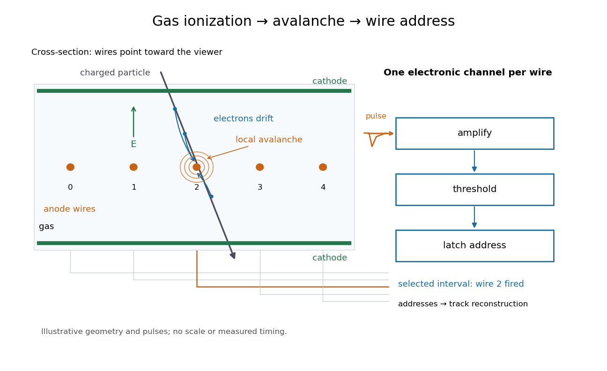

# Multiwire proportional chamber

↑ **Parent:** [Particle detector](particle-detector.md)

A [multiwire proportional chamber](multiwire-proportional-chamber.md) is a [proportional counter](proportional-counter.md): parallel [anode](anode.md) wires between [cathodes](cathode.md) in a [gas](gas.md). [Charged particle](charged-particle.md) [ionization](ionization.md) frees [electrons](electron.md); an [electric field](electric-field-split.md) drives them toward wires, triggering an [electron avalanche](electron-avalanche.md) read by [electronic amplifiers](electronic-amplifier.md).[pp. 24–27, Figs. 1–5](electronic-imaging-of-ionizing-radiation-with-limited-avalanches-in-gases-by-georges-charpak.md)

[Georges Charpak](georges-charpak.md)'s electronic readout avoided film scanning and full [spark chamber](spark-chamber.md) discharge.[pp. 23–24](electronic-imaging-of-ionizing-radiation-with-limited-avalanches-in-gases-by-georges-charpak.md)

**[Figure 1](#image-from-gas-ionization-to-an-electronic-wire-address). From gas ionization to an electronic wire address**. Original functional schematic; dimensions, pulse shapes and routing are illustrative. Wire cross-sections face the viewer.

Opposite polarities identify the avalanche wire. Positive [ion](ion.md) motion dominates integrated signal; detection precedes complete collection. Calibrated [electron](electron.md) travel times enable [drift chambers](drift-chamber.md).[pp. 26–28](electronic-imaging-of-ionizing-radiation-with-limited-avalanches-in-gases-by-georges-charpak.md)

**Table of contents**

- [Multiwire proportional chamber experiment](multiwire-proportional-chamber-experiment.md)
- [Wire pitch](wire-pitch.md)
- [Wire-address position model](wire-address-position-model.md)
- [Calibrated two-wire charge centroid](calibrated-two-wire-charge-centroid.md)

## ↑ Ancestors (4)

1. [Particle detector](particle-detector.md)
2. [Particle detection](particle-detection-split.md)
3. [Physics](physics-split.md)
4. [Codex Wiki](split.md)

## ← Incoming links (2)

- [Multiwire proportional chamber](multiwire-proportional-chamber.md)
- [Nobel Prize in Physics in 1992](nobel-prize-in-physics-in-1992.md)
