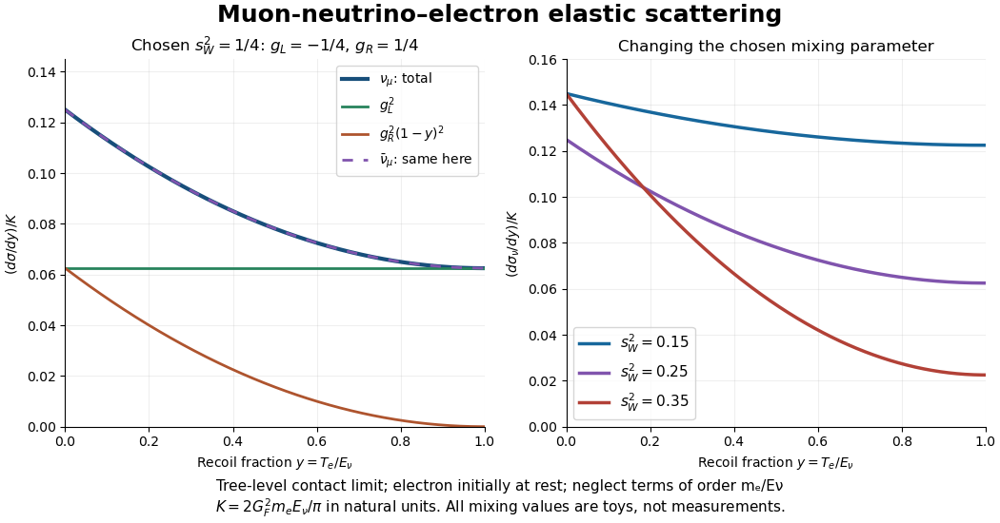

# Muon-neutrino electron recoil spectrum

↑ **Parent:** [Neutral current](neutral-current.md)

For an especially simple [neutral current](neutral-current.md) example, scatter a [muon neutrino](muon-neutrino.md) elastically from an initially stationary unpolarized [electron](electron.md):

$$
\nu_\mu e^-\longrightarrow\nu_\mu e^-,\qquad
y=\frac{T_e}{E_\nu},\qquad
s_W^2=\sin^2\theta_W,\qquad
g_L=-\frac12+s_W^2,\qquad g_R=s_W^2.
$$

Here $T_e$ is the final [electron](electron.md) [kinetic energy](kinetic-energy.md), $E_\nu$ is the incident [neutrino](neutrino.md) [energy](energy-split.md), and $\theta_W$ is the [Weinberg angle](weinberg-angle.md). These are electron [chiral](chirality-chemistry.md) couplings in the $g/\cos\theta_W$ vertex convention of [neutral-current vector and axial couplings](neutral-current-vector-and-axial-couplings.md). The chosen [muon neutrino](muon-neutrino.md) elastic channel has no additional [W boson](w-boson.md) exchange amplitude; the electron-neutrino elastic channel would have one. Other charged-current final states can become kinematically accessible at sufficiently high incident [energies](energy-split.md) and are not part of this elastic model.

Use [natural units](natural-units.md) $\hbar=c=1$, retain only [tree-level Feynman diagrams](tree-level-feynman-diagram.md), and take the contact limit $|q^2|\ll m_Z^2$ with $E_\nu\gg m_e$. Neglect [electron](electron.md)-mass terms relative to $E_\nu$, [radiative corrections](radiative-correction.md) and detector response. Then

$$
K=\frac{2G_F^2m_eE_\nu}{\pi},\qquad
\frac{d\sigma_\nu}{dy}=K\bigl[g_L^2+g_R^2(1-y)^2\bigr],\qquad
\frac{d\sigma_{\bar\nu}}{dy}=K\bigl[g_R^2+g_L^2(1-y)^2\bigr],\qquad 0\leq y\leq1.
$$

$G_F$ is the [Fermi constant](fermi-constant.md). The approximate endpoint $y=1$ replaces the exact elastic endpoint $y_{\max}=2E_\nu/(m_e+2E_\nu)$. The omitted leading mass-dependent interference term in $d\sigma_\nu/dy$ is $-K g_Lg_Rm_ey/E_\nu$. Thus the approximation is not appropriate for arbitrarily soft [neutrinos](neutrino.md).

The shape follows from the two [chiral](chirality-chemistry.md) contributions to the massless [scattering amplitude](scattering-amplitude.md). The [spin sum](spin-sum.md) gives terms proportional to $s^2$ and $u^2$ in [Mandelstam variables](mandelstam-variables.md); in this limit $u/s=-(1-y)$, giving the square $(1-y)^2$. The two electron [chiralities](chirality-physics.md) do not interfere when the relevant mass corrections are dropped. Replacing the [neutrino](neutrino.md) by its [antineutrino](antineutrino.md) exchanges which coupling multiplies each kinematic term. This is the same [chiral](chirality-chemistry.md) angular weighting that appears in [neutrino scattering on an antiquark](neutrino-scattering-on-an-antiquark.md), now with a target whose couplings are particularly simple.

Integrating the two elementary terms gives

$$
\int_0^1(1-y)^2\,dy=\frac13,\qquad
\sigma_\nu=K\left(g_L^2+\frac{g_R^2}{3}\right),\qquad
\sigma_{\bar\nu}=K\left(g_R^2+\frac{g_L^2}{3}\right).
$$

For an original teaching example choose $s_W^2=1/4$, so $g_L=-1/4$ and $g_R=1/4$. This is a stipulated parameter, not a measurement of the [Weinberg angle](weinberg-angle.md). Then

$$
\frac{1}{K}\frac{d\sigma_\nu}{dy}=\frac{1+(1-y)^2}{16},\qquad
\frac{\sigma_\nu}{K}=\frac1{12},\qquad
\langle y\rangle=\frac{\int_0^1y[1+(1-y)^2]dy}{4/3}=\frac7{16}.
$$

The normalized [probability density function](probability-density-function.md) is $p(y)=3[1+(1-y)^2]/4$, not the unnormalized differential [cross section](cross-section-physics.md). Its endpoints have ratio two, and the fraction with $y>1/2$ is $13/32$. The [antineutrino](antineutrino.md) spectrum happens to coincide at this chosen parameter because $g_L^2=g_R^2$; this equality is not a general prediction for arbitrary [Weinberg angles](weinberg-angle.md).

**[Figure 4](#image-chosen-muon-neutrino-electron-recoil-spectra-and-their-chiral-contributions). Chosen muon neutrino electron recoil spectra and their chiral contributions**. Original tree-level curves divided by $K=2G_F^2m_eE_\nu/\pi$. The left panel chooses $s_W^2=1/4$; the right compares three stipulated values in $(0,1)$. All omit finite electron-mass corrections and radiative corrections; none is historical data or a fitted mixing angle.

Unlike a visible [electron](electron.md) recoil, the scattered [neutrino](neutrino.md) is unrecorded. A measured recoil spectrum must therefore be compared with incident [neutrino](neutrino.md) flux, [energy](energy-split.md) distribution, acceptance, [detection efficiency](detection-efficiency.md) and backgrounds. A shape or rate tests a specified theoretical model only after these experimental ingredients have been supplied.

## ↑ Ancestors (7)

1. [Neutral current](neutral-current.md)
2. [Weak interaction](weak-interaction.md)
3. [Standard Model](standard-model-split.md)
4. [Quantum field theory](quantum-field-theory-split.md)
5. [Branches of physics](branches-of-physics.md)
6. [Physics](physics-split.md)
7. [Codex Wiki](split.md)

## ← Incoming links (1)

- [Electroweak interaction](electroweak-interaction.md)
