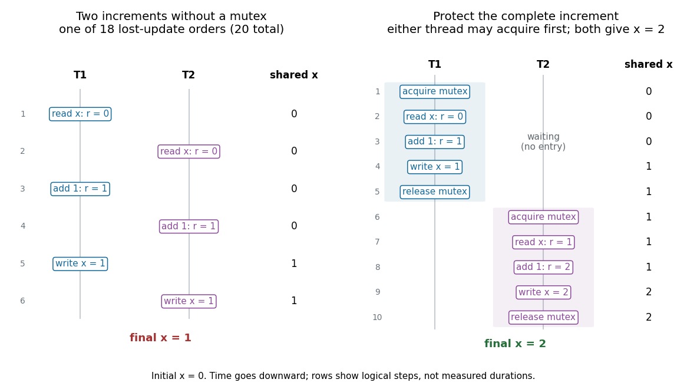

# Mutual exclusion

↑ **Parent:** [Synchronization (computing)](synchronization-computing.md)

[Mutual exclusion](mutual-exclusion.md) allows at most one participating [software thread](thread-computing.md) at a time to execute a protected [critical section](critical-section.md). A [mutex](mutex.md) is an object used to enforce that rule; the [critical section](critical-section.md) is the region of the program that needs the rule. Several different [critical sections](critical-section.md) can use the same [mutex](mutex.md) to protect the same shared data. The benefit is reasoning about a complete update without another cooperating [software thread](thread-computing.md) observing or changing its intermediate state.[pp. 1–2: lock ownership and critical sections](operating-systems-three-easy-pieces-by-remzi-h-arpaci-dusseau-and-others/locks.md)

For a small [lost update](lost-update.md), shared `x` initially equals $0$. Each of two [software threads](thread-computing.md), T1 and T2, uses its own local `r` and performs these three steps:
```
r = read(x)
r = r + 1
write(x, r)
```
Assume [sequential consistency](sequential-consistency.md): each step is indivisible, each [software thread](thread-computing.md) keeps the displayed order, and a read sees the latest preceding write to `x`. In the [thread interleaving](thread-interleaving.md) T1 read, T2 read, T1 add, T2 add, T1 write, T2 write, both local values become $1$ and both writes store $1$. Final $x=1$ instead of $2$: a [lost update](lost-update.md) despite two correctly executed local additions. Separate indivisible reads and writes are insufficient; the complete read, modify and write must be protected.

<a id="image-a-lost-update-and-its-repair-by-mutual-exclusion-around-the-complete-increment"></a>


**[Figure 49](#image-a-lost-update-and-its-repair-by-mutual-exclusion-around-the-complete-increment). A lost update and its repair by mutual exclusion around the complete increment**.

The [binomial coefficient](binomial-coefficient.md) $\binom{6}{3}=20$ counts the [thread interleavings](thread-interleaving.md) preserving the two three-step orders: choose T1's three positions, with the remaining positions belonging to T2. Exhaustive enumeration gives final $x=1$ in 18 orders and $x=2$ in the two serial orders. These counts are not probabilities: no random scheduler has been specified. With the same [mutex](mutex.md) acquired before reading and released after writing, only the two complete increment orders remain, and both give $2$. Alternatively, an [atomic read-modify-write](atomic-read-modify-write.md) increment updates `x` in one indivisible step. Protecting only the write still allows both [software threads](thread-computing.md) to read $0$ beforehand.

[Mutual exclusion](mutual-exclusion.md) is a [safety property](safety-property.md): two participants must never be inside the protected [critical section](critical-section.md) together. Eventual entry for every persistent requester is a [liveness property](liveness-property.md), expressed here as [starvation freedom](starvation-freedom.md). A protocol that never admits anyone satisfies the first requirement while failing the second. Nor does a [mutex](mutex.md) alone promise which waiting [software thread](thread-computing.md) enters next, or that a producer runs before a consumer. Such application ordering needs an additional [synchronization](synchronization-computing.md) protocol.[pp. 181–182: mutual exclusion, finite witnesses to safety violations, and eventual service](defining-liveness-by-bowen-alpern-and-others.md)

The [sequential consistency](sequential-consistency.md) assumptions delimit this calculation. In C++, unsynchronized conflicting accesses to an ordinary shared object can be a [data race](data-race.md), which makes behavior undefined; the 20 schedules are not a prediction for that program. An [atomic operation](atomic-operation.md) with relaxed ordering also supplies no [acquire-release synchronization](acquire-release-synchronization.md) for other data. A real [mutex](mutex.md) must supply both exclusive entry and the required [happens-before](happens-before.md) ordering between its users.[Working Draft, Standard for Programming Language C++ (N4861)](working-draft-standard-for-programming-language-c-plus-plus-n4861.md)

**Table of contents**

- [Critical section](critical-section.md)
- [Mutex](mutex.md)
  - [Spinlock](spinlock.md)
    - [Test-and-set](test-and-set.md)
- [Thread interleaving](thread-interleaving.md)
  - [Lost update](lost-update.md)

## ↑ Ancestors (6)

1. [Synchronization (computing)](synchronization-computing.md)
2. [Thread (computing)](thread-computing.md)
3. [Process (computing)](process-computing.md)
4. [Operating system](operating-system.md)
5. [Computer science](computer-science-split.md)
6. [Codex Wiki](split.md)

## ← Incoming links (15)

- [Atomic read-modify-write](atomic-read-modify-write.md)
- [Critical section](critical-section.md)
- [Deadlock](deadlock.md)
- [Liveness property](liveness-property.md)
- [Lost update](lost-update.md)
- [Memory-mapped file synchronization](memory-mapped-file-synchronization.md)
- [Mutual exclusion](mutual-exclusion.md)
- [Safety property](safety-property.md)
- [Sequential consistency](sequential-consistency.md)
- [Shared file mapping](shared-file-mapping.md)
- [Spinlock](spinlock.md)
- [Starvation freedom](starvation-freedom.md)
- [Synchronization (computing)](synchronization-computing.md)
- [Thread (computing)](thread-computing.md)
- [Thread interleaving](thread-interleaving.md)
