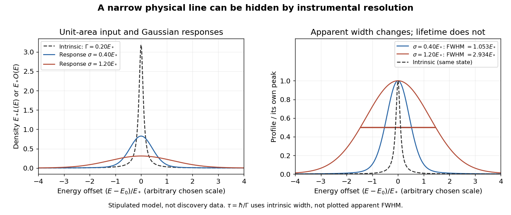

# Narrow resonance and instrumental resolution

↑ **Parent:** [Richter-Ting independent J/psi discovery experiments](richter-ting-independent-j-psi-discovery-experiments.md)

A simple isolated [particle resonance](particle-resonance.md) model starts with a survival amplitude proportional to

$$
a(t)=e^{-iE_0t/\hbar}e^{-\Gamma t/(2\hbar)},\qquad t\geq0.
$$

Its survival [probability](probability.md) is $|a(t)|^2=e^{-\Gamma t/\hbar}$, giving mean rest-frame lifetime $\tau=\hbar/\Gamma$. The [Fourier transform](fourier-transform-split.md) of this one-sided amplitude is proportional to $(\Gamma/2-i(E-E_0))^{-1}$; its squared modulus gives a [Lorentzian line shape](lorentzian-line-shape.md). Write its normalized density as

$$
L(E)=\frac1\pi\frac{\Gamma/2}{(E-E_0)^2+(\Gamma/2)^2},\qquad
\int_{-\infty}^{\infty}L(E)\,dE=1.
$$

At $E-E_0=\pm\Gamma/2$ the density is half its peak, so its intrinsic [full width at half maximum](full-width-at-half-maximum.md) is $\Gamma$. This is a local isolated-line approximation, extending the offset coordinate over the real line; physical production thresholds, interference and energy-dependent [decay widths](decay-width.md) can require a richer [quantum scattering](quantum-scattering-split.md) model.

Now stipulate a centered [normal distribution](normal-distribution.md) for the measurement response, with [standard deviation](standard-deviation.md) $\sigma$. A measured coordinate $x$ has density

$$
G_\sigma(x-E)=\frac{e^{-(x-E)^2/(2\sigma^2)}}{\sqrt{2\pi}\sigma},\qquad
O(x)=\int_{-\infty}^{\infty}L(E)G_\sigma(x-E)\,dE.
$$

This [convolution](convolution.md) describes the smearing of an underlying line, with constant acceptance and no background. For a pair spectrometer the response summarizes [invariant-mass resolution](invariant-mass-resolution.md); for an idealized collider scan it summarizes incoming [center-of-mass energy](center-of-mass-energy.md) spread. These are different experimental sources of uncertainty even when the same mathematical response is useful.

**[Figure 18](#image-an-arbitrary-narrow-line-broadened-by-two-stipulated-gaussian-responses). An arbitrary narrow line broadened by two stipulated Gaussian responses**. Original numerical convolution using a Lorentzian with intrinsic width 0.20 times an arbitrary energy scale and Gaussian standard deviations 0.40 and 1.20 times that scale. Left: densities with unit area on the whole line. Right: each profile divided by its own peak. No historical points, cross-section table or published curve were copied or fitted.

Choose an arbitrary scale $E_*$, intrinsic [decay width](decay-width.md) $\Gamma=0.20E_*$ and response [standard deviations](standard-deviation.md) $0.40E_*$ and $1.20E_*$. Numerical integration gives apparent [full width at half maximum](full-width-at-half-maximum.md) values of approximately $1.05E_*$ and $2.93E_*$, respectively. The state and its rest-frame lifetime are identical in both cases. The [normal distribution](normal-distribution.md)'s width alone is $2\sqrt{2\ln2}\,\sigma$; adding that width to $\Gamma$ in quadrature is not an exact rule for this [convolution](convolution.md).

For a purely illustrative $E_*=1\,\mathrm{MeV}$, taking $\hbar\simeq6.5821\times10^{-22}\,\mathrm{MeV\,s}$ gives $\tau\simeq3.2911\times10^{-21}\,\mathrm s$. These are invented line parameters, not [J/psi meson](j-psi-meson.md) measurements. Substituting the larger apparent width into $\hbar/\Gamma$ would incorrectly shorten the inferred lifetime by nearly a factor of fifteen. An unresolved width can support an upper bound on intrinsic [decay width](decay-width.md), and consequently a lower bound on lifetime, only after the instrumental response and model assumptions have been assessed.

The discovery peak and its later interpretation answer different questions. The [J/psi meson](j-psi-meson.md) is understood as [charmonium](charmonium.md), a bound [charm quark](charm-quark.md)–[charm antiquark](charm-antiquark.md) system. Richter's 1976 lecture distinguishes the initial discovery from subsequent tests of competing explanations, including the related level structure and later evidence for particles carrying uncancelled charm. A narrow peak alone did not establish all these properties in 1974.[From the Psi to Charm – The Experiments of 1975 and 1976, introduction and sections 7.4–8: charmonium interpretation and subsequent charm searches](from-the-psi-to-charm-the-experiments-of-1975-and-1976-by-burton-richter.md)

## ↑ Ancestors (4)

1. [Richter-Ting independent J/psi discovery experiments](richter-ting-independent-j-psi-discovery-experiments.md)
2. [Particle detection](particle-detection-split.md)
3. [Physics](physics-split.md)
4. [Codex Wiki](split.md)
