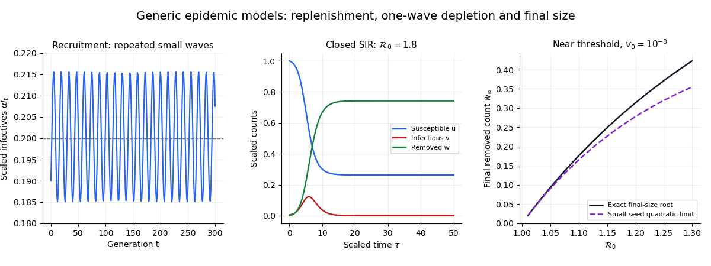

# Near-threshold SIR final-size expansion

↑ **Parent:** [Final size relation for an epidemic](final-size-relation-for-an-epidemic.md)

Normalize the closed [SIR model](sir-model.md) by its initial susceptible count, writing $u(0)=1$, $v(0)=v_0>0$, $w(0)=0$ and $\tau=\gamma t$. Then $u+v+w=1+v_0$, and the [SIR susceptible-recovered identity](sir-susceptible-recovered-identity.md) becomes $u=e^{-\mathcal R_0w}$. Hence

$$
\frac{dw}{d\tau}=v_0+1-w-e^{-\mathcal R_0w}
=v_0+(\mathcal R_0-1)w-\frac12\mathcal R_0^2w^2+O((\mathcal R_0w)^3).
$$

The positive root of the quadratic approximation is

$$
w_*=\frac{\mathcal R_0-1+\sqrt{(\mathcal R_0-1)^2+2\mathcal R_0^2v_0}}{\mathcal R_0^2}.
$$

The displayed small-seed formula requires $\mathcal R_0>1$, $\mathcal R_0w_*\ll1$ and $\mathcal R_0^2v_0\ll(\mathcal R_0-1)^2$. In particular, a regime is $0<\mathcal R_0-1\ll1$ with a much smaller positive seed. Setting the seed exactly to zero produces the disease-free trajectory instead of an outbreak.

**[Figure 3](#image-recruitment-and-closed-population-depletion-give-different-epidemic-trajectories). Recruitment and closed-population depletion give different epidemic trajectories**. Original diagrams and generic model calculations generated by the adjacent Python script.

## ↑ Ancestors (7)

1. [Final size relation for an epidemic](final-size-relation-for-an-epidemic.md)
2. [SEIR model](seir-model.md)
3. [Compartmental models (epidemiology)](compartmental-models-epidemiology.md)
4. [Mathematical biology](mathematical-biology-split.md)
5. [Branches of physics](branches-of-physics.md)
6. [Physics](physics-split.md)
7. [Codex Wiki](split.md)

## ← Incoming links (1)

- [Solution](past-exam-of-the-short-options-course-of-the-university-of-oxford/2017/9/b/iii/solution.md)
