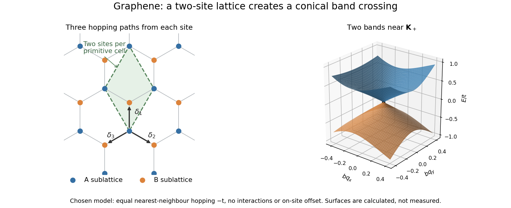

# Nearest-neighbour model of graphene

↑ **Parent:** [Graphene](graphene.md)

Take a planar [honeycomb lattice](honeycomb-lattice.md) with two sites $A,B$ per primitive cell and one localized [atomic orbital](atomic-orbital.md) per site. In this explicitly idealized [tight-binding model](tight-binding.md), all three nearest-neighbour hopping matrix elements are $-t$, with $t>0$; there is no on-site offset or further-neighbour hopping. Ignore [electron](electron.md) interactions and treat physical [spin](spin.md) as a separate degeneracy. Let the bond length be $b$, and choose the three vectors from an $A$ site to its neighbours as

$$
\boldsymbol\delta_1=b(0,1),\qquad
\boldsymbol\delta_2=b(\sqrt3/2,-1/2),\qquad
\boldsymbol\delta_3=b(-\sqrt3/2,-1/2).
$$

The [Bloch state](bloch-state.md) amplitudes on $A,B$ form a two-component [vector](vector.md). A consistent phase convention gives the [Hamiltonian](hamiltonian.md)

$$
H(\mathbf k)=-t\begin{pmatrix}0&f(\mathbf k)\\f(\mathbf k)^*&0\end{pmatrix},\qquad
f(\mathbf k)=\sum_{j=1}^3e^{i\mathbf k\cdot\boldsymbol\delta_j}
=e^{ibk_y}+2e^{-ibk_y/2}\cos(\sqrt3bk_x/2).
$$

Its characteristic equation is $E^2=t^2|f|^2$, giving the two displayed [energy bands](energy-band.md). The two-component structure comes from the two sites, rather than two values of physical [spin](spin.md). This is a particularly small matrix model in which a crystal's geometry creates an unexpected low-energy law.

**[Figure 15](#image-a-honeycomb-lattice-produces-two-touching-electronic-bands). A honeycomb lattice produces two touching electronic bands**. [Source](graphene-honeycomb-two-band-dirac-cone.py). Original nearest-neighbour model with the defined bond vectors. The surface shows the calculated bands near one zero of $f$, with distance in units of inverse bond length and energy in units of the hopping magnitude. These are model energies, not measured band data.

Historically, [Philip Russell Wallace](philip-russell-wallace.md) used a [tight-binding model](tight-binding.md) to investigate the [electronic band structure](electronic-band-structure.md) of [graphite](graphite.md) in 1947. The material in that paper was layered [graphite](graphite.md); the single-sheet model here isolates one simpler part of the problem.[Publisher abstract: tight-binding bands and Brillouin zones of graphite; published 1 May 1947](the-band-theory-of-graphite-by-philip-russell-wallace.md)

**Table of contents**

- [Dirac valleys in graphene](dirac-valleys-in-graphene.md)
  - [Sublattice pseudospin in graphene](sublattice-pseudospin-in-graphene.md)
  - [Carrier density in a graphene cone](carrier-density-in-a-graphene-cone.md)
  - [Cyclotron mass in a graphene cone](cyclotron-mass-in-a-graphene-cone.md)

## ↑ Ancestors (6)

1. [Graphene](graphene.md)
2. [Carbon](carbon.md)
3. [Chemical element](chemical-element.md)
4. [Chemical substance](chemical-substance-split.md)
5. [Chemistry](chemistry-split.md)
6. [Codex Wiki](split.md)

## ← Incoming links (5)

- [Dirac cone](dirac-cone.md)
- [Graphene](graphene.md)
- [Haldane model](haldane-model.md)
- [Solution](past-exam-of-the-quantum-condensed-matter-course-of-the-university-of-cambridge/2018/section-b/b4/solution.md)
- [Valley masses of the Haldane model](valley-masses-of-the-haldane-model.md)
