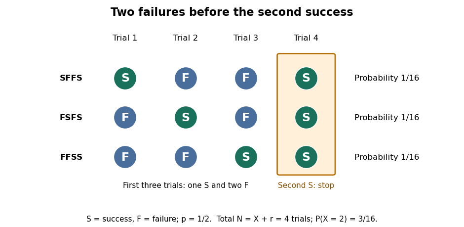
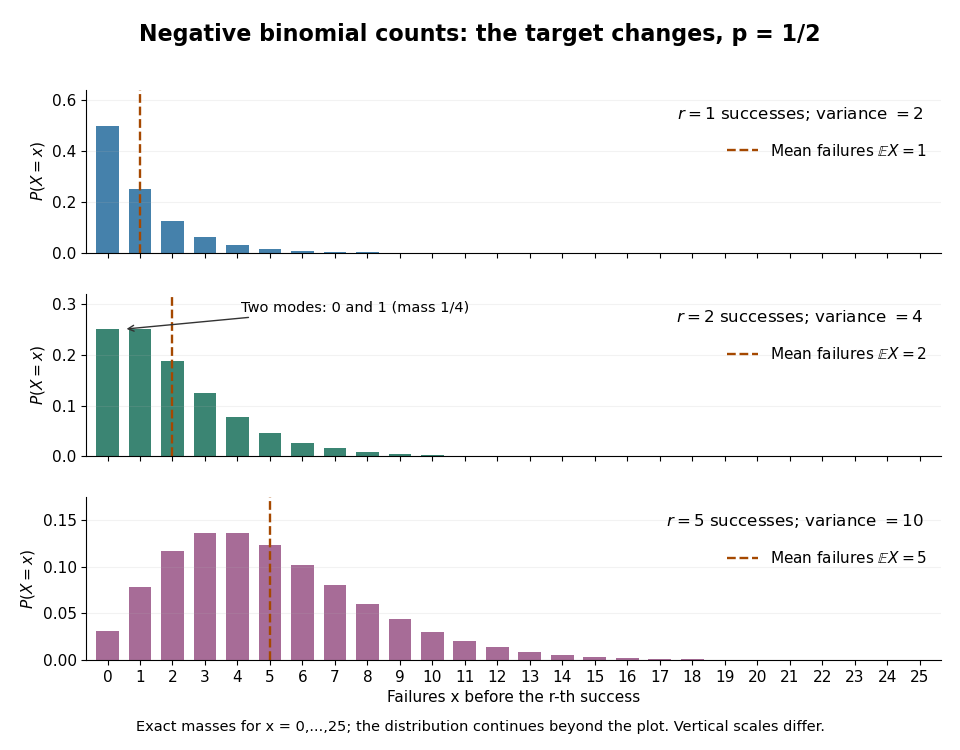

# Negative binomial distribution

↑ **Parent:** [Discrete probability distribution](discrete-probability-distribution-split.md)  
ⓦ [Wiki](https://en.wikipedia.org/wiki/Negative_binomial_distribution)

The [negative binomial distribution](negative-binomial-distribution.md) counts failures before a target number of successes in successive [independent](independent-random-variables.md) [Bernoulli trials](bernoulli-trial.md) with constant success [probability](probability.md) $p$. In this stopping model, $r$ is a positive [integer](integer-split.md) and $0<p\leq1$. On the failures-before-the-$r$th-success convention, the [random variable](random-variable-split.md) $X$ takes values $0,1,\ldots$; for $0<p<1$, its [probability mass function](probability-mass-function.md) is

$$
\mathbb P(X=x)=\binom{x+r-1}{x}(1-p)^x p^r,
\qquad x=0,1,\ldots.
$$

The [binomial coefficient](binomial-coefficient-split.md) counts possible arrangements before the final success, as explained by the [negative binomial stopping argument](negative-binomial-stopping-argument.md). At $p=1$, every trial succeeds: $X=0$ with [probability](probability.md) one, so its [expected value](expected-value-split.md) and [variance](variance-split.md) are both zero. This handles the endpoint without needing to interpret $0^0$. At $p=0$, the target is never reached and there is no proper finite waiting-count law.

For a worked example, toss a fair coin until the second head, calling heads $S$ and tails $F$. Thus $r=2$ and $p=1/2$. Exactly two failures means that the second success is on trial four. The complete stopped sequences are $SFFS$, $FSFS$ and $FFSS$; each has [probability](probability.md) $(1/2)^4=1/16$, giving $\mathbb P(X=2)=3/16$. The first three masses are

$$
\mathbb P(X=0)=\frac14,\qquad \mathbb P(X=1)=\frac14,\qquad \mathbb P(X=2)=\frac3{16}.
$$

Both $0$ and $1$ are [modes](mode-statistics.md), each with mass $1/4$: there is no unique [mode](mode-statistics.md) here. Later masses decrease, since $\mathbb P(X=x+1)/\mathbb P(X=x)=(x+2)/(2x+2)<1$ for $x\geq1$.

**[Figure 7](#image-exactly-two-failures-before-the-second-success-three-stopped-sequences-each-of-probability-1-16). Exactly two failures before the second success: three stopped sequences, each of probability 1/16**.

The [expected value](expected-value-split.md) and [variance](variance-split.md) of the failures count are

$$
\mathbb E X=\frac{r(1-p)}p,\qquad \operatorname{Var}(X)=\frac{r(1-p)}{p^2}.
$$

If instead $N=X+r$ counts all trials, including the $r$ successes, then $N\geq r$ and

$$
\mathbb E N=\frac rp,\qquad \operatorname{Var}(N)=\frac{r(1-p)}{p^2}.
$$

For the fair-coin example, $\mathbb E X=2$, $\operatorname{Var}(X)=4$, and $\mathbb E N=4$. Shifting the count changes its [expected value](expected-value-split.md) but preserves its [variance](variance-split.md). When $r=1$, $X$ has the failures-count [geometric distribution](geometric-distribution.md), while $N=X+1$ has the all-trials [geometric distribution](geometric-distribution.md). The two conventions and the moments are treated in [Kyle Siegrist, The Negative Binomial Distribution, Random Services](https://www.randomservices.org/random/bernoulli/NegativeBinomial.html).

**[Figure 8](#image-negative-binomial-failure-counts-for-success-probability-1-2-and-targets-of-one-two-and-five-successes). Negative binomial failure counts for success probability 1/2 and targets of one, two and five successes**.

The [negative binomial distribution](negative-binomial-distribution.md) is useful when a procedure runs until it collects a target number of successes: for example, obtaining $r$ usable samples from [independent](independent-random-variables.md) attempts with a stable acceptance [probability](probability.md). A [binomial distribution](binomial-distribution.md) instead counts successes in a fixed number of trials. The attractive connection is that these two experimental questions can be answered from the same trial sequence, using the [negative binomial stopping argument](negative-binomial-stopping-argument.md). For the failures count and $0<p<1$, the positive [mean](expected-value-split.md) $\mu=r(1-p)/p$ satisfies $\operatorname{Var}(X)=\mu/p>\mu$, so the law allows [overdispersion](overdispersion.md) relative to a [Poisson distribution](poisson-distribution.md). At $p=1$, both quantities vanish and the inequality is not strict. The separate [Poisson-gamma mixture](poisson-gamma-mixture.md) explains another way this count law arises; its noninteger shape parameters do not represent a literal target number of successes.

**Table of contents**

- [Negative binomial stopping argument](negative-binomial-stopping-argument.md)
  - [Success-count and waiting-time duality](success-count-and-waiting-time-duality.md)
  - [Success-failure stopping identity](success-failure-stopping-identity.md)
  - [Match win probability with a fixed winning score](match-win-probability-with-a-fixed-winning-score.md)
- [Poisson-gamma mixture](poisson-gamma-mixture.md)

## ↑ Ancestors (7)

1. [Discrete probability distribution](discrete-probability-distribution-split.md)
2. [Probability distribution](probability-distribution-split.md)
3. [Probability theory](probability-theory-split.md)
4. [Probability and statistics](probability-and-statistics-split.md)
5. [Area of mathematics](area-of-mathematics.md)
6. [Mathematics](mathematics-split.md)
7. [Codex Wiki](split.md)

## ← Incoming links (36)

- [Aggregation of macroparasite burdens](aggregation-of-macroparasite-burdens.md)
- [Claim count](claim-count.md)
- [Compound mixed Poisson distribution](compound-mixed-poisson-distribution.md)
- [Finite Erlang-mixture tail for a negative-binomial exponential aggregate](finite-erlang-mixture-tail-for-a-negative-binomial-exponential-aggregate.md)
- [Fixed-size negative binomial generalized linear model](fixed-size-negative-binomial-generalized-linear-model.md)
- [Local-count independence with through-flow dependence](local-count-independence-with-through-flow-dependence.md)
- [Match win probability with a fixed winning score](match-win-probability-with-a-fixed-winning-score.md)
- [Mixed Poisson distribution](mixed-poisson-distribution.md)
- [Negative binomial deviance](negative-binomial-deviance.md)
- [Negative binomial distribution](negative-binomial-distribution.md)
- [Negative binomial mean-size parameter orthogonality](negative-binomial-mean-size-parameter-orthogonality.md)
- [Negative binomial regression](negative-binomial-regression.md)
- [Negative binomial series](negative-binomial-series.md)
- [Negative binomial stopping argument](negative-binomial-stopping-argument.md)
- [Negative-binomial sum of exponential claims](negative-binomial-sum-of-exponential-claims.md)
- [Panjer claim-count class](panjer-claim-count-class.md)
- [Solution](past-exam-of-the-mathematics-course-of-the-university-of-cambridge/2001/iii/paper-52/3/solution.md)
- [Solution](past-exam-of-the-mathematics-course-of-the-university-of-cambridge/2002/iii/paper-35/1/solution.md)
- [Solution](past-exam-of-the-mathematics-course-of-the-university-of-cambridge/2002/iii/paper-36/4/i/solution.md)
- [Solution](past-exam-of-the-mathematics-course-of-the-university-of-cambridge/2003/iii/paper-38/4/ii/solution.md)
- [Solution](past-exam-of-the-mathematics-course-of-the-university-of-cambridge/2005/iii/paper-43/4/iii/solution.md)
- [Solution](past-exam-of-the-mathematics-course-of-the-university-of-cambridge/2006/iii/paper-43/2/solution.md)
- [Solution](past-exam-of-the-mathematics-course-of-the-university-of-cambridge/2008/iii/paper-43/1/c/solution.md)
- [Solution](past-exam-of-the-mathematics-course-of-the-university-of-cambridge/2010/iii/paper-38/1/b/solution.md)
- [Solution](past-exam-of-the-mathematics-course-of-the-university-of-cambridge/2011/ia/paper-2/10f/b/solution.md)
- [Solution](past-exam-of-the-mathematics-course-of-the-university-of-cambridge/2012/iii/paper-37/6/d/solution.md)
- [Solution](past-exam-of-the-mathematics-course-of-the-university-of-cambridge/2015/iii/paper-34/1/c/solution.md)
- [Solution](past-exam-of-the-mathematics-course-of-the-university-of-cambridge/2015/iii/paper-39/5/solution.md)
- [Solution](past-exam-of-the-mathematics-course-of-the-university-of-cambridge/2017/iii/paper-206/1/b/solution.md)
- [Solution](past-exam-of-the-mathematics-course-of-the-university-of-cambridge/2017/iii/paper-206/1/e/solution.md)
- [Solution](past-exam-of-the-mathematics-course-of-the-university-of-cambridge/2022/ia/paper-2/11f/c/solution.md)
- [Solution](past-exam-of-the-mathematics-course-of-the-university-of-cambridge/2023/ii/paper-1/5j/solution.md)
- [Solution](past-exam-of-the-mathematics-course-of-the-year-1-of-the-natural-sciences-course-of-the-university-of-cambridge/2009/paper-1/12/b/i/solution.md)
- [Poisson-gamma mixture](poisson-gamma-mixture.md)
- [Poisson mixture](poisson-mixture.md)
- [Posterior coin count after exactly one head](posterior-coin-count-after-exactly-one-head.md)
