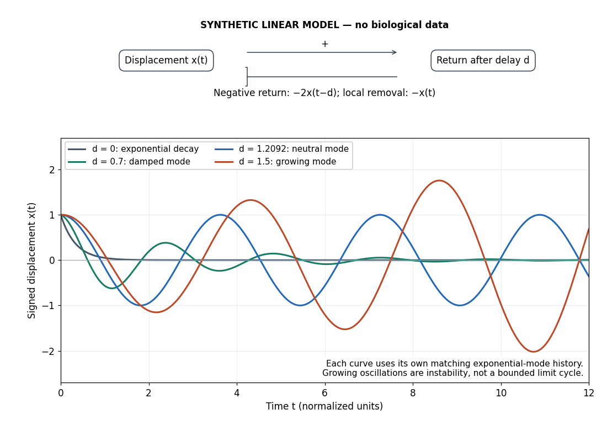

# Negative feedback

↑ **Parent:** [Signaling feedback](signaling-feedback.md)

[Negative feedback](negative-feedback.md) closes a causal loop whose net effect opposes an initiating change. In [signal transduction](signal-transduction-split.md), activation followed by a downstream inhibition of the earlier activating stage is one example of [negative feedback](negative-feedback.md). Loop sign alone does not establish [asymptotic stability](asymptotic-stability.md) or complete [signaling adaptation](signaling-adaptation.md); see the worked [signaling feedback](signaling-feedback.md) example.

A useful biological example is [chemotaxis feedback regulation](chemotaxis-feedback-regulation.md): an [Escherichia coli](escherichia-coli.md) [biological cell](biological-cell-split.md) adjusts its response to a sustained attractant instead of remaining at its immediate response. Increased [CheA](chea.md) activity promotes [CheB](cheb.md) [phosphorylation](phosphorylation.md); [CheB](cheb.md) reverses [receptor methylation](receptor-methylation.md), opposing their activation. After attractant addition, reduced activity instead favors [receptor methylation](receptor-methylation.md) by [CheR](cher.md), restoring activity. This is a return from [receptor](receptor-biochemistry.md) activity to the machinery regulating that activity. The response need not return exactly at every dose. [Precision and Kinetics of Adaptation in Bacterial Chemotaxis by Yigal Meir and others](precision-and-kinetics-of-adaptation-in-bacterial-chemotaxis-by-yigal-meir-and-others.md)

A motivating measurement is the [chemotaxis FRET assay](chemotaxis-fret-assay.md). [CheY](chey.md) and [CheZ](chez.md) carrying yellow and cyan fluorescent tags were observed in immobilized [Escherichia coli](escherichia-coli.md) [biological cells](biological-cell-split.md) on a coverslip in a flow chamber. Adding and removing attractant changed the yellow-to-cyan emission [ratio](ratio.md), reporting the association of phosphorylated [CheY](chey.md) with [CheZ](chez.md). This measures a molecular readout upstream of motor behavior. Comparisons with [biological cells](biological-cell-split.md) lacking [CheR](cher.md), [CheB](cheb.md), or both tested the dependence on [receptor](receptor-biochemistry.md) modification; these perturbations also change starting activity and sensitivity, so they are not pure changes of one [feedback gain](feedback-gain.md). [Receptor sensitivity in bacterial chemotaxis by Victor Sourjik and others](receptor-sensitivity-in-bacterial-chemotaxis-by-victor-sourjik-and-others.md)

The later [chemotaxis feedback regulation](chemotaxis-feedback-regulation.md) experiment used only the [Tar receptor](tar-receptor.md) and nonmetabolizable methylaspartate, supplied and removed by flow. Long recordings separated slow recovery from incomplete [signaling adaptation](signaling-adaptation.md); correction for bleaching addressed drift in the optical readout. Activity recovered incompletely after sufficiently large additions, with detectable imprecision already at $10\,\mathrm{\mu M}$ in that preparation. Restricting the [receptor](receptor-biochemistry.md) type and preventing consumption of the stimulus help interpret the perturbation, but limit transfer to other [receptors](receptor-biochemistry.md) and conditions. The readout infers [CheA](chea.md) activity through [CheY](chey.md)-[CheZ](chez.md) association, rather than directly measuring every molecular step. [Precision and Kinetics of Adaptation in Bacterial Chemotaxis by Yigal Meir and others](precision-and-kinetics-of-adaptation-in-bacterial-chemotaxis-by-yigal-meir-and-others.md)

[Negative feedback](negative-feedback.md) can also overshoot or sustain [oscillations](oscillation.md) if its return arrives too late. The worked [signaling feedback](signaling-feedback.md) example gives the contrasting instantaneous case; the [delayed negative feedback model](delayed-negative-feedback-model.md) below isolates the effect of timing. Loop sign describes causation, while [asymptotic stability](asymptotic-stability.md) describes what happens to displacements over time.

**[Figure 9](#image-negative-feedback-with-an-instantaneous-or-delayed-return). Negative feedback with an instantaneous or delayed return**. Original synthetic [delay differential equation](delay-differential-equation.md) modes, not measured [chemotaxis](chemotaxis.md) responses. All variables and time are normalized. The same negative return coefficient is used throughout; only its delay changes. Each curve has its own matching history. A growing [oscillation](oscillation.md) signals instability of this linear [mathematical model](mathematical-model.md), not a bounded biological rhythm.

**Table of contents**

- [Delayed negative feedback model](delayed-negative-feedback-model.md)
  - [Delayed feedback characteristic root](delayed-feedback-characteristic-root.md)
- [Chemotaxis feedback regulation](chemotaxis-feedback-regulation.md)
  - [Receptor demethylation](receptor-demethylation.md)
  - [Barkai-Leibler model](barkai-leibler-model.md)
    - [Unsaturated receptor modification and imperfect adaptation](unsaturated-receptor-modification-and-imperfect-adaptation.md)
  - [Robust perfect adaptation](robust-perfect-adaptation.md)
  - [Receptor methylation](receptor-methylation.md)
  - [Tar receptor](tar-receptor.md)
  - [Chemotaxis feedback proteins](chemotaxis-feedback-proteins.md)
    - [CheW](chew.md)
    - [CheA](chea.md)
    - [CheB](cheb.md)
    - [CheR](cher.md)
    - [CheY](chey.md)
    - [CheZ](chez.md)
  - [Chemotaxis FRET assay](chemotaxis-fret-assay.md)

## ↑ Ancestors (4)

1. [Signaling feedback](signaling-feedback.md)
2. [Signal transduction](signal-transduction-split.md)
3. [Biology](biology-split.md)
4. [Codex Wiki](split.md)

## ← Incoming links (46)

- [A negative feedback mechanism for the long-term stabilization of Earth's surface temperature by James C. G. Walker and others](a-negative-feedback-mechanism-for-the-long-term-stabilization-of-earth-s-surface-temperature-by-james-c-g-walker-and-others.md)
- [Amplifier saturation](amplifier-saturation.md)
- [CheB](cheb.md)
- [Chemotaxis feedback regulation](chemotaxis-feedback-regulation.md)
- [Delayed carbon-dioxide ventilation feedback](delayed-carbon-dioxide-ventilation-feedback.md)
- [Effector saturation](effector-saturation.md)
- [Homeostasis](homeostasis.md)
- [Ideal operational amplifier](ideal-operational-amplifier.md)
- [Incoherent feedforward loop](incoherent-feedforward-loop.md)
- [Insulin](insulin.md)
- [Inverting two-pole band-pass filter](inverting-two-pole-band-pass-filter.md)
- [Negative autoregulation](negative-autoregulation.md)
- [Negative feedback](negative-feedback.md)
- [Noninverting amplifier](noninverting-amplifier.md)
- [Operational amplifier](operational-amplifier.md)
- [Operational-amplifier negative feedback by Analog Devices](operational-amplifier-negative-feedback-by-analog-devices.md)
- [Solution](past-exam-of-the-biochemistry-course-of-the-university-of-cambridge/2024/paper-3/section-ii/5/solution.md)
- [Solution](past-exam-of-the-biological-physics-course-of-the-university-of-oxford/2016/7/d/solution.md)
- [Solution](past-exam-of-the-biological-physics-course-of-the-university-of-oxford/2019/3/c/solution.md)
- [Solution](past-exam-of-the-biological-physics-course-of-the-university-of-oxford/2019/3/d/solution.md)
- [Solution](past-exam-of-the-genetics-course-of-the-university-of-cambridge/2025/paper-2/4/solution.md)
- [Solution](past-exam-of-the-mathematics-and-the-environment-and-mathematical-physiology-course-of-the-university-of-oxford/2008/b/7/solution.md)
- [Solution](past-exam-of-the-mathematics-and-the-environment-and-mathematical-physiology-course-of-the-university-of-oxford/2008/b/8/solution.md)
- [Solution](past-exam-of-the-mathematics-and-the-environment-and-mathematical-physiology-course-of-the-university-of-oxford/2009/b/6/b/solution.md)
- [Solution](past-exam-of-the-physics-2-paper-of-the-university-of-oxford/2013-resit/3/i/solution.md)
- [Solution](past-exam-of-the-physics-2-paper-of-the-university-of-oxford/2013/8/i/solution.md)
- [Solution](past-exam-of-the-physics-2-paper-of-the-university-of-oxford/2016/7/a/solution.md)
- [Solution](past-exam-of-the-physics-2-paper-of-the-university-of-oxford/2016/7/b/solution.md)
- [Solution](past-exam-of-the-physics-2-paper-of-the-university-of-oxford/2017/7/solution.md)
- [Solution](past-exam-of-the-physics-2-paper-of-the-university-of-oxford/2019/10/b/solution.md)
- [Solution](past-exam-of-the-physics-2-paper-of-the-university-of-oxford/2021/5/a/solution.md)
- [Solution](past-exam-of-the-physics-a-course-of-the-university-of-cambridge/2012/paper-1/section-d/d13/solution.md)
- [Solution](past-exam-of-the-physics-a-course-of-the-university-of-cambridge/2015/paper-1/section-a/5/solution.md)
- [Solution](past-exam-of-the-physics-a-course-of-the-university-of-cambridge/2016/paper-1/section-d/d13/a/solution.md)
- [Solution](past-exam-of-the-physics-a-course-of-the-university-of-cambridge/2019/paper-1/section-d/d13/b/solution.md)
- [Solution](past-exam-of-the-plate-tectonics-course-of-the-university-of-oxford/2023/question-2/a/solution.md)
- [Solution](past-exam-of-the-plate-tectonics-course-of-the-university-of-oxford/2025/1/a/solution.md)
- [Solution](past-exam-of-the-short-options-paper-shared-by-prelims-and-parts-a-and-b-of-the-physics-course-of-the-university-of-oxford/2017/s25/2/3/solution.md)
- [Solution](past-exam-of-the-systems-biology-course-of-the-university-of-cambridge/2024/paper-1/section-i/1-1/solution.md)
- [Solution](past-exam-of-the-systems-biology-course-of-the-university-of-cambridge/2024/paper-1/section-ii/2-1/solution.md)
- [Physiological set point](physiological-set-point.md)
- [Signaling adaptation](signaling-adaptation.md)
- [Signaling feedback](signaling-feedback.md)
- [Summing amplifier](summing-amplifier.md)
- [Virtual short](virtual-short.md)
- [Weathering feedback with fast thermal adjustment](weathering-feedback-with-fast-thermal-adjustment.md)
