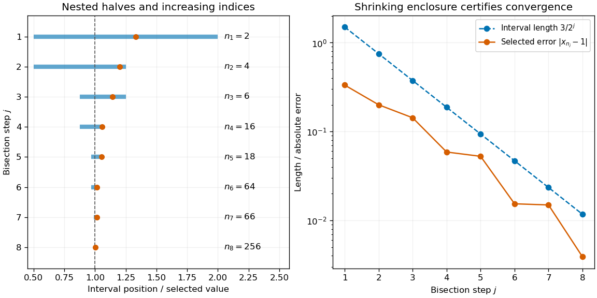

# Nested intervals extract a convergent subsequence

↑ **Parent:** [Bolzano-Weierstrass theorem](bolzano-weierstrass-theorem.md)

Begin with a [closed interval](closed-real-interval.md) $I_0=[a,b]$ containing the entire [bounded sequence](bounded-sequence.md). Split the interval at its midpoint. At least one of the two closed halves contains infinitely many indexed terms; choose such a half and repeat. This gives [nested intervals](nested-intervals.md) $I_j$ with lengths $(b-a)/2^j$. The [nested interval theorem](nested-interval-theorem.md), using [completeness of the real numbers](completeness-of-the-real-numbers.md), supplies their unique common point $\ell$.

Choose $n_j>n_{j-1}$ with $x_{n_j}\in I_j$. Infinitely many indexed terms in $I_j$ guarantee that the next index can be chosen. Both $x_{n_j}$ and $\ell$ belong to $I_j$, so

$$
|x_{n_j}-\ell|\leq\frac{b-a}{2^j}\longrightarrow0.
$$

This is a short existence proof, not necessarily a finite algorithm for an arbitrary input [sequence](sequence.md): deciding which half contains infinitely many future terms may require mathematical knowledge about that [sequence](sequence.md).

**[Figure 10](#image-nested-intervals-isolate-a-subsequential-limit-while-the-selected-indices-keep-increasing). Nested intervals isolate a subsequential limit while the selected indices keep increasing**. For $x_n=(-1)^n+1/(n+1)$, the illustrated halves contain infinitely many even-indexed terms and narrow around $1$. Each row marks one selected term inside its interval; the table gives the original index. The right plot shows the selected error below the interval-length bound. The exact selections follow the displayed model, rather than deciding an arbitrary infinite [sequence](sequence.md) by sampling.

## ↑ Ancestors (7)

1. [Bolzano-Weierstrass theorem](bolzano-weierstrass-theorem.md)
2. [Sequence and series](sequence-and-series-split.md)
3. [Real analysis](real-analysis-split.md)
4. [Analysis](analysis-split.md)
5. [Area of mathematics](area-of-mathematics.md)
6. [Mathematics](mathematics-split.md)
7. [Codex Wiki](split.md)
