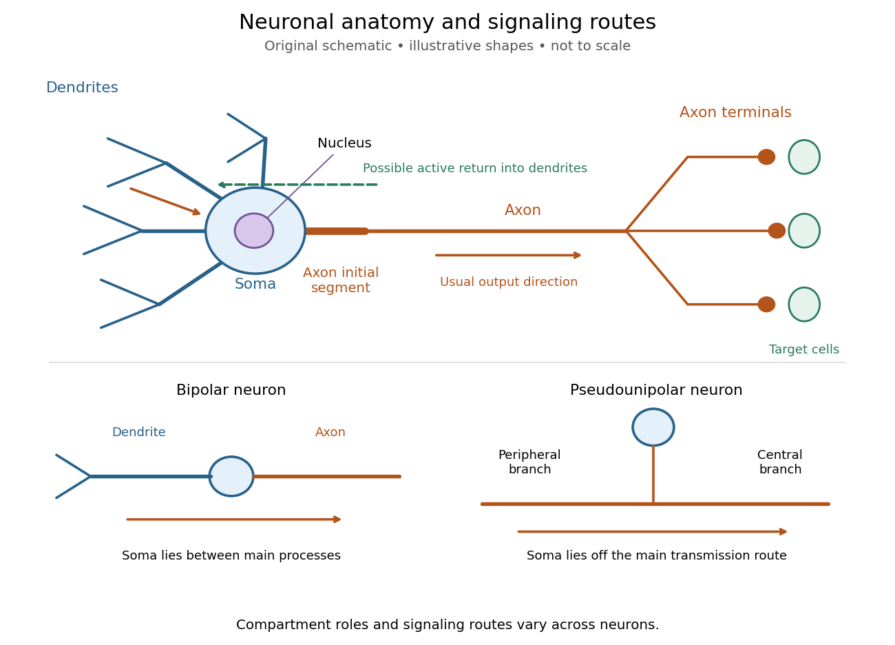
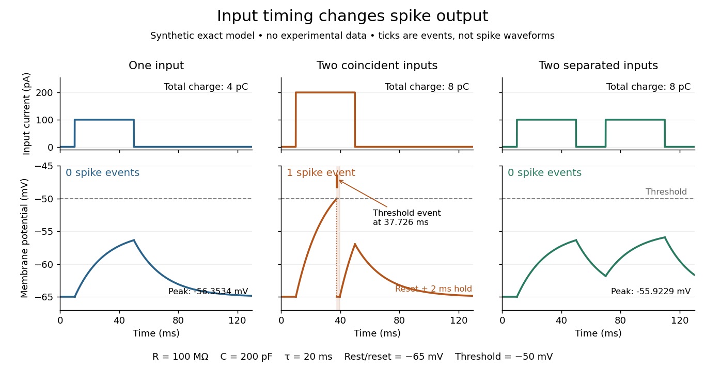

# Neuron

↑ **Parent:** [Neuroscience](neuroscience-split.md)  
ⓦ [Wiki](https://en.wikipedia.org/wiki/Neuron)

A [neuron](neuron.md) is a specialized [biological cell](biological-cell-split.md) that receives, integrates and transmits signals. Its shape separates places where inputs arrive from places where outputs reach other [biological cells](biological-cell-split.md): this functional asymmetry is [neuronal polarity](neuronal-polarity.md). Understanding a [neuron](neuron.md) therefore means connecting its anatomy to changes in [membrane potential](membrane-potential-split.md), rather than treating it as a wire that merely forwards every input.

In a common [multipolar neuron](multipolar-neuron.md), branching [dendrites](dendrite.md) receive inputs at [synapses](synapse.md); the [soma](soma-biology.md) contains the [cell nucleus](cell-nucleus.md) and most major [organelles](organelle.md); the [axon](axon.md) carries signals to distant or nearby targets; and [axon terminals](axon-terminal.md) form output contacts. All these regions belong to one [biological cell](biological-cell-split.md) enclosed by a continuous [cell membrane](cell-membrane-split.md). An [axon](axon.md) can branch, allowing one [neuron](neuron.md) to influence several receiving [biological cells](biological-cell-split.md).[§12.2, Parts of a Neuron: nucleus, organelles, processes, branching axon, initial segment and terminals](anatomy-and-physiology-2e-by-j-gordon-betts-and-others/12-2-nervous-tissue.md)

At an input [chemical synapse](chemical-synapse.md), a [neurotransmitter](neurotransmitter.md) acts on a [receptor](receptor-biochemistry.md), changing an [electric current](electric-current.md) directly or through [signal transduction](signal-transduction-split.md).[§3.1, opening paragraphs: ionotropic and metabotropic receptors and postsynaptic currents](neuronal-dynamics-from-single-neurons-to-networks-and-models-of-cognition-by-wulfram-gerstner-and-others/3-1-synapses.md) A resulting [synaptic potential](synaptic-potential.md) contributes to [synaptic integration](synaptic-integration.md) in the [dendrites](dendrite.md) and [soma](soma-biology.md). In many spiking [neurons](neuron.md), sufficiently strong [depolarization](depolarization.md) recruits [voltage-gated ion channels](voltage-gated-ion-channel.md) in the [axon initial segment](axon-initial-segment.md), initiating an [action potential](action-potential.md) that propagates along the [axon](axon.md). At an output [chemical synapse](chemical-synapse.md), [calcium](calcium.md) entry through [voltage-gated ion channels](voltage-gated-ion-channel.md) promotes [synaptic vesicle](synaptic-vesicle.md) [exocytosis](exocytosis.md), releasing [neurotransmitter](neurotransmitter.md). An [action potential](action-potential.md) is thus regenerated electrically along a [cell membrane](cell-membrane-split.md); it is not a packet of [neurotransmitter](neurotransmitter.md) travelling from the [dendrites](dendrite.md) to the [axon terminals](axon-terminal.md).[Chemical Synapses, Figure 5.3: voltage-gated calcium entry and synaptic vesicle exocytosis](neuroscience-2nd-edition-edited-by-d-purves-and-others.md)

**[Figure 5](#image-neuronal-anatomy-usual-signaling-direction-and-alternative-shapes). Neuronal anatomy, usual signaling direction and alternative shapes**. Original schematic, not microscopy and not to scale. The upper [multipolar neuron](multipolar-neuron.md) identifies [dendrites](dendrite.md), the [soma](soma-biology.md), the [cell nucleus](cell-nucleus.md), the [axon initial segment](axon-initial-segment.md), the [axon](axon.md) and [axon terminals](axon-terminal.md). Solid arrows show a common input-to-output route; a dashed arrow indicates possible propagation of an [action potential](action-potential.md) back toward [dendrites](dendrite.md). The lower sketches compare a [bipolar neuron](bipolar-neuron.md) and a [pseudounipolar neuron](pseudounipolar-neuron.md), whose [soma](soma-biology.md) lies off the main transmission route. Shapes and relative dimensions are illustrative.

The compartments are specializations, not exclusive jobs. Inputs can contact the [soma](soma-biology.md) or [axon](axon.md) as well as [dendrites](dendrite.md); [dendrites](dendrite.md) can support active [voltage-gated ion channels](voltage-gated-ion-channel.md). Paired recordings from a [pyramidal neuron](pyramidal-cell.md)'s [soma](soma-biology.md) and [dendrite](dendrite.md) or [axon](axon.md) established that an [action potential](action-potential.md) can begin in the [axon](axon.md) and propagate back into the [dendrites](dendrite.md). The usual output direction therefore does not make every electrical signal strictly one-way.[Active propagation of somatic action potentials into neocortical pyramidal cell dendrites by Greg J. Stuart and others](active-propagation-of-somatic-action-potentials-into-neocortical-pyramidal-cell-dendrites-by-greg-j-stuart-and-others.md) An [electrical synapse](electrical-synapse.md), which directly couples [cytoplasms](cytoplasm.md) through [gap junctions](gap-junction.md), also differs from the sending-and-receiving arrangement of a [chemical synapse](chemical-synapse.md).[§1.1.3: electrical and chemical synapses](neuronal-dynamics-from-single-neurons-to-networks-and-models-of-cognition-by-wulfram-gerstner-and-others/1-1-elements-of-neuronal-systems.md)

Nor does every [neuron](neuron.md) have the upper diagram's shape. A [bipolar neuron](bipolar-neuron.md) has two main processes, one [dendrite](dendrite.md) and one [axon](axon.md); a [multipolar neuron](multipolar-neuron.md) has several [dendrites](dendrite.md); and a [pseudounipolar neuron](pseudounipolar-neuron.md) has a single process from the [soma](soma-biology.md) that divides into peripheral and central branches. In the last arrangement, sensory signals can travel past the [soma](soma-biology.md) rather than obligatorily through it. These shape categories do not specify every [neuron](neuron.md)'s [receptor](receptor-biochemistry.md), connectivity or firing behavior.[§12.2, Types of Neurons and Figure 12.9: multipolar, bipolar and human pseudo-unipolar cells; sensory projection past the cell body](anatomy-and-physiology-2e-by-j-gordon-betts-and-others/12-2-nervous-tissue.md) Some [neurons](neuron.md) in the [retina](retina.md) communicate through graded changes in [membrane potential](membrane-potential-split.md) without generating [action potentials](action-potential.md).[1.1 Elements of Neuronal Systems](neuronal-dynamics-from-single-neurons-to-networks-and-models-of-cognition-by-wulfram-gerstner-and-others/1-1-elements-of-neuronal-systems.md)

**Why timing changes the computation.** [Synaptic integration](synaptic-integration.md) can combine inputs at different locations, called [spatial summation](spatial-summation.md), and inputs arriving at different times, called [temporal summation](temporal-summation.md). A minimal example uses the [leaky integrate-and-fire model](leaky-integrate-and-fire-model.md) with the illustrative parameters already given there: resting and reset [membrane potential](membrane-potential-split.md) $-65\,\mathrm{mV}$, firing threshold $-50\,\mathrm{mV}$, [electrical resistance](electrical-resistance.md) $R=100\,\mathrm{M\Omega}$, [capacitance](capacitance.md) $C=200\,\mathrm{pF}$, [time constant](time-constant.md) $\tau=RC=20\,\mathrm{ms}$ and [neuronal refractory period](neuronal-refractory-period.md) $2\,\mathrm{ms}$. These are chosen model values, not measured properties of a particular [neuron](neuron.md). Before firing, a constant inward [electric current](electric-current.md) $I$ starting from rest gives

$$
V(t)=-65\,\mathrm{mV}+RI\left(1-e^{-t/\tau}\right).
$$

The [exponential function](exponential-function.md) expresses the competition between charging the [cell membrane](cell-membrane-split.md)'s [capacitance](capacitance.md) and leakage through its [electrical resistance](electrical-resistance.md).[§1.3.1–§1.3.3, equations (1.5), (1.7), (1.12) and (1.13): passive integration, step response, threshold and reset](neuronal-dynamics-from-single-neurons-to-networks-and-models-of-cognition-by-wulfram-gerstner-and-others/1-3-integrate-and-fire-models.md)

Two $100\,\mathrm{pA}$ inputs, each lasting $40\,\mathrm{ms}$, produce different outputs depending on their timing. Either input alone reaches only $-56.3534\,\mathrm{mV}$. Applied together, they give $I=200\,\mathrm{pA}$ and reach threshold after $20\ln4\,\mathrm{ms}\approx27.7259\,\mathrm{ms}$, producing one [action potential](action-potential.md) event during the pulse. If instead the second input begins $20\,\mathrm{ms}$ after the first ends, the earlier [depolarization](depolarization.md) has partly decayed: the second pulse peaks at approximately $-55.9229\,\mathrm{mV}$ and neither pulse produces an [action potential](action-potential.md). The two-input protocols deliver the same total [electric charge](electric-charge-split.md), $8\,\mathrm{pC}$, yet only the coincident protocol fires. Counting total input alone misses this timing dependence.

**[Figure 6](#image-the-same-total-input-can-yield-different-neuronal-outputs). The same total input can yield different neuronal outputs**. Synthetic exact [leaky integrate-and-fire model](leaky-integrate-and-fire-model.md) responses, not empirical recordings. A single $100\,\mathrm{pA}$ pulse is below threshold; two coincident pulses produce one [action potential](action-potential.md) event, shown as a tick rather than a biological waveform; two separated pulses deliver the same total [electric charge](electric-charge-split.md) as the coincident pair but produce no events. The lower traces show [membrane potential](membrane-potential-split.md), its reset and the brief [neuronal refractory period](neuronal-refractory-period.md). All inputs are prescribed [electric currents](electric-current.md) in a single compartment, without a modeled [synaptic conductance](synaptic-conductance.md) or spatial [dendrite](dendrite.md).

This example makes a [neuron](neuron.md) a detector of sufficiently clustered input, not a perfect logical gate: different parameters change the result. Actual [dendrites](dendrite.md) introduce location-dependent filtering and active responses, and an [inhibitory postsynaptic potential](inhibitory-postsynaptic-potential.md) or [shunting inhibition](shunting-inhibition.md) can change whether another input succeeds. The single-compartment [leaky integrate-and-fire model](leaky-integrate-and-fire-model.md) omits these mechanisms.[§1.4.2 and §1.4.4: shunting inhibition, spatial structure and active dendritic responses](neuronal-dynamics-from-single-neurons-to-networks-and-models-of-cognition-by-wulfram-gerstner-and-others/1-4-limitations-of-the-leaky-integrate-and-fire-model.md) Across connected [neurons](neuron.md), branching [axons](axon.md) distribute outputs while converging [synapses](synapse.md) combine inputs; [spike trains](spike-train.md) can support [temporal coding](temporal-coding.md) and [rate coding](rate-coding.md), and [synaptic plasticity](synaptic-plasticity.md) changes the influence of an input. Connectivity and cellular dynamics together determine the computation.[§1.1.1–§1.1.2: axonal branching and spike trains](neuronal-dynamics-from-single-neurons-to-networks-and-models-of-cognition-by-wulfram-gerstner-and-others/1-1-elements-of-neuronal-systems.md)[§3.1.3: changes in synaptic efficacy with stimulation history](neuronal-dynamics-from-single-neurons-to-networks-and-models-of-cognition-by-wulfram-gerstner-and-others/3-1-synapses.md)

**Testing the connection between structure and function.** [Whole-cell recording](whole-cell-recording.md) connects anatomy to a measured [membrane potential](membrane-potential-split.md). In a published mouse protocol, a two-photon microscope guides solution-filled glass pipettes to [neurons](neuron.md); an amplifier and bath reference electrode complete the electrical recording apparatus. A high-resistance seal forms against the [cell membrane](cell-membrane-split.md), then brief suction opens the membrane patch beneath the tip. In [current clamp](current-clamp.md), the amplifier supplies a chosen [electric current](electric-current.md) and records the resulting [membrane potential](membrane-potential-split.md), unlike [voltage clamp](voltage-clamp.md), which controls voltage and measures [electric current](electric-current.md). The investigators used $500\,\mathrm{ms}$ current steps of several amplitudes to characterize excitability and firing, and negative current pulses to estimate input [electrical resistance](electrical-resistance.md).[Multiple Two-Photon Targeted Whole-Cell Patch-Clamp Recordings From Monosynaptically Connected Neurons in vivo by Jean-Sébastien Jouhanneau and others](multiple-two-photon-targeted-whole-cell-patch-clamp-recordings-from-monosynaptically-connected-neurons-in-vivo-by-jean-sebastien-jouhanneau-and-others.md)

The observable is a voltage trace, including graded responses and [action potentials](action-potential.md). Comparing injected [electric current](electric-current.md) with that trace tests how input becomes output; it does not identify every underlying [ion channel](ion-channel.md). The protocol checks access [electrical resistance](electrical-resistance.md), which can distort voltage and [action potential](action-potential.md) measurements, and includes intervals without stimulation to record spontaneous activity. In a teaching replication, repeated zero-input trials and monitoring baseline drift would provide further controls; these are recommended comparisons, not additional results attributed to the paper. A recording at the [soma](soma-biology.md) also cannot establish the local voltage everywhere in a branching [dendrite](dendrite.md), and this anesthetized preparation does not establish behavior in every awake [neuron](neuron.md).[Multiple Two-Photon Targeted Whole-Cell Patch-Clamp Recordings From Monosynaptically Connected Neurons in vivo by Jean-Sébastien Jouhanneau and others](multiple-two-photon-targeted-whole-cell-patch-clamp-recordings-from-monosynaptically-connected-neurons-in-vivo-by-jean-sebastien-jouhanneau-and-others.md)

A complementary experiment used simultaneous [whole-cell recordings](whole-cell-recording.md) from the [soma](soma-biology.md) and an apical [dendrite](dendrite.md) or [axon](axon.md) of the same [pyramidal neuron](pyramidal-cell.md) in a brain slice. The relative onset times of [action potentials](action-potential.md), together with [sodium](sodium.md) currents in excised [dendrite](dendrite.md) membrane patches, supported axonal initiation followed by active propagation into [dendrites](dendrite.md). Pairing sites within one [neuron](neuron.md) is a useful comparison because it avoids confusing differences between cells with differences between compartments. Instrument timing and comparable recording quality would be essential controls when reproducing the inference. Only the published abstract was accessible here, so no unverified timing values, drug controls or channel distributions are supplied.[Active propagation of somatic action potentials into neocortical pyramidal cell dendrites by Greg J. Stuart and others](active-propagation-of-somatic-action-potentials-into-neocortical-pyramidal-cell-dendrites-by-greg-j-stuart-and-others.md)

**Table of contents**

- [Neurite](neurite.md)
- [Neuronal polarity](neuronal-polarity.md)
- [Synaptic integration](synaptic-integration.md)
  - [Spatial summation](spatial-summation.md)
    - [Passive dendritic cable](passive-dendritic-cable.md)
    - [Passive spatial and conductance integration](passive-spatial-and-conductance-integration.md)
  - [Temporal summation](temporal-summation.md)
    - [Membrane time constant](membrane-time-constant.md)
  - [Neuronal firing threshold](neuronal-firing-threshold.md)
  - [Dendritic spike](dendritic-spike.md)
  - [NMDA receptor](nmda-receptor.md)
- [Multipolar neuron](multipolar-neuron.md)
- [Bipolar neuron](bipolar-neuron.md)
- [Pseudounipolar neuron](pseudounipolar-neuron.md)
- [Pyramidal cell](pyramidal-cell.md)
- [Soma (biology)](soma-biology.md)
- [Neural adaptation](neural-adaptation.md)
- [Synapse](synapse.md)
  - [Synaptic plasticity](synaptic-plasticity.md)
    - [Synaptic competition](synaptic-competition.md)
      - [Synaptic normalization](synaptic-normalization.md)
  - [Neurotransmitter](neurotransmitter.md)
    - [Acetylcholine](acetylcholine.md)
  - [Chemical synapse](chemical-synapse.md)
    - [Neurotransmitter clearance](neurotransmitter-clearance.md)
    - [Synaptic cleft](synaptic-cleft.md)
    - [Synaptic vesicle](synaptic-vesicle.md)
      - [Quantal neurotransmitter release](quantal-neurotransmitter-release.md)
        - [Synaptic release probability](synaptic-release-probability.md)
    - [Shunting inhibition](shunting-inhibition.md)
  - [Electrical synapse](electrical-synapse.md)
  - [Synaptic potential](synaptic-potential.md)
    - [Synaptic conductance](synaptic-conductance.md)
    - [Excitatory postsynaptic potential](excitatory-postsynaptic-potential.md)
    - [Inhibitory postsynaptic potential](inhibitory-postsynaptic-potential.md)
- [Action potential](action-potential.md)
  - [Compound action potential](compound-action-potential.md)
  - [Neuronal refractory period](neuronal-refractory-period.md)
    - [Absolute neuronal refractory period](absolute-neuronal-refractory-period.md)
    - [Relative neuronal refractory period](relative-neuronal-refractory-period.md)
    - [Neuronal paired-pulse recovery](neuronal-paired-pulse-recovery.md)
      - [Phenomenological paired-pulse recovery](phenomenological-paired-pulse-recovery.md)
    - [Refractory limits on neuronal firing](refractory-limits-on-neuronal-firing.md)
- [Dendrite](dendrite.md)
- [Axon](axon.md)
  - [Axon initial segment](axon-initial-segment.md)
  - [Axon terminal](axon-terminal.md)

## ↑ Ancestors (3)

1. [Neuroscience](neuroscience-split.md)
2. [Biology](biology-split.md)
3. [Codex Wiki](split.md)

## ← Incoming links (41)

- [Animal](animal.md)
- [Axon initial segment](axon-initial-segment.md)
- [Biology](biology-split.md)
- [Cellular differentiation](cellular-differentiation.md)
- [Central nervous system](central-nervous-system.md)
- [Chemical synapse](chemical-synapse.md)
- [Compound action potential](compound-action-potential.md)
- [Current clamp](current-clamp.md)
- [Electrical synapse](electrical-synapse.md)
- [Excitatory postsynaptic potential](excitatory-postsynaptic-potential.md)
- [Extracellular single-unit recording](extracellular-single-unit-recording.md)
- [Glial cell](glial-cell.md)
- [Homeostasis](homeostasis.md)
- [Leaky integrate-and-fire model](leaky-integrate-and-fire-model.md)
- [Metabotropic receptor](metabotropic-receptor.md)
- [Multicellular organism](multicellular-organism.md)
- [Neuron](neuron.md)
- [Neuronal paired-pulse recovery](neuronal-paired-pulse-recovery.md)
- [Neuronal refractory period](neuronal-refractory-period.md)
- [Neuroscience](neuroscience-split.md)
- [Organism](organism-split.md)
- [Orientation selectivity](orientation-selectivity.md)
- [Solution](past-exam-of-the-biochemistry-course-of-the-university-of-cambridge/2024/paper-2/section-i/2/solution.md)
- [Solution](past-exam-of-the-biochemistry-course-of-the-university-of-cambridge/2025/paper-2/section-i/1/solution.md)
- [Solution](past-exam-of-the-biochemistry-course-of-the-university-of-cambridge/2025/paper-2/section-ii/5/solution.md)
- [Solution](past-exam-of-the-genetics-course-of-the-university-of-cambridge/2024/paper-2/2/solution.md)
- [Solution](past-exam-of-the-genetics-course-of-the-university-of-cambridge/2025/paper-2/7/solution.md)
- [Solution](past-exam-of-the-mathematics-course-of-the-university-of-cambridge/2007/iii/paper-73/1/a/solution.md)
- [Physiological sensor](physiological-sensor.md)
- [Primary visual cortex](primary-visual-cortex.md)
- [Refractory limits on neuronal firing](refractory-limits-on-neuronal-firing.md)
- [Shunting inhibition](shunting-inhibition.md)
- [Simple cell](simple-cell.md)
- [Skin-temperature perturbation experiment](skin-temperature-perturbation-experiment.md)
- [Space clamp](space-clamp.md)
- [Synapse](synapse.md)
- [Synaptic integration](synaptic-integration.md)
- [Synaptic potential](synaptic-potential.md)
- [Synaptic release probability](synaptic-release-probability.md)
- [Temporal summation](temporal-summation.md)
- [Whole-cell recording](whole-cell-recording.md)
