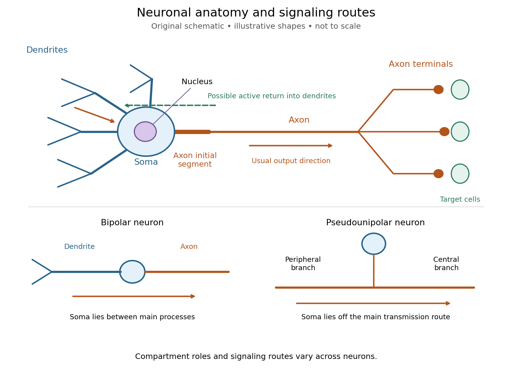
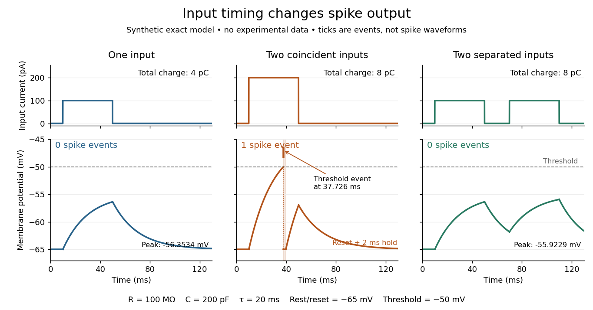
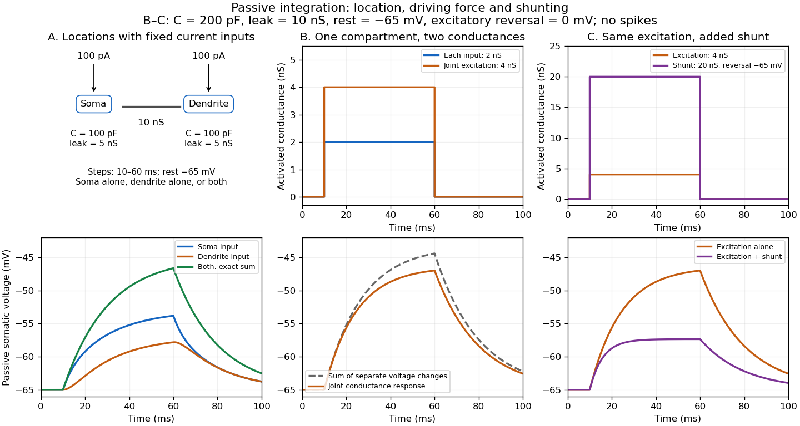
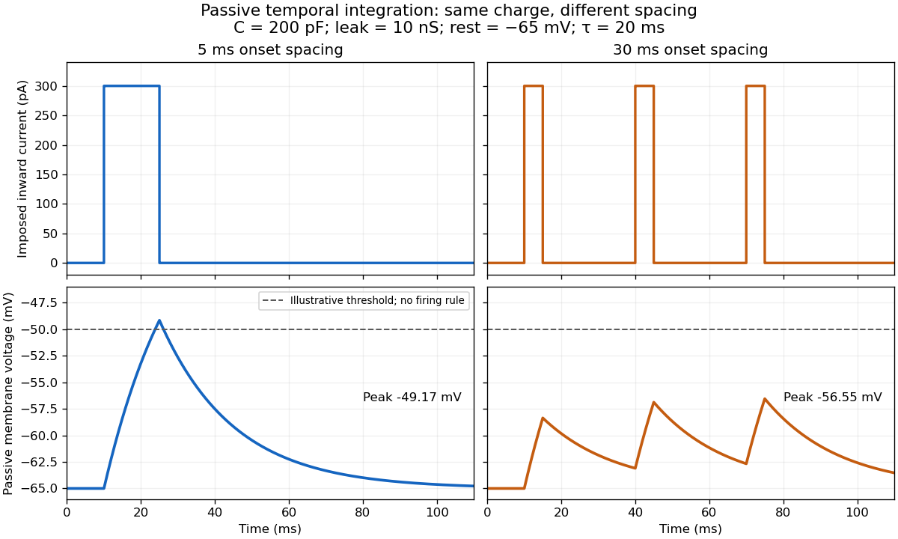
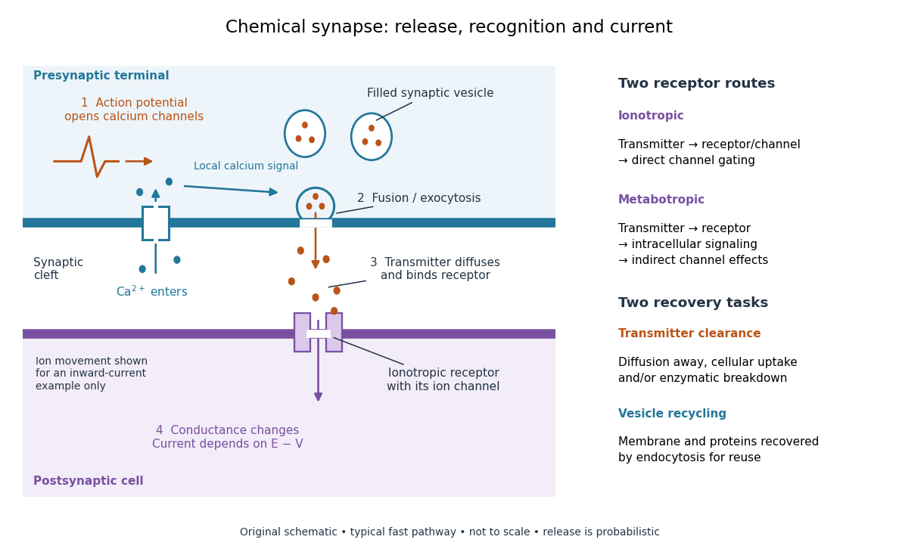
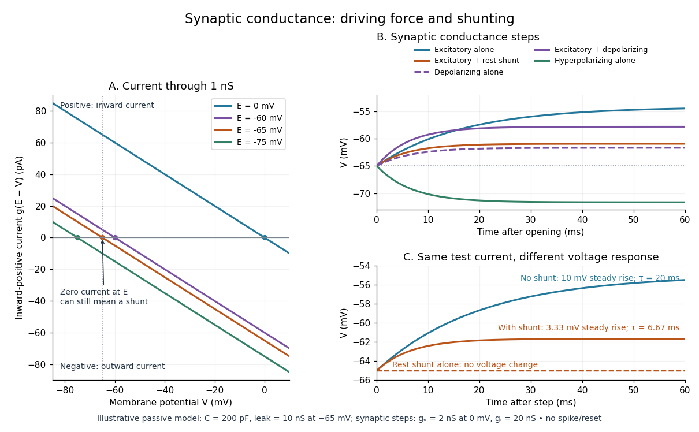
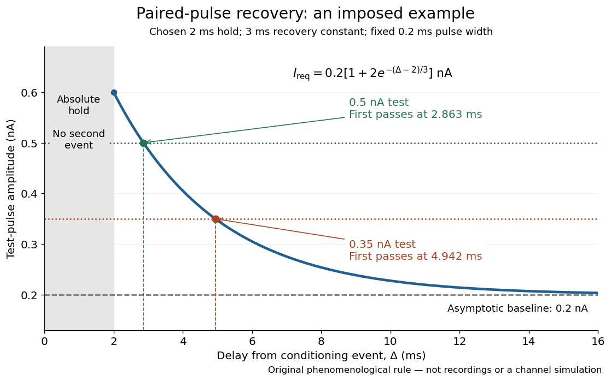
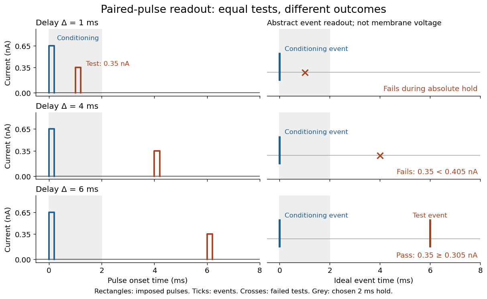

# Neuron

↑ **Parent:** [Neuroscience](neuroscience.md)  
ⓦ [Wiki](https://en.wikipedia.org/wiki/Neuron)

A [neuron](neuron.md) is a specialized [biological cell](biological-cell.md) that receives, integrates and transmits signals. Its shape separates places where inputs arrive from places where outputs reach other [biological cells](biological-cell.md): this functional asymmetry is [neuronal polarity](#neuronal-polarity). Understanding a [neuron](neuron.md) therefore means connecting its anatomy to changes in [membrane potential](membrane-potential.md), rather than treating it as a wire that merely forwards every input.

In a common [multipolar neuron](#multipolar-neuron), branching [dendrites](#dendrite) receive inputs at [synapses](#synapse); the [soma](#soma-biology) contains the [cell nucleus](biological-cell.md#cell-nucleus) and most major [organelles](biological-cell.md#organelle); the [axon](#axon) carries signals to distant or nearby targets; and [axon terminals](#axon-terminal) form output contacts. All these regions belong to one [biological cell](biological-cell.md) enclosed by a continuous [cell membrane](cell-membrane.md). An [axon](#axon) can branch, allowing one [neuron](neuron.md) to influence several receiving [biological cells](biological-cell.md).[§12.2, Parts of a Neuron: nucleus, organelles, processes, branching axon, initial segment and terminals](anatomy-and-physiology-bibliography.md#anatomy-and-physiology-2e-by-j-gordon-betts-and-others/12-2-nervous-tissue)

At an input [chemical synapse](#chemical-synapse), a [neurotransmitter](#neurotransmitter) acts on a [receptor](protein.md#receptor-biochemistry), changing an [electric current](electric-charge.md#electric-current) directly or through [signal transduction](signal-transduction.md).[§3.1, opening paragraphs: ionotropic and metabotropic receptors and postsynaptic currents](neuroscience-bibliography.md#neuronal-dynamics-from-single-neurons-to-networks-and-models-of-cognition-by-wulfram-gerstner-and-others/3-1-synapses) A resulting [synaptic potential](#synaptic-potential) contributes to [synaptic integration](#synaptic-integration) in the [dendrites](#dendrite) and [soma](#soma-biology). In many spiking [neurons](neuron.md), sufficiently strong [depolarization](membrane-potential.md#depolarization) recruits [voltage-gated ion channels](membrane-potential.md#voltage-gated-ion-channel) in the [axon initial segment](#axon-initial-segment), initiating an [action potential](#action-potential) that propagates along the [axon](#axon). At an output [chemical synapse](#chemical-synapse), [calcium](chemical-substance.md#calcium) entry through [voltage-gated ion channels](membrane-potential.md#voltage-gated-ion-channel) promotes [synaptic vesicle](#synaptic-vesicle) [exocytosis](cell-membrane.md#exocytosis), releasing [neurotransmitter](#neurotransmitter). An [action potential](#action-potential) is thus regenerated electrically along a [cell membrane](cell-membrane.md); it is not a packet of [neurotransmitter](#neurotransmitter) travelling from the [dendrites](#dendrite) to the [axon terminals](#axon-terminal).[Chemical Synapses, Figure 5.3: voltage-gated calcium entry and synaptic vesicle exocytosis](neuroscience-bibliography.md#neuroscience-2nd-edition-edited-by-d-purves-and-others)

**[Figure 1](#image-neuronal-anatomy-usual-signaling-direction-and-alternative-shapes). Neuronal anatomy, usual signaling direction and alternative shapes**. Original schematic, not microscopy and not to scale. The upper [multipolar neuron](#multipolar-neuron) identifies [dendrites](#dendrite), the [soma](#soma-biology), the [cell nucleus](biological-cell.md#cell-nucleus), the [axon initial segment](#axon-initial-segment), the [axon](#axon) and [axon terminals](#axon-terminal). Solid arrows show a common input-to-output route; a dashed arrow indicates possible propagation of an [action potential](#action-potential) back toward [dendrites](#dendrite). The lower sketches compare a [bipolar neuron](#bipolar-neuron) and a [pseudounipolar neuron](#pseudounipolar-neuron), whose [soma](#soma-biology) lies off the main transmission route. Shapes and relative dimensions are illustrative.

The compartments are specializations, not exclusive jobs. Inputs can contact the [soma](#soma-biology) or [axon](#axon) as well as [dendrites](#dendrite); [dendrites](#dendrite) can support active [voltage-gated ion channels](membrane-potential.md#voltage-gated-ion-channel). Paired recordings from a [pyramidal neuron](#pyramidal-cell)'s [soma](#soma-biology) and [dendrite](#dendrite) or [axon](#axon) established that an [action potential](#action-potential) can begin in the [axon](#axon) and propagate back into the [dendrites](#dendrite). The usual output direction therefore does not make every electrical signal strictly one-way.[Active propagation of somatic action potentials into neocortical pyramidal cell dendrites by Greg J. Stuart and others](neuroscience-bibliography.md#active-propagation-of-somatic-action-potentials-into-neocortical-pyramidal-cell-dendrites-by-greg-j-stuart-and-others) An [electrical synapse](#electrical-synapse), which directly couples [cytoplasms](biological-cell.md#cytoplasm) through [gap junctions](cell-membrane.md#gap-junction), also differs from the sending-and-receiving arrangement of a [chemical synapse](#chemical-synapse).[§1.1.3: electrical and chemical synapses](neuroscience-bibliography.md#neuronal-dynamics-from-single-neurons-to-networks-and-models-of-cognition-by-wulfram-gerstner-and-others/1-1-elements-of-neuronal-systems)

Nor does every [neuron](neuron.md) have the upper diagram's shape. A [bipolar neuron](#bipolar-neuron) has two main processes, one [dendrite](#dendrite) and one [axon](#axon); a [multipolar neuron](#multipolar-neuron) has several [dendrites](#dendrite); and a [pseudounipolar neuron](#pseudounipolar-neuron) has a single process from the [soma](#soma-biology) that divides into peripheral and central branches. In the last arrangement, sensory signals can travel past the [soma](#soma-biology) rather than obligatorily through it. These shape categories do not specify every [neuron](neuron.md)'s [receptor](protein.md#receptor-biochemistry), connectivity or firing behavior.[§12.2, Types of Neurons and Figure 12.9: multipolar, bipolar and human pseudo-unipolar cells; sensory projection past the cell body](anatomy-and-physiology-bibliography.md#anatomy-and-physiology-2e-by-j-gordon-betts-and-others/12-2-nervous-tissue) Some [neurons](neuron.md) in the [retina](neuroscience.md#retina) communicate through graded changes in [membrane potential](membrane-potential.md) without generating [action potentials](#action-potential).[1.1 Elements of Neuronal Systems](neuroscience-bibliography.md#neuronal-dynamics-from-single-neurons-to-networks-and-models-of-cognition-by-wulfram-gerstner-and-others/1-1-elements-of-neuronal-systems)

**Why timing changes the computation.** [Synaptic integration](#synaptic-integration) can combine inputs at different locations, called [spatial summation](#spatial-summation), and inputs arriving at different times, called [temporal summation](#temporal-summation). A minimal example uses the [leaky integrate-and-fire model](neuroscience.md#leaky-integrate-and-fire-model) with the illustrative parameters already given there: resting and reset [membrane potential](membrane-potential.md) $-65\,\mathrm{mV}$, firing threshold $-50\,\mathrm{mV}$, [electrical resistance](electric-charge.md#electrical-resistance) $R=100\,\mathrm{M\Omega}$, [capacitance](electromagnetism.md#capacitance) $C=200\,\mathrm{pF}$, [time constant](analysis.md#time-constant) $\tau=RC=20\,\mathrm{ms}$ and [neuronal refractory period](#neuronal-refractory-period) $2\,\mathrm{ms}$. These are chosen model values, not measured properties of a particular [neuron](neuron.md). Before firing, a constant inward [electric current](electric-charge.md#electric-current) $I$ starting from rest gives

$$
V(t)=-65\,\mathrm{mV}+RI\left(1-e^{-t/\tau}\right).
$$

The [exponential function](calculus.md#exponential-function) expresses the competition between charging the [cell membrane](cell-membrane.md)'s [capacitance](electromagnetism.md#capacitance) and leakage through its [electrical resistance](electric-charge.md#electrical-resistance).[§1.3.1–§1.3.3, equations (1.5), (1.7), (1.12) and (1.13): passive integration, step response, threshold and reset](neuroscience-bibliography.md#neuronal-dynamics-from-single-neurons-to-networks-and-models-of-cognition-by-wulfram-gerstner-and-others/1-3-integrate-and-fire-models)

Two $100\,\mathrm{pA}$ inputs, each lasting $40\,\mathrm{ms}$, produce different outputs depending on their timing. Either input alone reaches only $-56.3534\,\mathrm{mV}$. Applied together, they give $I=200\,\mathrm{pA}$ and reach threshold after $20\ln4\,\mathrm{ms}\approx27.7259\,\mathrm{ms}$, producing one [action potential](#action-potential) event during the pulse. If instead the second input begins $20\,\mathrm{ms}$ after the first ends, the earlier [depolarization](membrane-potential.md#depolarization) has partly decayed: the second pulse peaks at approximately $-55.9229\,\mathrm{mV}$ and neither pulse produces an [action potential](#action-potential). The two-input protocols deliver the same total [electric charge](electric-charge.md), $8\,\mathrm{pC}$, yet only the coincident protocol fires. Counting total input alone misses this timing dependence.

**[Figure 2](#image-the-same-total-input-can-yield-different-neuronal-outputs). The same total input can yield different neuronal outputs**. Synthetic exact [leaky integrate-and-fire model](neuroscience.md#leaky-integrate-and-fire-model) responses, not empirical recordings. A single $100\,\mathrm{pA}$ pulse is below threshold; two coincident pulses produce one [action potential](#action-potential) event, shown as a tick rather than a biological waveform; two separated pulses deliver the same total [electric charge](electric-charge.md) as the coincident pair but produce no events. The lower traces show [membrane potential](membrane-potential.md), its reset and the brief [neuronal refractory period](#neuronal-refractory-period). All inputs are prescribed [electric currents](electric-charge.md#electric-current) in a single compartment, without a modeled [synaptic conductance](#synaptic-conductance) or spatial [dendrite](#dendrite).

This example makes a [neuron](neuron.md) a detector of sufficiently clustered input, not a perfect logical gate: different parameters change the result. Actual [dendrites](#dendrite) introduce location-dependent filtering and active responses, and an [inhibitory postsynaptic potential](#inhibitory-postsynaptic-potential) or [shunting inhibition](#shunting-inhibition) can change whether another input succeeds. The single-compartment [leaky integrate-and-fire model](neuroscience.md#leaky-integrate-and-fire-model) omits these mechanisms.[§1.4.2 and §1.4.4: shunting inhibition, spatial structure and active dendritic responses](neuroscience-bibliography.md#neuronal-dynamics-from-single-neurons-to-networks-and-models-of-cognition-by-wulfram-gerstner-and-others/1-4-limitations-of-the-leaky-integrate-and-fire-model) Across connected [neurons](neuron.md), branching [axons](#axon) distribute outputs while converging [synapses](#synapse) combine inputs; [spike trains](neuroscience.md#spike-train) can support [temporal coding](neuroscience.md#temporal-coding) and [rate coding](neuroscience.md#rate-coding), and [synaptic plasticity](#synaptic-plasticity) changes the influence of an input. Connectivity and cellular dynamics together determine the computation.[§1.1.1–§1.1.2: axonal branching and spike trains](neuroscience-bibliography.md#neuronal-dynamics-from-single-neurons-to-networks-and-models-of-cognition-by-wulfram-gerstner-and-others/1-1-elements-of-neuronal-systems)[§3.1.3: changes in synaptic efficacy with stimulation history](neuroscience-bibliography.md#neuronal-dynamics-from-single-neurons-to-networks-and-models-of-cognition-by-wulfram-gerstner-and-others/3-1-synapses)

**Testing the connection between structure and function.** [Whole-cell recording](neuroscience.md#whole-cell-recording) connects anatomy to a measured [membrane potential](membrane-potential.md). In a published mouse protocol, a two-photon microscope guides solution-filled glass pipettes to [neurons](neuron.md); an amplifier and bath reference electrode complete the electrical recording apparatus. A high-resistance seal forms against the [cell membrane](cell-membrane.md), then brief suction opens the membrane patch beneath the tip. In [current clamp](neuroscience.md#current-clamp), the amplifier supplies a chosen [electric current](electric-charge.md#electric-current) and records the resulting [membrane potential](membrane-potential.md), unlike [voltage clamp](neuroscience.md#voltage-clamp), which controls voltage and measures [electric current](electric-charge.md#electric-current). The investigators used $500\,\mathrm{ms}$ current steps of several amplitudes to characterize excitability and firing, and negative current pulses to estimate input [electrical resistance](electric-charge.md#electrical-resistance).[Multiple Two-Photon Targeted Whole-Cell Patch-Clamp Recordings From Monosynaptically Connected Neurons in vivo by Jean-Sébastien Jouhanneau and others](neuroscience-bibliography.md#multiple-two-photon-targeted-whole-cell-patch-clamp-recordings-from-monosynaptically-connected-neurons-in-vivo-by-jean-sebastien-jouhanneau-and-others)

The observable is a voltage trace, including graded responses and [action potentials](#action-potential). Comparing injected [electric current](electric-charge.md#electric-current) with that trace tests how input becomes output; it does not identify every underlying [ion channel](cell-membrane.md#ion-channel). The protocol checks access [electrical resistance](electric-charge.md#electrical-resistance), which can distort voltage and [action potential](#action-potential) measurements, and includes intervals without stimulation to record spontaneous activity. In a teaching replication, repeated zero-input trials and monitoring baseline drift would provide further controls; these are recommended comparisons, not additional results attributed to the paper. A recording at the [soma](#soma-biology) also cannot establish the local voltage everywhere in a branching [dendrite](#dendrite), and this anesthetized preparation does not establish behavior in every awake [neuron](neuron.md).[Multiple Two-Photon Targeted Whole-Cell Patch-Clamp Recordings From Monosynaptically Connected Neurons in vivo by Jean-Sébastien Jouhanneau and others](neuroscience-bibliography.md#multiple-two-photon-targeted-whole-cell-patch-clamp-recordings-from-monosynaptically-connected-neurons-in-vivo-by-jean-sebastien-jouhanneau-and-others)

A complementary experiment used simultaneous [whole-cell recordings](neuroscience.md#whole-cell-recording) from the [soma](#soma-biology) and an apical [dendrite](#dendrite) or [axon](#axon) of the same [pyramidal neuron](#pyramidal-cell) in a brain slice. The relative onset times of [action potentials](#action-potential), together with [sodium](chemical-substance.md#sodium) currents in excised [dendrite](#dendrite) membrane patches, supported axonal initiation followed by active propagation into [dendrites](#dendrite). Pairing sites within one [neuron](neuron.md) is a useful comparison because it avoids confusing differences between cells with differences between compartments. Instrument timing and comparable recording quality would be essential controls when reproducing the inference. Only the published abstract was accessible here, so no unverified timing values, drug controls or channel distributions are supplied.[Active propagation of somatic action potentials into neocortical pyramidal cell dendrites by Greg J. Stuart and others](neuroscience-bibliography.md#active-propagation-of-somatic-action-potentials-into-neocortical-pyramidal-cell-dendrites-by-greg-j-stuart-and-others)

**Table of contents**

- [Neuronal excitability](#neuronal-excitability)
- [Mirror neuron](#mirror-neuron)
- [Amacrine cell](#amacrine-cell)
- [Horizontal cell](#horizontal-cell)
- [Retinal bipolar cell](#retinal-bipolar-cell)
  - [ON and OFF retinal pathways](#on-and-off-retinal-pathways)
- [Retinal ganglion cell](#retinal-ganglion-cell)
  - [Small bistratified ganglion cell](#small-bistratified-ganglion-cell)
  - [Midget ganglion cell](#midget-ganglion-cell)
- [Granule cell](#granule-cell)
- [Purkinje cell](#purkinje-cell)
- [Neurite](#neurite)
- [Neuronal polarity](#neuronal-polarity)
- [Synaptic integration](#synaptic-integration)
  - [Spatial summation](#spatial-summation)
    - [Passive dendritic cable](#passive-dendritic-cable)
    - [Passive spatial and conductance integration](#passive-spatial-and-conductance-integration)
  - [Temporal summation](#temporal-summation)
    - [Membrane time constant](#membrane-time-constant)
  - [Neuronal firing threshold](#neuronal-firing-threshold)
  - [Dendritic spike](#dendritic-spike)
  - [NMDA receptor](#nmda-receptor)
- [Multipolar neuron](#multipolar-neuron)
- [Bipolar neuron](#bipolar-neuron)
- [Pseudounipolar neuron](#pseudounipolar-neuron)
- [Pyramidal cell](#pyramidal-cell)
- [Soma (biology)](#soma-biology)
- [Neural adaptation](#neural-adaptation)
  - [Light adaptation](#light-adaptation)
  - [Chromatic adaptation](#chromatic-adaptation)
    - [Cone-gain normalization](#cone-gain-normalization)
    - [Color contrast adaptation](#color-contrast-adaptation)
- [Synapse](#synapse)
  - [Synaptic plasticity](#synaptic-plasticity)
    - [Eligibility trace](#eligibility-trace)
    - [Long-term potentiation](#long-term-potentiation)
    - [Short-term synaptic plasticity](#short-term-synaptic-plasticity)
    - [Synaptic competition](#synaptic-competition)
      - [Synaptic normalization](#synaptic-normalization)
  - [Neurotransmitter](#neurotransmitter)
    - [Neuropeptide](#neuropeptide)
      - [Corticotropin-releasing hormone](#corticotropin-releasing-hormone)
    - [Gamma-aminobutyric acid](#gamma-aminobutyric-acid)
    - [Neuromodulation](#neuromodulation)
      - [Neuromodulator measurement and intervention](#neuromodulator-measurement-and-intervention)
      - [Neuromodulator](#neuromodulator)
    - [Norepinephrine](#norepinephrine)
    - [Serotonin](#serotonin)
    - [Dopamine](#dopamine)
      - [Dopamine D2 receptor](#dopamine-d2-receptor)
    - [Acetylcholine](#acetylcholine)
  - [Chemical synapse](#chemical-synapse)
    - [Co-transmission](#co-transmission)
    - [Neurotransmitter clearance](#neurotransmitter-clearance)
    - [Synaptic cleft](#synaptic-cleft)
    - [Synaptic vesicle](#synaptic-vesicle)
      - [Quantal neurotransmitter release](#quantal-neurotransmitter-release)
        - [Synaptic release probability](#synaptic-release-probability)
    - [Shunting inhibition](#shunting-inhibition)
  - [Electrical synapse](#electrical-synapse)
  - [Synaptic potential](#synaptic-potential)
    - [Synaptic conductance](#synaptic-conductance)
    - [Excitatory postsynaptic potential](#excitatory-postsynaptic-potential)
    - [Inhibitory postsynaptic potential](#inhibitory-postsynaptic-potential)
- [Action potential](#action-potential)
  - [Depolarization block](#depolarization-block)
  - [Compound action potential](#compound-action-potential)
  - [Neuronal refractory period](#neuronal-refractory-period)
    - [Absolute neuronal refractory period](#absolute-neuronal-refractory-period)
    - [Relative neuronal refractory period](#relative-neuronal-refractory-period)
    - [Neuronal paired-pulse recovery](#neuronal-paired-pulse-recovery)
      - [Phenomenological paired-pulse recovery](#phenomenological-paired-pulse-recovery)
    - [Refractory limits on neuronal firing](#refractory-limits-on-neuronal-firing)
- [Dendrite](#dendrite)
- [Axon](#axon)
  - [Climbing fiber](#climbing-fiber)
  - [Parallel fiber](#parallel-fiber)
  - [Axon initial segment](#axon-initial-segment)
  - [Axon terminal](#axon-terminal)

## Neuronal excitability

↑ **Parent:** [Neuron](neuron.md)

## Mirror neuron

↑ **Parent:** [Neuron](neuron.md)

A [neuron](neuron.md) whose recorded activity has related selectivity during action execution and observation. This response property does not by itself identify the [neuron](neuron.md)’s necessary behavioural function or its developmental origin.

## Amacrine cell

↑ **Parent:** [Neuron](neuron.md)

A retinal interneuron contributing diverse temporal, inhibitory and other interactions in inner retinal circuits.

## Horizontal cell

↑ **Parent:** [Neuron](neuron.md)

A retinal interneuron contributing lateral interactions among [photoreceptor](neuroscience.md#photoreceptor) signals and spatial context. Its participation in a circuit does not imply that every perceptual surround effect originates at that one cell type.

## Retinal bipolar cell

↑ **Parent:** [Neuron](neuron.md)

A retinal interneuron relaying [photoreceptor](neuroscience.md#photoreceptor) signals toward ganglion-cell circuits. ON and OFF types differ in how changes in [photoreceptor](neuroscience.md#photoreceptor) output affect their responses.

### ON and OFF retinal pathways

↑ **Parent:** [Retinal bipolar cell](#retinal-bipolar-cell)

Parallel retinal pathways emphasizing increments and decrements in stimulation. Their sign differences depend on synaptic transformations of [photoreceptor](neuroscience.md#photoreceptor) output; an ON pathway is not simply a [photoreceptor](neuroscience.md#photoreceptor) that depolarizes to [light](optics.md#light).

## Retinal ganglion cell

↑ **Parent:** [Neuron](neuron.md)

A retinal output [neuron](neuron.md) conveying information through [action potentials](#action-potential). Its responses reflect inputs transformed by retinal circuitry rather than a direct copy of one cone voltage.

### Small bistratified ganglion cell

↑ **Parent:** [Retinal ganglion cell](#retinal-ganglion-cell)

A retinal ganglion-cell type with dendrites in two strata, identified with an S-ON opponent pathway in primates. Anatomy and physiology together establish a distinct route for S-cone signals; the traditional blue-on label does not equate its discharge with unique blue experience.

### Midget ganglion cell

↑ **Parent:** [Retinal ganglion cell](#retinal-ganglion-cell)

A retinal ganglion-cell type whose central retinal circuitry can support fine spatial sampling and cone-opponent responses. Functional spatial and chromatic roles need not correspond to entirely separate anatomical channels.

## Granule cell

↑ **Parent:** [Neuron](neuron.md)

A small [neuron](neuron.md) found in several brain regions. Cerebellar [granule cells](#granule-cell) supply [parallel fibers](#parallel-fiber); dentate [granule cells](#granule-cell) participate in sparse [hippocampal](neuroscience.md#hippocampus) input coding. These are anatomically distinct populations, so a shared descriptive name does not imply an identical circuit role.

## Purkinje cell

↑ **Parent:** [Neuron](neuron.md)

Named for [Jan Evangelista Purkyně](physiology.md#jan-evangelista-purkyne), a cerebellar [neuron](neuron.md) receiving many [parallel fiber](#parallel-fiber) inputs and a powerful [climbing fiber](#climbing-fiber) input. Simple-spike and complex-spike responses provide distinct physiological readouts in studies of motor learning.

**[Figure 3](#image-purkinje-cells-and-granule-cells-in-a-pigeon-cerebellum-drawn-by-santiago-ramon-y-cajal-in-1899). Purkinje cells and granule cells in a pigeon cerebellum, drawn by Santiago Ramón y Cajal in 1899**. [Source](https://commons.wikimedia.org/wiki/File:PurkinjeCell.jpg). The large, branching cells labelled A are [Purkinje cells](#purkinje-cell); the smaller cells labelled B are [granule cells](#granule-cell). Historical drawing held by Instituto Cajal, Madrid. Public domain, via Wikimedia Commons.

## Neurite

↑ **Parent:** [Neuron](neuron.md)

## Neuronal polarity

↑ **Parent:** [Neuron](neuron.md)

## Synaptic integration

↑ **Parent:** [Neuron](neuron.md)

[Synaptic integration](#synaptic-integration) is the conversion of inputs at a [neuron](neuron.md)'s [synapses](#synapse) into a changing [membrane potential](membrane-potential.md) and, in a spiking [neuron](neuron.md), the timing or absence of [action potentials](#action-potential). [Spatial summation](#spatial-summation) concerns inputs at different locations; [temporal summation](#temporal-summation) concerns inputs at different times. A useful question is whether individually ineffective inputs can act together, and whether an [inhibitory postsynaptic potential](#inhibitory-postsynaptic-potential) changes that cooperation. The answer depends on location, timing and the receiving [neuron](neuron.md)'s state.

A [synaptic potential](#synaptic-potential) is a voltage response, whereas [synaptic conductance](#synaptic-conductance) describes activated [ion channels](cell-membrane.md#ion-channel). With inward-positive [electric current](electric-charge.md#electric-current), the contribution of input $j$ is

$$
I_j(t)=g_j(t)(E_j-V).
$$

Here $g_j$ is its [synaptic conductance](#synaptic-conductance), $E_j$ its [reversal potential](membrane-potential.md#reversal-potential) and $V$ the local [membrane potential](membrane-potential.md). The driving force $E_j-V$ is an [electric potential difference](electric-field.md#electric-potential-difference). An [EPSP](#excitatory-postsynaptic-potential) generally brings the [membrane potential](membrane-potential.md) toward a more positive [reversal potential](membrane-potential.md#reversal-potential), but its driving force shrinks during [depolarization](membrane-potential.md#depolarization). An [IPSP](#inhibitory-postsynaptic-potential) need not produce [hyperpolarization](membrane-potential.md#hyperpolarization): a [reversal potential](membrane-potential.md#reversal-potential) above rest but below the [neuronal firing threshold](#neuronal-firing-threshold) can produce [depolarization](membrane-potential.md#depolarization) while opposing a larger excursion. At $E_j=V$, the added [synaptic conductance](#synaptic-conductance) initially carries zero [electric current](electric-charge.md#electric-current) yet can cause [shunting inhibition](#shunting-inhibition) of another input.[§3.1, equation (3.1), and §3.1.1: conductance, reversal and voltage-dependent sign; our current convention is inward-positive](neuroscience-bibliography.md#neuronal-dynamics-from-single-neurons-to-networks-and-models-of-cognition-by-wulfram-gerstner-and-others/3-1-synapses)

Two distinct nonlinearities matter. Even a passive [cell membrane](cell-membrane.md) can show sublinear [synaptic integration](#synaptic-integration) when added [synaptic conductances](#synaptic-conductance) reduce driving force and effective [electrical resistance](electric-charge.md#electrical-resistance). Active [voltage-gated ion channels](membrane-potential.md#voltage-gated-ion-channel) and [NMDA receptors](#nmda-receptor) can instead amplify sufficiently concentrated inputs and produce a [dendritic spike](#dendritic-spike). Neither summing prescribed [electric currents](electric-charge.md#electric-current) nor adding separate measured [EPSPs](#excitatory-postsynaptic-potential) is an exact universal rule for a branching [neuron](neuron.md).[§1.4.2 and §1.4.4: shunting, saturation and active dendritic interactions](neuroscience-bibliography.md#neuronal-dynamics-from-single-neurons-to-networks-and-models-of-cognition-by-wulfram-gerstner-and-others/1-4-limitations-of-the-leaky-integrate-and-fire-model)

### Spatial summation

↑ **Parent:** [Synaptic integration](#synaptic-integration)

[Spatial summation](#spatial-summation) combines inputs arriving at different [synapses](#synapse). Location matters because a [dendrite](#dendrite) has axial [electrical resistance](electric-charge.md#electrical-resistance) and leaky [membrane capacitance](neuroscience.md#membrane-capacitance): a local [synaptic potential](#synaptic-potential) need not arrive at the [soma](#soma-biology) with its original amplitude or time course. A [passive dendritic cable](#passive-dendritic-cable) makes this attenuation explicit. The [superposition principle](vector-space.md#superposition-principle) applies to fixed [electric current](electric-charge.md#electric-current) inputs in a linear passive model, but adding [synaptic conductances](#synaptic-conductance) changes the model's coefficients. Compare voltage changes relative to the same baseline, rather than adding absolute [membrane potentials](membrane-potential.md).

**[Figure 4](#image-spatial-summation-reduced-driving-force-and-shunting-inhibition-in-passive-models). Spatial summation, reduced driving force and shunting inhibition in passive models**. Original calculations, not biological recordings. A: equal imposed [electric current](electric-charge.md#electric-current) steps at the [soma](#soma-biology) and a [dendrite](#dendrite) in two coupled passive compartments yield different somatic voltage traces; applying both gives their exact sum relative to rest. B: activating two excitatory [synaptic conductances](#synaptic-conductance) together gives less [depolarization](membrane-potential.md#depolarization) than adding the separate voltage responses. C: a [synaptic conductance](#synaptic-conductance) whose [reversal potential](membrane-potential.md#reversal-potential) equals rest suppresses the same excitation. All steps last from $10$ to $60\,\mathrm{ms}$. There are no active [ion channels](cell-membrane.md#ion-channel), [action potentials](#action-potential) or resets. The equations and parameters are under [passive spatial and conductance integration](#passive-spatial-and-conductance-integration).

**A motivating experiment.** A 2004 study used $300$–$350\,\mathrm{\mu m}$ cortical slices from $18$–$28$-day-old rats at $35$–$36\,{}^\circ\mathrm C$. Somatic [whole-cell recordings](neuroscience.md#whole-cell-recording) measured [EPSPs](#excitatory-postsynaptic-potential) in layer-5 [pyramidal neurons](#pyramidal-cell). Two fine stimulating [electrodes](electrochemistry.md#electrode) were positioned beside imaged [dendrites](#dendrite); [calcium](chemical-substance.md#calcium)-sensitive dye localized activation. Each site was stimulated alone, then both together, usually with paired pulses $20\,\mathrm{ms}$ apart. Comparing the combined voltage trace with the sum of individual changes tested the summation rule. Nearby inputs on one branch showed strong amplification at intermediate strengths; inputs on different branches were approximately linear.[pp. 622–623, Figures 1–2; p. 626, Methods](neuroscience-bibliography.md#computational-subunits-in-thin-dendrites-of-pyramidal-cells-by-alon-polsky-and-others)

Blocking both excitatory [receptor](protein.md#receptor-biochemistry) classes eliminated voltage and [calcium](chemical-substance.md#calcium) responses, checking against direct electrical activation. [NMDA receptor](#nmda-receptor) blockers eliminated or markedly reduced amplification; comparisons with inhibition intact and blocked addressed inhibitory contributions. These controls support local active integration. Passing [axons](#axon) could still recruit unintended [synapses](#synapse); somatic voltage does not measure every local [membrane potential](membrane-potential.md). The study tested subthreshold slice responses and pairs of branches, not arbitrary activity in an intact brain.[pp. 622–624: controls; pp. 625–626: limitations](neuroscience-bibliography.md#computational-subunits-in-thin-dendrites-of-pyramidal-cells-by-alon-polsky-and-others)

#### Passive dendritic cable

↑ **Parent:** [Spatial summation](#spatial-summation)

A [passive dendritic cable](#passive-dendritic-cable) models a uniform [dendrite](#dendrite) with axial [electrical resistance](electric-charge.md#electrical-resistance), membrane leak and [membrane capacitance](neuroscience.md#membrane-capacitance), excluding active [ion channels](cell-membrane.md#ion-channel). Let $r_a$ be axial [electrical resistance](electric-charge.md#electrical-resistance) per length, $r_m$ membrane [electrical resistance](electric-charge.md#electrical-resistance) times length, and $c_m$ [membrane capacitance](neuroscience.md#membrane-capacitance) per length. For voltage deviation $v=V-E_L$ from the leak [reversal potential](membrane-potential.md#reversal-potential), [electric charge conservation](electric-charge.md#charge-conservation) gives the [partial differential equation](partial-differential-equation.md)

$$
c_m\frac{\partial v}{\partial t}=\frac{1}{r_a}\frac{\partial^2v}{\partial x^2}-\frac{v}{r_m}+i(x,t),\qquad \tau_m=r_mc_m,\qquad \lambda=\sqrt{\frac{r_m}{r_a}}.
$$

$i$ is imposed inward [electric current](electric-charge.md#electric-current) per length. Units are $r_a:\Omega/\mathrm m$, $r_m:\Omega\,\mathrm m$ and $c_m:\mathrm F/\mathrm m$, so $\tau_m$ is a time and $\lambda$ a length. On a source-free semi-infinite cable with imposed $v(0)=v_0$ and $v(x)\to0$ as $x\to\infty$, the [steady state](dynamical-systems.md#steady-state) is

$$
v(x)=v_0e^{-x/\lambda}.
$$

Differentiate twice to verify the [ordinary differential equation](differential-equation.md#ordinary-differential-equation) $\lambda^2v''-v=0$. At $x=\lambda$, the amplitude is $e^{-1}\approx0.368$ of the boundary amplitude. This is a stationary attenuation law, not the complete waveform of a brief [EPSP](#excitatory-postsynaptic-potential). Transient passive spread also broadens and delays responses. Finite ends, branch points and the [soma](#soma-biology)'s load alter the solution; distance alone cannot specify every real [synaptic potential](#synaptic-potential).[§3.2.1, equations (3.17)–(3.20): passive cable and length scale; §3.2.2, Figure 3.7: transient attenuation and delay](neuroscience-bibliography.md#neuronal-dynamics-from-single-neurons-to-networks-and-models-of-cognition-by-wulfram-gerstner-and-others/3-2-spatial-structure-the-dendritic-tree)

#### Passive spatial and conductance integration

↑ **Parent:** [Spatial summation](#spatial-summation)

The spatial panel uses two compartments with [membrane potentials](membrane-potential.md) $V_s,V_d$, one representing the [soma](#soma-biology) and one a [dendrite](#dendrite). Set $v_s=V_s-E_L$, $v_d=V_d-E_L$, with leak [reversal potential](membrane-potential.md#reversal-potential) $E_L=-65\,\mathrm{mV}$, each [membrane capacitance](neuroscience.md#membrane-capacitance) $C=100\,\mathrm{pF}$, each leak [electrical conductance](electric-charge.md#electrical-conductance) $g_L=5\,\mathrm{nS}$ and axial [electrical conductance](electric-charge.md#electrical-conductance) $g_c=10\,\mathrm{nS}$. [Electric charge conservation](electric-charge.md#charge-conservation) gives

$$
C\dot v_s=-(g_L+g_c)v_s+g_cv_d+I_s,\qquad C\dot v_d=g_cv_s-(g_L+g_c)v_d+I_d.
$$

This chosen passive model has two decay [time constants](analysis.md#time-constant), $C/g_L=20\,\mathrm{ms}$ for the equal-voltage mode and $C/(g_L+2g_c)=4\,\mathrm{ms}$ for the voltage-difference mode. Starting from rest, a $100\,\mathrm{pA}$ step into the [soma](#soma-biology) gives, with $u$ the time since onset,

$$
v_s(u)=10(1-e^{-u/20})+2(1-e^{-u/4})\quad\mathrm{mV},
$$

while the same step into the [dendrite](#dendrite) gives

$$
v_s(u)=10(1-e^{-u/20})-2(1-e^{-u/4})\quad\mathrm{mV}.
$$

$u$ is expressed in $\mathrm{ms}$. Their long-time rises are $12$ and $8\,\mathrm{mV}$ respectively. Applying both inputs gives $20(1-e^{-u/20})\,\mathrm{mV}$ exactly: spatial attenuation coexists with linear summation of prescribed [electric currents](electric-charge.md#electric-current). After the steps end, both modes decay with their respective [time constants](analysis.md#time-constant). This deliberately coarse model is not a reconstructed [dendrite](#dendrite) or a fit to the experiment above.

The conductance panels use the existing one-compartment [synaptic potential](#synaptic-potential) equation, with $C=200\,\mathrm{pF}$, $g_L=10\,\mathrm{nS}$, $E_L=-65\,\mathrm{mV}$ and excitatory [reversal potential](membrane-potential.md#reversal-potential) $E_e=0\,\mathrm{mV}$. For a constant excitatory [synaptic conductance](#synaptic-conductance) $g_e$, the [steady state](dynamical-systems.md#steady-state) voltage rise and [membrane time constant](#membrane-time-constant) are

$$
\Delta V_\infty=\frac{g_e(E_e-E_L)}{g_L+g_e},\qquad \tau_{\mathrm{eff}}=\frac{C}{g_L+g_e}.
$$

Each isolated $2\,\mathrm{nS}$ input has a limiting rise $130/12\approx10.833\,\mathrm{mV}$. Adding those isolated rises predicts $21.667\,\mathrm{mV}$, but opening both together gives $260/14\approx18.571\,\mathrm{mV}$. The two conductances share a changing driving force. This is sublinear input summation even though the voltage [ordinary differential equation](differential-equation.md#ordinary-differential-equation) is linear for each prescribed conductance waveform.

Add $g_i=20\,\mathrm{nS}$ with [reversal potential](membrane-potential.md#reversal-potential) $E_i=E_L$ to the joint $4\,\mathrm{nS}$ excitation. The limiting rise becomes $260/34\approx7.647\,\mathrm{mV}$ and the [membrane time constant](#membrane-time-constant) becomes $200/34\approx5.882\,\mathrm{ms}$. The shunt alone leaves rest unchanged. At the joint-excitation-only [steady state](dynamical-systems.md#steady-state) $V\approx-46.429\,\mathrm{mV}$, however, its inward [electric current](electric-charge.md#electric-current) would be $20(-65+46.429)\approx-371.429\,\mathrm{pA}$: it opposes that excursion. The finite $50\,\mathrm{ms}$ traces in the diagram approach, but need not reach, these limiting voltages. See [shunting inhibition](#shunting-inhibition) for the constant-[electric current](electric-charge.md#electric-current) comparison.

### Temporal summation

↑ **Parent:** [Synaptic integration](#synaptic-integration)

[Temporal summation](#temporal-summation) is overlap of responses to inputs arriving at different times. It can occur at one repeatedly activated [synapse](#synapse) or across several [synapses](#synapse); it is not defined by reuse of a particular contact. For prescribed [electric current](electric-charge.md#electric-current) inputs in a passive compartment, residual [depolarization](membrane-potential.md#depolarization) from earlier pulses changes the voltage reached by later pulses. The [membrane time constant](#membrane-time-constant) sets how rapidly that residual decays, while the duration of [synaptic conductance](#synaptic-conductance) and spatial filtering by a [passive dendritic cable](#passive-dendritic-cable) can add other timescales.

**[Figure 5](#image-equal-charge-inputs-with-different-spacing-in-a-passive-model-of-temporal-summation). Equal-charge inputs with different spacing in a passive model of temporal summation**. Original passive [current clamp](neuroscience.md#current-clamp) calculations with $C=200\,\mathrm{pF}$, $g_L=10\,\mathrm{nS}$ and rest $-65\,\mathrm{mV}$. Three equal $300\,\mathrm{pA}$ pulses, each $5\,\mathrm{ms}$ long, start at $10,15,20\,\mathrm{ms}$ or at $10,40,70\,\mathrm{ms}$. The first train consists of adjacent pulses and the second allows decay between pulses. The dashed $-50\,\mathrm{mV}$ line is an illustrative [neuronal firing threshold](#neuronal-firing-threshold); trajectories continue passively through it, with no [action potential](#action-potential) or reset. The same total injected [electric charge](electric-charge.md) produces different peak voltages.

For the diagram, write $v=V-E_L$, choose inward-positive imposed [electric current](electric-charge.md#electric-current) $I$, and use the [ordinary differential equation](differential-equation.md#ordinary-differential-equation)

$$
C\dot v=-g_Lv+I(t),\qquad \tau_m=\frac{C}{g_L}=20\,\mathrm{ms}.
$$

A rectangular pulse of amplitude $I_0=300\,\mathrm{pA}$ and duration $d=5\,\mathrm{ms}$, starting from rest, ends with

$$
A=\frac{I_0}{g_L}(1-e^{-d/\tau_m})=30(1-e^{-1/4})\,\mathrm{mV}\approx6.636\,\mathrm{mV}.
$$

Afterwards its contribution decays as $Ae^{-(t-d)/\tau_m}$. The [superposition principle](vector-space.md#superposition-principle) therefore gives, at the end of the third pulse with onset spacing $\Delta\geq d$,

$$
v_{\mathrm{peak}}=A\left(1+e^{-\Delta/\tau_m}+e^{-2\Delta/\tau_m}\right).
$$

For $\Delta=5\,\mathrm{ms}$ this is $15.829\,\mathrm{mV}$, so the peak [membrane potential](membrane-potential.md) is $-49.171\,\mathrm{mV}$. For $\Delta=30\,\mathrm{ms}$ it is $8.447\,\mathrm{mV}$, giving $-56.553\,\mathrm{mV}$. Both protocols inject $3I_0d=4.5\,\mathrm{pC}$ of [electric charge](electric-charge.md); equal charge does not imply equal peak voltage because the leak drains charge while it is delivered.

In the adjacent-pulse case, the illustrative [neuronal firing threshold](#neuronal-firing-threshold) $-50\,\mathrm{mV}$ is crossed at $10+20\log 2\approx23.863\,\mathrm{ms}$. A [leaky integrate-and-fire model](neuroscience.md#leaky-integrate-and-fire-model) would emit its first event there and reset, so its later trajectory would differ from the passive diagram. The widely spaced train never reaches that threshold. Thus changing input timing alone can change whether an event occurs. A real [neuron](neuron.md)'s [neuronal firing threshold](#neuronal-firing-threshold) is also state-dependent, and [synaptic conductance](#synaptic-conductance) pulses are not prescribed [electric current](electric-charge.md#electric-current) pulses.[Opening equations (1.31)–(1.32) and §1.4.3: ideal threshold/reset and dependence on preceding activity](neuroscience-bibliography.md#neuronal-dynamics-from-single-neurons-to-networks-and-models-of-cognition-by-wulfram-gerstner-and-others/1-4-limitations-of-the-leaky-integrate-and-fire-model)

Measured responses to repeated presynaptic [action potentials](#action-potential) may also change through [synaptic plasticity](#synaptic-plasticity). A larger second response can therefore reflect a stronger second input as well as residual postsynaptic voltage. To isolate passive [temporal summation](#temporal-summation), compare known injected [electric current](electric-charge.md#electric-current) waveforms with their single-pulse responses under stable recording conditions; to test actual [synapses](#synapse), measure whether input efficacy changes. These are proposed discriminating comparisons, not additional controls claimed for the slice experiment.[§3.1.3: rapid synaptic dynamics, facilitation and depression](neuroscience-bibliography.md#neuronal-dynamics-from-single-neurons-to-networks-and-models-of-cognition-by-wulfram-gerstner-and-others/3-1-synapses)

#### Membrane time constant

↑ **Parent:** [Temporal summation](#temporal-summation)

The [membrane time constant](#membrane-time-constant) of a passive uniform compartment is its [membrane capacitance](neuroscience.md#membrane-capacitance) $C$ divided by its total fixed [electrical conductance](electric-charge.md#electrical-conductance) $G$. After input removal, voltage deviation from the relevant equilibrium undergoes [exponential decay](analysis.md#exponential-decay); in one [membrane time constant](#membrane-time-constant) it falls to $e^{-1}$ of its initial value. For leak alone, $G=g_L$; while fixed [synaptic conductances](#synaptic-conductance) are open, $G=g_L+\sum_jg_j$. Thus [shunting inhibition](#shunting-inhibition) can both reduce voltage responses and shorten the integration window. This is a local passive timescale: a branching [dendrite](#dendrite) can have several decay modes, and a time-varying [synaptic conductance](#synaptic-conductance) need not admit one constant $\tau_m$.

### Neuronal firing threshold

↑ **Parent:** [Synaptic integration](#synaptic-integration)

A [neuronal firing threshold](#neuronal-firing-threshold) specifies the condition for initiating an [action potential](#action-potential). The [leaky integrate-and-fire model](neuroscience.md#leaky-integrate-and-fire-model) uses a prescribed [membrane potential](membrane-potential.md) $\vartheta$; real initiation involves active [voltage-gated ion channels](membrane-potential.md#voltage-gated-ion-channel) and depends on recent activity and recording site. A threshold drawn on a passive voltage trace is a comparison criterion, not a simulated [action potential](#action-potential).

### Dendritic spike

↑ **Parent:** [Synaptic integration](#synaptic-integration)

A [dendritic spike](#dendritic-spike) is a regenerative local voltage event in a [dendrite](#dendrite). Its effect at the [soma](#soma-biology) depends on propagation and attenuation; local regeneration does not by itself establish a somatic [action potential](#action-potential). It is an active mechanism beyond the [passive dendritic cable](#passive-dendritic-cable).

### NMDA receptor

↑ **Parent:** [Synaptic integration](#synaptic-integration)

An [NMDA receptor](#nmda-receptor) is an [ionotropic receptor](protein.md#ionotropic-receptor) gating an [ion channel](cell-membrane.md#ion-channel) with voltage-dependent [magnesium](chemical-substance.md#magnesium) block. This voltage dependence permits cooperative amplification when inputs produce sufficient local [depolarization](membrane-potential.md#depolarization); [calcium](chemical-substance.md#calcium) can also pass through the open channel.[§3.1.2, equation (3.6): voltage-dependent magnesium block and calcium permeability](neuroscience-bibliography.md#neuronal-dynamics-from-single-neurons-to-networks-and-models-of-cognition-by-wulfram-gerstner-and-others/3-1-synapses)

## Multipolar neuron

↑ **Parent:** [Neuron](neuron.md)  
ⓦ [Wiki](https://en.wikipedia.org/wiki/Multipolar_neuron)

## Bipolar neuron

↑ **Parent:** [Neuron](neuron.md)  
ⓦ [Wiki](https://en.wikipedia.org/wiki/Bipolar_neuron)

## Pseudounipolar neuron

↑ **Parent:** [Neuron](neuron.md)  
ⓦ [Wiki](https://en.wikipedia.org/wiki/Pseudounipolar_neuron)

## Pyramidal cell

↑ **Parent:** [Neuron](neuron.md)  
ⓦ [Wiki](https://en.wikipedia.org/wiki/Pyramidal_cell)

## Soma (biology)

↑ **Parent:** [Neuron](neuron.md)  
ⓦ [Wiki](https://en.wikipedia.org/wiki/Soma_(biology))

## Neural adaptation

↑ **Parent:** [Neuron](neuron.md)  
ⓦ [Wiki](https://en.wikipedia.org/wiki/Neural_adaptation)

Changes in responsiveness during sustained or repeated input. Adaptation makes activity depend on recent stimulation and can invalidate a model whose rate depends only on the present stimulus.

### Light adaptation

↑ **Parent:** [Neural adaptation](#neural-adaptation)

Changes in visual response associated with prevailing [light](optics.md#light) input. Receptor gain, later neural gain and appearance reference points can adjust on different timescales; threshold loss is not automatically tissue damage.

### Chromatic adaptation

↑ **Parent:** [Neural adaptation](#neural-adaptation)

Adjustment of visual responses to the spectral statistics of prevailing stimulation. Changes in gain or reference levels can partially stabilize [color](optics.md#color) judgments despite different illumination or receptor signals. Adaptation is an explanatory mechanism to test; similarity on a [color](optics.md#color) test does not uniquely identify its neural implementation.

#### Cone-gain normalization

↑ **Parent:** [Chromatic adaptation](#chromatic-adaptation)

A diagonal model applying gains $g_j$ to cone signals. If a change transforms every relevant catch as $Q_j\mapsto k_jQ_j$, gains $g_j\mapsto g_j/k_j$ preserve the normalized outputs exactly. A general [illuminant](optics.md#illuminant) change need not produce the same channelwise factors for every surface, so exact cancellation is conditional.

#### Color contrast adaptation

↑ **Parent:** [Chromatic adaptation](#chromatic-adaptation)

Changes following exposure to variation around a mean [color](optics.md#color) or [luminance](optics.md#luminance). Holding the mean input fixed helps distinguish adaptation to variation from a simple account based on changed average cone catch, while receptor nonlinearities and task factors still require controls.

## Synapse

↑ **Parent:** [Neuron](neuron.md)  
ⓦ [Wiki](https://en.wikipedia.org/wiki/Synapse)

A [synapse](#synapse) is a signaling junction between a [neuron](neuron.md) and another [biological cell](biological-cell.md). The sending side is presynaptic and the receiving side postsynaptic. At a [chemical synapse](#chemical-synapse), released [neurotransmitter](#neurotransmitter) acts on a [receptor](protein.md#receptor-biochemistry) in the receiving [cell membrane](cell-membrane.md). At an [electrical synapse](#electrical-synapse), [gap junctions](cell-membrane.md#gap-junction) provide a direct path for [electric current](electric-charge.md#electric-current) between cells. See [1.1 Elements of Neuronal Systems](neuroscience-bibliography.md#neuronal-dynamics-from-single-neurons-to-networks-and-models-of-cognition-by-wulfram-gerstner-and-others/1-1-elements-of-neuronal-systems).

In a common sequence at a [chemical synapse](#chemical-synapse), an arriving [action potential](#action-potential) opens [voltage-gated ion channels](membrane-potential.md#voltage-gated-ion-channel) selective for [calcium](chemical-substance.md#calcium). [Calcium](chemical-substance.md#calcium) entry triggers fusion of [synaptic vesicles](#synaptic-vesicle) with the presynaptic [cell membrane](cell-membrane.md), releasing [neurotransmitter](#neurotransmitter) into the [synaptic cleft](#synaptic-cleft). Binding to a [receptor](protein.md#receptor-biochemistry) changes postsynaptic [electrical resistance and conductance](electric-charge.md#electrical-resistance-and-conductance), directly through an [ion channel](cell-membrane.md#ion-channel) or through an intracellular signaling pathway. The resulting change in [membrane potential](membrane-potential.md) is a [synaptic potential](#synaptic-potential). See [Ion Channels and the Electrical Properties of Membranes](cell-biology-bibliography.md#molecular-biology-of-the-cell-4th-edition-by-bruce-alberts-and-others/ion-channels-and-the-electrical-properties-of-membranes).

A useful conductance approximation writes the inward-positive synaptic [electric current](electric-charge.md#electric-current) as

$$
I_{\mathrm{syn}}=g_{\mathrm{syn}}(t)(E_{\mathrm{syn}}-V),
$$

where $g_{\mathrm{syn}}\geq0$ describes the activated [electrical resistance and conductance](electric-charge.md#electrical-resistance-and-conductance), $V$ is the postsynaptic [membrane potential](membrane-potential.md), and $E_{\mathrm{syn}}$ is the [reversal potential](membrane-potential.md#reversal-potential), the voltage at which this current vanishes. Opening these channels tends to pull $V$ toward $E_{\mathrm{syn}}$; it does not prescribe a current of fixed sign independently of $V$.

For a worked example, let $V=-65\,\mathrm{mV}$ and $g_{\mathrm{syn}}=1\,\mathrm{nS}$. A [reversal potential](membrane-potential.md#reversal-potential) of $0\,\mathrm{mV}$ gives $I_{\mathrm{syn}}=65\,\mathrm{pA}$, an inward [electric current](electric-charge.md#electric-current) that raises [membrane potential](membrane-potential.md). A [reversal potential](membrane-potential.md#reversal-potential) of $-75\,\mathrm{mV}$ instead gives $-10\,\mathrm{pA}$, which lowers [membrane potential](membrane-potential.md). These are illustrative calculations, not measurements. A [reversal potential](membrane-potential.md#reversal-potential) of $-60\,\mathrm{mV}$ can raise $V$ from $-65\,\mathrm{mV}$ yet oppose reaching a threshold of $-50\,\mathrm{mV}$: a depolarizing input need not be excitatory.

An excitatory [synapse](#synapse) favors a subsequent [action potential](#action-potential), whereas an inhibitory [synapse](#synapse) opposes it. The effect depends on the [receptor](protein.md#receptor-biochemistry), the permeating [ions](chemistry.md#ion), their gradients and the [reversal potential](membrane-potential.md#reversal-potential); a [neurotransmitter](#neurotransmitter) does not have one fixed excitatory or inhibitory sign in every context. Even with $E_{\mathrm{syn}}=V$, an added conductance can reduce responses to other inputs by lowering effective [electrical resistance](electric-charge.md#electrical-resistance), an effect called [shunting inhibition](#shunting-inhibition). See [Purves and colleagues: excitatory and inhibitory postsynaptic potentials](https://www.ncbi.nlm.nih.gov/books/NBK11117/). This dependence matters when translating a biological [synapse](#synapse) into a signed weight or an imposed [electric current](electric-charge.md#electric-current) in [computational neuroscience](neuroscience.md#computational-neuroscience).

### Synaptic plasticity

↑ **Parent:** [Synapse](#synapse)  
ⓦ [Wiki](https://en.wikipedia.org/wiki/Synaptic_plasticity)

Changes in synaptic efficacy over time. Activity-dependent plasticity can support learning and development, but also requires constraints to prevent unbounded growth or competition in simplified models.

#### Eligibility trace

↑ **Parent:** [Synaptic plasticity](#synaptic-plasticity)

A decaying record of recent activity that marks a state or connection as eligible for modification by a later teaching signal. An accumulating value-learning trace is $e_t=\gamma\lambda e_{t-1}+x(s_t)$, giving $\Delta w=\alpha\delta_t e_t$. Other traces record action-policy [gradients](multivariable-calculus.md#gradient) or pre/post synaptic events. The update and episode-boundary convention must be specified; an [eligibility trace](#eligibility-trace) is not automatically identical to the visual activity trace used for [trace learning](statistical-learning.md#trace-learning).

#### Long-term potentiation

↑ **Parent:** [Synaptic plasticity](#synaptic-plasticity)

A persistent increase in synaptic efficacy induced by an appropriate pattern of activity. Its presence is a possible storage mechanism; a memory model must still explain which inputs are modified, the learning conditions and how subsequent activity retrieves the stored information.

#### Short-term synaptic plasticity

↑ **Parent:** [Synaptic plasticity](#synaptic-plasticity)

Short-lived changes in synaptic efficacy dependent on recent activity, including facilitation and depression. Such changes can alter a network's response to a later input even when its immediately recorded activity does not reveal the retained information.

#### Synaptic competition

↑ **Parent:** [Synaptic plasticity](#synaptic-plasticity)

Constraints or interactions make the strengthening of some inputs limit others. In developmental models, competition together with input correlations can segregate ON and OFF subregions or inputs from the two eyes; correlations alone do not specify the full biological developmental mechanism.

##### Synaptic normalization

↑ **Parent:** [Synaptic competition](#synaptic-competition)

A learning rule can constrain the sum or norm of incoming synaptic weights to prevent unbounded [Hebbian learning](statistical-learning.md#hebbian-learning). For $\sum_iw_{ai}=S$, subtracting the mean unconstrained update from each update preserves the sum. Bounds and renormalization may also be needed to keep excitatory weights nonnegative. Normalization of learning weights is distinct from divisive gain control in instantaneous neural responses.

### Neurotransmitter

↑ **Parent:** [Synapse](#synapse)  
ⓦ [Wiki](https://en.wikipedia.org/wiki/Neurotransmitter)

A chemical signal released by a neuron that changes a target cell's activity through its receptors. Its effect depends on the receptor and ionic mechanism rather than being intrinsically excitatory or inhibitory in every context.

#### Neuropeptide

↑ **Parent:** [Neurotransmitter](#neurotransmitter)

A peptide used in neural signalling. Release, [receptor](protein.md#receptor-biochemistry) distribution and interactions with other transmitters affect its function.

##### Corticotropin-releasing hormone

↑ **Parent:** [Neuropeptide](#neuropeptide)

A peptide signal involved in endocrine and neural stress regulation. Its actions within a defined local circuit need not match a whole-organism hormone concentration.

#### Gamma-aminobutyric acid

↑ **Parent:** [Neurotransmitter](#neurotransmitter)

A major transmitter commonly associated with inhibitory signalling through appropriate [receptors](protein.md#receptor-biochemistry). Its cellular effect depends on [receptor](protein.md#receptor-biochemistry) and ionic conditions; suppressing an inhibitory [neuron](neuron.md) can disinhibit its targets.

#### Neuromodulation

↑ **Parent:** [Neurotransmitter](#neurotransmitter)

Regulation of neural processing by chemical signals that can alter excitability, plasticity, gain or network state. Effects depend on [receptor](protein.md#receptor-biochemistry), target and timescale rather than only transmitter identity.

##### Neuromodulator measurement and intervention

↑ **Parent:** [Neuromodulation](#neuromodulation)

Observations establish what signals naturally covary with defined events; [interventions](causal-inference.md#treatment) estimate consequences of changing a specified target. Convergence requires matching cell population, projection, timescale and behavioural endpoint, with direct [target engagement](pharmacology.md#target-engagement) measurements and controls for [off-target drug effects](pharmacology.md#off-target-drug-effect).

##### Neuromodulator

↑ **Parent:** [Neuromodulation](#neuromodulation)

A signal acting in [neuromodulation](#neuromodulation). The same molecule can have different functions at different [receptors](protein.md#receptor-biochemistry) and targets; the label does not imply slow action or a single diffuse behavioural purpose.

#### Norepinephrine

↑ **Parent:** [Neurotransmitter](#neurotransmitter)

A catecholamine transmitter involved in arousal, attention and other state-dependent functions, also called noradrenaline.

#### Serotonin

↑ **Parent:** [Neurotransmitter](#neurotransmitter)

A [monoamine](chemical-substance.md#monoamine) transmitter also called 5-hydroxytryptamine. Distinct receptors and circuits can have different effects; blood levels are not a direct reading of synaptic transmission in the [brain](neuroscience.md#brain).

#### Dopamine

↑ **Parent:** [Neurotransmitter](#neurotransmitter)

A neurotransmitter involved in multiple neural functions. Some phasic dopamine-neuron responses are consistent with reward-prediction-error signalling, and timed interventions can affect learning. This does not mean that every [dopamine](#dopamine) [neuron](neuron.md) or every timescale carries one identical scalar error.[Abstract and Figures 1–4: associative blocking, extinction and reward-timed dopamine-neuron stimulation](neuroscience-bibliography.md#a-causal-link-between-prediction-errors-dopamine-neurons-and-learning-by-elizabeth-e-steinberg-and-others)

##### Dopamine D2 receptor

↑ **Parent:** [Dopamine](#dopamine)

A subtype of receptor for [dopamine](#dopamine) involved in neural signalling and targeted by many [antipsychotic](pharmacology.md#antipsychotic) medications. Receptor blockade is a pharmacological action, not a complete psychological description of [treatment](causal-inference.md#treatment) response.

#### Acetylcholine

↑ **Parent:** [Neurotransmitter](#neurotransmitter)  
ⓦ [Wiki](https://en.wikipedia.org/wiki/Acetylcholine)

[Acetylcholine](#acetylcholine) is a [neurotransmitter](#neurotransmitter) that acts through nicotinic [ionotropic receptors](protein.md#ionotropic-receptor) and muscarinic [metabotropic receptors](protein.md#metabotropic-receptor). The [receptor](protein.md#receptor-biochemistry) and the target cell's machinery determine the response; [acetylcholine](#acetylcholine) itself does not specify whether coupling is direct or mediated by intracellular [signal transduction](signal-transduction.md). [Two Families of Postsynaptic Receptors](neuroscience-bibliography.md#neuroscience-2nd-edition-edited-by-d-purves-and-others/two-families-of-postsynaptic-receptors)

### Chemical synapse

↑ **Parent:** [Synapse](#synapse)  
ⓦ [Wiki](https://en.wikipedia.org/wiki/Chemical_synapse)

A [chemical synapse](#chemical-synapse) transmits a signal by releasing [neurotransmitter](#neurotransmitter) from a presynaptic [neuron](neuron.md) to act on postsynaptic [receptors](protein.md#receptor-biochemistry) across a [synaptic cleft](#synaptic-cleft). The two [cell membranes](cell-membrane.md) remain separate. A typical fast transmission sequence is:

- An arriving [action potential](#action-potential) produces presynaptic [depolarization](membrane-potential.md#depolarization), opening [voltage-gated ion channels](membrane-potential.md#voltage-gated-ion-channel) selective for [calcium](chemical-substance.md#calcium).
- [Calcium](chemical-substance.md#calcium) [ions](chemistry.md#ion) enter down their [electrochemical gradient](chemical-potential.md#electrochemical-gradient). The local rise in [calcium](chemical-substance.md#calcium) [concentration](mathematical-physics.md#concentration) activates release machinery, allowing already prepared [synaptic vesicles](#synaptic-vesicle) to fuse with the presynaptic [cell membrane](cell-membrane.md) by [exocytosis](cell-membrane.md#exocytosis).
- Released [neurotransmitter](#neurotransmitter) crosses the [synaptic cleft](#synaptic-cleft) by [diffusion](thermodynamics.md#diffusion) and binds postsynaptic [receptors](protein.md#receptor-biochemistry).
- [Ionotropic receptors](protein.md#ionotropic-receptor) directly gate an [ion channel](cell-membrane.md#ion-channel); [metabotropic receptors](protein.md#metabotropic-receptor) activate an intracellular signaling pathway that can alter [ion channels](cell-membrane.md#ion-channel) indirectly. Changed [synaptic conductance](#synaptic-conductance) changes [electric current](electric-charge.md#electric-current) and usually produces a [synaptic potential](#synaptic-potential).

See [Chemical Synapses](neuroscience-bibliography.md#neuroscience-2nd-edition-edited-by-d-purves-and-others/chemical-synapses) and [3.1 Synapses](neuroscience-bibliography.md#neuronal-dynamics-from-single-neurons-to-networks-and-models-of-cognition-by-wulfram-gerstner-and-others/3-1-synapses). The fast pathway uses [synaptic vesicles](#synaptic-vesicle) prepared near release sites; it does not require a distant [synaptic vesicle](#synaptic-vesicle) to travel across the terminal after every [action potential](#action-potential). See [Basic Neurochemistry: calcium entry and vesicles at release sites](https://www.ncbi.nlm.nih.gov/books/NBK27911/). Some [chemical synapses](#chemical-synapse) release [neurotransmitter](#neurotransmitter) in response to graded presynaptic [membrane potential](membrane-potential.md) changes rather than [action potentials](#action-potential).

**[Figure 6](#image-from-an-action-potential-to-neurotransmitter-release-and-postsynaptic-electric-current). From an action potential to neurotransmitter release and postsynaptic electric current**. Original schematic of a typical fast [chemical synapse](#chemical-synapse), not to scale. [Calcium](chemical-substance.md#calcium) entry occurs on the presynaptic side; [neurotransmitter](#neurotransmitter) crosses the [synaptic cleft](#synaptic-cleft). The postsynaptic [ionotropic receptor](protein.md#ionotropic-receptor) gates its associated [ion channel](cell-membrane.md#ion-channel). The inset contrasts direct [ionotropic receptor](protein.md#ionotropic-receptor) gating with indirect [metabotropic receptor](protein.md#metabotropic-receptor) signaling. Arrows indicate mechanisms, not measured timing or amounts; [neurotransmitter clearance](#neurotransmitter-clearance) and [synaptic vesicle](#synaptic-vesicle) recycling are distinct processes.

[Neurotransmitter clearance](#neurotransmitter-clearance) limits how long released [neurotransmitter](#neurotransmitter) remains available. Depending on the [neurotransmitter](#neurotransmitter) and location, [diffusion](thermodynamics.md#diffusion) away, uptake through [membrane transport proteins](cell-membrane.md#membrane-transport-protein) into the sending or neighboring [biological cells](biological-cell.md), and breakdown by [enzymes](enzyme.md) contribute. [Receptor](protein.md#receptor-biochemistry) binding and unbinding also affect response duration. Recovering [synaptic vesicle](#synaptic-vesicle) membrane is a separate recycling task; uptake of released [neurotransmitter](#neurotransmitter) is not the return of an intact [synaptic vesicle](#synaptic-vesicle). See [General Principles of Cell Communication](cell-biology-bibliography.md#molecular-biology-of-the-cell-4th-edition-by-bruce-alberts-and-others/general-principles-of-cell-communication).

This electrical-to-chemical-to-electrical sequence offers several places to adjust a signal: [synaptic release probability](#synaptic-release-probability), [receptor](protein.md#receptor-biochemistry) availability and [neurotransmitter clearance](#neurotransmitter-clearance) can change its strength or duration. It helps explain why [synaptic plasticity](#synaptic-plasticity) can modify communication between [neurons](neuron.md), and why an arriving [action potential](#action-potential) need not cause a postsynaptic [action potential](#action-potential).

Otto Loewi's 1936 Nobel lecture describes his 1921 experiment: fluid from a frog heart whose nerves had been stimulated produced the corresponding response when transferred to another heart. The transferable substance established chemical mediation in that preparation. This was evidence for released chemical signaling, not yet an identification of [synaptic vesicle](#synaptic-vesicle) fusion and not a claim that every [synapse](#synapse) is chemical. See [Loewi, The Chemical Transmission of Nerve Action, Nobel lecture, 12 December 1936](https://www.nobelprize.org/prizes/medicine/1936/loewi/lecture/).

#### Co-transmission

↑ **Parent:** [Chemical synapse](#chemical-synapse)

Release or signalling by more than one transmitter from a [neuron](neuron.md) or pathway. Manipulating a cell identified by one transmitter can therefore change other signals as well.

#### Neurotransmitter clearance

↑ **Parent:** [Chemical synapse](#chemical-synapse)

[Neurotransmitter clearance](#neurotransmitter-clearance) removes released [neurotransmitter](#neurotransmitter) from the region where it can activate [receptors](protein.md#receptor-biochemistry), through [diffusion](thermodynamics.md#diffusion), cellular uptake or [enzyme](enzyme.md)-mediated breakdown. Its routes and rates help delimit a [chemical synapse](#chemical-synapse)'s response in space and time; see the mechanisms and source under [chemical synapse](#chemical-synapse).

#### Synaptic cleft

↑ **Parent:** [Chemical synapse](#chemical-synapse)

The synaptic cleft is the extracellular gap between the sending and receiving [cell membranes](cell-membrane.md) of a [chemical synapse](#chemical-synapse). Released [neurotransmitter](#neurotransmitter) crosses this gap to reach a [receptor](protein.md#receptor-biochemistry). [Ion Channels and the Electrical Properties of Membranes](cell-biology-bibliography.md#molecular-biology-of-the-cell-4th-edition-by-bruce-alberts-and-others/ion-channels-and-the-electrical-properties-of-membranes)

#### Synaptic vesicle

↑ **Parent:** [Chemical synapse](#chemical-synapse)  
ⓦ [Wiki](https://en.wikipedia.org/wiki/Synaptic_vesicle)

A [synaptic vesicle](#synaptic-vesicle) is a small membrane-bounded compartment in a presynaptic terminal that stores [neurotransmitter](#neurotransmitter) for release. Fusion with the [cell membrane](cell-membrane.md) exposes its contents to the [synaptic cleft](#synaptic-cleft); the packet supplied by one [synaptic vesicle](#synaptic-vesicle) is a quantum of release. [Quantal neurotransmitter release](#quantal-neurotransmitter-release) refers to these discrete packets, rather than the release of one [molecule](molecule.md) at a time. The postsynaptic response to a packet can vary with its contents, [receptors](protein.md#receptor-biochemistry) and recording conditions. See [Purves and colleagues: vesicles as the source of transmitter quanta](https://www.ncbi.nlm.nih.gov/books/NBK10866/).

The useful cycle is filling, preparation for fusion, [calcium](chemical-substance.md#calcium)-triggered [exocytosis](cell-membrane.md#exocytosis), and recovery of membrane and [proteins](protein.md) through [endocytosis](cell-membrane.md#endocytosis) for reuse. Different recovery routes occur; recycling need not preserve a particular [synaptic vesicle](#synaptic-vesicle) as an identifiable container throughout. Limited availability of prepared [synaptic vesicles](#synaptic-vesicle) can reduce release during repeated stimulation, while changes in [synaptic release probability](#synaptic-release-probability) can also change successive responses. See [Basic Neurochemistry: secretion machinery and vesicle reuse](https://www.ncbi.nlm.nih.gov/books/NBK27911/) and [3.1 Synapses](neuroscience-bibliography.md#neuronal-dynamics-from-single-neurons-to-networks-and-models-of-cognition-by-wulfram-gerstner-and-others/3-1-synapses).

For an illustrative calculation, assume four release sites, each with one prepared [synaptic vesicle](#synaptic-vesicle), each releasing with [synaptic release probability](#synaptic-release-probability) $p=0.25$ during one presynaptic [action potential](#action-potential). Assume [independent](random-variable.md#independent-random-variables) [Bernoulli trials](discrete-probability-distribution.md#bernoulli-trial) and at most one release per site. The released packet count $K$ has a [binomial distribution](discrete-probability-distribution.md#binomial-distribution):

$$
K\sim\operatorname{Bin}(4,0.25),\qquad \mathbb E[K]=4(0.25)=1,\qquad \operatorname{Var}(K)=4(0.25)(0.75)=0.75.
$$

The [probability](probability-theory.md#probability) of no release is $\mathbb P(K=0)=0.75^4=0.31640625$; at least one release has [probability](probability-theory.md#probability) $0.68359375$. An [expected value](expected-value.md) of one packet does not mean that every [action potential](#action-potential) releases one packet. If each packet contributes a stipulated $0.5\,\mathrm{nS}$ conductance increment and increments add, the [expected value](expected-value.md) of that increment is $0.5\,\mathrm{nS}$, with zero increment on about $31.6\%$ of trials. These assumptions are a teaching model: shared [calcium](chemical-substance.md#calcium) fluctuations, unequal sites, depletion and nonlinear [receptor](protein.md#receptor-biochemistry) responses can invalidate them.

##### Quantal neurotransmitter release

↑ **Parent:** [Synaptic vesicle](#synaptic-vesicle)  
ⓦ [Wiki](https://en.wikipedia.org/wiki/Quantal_neurotransmitter_release)

[Quantal neurotransmitter release](#quantal-neurotransmitter-release) is release of [neurotransmitter](#neurotransmitter) in discrete packets associated with individual [synaptic vesicles](#synaptic-vesicle). Packet count and postsynaptic packet response are different quantities; see the [binomial distribution](discrete-probability-distribution.md#binomial-distribution) example under [synaptic vesicle](#synaptic-vesicle).

###### Synaptic release probability

↑ **Parent:** [Quantal neurotransmitter release](#quantal-neurotransmitter-release)

[Synaptic release probability](#synaptic-release-probability) is the [probability](probability-theory.md#probability) of release at a specified site during a specified opportunity, such as one presynaptic [action potential](#action-potential). It depends on the site's state and conditions; it is not the [probability](probability-theory.md#probability) that the receiving [neuron](neuron.md) fires. In the example under [synaptic vesicle](#synaptic-vesicle), $p$ refers to one available site, whereas $1-(1-p)^4$ refers to any of four [independent](random-variable.md#independent-random-variables) sites releasing.

#### Shunting inhibition

↑ **Parent:** [Chemical synapse](#chemical-synapse)  
ⓦ [Wiki](https://en.wikipedia.org/wiki/Shunting_inhibition)

[Shunting inhibition](#shunting-inhibition) is suppression of another input's effect through increased [synaptic conductance](#synaptic-conductance): opening additional [ion channels](cell-membrane.md#ion-channel) lowers effective [electrical resistance](electric-charge.md#electrical-resistance), reducing the voltage response to a given added [electric current](electric-charge.md#electric-current). When the added [reversal potential](membrane-potential.md#reversal-potential) equals the resting [membrane potential](membrane-potential.md), there can be no voltage change at rest and still be inhibition of a simultaneous input. See [1.4 Limitations of the Leaky Integrate-and-Fire Model](neuroscience-bibliography.md#neuronal-dynamics-from-single-neurons-to-networks-and-models-of-cognition-by-wulfram-gerstner-and-others/1-4-limitations-of-the-leaky-integrate-and-fire-model).

Use the passive [synaptic potential](#synaptic-potential) model below with leak $g_L=10\,\mathrm{nS}$, $E_L=-65\,\mathrm{mV}$ and [capacitance](electromagnetism.md#capacitance) $C=200\,\mathrm{pF}$. A sustained inward test [electric current](electric-charge.md#electric-current) of $I_{\mathrm{ext}}=100\,\mathrm{pA}$ alone gives a steady voltage increase of $I_{\mathrm{ext}}/g_L=10\,\mathrm{mV}$, so $V_\infty=-55\,\mathrm{mV}$. Effective [electrical resistance](electric-charge.md#electrical-resistance) is $100\,\mathrm{M\Omega}$ and the [time constant](analysis.md#time-constant) is $20\,\mathrm{ms}$.

Now hold a shunting conductance $g_i=20\,\mathrm{nS}$ open with $E_i=E_L=-65\,\mathrm{mV}$. With no test [electric current](electric-charge.md#electric-current), rest stays at $-65\,\mathrm{mV}$. With the same $100\,\mathrm{pA}$ test [electric current](electric-charge.md#electric-current), total conductance becomes $30\,\mathrm{nS}$, so the steady voltage increase is only $100/30\simeq3.333\,\mathrm{mV}$: $V_\infty\simeq-61.667\,\mathrm{mV}$. Effective [electrical resistance](electric-charge.md#electrical-resistance) is $33.333\,\mathrm{M\Omega}$ and the [time constant](analysis.md#time-constant) is $200/30\simeq6.667\,\mathrm{ms}$. A faster response can therefore be smaller. At the original rest the shunting [electric current](electric-charge.md#electric-current) is zero; at $V=-55\,\mathrm{mV}$ it is $20(-65+55)=-200\,\mathrm{pA}$, opposing the voltage excursion.

The factor of three reduction applies to this constant-[electric current](electric-charge.md#electric-current), constant-conductance example. A finite pulse, conductance-driven input or spatially extended [dendrite](#dendrite) need not have the same reduction. The interesting feature is conditional action: the shunt can leave a quiet [neuron](neuron.md)'s voltage unchanged yet reshape its response when another input arrives. A model that represents all inhibition as a fixed outward [electric current](electric-charge.md#electric-current) misses this behavior.

### Electrical synapse

↑ **Parent:** [Synapse](#synapse)  
ⓦ [Wiki](https://en.wikipedia.org/wiki/Electrical_synapse)

An [electrical synapse](#electrical-synapse) passes ionic [electric current](electric-charge.md#electric-current) directly between [neurons](neuron.md) through [gap junctions](cell-membrane.md#gap-junction), whose paired channels connect the two [cytoplasms](biological-cell.md#cytoplasm). It does not require [synaptic vesicle](#synaptic-vesicle) release and postsynaptic [neurotransmitter](#neurotransmitter) binding. Transmission across the junction is very fast; the receiving [cell membrane](cell-membrane.md)'s [capacitance](electromagnetism.md#capacitance) and other conductances still determine its voltage response. Electrical coupling can coordinate the timing of activity across [neurons](neuron.md). See [Purves and colleagues: electrical synapses and gap junctions](https://www.ncbi.nlm.nih.gov/books/NBK11164/).

For a passive junction with constant conductance $g_j$, the inward [electric current](electric-charge.md#electric-current) into cell 2 is

$$
I_{2\leftarrow1}=g_j(V_1-V_2),\qquad I_{1\leftarrow2}=-I_{2\leftarrow1},
$$

where each $V_k$ is the cell's [membrane potential](membrane-potential.md), measured against a common extracellular reference. Taking $g_j=2\,\mathrm{nS}$, $V_1=-55\,\mathrm{mV}$ and $V_2=-65\,\mathrm{mV}$ gives $20\,\mathrm{pA}$ into cell 2 and the equal opposite [electric current](electric-charge.md#electric-current) into cell 1. Exchanging the voltages reverses the [electric current](electric-charge.md#electric-current). Both [depolarization](membrane-potential.md#depolarization) and [hyperpolarization](membrane-potential.md#hyperpolarization) can therefore be transmitted; an [electrical synapse](#electrical-synapse) is not inherently an excitatory connection.

Many [electrical synapses](#electrical-synapse) conduct in both directions, but this does not guarantee equal voltage responses: the cells can have different effective [electrical resistance](electric-charge.md#electrical-resistance) and [capacitance](electromagnetism.md#capacitance). Some junctions rectify, meaning they conduct preferentially in one direction, so the constant-$g_j$ formula is insufficient. A concrete molecular example is the original study [Shui and colleagues, 2020: Molecular basis of junctional current rectification at an electrical synapse](https://pmc.ncbi.nlm.nih.gov/articles/PMC7455501/). Bidirectionality is thus a common property with important qualifications, rather than part of the definition.

### Synaptic potential

↑ **Parent:** [Synapse](#synapse)  
ⓦ [Wiki](https://en.wikipedia.org/wiki/Synaptic_potential)

A [synaptic potential](#synaptic-potential) is a postsynaptic change in [membrane potential](membrane-potential.md) caused by activity at a [synapse](#synapse). Unlike the regenerative [action potential](#action-potential), a passive [synaptic potential](#synaptic-potential) is graded: its size depends on input strength, the initial [membrane potential](membrane-potential.md) and the receiving [cell membrane](cell-membrane.md)'s properties. Local voltage changes can decay before reaching the [soma](#soma-biology); their timing and overlap help determine whether an [action potential](#action-potential) follows. See [Ion Channels and the Electrical Properties of Membranes](cell-biology-bibliography.md#molecular-biology-of-the-cell-4th-edition-by-bruce-alberts-and-others/ion-channels-and-the-electrical-properties-of-membranes).

[Depolarization](membrane-potential.md#depolarization) means that the interior becomes less negative relative to the exterior; [hyperpolarization](membrane-potential.md#hyperpolarization) means that it becomes more negative. Excitation and inhibition instead describe whether an input promotes or opposes postsynaptic [action potential](#action-potential) generation. An [inhibitory postsynaptic potential](#inhibitory-postsynaptic-potential) can be depolarizing, and [shunting inhibition](#shunting-inhibition) can occur with no voltage change at rest. The [receptor](protein.md#receptor-biochemistry), permeating [ions](chemistry.md#ion), ionic gradients and [reversal potential](membrane-potential.md#reversal-potential) matter. See [Purves and colleagues: excitation, inhibition and depolarizing inhibition](https://www.ncbi.nlm.nih.gov/books/NBK11117/).

A worked passive model treats the receiving membrane as one compartment with [capacitance](electromagnetism.md#capacitance) $C>0$, leak conductance $g_L>0$, and activated synaptic conductances $g_e,g_i\geq0$:

$$
C\frac{dV}{dt}=g_L(E_L-V)+g_e(E_e-V)+g_i(E_i-V)+I_{\mathrm{ext}}.
$$

All [electric currents](electric-charge.md#electric-current) are inward-positive. Each term $g(E-V)$ vanishes at its [reversal potential](membrane-potential.md#reversal-potential) $E$; $\mathrm{nS}\times\mathrm{mV}=\mathrm{pA}$. With constant parameters, the [ordinary differential equation](differential-equation.md#ordinary-differential-equation) has

$$
G=g_L+g_e+g_i,\qquad V_\infty=\frac{g_LE_L+g_eE_e+g_iE_i+I_{\mathrm{ext}}}{G},\qquad \tau=\frac{C}{G},
$$

$$
V(t)=V_\infty+(V(0)-V_\infty)e^{-t/\tau}.
$$

Here $G$ is total conductance, $1/G$ is effective [electrical resistance](electric-charge.md#electrical-resistance), $V_\infty$ is the [steady state](dynamical-systems.md#steady-state) and $\tau$ the [time constant](analysis.md#time-constant). Without imposed [electric current](electric-charge.md#electric-current), $V_\infty$ is a conductance-weighted average of the [reversal potentials](membrane-potential.md#reversal-potential). This approximation omits spatial structure, changing ionic gradients and active [voltage-gated ion channels](membrane-potential.md#voltage-gated-ion-channel); it calculates passive voltage responses, not actual [action potential](#action-potential) waveforms. See [3.1 Synapses](neuroscience-bibliography.md#neuronal-dynamics-from-single-neurons-to-networks-and-models-of-cognition-by-wulfram-gerstner-and-others/3-1-synapses) for the mechanism behind the terms; the inward-positive convention here reverses that source's synaptic-current sign.

Take the same illustrative leak and [capacitance](electromagnetism.md#capacitance) as under [shunting inhibition](#shunting-inhibition), start at $V(0)=-65\,\mathrm{mV}$ and set $I_{\mathrm{ext}}=0$. Opening $g_e=2\,\mathrm{nS}$ with $E_e=0\,\mathrm{mV}$ gives $V_\infty=-650/12\simeq-54.167\,\mathrm{mV}$ and $\tau\simeq16.667\,\mathrm{ms}$. Its initial inward [electric current](electric-charge.md#electric-current) is $2(0+65)=130\,\mathrm{pA}$. Adding $g_i=20\,\mathrm{nS}$ with $E_i=-65\,\mathrm{mV}$ changes $V_\infty$ to $(-650-1300)/32=-60.9375\,\mathrm{mV}$ and $\tau=6.25\,\mathrm{ms}$. This is [shunting inhibition](#shunting-inhibition) of the same excitatory drive.

For comparison, $g_i=20\,\mathrm{nS}$ with $E_i=-75\,\mathrm{mV}$ alone gives $V_\infty\simeq-71.667\,\mathrm{mV}$: [hyperpolarization](membrane-potential.md#hyperpolarization). With $E_i=-60\,\mathrm{mV}$ instead, it alone gives $V_\infty\simeq-61.667\,\mathrm{mV}$: [depolarization](membrane-potential.md#depolarization). Yet adding this depolarizing conductance to the $g_e=2\,\mathrm{nS}$ excitatory drive lowers that drive's $V_\infty$ from $-54.167$ to $(-650-1200)/32=-57.8125\,\mathrm{mV}$. At an illustrative firing threshold $V=-50\,\mathrm{mV}$, its [electric current](electric-charge.md#electric-current) is $20(-60+50)=-200\,\mathrm{pA}$, opposing threshold approach. The combined trace initially rises faster than the excitatory drive alone, before settling below it. Thus the sign of a voltage change at rest alone does not determine excitation or inhibition; a claim about firing must specify input strength, timing and the [neuron](neuron.md)'s state.

**[Figure 7](#image-reversal-potential-passive-synaptic-potentials-and-shunting-inhibition). Reversal potential, passive synaptic potentials and shunting inhibition**. Computed illustrations, not recordings. Left: inward [electric current](electric-charge.md#electric-current) for a $1\,\mathrm{nS}$ conductance with four [reversal potentials](membrane-potential.md#reversal-potential). Upper right: constant-conductance steps at time zero in the one-compartment model with $C=200\,\mathrm{pF}$, $g_L=10\,\mathrm{nS}$ and $E_L=V(0)=-65\,\mathrm{mV}$. Lower right: the same $100\,\mathrm{pA}$ test [electric current](electric-charge.md#electric-current) with and without $20\,\mathrm{nS}$ of added conductance at $E_i=-65\,\mathrm{mV}$. All plotted trajectories are passive; no [action potential](#action-potential) generation or reset is included.

#### Synaptic conductance

↑ **Parent:** [Synaptic potential](#synaptic-potential)

[Synaptic conductance](#synaptic-conductance) describes how strongly activated synaptic [ion channels](cell-membrane.md#ion-channel) conduct [electric current](electric-charge.md#electric-current) for a given driving force. In the passive approximation, $I_{\mathrm{syn}}=g_{\mathrm{syn}}(E_{\mathrm{syn}}-V)$, with inward-positive [electric current](electric-charge.md#electric-current). It is the [electrical conductance](electric-charge.md#electrical-conductance) contribution of a [synapse](#synapse); its postsynaptic voltage response also depends on the driving force, the other membrane [electrical conductances](electric-charge.md#electrical-conductance), and the [capacitance](electromagnetism.md#capacitance). The [synaptic potential](#synaptic-potential) model and [shunting inhibition](#shunting-inhibition) example show why a nonzero [synaptic conductance](#synaptic-conductance) can have zero [electric current](electric-charge.md#electric-current) at rest.

#### Excitatory postsynaptic potential

↑ **Parent:** [Synaptic potential](#synaptic-potential)  
ⓦ [Wiki](https://en.wikipedia.org/wiki/Excitatory_postsynaptic_potential)

An [excitatory postsynaptic potential](#excitatory-postsynaptic-potential) is a [synaptic potential](#synaptic-potential) associated with increased likelihood of a postsynaptic [action potential](#action-potential). Its size and effect depend on the receiving [neuron](neuron.md)'s state; the definition concerns firing, not a fixed [neurotransmitter](#neurotransmitter) identity. See [synaptic potential](#synaptic-potential) for the mechanism and source.

#### Inhibitory postsynaptic potential

↑ **Parent:** [Synaptic potential](#synaptic-potential)  
ⓦ [Wiki](https://en.wikipedia.org/wiki/Inhibitory_postsynaptic_potential)

An [inhibitory postsynaptic potential](#inhibitory-postsynaptic-potential) is a [synaptic potential](#synaptic-potential) associated with decreased likelihood of a postsynaptic [action potential](#action-potential). It can involve [hyperpolarization](membrane-potential.md#hyperpolarization) or [depolarization](membrane-potential.md#depolarization); an inhibitory conductance can even produce no measurable voltage change at rest. See [synaptic potential](#synaptic-potential) and [shunting inhibition](#shunting-inhibition) for worked examples and sources.

## Action potential

↑ **Parent:** [Neuron](neuron.md)  
ⓦ [Wiki](https://en.wikipedia.org/wiki/Action_potential)

An [action potential](#action-potential) is a brief regenerative excursion of [membrane potential](membrane-potential.md), produced by changing [electrical resistance and conductance](electric-charge.md#electrical-resistance-and-conductance) through [voltage-gated ion channels](membrane-potential.md#voltage-gated-ion-channel). In a typical fast neuronal [action potential](#action-potential), [sodium](chemical-substance.md#sodium) entry raises [membrane potential](membrane-potential.md), activating further [sodium](chemical-substance.md#sodium) channels. This feedback produces the rapid rising phase. Inactivation of [sodium](chemical-substance.md#sodium) channels and increased conductance to [potassium](chemical-substance.md#potassium) then lower [membrane potential](membrane-potential.md) again; persisting [potassium](chemical-substance.md#potassium) conductance can produce an undershoot below the resting level. See [Purves and colleagues: the ionic basis of action potentials](https://www.ncbi.nlm.nih.gov/books/NBK10897/).

For an illustrative electrical calculation, write inward [sodium](chemical-substance.md#sodium) [electric current](electric-charge.md#electric-current) as $I_{\mathrm{Na}}=g_{\mathrm{Na}}(E_{\mathrm{Na}}-V)$. At $V=-50\,\mathrm{mV}$, taking $E_{\mathrm{Na}}=60\,\mathrm{mV}$ and $g_{\mathrm{Na}}=10\,\mathrm{nS}$ gives $I_{\mathrm{Na}}=1.1\,\mathrm{nA}$ inward. A [potassium](chemical-substance.md#potassium) current $I_{\mathrm{K}}=g_{\mathrm{K}}(E_{\mathrm{K}}-V)$ with $E_{\mathrm{K}}=-80\,\mathrm{mV}$ and $g_{\mathrm{K}}=20\,\mathrm{nS}$ gives $-0.6\,\mathrm{nA}$, outward. These illustrative values expose opposing driving forces; a waveform requires the conductances to evolve with [membrane potential](membrane-potential.md) and time, as in the [Hodgkin-Huxley model](neuroscience.md#hodgkin-huxley-model).

An [action potential](#action-potential) propagates along an [axon](#axon) because local [electric currents](electric-charge.md#electric-current) bring neighboring regions of [cell membrane](cell-membrane.md) into the regime where their [voltage-gated ion channels](membrane-potential.md#voltage-gated-ion-channel) regenerate the signal. It is a traveling pattern of excitation, not a packet of [sodium](chemical-substance.md#sodium) [ions](chemistry.md#ion) traversing the entire [axon](#axon). Regeneration allows an [action potential](#action-potential) to travel without the passive attenuation of a small local voltage change. See [Ion Channels and the Electrical Properties of Membranes](cell-biology-bibliography.md#molecular-biology-of-the-cell-4th-edition-by-bruce-alberts-and-others/ion-channels-and-the-electrical-properties-of-membranes).

The [neuronal refractory period](#neuronal-refractory-period) constrains how soon another [action potential](#action-potential) can follow. Under comparable conditions, successive [action potentials](#action-potential) have roughly stereotyped shapes, making event count and timing useful for [neural coding](neuroscience.md#neural-coding); waveform details can nevertheless change with channel state and conditions. The [leaky integrate-and-fire model](neuroscience.md#leaky-integrate-and-fire-model) abstracts each [action potential](#action-potential) to a threshold event and reset. Its reset jump is a mathematical rule, not the actual regenerative waveform produced by [sodium](chemical-substance.md#sodium) and [potassium](chemical-substance.md#potassium) currents.

### Depolarization block

↑ **Parent:** [Action potential](#action-potential)

Sustained [membrane potential](membrane-potential.md) depolarization can prevent repeated [action potentials](#action-potential) because voltage-dependent [ion-channel inactivation](membrane-potential.md#ion-channel-inactivation) leaves too few available sodium channels. This differs from a reduced response to a passive current step: active [Hodgkin-Huxley model](neuroscience.md#hodgkin-huxley-model) dynamics and recovery from inactivation are essential to the mechanism.

### Compound action potential

↑ **Parent:** [Action potential](#action-potential)

A [compound action potential](#compound-action-potential) is an extracellularly recorded sum of activity from multiple [axons](#axon). Amplitude and waveform depend on recruitment and relative arrival times. The documented [neuronal paired-pulse recovery](#neuronal-paired-pulse-recovery) experiment illustrates why recovery of a summed response is not recovery of one [neuron](neuron.md).

### Neuronal refractory period

↑ **Parent:** [Action potential](#action-potential)

A [neuronal refractory period](#neuronal-refractory-period) is the change in excitability following an [action potential](#action-potential): recent firing changes whether, and how readily, a [neuron](neuron.md) can fire again. The [absolute neuronal refractory period](#absolute-neuronal-refractory-period) prevents a second regenerative [action potential](#action-potential); during the [relative neuronal refractory period](#relative-neuronal-refractory-period), some stimuli that work after full recovery still fail. These are useful distinctions, but their durations are not universal constants. The preparation, [temperature](temperature.md), starting [membrane potential](membrane-potential.md), stimulation protocol and criterion for detecting an [action potential](#action-potential) must accompany a measured interval.

The mechanism continues the opposing [sodium](chemical-substance.md#sodium) and [potassium](chemical-substance.md#potassium) [electric currents](electric-charge.md#electric-current) described under [action potential](#action-potential) and the [Hodgkin-Huxley model](neuroscience.md#hodgkin-huxley-model). After a spike, [ion-channel inactivation](membrane-potential.md#ion-channel-inactivation) leaves fewer [sodium](chemical-substance.md#sodium)-selective [voltage-gated ion channels](membrane-potential.md#voltage-gated-ion-channel) available for regenerative [depolarization](membrane-potential.md#depolarization), while persisting [potassium](chemical-substance.md#potassium) [electrical conductance](electric-charge.md#electrical-conductance) opposes that [depolarization](membrane-potential.md#depolarization). In the [Hodgkin-Huxley model](neuroscience.md#hodgkin-huxley-model), recovery of $h$ restores [sodium](chemical-substance.md#sodium) availability and relaxation of $n$ reduces [potassium](chemical-substance.md#potassium) [electrical conductance](electric-charge.md#electrical-conductance). Closed but available channels differ from inactivated channels: opening and recovery from [ion-channel inactivation](membrane-potential.md#ion-channel-inactivation) are different processes.[§2.2.1, Activation and De-inactivation; §2.2.3, Figure 2.6 and Ion channel dynamics during spike generation](neuroscience-bibliography.md#neuronal-dynamics-from-single-neurons-to-networks-and-models-of-cognition-by-wulfram-gerstner-and-others/2-2-hodgkin-huxley-model)

This short memory matters for [spike trains](neuroscience.md#spike-train): a stimulus-only [Poisson process](poisson-process.md) can predict very short [interspike intervals](neuroscience.md#interspike-interval) that a refractory [neuron](neuron.md) cannot produce. [Neuronal paired-pulse recovery](#neuronal-paired-pulse-recovery) makes that memory visible. The [phenomenological paired-pulse recovery](#phenomenological-paired-pulse-recovery) example below separates a chosen recovery rule, pulse strength and event readout; [refractory limits on neuronal firing](#refractory-limits-on-neuronal-firing) then shows why an absolute bound is not a prediction of sustained firing rate.

#### Absolute neuronal refractory period

↑ **Parent:** [Neuronal refractory period](#neuronal-refractory-period)

During an [absolute neuronal refractory period](#absolute-neuronal-refractory-period), the excitable region cannot initiate a second distinct regenerative [action potential](#action-potential) under the physiological stimulation conditions being considered. Extensive [sodium](chemical-substance.md#sodium) [ion-channel inactivation](membrane-potential.md#ion-channel-inactivation) is central for a fast [sodium](chemical-substance.md#sodium)-dependent [action potential](#action-potential). “Cannot fire” concerns regeneration; an imposed pulse can still move [membrane potential](membrane-potential.md) or leave a recording artifact. Failure of just one fixed-amplitude test pulse does not establish an [absolute neuronal refractory period](#absolute-neuronal-refractory-period): the same failure can occur in the [relative neuronal refractory period](#relative-neuronal-refractory-period).

The boundary is an operational question about distinguishable [action potentials](#action-potential) and the range of stimulation tested. A drawn vertical line is useful in the [phenomenological paired-pulse recovery](#phenomenological-paired-pulse-recovery) model, where it is imposed explicitly; it should not be mistaken for a universal sharp biochemical switch.

#### Relative neuronal refractory period

↑ **Parent:** [Neuronal refractory period](#neuronal-refractory-period)

During a [relative neuronal refractory period](#relative-neuronal-refractory-period), another [action potential](#action-potential) is possible, but incomplete recovery changes the excitation needed to obtain it. Remaining [sodium](chemical-substance.md#sodium) [ion-channel inactivation](membrane-potential.md#ion-channel-inactivation) and elevated [potassium](chemical-substance.md#potassium) [electrical conductance](electric-charge.md#electrical-conductance) both matter. A [hyperpolarization](membrane-potential.md#hyperpolarization) after an [action potential](#action-potential) can increase the voltage excursion needed for firing, while extra [electrical conductance](electric-charge.md#electrical-conductance) can drain an injected pulse faster. Thus a single fixed [neuronal firing threshold](#neuronal-firing-threshold) measured from the instantaneous voltage misses relevant state variables.[§2.2.3, Refractoriness, Figure 2.9: a stronger second pulse can evoke an earlier second spike; increased conductance shortens the voltage response](neuroscience-bibliography.md#neuronal-dynamics-from-single-neurons-to-networks-and-models-of-cognition-by-wulfram-gerstner-and-others/2-2-hodgkin-huxley-model)

Recovery can depend on earlier spikes as well as the last one; the [Hodgkin-Huxley model](neuroscience.md#hodgkin-huxley-model) and [neural adaptation](#neural-adaptation) provide richer histories than an imposed reset. A fixed hold in a [leaky integrate-and-fire model](neuroscience.md#leaky-integrate-and-fire-model) is a useful simplification with a specified domain, rather than a complete explanation of a [relative neuronal refractory period](#relative-neuronal-refractory-period).[§1.4.3, Adaptation, Refractoriness, and Burst Firing: dependence on preceding activity](neuroscience-bibliography.md#neuronal-dynamics-from-single-neurons-to-networks-and-models-of-cognition-by-wulfram-gerstner-and-others/1-4-limitations-of-the-leaky-integrate-and-fire-model)

#### Neuronal paired-pulse recovery

↑ **Parent:** [Neuronal refractory period](#neuronal-refractory-period)

[Neuronal paired-pulse recovery](#neuronal-paired-pulse-recovery) probes the effect of an earlier [action potential](#action-potential) with a later test stimulus. First establish a conditioning [action potential](#action-potential); then vary the delay $\Delta$ to a test pulse of specified amplitude, duration and delivery site. Record whether a second [action potential](#action-potential) occurs, its timing and, where relevant, its waveform. Repeating the test across amplitudes distinguishes recovery of responsiveness to one pulse from recovery of the minimum effective pulse. Direct [current clamp](neuroscience.md#current-clamp) stimulation can probe the receiving [neuron](neuron.md)'s excitability; stimulation through a [synapse](#synapse) additionally allows [synaptic plasticity](#synaptic-plasticity) to alter the input.

A documented whole-nerve teaching experiment keeps a bundle of [axons](#axon) in physiological solution, with its proximal end drawn into a stimulating tube and its distal end into a recording tube. The suction [electrodes](electrochemistry.md#electrode) use short plastic tubes and $1\,\mathrm{ml}$ syringe-plunger terminals, held by O-rings. Longitudinal [electric currents](electric-charge.md#electric-current) create a voltage drop in the thin solution layer between bundle and tube, read by a cathode-ray oscilloscope. Electrode fit affects amplitude. An immediate stimulation artifact remains even without the nerve, whereas the neural signal arrives after a delay.[The Nerve Impulse Seen from Outside, Topic 14, Figure 14 and suction-electrode construction](neuroscience-bibliography.md#the-nerve-impulse-seen-from-outside-by-dexter-m-easton/topic-14-stimulating-and-recording-arrangements)[Topic 15, Figure 15: bath conduction, stimulus artifact and delayed neural response](neuroscience-bibliography.md#the-nerve-impulse-seen-from-outside-by-dexter-m-easton/topic-15-stimulating-arrangements-the-stimulus-artifact)

The paired-stimulus exercise sets $0.1\,\mathrm{ms}$ pulses to obtain a maximal undistorted A wave of the [compound action potential](#compound-action-potential), then increases the spacing. The described first response remains constant while the second grows with spacing. Different [axons](#axon) recover at different times; the summed response therefore grows as more contribute. A smaller second [compound action potential](#compound-action-potential) does not mean every individual [action potential](#action-potential) has shrunk. The source contrasts this with a single [axon](#axon)'s response or failure. Its response-amplitude recovery criterion is not a universal single-cell threshold criterion.[Topic 26, Conditioning-testing, stimulus duration and Figure 26: constant first response and recovery of the second response](neuroscience-bibliography.md#the-nerve-impulse-seen-from-outside-by-dexter-m-easton/topic-26-conditioning-testing)

Useful additional controls would include single-pulse baselines interleaved with paired trials, a verified conditioning [action potential](#action-potential), enough rest between trials, and fixed [temperature](temperature.md), electrode geometry, pulse width and initial [membrane potential](membrane-potential.md). Confirm stimulus delivery and amplifier recovery, separate the stimulus artifact from a second neural event, and check whether waveforms overlap before measuring amplitudes. These are proposed checks, not additional results claimed for that teaching experiment. Even a clean [compound action potential](#compound-action-potential) does not uniquely identify [sodium](chemical-substance.md#sodium) availability: recruitment, propagation and synchronization of different [axons](#axon) influence the summed signal. Nor does failure at a distant recording site alone distinguish failed initiation from failed propagation.

##### Phenomenological paired-pulse recovery

↑ **Parent:** [Neuronal paired-pulse recovery](#neuronal-paired-pulse-recovery)

Choose the following original phenomenological [mathematical model](mathematics.md#mathematical-model) solely to calculate a paired-pulse readout. It is not experimental data, a fit to the teaching experiment, or a simulation of the [Hodgkin-Huxley model](neuroscience.md#hodgkin-huxley-model). The conditioning [action potential](#action-potential) defines time zero. Test pulses have fixed width $0.2\,\mathrm{ms}$; $I$ denotes their inward [electric current](electric-charge.md#electric-current) amplitude. Impose an [absolute neuronal refractory period](#absolute-neuronal-refractory-period) $t_{\mathrm{abs}}=2\,\mathrm{ms}$. No finite test amplitude generates an event for $0<\Delta<t_{\mathrm{abs}}$. After that hold, stipulate a required amplitude

$$
I_{\mathrm{req}}(\Delta)=I_\infty\left(1+A e^{-(\Delta-t_{\mathrm{abs}})/\tau_r}\right),\qquad \Delta\geq t_{\mathrm{abs}},
$$

with $I_\infty=0.2\,\mathrm{nA}$, dimensionless $A=2$ and recovery [time constant](analysis.md#time-constant) $\tau_r=3\,\mathrm{ms}$. Emit a test event exactly when $I\geq I_{\mathrm{req}}(\Delta)$, including equality. For this ideal event readout, assign events to pulse onset and assume the conditioning event is successfully evoked. There is no calculated [membrane potential](membrane-potential.md), spike waveform, response latency or stochastic success [probability](probability-theory.md#probability).

**[Figure 8](#image-chosen-refractory-hold-and-required-test-pulse-amplitude). Chosen refractory hold and required test-pulse amplitude**. Original [phenomenological paired-pulse recovery](#phenomenological-paired-pulse-recovery) rule, not measured data or a channel simulation. The grey region forbids a second event; after $2\,\mathrm{ms}$, the required [electric current](electric-charge.md#electric-current) falls from $0.6$ toward $0.2\,\mathrm{nA}$. Horizontal lines show two chosen test amplitudes; their intersections give different first permitted test delays. The dashed baseline is approached asymptotically.

The [exponential decay](analysis.md#exponential-decay) represents a combined recovery deficit; it is neither the [Hodgkin-Huxley model](neuroscience.md#hodgkin-huxley-model)'s $h$ nor a measured [potassium](chemical-substance.md#potassium) [electrical conductance](electric-charge.md#electrical-conductance). One such curve cannot separately identify [sodium](chemical-substance.md#sodium) recovery and persistent [potassium](chemical-substance.md#potassium) [electrical conductance](electric-charge.md#electrical-conductance). A constant pulse-width amplitude criterion also does not establish an equivalent rule for other pulse widths or voltage trajectories.

At the hold boundary, $I_{\mathrm{req}}(2\,\mathrm{ms})=0.2(1+2)=0.6\,\mathrm{nA}$. At $\Delta=4\,\mathrm{ms}$,

$$
I_{\mathrm{req}}=0.2(1+2e^{-2/3})\,\mathrm{nA}\approx0.405367\,\mathrm{nA};
$$

at $\Delta=6\,\mathrm{ms}$,

$$
I_{\mathrm{req}}=0.2(1+2e^{-4/3})\,\mathrm{nA}\approx0.305439\,\mathrm{nA}.
$$

Thus a $0.35\,\mathrm{nA}$ test fails at $1\,\mathrm{ms}$ because of the imposed hold, fails at $4\,\mathrm{ms}$ because recovery is insufficient for that amplitude, and succeeds at $6\,\mathrm{ms}$. At $4\,\mathrm{ms}$, a $0.5\,\mathrm{nA}$ pulse would instead succeed: failure of the weaker pulse was relative refractoriness.

**[Figure 9](#image-paired-pulses-and-event-readout-at-three-chosen-delays). Paired pulses and event readout at three chosen delays**. Each row is a separately reset ideal trial with a $0.65\,\mathrm{nA}$ conditioning pulse assumed to evoke an [action potential](#action-potential) at time zero and a $0.35\,\mathrm{nA}$ test pulse. Rectangles are imposed [electric current](electric-charge.md#electric-current) pulses; vertical ticks are abstract events, not voltage recordings. Only the $6\,\mathrm{ms}$ test passes the stipulated recovery rule. The $1\,\mathrm{ms}$ and $4\,\mathrm{ms}$ failures have different causes.

For $I>I_\infty$, solve $I\geq I_{\mathrm{req}}(\Delta)$ using the [logarithm](calculus.md#logarithm). The earliest allowed delay is

$$
\Delta_{\min}(I)=t_{\mathrm{abs}}+\max\left\{0,\tau_r\ln\left(\frac{A}{I/I_\infty-1}\right)\right\}.
$$

For $I=0.35\,\mathrm{nA}$ this is $2+3\ln(8/3)\approx4.942488\,\mathrm{ms}$; for $I=0.5\,\mathrm{nA}$ it is $2+3\ln(4/3)\approx2.863046\,\mathrm{ms}$. If $I\geq0.6\,\mathrm{nA}$, the imposed $2\,\mathrm{ms}$ hold is the only delay restriction. If $I\leq I_\infty$, no finite delay passes the rule: the required amplitude stays strictly above its asymptotic baseline. A finite experimental “fully recovered” time therefore also needs a tolerance and a readout definition.

#### Refractory limits on neuronal firing

↑ **Parent:** [Neuronal refractory period](#neuronal-refractory-period)

If every [interspike interval](neuroscience.md#interspike-interval) is at least $t_{\mathrm{abs}}>0$, a sustained [spike train](neuroscience.md#spike-train) has mean firing rate at most $1/t_{\mathrm{abs}}$. Across a window of duration $T$, the event count satisfies $N(T)\leq1+T/t_{\mathrm{abs}}$; dividing by $T$ and taking the long-time limit gives the bound. The extra one accounts for a possible first event. The bound permits much slower firing and says nothing about whether stronger drive can maintain the limiting rate in a real [neuron](neuron.md).

For the chosen [phenomenological paired-pulse recovery](#phenomenological-paired-pulse-recovery), the hold alone gives $500\,\mathrm{Hz}$. Add the further assumption that every successful event resets precisely the same recovery curve, with no accumulation from earlier events. Then $0.35\,\mathrm{nA}$ onset-timed pulses can sustain at most $1000/4.942488\approx202.327\,\mathrm{Hz}$ in that model. This repeatable reset is an extra assumption: a two-pulse result alone cannot establish it. A real [neuron](neuron.md)'s sustained rate also depends on [neural adaptation](#neural-adaptation), input delivery and evolving [ion-channel inactivation](membrane-potential.md#ion-channel-inactivation). The existing [leaky integrate-and-fire model](neuroscience.md#leaky-integrate-and-fire-model) similarly adds integration time to its imposed hold.

A homogeneous [Poisson process](poisson-process.md) of rate $\lambda$ has [interspike intervals](neuroscience.md#interspike-interval) with an [exponential distribution](continuous-probability-distribution.md#exponential-distribution), so

$$
\Pr(S<t_{\mathrm{abs}})=1-e^{-\lambda t_{\mathrm{abs}}}>0.
$$

With the purely illustrative choices $\lambda=100\,\mathrm{Hz}$ and $t_{\mathrm{abs}}=0.002\,\mathrm{s}$, this is $1-e^{-0.2}\approx0.181269$. Thus about $18.13\%$ of intervals predicted by that model violate this chosen hold. Matching a mean [spike train](neuroscience.md#spike-train) count does not make a stimulus-only [Poisson process](poisson-process.md) respect recent firing.

A minimal alternative is a [renewal process](probability-theory.md#renewal-process) with [independent and identically distributed](random-variable.md#independent-and-identically-distributed-random-variables) intervals $S=t_{\mathrm{abs}}+X$, where $X$ has an [exponential distribution](continuous-probability-distribution.md#exponential-distribution) of rate $\lambda$. Its [hazard function](survival-analysis.md#hazard-function) is zero during the hold and $\lambda$ afterwards. Its mean interval is $t_{\mathrm{abs}}+1/\lambda$ and long-run firing rate is

$$
f=\frac{\lambda}{1+\lambda t_{\mathrm{abs}}}.
$$

The same $100\,\mathrm{s}^{-1}$ rate after a $2\,\mathrm{ms}$ hold gives $83.333\,\mathrm{Hz}$, not $100\,\mathrm{Hz}$. This separate stochastic example has no gradual relative recovery; it illustrates why an available-state rate differs from an observed mean firing rate. Smooth dependence on time since the last event can extend the [hazard function](survival-analysis.md#hazard-function), while longer histories require more than this simple [renewal process](probability-theory.md#renewal-process). [Time-rescaled spike-train diagnostics](neuroscience.md#time-rescaled-spike-train-diagnostics) can test the resulting history-dependent predictions against recorded [spike trains](neuroscience.md#spike-train).

## Dendrite

↑ **Parent:** [Neuron](neuron.md)  
ⓦ [Wiki](https://en.wikipedia.org/wiki/Dendrite)

A neuronal process that receives and integrates many inputs. Its geometry and membrane properties can make integration spatially and temporally selective.

## Axon

↑ **Parent:** [Neuron](neuron.md)  
ⓦ [Wiki](https://en.wikipedia.org/wiki/Axon)

A neuronal process that carries signals toward output sites, often by propagation of [action potentials](#action-potential) to [synapses](#synapse).

### Climbing fiber

↑ **Parent:** [Axon](#axon)

An axon from the inferior olive with powerful input to a [Purkinje cell](#purkinje-cell). Its activity can evoke a complex spike and participate in an instructive pathway for [cerebellar error-driven learning](neuroscience.md#cerebellar-error-driven-learning).

### Parallel fiber

↑ **Parent:** [Axon](#axon)

A branch of a cerebellar granule-cell axon that forms [synapses](#synapse) on [Purkinje cells](#purkinje-cell) and other cerebellar [neurons](neuron.md). Expanded granule-cell activity supplies a diverse input basis in cerebellar adaptive-filter models.

### Axon initial segment

↑ **Parent:** [Axon](#axon)

The axon initial segment is the specialized proximal region of an [axon](#axon) near the [soma](#soma-biology). In many [neurons](neuron.md), its [voltage-gated ion channels](membrane-potential.md#voltage-gated-ion-channel) make it the site where an [action potential](#action-potential) begins. [1.1 Elements of Neuronal Systems](neuroscience-bibliography.md#neuronal-dynamics-from-single-neurons-to-networks-and-models-of-cognition-by-wulfram-gerstner-and-others/1-1-elements-of-neuronal-systems)

### Axon terminal

↑ **Parent:** [Axon](#axon)  
ⓦ [Wiki](https://en.wikipedia.org/wiki/Axon_terminal)

## ↑ Ancestors (3)

1. [Neuroscience](neuroscience.md)
2. [Biology](biology.md)
3. [Codex Wiki](README.md)

## ← Incoming links (100)

- [Animal](organism.md#animal)
- [Axon initial segment](#axon-initial-segment)
- [Biology](biology.md)
- [Cell assembly](neuroscience.md#cell-assembly)
- [Cellular differentiation](organism.md#cellular-differentiation)
- [Central nervous system](neuroscience.md#central-nervous-system)
- [Chemical synapse](#chemical-synapse)
- [Co-transmission](#co-transmission)
- [Color perception is mediated by a plastic neural mechanism that is adjustable in adults by Jay Neitz and others](psychology-bibliography.md#color-perception-is-mediated-by-a-plastic-neural-mechanism-that-is-adjustable-in-adults-by-jay-neitz-and-others)
- [Compound action potential](#compound-action-potential)
- [Cone contrast](optics.md#cone-contrast)
- [Current clamp](neuroscience.md#current-clamp)
- [Dopamine](#dopamine)
- [Dorsal raphe nucleus](neuroscience.md#dorsal-raphe-nucleus)
- [Double-opponent cell](neuroscience.md#double-opponent-cell)
- [Electrical synapse](#electrical-synapse)
- [Excitatory postsynaptic potential](#excitatory-postsynaptic-potential)
- [Extracellular single-unit recording](neuroscience.md#extracellular-single-unit-recording)
- [Gamma-aminobutyric acid](#gamma-aminobutyric-acid)
- [Gaussian-process factor analysis for low-dimensional single-trial analysis of neural population activity by Byron M. Yu and others](psychology-bibliography.md#gaussian-process-factor-analysis-for-low-dimensional-single-trial-analysis-of-neural-population-activity-by-byron-m-yu-and-others)
- [Glial cell](neuroscience.md#glial-cell)
- [Granule cell](#granule-cell)
- [Head direction cell](neuroscience.md#head-direction-cell)
- [Hippocampal time cells bridge the gap in memory for discontiguous events by Christopher J. MacDonald and others](psychology-bibliography.md#hippocampal-time-cells-bridge-the-gap-in-memory-for-discontiguous-events-by-christopher-j-macdonald-and-others)
- [Homeostasis](physiology.md#homeostasis)
- [I know what you are doing: a neurophysiological study by Maria Alessandra Umiltà and others](psychology-bibliography.md#i-know-what-you-are-doing-a-neurophysiological-study-by-maria-alessandra-umilta-and-others)
- [Leaky integrate-and-fire model](neuroscience.md#leaky-integrate-and-fire-model)
- [Metabotropic receptor](protein.md#metabotropic-receptor)
- [Mirror neuron](#mirror-neuron)
- [Mirror neuron system](neuroscience.md#mirror-neuron-system)
- [Mnemonic Coding of Visual Space in the Monkey's Dorsolateral Prefrontal Cortex by Shintaro Funahashi and others](psychology-bibliography.md#mnemonic-coding-of-visual-space-in-the-monkey-s-dorsolateral-prefrontal-cortex-by-shintaro-funahashi-and-others)
- [Multicellular organism](organism.md#multicellular-organism)
- [Multisensory integration](neuroscience.md#multisensory-integration)
- [Nerve](neuroscience.md#nerve)
- [Neuron](neuron.md)
- [Neuronal paired-pulse recovery](#neuronal-paired-pulse-recovery)
- [Neuronal refractory period](#neuronal-refractory-period)
- [Neuroscience](neuroscience.md)
- [Opioidergic modulation](neuroscience.md#opioidergic-modulation)
- [Orbitofrontal cortex](neuroscience.md#orbitofrontal-cortex)
- [Organism](organism.md)
- [Orientation selectivity](neuroscience.md#orientation-selectivity)
- [Parallel fiber](#parallel-fiber)
- [Solution](past-exam-of-the-biochemistry-course-of-the-university-of-cambridge/2024/paper-2.md#section-i/2/solution)
- [Solution](past-exam-of-the-biochemistry-course-of-the-university-of-cambridge/2025/paper-2.md#section-i/1/solution)
- [Solution](past-exam-of-the-biochemistry-course-of-the-university-of-cambridge/2025/paper-2.md#section-ii/5/solution)
- [Solution](past-exam-of-the-biological-physics-course-of-the-university-of-oxford/2021.md#1/b/solution)
- [Solution](past-exam-of-the-clinical-social-cognitive-neuroscience-course-of-the-university-of-oxford/2022.md#2/solution)
- [Solution](past-exam-of-the-clinical-social-cognitive-neuroscience-course-of-the-university-of-oxford/2022.md#4/solution)
- [Solution](past-exam-of-the-cognition-course-of-the-year-2-of-the-psychology-experimental-course-of-the-university-of-oxford/2022.md#1/solution)
- [Solution](past-exam-of-the-computational-neuroscience-course-of-the-university-of-oxford/2022.md#1/solution)
- [Solution](past-exam-of-the-computational-neuroscience-course-of-the-university-of-oxford/2022.md#2/solution)
- [Solution](past-exam-of-the-computational-neuroscience-course-of-the-university-of-oxford/2022.md#6/solution)
- [Solution](past-exam-of-the-episodic-and-semantic-memory-course-of-the-university-of-oxford/2022.md#2/solution)
- [Solution](past-exam-of-the-episodic-and-semantic-memory-course-of-the-university-of-oxford/2022.md#3/solution)
- [Solution](past-exam-of-the-episodic-and-semantic-memory-course-of-the-university-of-oxford/2022.md#5/solution)
- [Solution](past-exam-of-the-episodic-and-semantic-memory-course-of-the-university-of-oxford/2022.md#6/solution)
- [Solution](past-exam-of-the-genetics-course-of-the-university-of-cambridge/2024/paper-2.md#2/solution)
- [Solution](past-exam-of-the-genetics-course-of-the-university-of-cambridge/2025/paper-2.md#7/solution)
- [Solution](past-exam-of-the-how-to-build-a-brain-from-scratch-course-of-the-university-of-oxford/2022.md#2/solution)
- [Solution](past-exam-of-the-how-to-build-a-brain-from-scratch-course-of-the-university-of-oxford/2022.md#3/solution)
- [Solution](past-exam-of-the-how-to-build-a-brain-from-scratch-course-of-the-university-of-oxford/2022.md#4/solution)
- [Solution](past-exam-of-the-mathematics-course-of-the-university-of-cambridge/2007/iii/paper-73.md#1/a/solution)
- [Solution](past-exam-of-the-medicine-course-of-the-university-of-oxford/1865/first-examination/anatomy-and-physiology.md#2/solution)
- [Solution](past-exam-of-the-medicine-course-of-the-university-of-oxford/1867/second-examination/materia-medica.md#5/solution)
- [Solution](past-exam-of-the-medicine-course-of-the-university-of-oxford/1867/second-examination/pathology.md#2/solution)
- [Solution](past-exam-of-the-medicine-course-of-the-university-of-oxford/1867/second-examination/pathology.md#4/solution)
- [Solution](past-exam-of-the-multisensory-perception-attention-integration-and-development-course-of-the-university-of-oxford/2022.md#2/solution)
- [Solution](past-exam-of-the-multisensory-perception-attention-integration-and-development-course-of-the-university-of-oxford/2022.md#6/solution)
- [Solution](past-exam-of-the-neuropsychopharmacology-of-higher-cognition-course-of-the-university-of-oxford/2022.md#1/solution)
- [Solution](past-exam-of-the-neuropsychopharmacology-of-higher-cognition-course-of-the-university-of-oxford/2022.md#3/solution)
- [Solution](past-exam-of-the-neuropsychopharmacology-of-higher-cognition-course-of-the-university-of-oxford/2022.md#4/solution)
- [Solution](past-exam-of-the-neuropsychopharmacology-of-higher-cognition-course-of-the-university-of-oxford/2022.md#6/solution)
- [Solution](past-exam-of-the-perception-course-of-the-year-2-of-the-psychology-experimental-course-of-the-university-of-oxford/2022.md#3/solution)
- [Solution](past-exam-of-the-sensing-and-perceiving-light-colour-and-materials-course-of-the-university-of-oxford/2022.md#1/solution)
- [Solution](past-exam-of-the-social-psychology-course-of-the-year-2-of-the-psychology-experimental-course-of-the-university-of-oxford/2022.md#5/solution)
- [Physiological sensor](physiology.md#physiological-sensor)
- [Place cell](neuroscience.md#place-cell)
- [Population coding](neuroscience.md#population-coding)
- [Premotor cortex](neuroscience.md#premotor-cortex)
- [Primary visual cortex](neuroscience.md#primary-visual-cortex)
- [Purkinje cell](#purkinje-cell)
- [Refractory limits on neuronal firing](#refractory-limits-on-neuronal-firing)
- [Retinal ganglion cell](#retinal-ganglion-cell)
- [Santiago Ramón y Cajal](neuroscientist.md#santiago-ramon-y-cajal)
- [Shunting inhibition](#shunting-inhibition)
- [Simple cell](neuroscience.md#simple-cell)
- [Single-unit recording](neuroscience.md#single-unit-recording)
- [Skin-temperature perturbation experiment](physiology.md#skin-temperature-perturbation-experiment)
- [Space clamp](neuroscience.md#space-clamp)
- [Spatial view cell](neuroscience.md#spatial-view-cell)
- [Superior colliculus](neuroscience.md#superior-colliculus)
- [Synapse](#synapse)
- [Synaptic integration](#synaptic-integration)
- [Synaptic potential](#synaptic-potential)
- [Synaptic release probability](#synaptic-release-probability)
- [Temporal summation](#temporal-summation)
- [Time cell](neuroscience.md#time-cell)
- [Ventral tegmental area](neuroscience.md#ventral-tegmental-area)
- [Whole-cell recording](neuroscience.md#whole-cell-recording)
