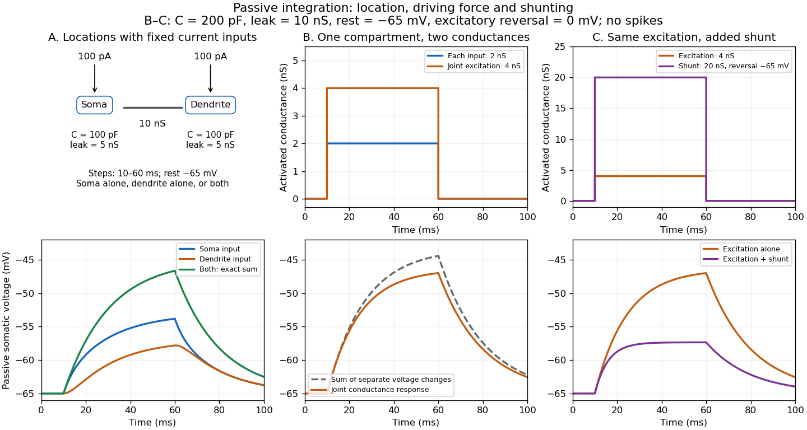
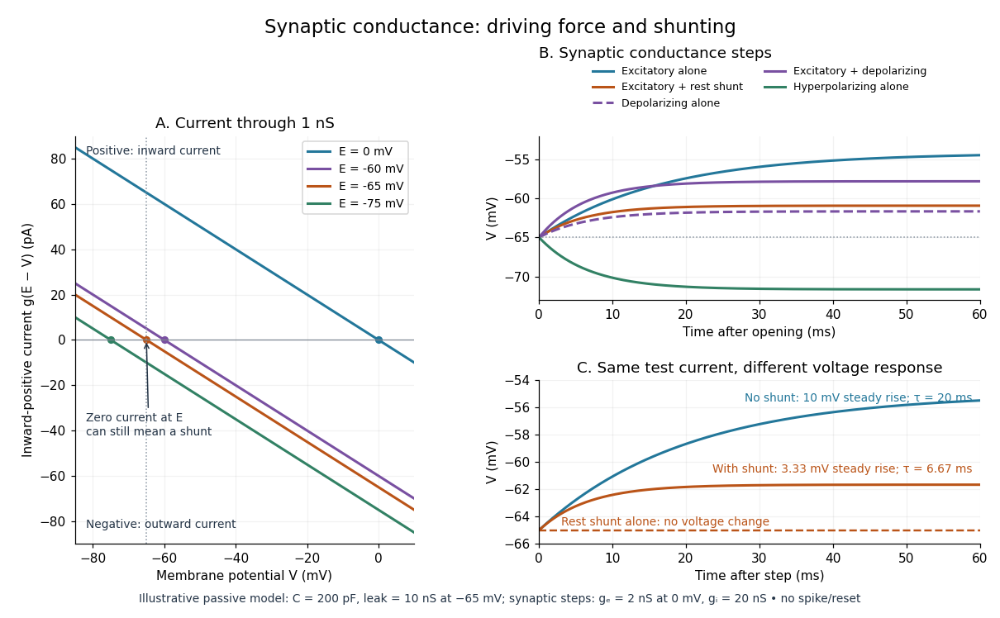
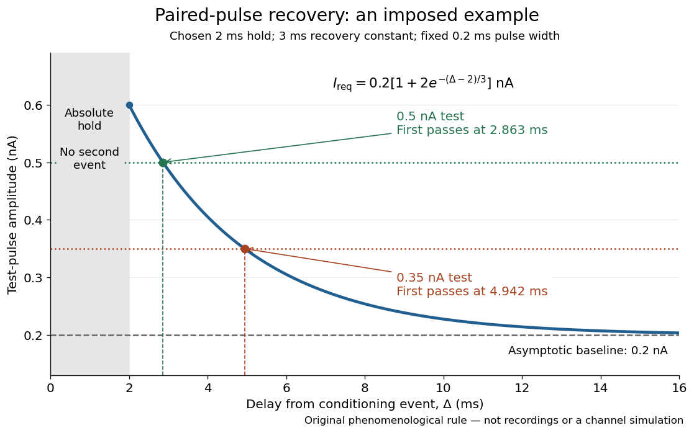
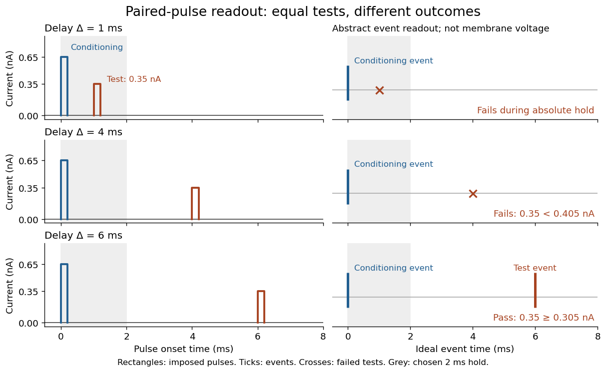

# Neuroscience

↑ **Parent:** [Biology](biology.md)  
ⓦ [Wiki](https://en.wikipedia.org/wiki/Neuroscience)

The study of nervous systems, from the properties of individual [neurons](#neuron) to circuits, development, behavior and information processing.

**Table of contents**

- [Memory in animals](#memory-in-animals)
  - [Autobiographical memory](#autobiographical-memory)
- [Neural circuit](#neural-circuit)
- [Sensory system](#sensory-system)
  - [Hearing](#hearing)
    - [Acoustic masking](#acoustic-masking)
  - [Proprioception](#proprioception)
  - [Psychophysics](#psychophysics)
    - [Signal detection theory](#signal-detection-theory)
    - [Psychometric function](#psychometric-function)
  - [Olfaction](#olfaction)
    - [Olfactory bulb](#olfactory-bulb)
      - [Olfactory glomerulus](#olfactory-glomerulus)
    - [Olfactory receptor](#olfactory-receptor)
  - [Vision](#vision)
    - [Ultraviolet vision](#ultraviolet-vision)
    - [Opsin](#opsin)
    - [Photoreceptor](#photoreceptor)
      - [Cone cell](#cone-cell)
    - [Spectral sensitivity](#spectral-sensitivity)
  - [Perception](#perception)
    - [Sensorimotor contingency](#sensorimotor-contingency)
    - [Subjective experience](#subjective-experience)
  - [Sensory ecology](#sensory-ecology)
- [Nervous system](#nervous-system)
  - [Enteric nervous system](#enteric-nervous-system)
- [Central nervous system](#central-nervous-system)
- [Brain](#brain)
- [Glial cell](#glial-cell)
- [Spinal cord](#spinal-cord)
- [Neuroscientist](#neuroscientist)
  - [List of neuroscientists](#list-of-neuroscientists)
    - [Yoshiyuki Yamamoto](#yoshiyuki-yamamoto)
    - [Peter Mombaerts](#peter-mombaerts)
    - [Linda B. Buck](#linda-b-buck)
    - [Katherine Mancuso](#katherine-mancuso)
    - [Karen L. Carleton](#karen-l-carleton)
    - [Jeremy Nathans](#jeremy-nathans)
    - [Mark D. Humphries](#mark-d-humphries)
    - [Terrence J. Sejnowski](#terrence-j-sejnowski)
      - [Work by Terrence J. Sejnowski](#work-by-terrence-j-sejnowski)
    - [Dexter M. Easton](#dexter-m-easton)
      - [Work by Dexter M. Easton](#work-by-dexter-m-easton)
    - [Ryohei Yasuda](#ryohei-yasuda)
      - [Work by Ryohei Yasuda](#work-by-ryohei-yasuda)
- [Voltage clamp](#voltage-clamp)
- [Extracellular single-unit recording](#extracellular-single-unit-recording)
- [Primary visual cortex](#primary-visual-cortex)
  - [Correlation-based development of visual cortical maps](#correlation-based-development-of-visual-cortical-maps)
  - [Complex cell](#complex-cell)
    - [Quadrature energy model of a complex cell](#quadrature-energy-model-of-a-complex-cell)
    - [Pooling model of a complex cell](#pooling-model-of-a-complex-cell)
  - [Ocular dominance column](#ocular-dominance-column)
    - [Activity-dependent ocular dominance segregation](#activity-dependent-ocular-dominance-segregation)
  - [Orientation selectivity](#orientation-selectivity)
    - [Orientation tuning curve](#orientation-tuning-curve)
    - [Orientation-map self-organization](#orientation-map-self-organization)
  - [Simple cell](#simple-cell)
    - [Signed spatial filter model of a simple cell](#signed-spatial-filter-model-of-a-simple-cell)
- [Neuron](#neuron)
  - [Neurite](#neurite)
  - [Neuronal polarity](#neuronal-polarity)
  - [Synaptic integration](#synaptic-integration)
    - [Spatial summation](#spatial-summation)
      - [Passive dendritic cable](#passive-dendritic-cable)
      - [Passive spatial and conductance integration](#passive-spatial-and-conductance-integration)
    - [Temporal summation](#temporal-summation)
      - [Membrane time constant](#membrane-time-constant)
    - [Neuronal firing threshold](#neuronal-firing-threshold)
    - [Dendritic spike](#dendritic-spike)
    - [NMDA receptor](#nmda-receptor)
  - [Multipolar neuron](#multipolar-neuron)
  - [Bipolar neuron](#bipolar-neuron)
  - [Pseudounipolar neuron](#pseudounipolar-neuron)
  - [Pyramidal cell](#pyramidal-cell)
  - [Soma (biology)](#soma-biology)
  - [Neural adaptation](#neural-adaptation)
  - [Synapse](#synapse)
    - [Synaptic plasticity](#synaptic-plasticity)
      - [Synaptic competition](#synaptic-competition)
        - [Synaptic normalization](#synaptic-normalization)
    - [Neurotransmitter](#neurotransmitter)
      - [Acetylcholine](#acetylcholine)
    - [Chemical synapse](#chemical-synapse)
      - [Neurotransmitter clearance](#neurotransmitter-clearance)
      - [Synaptic cleft](#synaptic-cleft)
      - [Synaptic vesicle](#synaptic-vesicle)
        - [Quantal neurotransmitter release](#quantal-neurotransmitter-release)
          - [Synaptic release probability](#synaptic-release-probability)
      - [Shunting inhibition](#shunting-inhibition)
    - [Electrical synapse](#electrical-synapse)
    - [Synaptic potential](#synaptic-potential)
      - [Synaptic conductance](#synaptic-conductance)
      - [Excitatory postsynaptic potential](#excitatory-postsynaptic-potential)
      - [Inhibitory postsynaptic potential](#inhibitory-postsynaptic-potential)
  - [Action potential](#action-potential)
    - [Compound action potential](#compound-action-potential)
    - [Neuronal refractory period](#neuronal-refractory-period)
      - [Absolute neuronal refractory period](#absolute-neuronal-refractory-period)
      - [Relative neuronal refractory period](#relative-neuronal-refractory-period)
      - [Neuronal paired-pulse recovery](#neuronal-paired-pulse-recovery)
        - [Phenomenological paired-pulse recovery](#phenomenological-paired-pulse-recovery)
      - [Refractory limits on neuronal firing](#refractory-limits-on-neuronal-firing)
  - [Dendrite](#dendrite)
  - [Axon](#axon)
    - [Axon initial segment](#axon-initial-segment)
    - [Axon terminal](#axon-terminal)
- [Retina](#retina)
- [Patch clamp](#patch-clamp)
  - [Patch pipette](#patch-pipette)
  - [Gigaohm seal](#gigaohm-seal)
    - [Seal leak current](#seal-leak-current)
  - [Cell-attached recording](#cell-attached-recording)
  - [Single-channel recording](#single-channel-recording)
    - [Single-channel current-voltage relation](#single-channel-current-voltage-relation)
  - [Inside-out patch](#inside-out-patch)
  - [Outside-out patch](#outside-out-patch)
  - [Whole-cell recording](#whole-cell-recording)
    - [Patch-clamp series resistance](#patch-clamp-series-resistance)
    - [Membrane capacitance](#membrane-capacitance)
    - [Space clamp](#space-clamp)
    - [Cytosol dialysis](#cytosol-dialysis)
    - [Perforated patch recording](#perforated-patch-recording)
  - [Current clamp](#current-clamp)
    - [Passive membrane response in current clamp](#passive-membrane-response-in-current-clamp)
- [Computational neuroscience](#computational-neuroscience)
  - [Gabor filter](#gabor-filter)
  - [Dynamic clamp](#dynamic-clamp)
  - [Three-neuron ring stability](#three-neuron-ring-stability)
  - [Leaky integrate-and-fire model](#leaky-integrate-and-fire-model)
    - [Constant-input firing rate of a leaky integrate-and-fire neuron](#constant-input-firing-rate-of-a-leaky-integrate-and-fire-neuron)
  - [Hodgkin-Huxley model](#hodgkin-huxley-model)
  - [Mutually excitatory saturating rate network](#mutually-excitatory-saturating-rate-network)
  - [Linear-nonlinear-Poisson cascade model](#linear-nonlinear-poisson-cascade-model)
    - [Poisson spike-train likelihood fitting](#poisson-spike-train-likelihood-fitting)
  - [Spike-triggered average](#spike-triggered-average)
    - [Stimulus-correlated spike-triggered averaging](#stimulus-correlated-spike-triggered-averaging)
  - [Neural coding](#neural-coding)
    - [Receptive field](#receptive-field)
      - [ON and OFF receptive-field subregions](#on-and-off-receptive-field-subregions)
      - [Visual contrast](#visual-contrast)
    - [Temporal coding](#temporal-coding)
    - [Rate coding](#rate-coding)
    - [Spike train](#spike-train)
      - [Interspike interval](#interspike-interval)
      - [Time-rescaled spike-train diagnostics](#time-rescaled-spike-train-diagnostics)

## Memory in animals

↑ **Parent:** [Neuroscience](neuroscience.md)

Retention and later use of information acquired through experience. Behavioural tests distinguish retention from immediate sensory responses and continuing access to external cues.

### Autobiographical memory

↑ **Parent:** [Memory in animals](#memory-in-animals)

Memory concerning events and information related to one’s own life. Mirror-guided localization of a body mark does not by itself demonstrate this capacity.

## Neural circuit

↑ **Parent:** [Neuroscience](neuroscience.md)

Interacting neurons and connections supporting a defined processing or behavioural function.

## Sensory system

↑ **Parent:** [Neuroscience](neuroscience.md)

Structures and processes that acquire and transform information about external or internal conditions, including receptors, transduction and downstream neural processing.

### Hearing

↑ **Parent:** [Sensory system](#sensory-system)

Detection and processing of acoustic stimulation. Signal detectability depends on the receiver and background noise.

#### Acoustic masking

↑ **Parent:** [Hearing](#hearing)

Interference with detection or discrimination of a sound by other sounds. Signal frequency, amplitude, timing and receiver processing can affect masking.

### Proprioception

↑ **Parent:** [Sensory system](#sensory-system)

Sensory information about bodily position, movement and force, contributing to coordination and relations between seen and felt movement.

### Psychophysics

↑ **Parent:** [Sensory system](#sensory-system)

Quantitative study of the relationship between controlled physical stimuli and sensory performance or reports.

#### Signal detection theory

↑ **Parent:** [Psychophysics](#psychophysics)

A framework separating stimulus discriminability from decision criterion in noisy tasks. Response bias and sensory sensitivity need not change together.

#### Psychometric function

↑ **Parent:** [Psychophysics](#psychophysics)

A function relating a stimulus variable to measured response probability or discrimination performance.

### Olfaction

↑ **Parent:** [Sensory system](#sensory-system)

Detection and processing of volatile chemical stimuli.

#### Olfactory bulb

↑ **Parent:** [Olfaction](#olfaction)

A vertebrate brain structure receiving projections from olfactory sensory neurons.

##### Olfactory glomerulus

↑ **Parent:** [Olfactory bulb](#olfactory-bulb)

A local site of converging sensory axons and interactions with postsynaptic cells. Molecular identity and other developmental mechanisms contribute to targeting.

#### Olfactory receptor

↑ **Parent:** [Olfaction](#olfaction)

A receptor involved in detecting odorants. Receptor identity is one component of the mapping from molecules to neural and behavioural responses.

### Vision

↑ **Parent:** [Sensory system](#sensory-system)

Sensing based on light, including detection, discrimination and spatial processing.

#### Ultraviolet vision

↑ **Parent:** [Vision](#vision)

Visual sensitivity to ultraviolet wavelengths. Its relevance to a colour comparison depends on the receiver’s actual receptors and the illumination.

#### Opsin

↑ **Parent:** [Vision](#vision)

A light-sensitive receptor protein associated with a chromophore. Sequence, expression, chromophore and neural processing all contribute to visual performance.

#### Photoreceptor

↑ **Parent:** [Vision](#vision)

A sensory cell converting light into a biological response.

##### Cone cell

↑ **Parent:** [Photoreceptor](#photoreceptor)

A vertebrate retinal photoreceptor class important in photopic vision and colour discrimination.

#### Spectral sensitivity

↑ **Parent:** [Vision](#vision)

Dependence of a receptor or sensory response on wavelength. Define whether the measurement concerns a pigment, receptor, circuit or behaviour.

### Perception

↑ **Parent:** [Sensory system](#sensory-system)

Processing and use of sensory input. Measured discrimination and subjective sensory experience are related but distinct targets of explanation.

#### Sensorimotor contingency

↑ **Parent:** [Perception](#perception)

A dependable relation between an action and its sensory consequences. A mirror generates tightly coupled visual changes that can support [learning](biology.md#learning) about the relation between body movement and reflected movement.

#### Subjective experience

↑ **Parent:** [Perception](#perception)

Experience considered from the experiencing subject's standpoint. Observable performance does not uniquely specify its qualitative character.

### Sensory ecology

↑ **Parent:** [Sensory system](#sensory-system)

Study of sensory acquisition and use in the physical and ecological environments in which animals live.

## Nervous system

↑ **Parent:** [Neuroscience](neuroscience.md)

### Enteric nervous system

↑ **Parent:** [Nervous system](#nervous-system)

The neural network associated with the digestive tract, contributing to local coordination of motility and secretion.

## Central nervous system

↑ **Parent:** [Neuroscience](neuroscience.md)

The brain and spinal cord, including both [neurons](#neuron) and [glial cells](#glial-cell).

## Brain

↑ **Parent:** [Neuroscience](neuroscience.md)

The anterior central nervous system of a vertebrate, developing principally from the [neural tube](biology.md#neural-tube) rather than directly from [neural crest](biology.md#neural-crest).

## Glial cell

↑ **Parent:** [Neuroscience](neuroscience.md)

A nervous-system cell with specialised support, insulation or regulatory functions distinct from the principal signalling role of [neurons](#neuron).

## Spinal cord

↑ **Parent:** [Neuroscience](neuroscience.md)

The posterior part of the vertebrate central nervous system, derived from the [neural tube](biology.md#neural-tube).

## Neuroscientist

↑ **Parent:** [Neuroscience](neuroscience.md)

### List of neuroscientists

↑ **Parent:** [Neuroscientist](#neuroscientist)

#### Yoshiyuki Yamamoto

↑ **Parent:** [List of neuroscientists](#list-of-neuroscientists)

#### Peter Mombaerts

↑ **Parent:** [List of neuroscientists](#list-of-neuroscientists)

#### Linda B. Buck

↑ **Parent:** [List of neuroscientists](#list-of-neuroscientists)

#### Katherine Mancuso

↑ **Parent:** [List of neuroscientists](#list-of-neuroscientists)

#### Karen L. Carleton

↑ **Parent:** [List of neuroscientists](#list-of-neuroscientists)

#### Jeremy Nathans

↑ **Parent:** [List of neuroscientists](#list-of-neuroscientists)

#### Mark D. Humphries

↑ **Parent:** [List of neuroscientists](#list-of-neuroscientists)

#### Terrence J. Sejnowski

↑ **Parent:** [List of neuroscientists](#list-of-neuroscientists)

A [neuroscientist](#neuroscientist) researching computational models of [neural networks](statistical-learning.md#neural-network).[Biography: Computational Neurobiology Laboratory research](physics-bibliography.md#cnl-cnl-people-terry-sejnowski)

**[Figure 1](#image-portrait-of-terrence-j-sejnowski). Portrait of Terrence J. Sejnowski**.

##### Work by Terrence J. Sejnowski

↑ **Parent:** [Terrence J. Sejnowski](#terrence-j-sejnowski)

#### Dexter M. Easton

↑ **Parent:** [List of neuroscientists](#list-of-neuroscientists)

**[Figure 2](#image-portrait-of-dexter-m-easton). Portrait of Dexter M. Easton**. Portrait identified on the [Florida State University profile](https://www.bio.fsu.edu/faculty-easton.php).

##### Work by Dexter M. Easton

↑ **Parent:** [Dexter M. Easton](#dexter-m-easton)

#### Ryohei Yasuda

↑ **Parent:** [List of neuroscientists](#list-of-neuroscientists)

A [neuroscientist](#neuroscientist).[Independent biography: identity and specialization](https://mpfi.org/our-labs/yasuda-lab/)

##### Work by Ryohei Yasuda

↑ **Parent:** [Ryohei Yasuda](#ryohei-yasuda)

## Voltage clamp

↑ **Parent:** [Neuroscience](neuroscience.md)  
ⓦ [Wiki](https://en.wikipedia.org/wiki/Voltage_clamp)

A [voltage clamp](#voltage-clamp) uses electrical feedback to hold a preparation's [membrane potential](membrane-potential.md) near a commanded value while measuring the [electric current](electric-charge.md#electric-current) required to maintain it. Holding voltage separates changes in [electrical conductance](electric-charge.md#electrical-conductance) from changes in electrical driving force. Imperfect voltage control and finite recording bandwidth limit the inference. The muscle experiment under [ionotropic receptor](protein.md#ionotropic-receptor) used separate intracellular electrodes for voltage control and a sealed patch pipette for recording local [electric current](electric-charge.md#electric-current).[pp. 33–35; Figure 1](biology-bibliography.md#elementary-steps-in-synaptic-transmission-revealed-by-currents-through-single-ion-channels-by-bert-sakmann)

## Extracellular single-unit recording

↑ **Parent:** [Neuroscience](neuroscience.md)

[Extracellular single-unit recording](#extracellular-single-unit-recording) uses an [electrode](electrochemistry.md#electrode) outside a [neuron](#neuron) to detect electrical events attributed to that unit's [action potentials](#action-potential). It records a [spike train](#spike-train), not the intracellular [membrane potential](membrane-potential.md) or every input [synapse](#synapse). [Hubel and Wiesel (1959), p. 575: extracellular recording methods](https://xbio-live.s3.amazonaws.com/narratives/57358/Hubel%20and%20Wiesel%201959_Guided%20paper.pdf)

## Primary visual cortex

↑ **Parent:** [Neuroscience](neuroscience.md)

The [primary visual cortex](#primary-visual-cortex), often abbreviated V1, is an early cortical stage of visual processing. Its [neurons](#neuron) have [receptive fields](#receptive-field): changing a stimulus in a particular part of the visible scene can change their [spike trains](#spike-train). [Orientation selectivity](#orientation-selectivity) adds a further distinction: at the same location, a properly aligned bar can evoke a strong response while a rotated bar evokes little. [Simple cells](#simple-cell) make the dependence on local position and [visual contrast](#visual-contrast) especially clear. See the original experiments under [orientation selectivity](#orientation-selectivity) and [simple cell](#simple-cell).

In their 1962 study, David Hubel and Torsten Wiesel recorded from forty cats under thiopental anesthesia, maintained light anesthesia while monitoring cortical electrical activity, and used succinylcholine to stabilize the eyes. White-light patterns were projected onto a screen $1.5\,\mathrm m$ away. [Extracellular single-unit recording](#extracellular-single-unit-recording) with tungsten [electrodes](electrochemistry.md#electrode) sampled individual units; [receptive fields](#receptive-field) were mapped separately for each eye. This connected controlled stimulus geometry to individual [spike trains](#spike-train). [Hubel and Wiesel, Receptive fields, binocular interaction and functional architecture in the cat's visual cortex (1962), pp. 107–108: methods](https://www.gatsby.ucl.ac.uk/teaching/courses/tn1-2020/additional/systems/JPhysiol-1962-Hubel-106-54.pdf)

These acute, anesthetized-cat recordings do not directly measure human perception or responses during awake behavior. The useful idea is a local description of structure: a population can distinguish where a feature lies, which way it is aligned, and which side is brighter. The [signed spatial filter model of a simple cell](#signed-spatial-filter-model-of-a-simple-cell) turns that idea into a computable example. One [neuron](#neuron)'s preferred stimulus does not establish recognition of an entire object. Likewise, [orientation selectivity](#orientation-selectivity) in one [neuron](#neuron) and an orderly map of preferences across [primary visual cortex](#primary-visual-cortex) are different findings: rodents can have strong [orientation selectivity](#orientation-selectivity) without the orderly arrangement typical of some other [species](biology.md#species). [Dario L. Ringach, Specificity and randomness in the visual cortex (2007): authored review of species differences](https://pubmed.ncbi.nlm.nih.gov/17720489/) The existing [correlation-based development of visual cortical maps](#correlation-based-development-of-visual-cortical-maps) and [orientation-map self-organization](#orientation-map-self-organization) sections describe hypotheses about how organization develops.

### Correlation-based development of visual cortical maps

↑ **Parent:** [Primary visual cortex](#primary-visual-cortex)

Consider afferent activities $z_i$, cortical activity $y_a$ and a constrained [Hebbian learning](statistical-learning.md#hebbian-learning) rule $\dot w_{ai}=\epsilon\langle y_az_i\rangle-\Lambda_a$. If $y_a=\sum_{b,j}K_{ab}w_{bj}z_j$, then $\langle y_az_i\rangle=\sum_{b,j}K_{ab}w_{bj}C_{ji}$, where $C$ is the input correlation matrix. Thus input correlations and lateral interactions select growing weight modes, while [synaptic normalization](#synaptic-normalization) and bounds stop unlimited growth. The model tests how organization can emerge without assigning every final cortical feature in advance.

### Complex cell

↑ **Parent:** [Primary visual cortex](#primary-visual-cortex)  
ⓦ [Wiki](https://en.wikipedia.org/wiki/Complex_cell)

A [complex cell](#complex-cell) typically responds selectively to an oriented edge or bar over a finite spatial region with less dependence on spatial phase and contrast polarity than a [simple cell](#simple-cell). It need not have the simple cell's separated linear ON and OFF subregions. Phase tolerance is local, not invariance to arbitrary displacement outside its [receptive field](#receptive-field).

#### Quadrature energy model of a complex cell

↑ **Parent:** [Complex cell](#complex-cell)

Two oriented linear filters in quadrature have responses $A\cos\varphi$ and $A\sin\varphi$ to a suitably matched narrowband grating. Their squared sum is $A^2$, independent of phase $\varphi$, while orientation and spatial-frequency selectivity remain. A nonlinear output function or normalization can transform this energy into firing rate. Ideal quadrature gives an exact phase identity for the matched stimulus; finite approximate filter pairs need not have perfect invariance for arbitrary images.

#### Pooling model of a complex cell

↑ **Parent:** [Complex cell](#complex-cell)

Rectify outputs of [simple cells](#simple-cell) with similar orientations and varying phases or positions, then sum or pool them. Opposite-polarity subunits allow response to both light and dark features. Pooling gives approximate phase and position tolerance over the subunit coverage; its extent and contrast dependence depend on the pooling rule.

### Ocular dominance column

↑ **Parent:** [Primary visual cortex](#primary-visual-cortex)  
ⓦ [Wiki](https://en.wikipedia.org/wiki/Ocular_dominance_column)

A cortical region whose visual responses preferentially reflect input from one eye. Competitive activity-dependent models can explain segregation of correlated inputs, while anatomical constraints and species differences also matter.

#### Activity-dependent ocular dominance segregation

↑ **Parent:** [Ocular dominance column](#ocular-dominance-column)

Two eye-specific afferent populations compete under [Hebbian learning](statistical-learning.md#hebbian-learning) and [synaptic normalization](#synaptic-normalization). In a simplified symmetric two-eye model, the eye-difference mode $d_a=w_{aL}-w_{aR}$ evolves with a linear operator containing $K_{ab}(C_{\rm same}-C_{\rm cross})_{ab}$. Dominant spatial modes can produce alternating eye preference, while saturation sets finite contrast. The interaction width, arbor constraints and correlation structure influence the column scale. This is a mechanistic hypothesis whose predictions can be tested, not a unique inference from the existence of columns.

### Orientation selectivity

↑ **Parent:** [Primary visual cortex](#primary-visual-cortex)  
ⓦ [Wiki](https://en.wikipedia.org/wiki/Orientation_selectivity)

[Orientation selectivity](#orientation-selectivity) is a systematic dependence of a visual [neuron](#neuron)'s response on the axis of a bar, edge or stripe pattern presented in its [receptive field](#receptive-field), under specified stimulus conditions. Here the [angle](geometry-and-topology.md#angle) $\theta$ measures the stripe axis from horizontal: $0^\circ$ is horizontal and $90^\circ$ vertical. An axis has no arrow, so $\theta$ and $\theta+180^\circ$ describe the same orientation. A preference for one direction of movement across that axis is an additional property; the 1962 recordings included both equal and unequal responses to opposite movements. [Hubel and Wiesel (1962), p. 112: orientation versus opposite movements](https://www.gatsby.ucl.ac.uk/teaching/courses/tn1-2020/additional/systems/JPhysiol-1962-Hubel-106-54.pdf)

A particularly clear experiment using [extracellular single-unit recording](#extracellular-single-unit-recording) appears in the 1959 paper, Figures 2–3. A bright $1^\circ\times8^\circ$ slit was centered on the same [receptive field](#receptive-field) and rotated through successive [angles](geometry-and-topology.md#angle); each presentation lasted one second. The vertical slit strongly increased the extracellularly recorded [spike train](#spike-train), whereas the horizontal slit was ineffective. Small-spot tests had identified [ON and OFF receptive-field subregions](#on-and-off-receptive-field-subregions), with a central ON region and opposing flanks: rotation illuminated less of the center and more of the flanks. Geometry and location therefore mattered together. These dimensions belong to that recorded unit, not to every [neuron](#neuron). [Hubel and Wiesel, Receptive fields of single neurones in the cat's striate cortex (1959), pp. 578–579, Figures 2–3: primary recordings](https://xbio-live.s3.amazonaws.com/narratives/57358/Hubel%20and%20Wiesel%201959_Guided%20paper.pdf)

An [orientation tuning curve](#orientation-tuning-curve) summarizes a controlled [angle](geometry-and-topology.md#angle) sweep. Keep location, size and [visual contrast](#visual-contrast) fixed; for a stripe pattern also specify [spatial frequency](fourier-analysis.md#spatial-frequency) and [phase](wave.md#phase-waves). The same [signed spatial filter model of a simple cell](#signed-spatial-filter-model-of-a-simple-cell) can produce strong [orientation selectivity](#orientation-selectivity) and strong dependence on [phase](wave.md#phase-waves), as the following original toy illustrates. Its smooth curves are calculated predictions, not digitized or invented biological measurements.

**[Figure 3](#image-orientation-selectivity-and-phase-sensitivity-in-a-toy-gabor-filter). Orientation selectivity and phase sensitivity in a toy Gabor filter**. A chosen [Gaussian function](calculus.md#gaussian-function) times a [cosine](geometry-and-topology.md#cosine) supplies the signed filter. At fixed [phase](wave.md#phase-waves) its normalized output peaks for vertical stripes; shifting the same stripes changes the signed drive and the rectified output. The [angle](geometry-and-topology.md#angle) labels refer to the stripe axis, perpendicular to the direction in which brightness varies. Spatial units and all parameters are arbitrary; curves use an infinite-domain [integral](integral.md), while the small image panels show only a crop. See [signed spatial filter model of a simple cell](#signed-spatial-filter-model-of-a-simple-cell) for the calculation.

#### Orientation tuning curve

↑ **Parent:** [Orientation selectivity](#orientation-selectivity)

An [orientation tuning curve](#orientation-tuning-curve) plots a specified response against the stimulus-axis [angle](geometry-and-topology.md#angle) $\theta$, with the other stimulus variables controlled. A practical count summary for [extracellular single-unit recording](#extracellular-single-unit-recording) is

$$
\widehat r(\theta)=\frac{1}{mT}\sum_{k=1}^{m}N_k(\theta),
$$

where $N_k(\theta)$ counts [action potentials](#action-potential) in the same duration $T>0$ on trial $k$, and $m$ is the number of repeats at each [angle](geometry-and-topology.md#angle). This estimates spikes per unit time in that window; the window must specify whether it covers onset, sustained stimulation, or both. Record a blank-background response separately, and report whether it has been subtracted. Randomizing [angle](geometry-and-topology.md#angle) order and repeating each condition helps separate [orientation selectivity](#orientation-selectivity) from changes over time, including [neural adaptation](#neural-adaptation). This is a proposed measurement procedure, not a claim that the original experiments used this estimator.

A [simple cell](#simple-cell)'s [orientation tuning curve](#orientation-tuning-curve) can also change when the stimulus shifts. An [angle](geometry-and-topology.md#angle) sweep at fixed [phase](wave.md#phase-waves), a sweep averaging over [phase](wave.md#phase-waves), and a sweep of moving stripes ask different questions. Consequently, a single preferred [angle](geometry-and-topology.md#angle) does not specify the whole [receptive field](#receptive-field). The toy curve under [orientation selectivity](#orientation-selectivity) holds [phase](wave.md#phase-waves) fixed and plots dimensionless output, rather than spikes per second.

#### Orientation-map self-organization

↑ **Parent:** [Orientation selectivity](#orientation-selectivity)

Correlation-based learning among spatially arranged ON and OFF inputs, with [synaptic competition](#synaptic-competition) and lateral interactions, can select elongated [simple cell](#simple-cell) receptive fields. Neighbor interactions coordinate preferred orientations across cortex, while competition allows different orientations to persist. Selectivity within one cell and a spatial map across many cells are separate predictions, and neither follows from unbounded [Hebbian learning](statistical-learning.md#hebbian-learning) alone.

### Simple cell

↑ **Parent:** [Primary visual cortex](#primary-visual-cortex)  
ⓦ [Wiki](https://en.wikipedia.org/wiki/Simple_cell)

A [simple cell](#simple-cell) is a visual cortical [neuron](#neuron) whose [receptive field](#receptive-field) has spatially separable [ON and OFF receptive-field subregions](#on-and-off-receptive-field-subregions). Elongated neighboring subregions give a preferred orientation and a sensitivity to the location and polarity of [visual contrast](#visual-contrast). “Simple” describes the response organization; it does not describe a simpler [cell body](#soma-biology) or a particular shape of [neuron](#neuron).

Hubel and Wiesel's 1962 classification emphasized four observations: distinguishable [ON and OFF receptive-field subregions](#on-and-off-receptive-field-subregions), summation within each region, antagonism between regions, and qualitative prediction of responses to differently shaped stimuli from those regions' arrangement. A slit fitting an elongated center was more effective than a smaller spot; a larger patch could invade opposing flanks and lose effectiveness. An edge separating bright and dark regions could be effective when its boundary matched the boundary between subregions. These were observations about [spike trains](#spike-train), rather than an assertion of exact [linearity](vector-space.md#linearity). [Hubel and Wiesel (1962), pp. 109–112: simple-field criteria and slit/edge experiments](https://www.gatsby.ucl.ac.uk/teaching/courses/tn1-2020/additional/systems/JPhysiol-1962-Hubel-106-54.pdf)

The following deliberately coarse [signed spatial filter model of a simple cell](#signed-spatial-filter-model-of-a-simple-cell) makes the geometry easy to count. A centered bright bar contributes positively at five sites. Rotating it preserves its area but mixes positive and negative weights; shifting it preserves its orientation but changes which weights it samples. The model is useful because it predicts distinct effects of these three manipulations instead of treating any bright stimulus as equivalent.

**[Figure 4](#image-a-signed-toy-simple-cell-filter-separates-orientation-location-and-visual-contrast-polarity). A signed toy simple cell filter separates orientation, location and visual contrast polarity**. The $5\times5$ chosen weight map has a positive central column and negative flanks. Bright, unchanged and dark image values are $+1$, $0$ and $-1$. The [dot product](inner-product.md#dot-product) gives signed drive $D$; a [rectified linear unit](statistical-learning.md#rectified-linear-unit) gives toy output $R$. Centered, rotated, uniform, shifted-bright and shifted-dark examples give $D=1,0,0,-1/4,1/4$. Colors and weights are illustrative, not a measured [receptive field](#receptive-field) or a map of identified [synapses](#synapse).

A [simple cell](#simple-cell) is not an ideal linear sensor. Its [spike train](#spike-train) is nonnegative in event count, and [neural adaptation](#neural-adaptation) can change responsiveness. The [signed spatial filter model of a simple cell](#signed-spatial-filter-model-of-a-simple-cell) supplies a useful approximation to spatial drive and an explicit output rule. Comparing predictions with unseen stimuli is more informative than assuming the rule from the name “simple”. In contrast, the existing [complex cell](#complex-cell) models explore tolerance to [phase](wave.md#phase-waves) and local displacement.

#### Signed spatial filter model of a simple cell

↑ **Parent:** [Simple cell](#simple-cell)

A [signed spatial filter model of a simple cell](#signed-spatial-filter-model-of-a-simple-cell) assigns a weight $K_{ij}$ to each sampled location and takes its [dot product](inner-product.md#dot-product) with the [visual contrast](#visual-contrast) image $C_{ij}$. Positive weights favor bright features; negative weights favor dark features. The signed drive

$$
D=\sum_{i,j}K_{ij}C_{ij},\qquad R=\max(0,D)
$$

is a [linear function](vector-space.md#linear-function) of the image, while the [rectified linear unit](statistical-learning.md#rectified-linear-unit) output $R$ is nonlinear. $D$ and $R$ below are arbitrary model units. To obtain a predicted firing rate one would need a calibrated gain, background response and possibly a different output function. The model does not generate a [spike train](#spike-train); a [linear-nonlinear-Poisson cascade model](#linear-nonlinear-poisson-cascade-model) adds a stochastic event-generation assumption.

For the first diagram, every one of five rows has weights

$$
(K_{i1},K_{i2},K_{i3},K_{i4},K_{i5})=(-1/20,-1/20,1/5,-1/20,-1/20).
$$

A bright central column, with $C_{i3}=1$ and zero elsewhere, gives $D=5/5=1$. A bright middle row gives $D=-1/20-1/20+1/5-1/20-1/20=0$; a uniformly bright patch also gives $D=0$, since every row sums to zero. Move the bright column one site right: $D=5(-1/20)=-1/4$, so $R=0$. Make that shifted column dark instead: $D=1/4$ and $R=1/4$. Thus an OFF-like weight can increase output for darkness. A negative weight is a descriptive sensitivity, not evidence for a particular inhibitory [synapse](#synapse).

For a smooth example use the real, even [Gabor filter](#gabor-filter)

$$
K(x,y)=\exp\!\left(-\frac{x^2}{2\sigma_x^2}-\frac{y^2}{2\sigma_y^2}\right)\cos(qx),\qquad C_{\theta,\varphi}(x,y)=\cos\!\bigl(q(x\sin\theta-y\cos\theta)+\varphi\bigr).
$$

The [Gaussian function](calculus.md#gaussian-function) localizes the weights; the [cosine](geometry-and-topology.md#cosine) supplies alternating polarity. Choose $\sigma_x=1/2$, $\sigma_y=1$ and $q=\pi$ in arbitrary spatial units. The stripes' [spatial frequency](fourier-analysis.md#spatial-frequency) is $q/(2\pi)=1/2$ cycles per unit. Their axis makes [angle](geometry-and-topology.md#angle) $\theta$ with horizontal, while brightness changes across the perpendicular axis. $\varphi$ is their spatial [phase](wave.md#phase-waves). Normalize the full-plane [integral](integral.md) of $KC_{\theta,\varphi}$ by its value at $\theta=\pi/2$, $\varphi=0$. The [Gaussian integral](integral.md#gaussian-integral) and the product identity for [cosines](geometry-and-topology.md#cosine) give

$$
D(\theta,\varphi)=A(\theta)\cos\varphi,\qquad R(\theta,\varphi)=\max(0,D(\theta,\varphi)),
$$

where

$$
A(\theta)=\frac{\exp\!\left[-\frac{q^2}{2}\left(\sigma_x^2(\sin\theta-1)^2+\sigma_y^2\cos^2\theta\right)\right]+\exp\!\left[-\frac{q^2}{2}\left(\sigma_x^2(\sin\theta+1)^2+\sigma_y^2\cos^2\theta\right)\right]}{1+\exp(-2\sigma_x^2q^2)}.
$$

At $\varphi=0$, horizontal stripes give $R\approx0.004159$, $60^\circ$ stripes give $R\approx0.286741$, and vertical stripes give $R=1$. At the same vertical orientation, $\varphi=\pi/2$ gives $D=R=0$, while reversing the polarity with $\varphi=\pi$ gives $D=-1$ and $R=0$. The preferred axis persists while the response changes dramatically with position. Shifting the vertical stripes by a quarter of their wavelength changes [phase](wave.md#phase-waves) by $\pi/2$ up to sign, without rotating them.

These are two different toy filters, not discretizations of the same fitted [receptive field](#receptive-field). The discrete filter exactly rejects a uniform contrast patch; this [Gabor filter](#gabor-filter) need not reject uniform contrast because its weight [integral](integral.md) need not vanish. Neither toy includes stimulus history, recurrent interactions, saturation or a measured response baseline. Their value is a transparent prediction: [orientation selectivity](#orientation-selectivity) can emerge from spatial summation, and it does not by itself imply tolerance to [phase](wave.md#phase-waves).

## Neuron

↑ **Parent:** [Neuroscience](neuroscience.md)  
ⓦ [Wiki](https://en.wikipedia.org/wiki/Neuron)

A [neuron](#neuron) is a specialized [biological cell](biological-cell.md) that receives, integrates and transmits signals. Its shape separates places where inputs arrive from places where outputs reach other [biological cells](biological-cell.md): this functional asymmetry is [neuronal polarity](#neuronal-polarity). Understanding a [neuron](#neuron) therefore means connecting its anatomy to changes in [membrane potential](membrane-potential.md), rather than treating it as a wire that merely forwards every input.

In a common [multipolar neuron](#multipolar-neuron), branching [dendrites](#dendrite) receive inputs at [synapses](#synapse); the [soma](#soma-biology) contains the [cell nucleus](biological-cell.md#cell-nucleus) and most major [organelles](biological-cell.md#organelle); the [axon](#axon) carries signals to distant or nearby targets; and [axon terminals](#axon-terminal) form output contacts. All these regions belong to one [biological cell](biological-cell.md) enclosed by a continuous [cell membrane](cell-membrane.md). An [axon](#axon) can branch, allowing one [neuron](#neuron) to influence several receiving [biological cells](biological-cell.md).[§12.2, Parts of a Neuron: nucleus, organelles, processes, branching axon, initial segment and terminals](biology-bibliography.md#anatomy-and-physiology-2e-by-j-gordon-betts-and-others/12-2-nervous-tissue)

At an input [chemical synapse](#chemical-synapse), a [neurotransmitter](#neurotransmitter) acts on a [receptor](protein.md#receptor-biochemistry), changing an [electric current](electric-charge.md#electric-current) directly or through [signal transduction](signal-transduction.md).[§3.1, opening paragraphs: ionotropic and metabotropic receptors and postsynaptic currents](biology-bibliography.md#neuronal-dynamics-from-single-neurons-to-networks-and-models-of-cognition-by-wulfram-gerstner-and-others/3-1-synapses) A resulting [synaptic potential](#synaptic-potential) contributes to [synaptic integration](#synaptic-integration) in the [dendrites](#dendrite) and [soma](#soma-biology). In many spiking [neurons](#neuron), sufficiently strong [depolarization](membrane-potential.md#depolarization) recruits [voltage-gated ion channels](membrane-potential.md#voltage-gated-ion-channel) in the [axon initial segment](#axon-initial-segment), initiating an [action potential](#action-potential) that propagates along the [axon](#axon). At an output [chemical synapse](#chemical-synapse), [calcium](chemical-substance.md#calcium) entry through [voltage-gated ion channels](membrane-potential.md#voltage-gated-ion-channel) promotes [synaptic vesicle](#synaptic-vesicle) [exocytosis](cell-membrane.md#exocytosis), releasing [neurotransmitter](#neurotransmitter). An [action potential](#action-potential) is thus regenerated electrically along a [cell membrane](cell-membrane.md); it is not a packet of [neurotransmitter](#neurotransmitter) travelling from the [dendrites](#dendrite) to the [axon terminals](#axon-terminal).[Chemical Synapses, Figure 5.3: voltage-gated calcium entry and synaptic vesicle exocytosis](biology-bibliography.md#neuroscience-2nd-edition-edited-by-d-purves-and-others)

**[Figure 5](#image-neuronal-anatomy-usual-signaling-direction-and-alternative-shapes). Neuronal anatomy, usual signaling direction and alternative shapes**. Original schematic, not microscopy and not to scale. The upper [multipolar neuron](#multipolar-neuron) identifies [dendrites](#dendrite), the [soma](#soma-biology), the [cell nucleus](biological-cell.md#cell-nucleus), the [axon initial segment](#axon-initial-segment), the [axon](#axon) and [axon terminals](#axon-terminal). Solid arrows show a common input-to-output route; a dashed arrow indicates possible propagation of an [action potential](#action-potential) back toward [dendrites](#dendrite). The lower sketches compare a [bipolar neuron](#bipolar-neuron) and a [pseudounipolar neuron](#pseudounipolar-neuron), whose [soma](#soma-biology) lies off the main transmission route. Shapes and relative dimensions are illustrative.

The compartments are specializations, not exclusive jobs. Inputs can contact the [soma](#soma-biology) or [axon](#axon) as well as [dendrites](#dendrite); [dendrites](#dendrite) can support active [voltage-gated ion channels](membrane-potential.md#voltage-gated-ion-channel). Paired recordings from a [pyramidal neuron](#pyramidal-cell)'s [soma](#soma-biology) and [dendrite](#dendrite) or [axon](#axon) established that an [action potential](#action-potential) can begin in the [axon](#axon) and propagate back into the [dendrites](#dendrite). The usual output direction therefore does not make every electrical signal strictly one-way.[Active propagation of somatic action potentials into neocortical pyramidal cell dendrites by Greg J. Stuart and others](biology-bibliography.md#active-propagation-of-somatic-action-potentials-into-neocortical-pyramidal-cell-dendrites-by-greg-j-stuart-and-others) An [electrical synapse](#electrical-synapse), which directly couples [cytoplasms](biological-cell.md#cytoplasm) through [gap junctions](cell-membrane.md#gap-junction), also differs from the sending-and-receiving arrangement of a [chemical synapse](#chemical-synapse).[§1.1.3: electrical and chemical synapses](biology-bibliography.md#neuronal-dynamics-from-single-neurons-to-networks-and-models-of-cognition-by-wulfram-gerstner-and-others/1-1-elements-of-neuronal-systems)

Nor does every [neuron](#neuron) have the upper diagram's shape. A [bipolar neuron](#bipolar-neuron) has two main processes, one [dendrite](#dendrite) and one [axon](#axon); a [multipolar neuron](#multipolar-neuron) has several [dendrites](#dendrite); and a [pseudounipolar neuron](#pseudounipolar-neuron) has a single process from the [soma](#soma-biology) that divides into peripheral and central branches. In the last arrangement, sensory signals can travel past the [soma](#soma-biology) rather than obligatorily through it. These shape categories do not specify every [neuron](#neuron)'s [receptor](protein.md#receptor-biochemistry), connectivity or firing behavior.[§12.2, Types of Neurons and Figure 12.9: multipolar, bipolar and human pseudo-unipolar cells; sensory projection past the cell body](biology-bibliography.md#anatomy-and-physiology-2e-by-j-gordon-betts-and-others/12-2-nervous-tissue) Some [neurons](#neuron) in the [retina](#retina) communicate through graded changes in [membrane potential](membrane-potential.md) without generating [action potentials](#action-potential).[1.1 Elements of Neuronal Systems](biology-bibliography.md#neuronal-dynamics-from-single-neurons-to-networks-and-models-of-cognition-by-wulfram-gerstner-and-others/1-1-elements-of-neuronal-systems)

**Why timing changes the computation.** [Synaptic integration](#synaptic-integration) can combine inputs at different locations, called [spatial summation](#spatial-summation), and inputs arriving at different times, called [temporal summation](#temporal-summation). A minimal example uses the [leaky integrate-and-fire model](#leaky-integrate-and-fire-model) with the illustrative parameters already given there: resting and reset [membrane potential](membrane-potential.md) $-65\,\mathrm{mV}$, firing threshold $-50\,\mathrm{mV}$, [electrical resistance](electric-charge.md#electrical-resistance) $R=100\,\mathrm{M\Omega}$, [capacitance](electromagnetism.md#capacitance) $C=200\,\mathrm{pF}$, [time constant](analysis.md#time-constant) $\tau=RC=20\,\mathrm{ms}$ and [neuronal refractory period](#neuronal-refractory-period) $2\,\mathrm{ms}$. These are chosen model values, not measured properties of a particular [neuron](#neuron). Before firing, a constant inward [electric current](electric-charge.md#electric-current) $I$ starting from rest gives

$$
V(t)=-65\,\mathrm{mV}+RI\left(1-e^{-t/\tau}\right).
$$

The [exponential function](calculus.md#exponential-function) expresses the competition between charging the [cell membrane](cell-membrane.md)'s [capacitance](electromagnetism.md#capacitance) and leakage through its [electrical resistance](electric-charge.md#electrical-resistance).[§1.3.1–§1.3.3, equations (1.5), (1.7), (1.12) and (1.13): passive integration, step response, threshold and reset](biology-bibliography.md#neuronal-dynamics-from-single-neurons-to-networks-and-models-of-cognition-by-wulfram-gerstner-and-others/1-3-integrate-and-fire-models)

Two $100\,\mathrm{pA}$ inputs, each lasting $40\,\mathrm{ms}$, produce different outputs depending on their timing. Either input alone reaches only $-56.3534\,\mathrm{mV}$. Applied together, they give $I=200\,\mathrm{pA}$ and reach threshold after $20\ln4\,\mathrm{ms}\approx27.7259\,\mathrm{ms}$, producing one [action potential](#action-potential) event during the pulse. If instead the second input begins $20\,\mathrm{ms}$ after the first ends, the earlier [depolarization](membrane-potential.md#depolarization) has partly decayed: the second pulse peaks at approximately $-55.9229\,\mathrm{mV}$ and neither pulse produces an [action potential](#action-potential). The two-input protocols deliver the same total [electric charge](electric-charge.md), $8\,\mathrm{pC}$, yet only the coincident protocol fires. Counting total input alone misses this timing dependence.

**[Figure 6](#image-the-same-total-input-can-yield-different-neuronal-outputs). The same total input can yield different neuronal outputs**. Synthetic exact [leaky integrate-and-fire model](#leaky-integrate-and-fire-model) responses, not empirical recordings. A single $100\,\mathrm{pA}$ pulse is below threshold; two coincident pulses produce one [action potential](#action-potential) event, shown as a tick rather than a biological waveform; two separated pulses deliver the same total [electric charge](electric-charge.md) as the coincident pair but produce no events. The lower traces show [membrane potential](membrane-potential.md), its reset and the brief [neuronal refractory period](#neuronal-refractory-period). All inputs are prescribed [electric currents](electric-charge.md#electric-current) in a single compartment, without a modeled [synaptic conductance](#synaptic-conductance) or spatial [dendrite](#dendrite).

This example makes a [neuron](#neuron) a detector of sufficiently clustered input, not a perfect logical gate: different parameters change the result. Actual [dendrites](#dendrite) introduce location-dependent filtering and active responses, and an [inhibitory postsynaptic potential](#inhibitory-postsynaptic-potential) or [shunting inhibition](#shunting-inhibition) can change whether another input succeeds. The single-compartment [leaky integrate-and-fire model](#leaky-integrate-and-fire-model) omits these mechanisms.[§1.4.2 and §1.4.4: shunting inhibition, spatial structure and active dendritic responses](biology-bibliography.md#neuronal-dynamics-from-single-neurons-to-networks-and-models-of-cognition-by-wulfram-gerstner-and-others/1-4-limitations-of-the-leaky-integrate-and-fire-model) Across connected [neurons](#neuron), branching [axons](#axon) distribute outputs while converging [synapses](#synapse) combine inputs; [spike trains](#spike-train) can support [temporal coding](#temporal-coding) and [rate coding](#rate-coding), and [synaptic plasticity](#synaptic-plasticity) changes the influence of an input. Connectivity and cellular dynamics together determine the computation.[§1.1.1–§1.1.2: axonal branching and spike trains](biology-bibliography.md#neuronal-dynamics-from-single-neurons-to-networks-and-models-of-cognition-by-wulfram-gerstner-and-others/1-1-elements-of-neuronal-systems)[§3.1.3: changes in synaptic efficacy with stimulation history](biology-bibliography.md#neuronal-dynamics-from-single-neurons-to-networks-and-models-of-cognition-by-wulfram-gerstner-and-others/3-1-synapses)

**Testing the connection between structure and function.** [Whole-cell recording](#whole-cell-recording) connects anatomy to a measured [membrane potential](membrane-potential.md). In a published mouse protocol, a two-photon microscope guides solution-filled glass pipettes to [neurons](#neuron); an amplifier and bath reference electrode complete the electrical recording apparatus. A high-resistance seal forms against the [cell membrane](cell-membrane.md), then brief suction opens the membrane patch beneath the tip. In [current clamp](#current-clamp), the amplifier supplies a chosen [electric current](electric-charge.md#electric-current) and records the resulting [membrane potential](membrane-potential.md), unlike [voltage clamp](#voltage-clamp), which controls voltage and measures [electric current](electric-charge.md#electric-current). The investigators used $500\,\mathrm{ms}$ current steps of several amplitudes to characterize excitability and firing, and negative current pulses to estimate input [electrical resistance](electric-charge.md#electrical-resistance).[Multiple Two-Photon Targeted Whole-Cell Patch-Clamp Recordings From Monosynaptically Connected Neurons in vivo by Jean-Sébastien Jouhanneau and others](biology-bibliography.md#multiple-two-photon-targeted-whole-cell-patch-clamp-recordings-from-monosynaptically-connected-neurons-in-vivo-by-jean-sebastien-jouhanneau-and-others)

The observable is a voltage trace, including graded responses and [action potentials](#action-potential). Comparing injected [electric current](electric-charge.md#electric-current) with that trace tests how input becomes output; it does not identify every underlying [ion channel](cell-membrane.md#ion-channel). The protocol checks access [electrical resistance](electric-charge.md#electrical-resistance), which can distort voltage and [action potential](#action-potential) measurements, and includes intervals without stimulation to record spontaneous activity. In a teaching replication, repeated zero-input trials and monitoring baseline drift would provide further controls; these are recommended comparisons, not additional results attributed to the paper. A recording at the [soma](#soma-biology) also cannot establish the local voltage everywhere in a branching [dendrite](#dendrite), and this anesthetized preparation does not establish behavior in every awake [neuron](#neuron).[Multiple Two-Photon Targeted Whole-Cell Patch-Clamp Recordings From Monosynaptically Connected Neurons in vivo by Jean-Sébastien Jouhanneau and others](biology-bibliography.md#multiple-two-photon-targeted-whole-cell-patch-clamp-recordings-from-monosynaptically-connected-neurons-in-vivo-by-jean-sebastien-jouhanneau-and-others)

A complementary experiment used simultaneous [whole-cell recordings](#whole-cell-recording) from the [soma](#soma-biology) and an apical [dendrite](#dendrite) or [axon](#axon) of the same [pyramidal neuron](#pyramidal-cell) in a brain slice. The relative onset times of [action potentials](#action-potential), together with [sodium](chemical-substance.md#sodium) currents in excised [dendrite](#dendrite) membrane patches, supported axonal initiation followed by active propagation into [dendrites](#dendrite). Pairing sites within one [neuron](#neuron) is a useful comparison because it avoids confusing differences between cells with differences between compartments. Instrument timing and comparable recording quality would be essential controls when reproducing the inference. Only the published abstract was accessible here, so no unverified timing values, drug controls or channel distributions are supplied.[Active propagation of somatic action potentials into neocortical pyramidal cell dendrites by Greg J. Stuart and others](biology-bibliography.md#active-propagation-of-somatic-action-potentials-into-neocortical-pyramidal-cell-dendrites-by-greg-j-stuart-and-others)

### Neurite

↑ **Parent:** [Neuron](#neuron)

### Neuronal polarity

↑ **Parent:** [Neuron](#neuron)

### Synaptic integration

↑ **Parent:** [Neuron](#neuron)

[Synaptic integration](#synaptic-integration) is the conversion of inputs at a [neuron](#neuron)'s [synapses](#synapse) into a changing [membrane potential](membrane-potential.md) and, in a spiking [neuron](#neuron), the timing or absence of [action potentials](#action-potential). [Spatial summation](#spatial-summation) concerns inputs at different locations; [temporal summation](#temporal-summation) concerns inputs at different times. A useful question is whether individually ineffective inputs can act together, and whether an [inhibitory postsynaptic potential](#inhibitory-postsynaptic-potential) changes that cooperation. The answer depends on location, timing and the receiving [neuron](#neuron)'s state.

A [synaptic potential](#synaptic-potential) is a voltage response, whereas [synaptic conductance](#synaptic-conductance) describes activated [ion channels](cell-membrane.md#ion-channel). With inward-positive [electric current](electric-charge.md#electric-current), the contribution of input $j$ is

$$
I_j(t)=g_j(t)(E_j-V).
$$

Here $g_j$ is its [synaptic conductance](#synaptic-conductance), $E_j$ its [reversal potential](membrane-potential.md#reversal-potential) and $V$ the local [membrane potential](membrane-potential.md). The driving force $E_j-V$ is an [electric potential difference](electric-field.md#electric-potential-difference). An [EPSP](#excitatory-postsynaptic-potential) generally brings the [membrane potential](membrane-potential.md) toward a more positive [reversal potential](membrane-potential.md#reversal-potential), but its driving force shrinks during [depolarization](membrane-potential.md#depolarization). An [IPSP](#inhibitory-postsynaptic-potential) need not produce [hyperpolarization](membrane-potential.md#hyperpolarization): a [reversal potential](membrane-potential.md#reversal-potential) above rest but below the [neuronal firing threshold](#neuronal-firing-threshold) can produce [depolarization](membrane-potential.md#depolarization) while opposing a larger excursion. At $E_j=V$, the added [synaptic conductance](#synaptic-conductance) initially carries zero [electric current](electric-charge.md#electric-current) yet can cause [shunting inhibition](#shunting-inhibition) of another input.[§3.1, equation (3.1), and §3.1.1: conductance, reversal and voltage-dependent sign; our current convention is inward-positive](biology-bibliography.md#neuronal-dynamics-from-single-neurons-to-networks-and-models-of-cognition-by-wulfram-gerstner-and-others/3-1-synapses)

Two distinct nonlinearities matter. Even a passive [cell membrane](cell-membrane.md) can show sublinear [synaptic integration](#synaptic-integration) when added [synaptic conductances](#synaptic-conductance) reduce driving force and effective [electrical resistance](electric-charge.md#electrical-resistance). Active [voltage-gated ion channels](membrane-potential.md#voltage-gated-ion-channel) and [NMDA receptors](#nmda-receptor) can instead amplify sufficiently concentrated inputs and produce a [dendritic spike](#dendritic-spike). Neither summing prescribed [electric currents](electric-charge.md#electric-current) nor adding separate measured [EPSPs](#excitatory-postsynaptic-potential) is an exact universal rule for a branching [neuron](#neuron).[§1.4.2 and §1.4.4: shunting, saturation and active dendritic interactions](biology-bibliography.md#neuronal-dynamics-from-single-neurons-to-networks-and-models-of-cognition-by-wulfram-gerstner-and-others/1-4-limitations-of-the-leaky-integrate-and-fire-model)

#### Spatial summation

↑ **Parent:** [Synaptic integration](#synaptic-integration)

[Spatial summation](#spatial-summation) combines inputs arriving at different [synapses](#synapse). Location matters because a [dendrite](#dendrite) has axial [electrical resistance](electric-charge.md#electrical-resistance) and leaky [membrane capacitance](#membrane-capacitance): a local [synaptic potential](#synaptic-potential) need not arrive at the [soma](#soma-biology) with its original amplitude or time course. A [passive dendritic cable](#passive-dendritic-cable) makes this attenuation explicit. The [superposition principle](vector-space.md#superposition-principle) applies to fixed [electric current](electric-charge.md#electric-current) inputs in a linear passive model, but adding [synaptic conductances](#synaptic-conductance) changes the model's coefficients. Compare voltage changes relative to the same baseline, rather than adding absolute [membrane potentials](membrane-potential.md).

**[Figure 7](#image-spatial-summation-reduced-driving-force-and-shunting-inhibition-in-passive-models). Spatial summation, reduced driving force and shunting inhibition in passive models**. Original calculations, not biological recordings. A: equal imposed [electric current](electric-charge.md#electric-current) steps at the [soma](#soma-biology) and a [dendrite](#dendrite) in two coupled passive compartments yield different somatic voltage traces; applying both gives their exact sum relative to rest. B: activating two excitatory [synaptic conductances](#synaptic-conductance) together gives less [depolarization](membrane-potential.md#depolarization) than adding the separate voltage responses. C: a [synaptic conductance](#synaptic-conductance) whose [reversal potential](membrane-potential.md#reversal-potential) equals rest suppresses the same excitation. All steps last from $10$ to $60\,\mathrm{ms}$. There are no active [ion channels](cell-membrane.md#ion-channel), [action potentials](#action-potential) or resets. The equations and parameters are under [passive spatial and conductance integration](#passive-spatial-and-conductance-integration).

**A motivating experiment.** A 2004 study used $300$–$350\,\mathrm{\mu m}$ cortical slices from $18$–$28$-day-old rats at $35$–$36\,{}^\circ\mathrm C$. Somatic [whole-cell recordings](#whole-cell-recording) measured [EPSPs](#excitatory-postsynaptic-potential) in layer-5 [pyramidal neurons](#pyramidal-cell). Two fine stimulating [electrodes](electrochemistry.md#electrode) were positioned beside imaged [dendrites](#dendrite); [calcium](chemical-substance.md#calcium)-sensitive dye localized activation. Each site was stimulated alone, then both together, usually with paired pulses $20\,\mathrm{ms}$ apart. Comparing the combined voltage trace with the sum of individual changes tested the summation rule. Nearby inputs on one branch showed strong amplification at intermediate strengths; inputs on different branches were approximately linear.[pp. 622–623, Figures 1–2; p. 626, Methods](biology-bibliography.md#computational-subunits-in-thin-dendrites-of-pyramidal-cells-by-alon-polsky-and-others)

Blocking both excitatory [receptor](protein.md#receptor-biochemistry) classes eliminated voltage and [calcium](chemical-substance.md#calcium) responses, checking against direct electrical activation. [NMDA receptor](#nmda-receptor) blockers eliminated or markedly reduced amplification; comparisons with inhibition intact and blocked addressed inhibitory contributions. These controls support local active integration. Passing [axons](#axon) could still recruit unintended [synapses](#synapse); somatic voltage does not measure every local [membrane potential](membrane-potential.md). The study tested subthreshold slice responses and pairs of branches, not arbitrary activity in an intact brain.[pp. 622–624: controls; pp. 625–626: limitations](biology-bibliography.md#computational-subunits-in-thin-dendrites-of-pyramidal-cells-by-alon-polsky-and-others)

##### Passive dendritic cable

↑ **Parent:** [Spatial summation](#spatial-summation)

A [passive dendritic cable](#passive-dendritic-cable) models a uniform [dendrite](#dendrite) with axial [electrical resistance](electric-charge.md#electrical-resistance), membrane leak and [membrane capacitance](#membrane-capacitance), excluding active [ion channels](cell-membrane.md#ion-channel). Let $r_a$ be axial [electrical resistance](electric-charge.md#electrical-resistance) per length, $r_m$ membrane [electrical resistance](electric-charge.md#electrical-resistance) times length, and $c_m$ [membrane capacitance](#membrane-capacitance) per length. For voltage deviation $v=V-E_L$ from the leak [reversal potential](membrane-potential.md#reversal-potential), [electric charge conservation](electric-charge.md#charge-conservation) gives the [partial differential equation](partial-differential-equation.md)

$$
c_m\frac{\partial v}{\partial t}=\frac{1}{r_a}\frac{\partial^2v}{\partial x^2}-\frac{v}{r_m}+i(x,t),\qquad \tau_m=r_mc_m,\qquad \lambda=\sqrt{\frac{r_m}{r_a}}.
$$

$i$ is imposed inward [electric current](electric-charge.md#electric-current) per length. Units are $r_a:\Omega/\mathrm m$, $r_m:\Omega\,\mathrm m$ and $c_m:\mathrm F/\mathrm m$, so $\tau_m$ is a time and $\lambda$ a length. On a source-free semi-infinite cable with imposed $v(0)=v_0$ and $v(x)\to0$ as $x\to\infty$, the [steady state](dynamical-systems.md#steady-state) is

$$
v(x)=v_0e^{-x/\lambda}.
$$

Differentiate twice to verify the [ordinary differential equation](differential-equation.md#ordinary-differential-equation) $\lambda^2v''-v=0$. At $x=\lambda$, the amplitude is $e^{-1}\approx0.368$ of the boundary amplitude. This is a stationary attenuation law, not the complete waveform of a brief [EPSP](#excitatory-postsynaptic-potential). Transient passive spread also broadens and delays responses. Finite ends, branch points and the [soma](#soma-biology)'s load alter the solution; distance alone cannot specify every real [synaptic potential](#synaptic-potential).[§3.2.1, equations (3.17)–(3.20): passive cable and length scale; §3.2.2, Figure 3.7: transient attenuation and delay](biology-bibliography.md#neuronal-dynamics-from-single-neurons-to-networks-and-models-of-cognition-by-wulfram-gerstner-and-others/3-2-spatial-structure-the-dendritic-tree)

##### Passive spatial and conductance integration

↑ **Parent:** [Spatial summation](#spatial-summation)

The spatial panel uses two compartments with [membrane potentials](membrane-potential.md) $V_s,V_d$, one representing the [soma](#soma-biology) and one a [dendrite](#dendrite). Set $v_s=V_s-E_L$, $v_d=V_d-E_L$, with leak [reversal potential](membrane-potential.md#reversal-potential) $E_L=-65\,\mathrm{mV}$, each [membrane capacitance](#membrane-capacitance) $C=100\,\mathrm{pF}$, each leak [electrical conductance](electric-charge.md#electrical-conductance) $g_L=5\,\mathrm{nS}$ and axial [electrical conductance](electric-charge.md#electrical-conductance) $g_c=10\,\mathrm{nS}$. [Electric charge conservation](electric-charge.md#charge-conservation) gives

$$
C\dot v_s=-(g_L+g_c)v_s+g_cv_d+I_s,\qquad C\dot v_d=g_cv_s-(g_L+g_c)v_d+I_d.
$$

This chosen passive model has two decay [time constants](analysis.md#time-constant), $C/g_L=20\,\mathrm{ms}$ for the equal-voltage mode and $C/(g_L+2g_c)=4\,\mathrm{ms}$ for the voltage-difference mode. Starting from rest, a $100\,\mathrm{pA}$ step into the [soma](#soma-biology) gives, with $u$ the time since onset,

$$
v_s(u)=10(1-e^{-u/20})+2(1-e^{-u/4})\quad\mathrm{mV},
$$

while the same step into the [dendrite](#dendrite) gives

$$
v_s(u)=10(1-e^{-u/20})-2(1-e^{-u/4})\quad\mathrm{mV}.
$$

$u$ is expressed in $\mathrm{ms}$. Their long-time rises are $12$ and $8\,\mathrm{mV}$ respectively. Applying both inputs gives $20(1-e^{-u/20})\,\mathrm{mV}$ exactly: spatial attenuation coexists with linear summation of prescribed [electric currents](electric-charge.md#electric-current). After the steps end, both modes decay with their respective [time constants](analysis.md#time-constant). This deliberately coarse model is not a reconstructed [dendrite](#dendrite) or a fit to the experiment above.

The conductance panels use the existing one-compartment [synaptic potential](#synaptic-potential) equation, with $C=200\,\mathrm{pF}$, $g_L=10\,\mathrm{nS}$, $E_L=-65\,\mathrm{mV}$ and excitatory [reversal potential](membrane-potential.md#reversal-potential) $E_e=0\,\mathrm{mV}$. For a constant excitatory [synaptic conductance](#synaptic-conductance) $g_e$, the [steady state](dynamical-systems.md#steady-state) voltage rise and [membrane time constant](#membrane-time-constant) are

$$
\Delta V_\infty=\frac{g_e(E_e-E_L)}{g_L+g_e},\qquad \tau_{\mathrm{eff}}=\frac{C}{g_L+g_e}.
$$

Each isolated $2\,\mathrm{nS}$ input has a limiting rise $130/12\approx10.833\,\mathrm{mV}$. Adding those isolated rises predicts $21.667\,\mathrm{mV}$, but opening both together gives $260/14\approx18.571\,\mathrm{mV}$. The two conductances share a changing driving force. This is sublinear input summation even though the voltage [ordinary differential equation](differential-equation.md#ordinary-differential-equation) is linear for each prescribed conductance waveform.

Add $g_i=20\,\mathrm{nS}$ with [reversal potential](membrane-potential.md#reversal-potential) $E_i=E_L$ to the joint $4\,\mathrm{nS}$ excitation. The limiting rise becomes $260/34\approx7.647\,\mathrm{mV}$ and the [membrane time constant](#membrane-time-constant) becomes $200/34\approx5.882\,\mathrm{ms}$. The shunt alone leaves rest unchanged. At the joint-excitation-only [steady state](dynamical-systems.md#steady-state) $V\approx-46.429\,\mathrm{mV}$, however, its inward [electric current](electric-charge.md#electric-current) would be $20(-65+46.429)\approx-371.429\,\mathrm{pA}$: it opposes that excursion. The finite $50\,\mathrm{ms}$ traces in the diagram approach, but need not reach, these limiting voltages. See [shunting inhibition](#shunting-inhibition) for the constant-[electric current](electric-charge.md#electric-current) comparison.

#### Temporal summation

↑ **Parent:** [Synaptic integration](#synaptic-integration)

[Temporal summation](#temporal-summation) is overlap of responses to inputs arriving at different times. It can occur at one repeatedly activated [synapse](#synapse) or across several [synapses](#synapse); it is not defined by reuse of a particular contact. For prescribed [electric current](electric-charge.md#electric-current) inputs in a passive compartment, residual [depolarization](membrane-potential.md#depolarization) from earlier pulses changes the voltage reached by later pulses. The [membrane time constant](#membrane-time-constant) sets how rapidly that residual decays, while the duration of [synaptic conductance](#synaptic-conductance) and spatial filtering by a [passive dendritic cable](#passive-dendritic-cable) can add other timescales.

**[Figure 8](#image-equal-charge-inputs-with-different-spacing-in-a-passive-model-of-temporal-summation). Equal-charge inputs with different spacing in a passive model of temporal summation**. Original passive [current clamp](#current-clamp) calculations with $C=200\,\mathrm{pF}$, $g_L=10\,\mathrm{nS}$ and rest $-65\,\mathrm{mV}$. Three equal $300\,\mathrm{pA}$ pulses, each $5\,\mathrm{ms}$ long, start at $10,15,20\,\mathrm{ms}$ or at $10,40,70\,\mathrm{ms}$. The first train consists of adjacent pulses and the second allows decay between pulses. The dashed $-50\,\mathrm{mV}$ line is an illustrative [neuronal firing threshold](#neuronal-firing-threshold); trajectories continue passively through it, with no [action potential](#action-potential) or reset. The same total injected [electric charge](electric-charge.md) produces different peak voltages.

For the diagram, write $v=V-E_L$, choose inward-positive imposed [electric current](electric-charge.md#electric-current) $I$, and use the [ordinary differential equation](differential-equation.md#ordinary-differential-equation)

$$
C\dot v=-g_Lv+I(t),\qquad \tau_m=\frac{C}{g_L}=20\,\mathrm{ms}.
$$

A rectangular pulse of amplitude $I_0=300\,\mathrm{pA}$ and duration $d=5\,\mathrm{ms}$, starting from rest, ends with

$$
A=\frac{I_0}{g_L}(1-e^{-d/\tau_m})=30(1-e^{-1/4})\,\mathrm{mV}\approx6.636\,\mathrm{mV}.
$$

Afterwards its contribution decays as $Ae^{-(t-d)/\tau_m}$. The [superposition principle](vector-space.md#superposition-principle) therefore gives, at the end of the third pulse with onset spacing $\Delta\geq d$,

$$
v_{\mathrm{peak}}=A\left(1+e^{-\Delta/\tau_m}+e^{-2\Delta/\tau_m}\right).
$$

For $\Delta=5\,\mathrm{ms}$ this is $15.829\,\mathrm{mV}$, so the peak [membrane potential](membrane-potential.md) is $-49.171\,\mathrm{mV}$. For $\Delta=30\,\mathrm{ms}$ it is $8.447\,\mathrm{mV}$, giving $-56.553\,\mathrm{mV}$. Both protocols inject $3I_0d=4.5\,\mathrm{pC}$ of [electric charge](electric-charge.md); equal charge does not imply equal peak voltage because the leak drains charge while it is delivered.

In the adjacent-pulse case, the illustrative [neuronal firing threshold](#neuronal-firing-threshold) $-50\,\mathrm{mV}$ is crossed at $10+20\log 2\approx23.863\,\mathrm{ms}$. A [leaky integrate-and-fire model](#leaky-integrate-and-fire-model) would emit its first event there and reset, so its later trajectory would differ from the passive diagram. The widely spaced train never reaches that threshold. Thus changing input timing alone can change whether an event occurs. A real [neuron](#neuron)'s [neuronal firing threshold](#neuronal-firing-threshold) is also state-dependent, and [synaptic conductance](#synaptic-conductance) pulses are not prescribed [electric current](electric-charge.md#electric-current) pulses.[Opening equations (1.31)–(1.32) and §1.4.3: ideal threshold/reset and dependence on preceding activity](biology-bibliography.md#neuronal-dynamics-from-single-neurons-to-networks-and-models-of-cognition-by-wulfram-gerstner-and-others/1-4-limitations-of-the-leaky-integrate-and-fire-model)

Measured responses to repeated presynaptic [action potentials](#action-potential) may also change through [synaptic plasticity](#synaptic-plasticity). A larger second response can therefore reflect a stronger second input as well as residual postsynaptic voltage. To isolate passive [temporal summation](#temporal-summation), compare known injected [electric current](electric-charge.md#electric-current) waveforms with their single-pulse responses under stable recording conditions; to test actual [synapses](#synapse), measure whether input efficacy changes. These are proposed discriminating comparisons, not additional controls claimed for the slice experiment.[§3.1.3: rapid synaptic dynamics, facilitation and depression](biology-bibliography.md#neuronal-dynamics-from-single-neurons-to-networks-and-models-of-cognition-by-wulfram-gerstner-and-others/3-1-synapses)

##### Membrane time constant

↑ **Parent:** [Temporal summation](#temporal-summation)

The [membrane time constant](#membrane-time-constant) of a passive uniform compartment is its [membrane capacitance](#membrane-capacitance) $C$ divided by its total fixed [electrical conductance](electric-charge.md#electrical-conductance) $G$. After input removal, voltage deviation from the relevant equilibrium undergoes [exponential decay](analysis.md#exponential-decay); in one [membrane time constant](#membrane-time-constant) it falls to $e^{-1}$ of its initial value. For leak alone, $G=g_L$; while fixed [synaptic conductances](#synaptic-conductance) are open, $G=g_L+\sum_jg_j$. Thus [shunting inhibition](#shunting-inhibition) can both reduce voltage responses and shorten the integration window. This is a local passive timescale: a branching [dendrite](#dendrite) can have several decay modes, and a time-varying [synaptic conductance](#synaptic-conductance) need not admit one constant $\tau_m$.

#### Neuronal firing threshold

↑ **Parent:** [Synaptic integration](#synaptic-integration)

A [neuronal firing threshold](#neuronal-firing-threshold) specifies the condition for initiating an [action potential](#action-potential). The [leaky integrate-and-fire model](#leaky-integrate-and-fire-model) uses a prescribed [membrane potential](membrane-potential.md) $\vartheta$; real initiation involves active [voltage-gated ion channels](membrane-potential.md#voltage-gated-ion-channel) and depends on recent activity and recording site. A threshold drawn on a passive voltage trace is a comparison criterion, not a simulated [action potential](#action-potential).

#### Dendritic spike

↑ **Parent:** [Synaptic integration](#synaptic-integration)

A [dendritic spike](#dendritic-spike) is a regenerative local voltage event in a [dendrite](#dendrite). Its effect at the [soma](#soma-biology) depends on propagation and attenuation; local regeneration does not by itself establish a somatic [action potential](#action-potential). It is an active mechanism beyond the [passive dendritic cable](#passive-dendritic-cable).

#### NMDA receptor

↑ **Parent:** [Synaptic integration](#synaptic-integration)

An [NMDA receptor](#nmda-receptor) is an [ionotropic receptor](protein.md#ionotropic-receptor) gating an [ion channel](cell-membrane.md#ion-channel) with voltage-dependent [magnesium](chemical-substance.md#magnesium) block. This voltage dependence permits cooperative amplification when inputs produce sufficient local [depolarization](membrane-potential.md#depolarization); [calcium](chemical-substance.md#calcium) can also pass through the open channel.[§3.1.2, equation (3.6): voltage-dependent magnesium block and calcium permeability](biology-bibliography.md#neuronal-dynamics-from-single-neurons-to-networks-and-models-of-cognition-by-wulfram-gerstner-and-others/3-1-synapses)

### Multipolar neuron

↑ **Parent:** [Neuron](#neuron)  
ⓦ [Wiki](https://en.wikipedia.org/wiki/Multipolar_neuron)

### Bipolar neuron

↑ **Parent:** [Neuron](#neuron)  
ⓦ [Wiki](https://en.wikipedia.org/wiki/Bipolar_neuron)

### Pseudounipolar neuron

↑ **Parent:** [Neuron](#neuron)  
ⓦ [Wiki](https://en.wikipedia.org/wiki/Pseudounipolar_neuron)

### Pyramidal cell

↑ **Parent:** [Neuron](#neuron)  
ⓦ [Wiki](https://en.wikipedia.org/wiki/Pyramidal_cell)

### Soma (biology)

↑ **Parent:** [Neuron](#neuron)  
ⓦ [Wiki](https://en.wikipedia.org/wiki/Soma_(biology))

### Neural adaptation

↑ **Parent:** [Neuron](#neuron)  
ⓦ [Wiki](https://en.wikipedia.org/wiki/Neural_adaptation)

Changes in responsiveness during sustained or repeated input. Adaptation makes activity depend on recent stimulation and can invalidate a model whose rate depends only on the present stimulus.

### Synapse

↑ **Parent:** [Neuron](#neuron)  
ⓦ [Wiki](https://en.wikipedia.org/wiki/Synapse)

A [synapse](#synapse) is a signaling junction between a [neuron](#neuron) and another [biological cell](biological-cell.md). The sending side is presynaptic and the receiving side postsynaptic. At a [chemical synapse](#chemical-synapse), released [neurotransmitter](#neurotransmitter) acts on a [receptor](protein.md#receptor-biochemistry) in the receiving [cell membrane](cell-membrane.md). At an [electrical synapse](#electrical-synapse), [gap junctions](cell-membrane.md#gap-junction) provide a direct path for [electric current](electric-charge.md#electric-current) between cells. See [1.1 Elements of Neuronal Systems](biology-bibliography.md#neuronal-dynamics-from-single-neurons-to-networks-and-models-of-cognition-by-wulfram-gerstner-and-others/1-1-elements-of-neuronal-systems).

In a common sequence at a [chemical synapse](#chemical-synapse), an arriving [action potential](#action-potential) opens [voltage-gated ion channels](membrane-potential.md#voltage-gated-ion-channel) selective for [calcium](chemical-substance.md#calcium). [Calcium](chemical-substance.md#calcium) entry triggers fusion of [synaptic vesicles](#synaptic-vesicle) with the presynaptic [cell membrane](cell-membrane.md), releasing [neurotransmitter](#neurotransmitter) into the [synaptic cleft](#synaptic-cleft). Binding to a [receptor](protein.md#receptor-biochemistry) changes postsynaptic [electrical resistance and conductance](electric-charge.md#electrical-resistance-and-conductance), directly through an [ion channel](cell-membrane.md#ion-channel) or through an intracellular signaling pathway. The resulting change in [membrane potential](membrane-potential.md) is a [synaptic potential](#synaptic-potential). See [Ion Channels and the Electrical Properties of Membranes](biology-bibliography.md#molecular-biology-of-the-cell-4th-edition-by-bruce-alberts-and-others/ion-channels-and-the-electrical-properties-of-membranes).

A useful conductance approximation writes the inward-positive synaptic [electric current](electric-charge.md#electric-current) as

$$
I_{\mathrm{syn}}=g_{\mathrm{syn}}(t)(E_{\mathrm{syn}}-V),
$$

where $g_{\mathrm{syn}}\geq0$ describes the activated [electrical resistance and conductance](electric-charge.md#electrical-resistance-and-conductance), $V$ is the postsynaptic [membrane potential](membrane-potential.md), and $E_{\mathrm{syn}}$ is the [reversal potential](membrane-potential.md#reversal-potential), the voltage at which this current vanishes. Opening these channels tends to pull $V$ toward $E_{\mathrm{syn}}$; it does not prescribe a current of fixed sign independently of $V$.

For a worked example, let $V=-65\,\mathrm{mV}$ and $g_{\mathrm{syn}}=1\,\mathrm{nS}$. A [reversal potential](membrane-potential.md#reversal-potential) of $0\,\mathrm{mV}$ gives $I_{\mathrm{syn}}=65\,\mathrm{pA}$, an inward [electric current](electric-charge.md#electric-current) that raises [membrane potential](membrane-potential.md). A [reversal potential](membrane-potential.md#reversal-potential) of $-75\,\mathrm{mV}$ instead gives $-10\,\mathrm{pA}$, which lowers [membrane potential](membrane-potential.md). These are illustrative calculations, not measurements. A [reversal potential](membrane-potential.md#reversal-potential) of $-60\,\mathrm{mV}$ can raise $V$ from $-65\,\mathrm{mV}$ yet oppose reaching a threshold of $-50\,\mathrm{mV}$: a depolarizing input need not be excitatory.

An excitatory [synapse](#synapse) favors a subsequent [action potential](#action-potential), whereas an inhibitory [synapse](#synapse) opposes it. The effect depends on the [receptor](protein.md#receptor-biochemistry), the permeating [ions](chemistry.md#ion), their gradients and the [reversal potential](membrane-potential.md#reversal-potential); a [neurotransmitter](#neurotransmitter) does not have one fixed excitatory or inhibitory sign in every context. Even with $E_{\mathrm{syn}}=V$, an added conductance can reduce responses to other inputs by lowering effective [electrical resistance](electric-charge.md#electrical-resistance), an effect called [shunting inhibition](#shunting-inhibition). See [Purves and colleagues: excitatory and inhibitory postsynaptic potentials](https://www.ncbi.nlm.nih.gov/books/NBK11117/). This dependence matters when translating a biological [synapse](#synapse) into a signed weight or an imposed [electric current](electric-charge.md#electric-current) in [computational neuroscience](#computational-neuroscience).

#### Synaptic plasticity

↑ **Parent:** [Synapse](#synapse)  
ⓦ [Wiki](https://en.wikipedia.org/wiki/Synaptic_plasticity)

Changes in synaptic efficacy over time. Activity-dependent plasticity can support learning and development, but also requires constraints to prevent unbounded growth or competition in simplified models.

##### Synaptic competition

↑ **Parent:** [Synaptic plasticity](#synaptic-plasticity)

Constraints or interactions make the strengthening of some inputs limit others. In developmental models, competition together with input correlations can segregate ON and OFF subregions or inputs from the two eyes; correlations alone do not specify the full biological developmental mechanism.

###### Synaptic normalization

↑ **Parent:** [Synaptic competition](#synaptic-competition)

A learning rule can constrain the sum or norm of incoming synaptic weights to prevent unbounded [Hebbian learning](statistical-learning.md#hebbian-learning). For $\sum_iw_{ai}=S$, subtracting the mean unconstrained update from each update preserves the sum. Bounds and renormalization may also be needed to keep excitatory weights nonnegative. Normalization of learning weights is distinct from divisive gain control in instantaneous neural responses.

#### Neurotransmitter

↑ **Parent:** [Synapse](#synapse)  
ⓦ [Wiki](https://en.wikipedia.org/wiki/Neurotransmitter)

A chemical signal released by a neuron that changes a target cell's activity through its receptors. Its effect depends on the receptor and ionic mechanism rather than being intrinsically excitatory or inhibitory in every context.

##### Acetylcholine

↑ **Parent:** [Neurotransmitter](#neurotransmitter)  
ⓦ [Wiki](https://en.wikipedia.org/wiki/Acetylcholine)

[Acetylcholine](#acetylcholine) is a [neurotransmitter](#neurotransmitter) that acts through nicotinic [ionotropic receptors](protein.md#ionotropic-receptor) and muscarinic [metabotropic receptors](protein.md#metabotropic-receptor). The [receptor](protein.md#receptor-biochemistry) and the target cell's machinery determine the response; [acetylcholine](#acetylcholine) itself does not specify whether coupling is direct or mediated by intracellular [signal transduction](signal-transduction.md). [Two Families of Postsynaptic Receptors](biology-bibliography.md#neuroscience-2nd-edition-edited-by-d-purves-and-others/two-families-of-postsynaptic-receptors)

#### Chemical synapse

↑ **Parent:** [Synapse](#synapse)  
ⓦ [Wiki](https://en.wikipedia.org/wiki/Chemical_synapse)

A [chemical synapse](#chemical-synapse) transmits a signal by releasing [neurotransmitter](#neurotransmitter) from a presynaptic [neuron](#neuron) to act on postsynaptic [receptors](protein.md#receptor-biochemistry) across a [synaptic cleft](#synaptic-cleft). The two [cell membranes](cell-membrane.md) remain separate. A typical fast transmission sequence is:

- An arriving [action potential](#action-potential) produces presynaptic [depolarization](membrane-potential.md#depolarization), opening [voltage-gated ion channels](membrane-potential.md#voltage-gated-ion-channel) selective for [calcium](chemical-substance.md#calcium).
- [Calcium](chemical-substance.md#calcium) [ions](chemistry.md#ion) enter down their [electrochemical gradient](chemical-potential.md#electrochemical-gradient). The local rise in [calcium](chemical-substance.md#calcium) [concentration](mathematical-physics.md#concentration) activates release machinery, allowing already prepared [synaptic vesicles](#synaptic-vesicle) to fuse with the presynaptic [cell membrane](cell-membrane.md) by [exocytosis](cell-membrane.md#exocytosis).
- Released [neurotransmitter](#neurotransmitter) crosses the [synaptic cleft](#synaptic-cleft) by [diffusion](thermodynamics.md#diffusion) and binds postsynaptic [receptors](protein.md#receptor-biochemistry).
- [Ionotropic receptors](protein.md#ionotropic-receptor) directly gate an [ion channel](cell-membrane.md#ion-channel); [metabotropic receptors](protein.md#metabotropic-receptor) activate an intracellular signaling pathway that can alter [ion channels](cell-membrane.md#ion-channel) indirectly. Changed [synaptic conductance](#synaptic-conductance) changes [electric current](electric-charge.md#electric-current) and usually produces a [synaptic potential](#synaptic-potential).

See [Chemical Synapses](biology-bibliography.md#neuroscience-2nd-edition-edited-by-d-purves-and-others/chemical-synapses) and [3.1 Synapses](biology-bibliography.md#neuronal-dynamics-from-single-neurons-to-networks-and-models-of-cognition-by-wulfram-gerstner-and-others/3-1-synapses). The fast pathway uses [synaptic vesicles](#synaptic-vesicle) prepared near release sites; it does not require a distant [synaptic vesicle](#synaptic-vesicle) to travel across the terminal after every [action potential](#action-potential). See [Basic Neurochemistry: calcium entry and vesicles at release sites](https://www.ncbi.nlm.nih.gov/books/NBK27911/). Some [chemical synapses](#chemical-synapse) release [neurotransmitter](#neurotransmitter) in response to graded presynaptic [membrane potential](membrane-potential.md) changes rather than [action potentials](#action-potential).

**[Figure 9](#image-from-an-action-potential-to-neurotransmitter-release-and-postsynaptic-electric-current). From an action potential to neurotransmitter release and postsynaptic electric current**. Original schematic of a typical fast [chemical synapse](#chemical-synapse), not to scale. [Calcium](chemical-substance.md#calcium) entry occurs on the presynaptic side; [neurotransmitter](#neurotransmitter) crosses the [synaptic cleft](#synaptic-cleft). The postsynaptic [ionotropic receptor](protein.md#ionotropic-receptor) gates its associated [ion channel](cell-membrane.md#ion-channel). The inset contrasts direct [ionotropic receptor](protein.md#ionotropic-receptor) gating with indirect [metabotropic receptor](protein.md#metabotropic-receptor) signaling. Arrows indicate mechanisms, not measured timing or amounts; [neurotransmitter clearance](#neurotransmitter-clearance) and [synaptic vesicle](#synaptic-vesicle) recycling are distinct processes.

[Neurotransmitter clearance](#neurotransmitter-clearance) limits how long released [neurotransmitter](#neurotransmitter) remains available. Depending on the [neurotransmitter](#neurotransmitter) and location, [diffusion](thermodynamics.md#diffusion) away, uptake through [membrane transport proteins](cell-membrane.md#membrane-transport-protein) into the sending or neighboring [biological cells](biological-cell.md), and breakdown by [enzymes](enzyme.md) contribute. [Receptor](protein.md#receptor-biochemistry) binding and unbinding also affect response duration. Recovering [synaptic vesicle](#synaptic-vesicle) membrane is a separate recycling task; uptake of released [neurotransmitter](#neurotransmitter) is not the return of an intact [synaptic vesicle](#synaptic-vesicle). See [General Principles of Cell Communication](biology-bibliography.md#molecular-biology-of-the-cell-4th-edition-by-bruce-alberts-and-others/general-principles-of-cell-communication).

This electrical-to-chemical-to-electrical sequence offers several places to adjust a signal: [synaptic release probability](#synaptic-release-probability), [receptor](protein.md#receptor-biochemistry) availability and [neurotransmitter clearance](#neurotransmitter-clearance) can change its strength or duration. It helps explain why [synaptic plasticity](#synaptic-plasticity) can modify communication between [neurons](#neuron), and why an arriving [action potential](#action-potential) need not cause a postsynaptic [action potential](#action-potential).

Otto Loewi's 1936 Nobel lecture describes his 1921 experiment: fluid from a frog heart whose nerves had been stimulated produced the corresponding response when transferred to another heart. The transferable substance established chemical mediation in that preparation. This was evidence for released chemical signaling, not yet an identification of [synaptic vesicle](#synaptic-vesicle) fusion and not a claim that every [synapse](#synapse) is chemical. See [Loewi, The Chemical Transmission of Nerve Action, Nobel lecture, 12 December 1936](https://www.nobelprize.org/prizes/medicine/1936/loewi/lecture/).

##### Neurotransmitter clearance

↑ **Parent:** [Chemical synapse](#chemical-synapse)

[Neurotransmitter clearance](#neurotransmitter-clearance) removes released [neurotransmitter](#neurotransmitter) from the region where it can activate [receptors](protein.md#receptor-biochemistry), through [diffusion](thermodynamics.md#diffusion), cellular uptake or [enzyme](enzyme.md)-mediated breakdown. Its routes and rates help delimit a [chemical synapse](#chemical-synapse)'s response in space and time; see the mechanisms and source under [chemical synapse](#chemical-synapse).

##### Synaptic cleft

↑ **Parent:** [Chemical synapse](#chemical-synapse)

The synaptic cleft is the extracellular gap between the sending and receiving [cell membranes](cell-membrane.md) of a [chemical synapse](#chemical-synapse). Released [neurotransmitter](#neurotransmitter) crosses this gap to reach a [receptor](protein.md#receptor-biochemistry). [Ion Channels and the Electrical Properties of Membranes](biology-bibliography.md#molecular-biology-of-the-cell-4th-edition-by-bruce-alberts-and-others/ion-channels-and-the-electrical-properties-of-membranes)

##### Synaptic vesicle

↑ **Parent:** [Chemical synapse](#chemical-synapse)  
ⓦ [Wiki](https://en.wikipedia.org/wiki/Synaptic_vesicle)

A [synaptic vesicle](#synaptic-vesicle) is a small membrane-bounded compartment in a presynaptic terminal that stores [neurotransmitter](#neurotransmitter) for release. Fusion with the [cell membrane](cell-membrane.md) exposes its contents to the [synaptic cleft](#synaptic-cleft); the packet supplied by one [synaptic vesicle](#synaptic-vesicle) is a quantum of release. [Quantal neurotransmitter release](#quantal-neurotransmitter-release) refers to these discrete packets, rather than the release of one [molecule](molecule.md) at a time. The postsynaptic response to a packet can vary with its contents, [receptors](protein.md#receptor-biochemistry) and recording conditions. See [Purves and colleagues: vesicles as the source of transmitter quanta](https://www.ncbi.nlm.nih.gov/books/NBK10866/).

The useful cycle is filling, preparation for fusion, [calcium](chemical-substance.md#calcium)-triggered [exocytosis](cell-membrane.md#exocytosis), and recovery of membrane and [proteins](protein.md) through [endocytosis](cell-membrane.md#endocytosis) for reuse. Different recovery routes occur; recycling need not preserve a particular [synaptic vesicle](#synaptic-vesicle) as an identifiable container throughout. Limited availability of prepared [synaptic vesicles](#synaptic-vesicle) can reduce release during repeated stimulation, while changes in [synaptic release probability](#synaptic-release-probability) can also change successive responses. See [Basic Neurochemistry: secretion machinery and vesicle reuse](https://www.ncbi.nlm.nih.gov/books/NBK27911/) and [3.1 Synapses](biology-bibliography.md#neuronal-dynamics-from-single-neurons-to-networks-and-models-of-cognition-by-wulfram-gerstner-and-others/3-1-synapses).

For an illustrative calculation, assume four release sites, each with one prepared [synaptic vesicle](#synaptic-vesicle), each releasing with [synaptic release probability](#synaptic-release-probability) $p=0.25$ during one presynaptic [action potential](#action-potential). Assume [independent](random-variable.md#independent-random-variables) [Bernoulli trials](discrete-probability-distribution.md#bernoulli-trial) and at most one release per site. The released packet count $K$ has a [binomial distribution](discrete-probability-distribution.md#binomial-distribution):

$$
K\sim\operatorname{Bin}(4,0.25),\qquad \mathbb E[K]=4(0.25)=1,\qquad \operatorname{Var}(K)=4(0.25)(0.75)=0.75.
$$

The [probability](probability-theory.md#probability) of no release is $\mathbb P(K=0)=0.75^4=0.31640625$; at least one release has [probability](probability-theory.md#probability) $0.68359375$. An [expected value](expected-value.md) of one packet does not mean that every [action potential](#action-potential) releases one packet. If each packet contributes a stipulated $0.5\,\mathrm{nS}$ conductance increment and increments add, the [expected value](expected-value.md) of that increment is $0.5\,\mathrm{nS}$, with zero increment on about $31.6\%$ of trials. These assumptions are a teaching model: shared [calcium](chemical-substance.md#calcium) fluctuations, unequal sites, depletion and nonlinear [receptor](protein.md#receptor-biochemistry) responses can invalidate them.

###### Quantal neurotransmitter release

↑ **Parent:** [Synaptic vesicle](#synaptic-vesicle)  
ⓦ [Wiki](https://en.wikipedia.org/wiki/Quantal_neurotransmitter_release)

[Quantal neurotransmitter release](#quantal-neurotransmitter-release) is release of [neurotransmitter](#neurotransmitter) in discrete packets associated with individual [synaptic vesicles](#synaptic-vesicle). Packet count and postsynaptic packet response are different quantities; see the [binomial distribution](discrete-probability-distribution.md#binomial-distribution) example under [synaptic vesicle](#synaptic-vesicle).

###### Synaptic release probability

↑ **Parent:** [Quantal neurotransmitter release](#quantal-neurotransmitter-release)

[Synaptic release probability](#synaptic-release-probability) is the [probability](probability-theory.md#probability) of release at a specified site during a specified opportunity, such as one presynaptic [action potential](#action-potential). It depends on the site's state and conditions; it is not the [probability](probability-theory.md#probability) that the receiving [neuron](#neuron) fires. In the example under [synaptic vesicle](#synaptic-vesicle), $p$ refers to one available site, whereas $1-(1-p)^4$ refers to any of four [independent](random-variable.md#independent-random-variables) sites releasing.

##### Shunting inhibition

↑ **Parent:** [Chemical synapse](#chemical-synapse)  
ⓦ [Wiki](https://en.wikipedia.org/wiki/Shunting_inhibition)

[Shunting inhibition](#shunting-inhibition) is suppression of another input's effect through increased [synaptic conductance](#synaptic-conductance): opening additional [ion channels](cell-membrane.md#ion-channel) lowers effective [electrical resistance](electric-charge.md#electrical-resistance), reducing the voltage response to a given added [electric current](electric-charge.md#electric-current). When the added [reversal potential](membrane-potential.md#reversal-potential) equals the resting [membrane potential](membrane-potential.md), there can be no voltage change at rest and still be inhibition of a simultaneous input. See [1.4 Limitations of the Leaky Integrate-and-Fire Model](biology-bibliography.md#neuronal-dynamics-from-single-neurons-to-networks-and-models-of-cognition-by-wulfram-gerstner-and-others/1-4-limitations-of-the-leaky-integrate-and-fire-model).

Use the passive [synaptic potential](#synaptic-potential) model below with leak $g_L=10\,\mathrm{nS}$, $E_L=-65\,\mathrm{mV}$ and [capacitance](electromagnetism.md#capacitance) $C=200\,\mathrm{pF}$. A sustained inward test [electric current](electric-charge.md#electric-current) of $I_{\mathrm{ext}}=100\,\mathrm{pA}$ alone gives a steady voltage increase of $I_{\mathrm{ext}}/g_L=10\,\mathrm{mV}$, so $V_\infty=-55\,\mathrm{mV}$. Effective [electrical resistance](electric-charge.md#electrical-resistance) is $100\,\mathrm{M\Omega}$ and the [time constant](analysis.md#time-constant) is $20\,\mathrm{ms}$.

Now hold a shunting conductance $g_i=20\,\mathrm{nS}$ open with $E_i=E_L=-65\,\mathrm{mV}$. With no test [electric current](electric-charge.md#electric-current), rest stays at $-65\,\mathrm{mV}$. With the same $100\,\mathrm{pA}$ test [electric current](electric-charge.md#electric-current), total conductance becomes $30\,\mathrm{nS}$, so the steady voltage increase is only $100/30\simeq3.333\,\mathrm{mV}$: $V_\infty\simeq-61.667\,\mathrm{mV}$. Effective [electrical resistance](electric-charge.md#electrical-resistance) is $33.333\,\mathrm{M\Omega}$ and the [time constant](analysis.md#time-constant) is $200/30\simeq6.667\,\mathrm{ms}$. A faster response can therefore be smaller. At the original rest the shunting [electric current](electric-charge.md#electric-current) is zero; at $V=-55\,\mathrm{mV}$ it is $20(-65+55)=-200\,\mathrm{pA}$, opposing the voltage excursion.

The factor of three reduction applies to this constant-[electric current](electric-charge.md#electric-current), constant-conductance example. A finite pulse, conductance-driven input or spatially extended [dendrite](#dendrite) need not have the same reduction. The interesting feature is conditional action: the shunt can leave a quiet [neuron](#neuron)'s voltage unchanged yet reshape its response when another input arrives. A model that represents all inhibition as a fixed outward [electric current](electric-charge.md#electric-current) misses this behavior.

#### Electrical synapse

↑ **Parent:** [Synapse](#synapse)  
ⓦ [Wiki](https://en.wikipedia.org/wiki/Electrical_synapse)

An [electrical synapse](#electrical-synapse) passes ionic [electric current](electric-charge.md#electric-current) directly between [neurons](#neuron) through [gap junctions](cell-membrane.md#gap-junction), whose paired channels connect the two [cytoplasms](biological-cell.md#cytoplasm). It does not require [synaptic vesicle](#synaptic-vesicle) release and postsynaptic [neurotransmitter](#neurotransmitter) binding. Transmission across the junction is very fast; the receiving [cell membrane](cell-membrane.md)'s [capacitance](electromagnetism.md#capacitance) and other conductances still determine its voltage response. Electrical coupling can coordinate the timing of activity across [neurons](#neuron). See [Purves and colleagues: electrical synapses and gap junctions](https://www.ncbi.nlm.nih.gov/books/NBK11164/).

For a passive junction with constant conductance $g_j$, the inward [electric current](electric-charge.md#electric-current) into cell 2 is

$$
I_{2\leftarrow1}=g_j(V_1-V_2),\qquad I_{1\leftarrow2}=-I_{2\leftarrow1},
$$

where each $V_k$ is the cell's [membrane potential](membrane-potential.md), measured against a common extracellular reference. Taking $g_j=2\,\mathrm{nS}$, $V_1=-55\,\mathrm{mV}$ and $V_2=-65\,\mathrm{mV}$ gives $20\,\mathrm{pA}$ into cell 2 and the equal opposite [electric current](electric-charge.md#electric-current) into cell 1. Exchanging the voltages reverses the [electric current](electric-charge.md#electric-current). Both [depolarization](membrane-potential.md#depolarization) and [hyperpolarization](membrane-potential.md#hyperpolarization) can therefore be transmitted; an [electrical synapse](#electrical-synapse) is not inherently an excitatory connection.

Many [electrical synapses](#electrical-synapse) conduct in both directions, but this does not guarantee equal voltage responses: the cells can have different effective [electrical resistance](electric-charge.md#electrical-resistance) and [capacitance](electromagnetism.md#capacitance). Some junctions rectify, meaning they conduct preferentially in one direction, so the constant-$g_j$ formula is insufficient. A concrete molecular example is the original study [Shui and colleagues, 2020: Molecular basis of junctional current rectification at an electrical synapse](https://pmc.ncbi.nlm.nih.gov/articles/PMC7455501/). Bidirectionality is thus a common property with important qualifications, rather than part of the definition.

#### Synaptic potential

↑ **Parent:** [Synapse](#synapse)  
ⓦ [Wiki](https://en.wikipedia.org/wiki/Synaptic_potential)

A [synaptic potential](#synaptic-potential) is a postsynaptic change in [membrane potential](membrane-potential.md) caused by activity at a [synapse](#synapse). Unlike the regenerative [action potential](#action-potential), a passive [synaptic potential](#synaptic-potential) is graded: its size depends on input strength, the initial [membrane potential](membrane-potential.md) and the receiving [cell membrane](cell-membrane.md)'s properties. Local voltage changes can decay before reaching the [soma](#soma-biology); their timing and overlap help determine whether an [action potential](#action-potential) follows. See [Ion Channels and the Electrical Properties of Membranes](biology-bibliography.md#molecular-biology-of-the-cell-4th-edition-by-bruce-alberts-and-others/ion-channels-and-the-electrical-properties-of-membranes).

[Depolarization](membrane-potential.md#depolarization) means that the interior becomes less negative relative to the exterior; [hyperpolarization](membrane-potential.md#hyperpolarization) means that it becomes more negative. Excitation and inhibition instead describe whether an input promotes or opposes postsynaptic [action potential](#action-potential) generation. An [inhibitory postsynaptic potential](#inhibitory-postsynaptic-potential) can be depolarizing, and [shunting inhibition](#shunting-inhibition) can occur with no voltage change at rest. The [receptor](protein.md#receptor-biochemistry), permeating [ions](chemistry.md#ion), ionic gradients and [reversal potential](membrane-potential.md#reversal-potential) matter. See [Purves and colleagues: excitation, inhibition and depolarizing inhibition](https://www.ncbi.nlm.nih.gov/books/NBK11117/).

A worked passive model treats the receiving membrane as one compartment with [capacitance](electromagnetism.md#capacitance) $C>0$, leak conductance $g_L>0$, and activated synaptic conductances $g_e,g_i\geq0$:

$$
C\frac{dV}{dt}=g_L(E_L-V)+g_e(E_e-V)+g_i(E_i-V)+I_{\mathrm{ext}}.
$$

All [electric currents](electric-charge.md#electric-current) are inward-positive. Each term $g(E-V)$ vanishes at its [reversal potential](membrane-potential.md#reversal-potential) $E$; $\mathrm{nS}\times\mathrm{mV}=\mathrm{pA}$. With constant parameters, the [ordinary differential equation](differential-equation.md#ordinary-differential-equation) has

$$
G=g_L+g_e+g_i,\qquad V_\infty=\frac{g_LE_L+g_eE_e+g_iE_i+I_{\mathrm{ext}}}{G},\qquad \tau=\frac{C}{G},
$$

$$
V(t)=V_\infty+(V(0)-V_\infty)e^{-t/\tau}.
$$

Here $G$ is total conductance, $1/G$ is effective [electrical resistance](electric-charge.md#electrical-resistance), $V_\infty$ is the [steady state](dynamical-systems.md#steady-state) and $\tau$ the [time constant](analysis.md#time-constant). Without imposed [electric current](electric-charge.md#electric-current), $V_\infty$ is a conductance-weighted average of the [reversal potentials](membrane-potential.md#reversal-potential). This approximation omits spatial structure, changing ionic gradients and active [voltage-gated ion channels](membrane-potential.md#voltage-gated-ion-channel); it calculates passive voltage responses, not actual [action potential](#action-potential) waveforms. See [3.1 Synapses](biology-bibliography.md#neuronal-dynamics-from-single-neurons-to-networks-and-models-of-cognition-by-wulfram-gerstner-and-others/3-1-synapses) for the mechanism behind the terms; the inward-positive convention here reverses that source's synaptic-current sign.

Take the same illustrative leak and [capacitance](electromagnetism.md#capacitance) as under [shunting inhibition](#shunting-inhibition), start at $V(0)=-65\,\mathrm{mV}$ and set $I_{\mathrm{ext}}=0$. Opening $g_e=2\,\mathrm{nS}$ with $E_e=0\,\mathrm{mV}$ gives $V_\infty=-650/12\simeq-54.167\,\mathrm{mV}$ and $\tau\simeq16.667\,\mathrm{ms}$. Its initial inward [electric current](electric-charge.md#electric-current) is $2(0+65)=130\,\mathrm{pA}$. Adding $g_i=20\,\mathrm{nS}$ with $E_i=-65\,\mathrm{mV}$ changes $V_\infty$ to $(-650-1300)/32=-60.9375\,\mathrm{mV}$ and $\tau=6.25\,\mathrm{ms}$. This is [shunting inhibition](#shunting-inhibition) of the same excitatory drive.

For comparison, $g_i=20\,\mathrm{nS}$ with $E_i=-75\,\mathrm{mV}$ alone gives $V_\infty\simeq-71.667\,\mathrm{mV}$: [hyperpolarization](membrane-potential.md#hyperpolarization). With $E_i=-60\,\mathrm{mV}$ instead, it alone gives $V_\infty\simeq-61.667\,\mathrm{mV}$: [depolarization](membrane-potential.md#depolarization). Yet adding this depolarizing conductance to the $g_e=2\,\mathrm{nS}$ excitatory drive lowers that drive's $V_\infty$ from $-54.167$ to $(-650-1200)/32=-57.8125\,\mathrm{mV}$. At an illustrative firing threshold $V=-50\,\mathrm{mV}$, its [electric current](electric-charge.md#electric-current) is $20(-60+50)=-200\,\mathrm{pA}$, opposing threshold approach. The combined trace initially rises faster than the excitatory drive alone, before settling below it. Thus the sign of a voltage change at rest alone does not determine excitation or inhibition; a claim about firing must specify input strength, timing and the [neuron](#neuron)'s state.

**[Figure 10](#image-reversal-potential-passive-synaptic-potentials-and-shunting-inhibition). Reversal potential, passive synaptic potentials and shunting inhibition**. Computed illustrations, not recordings. Left: inward [electric current](electric-charge.md#electric-current) for a $1\,\mathrm{nS}$ conductance with four [reversal potentials](membrane-potential.md#reversal-potential). Upper right: constant-conductance steps at time zero in the one-compartment model with $C=200\,\mathrm{pF}$, $g_L=10\,\mathrm{nS}$ and $E_L=V(0)=-65\,\mathrm{mV}$. Lower right: the same $100\,\mathrm{pA}$ test [electric current](electric-charge.md#electric-current) with and without $20\,\mathrm{nS}$ of added conductance at $E_i=-65\,\mathrm{mV}$. All plotted trajectories are passive; no [action potential](#action-potential) generation or reset is included.

##### Synaptic conductance

↑ **Parent:** [Synaptic potential](#synaptic-potential)

[Synaptic conductance](#synaptic-conductance) describes how strongly activated synaptic [ion channels](cell-membrane.md#ion-channel) conduct [electric current](electric-charge.md#electric-current) for a given driving force. In the passive approximation, $I_{\mathrm{syn}}=g_{\mathrm{syn}}(E_{\mathrm{syn}}-V)$, with inward-positive [electric current](electric-charge.md#electric-current). It is the [electrical conductance](electric-charge.md#electrical-conductance) contribution of a [synapse](#synapse); its postsynaptic voltage response also depends on the driving force, the other membrane [electrical conductances](electric-charge.md#electrical-conductance), and the [capacitance](electromagnetism.md#capacitance). The [synaptic potential](#synaptic-potential) model and [shunting inhibition](#shunting-inhibition) example show why a nonzero [synaptic conductance](#synaptic-conductance) can have zero [electric current](electric-charge.md#electric-current) at rest.

##### Excitatory postsynaptic potential

↑ **Parent:** [Synaptic potential](#synaptic-potential)  
ⓦ [Wiki](https://en.wikipedia.org/wiki/Excitatory_postsynaptic_potential)

An [excitatory postsynaptic potential](#excitatory-postsynaptic-potential) is a [synaptic potential](#synaptic-potential) associated with increased likelihood of a postsynaptic [action potential](#action-potential). Its size and effect depend on the receiving [neuron](#neuron)'s state; the definition concerns firing, not a fixed [neurotransmitter](#neurotransmitter) identity. See [synaptic potential](#synaptic-potential) for the mechanism and source.

##### Inhibitory postsynaptic potential

↑ **Parent:** [Synaptic potential](#synaptic-potential)  
ⓦ [Wiki](https://en.wikipedia.org/wiki/Inhibitory_postsynaptic_potential)

An [inhibitory postsynaptic potential](#inhibitory-postsynaptic-potential) is a [synaptic potential](#synaptic-potential) associated with decreased likelihood of a postsynaptic [action potential](#action-potential). It can involve [hyperpolarization](membrane-potential.md#hyperpolarization) or [depolarization](membrane-potential.md#depolarization); an inhibitory conductance can even produce no measurable voltage change at rest. See [synaptic potential](#synaptic-potential) and [shunting inhibition](#shunting-inhibition) for worked examples and sources.

### Action potential

↑ **Parent:** [Neuron](#neuron)  
ⓦ [Wiki](https://en.wikipedia.org/wiki/Action_potential)

An [action potential](#action-potential) is a brief regenerative excursion of [membrane potential](membrane-potential.md), produced by changing [electrical resistance and conductance](electric-charge.md#electrical-resistance-and-conductance) through [voltage-gated ion channels](membrane-potential.md#voltage-gated-ion-channel). In a typical fast neuronal [action potential](#action-potential), [sodium](chemical-substance.md#sodium) entry raises [membrane potential](membrane-potential.md), activating further [sodium](chemical-substance.md#sodium) channels. This feedback produces the rapid rising phase. Inactivation of [sodium](chemical-substance.md#sodium) channels and increased conductance to [potassium](chemical-substance.md#potassium) then lower [membrane potential](membrane-potential.md) again; persisting [potassium](chemical-substance.md#potassium) conductance can produce an undershoot below the resting level. See [Purves and colleagues: the ionic basis of action potentials](https://www.ncbi.nlm.nih.gov/books/NBK10897/).

For an illustrative electrical calculation, write inward [sodium](chemical-substance.md#sodium) [electric current](electric-charge.md#electric-current) as $I_{\mathrm{Na}}=g_{\mathrm{Na}}(E_{\mathrm{Na}}-V)$. At $V=-50\,\mathrm{mV}$, taking $E_{\mathrm{Na}}=60\,\mathrm{mV}$ and $g_{\mathrm{Na}}=10\,\mathrm{nS}$ gives $I_{\mathrm{Na}}=1.1\,\mathrm{nA}$ inward. A [potassium](chemical-substance.md#potassium) current $I_{\mathrm{K}}=g_{\mathrm{K}}(E_{\mathrm{K}}-V)$ with $E_{\mathrm{K}}=-80\,\mathrm{mV}$ and $g_{\mathrm{K}}=20\,\mathrm{nS}$ gives $-0.6\,\mathrm{nA}$, outward. These illustrative values expose opposing driving forces; a waveform requires the conductances to evolve with [membrane potential](membrane-potential.md) and time, as in the [Hodgkin-Huxley model](#hodgkin-huxley-model).

An [action potential](#action-potential) propagates along an [axon](#axon) because local [electric currents](electric-charge.md#electric-current) bring neighboring regions of [cell membrane](cell-membrane.md) into the regime where their [voltage-gated ion channels](membrane-potential.md#voltage-gated-ion-channel) regenerate the signal. It is a traveling pattern of excitation, not a packet of [sodium](chemical-substance.md#sodium) [ions](chemistry.md#ion) traversing the entire [axon](#axon). Regeneration allows an [action potential](#action-potential) to travel without the passive attenuation of a small local voltage change. See [Ion Channels and the Electrical Properties of Membranes](biology-bibliography.md#molecular-biology-of-the-cell-4th-edition-by-bruce-alberts-and-others/ion-channels-and-the-electrical-properties-of-membranes).

The [neuronal refractory period](#neuronal-refractory-period) constrains how soon another [action potential](#action-potential) can follow. Under comparable conditions, successive [action potentials](#action-potential) have roughly stereotyped shapes, making event count and timing useful for [neural coding](#neural-coding); waveform details can nevertheless change with channel state and conditions. The [leaky integrate-and-fire model](#leaky-integrate-and-fire-model) abstracts each [action potential](#action-potential) to a threshold event and reset. Its reset jump is a mathematical rule, not the actual regenerative waveform produced by [sodium](chemical-substance.md#sodium) and [potassium](chemical-substance.md#potassium) currents.

#### Compound action potential

↑ **Parent:** [Action potential](#action-potential)

A [compound action potential](#compound-action-potential) is an extracellularly recorded sum of activity from multiple [axons](#axon). Amplitude and waveform depend on recruitment and relative arrival times. The documented [neuronal paired-pulse recovery](#neuronal-paired-pulse-recovery) experiment illustrates why recovery of a summed response is not recovery of one [neuron](#neuron).

#### Neuronal refractory period

↑ **Parent:** [Action potential](#action-potential)

A [neuronal refractory period](#neuronal-refractory-period) is the change in excitability following an [action potential](#action-potential): recent firing changes whether, and how readily, a [neuron](#neuron) can fire again. The [absolute neuronal refractory period](#absolute-neuronal-refractory-period) prevents a second regenerative [action potential](#action-potential); during the [relative neuronal refractory period](#relative-neuronal-refractory-period), some stimuli that work after full recovery still fail. These are useful distinctions, but their durations are not universal constants. The preparation, [temperature](temperature.md), starting [membrane potential](membrane-potential.md), stimulation protocol and criterion for detecting an [action potential](#action-potential) must accompany a measured interval.

The mechanism continues the opposing [sodium](chemical-substance.md#sodium) and [potassium](chemical-substance.md#potassium) [electric currents](electric-charge.md#electric-current) described under [action potential](#action-potential) and the [Hodgkin-Huxley model](#hodgkin-huxley-model). After a spike, [ion-channel inactivation](membrane-potential.md#ion-channel-inactivation) leaves fewer [sodium](chemical-substance.md#sodium)-selective [voltage-gated ion channels](membrane-potential.md#voltage-gated-ion-channel) available for regenerative [depolarization](membrane-potential.md#depolarization), while persisting [potassium](chemical-substance.md#potassium) [electrical conductance](electric-charge.md#electrical-conductance) opposes that [depolarization](membrane-potential.md#depolarization). In the [Hodgkin-Huxley model](#hodgkin-huxley-model), recovery of $h$ restores [sodium](chemical-substance.md#sodium) availability and relaxation of $n$ reduces [potassium](chemical-substance.md#potassium) [electrical conductance](electric-charge.md#electrical-conductance). Closed but available channels differ from inactivated channels: opening and recovery from [ion-channel inactivation](membrane-potential.md#ion-channel-inactivation) are different processes.[§2.2.1, Activation and De-inactivation; §2.2.3, Figure 2.6 and Ion channel dynamics during spike generation](biology-bibliography.md#neuronal-dynamics-from-single-neurons-to-networks-and-models-of-cognition-by-wulfram-gerstner-and-others/2-2-hodgkin-huxley-model)

This short memory matters for [spike trains](#spike-train): a stimulus-only [Poisson process](poisson-process.md) can predict very short [interspike intervals](#interspike-interval) that a refractory [neuron](#neuron) cannot produce. [Neuronal paired-pulse recovery](#neuronal-paired-pulse-recovery) makes that memory visible. The [phenomenological paired-pulse recovery](#phenomenological-paired-pulse-recovery) example below separates a chosen recovery rule, pulse strength and event readout; [refractory limits on neuronal firing](#refractory-limits-on-neuronal-firing) then shows why an absolute bound is not a prediction of sustained firing rate.

##### Absolute neuronal refractory period

↑ **Parent:** [Neuronal refractory period](#neuronal-refractory-period)

During an [absolute neuronal refractory period](#absolute-neuronal-refractory-period), the excitable region cannot initiate a second distinct regenerative [action potential](#action-potential) under the physiological stimulation conditions being considered. Extensive [sodium](chemical-substance.md#sodium) [ion-channel inactivation](membrane-potential.md#ion-channel-inactivation) is central for a fast [sodium](chemical-substance.md#sodium)-dependent [action potential](#action-potential). “Cannot fire” concerns regeneration; an imposed pulse can still move [membrane potential](membrane-potential.md) or leave a recording artifact. Failure of just one fixed-amplitude test pulse does not establish an [absolute neuronal refractory period](#absolute-neuronal-refractory-period): the same failure can occur in the [relative neuronal refractory period](#relative-neuronal-refractory-period).

The boundary is an operational question about distinguishable [action potentials](#action-potential) and the range of stimulation tested. A drawn vertical line is useful in the [phenomenological paired-pulse recovery](#phenomenological-paired-pulse-recovery) model, where it is imposed explicitly; it should not be mistaken for a universal sharp biochemical switch.

##### Relative neuronal refractory period

↑ **Parent:** [Neuronal refractory period](#neuronal-refractory-period)

During a [relative neuronal refractory period](#relative-neuronal-refractory-period), another [action potential](#action-potential) is possible, but incomplete recovery changes the excitation needed to obtain it. Remaining [sodium](chemical-substance.md#sodium) [ion-channel inactivation](membrane-potential.md#ion-channel-inactivation) and elevated [potassium](chemical-substance.md#potassium) [electrical conductance](electric-charge.md#electrical-conductance) both matter. A [hyperpolarization](membrane-potential.md#hyperpolarization) after an [action potential](#action-potential) can increase the voltage excursion needed for firing, while extra [electrical conductance](electric-charge.md#electrical-conductance) can drain an injected pulse faster. Thus a single fixed [neuronal firing threshold](#neuronal-firing-threshold) measured from the instantaneous voltage misses relevant state variables.[§2.2.3, Refractoriness, Figure 2.9: a stronger second pulse can evoke an earlier second spike; increased conductance shortens the voltage response](biology-bibliography.md#neuronal-dynamics-from-single-neurons-to-networks-and-models-of-cognition-by-wulfram-gerstner-and-others/2-2-hodgkin-huxley-model)

Recovery can depend on earlier spikes as well as the last one; the [Hodgkin-Huxley model](#hodgkin-huxley-model) and [neural adaptation](#neural-adaptation) provide richer histories than an imposed reset. A fixed hold in a [leaky integrate-and-fire model](#leaky-integrate-and-fire-model) is a useful simplification with a specified domain, rather than a complete explanation of a [relative neuronal refractory period](#relative-neuronal-refractory-period).[§1.4.3, Adaptation, Refractoriness, and Burst Firing: dependence on preceding activity](biology-bibliography.md#neuronal-dynamics-from-single-neurons-to-networks-and-models-of-cognition-by-wulfram-gerstner-and-others/1-4-limitations-of-the-leaky-integrate-and-fire-model)

##### Neuronal paired-pulse recovery

↑ **Parent:** [Neuronal refractory period](#neuronal-refractory-period)

[Neuronal paired-pulse recovery](#neuronal-paired-pulse-recovery) probes the effect of an earlier [action potential](#action-potential) with a later test stimulus. First establish a conditioning [action potential](#action-potential); then vary the delay $\Delta$ to a test pulse of specified amplitude, duration and delivery site. Record whether a second [action potential](#action-potential) occurs, its timing and, where relevant, its waveform. Repeating the test across amplitudes distinguishes recovery of responsiveness to one pulse from recovery of the minimum effective pulse. Direct [current clamp](#current-clamp) stimulation can probe the receiving [neuron](#neuron)'s excitability; stimulation through a [synapse](#synapse) additionally allows [synaptic plasticity](#synaptic-plasticity) to alter the input.

A documented whole-nerve teaching experiment keeps a bundle of [axons](#axon) in physiological solution, with its proximal end drawn into a stimulating tube and its distal end into a recording tube. The suction [electrodes](electrochemistry.md#electrode) use short plastic tubes and $1\,\mathrm{ml}$ syringe-plunger terminals, held by O-rings. Longitudinal [electric currents](electric-charge.md#electric-current) create a voltage drop in the thin solution layer between bundle and tube, read by a cathode-ray oscilloscope. Electrode fit affects amplitude. An immediate stimulation artifact remains even without the nerve, whereas the neural signal arrives after a delay.[The Nerve Impulse Seen from Outside, Topic 14, Figure 14 and suction-electrode construction](biology-bibliography.md#the-nerve-impulse-seen-from-outside-by-dexter-m-easton/topic-14-stimulating-and-recording-arrangements)[Topic 15, Figure 15: bath conduction, stimulus artifact and delayed neural response](biology-bibliography.md#the-nerve-impulse-seen-from-outside-by-dexter-m-easton/topic-15-stimulating-arrangements-the-stimulus-artifact)

The paired-stimulus exercise sets $0.1\,\mathrm{ms}$ pulses to obtain a maximal undistorted A wave of the [compound action potential](#compound-action-potential), then increases the spacing. The described first response remains constant while the second grows with spacing. Different [axons](#axon) recover at different times; the summed response therefore grows as more contribute. A smaller second [compound action potential](#compound-action-potential) does not mean every individual [action potential](#action-potential) has shrunk. The source contrasts this with a single [axon](#axon)'s response or failure. Its response-amplitude recovery criterion is not a universal single-cell threshold criterion.[Topic 26, Conditioning-testing, stimulus duration and Figure 26: constant first response and recovery of the second response](biology-bibliography.md#the-nerve-impulse-seen-from-outside-by-dexter-m-easton/topic-26-conditioning-testing)

Useful additional controls would include single-pulse baselines interleaved with paired trials, a verified conditioning [action potential](#action-potential), enough rest between trials, and fixed [temperature](temperature.md), electrode geometry, pulse width and initial [membrane potential](membrane-potential.md). Confirm stimulus delivery and amplifier recovery, separate the stimulus artifact from a second neural event, and check whether waveforms overlap before measuring amplitudes. These are proposed checks, not additional results claimed for that teaching experiment. Even a clean [compound action potential](#compound-action-potential) does not uniquely identify [sodium](chemical-substance.md#sodium) availability: recruitment, propagation and synchronization of different [axons](#axon) influence the summed signal. Nor does failure at a distant recording site alone distinguish failed initiation from failed propagation.

###### Phenomenological paired-pulse recovery

↑ **Parent:** [Neuronal paired-pulse recovery](#neuronal-paired-pulse-recovery)

Choose the following original phenomenological [mathematical model](mathematics.md#mathematical-model) solely to calculate a paired-pulse readout. It is not experimental data, a fit to the teaching experiment, or a simulation of the [Hodgkin-Huxley model](#hodgkin-huxley-model). The conditioning [action potential](#action-potential) defines time zero. Test pulses have fixed width $0.2\,\mathrm{ms}$; $I$ denotes their inward [electric current](electric-charge.md#electric-current) amplitude. Impose an [absolute neuronal refractory period](#absolute-neuronal-refractory-period) $t_{\mathrm{abs}}=2\,\mathrm{ms}$. No finite test amplitude generates an event for $0<\Delta<t_{\mathrm{abs}}$. After that hold, stipulate a required amplitude

$$
I_{\mathrm{req}}(\Delta)=I_\infty\left(1+A e^{-(\Delta-t_{\mathrm{abs}})/\tau_r}\right),\qquad \Delta\geq t_{\mathrm{abs}},
$$

with $I_\infty=0.2\,\mathrm{nA}$, dimensionless $A=2$ and recovery [time constant](analysis.md#time-constant) $\tau_r=3\,\mathrm{ms}$. Emit a test event exactly when $I\geq I_{\mathrm{req}}(\Delta)$, including equality. For this ideal event readout, assign events to pulse onset and assume the conditioning event is successfully evoked. There is no calculated [membrane potential](membrane-potential.md), spike waveform, response latency or stochastic success [probability](probability-theory.md#probability).

**[Figure 11](#image-chosen-refractory-hold-and-required-test-pulse-amplitude). Chosen refractory hold and required test-pulse amplitude**. Original [phenomenological paired-pulse recovery](#phenomenological-paired-pulse-recovery) rule, not measured data or a channel simulation. The grey region forbids a second event; after $2\,\mathrm{ms}$, the required [electric current](electric-charge.md#electric-current) falls from $0.6$ toward $0.2\,\mathrm{nA}$. Horizontal lines show two chosen test amplitudes; their intersections give different first permitted test delays. The dashed baseline is approached asymptotically.

The [exponential decay](analysis.md#exponential-decay) represents a combined recovery deficit; it is neither the [Hodgkin-Huxley model](#hodgkin-huxley-model)'s $h$ nor a measured [potassium](chemical-substance.md#potassium) [electrical conductance](electric-charge.md#electrical-conductance). One such curve cannot separately identify [sodium](chemical-substance.md#sodium) recovery and persistent [potassium](chemical-substance.md#potassium) [electrical conductance](electric-charge.md#electrical-conductance). A constant pulse-width amplitude criterion also does not establish an equivalent rule for other pulse widths or voltage trajectories.

At the hold boundary, $I_{\mathrm{req}}(2\,\mathrm{ms})=0.2(1+2)=0.6\,\mathrm{nA}$. At $\Delta=4\,\mathrm{ms}$,

$$
I_{\mathrm{req}}=0.2(1+2e^{-2/3})\,\mathrm{nA}\approx0.405367\,\mathrm{nA};
$$

at $\Delta=6\,\mathrm{ms}$,

$$
I_{\mathrm{req}}=0.2(1+2e^{-4/3})\,\mathrm{nA}\approx0.305439\,\mathrm{nA}.
$$

Thus a $0.35\,\mathrm{nA}$ test fails at $1\,\mathrm{ms}$ because of the imposed hold, fails at $4\,\mathrm{ms}$ because recovery is insufficient for that amplitude, and succeeds at $6\,\mathrm{ms}$. At $4\,\mathrm{ms}$, a $0.5\,\mathrm{nA}$ pulse would instead succeed: failure of the weaker pulse was relative refractoriness.

**[Figure 12](#image-paired-pulses-and-event-readout-at-three-chosen-delays). Paired pulses and event readout at three chosen delays**. Each row is a separately reset ideal trial with a $0.65\,\mathrm{nA}$ conditioning pulse assumed to evoke an [action potential](#action-potential) at time zero and a $0.35\,\mathrm{nA}$ test pulse. Rectangles are imposed [electric current](electric-charge.md#electric-current) pulses; vertical ticks are abstract events, not voltage recordings. Only the $6\,\mathrm{ms}$ test passes the stipulated recovery rule. The $1\,\mathrm{ms}$ and $4\,\mathrm{ms}$ failures have different causes.

For $I>I_\infty$, solve $I\geq I_{\mathrm{req}}(\Delta)$ using the [logarithm](calculus.md#logarithm). The earliest allowed delay is

$$
\Delta_{\min}(I)=t_{\mathrm{abs}}+\max\left\{0,\tau_r\ln\left(\frac{A}{I/I_\infty-1}\right)\right\}.
$$

For $I=0.35\,\mathrm{nA}$ this is $2+3\ln(8/3)\approx4.942488\,\mathrm{ms}$; for $I=0.5\,\mathrm{nA}$ it is $2+3\ln(4/3)\approx2.863046\,\mathrm{ms}$. If $I\geq0.6\,\mathrm{nA}$, the imposed $2\,\mathrm{ms}$ hold is the only delay restriction. If $I\leq I_\infty$, no finite delay passes the rule: the required amplitude stays strictly above its asymptotic baseline. A finite experimental “fully recovered” time therefore also needs a tolerance and a readout definition.

##### Refractory limits on neuronal firing

↑ **Parent:** [Neuronal refractory period](#neuronal-refractory-period)

If every [interspike interval](#interspike-interval) is at least $t_{\mathrm{abs}}>0$, a sustained [spike train](#spike-train) has mean firing rate at most $1/t_{\mathrm{abs}}$. Across a window of duration $T$, the event count satisfies $N(T)\leq1+T/t_{\mathrm{abs}}$; dividing by $T$ and taking the long-time limit gives the bound. The extra one accounts for a possible first event. The bound permits much slower firing and says nothing about whether stronger drive can maintain the limiting rate in a real [neuron](#neuron).

For the chosen [phenomenological paired-pulse recovery](#phenomenological-paired-pulse-recovery), the hold alone gives $500\,\mathrm{Hz}$. Add the further assumption that every successful event resets precisely the same recovery curve, with no accumulation from earlier events. Then $0.35\,\mathrm{nA}$ onset-timed pulses can sustain at most $1000/4.942488\approx202.327\,\mathrm{Hz}$ in that model. This repeatable reset is an extra assumption: a two-pulse result alone cannot establish it. A real [neuron](#neuron)'s sustained rate also depends on [neural adaptation](#neural-adaptation), input delivery and evolving [ion-channel inactivation](membrane-potential.md#ion-channel-inactivation). The existing [leaky integrate-and-fire model](#leaky-integrate-and-fire-model) similarly adds integration time to its imposed hold.

A homogeneous [Poisson process](poisson-process.md) of rate $\lambda$ has [interspike intervals](#interspike-interval) with an [exponential distribution](continuous-probability-distribution.md#exponential-distribution), so

$$
\Pr(S<t_{\mathrm{abs}})=1-e^{-\lambda t_{\mathrm{abs}}}>0.
$$

With the purely illustrative choices $\lambda=100\,\mathrm{Hz}$ and $t_{\mathrm{abs}}=0.002\,\mathrm{s}$, this is $1-e^{-0.2}\approx0.181269$. Thus about $18.13\%$ of intervals predicted by that model violate this chosen hold. Matching a mean [spike train](#spike-train) count does not make a stimulus-only [Poisson process](poisson-process.md) respect recent firing.

A minimal alternative is a [renewal process](probability-theory.md#renewal-process) with [independent and identically distributed](random-variable.md#independent-and-identically-distributed-random-variables) intervals $S=t_{\mathrm{abs}}+X$, where $X$ has an [exponential distribution](continuous-probability-distribution.md#exponential-distribution) of rate $\lambda$. Its [hazard function](survival-analysis.md#hazard-function) is zero during the hold and $\lambda$ afterwards. Its mean interval is $t_{\mathrm{abs}}+1/\lambda$ and long-run firing rate is

$$
f=\frac{\lambda}{1+\lambda t_{\mathrm{abs}}}.
$$

The same $100\,\mathrm{s}^{-1}$ rate after a $2\,\mathrm{ms}$ hold gives $83.333\,\mathrm{Hz}$, not $100\,\mathrm{Hz}$. This separate stochastic example has no gradual relative recovery; it illustrates why an available-state rate differs from an observed mean firing rate. Smooth dependence on time since the last event can extend the [hazard function](survival-analysis.md#hazard-function), while longer histories require more than this simple [renewal process](probability-theory.md#renewal-process). [Time-rescaled spike-train diagnostics](#time-rescaled-spike-train-diagnostics) can test the resulting history-dependent predictions against recorded [spike trains](#spike-train).

### Dendrite

↑ **Parent:** [Neuron](#neuron)  
ⓦ [Wiki](https://en.wikipedia.org/wiki/Dendrite)

A neuronal process that receives and integrates many inputs. Its geometry and membrane properties can make integration spatially and temporally selective.

### Axon

↑ **Parent:** [Neuron](#neuron)  
ⓦ [Wiki](https://en.wikipedia.org/wiki/Axon)

A neuronal process that carries signals toward output sites, often by propagation of [action potentials](#action-potential) to [synapses](#synapse).

#### Axon initial segment

↑ **Parent:** [Axon](#axon)

The axon initial segment is the specialized proximal region of an [axon](#axon) near the [soma](#soma-biology). In many [neurons](#neuron), its [voltage-gated ion channels](membrane-potential.md#voltage-gated-ion-channel) make it the site where an [action potential](#action-potential) begins. [1.1 Elements of Neuronal Systems](biology-bibliography.md#neuronal-dynamics-from-single-neurons-to-networks-and-models-of-cognition-by-wulfram-gerstner-and-others/1-1-elements-of-neuronal-systems)

#### Axon terminal

↑ **Parent:** [Axon](#axon)  
ⓦ [Wiki](https://en.wikipedia.org/wiki/Axon_terminal)

## Retina

↑ **Parent:** [Neuroscience](neuroscience.md)  
ⓦ [Wiki](https://en.wikipedia.org/wiki/Retina)

## Patch clamp

↑ **Parent:** [Neuroscience](neuroscience.md)  
ⓦ [Wiki](https://en.wikipedia.org/wiki/Patch_clamp)

[Patch clamp](#patch-clamp) connects an [electrode](electrochemistry.md#electrode) to a small area of [cell membrane](cell-membrane.md) through a solution-filled [patch pipette](#patch-pipette). A [gigaohm seal](#gigaohm-seal) around the rim makes tiny [electric currents](electric-charge.md#electric-current) through [ion channels](cell-membrane.md#ion-channel) distinguishable from [seal leak current](#seal-leak-current). The beautiful change of scale is from a population's average response to individual opening and closing events in [single-channel recording](#single-channel-recording).

Separate two questions. The configuration determines which [cell membrane](cell-membrane.md) is accessible: an intact patch in [cell-attached recording](#cell-attached-recording), an excised [inside-out patch](#inside-out-patch) or [outside-out patch](#outside-out-patch), or intracellular access in [whole-cell recording](#whole-cell-recording). The recording mode determines what is commanded and what is observed: [voltage clamp](#voltage-clamp) commands an [electric potential difference](electric-field.md#electric-potential-difference) and measures [electric current](electric-charge.md#electric-current); [current clamp](#current-clamp) commands [electric current](electric-charge.md#electric-current) and measures [membrane potential](membrane-potential.md). [Whole-cell recording](#whole-cell-recording) supports both modes. A patch can contain several [ion channels](cell-membrane.md#ion-channel); a small recording area does not establish that only one is present.

**[Figure 13](#image-patch-clamp-configurations-and-synthetic-single-channel-recording). Patch clamp configurations and synthetic single-channel recording**. Original schematic of [cell-attached recording](#cell-attached-recording) and [whole-cell recording](#whole-cell-recording), with synthetic [electric current](electric-charge.md#electric-current) traces and a [single-channel current-voltage relation](#single-channel-current-voltage-relation). The prescribed opening times are identical at $-80$ and $-40\,\mathrm{mV}$ solely to compare amplitudes. These are not experimental data or a model of opening [probability](probability-theory.md#probability). [Membrane potential](membrane-potential.md) means the actual voltage across the patch, not automatically the pipette command.

The 1976 article [Single-channel currents recorded from membrane of denervated frog muscle fibres](https://cenl.ucsd.edu/psych506A/papers/neher-sakmann%2Bsingle-channel-currents-membrane-denervated-frog-muscle%2BNature%2B1976.pdf) describes an extracellular fire-polished pipette with a $3$–$5\,\mu\mathrm m$ opening and $2$–$5\,\mathrm{M\Omega}$ [electrical resistance](electric-charge.md#electrical-resistance). It contained saline and a channel-activating compound. Two separate intracellular [electrodes](electrochemistry.md#electrode) supplied local [voltage clamp](#voltage-clamp) of the muscle fibre; the patch amplifier measured local [electric current](electric-charge.md#electric-current). Cooling to $6$–$8\,{}^\circ\mathrm C$ and [hyperpolarization](membrane-potential.md#hyperpolarization) helped resolve elementary events. Figure 2 shows step-like pulses with a $200\,\mathrm{Hz}$ filter at $-120\,\mathrm{mV}$ and $8\,{}^\circ\mathrm C$. Discrete amplitudes and overlapping events supported individual [ion channel](cell-membrane.md#ion-channel) openings rather than a smoothly varying population response. This was neither [whole-cell recording](#whole-cell-recording) through the patch pipette nor [current clamp](#current-clamp). The specialized conditions improved visibility but limit generalization to warmer preparations; filtering can conceal brief openings.[p. 800, Figures 1–2 and accompanying experimental conditions](biology-bibliography.md#single-channel-currents-recorded-from-membrane-of-denervated-frog-muscle-fibres-by-erwin-neher-and-others)

For a new [single-channel recording](#single-channel-recording) experiment, useful controls include a matched recording without the activating compound, controlled [membrane potential](membrane-potential.md), repeated seal tests, and an explicitly stated filter [frequency response](electrical-engineering.md#frequency-response). These are proposed controls, not claims that every one was performed in that 1976 figure. Changing [membrane potential](membrane-potential.md) tests the [single-channel current-voltage relation](#single-channel-current-voltage-relation); changing the recording filter tests whether a short pulse's apparent amplitude is an instrument artifact. A flat baseline establishes neither an absence of [ion channels](cell-membrane.md#ion-channel) nor an absence of very brief events.

### Patch pipette

↑ **Parent:** [Patch clamp](#patch-clamp)

A [patch pipette](#patch-pipette) is the tapered glass, solution-filled probe used in [patch clamp](#patch-clamp). Its [electrode](electrochemistry.md#electrode) connects the solution to an amplifier, with another [electrode](electrochemistry.md#electrode) referencing the bath. The open-tip [electrical resistance](electric-charge.md#electrical-resistance) differs from the much larger [gigaohm seal](#gigaohm-seal) [electrical resistance](electric-charge.md#electrical-resistance). After break-in, a narrow or partly obstructed tip contributes to [patch-clamp series resistance](#patch-clamp-series-resistance).

### Gigaohm seal

↑ **Parent:** [Patch clamp](#patch-clamp)

A [gigaohm seal](#gigaohm-seal) is the high [electrical resistance](electric-charge.md#electrical-resistance) contact between the glass rim and [cell membrane](cell-membrane.md), also called a [gigaseal](#gigaohm-seal). It suppresses a bypass route around the membrane patch; it does not make the membrane patch itself impermeable. The 1981 methods used pulled, coated and heat-polished pipettes, a chlorided silver [electrode](electrochemistry.md#electrode) and a pressure connection. Clean glass and suction supported tight seals; coating reduced pipette-to-bath [capacitance](electromagnetism.md#capacitance) and recording [noise](electrical-engineering.md#noise-signal-processing), rather than being required for sealing.[pp. 85–86, Part I.1 and Figure 1](biology-bibliography.md#improved-patch-clamp-techniques-for-high-resolution-current-recording-from-cells-and-cell-free-membrane-patches-by-o-p-hamill-and-others)

#### Seal leak current

↑ **Parent:** [Gigaohm seal](#gigaohm-seal)

[Seal leak current](#seal-leak-current) bypasses the membrane patch through an imperfect seal. For an ideal ohmic seal to a zero-voltage bath, $I_{\mathrm{seal}}=V_p/R_{\mathrm{seal}}$, positive from pipette to bath. At $|V_p|=50\,\mathrm{mV}$ and $R_{\mathrm{seal}}=1\,\mathrm{G\Omega}$ its magnitude is $50\,\mathrm{pA}$, far larger than the synthetic $0.8\,\mathrm{pA}$ single-channel step. A stable baseline can be subtracted, but changing leakage can mimic a biological response. Intrinsic membrane leak through [ion channels](cell-membrane.md#ion-channel) is distinct from this bypass: interpreting both as the same [electrical conductance](electric-charge.md#electrical-conductance) obscures whether the [biological cell](biological-cell.md) or the seal changed.

### Cell-attached recording

↑ **Parent:** [Patch clamp](#patch-clamp)

In [cell-attached recording](#cell-attached-recording), the membrane under the [patch pipette](#patch-pipette) remains intact and the [cytosol](biological-cell.md#cytosol) is retained. If bath voltage is zero, cell-interior voltage is $V_{\mathrm{cell}}$ and pipette voltage is $V_p$, the patch's inside-minus-outside [membrane potential](membrane-potential.md) is $V_{\mathrm{cell}}-V_p$. Commanding $V_p$ alone does not determine that difference when $V_{\mathrm{cell}}$ is unknown or changing. This is especially relevant to [single-channel current-voltage relations](#single-channel-current-voltage-relation).

### Single-channel recording

↑ **Parent:** [Patch clamp](#patch-clamp)

[Single-channel recording](#single-channel-recording) resolves individual [ion channel](cell-membrane.md#ion-channel) opening events as changes in [electric current](electric-charge.md#electric-current). The distinction is resolution, not an absolute rule about configuration: rare, sufficiently large events can also be resolved during [whole-cell recording](#whole-cell-recording). Simultaneously open identical [ion channels](cell-membrane.md#ion-channel) can give successive current levels; indistinguishable amplitudes alone do not prove a unique channel identity.

#### Single-channel current-voltage relation

↑ **Parent:** [Single-channel recording](#single-channel-recording)

For an ideal open [ion channel](cell-membrane.md#ion-channel) with constant [electrical conductance](electric-charge.md#electrical-conductance) $g$, [membrane potential](membrane-potential.md) $V$ and [reversal potential](membrane-potential.md#reversal-potential) $E_{\mathrm{rev}}$, define outward [electric current](electric-charge.md#electric-current) as positive:

$$
i=g(V-E_{\mathrm{rev}}).
$$

This is an [Ohm's law](electric-charge.md#ohm-s-law) model of the open state, not a universal channel law or a rule for opening [probability](probability-theory.md#probability). In the synthetic figure, $g=10\,\mathrm{pS}$ and $E_{\mathrm{rev}}=0\,\mathrm{mV}$. Because $1\,\mathrm{pS}\cdot1\,\mathrm{mV}=10^{-3}\,\mathrm{pA}$, the open-state [electric currents](electric-charge.md#electric-current) at $-80$ and $-40\,\mathrm{mV}$ are $-0.8$ and $-0.4\,\mathrm{pA}$. Zero [electric current](electric-charge.md#electric-current) at the [reversal potential](membrane-potential.md#reversal-potential) does not imply a closed [ion channel](cell-membrane.md#ion-channel). Real [ion channels](cell-membrane.md#ion-channel) can have nonlinear responses, so the straight line is an explicit idealization.

### Inside-out patch

↑ **Parent:** [Patch clamp](#patch-clamp)

An [inside-out patch](#inside-out-patch) is an excised membrane patch whose [cytosol](biological-cell.md#cytosol) side faces the bath. Bath changes can therefore test effects on the intracellular face of an [ion channel](cell-membrane.md#ion-channel), with the extracellular face exposed to pipette solution.

### Outside-out patch

↑ **Parent:** [Patch clamp](#patch-clamp)

An [outside-out patch](#outside-out-patch) is an excised membrane patch whose extracellular side faces the bath. It can form on withdrawal after [whole-cell recording](#whole-cell-recording), with the intracellular face exposed to pipette solution. The orientation determines which side a bath-applied substance reaches.

### Whole-cell recording

↑ **Parent:** [Patch clamp](#patch-clamp)

[Whole-cell recording](#whole-cell-recording) establishes intracellular electrical access by rupturing the membrane under a sealed [patch pipette](#patch-pipette) while retaining the [gigaohm seal](#gigaohm-seal). Under adequate [voltage clamp](#voltage-clamp), the measured [electric current](electric-charge.md#electric-current) combines contributions from accessible [ion channels](cell-membrane.md#ion-channel), [membrane capacitance](#membrane-capacitance) and [seal leak current](#seal-leak-current). [Current clamp](#current-clamp) instead follows [membrane potential](membrane-potential.md) while supplying a chosen [electric current](electric-charge.md#electric-current). [Whole-cell recording](#whole-cell-recording) is useful for linking a [biological cell](biological-cell.md)'s total electrical response to its [ion channels](cell-membrane.md#ion-channel), but neither mode automatically controls distant [dendrites](#dendrite) or preserves the original [cytosol](biological-cell.md#cytosol).

In the 1981 methods demonstration, a bovine chromaffin [biological cell](biological-cell.md) was tested before and after patch rupture. Small [voltage clamp](#voltage-clamp) steps produced a much larger capacitive transient after break-in. Integrating it gave $5\,\mathrm{pF}$ for a $13\,\mu\mathrm m$ cell; its decay indicated [patch-clamp series resistance](#patch-clamp-series-resistance) below $20\,\mathrm{M\Omega}$. Depolarizing commands then revealed ionic [electric currents](electric-charge.md#electric-current). Separate [current clamp](#current-clamp) recordings showed spontaneous [action potentials](#action-potential). The comparison established access to the cell interior, rather than a claim that every pipette command equals [membrane potential](membrane-potential.md). Slower transients sometimes indicated incomplete rupture, and these small-cell results do not establish spatial control of a branched [neuron](#neuron).[pp. 98–99, Figure 15 and following voltage-clamp and current-clamp discussion](biology-bibliography.md#improved-patch-clamp-techniques-for-high-resolution-current-recording-from-cells-and-cell-free-membrane-patches-by-o-p-hamill-and-others)

**[Figure 14](#image-synthetic-whole-cell-recording-patch-clamp-series-resistance-and-passive-responses). Synthetic whole-cell recording: patch-clamp series resistance and passive responses**. An original equivalent [electrical circuit](electrical-circuit.md) uses $R_s=20\,\mathrm{M\Omega}$, $R_m=200\,\mathrm{M\Omega}$ and $C_m=50\,\mathrm{pF}$. The [current clamp](#current-clamp) step and [voltage clamp](#voltage-clamp) step are separate synthetic experiments. The passive model omits active [ion channels](cell-membrane.md#ion-channel), [seal leak current](#seal-leak-current), pipette [capacitance](electromagnetism.md#capacitance) and amplifier dynamics. Curves are calculations, not experimental measurements.

#### Patch-clamp series resistance

↑ **Parent:** [Whole-cell recording](#whole-cell-recording)

[Patch-clamp series resistance](#patch-clamp-series-resistance), also called [patch-clamp access resistance](#patch-clamp-series-resistance), is the effective [electrical resistance](electric-charge.md#electrical-resistance) between the pipette's sensed voltage and the cell interior. It includes tip access and any remaining obstruction after break-in. For injected [electric current](electric-charge.md#electric-current) $I$ into the [biological cell](biological-cell.md), an ideal resistive access path gives

$$
V_p-V=IR_s.
$$

Thus $1\,\mathrm{nA}$ through $20\,\mathrm{M\Omega}$ produces a $20\,\mathrm{mV}$ difference: a substantial possible [voltage clamp](#voltage-clamp) error. The [electric current](electric-charge.md#electric-current) in this equation is the access-path current, excluding any bypass [seal leak current](#seal-leak-current). In [current clamp](#current-clamp), the same access drop contaminates the pipette voltage during injection. Bridge compensation subtracts an estimated $IR_s$; an estimate that changes during recording leaves an error.

An independent passive [voltage clamp](#voltage-clamp) calculation makes both speed and error visible. Write $v=V-E_L$ and $v_p=V_p-E_L$, with fixed leak [reversal potential](membrane-potential.md#reversal-potential) $E_L$, constant membrane [electrical resistance](electric-charge.md#electrical-resistance) $R_m$ and [membrane capacitance](#membrane-capacitance) $C_m$. Assume an ideal command at the pipette node and omit [seal leak current](#seal-leak-current) and pipette [capacitance](electromagnetism.md#capacitance). [Electric charge conservation](electric-charge.md#charge-conservation) gives

$$
C_m\frac{dv}{dt}=\frac{v_p-v}{R_s}-\frac{v}{R_m}.
$$

For a step $v_p=\Delta V$ from $v(0)=0$, the [ordinary differential equation](differential-equation.md#ordinary-differential-equation) gives

$$
v(t)=\Delta V\frac{R_m}{R_s+R_m}\left(1-e^{-t/\tau_{\mathrm{vc}}}\right),\qquad \tau_{\mathrm{vc}}=C_m\frac{R_sR_m}{R_s+R_m}.
$$

With the figure's parameters and $\Delta V=10\,\mathrm{mV}$, the [time constant](analysis.md#time-constant) is $0.909\,\mathrm{ms}$, the final membrane rise is $9.091\,\mathrm{mV}$, and access-path [electric current](electric-charge.md#electric-current) falls from $500$ to $45.45\,\mathrm{pA}$. Only when $R_m\gg R_s$ does the [time constant](analysis.md#time-constant) approach $R_sC_m$ and the final voltage approach the command. Actual [voltage clamp](#voltage-clamp) also depends on amplifier [feedback control](control-theory.md#closed-loop-control) and the [space clamp](#space-clamp) problem.

#### Membrane capacitance

↑ **Parent:** [Whole-cell recording](#whole-cell-recording)

[Membrane capacitance](#membrane-capacitance) is the [capacitance](electromagnetism.md#capacitance) associated with separated [electric charge](electric-charge.md) across [cell membrane](cell-membrane.md). A local ideal [capacitor](electromagnetism.md#capacitor) has charging [electric current](electric-charge.md#electric-current) $I_C=C_m\,dV/dt$. If a known actual membrane voltage change is $\Delta V$, integrating the charging transient after subtracting sustained ionic and leak components gives $C_m=\Delta V^{-1}\int I_C\,dt$. Pipette [capacitance](electromagnetism.md#capacitance), finite [patch-clamp series resistance](#patch-clamp-series-resistance) and imperfect transient subtraction can bias the estimate. A capacitive transient is not by itself an [ion channel](cell-membrane.md#ion-channel) opening.

#### Space clamp

↑ **Parent:** [Whole-cell recording](#whole-cell-recording)

The [space clamp](#space-clamp) problem is the failure to maintain the commanded [membrane potential](membrane-potential.md) throughout a spatially extended [biological cell](biological-cell.md). A soma [voltage clamp](#voltage-clamp) can coexist with substantial voltage changes in distant [dendrites](#dendrite) or an [axon](#axon). Reducing [patch-clamp series resistance](#patch-clamp-series-resistance) improves access at the recording site, but does not eliminate electrical separation within the [neuron](#neuron).

#### Cytosol dialysis

↑ **Parent:** [Whole-cell recording](#whole-cell-recording)

[Cytosol dialysis](#cytosol-dialysis) is exchange between the [cytosol](biological-cell.md#cytosol) and pipette solution through the opening used in conventional [whole-cell recording](#whole-cell-recording). [Diffusion](thermodynamics.md#diffusion) can change [ion](chemistry.md#ion) [concentrations](mathematical-physics.md#concentration) and dilute soluble regulators of [ion channels](cell-membrane.md#ion-channel). A diminishing response can therefore reflect the recording's alteration of the [biological cell](biological-cell.md), rather than the experimental treatment.

A direct motivating example is the 1988 article [Muscarinic activation of ionic currents measured by a new whole-cell recording method](https://pubmed.ncbi.nlm.nih.gov/2459299/). In rat lacrimal gland [biological cells](biological-cell.md), the [acetylcholine](#acetylcholine) response in conventional [whole-cell recording](#whole-cell-recording) lasted about five minutes. With a pore-forming substance in the [patch pipette](#patch-pipette) instead of open break-in, the response remained undiminished after one hour. The readout was activation of [calcium](chemical-substance.md#calcium)-activated [potassium](chemical-substance.md#potassium) and $\mathrm{Cl}^-$ [ion](chemistry.md#ion) [electric currents](electric-charge.md#electric-current); preserving the response supported a role for retained cytoplasmic components. The authors also tested the substance extracellularly and observed reversible increases in [cation](chemistry.md#cation) [electrical conductance](electric-charge.md#electrical-conductance). This comparison motivates [perforated patch recording](#perforated-patch-recording), but does not show that every intracellular constituent or every [ion channel](cell-membrane.md#ion-channel) response is preserved. [Muscarinic activation of ionic currents measured by a new whole-cell recording method by Richard Horn and others](biology-bibliography.md#muscarinic-activation-of-ionic-currents-measured-by-a-new-whole-cell-recording-method-by-richard-horn-and-others)

Practical controls are matched pipette and bath compositions, recording elapsed time after break-in, time-matched untreated preparations, and tracking both [patch-clamp series resistance](#patch-clamp-series-resistance) and baseline leakage. Comparing conventional [whole-cell recording](#whole-cell-recording) with [perforated patch recording](#perforated-patch-recording) can separate loss of soluble components from an intended treatment effect, but only if electrical access is characterized in both. These are controls suggested by the mechanisms above, not a new set of measured results.

#### Perforated patch recording

↑ **Parent:** [Whole-cell recording](#whole-cell-recording)

[Perforated patch recording](#perforated-patch-recording) obtains intracellular electrical access through pores in the patch under the [patch pipette](#patch-pipette), with less open exchange of large cytoplasmic components than conventional [whole-cell recording](#whole-cell-recording). Pore selectivity matters: retaining some components does not guarantee unchanged [ion](chemistry.md#ion) [concentrations](mathematical-physics.md#concentration). Monitor [patch-clamp series resistance](#patch-clamp-series-resistance) as access develops and distinguish a perforated patch from accidental full rupture.

### Current clamp

↑ **Parent:** [Patch clamp](#patch-clamp)

[Current clamp](#current-clamp) prescribes injected [electric current](electric-charge.md#electric-current) while recording [membrane potential](membrane-potential.md). A constant command does not force [membrane potential](membrane-potential.md) to remain constant: a [neuron](#neuron) can produce [action potentials](#action-potential) or [synaptic potentials](#synaptic-potential) while that command is unchanged. At zero commanded [electric current](electric-charge.md#electric-current), the amplifier still measures [membrane potential](membrane-potential.md); intrinsic ionic [electric currents](electric-charge.md#electric-current) continue. The name concerns current supplied by the instrument, not the cancellation of all currents in the [biological cell](biological-cell.md).

In [whole-cell recording](#whole-cell-recording), the measured pipette voltage during a current pulse includes the [patch-clamp series resistance](#patch-clamp-series-resistance) drop. A modern authored methods article explicitly describes current-pulse protocols and this distortion.[Intracellular Current Injection; Step 5: Whole-Cell Configuration](biology-bibliography.md#multiple-two-photon-targeted-whole-cell-patch-clamp-recordings-from-monosynaptically-connected-neurons-in-vivo-by-jean-sebastien-jouhanneau-and-others) Check the access contribution with small pulses and distinguish the immediate pipette-voltage jump from the slower [membrane capacitance](#membrane-capacitance) response. A zero-input interval measures a baseline, not proof that the instrument has no voltage offset. The passive example below explains these distinctions without asserting any new physiological measurements.

#### Passive membrane response in current clamp

↑ **Parent:** [Current clamp](#current-clamp)

Model a spatially uniform [cell membrane](cell-membrane.md) as a [capacitor](electromagnetism.md#capacitor) of [membrane capacitance](#membrane-capacitance) $C_m$ in parallel with membrane [electrical resistance](electric-charge.md#electrical-resistance) $R_m$ and a fixed leak [reversal potential](membrane-potential.md#reversal-potential) $E_L$. Exclude active [ion channels](cell-membrane.md#ion-channel), [seal leak current](#seal-leak-current) and pipette [capacitance](electromagnetism.md#capacitance). For [electric current](electric-charge.md#electric-current) $I$ injected into the [biological cell](biological-cell.md), [electric charge conservation](electric-charge.md#charge-conservation) yields

$$
C_m\frac{dV}{dt}=I-\frac{V-E_L}{R_m}.
$$

Starting at $V(0)=E_L$ and applying constant $I$ gives the [ordinary differential equation](differential-equation.md#ordinary-differential-equation) solution

$$
V(t)=E_L+IR_m\left(1-e^{-t/\tau_m}\right),\qquad \tau_m=R_mC_m.
$$

The [steady state](dynamical-systems.md#steady-state) rise is $IR_m$; the [time constant](analysis.md#time-constant) is $R_mC_m$. With $I=50\,\mathrm{pA}$, $R_m=200\,\mathrm{M\Omega}$, $C_m=50\,\mathrm{pF}$ and $E_L=-70\,\mathrm{mV}$, the rise is $10\,\mathrm{mV}$ and $\tau_m=10\,\mathrm{ms}$. At one [time constant](analysis.md#time-constant) the rise is $10(1-e^{-1})\,\mathrm{mV}\approx6.321\,\mathrm{mV}$. The figure's uncompensated pipette voltage adds $IR_s=1\,\mathrm{mV}$ for $R_s=20\,\mathrm{M\Omega}$. The membrane voltage is continuous at step onset in this model, while the pipette voltage immediately acquires that access drop.

Checking the units is instructive: [electrical resistance](electric-charge.md#electrical-resistance) times [capacitance](electromagnetism.md#capacitance) has units $\Omega\,\mathrm F=\mathrm s$, and [electric current](electric-charge.md#electric-current) times [electrical resistance](electric-charge.md#electrical-resistance) has units of voltage. Unlike the passive [voltage clamp](#voltage-clamp) transient under [patch-clamp series resistance](#patch-clamp-series-resistance), this ideal [current clamp](#current-clamp) membrane [time constant](analysis.md#time-constant) is set by $R_mC_m$, not $R_sC_m$. Strong current steps can recruit [voltage-gated ion channels](membrane-potential.md#voltage-gated-ion-channel); the passive model then fails and cannot generate an [action potential](#action-potential). Small pulses of both signs, stable access and repeated baseline measurements help test whether the passive approximation is appropriate.

## Computational neuroscience

↑ **Parent:** [Neuroscience](neuroscience.md)  
ⓦ [Wiki](https://en.wikipedia.org/wiki/Computational_neuroscience)

Mathematical and computational models connect neural mechanisms, measured responses and proposed information-processing functions. Their predictions require comparison with experiments; matching observations does not uniquely identify the biological mechanism.

### Gabor filter

↑ **Parent:** [Computational neuroscience](#computational-neuroscience)  
ⓦ [Wiki](https://en.wikipedia.org/wiki/Gabor_filter)

A [Gabor filter](#gabor-filter) has a kernel formed by multiplying a [Gaussian function](calculus.md#gaussian-function) by a [sinusoid](geometry-and-topology.md#sinusoid) or a complex oscillation. In two-dimensional [image processing](computer-science.md#image-processing), its orientation and [spatial frequency](fourier-analysis.md#spatial-frequency) select local image structure; evaluating the kernel's translated [dot product](inner-product.md#dot-product) with an image is spatial filtering. The real even example under [signed spatial filter model of a simple cell](#signed-spatial-filter-model-of-a-simple-cell) uses a [cosine](geometry-and-topology.md#cosine).

There is experimental motivation for this family without making every [simple cell](#simple-cell) an exact [Gabor filter](#gabor-filter). Jones and Palmer fitted two-dimensional [Gabor filters](#gabor-filter) to measured spatial and spectral response profiles of [simple cells](#simple-cell) in cat cortex and compared independently estimated parameters as a test of spatial [linearity](vector-space.md#linearity). Their reported residuals supported the approximation in that dataset. The chosen parameters and [orientation tuning curve](#orientation-tuning-curve) in this article are not extracted from their measurements. [Jones and Palmer, An evaluation of the two-dimensional Gabor filter model of simple receptive fields in cat striate cortex (1987), primary abstract](https://pubmed.ncbi.nlm.nih.gov/3437332/)

### Dynamic clamp

↑ **Parent:** [Computational neuroscience](#computational-neuroscience)  
ⓦ [Wiki](https://en.wikipedia.org/wiki/Dynamic_clamp)

A [dynamic clamp](#dynamic-clamp) measures a real neuron's voltage, updates a conductance model in real time and injects the resulting current, for example $I=g(t)(E-V)$. It implements a virtual conductance without holding the voltage fixed. It can add artificial synapses, couple real neurons into a hybrid network or test how a voltage-dependent conductance affects excitability. Sampling delay and the injection site limit fidelity to spatially distributed biological channels.

### Three-neuron ring stability

↑ **Parent:** [Computational neuroscience](#computational-neuroscience)

For a directed three-neuron rate ring $\tau\dot x_i=-x_i+W_{i,i-1}\tanh(\beta x_{i-1})$, the linearization has characteristic equation $(1+\tau\lambda)^3=\Gamma$, where $\Gamma=\beta^3W_{13}W_{32}W_{21}$. Positive loop gain has strict linear asymptotic stability for $\Gamma<1$. Negative loop gain has it for $-8<\Gamma<0$; at $\Gamma=-8$ a complex pair crosses the imaginary axis at frequency $\sqrt3/\tau$. The saturating cubic gives a [supercritical Hopf bifurcation](bifurcation-theory.md#supercritical-hopf-bifurcation) under an ordinary loop-gain variation. This directed system does not inherit the energy-descent property of a symmetric [Hopfield network](statistical-learning.md#hopfield-network).

### Leaky integrate-and-fire model

↑ **Parent:** [Computational neuroscience](#computational-neuroscience)

The [leaky integrate-and-fire model](#leaky-integrate-and-fire-model) combines a passive equation for [membrane potential](membrane-potential.md) with a firing rule. Between events, inward-positive applied [electric current](electric-charge.md#electric-current) $I(t)$ obeys

$$
C\frac{dV}{dt}=-g_L(V-E_L)+I(t),\qquad R=\frac{1}{g_L},\qquad \tau=\frac{C}{g_L}=RC,
$$

where $C>0$ is membrane [capacitance](electromagnetism.md#capacitance), $g_L>0$ is the leak conductance, $R$ is the corresponding [electrical resistance](electric-charge.md#electrical-resistance), and $E_L$ is the leak [reversal potential](membrane-potential.md#reversal-potential). Here the leak conductance is constant. The [time constant](analysis.md#time-constant) $\tau$ describes passive relaxation. When $V$ first reaches a threshold $V_\theta$ from below, record an [action potential](#action-potential) event and reset $V$ to $V_r<V_\theta$. In the version used here, hold $V=V_r$ for a fixed [neuronal refractory period](#neuronal-refractory-period) $t_{\mathrm{ref}}$, then resume integration. See [1.3 Integrate-And-Fire Models](biology-bibliography.md#neuronal-dynamics-from-single-neurons-to-networks-and-models-of-cognition-by-wulfram-gerstner-and-others/1-3-integrate-and-fire-models).

For constant $I$, with $t=0$ at the start of an integration interval and $V(0)=V_{\mathrm{initial}}$, the exact subthreshold solution is

$$
V(t)=E_L+RI+(V_{\mathrm{initial}}-E_L-RI)e^{-t/\tau}.
$$

The [equilibrium point](dynamical-systems.md#equilibrium-point-of-a-dynamical-system) of this passive equation is $V_\infty=E_L+RI$. Subtracting $V_\infty$ leaves $d(V-V_\infty)/dt=-(V-V_\infty)/\tau$, explaining the [exponential function](calculus.md#exponential-function). This solution applies only until a threshold event or a change in $I$. Starting below threshold, constant input produces repeated events if $V_\infty>V_\theta$; if $V_\infty=V_\theta$, the threshold is approached asymptotically and never reached at finite time.

For a worked example, choose

$$
E_L=V_r=V_{\mathrm{initial}}=-65\,\mathrm{mV},\quad V_\theta=-50\,\mathrm{mV},\quad \tau=20\,\mathrm{ms},\quad R=100\,\mathrm{M\Omega},\quad t_{\mathrm{ref}}=2\,\mathrm{ms}.
$$

These imply $g_L=10\,\mathrm{nS}$ and $C=200\,\mathrm{pF}$. All these parameters are illustrative model choices, not measurements from a particular [neuron](#neuron). With $I=200\,\mathrm{pA}$, [Ohm's law](electric-charge.md#ohm-s-law) gives $RI=20\,\mathrm{mV}$ and hence $V_\infty=-45\,\mathrm{mV}$. Thus

$$
V(t)=-45\,\mathrm{mV}-20\,\mathrm{mV}\,e^{-t/(20\,\mathrm{ms})}.
$$

At threshold, $e^{-t/\tau}=1/4$, so the first event occurs after $T=20\ln4\,\mathrm{ms}\approx27.7259\,\mathrm{ms}$. Each subsequent cycle includes the $2\,\mathrm{ms}$ [neuronal refractory period](#neuronal-refractory-period), giving

$$
f=\frac{1}{T+t_{\mathrm{ref}}}\approx33.6407\,\mathrm{Hz}.
$$

This is the ideal sustained firing rate; the first-event latency is $T$, not $T+t_{\mathrm{ref}}$.

With $I=100\,\mathrm{pA}$ instead, $RI=10\,\mathrm{mV}$ and $V_\infty=-55\,\mathrm{mV}$. From the same initial state, $V(t)=-55\,\mathrm{mV}-10\,\mathrm{mV}\,e^{-t/\tau}$ stays below $-50\,\mathrm{mV}$: no events occur, however long this current is held. The critical sustained current is $(V_\theta-E_L)/R=150\,\mathrm{pA}$; equality gives asymptotic approach rather than finite-time firing.

**[Figure 15](#image-exact-leaky-integrate-and-fire-responses-to-two-current-steps). Exact leaky integrate-and-fire responses to two current steps**. Both inputs start at $20\,\mathrm{ms}$ and end at $180\,\mathrm{ms}$. A $100\,\mathrm{pA}$ step approaches $-55\,\mathrm{mV}$ without firing; a $200\,\mathrm{pA}$ step produces threshold events separated by $29.7259\,\mathrm{ms}$ after the first. Orange ticks mark events, and shaded intervals mark the $2\,\mathrm{ms}$ reset hold. The dashed $-45\,\mathrm{mV}$ level is the stronger input's passive equilibrium, which the reset trajectory never reaches. These are analytic model trajectories, not recordings or biological spike waveforms.

The leak gives old inputs progressively less influence, while [capacitance](electromagnetism.md#capacitance) prevents an ordinary finite [electric current](electric-charge.md#electric-current) step from changing $V$ instantly. This combination makes the [leaky integrate-and-fire model](#leaky-integrate-and-fire-model) useful for exploring input summation, event timing and network activity at low computational cost. Its fixed parameters and reset omit the evolving [voltage-gated ion channels](membrane-potential.md#voltage-gated-ion-channel) of the [Hodgkin-Huxley model](#hodgkin-huxley-model), spatial integration in [dendrites](#dendrite) and mechanisms of [neural adaptation](#neural-adaptation). Treating a [synapse](#synapse) as a prescribed $I(t)$ also omits its voltage-dependent driving force unless a conductance term is added. See [1.4 Limitations of the Leaky Integrate-and-Fire Model](biology-bibliography.md#neuronal-dynamics-from-single-neurons-to-networks-and-models-of-cognition-by-wulfram-gerstner-and-others/1-4-limitations-of-the-leaky-integrate-and-fire-model) and [constant-input firing rate of a leaky integrate-and-fire neuron](#constant-input-firing-rate-of-a-leaky-integrate-and-fire-neuron).

#### Constant-input firing rate of a leaky integrate-and-fire neuron

↑ **Parent:** [Leaky integrate-and-fire model](#leaky-integrate-and-fire-model)

For $C_m\dot V=-g_L(V-V_L)+I$, reset $V_0<V_\theta$ and no explicit refractory interval, define $I_c=g_L(V_\theta-V_L)$ and $\tau_m=C_m/g_L$. Constant current gives

$$
r(I)=\begin{cases}0,&I\leq I_c,\\\bigl[\tau_m\log((I-g_L(V_0-V_L))/(I-I_c))\bigr]^{-1},&I>I_c.\end{cases}
$$

The threshold is approached only asymptotically at $I=I_c$. At large current, $r\sim I/[C_m(V_\theta-V_0)]$. Adding an absolute [neuronal refractory period](#neuronal-refractory-period) changes the denominator to $T(I)+t_{\rm ref}$ and makes the firing rate saturate rather than grow without bound.

### Hodgkin-Huxley model

↑ **Parent:** [Computational neuroscience](#computational-neuroscience)  
ⓦ [Wiki](https://en.wikipedia.org/wiki/Hodgkin-Huxley_model)

A conductance-based [Hodgkin-Huxley model](#hodgkin-huxley-model) couples [membrane potential](membrane-potential.md) to voltage-dependent channel-gating variables. It explains generation of [action potentials](#action-potential) through regenerative and opposing ionic [electric currents](electric-charge.md#electric-current), while its parameters and channel assumptions determine its biological domain of validity.

In the classical model, $m$ describes [sodium](chemical-substance.md#sodium) activation, $h$ describes availability against [sodium](chemical-substance.md#sodium) inactivation, and $n$ describes [potassium](chemical-substance.md#potassium) activation. Each follows [two-state ion-channel gating](membrane-potential.md#two-state-ion-channel-gating), with its own voltage-dependent rates. The available [electrical conductances](electric-charge.md#electrical-conductance) are

$$
g_{\mathrm{Na}}=\bar g_{\mathrm{Na}}m^3h,\qquad g_{\mathrm K}=\bar g_{\mathrm K}n^4.
$$

The barred quantities are maximum [electrical conductances](electric-charge.md#electrical-conductance). The factors have the interpretation of [independent permissive gates in an ion channel](membrane-potential.md#independent-permissive-gates-in-an-ion-channel): three activation factors and a distinct inactivation-availability factor for [sodium](chemical-substance.md#sodium), and four identical activation factors for [potassium](chemical-substance.md#potassium). Large $h$ means availability; small $h$ means inactivation. These are model assumptions, not a literal structural description of every [ion channel](cell-membrane.md#ion-channel). See [Gerstner, Kistler, Naud and Paninski, Neuronal Dynamics (2014), §2.2: model definition and stochastic opening](https://neuronaldynamics.epfl.ch/online/Ch2.S2.html).

With inward-positive [electric current](electric-charge.md#electric-current), a single-compartment form is

$$
C\frac{dV}{dt}=I_{\mathrm{ext}}+g_{\mathrm{Na}}(E_{\mathrm{Na}}-V)+g_{\mathrm K}(E_{\mathrm K}-V)+g_L(E_L-V).
$$

Here $C$ is membrane [capacitance](electromagnetism.md#capacitance), $I_{\mathrm{ext}}$ is imposed inward [electric current](electric-charge.md#electric-current), $g_L$ is leak [electrical conductance](electric-charge.md#electrical-conductance), and each $E$ is a [reversal potential](membrane-potential.md#reversal-potential). Use consistent units, and either whole-compartment quantities throughout or quantities per membrane area throughout. Opening changes [electrical conductance](electric-charge.md#electrical-conductance); the [reversal potential](membrane-potential.md#reversal-potential) and present [membrane potential](membrane-potential.md) determine the associated [electric current](electric-charge.md#electric-current). Coupling this equation to the voltage-dependent gates makes a generally nonlinear system of [ordinary differential equations](differential-equation.md#ordinary-differential-equation); a gate's fixed-voltage limit alone does not specify its evolving state during an [action potential](#action-potential).

The original quantitative account is [Hodgkin and Huxley (1952), A quantitative description of membrane current and its application to conduction and excitation in nerve, Journal of Physiology 117, 500–544, doi:10.1113/jphysiol.1952.sp004764](https://pmc.ncbi.nlm.nih.gov/articles/PMC1392413/). The contrast with the [leaky integrate-and-fire model](#leaky-integrate-and-fire-model) is useful: here an [action potential](#action-potential) emerges from evolving ionic [electric currents](electric-charge.md#electric-current), whereas the simpler model records a threshold event and imposes a reset.

### Mutually excitatory saturating rate network

↑ **Parent:** [Computational neuroscience](#computational-neuroscience)

The symmetric two-neuron rate model has nonnegative activity and saturating recurrent input. Every equilibrium has $x=y$: otherwise monotonicity of $g$ gives a contradiction. With positive parameters it has three distinct equilibria exactly when $am>2\sigma$, namely zero and $z_\pm=(m\pm\sqrt{m^2-4\sigma^2/a^2})/2$. The lower positive equilibrium is a saddle and the origin and upper equilibrium are stable nodes. The resulting two attracting activity levels model a persistent switch rather than a spiking waveform.

### Linear-nonlinear-Poisson cascade model

↑ **Parent:** [Computational neuroscience](#computational-neuroscience)  
ⓦ [Wiki](https://en.wikipedia.org/wiki/Linear-nonlinear-Poisson_cascade_model)

A stimulus passes through a linear temporal or spatial filter, then a nonnegative nonlinear rate function. A conditionally [Inhomogeneous Poisson process](poisson-process.md#inhomogeneous-poisson-process) generates spikes at that rate. The filter and nonlinearity can be fitted from data and tested on held-out trials. Refractoriness and spike-history correlations require extensions beyond this basic cascade.

#### Poisson spike-train likelihood fitting

↑ **Parent:** [Linear-nonlinear-Poisson cascade model](#linear-nonlinear-poisson-cascade-model)

For a stimulus-conditioned [Inhomogeneous Poisson process](poisson-process.md#inhomogeneous-poisson-process), the event log-likelihood is the displayed expression. A causal filter expansion $\lambda(t)=\exp[b+\sum_aw_a(s*b_a)(t)]$ can be fitted by [maximum likelihood estimation](maximum-likelihood-estimation.md), with a smoothness or size penalty and held-out validation. The integral term penalizes predicted spikes that did not occur; fitting only stimulus values at observed spikes omits this essential part.

### Spike-triggered average

↑ **Parent:** [Computational neuroscience](#computational-neuroscience)  
ⓦ [Wiki](https://en.wikipedia.org/wiki/Spike-triggered_average)

Average the stimulus history preceding each observed spike, after removing the stimulus mean. With white Gaussian stimulation and a suitable one-filter encoding model, the result is proportional to the relevant linear filter. An even nonlinearity can make the average vanish despite strong stimulus dependence, so averaging alone is not universally sufficient.

#### Stimulus-correlated spike-triggered averaging

↑ **Parent:** [Spike-triggered average](#spike-triggered-average)

For a single linear filter followed by a rate nonlinearity and a Gaussian stimulus-history vector $s$ with covariance $C$, Gaussian integration by parts gives $\mathbb E[s\,g(k^Ts)]\propto Ck$. Thus a [spike-triggered average](#spike-triggered-average) estimates $Ck$, rather than $k$ directly, when the stimulus is correlated. Covariance correction, with regularization if necessary, can recover the filter direction. For an even nonlinearity the proportionality factor can vanish; then a one-filter average is insufficient.

### Neural coding

↑ **Parent:** [Computational neuroscience](#computational-neuroscience)  
ⓦ [Wiki](https://en.wikipedia.org/wiki/Neural_coding)

How neural responses represent variables relevant to an organism. A coding claim specifies both which response features carry information and how a downstream system can use them.

#### Receptive field

↑ **Parent:** [Neural coding](#neural-coding)  
ⓦ [Wiki](https://en.wikipedia.org/wiki/Receptive_field)

The region and stimulus features whose variation influences a sensory neuron's response. A visual receptive field may include spatially distinct ON and OFF regions; a linear receptive-field kernel is a signed weighting map, while the full response can be nonlinear and depend on stimulus history.

##### ON and OFF receptive-field subregions

↑ **Parent:** [Receptive field](#receptive-field)

[ON and OFF receptive-field subregions](#on-and-off-receptive-field-subregions) distinguish locations by response polarity. In the classic mapping experiment, a bright spot in an ON region increased firing during illumination; illumination in an OFF region suppressed maintained firing and/or evoked a discharge when the light disappeared. If maintained firing was very low, suppression could be hard to see. The recorded decrease alone did not distinguish direct inhibition at a [synapse](#synapse) from reduced excitation. [Hubel and Wiesel (1959), pp. 576–577: response polarity and inferential limits](https://xbio-live.s3.amazonaws.com/narratives/57358/Hubel%20and%20Wiesel%201959_Guided%20paper.pdf) These are functional regions in visual space, not compartments of a [cell body](#soma-biology).

##### Visual contrast

↑ **Parent:** [Receptive field](#receptive-field)

For the toy models here, [visual contrast](#visual-contrast) means brightness relative to a positive uniform background $L_0$: $C(x,y)=(L(x,y)-L_0)/L_0$. Positive values mean brighter than background, negative values darker, and zero unchanged. This convention separates spatial structure from the background level. A [sinusoid](geometry-and-topology.md#sinusoid) $C=a\cos(\cdots)$ with $0\leq a\leq1$ keeps $L=L_0(1+C)$ nonnegative. Different experimental conventions for [visual contrast](#visual-contrast) require their own definitions; the toy values below do not specify a historical stimulus intensity.

#### Temporal coding

↑ **Parent:** [Neural coding](#neural-coding)

Representation by spike timing, latency, phase or relative timing across neurons, beyond a chosen count summary. Its interpretation requires a timing reference and a decoder capable of resolving the relevant precision.

#### Rate coding

↑ **Parent:** [Neural coding](#neural-coding)

Representation by a neuron's firing frequency or the expected spike count in a chosen time window. The window length and averaging convention matter; equal counts do not imply equal temporal patterns.

#### Spike train

↑ **Parent:** [Neural coding](#neural-coding)

A sequence of [action potential](#action-potential) times, represented mathematically as a point process or a sum of [Dirac deltas](distribution-theory.md#dirac-delta-function). Its event counts, intervals and correlations summarize different aspects of neural activity.

##### Interspike interval

↑ **Parent:** [Spike train](#spike-train)

An [interspike interval](#interspike-interval) is the elapsed time between consecutive [action potentials](#action-potential) in a [spike train](#spike-train). Its [probability distribution](probability-distribution.md) and dependence on previous activity can reveal a [neuronal refractory period](#neuronal-refractory-period) even when the average firing rate is unchanged.

##### Time-rescaled spike-train diagnostics

↑ **Parent:** [Spike train](#spike-train)

For a correctly specified conditional rate, transformed interspike intervals have independent unit-exponential distributions, apart from observation-boundary censoring. Their transforms $1-e^{-z_i}$ should be uniform. Distributional checks and serial-correlation checks assess a fitted spike model on held-out data. A history-dependent model must include past spikes in its conditional rate; stimulus-only [Poisson spike-train likelihood fitting](#poisson-spike-train-likelihood-fitting) cannot automatically capture refractoriness.

## ↑ Ancestors (2)

1. [Biology](biology.md)
2. [Codex Wiki](README.md)

## ← Incoming links (1)

- [Metabotropic receptor](protein.md#metabotropic-receptor)
