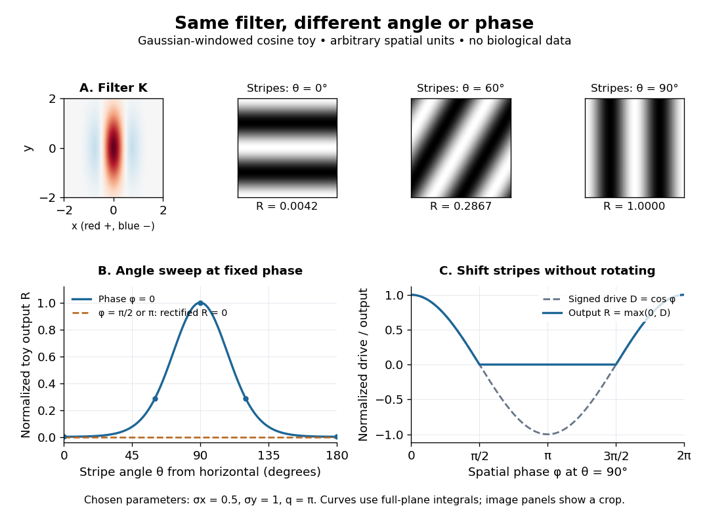
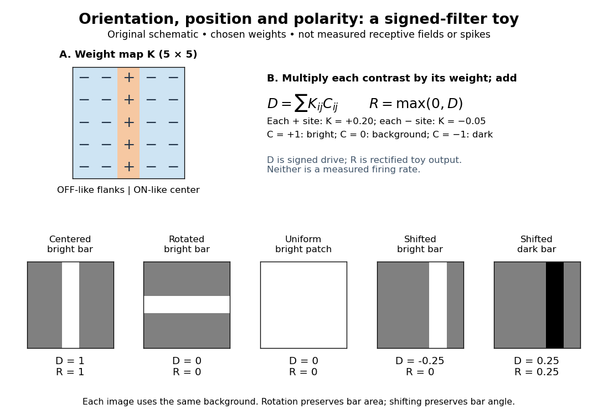
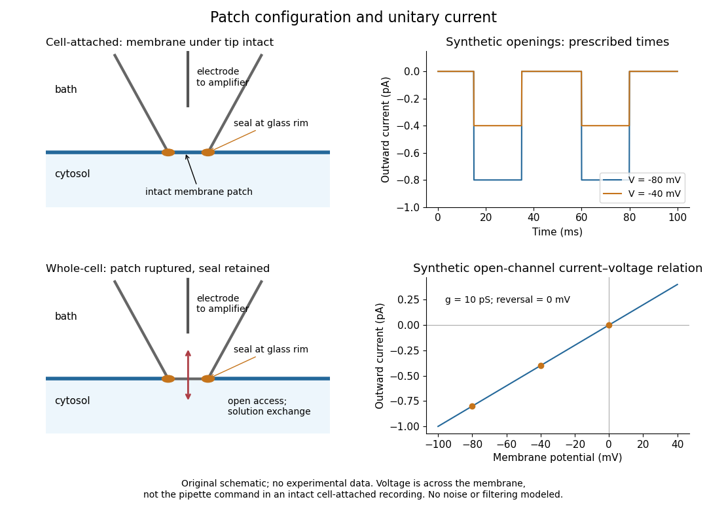
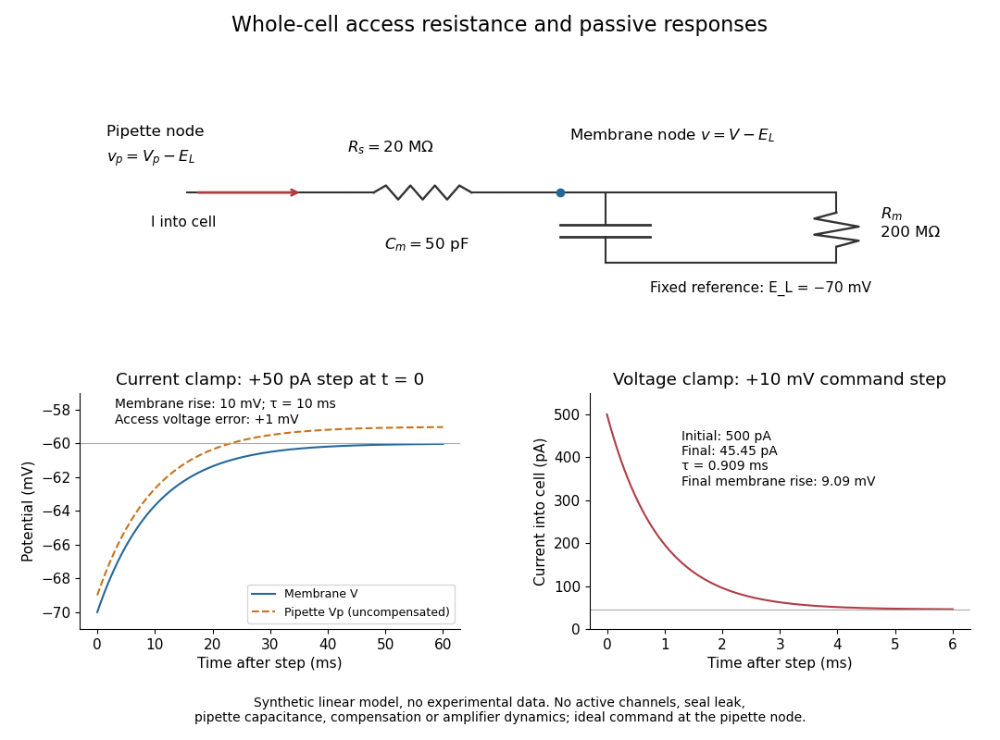
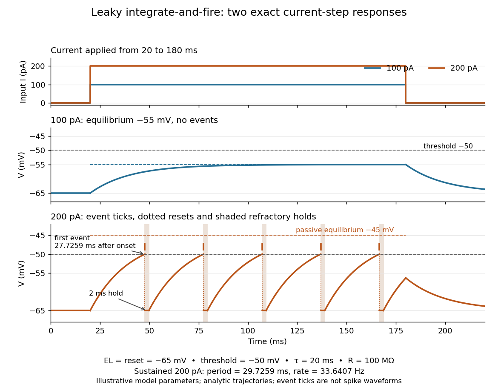

# Neuroscience

↑ **Parent:** [Biology](biology.md)  
ⓦ [Wiki](https://en.wikipedia.org/wiki/Neuroscience)

The study of nervous systems, from the properties of individual [neurons](neuron.md) to circuits, development, behavior and information processing.

**Table of contents**

- [Educational neuroscience](#educational-neuroscience)
  - [Neuromyth](#neuromyth)
  - [Neuroscience literacy](#neuroscience-literacy)
- [Neurodiversity](#neurodiversity)
- [Motor control](#motor-control)
  - [Spatial stimulus-response compatibility](#spatial-stimulus-response-compatibility)
  - [Motor simulation](#motor-simulation)
- [Lateralization of brain function](#lateralization-of-brain-function)
  - [Laterality index](#laterality-index)
- [Chemogenetics](#chemogenetics)
  - [DREADD](#dreadd)
- [Acoustic startle reflex](#acoustic-startle-reflex)
- [Opioidergic modulation](#opioidergic-modulation)
- [Neuroplasticity](#neuroplasticity)
  - [Maladaptive plasticity](#maladaptive-plasticity)
  - [Functional compensation](#functional-compensation)
  - [Crossmodal plasticity](#crossmodal-plasticity)
    - [Sensory compensation](#sensory-compensation)
- [Behavioural neuroscience](#behavioural-neuroscience)
- [Neuroscientific methods](#neuroscientific-methods)
  - [Functional localizer](#functional-localizer)
  - [Structural connectivity](#structural-connectivity)
  - [Functional connectivity](#functional-connectivity)
  - [Voxel](#voxel)
  - [Single-unit recording](#single-unit-recording)
  - [Lesion study](#lesion-study)
  - [Transcranial magnetic stimulation](#transcranial-magnetic-stimulation)
    - [Repetitive transcranial magnetic stimulation](#repetitive-transcranial-magnetic-stimulation)
- [Cognitive neuroscience](#cognitive-neuroscience)
  - [Cognitive reserve](#cognitive-reserve)
  - [Body representation](#body-representation)
    - [Somatoparaphrenia](#somatoparaphrenia)
    - [Asomatognosia](#asomatognosia)
  - [Neural representation](#neural-representation)
    - [Amodal representation](#amodal-representation)
      - [Amodal semantics](#amodal-semantics)
    - [Regional activation does not identify a neural code](#regional-activation-does-not-identify-a-neural-code)
    - [Neural code](#neural-code)
  - [Language processing](#language-processing)
    - [Literacy-related cortical reorganisation](#literacy-related-cortical-reorganisation)
    - [Word recognition](#word-recognition)
      - [Word frequency](#word-frequency)
      - [Visual word recognition](#visual-word-recognition)
        - [Orthographic learning](#orthographic-learning)
          - [Variability in irrelevant letters](#variability-in-irrelevant-letters)
          - [Artificial-orthography learning experiment](#artificial-orthography-learning-experiment)
          - [Self-teaching hypothesis of reading](#self-teaching-hypothesis-of-reading)
        - [Reading fluency](#reading-fluency)
    - [Lexical retrieval](#lexical-retrieval)
    - [Aphasia](#aphasia)
      - [Aphasia recovery](#aphasia-recovery)
      - [Primary progressive aphasia](#primary-progressive-aphasia)
        - [Logopenic variant primary progressive aphasia](#logopenic-variant-primary-progressive-aphasia)
        - [Semantic variant primary progressive aphasia](#semantic-variant-primary-progressive-aphasia)
        - [Nonfluent variant primary progressive aphasia](#nonfluent-variant-primary-progressive-aphasia)
      - [Optic aphasia](#optic-aphasia)
      - [Semantic aphasia](#semantic-aphasia)
      - [Anomia](#anomia)
      - [Paraphasia](#paraphasia)
      - [Receptive aphasia](#receptive-aphasia)
      - [Wernicke's aphasia](#wernicke-s-aphasia)
      - [Conduction aphasia](#conduction-aphasia)
    - [Ventral language pathway](#ventral-language-pathway)
    - [Dorsal language pathway](#dorsal-language-pathway)
    - [Sentence comprehension](#sentence-comprehension)
      - [Sentence-picture matching](#sentence-picture-matching)
    - [Speech production](#speech-production)
      - [Stuttering](#stuttering)
      - [Apraxia of speech](#apraxia-of-speech)
        - [Childhood apraxia of speech](#childhood-apraxia-of-speech)
    - [Speech perception](#speech-perception)
      - [Auditory verbal agnosia](#auditory-verbal-agnosia)
  - [Reverse inference](#reverse-inference)
- [Memory in animals](#memory-in-animals)
  - [Engram](#engram)
  - [Relational memory](#relational-memory)
    - [Relational memory theory](#relational-memory-theory)
  - [Temporal context in memory](#temporal-context-in-memory)
  - [Temporal order memory](#temporal-order-memory)
  - [Episodic-like memory](#episodic-like-memory)
    - [What-where-when memory](#what-where-when-memory)
  - [Human memory](#human-memory)
    - [Serial two-store model of memory](#serial-two-store-model-of-memory)
    - [Long-term memory](#long-term-memory)
    - [Short-term memory](#short-term-memory)
      - [Verbal short-term memory](#verbal-short-term-memory)
        - [Digit span](#digit-span)
  - [Stimulus priming](#stimulus-priming)
    - [Retrieval-generated priming](#retrieval-generated-priming)
    - [Self-generated priming](#self-generated-priming)
  - [Associative mismatch](#associative-mismatch)
  - [Schema in memory](#schema-in-memory)
  - [Complementary learning systems](#complementary-learning-systems)
  - [Memory consolidation](#memory-consolidation)
    - [Systems consolidation](#systems-consolidation)
      - [Active systems consolidation hypothesis](#active-systems-consolidation-hypothesis)
    - [Synaptic consolidation](#synaptic-consolidation)
  - [Procedural memory](#procedural-memory)
    - [Rotary pursuit](#rotary-pursuit)
  - [Declarative memory](#declarative-memory)
    - [Medial temporal lobe declarative memory system theory](#medial-temporal-lobe-declarative-memory-system-theory)
    - [Semantic memory](#semantic-memory)
      - [Conceptual knowledge](#conceptual-knowledge)
      - [Semantic representation](#semantic-representation)
      - [Amodal semantic representation](#amodal-semantic-representation)
      - [Semantic control](#semantic-control)
  - [Recognition memory](#recognition-memory)
    - [Object recognition task](#object-recognition-task)
    - [Recollection](#recollection)
    - [Familiarity](#familiarity)
  - [Memory retrieval](#memory-retrieval)
    - [Mnemonic reinstatement](#mnemonic-reinstatement)
    - [Source memory](#source-memory)
    - [Intrusive memory](#intrusive-memory)
      - [Trauma-film paradigm](#trauma-film-paradigm)
      - [Warning-signal hypothesis of intrusive memories](#warning-signal-hypothesis-of-intrusive-memories)
    - [Source monitoring](#source-monitoring)
    - [Memory reactivation](#memory-reactivation)
      - [Targeted memory reactivation](#targeted-memory-reactivation)
      - [Neural replay](#neural-replay)
  - [Memory retention](#memory-retention)
  - [Memory encoding](#memory-encoding)
  - [Episodic memory](#episodic-memory)
    - [Episodic binding](#episodic-binding)
      - [Marginal event features do not determine episodic binding](#marginal-event-features-do-not-determine-episodic-binding)
  - [Working memory](#working-memory)
    - [Working-memory updating](#working-memory-updating)
      - [N-back task](#n-back-task)
    - [Activity-silent working memory](#activity-silent-working-memory)
    - [Sensory recruitment](#sensory-recruitment)
    - [Delay-period activity](#delay-period-activity)
    - [Phonological working memory](#phonological-working-memory)
      - [Nonword repetition](#nonword-repetition)
      - [Articulatory rehearsal](#articulatory-rehearsal)
    - [Working memory precision](#working-memory-precision)
    - [Working memory capacity](#working-memory-capacity)
  - [Autobiographical memory](#autobiographical-memory)
    - [Forward telescoping](#forward-telescoping)
    - [Magic Shrinking Machine memory task](#magic-shrinking-machine-memory-task)
    - [Childhood amnesia](#childhood-amnesia)
      - [Infantile amnesia](#infantile-amnesia)
- [Neural circuit](#neural-circuit)
  - [Effective connectivity in neuroscience](#effective-connectivity-in-neuroscience)
  - [Mirror neuron system](#mirror-neuron-system)
  - [Interhemispheric inhibition](#interhemispheric-inhibition)
  - [Basal ganglia-thalamocortical circuit](#basal-ganglia-thalamocortical-circuit)
  - [Corticostriatal circuit](#corticostriatal-circuit)
  - [Papez circuit](#papez-circuit)
  - [Delay-Brion circuit](#delay-brion-circuit)
- [Sensory system](#sensory-system)
  - [Sensory receptor](#sensory-receptor)
    - [Baroreceptor](#baroreceptor)
  - [Sensory loss](#sensory-loss)
    - [Deafness](#deafness)
    - [Blindness](#blindness)
    - [Sensory deprivation](#sensory-deprivation)
  - [Chemosensation](#chemosensation)
  - [Somatosensation](#somatosensation)
    - [Touch](#touch)
      - [Haptic perception](#haptic-perception)
  - [Sensory modality](#sensory-modality)
  - [Gustation](#gustation)
  - [Hearing](#hearing)
    - [Audiometry](#audiometry)
      - [Tympanometry](#tympanometry)
    - [Auditory nerve](#auditory-nerve)
    - [Phonemic restoration](#phonemic-restoration)
    - [Auditory scene analysis](#auditory-scene-analysis)
    - [Head-related transfer function](#head-related-transfer-function)
    - [Interaural level difference](#interaural-level-difference)
    - [Interaural time difference](#interaural-time-difference)
    - [Timbre](#timbre)
    - [Pitch](#pitch)
    - [Tonotopy](#tonotopy)
    - [Cochlea](#cochlea)
      - [Organ of Corti](#organ-of-corti)
      - [Cochlear amplifier](#cochlear-amplifier)
      - [Hair cell](#hair-cell)
        - [Outer hair cell](#outer-hair-cell)
        - [Inner hair cell](#inner-hair-cell)
      - [Basilar membrane](#basilar-membrane)
    - [Middle ear](#middle-ear)
      - [Tensor tympani muscle](#tensor-tympani-muscle)
      - [Tubotympanic recess](#tubotympanic-recess)
      - [Tympanic cavity](#tympanic-cavity)
      - [Eustachian tube](#eustachian-tube)
    - [Acoustic masking](#acoustic-masking)
      - [Informational masking](#informational-masking)
      - [Energetic masking](#energetic-masking)
  - [Proprioception](#proprioception)
  - [Psychophysics](#psychophysics)
    - [Weber's law](#weber-s-law)
    - [Skin conductance response](#skin-conductance-response)
    - [Temporal order judgment](#temporal-order-judgment)
    - [Simultaneity judgment](#simultaneity-judgment)
      - [Gaussian simultaneity decision model](#gaussian-simultaneity-decision-model)
      - [Point of subjective simultaneity](#point-of-subjective-simultaneity)
    - [Eye tracking](#eye-tracking)
    - [Looking-time method](#looking-time-method)
      - [Violation-of-expectation method](#violation-of-expectation-method)
      - [Head-turn preference procedure](#head-turn-preference-procedure)
    - [Response dumping](#response-dumping)
    - [Two-alternative forced-choice task](#two-alternative-forced-choice-task)
    - [Signal detection theory](#signal-detection-theory)
      - [Perceptual sensitivity](#perceptual-sensitivity)
      - [Sensitivity index](#sensitivity-index)
        - [Gaussian forced-choice sensitivity relation](#gaussian-forced-choice-sensitivity-relation)
      - [Decision criterion](#decision-criterion)
    - [Psychometric function](#psychometric-function)
      - [Psychometric function with guessing and lapses](#psychometric-function-with-guessing-and-lapses)
      - [Gaussian psychometric function](#gaussian-psychometric-function)
      - [Psychophysical threshold](#psychophysical-threshold)
  - [Olfaction](#olfaction)
    - [Retronasal olfaction](#retronasal-olfaction)
    - [Orthonasal olfaction](#orthonasal-olfaction)
    - [Olfactory bulb](#olfactory-bulb)
      - [Olfactory glomerulus](#olfactory-glomerulus)
    - [Olfactory receptor](#olfactory-receptor)
  - [Vision](#vision)
    - [Visual object recognition](#visual-object-recognition)
    - [Hemianopia](#hemianopia)
    - [Visual field](#visual-field)
    - [Dorsal visual stream](#dorsal-visual-stream)
      - [Visuomotor transformation](#visuomotor-transformation)
    - [Natural image statistics](#natural-image-statistics)
      - [Luminance histogram](#luminance-histogram)
        - [Histogram-preserving spatial permutation](#histogram-preserving-spatial-permutation)
    - [Mesopic vision](#mesopic-vision)
    - [Texture bias in visual recognition](#texture-bias-in-visual-recognition)
    - [View-invariant object recognition](#view-invariant-object-recognition)
    - [Ventral visual stream](#ventral-visual-stream)
      - [Recurrent visual processing](#recurrent-visual-processing)
    - [Visual search](#visual-search)
      - [Target prevalence effect](#target-prevalence-effect)
      - [Guided search](#guided-search)
        - [Guided Search 6.0](#guided-search-6-0)
      - [Serial self-terminating search benchmark](#serial-self-terminating-search-benchmark)
      - [Conjunction search](#conjunction-search)
      - [Feature search](#feature-search)
    - [Saccade](#saccade)
    - [Ultraviolet vision](#ultraviolet-vision)
    - [Opsin](#opsin)
    - [Photoreceptor](#photoreceptor)
      - [Photoreceptor sampling](#photoreceptor-sampling)
      - [Rod cell](#rod-cell)
      - [Photopigment](#photopigment)
      - [Visual phototransduction](#visual-phototransduction)
        - [Photopigment bleaching](#photopigment-bleaching)
      - [Principle of univariance](#principle-of-univariance)
      - [Cone cell](#cone-cell)
        - [Short-wavelength-sensitive cone](#short-wavelength-sensitive-cone)
        - [Middle-wavelength-sensitive cone](#middle-wavelength-sensitive-cone)
        - [Long-wavelength-sensitive cone](#long-wavelength-sensitive-cone)
    - [Spectral sensitivity](#spectral-sensitivity)
  - [Perception](#perception)
    - [Visual oddity task](#visual-oddity-task)
    - [Feature ambiguity](#feature-ambiguity)
    - [Visual masking](#visual-masking)
    - [Auditory hallucination](#auditory-hallucination)
      - [Auditory verbal hallucination](#auditory-verbal-hallucination)
    - [Categorical perception](#categorical-perception)
      - [Categorical perception of color](#categorical-perception-of-color)
    - [Material perception](#material-perception)
      - [Translucency](#translucency)
      - [Surface roughness](#surface-roughness)
      - [Gloss](#gloss)
        - [Highlight congruence](#highlight-congruence)
    - [Interoception](#interoception)
      - [Interoceptive inference](#interoceptive-inference)
      - [Interoceptive awareness](#interoceptive-awareness)
      - [Interoceptive sensibility](#interoceptive-sensibility)
      - [Interoceptive accuracy](#interoceptive-accuracy)
        - [Heartbeat discrimination task](#heartbeat-discrimination-task)
        - [Heartbeat counting task](#heartbeat-counting-task)
          - [Heartbeat counting score](#heartbeat-counting-score)
            - [Perfect heartbeat-counting score does not establish heartbeat detection](#perfect-heartbeat-counting-score-does-not-establish-heartbeat-detection)
      - [Heartbeat perception](#heartbeat-perception)
    - [Pain](#pain)
      - [Analgesia](#analgesia)
    - [Sensory substitution](#sensory-substitution)
      - [Sensory substitution system](#sensory-substitution-system)
        - [vOICe](#voice)
        - [Image-to-sound mapping](#image-to-sound-mapping)
    - [Spatial perception](#spatial-perception)
    - [Multisensory perception](#multisensory-perception)
      - [Crossmodal correspondence](#crossmodal-correspondence)
        - [Affective crossmodal correspondence](#affective-crossmodal-correspondence)
        - [Semantic crossmodal correspondence](#semantic-crossmodal-correspondence)
        - [Statistical crossmodal correspondence](#statistical-crossmodal-correspondence)
        - [Structural crossmodal correspondence](#structural-crossmodal-correspondence)
      - [Multisensory integration](#multisensory-integration)
        - [Temporal binding window](#temporal-binding-window)
          - [Temporal recalibration](#temporal-recalibration)
        - [Multisensory response enhancement](#multisensory-response-enhancement)
          - [Inverse effectiveness](#inverse-effectiveness)
          - [Superadditive multisensory response](#superadditive-multisensory-response)
        - [Bayesian causal inference in perception](#bayesian-causal-inference-in-perception)
          - [Gaussian temporal-discrepancy shrinkage](#gaussian-temporal-discrepancy-shrinkage)
        - [Multisensory cue integration](#multisensory-cue-integration)
          - [Reliability-weighted cue integration](#reliability-weighted-cue-integration)
            - [Minimum-variance two-cue estimate](#minimum-variance-two-cue-estimate)
    - [Synesthesia](#synesthesia)
    - [Flavor perception](#flavor-perception)
      - [Olfactory referral](#olfactory-referral)
    - [Auditory object](#auditory-object)
    - [Sensorimotor contingency](#sensorimotor-contingency)
    - [Subjective experience](#subjective-experience)
  - [Sensory ecology](#sensory-ecology)
- [Nervous system](#nervous-system)
  - [Peripheral nervous system](#peripheral-nervous-system)
  - [Nerve](#nerve)
    - [Common fibular nerve](#common-fibular-nerve)
    - [Tibial nerve](#tibial-nerve)
    - [Femoral nerve](#femoral-nerve)
  - [Sensory nerve](#sensory-nerve)
    - [Vagal afferent](#vagal-afferent)
  - [Nerve injury](#nerve-injury)
    - [Denervation](#denervation)
  - [Brachial plexus](#brachial-plexus)
    - [Radial nerve](#radial-nerve)
      - [Posterior interosseous nerve](#posterior-interosseous-nerve)
    - [Axillary nerve](#axillary-nerve)
  - [Vestibular system](#vestibular-system)
    - [Motion sickness](#motion-sickness)
  - [Reflex](#reflex)
    - [Gag reflex](#gag-reflex)
  - [Nerve plexus](#nerve-plexus)
    - [Lumbar plexus](#lumbar-plexus)
      - [Obturator nerve](#obturator-nerve)
    - [Oesophageal plexus](#oesophageal-plexus)
    - [Pulmonary plexus](#pulmonary-plexus)
    - [Cardiac plexus](#cardiac-plexus)
    - [Pharyngeal plexus](#pharyngeal-plexus)
  - [Ganglion](#ganglion)
    - [Otic ganglion](#otic-ganglion)
    - [Submandibular ganglion](#submandibular-ganglion)
    - [Ciliary ganglion](#ciliary-ganglion)
      - [Short ciliary nerves](#short-ciliary-nerves)
  - [Peripheral nerve](#peripheral-nerve)
    - [Peripheral neuropathy](#peripheral-neuropathy)
    - [Phrenic nerve](#phrenic-nerve)
  - [Cranial nerve](#cranial-nerve)
    - [Optic nerve](#optic-nerve)
    - [Facial nerve](#facial-nerve)
      - [Superior salivatory nucleus](#superior-salivatory-nucleus)
      - [Geniculate ganglion](#geniculate-ganglion)
      - [Chorda tympani](#chorda-tympani)
    - [Trigeminal nerve](#trigeminal-nerve)
      - [Auriculotemporal nerve](#auriculotemporal-nerve)
      - [Lingual nerve](#lingual-nerve)
      - [Buccal nerve](#buccal-nerve)
      - [Ophthalmic nerve](#ophthalmic-nerve)
        - [Nasociliary nerve](#nasociliary-nerve)
          - [Posterior ethmoidal nerve](#posterior-ethmoidal-nerve)
          - [Anterior ethmoidal nerve](#anterior-ethmoidal-nerve)
          - [Long ciliary nerves](#long-ciliary-nerves)
        - [Lacrimal nerve](#lacrimal-nerve)
        - [Frontal nerve](#frontal-nerve)
          - [Supratrochlear nerve](#supratrochlear-nerve)
          - [Supraorbital nerve](#supraorbital-nerve)
    - [Accessory nerve](#accessory-nerve)
    - [Glossopharyngeal nerve](#glossopharyngeal-nerve)
      - [Carotid sinus nerve](#carotid-sinus-nerve)
      - [Lesser petrosal nerve](#lesser-petrosal-nerve)
    - [Vagus nerve](#vagus-nerve)
      - [Vagotomy](#vagotomy)
      - [Recurrent laryngeal nerve](#recurrent-laryngeal-nerve)
      - [Superior laryngeal nerve](#superior-laryngeal-nerve)
      - [Inferior vagal ganglion](#inferior-vagal-ganglion)
      - [Superior vagal ganglion](#superior-vagal-ganglion)
    - [Abducens nerve](#abducens-nerve)
    - [Trochlear nerve](#trochlear-nerve)
    - [Oculomotor nerve](#oculomotor-nerve)
  - [Somatic nervous system](#somatic-nervous-system)
  - [Autonomic nervous system](#autonomic-nervous-system)
    - [Autonomic nerve](#autonomic-nerve)
    - [Parasympathetic nervous system](#parasympathetic-nervous-system)
      - [Parasympathetic](#parasympathetic)
  - [Enteric nervous system](#enteric-nervous-system)
- [Central nervous system](#central-nervous-system)
  - [Gray matter](#gray-matter)
- [Brain](#brain)
  - [Intracranial pressure](#intracranial-pressure)
  - [Brainstem](#brainstem)
    - [Cranial nerve nucleus](#cranial-nerve-nucleus)
    - [Pons](#pons)
      - [Locus coeruleus](#locus-coeruleus)
      - [Vestibular nucleus](#vestibular-nucleus)
      - [Facial motor nucleus](#facial-motor-nucleus)
      - [Abducens nucleus](#abducens-nucleus)
    - [Medulla oblongata](#medulla-oblongata)
      - [Solitary nucleus](#solitary-nucleus)
      - [Nucleus tractus solitarius](#nucleus-tractus-solitarius)
      - [Hypoglossal nucleus](#hypoglossal-nucleus)
      - [Spinal trigeminal nucleus](#spinal-trigeminal-nucleus)
      - [Nucleus of the solitary tract](#nucleus-of-the-solitary-tract)
      - [Dorsal motor nucleus of the vagus](#dorsal-motor-nucleus-of-the-vagus)
      - [Nucleus ambiguus](#nucleus-ambiguus)
      - [Inferior olive](#inferior-olive)
  - [Ventricular system](#ventricular-system)
    - [Central canal of the spinal cord](#central-canal-of-the-spinal-cord)
    - [Cerebral aqueduct](#cerebral-aqueduct)
    - [Choroid plexus](#choroid-plexus)
      - [Choroid plexus of the fourth ventricle](#choroid-plexus-of-the-fourth-ventricle)
    - [Ependyma](#ependyma)
    - [Cerebrospinal fluid](#cerebrospinal-fluid)
    - [Fourth ventricle](#fourth-ventricle)
      - [Lateral aperture of the fourth ventricle](#lateral-aperture-of-the-fourth-ventricle)
        - [Lateral apertures of the fourth ventricle](#lateral-apertures-of-the-fourth-ventricle)
      - [Median aperture of the fourth ventricle](#median-aperture-of-the-fourth-ventricle)
      - [Tela choroidea](#tela-choroidea)
      - [Inferior medullary velum](#inferior-medullary-velum)
      - [Superior medullary velum](#superior-medullary-velum)
      - [Lateral recess of the fourth ventricle](#lateral-recess-of-the-fourth-ventricle)
        - [Lateral recesses of the fourth ventricle](#lateral-recesses-of-the-fourth-ventricle)
      - [Fastigium](#fastigium)
      - [Rhomboid fossa](#rhomboid-fossa)
        - [Funiculus separans](#funiculus-separans)
        - [Area postrema](#area-postrema)
        - [Vagal trigone](#vagal-trigone)
        - [Hypoglossal trigone](#hypoglossal-trigone)
        - [Vestibular area](#vestibular-area)
        - [Superior fovea](#superior-fovea)
        - [Facial colliculus](#facial-colliculus)
        - [Striae medullares of the fourth ventricle](#striae-medullares-of-the-fourth-ventricle)
        - [Sulcus limitans](#sulcus-limitans)
        - [Medial eminence](#medial-eminence)
        - [Obex](#obex)
  - [Cerebral hemisphere](#cerebral-hemisphere)
  - [Basal ganglia](#basal-ganglia)
    - [Globus pallidus](#globus-pallidus)
  - [Ventral tegmental area](#ventral-tegmental-area)
  - [Extended amygdala](#extended-amygdala)
  - [Bed nucleus of the stria terminalis](#bed-nucleus-of-the-stria-terminalis)
  - [Amygdala](#amygdala)
    - [Central nucleus of the amygdala](#central-nucleus-of-the-amygdala)
    - [Basolateral amygdala](#basolateral-amygdala)
  - [Midbrain](#midbrain)
    - [Superior colliculus](#superior-colliculus)
  - [Gudden's ventral tegmental nucleus](#gudden-s-ventral-tegmental-nucleus)
  - [Dorsal raphe nucleus](#dorsal-raphe-nucleus)
  - [Thalamus](#thalamus)
    - [Lateral geniculate nucleus](#lateral-geniculate-nucleus)
    - [Mediodorsal thalamus](#mediodorsal-thalamus)
    - [Anterior thalamic nuclei](#anterior-thalamic-nuclei)
  - [Mammillothalamic tract](#mammillothalamic-tract)
  - [Fornix](#fornix)
  - [Medial temporal lobe](#medial-temporal-lobe)
    - [Parahippocampal cortex](#parahippocampal-cortex)
    - [Postrhinal cortex](#postrhinal-cortex)
    - [Perirhinal cortex](#perirhinal-cortex)
      - [Feature-conjunction account of perirhinal cortex](#feature-conjunction-account-of-perirhinal-cortex)
  - [Brain lesion](#brain-lesion)
    - [Brain herniation](#brain-herniation)
    - [Hypoxic-ischaemic brain injury](#hypoxic-ischaemic-brain-injury)
  - [Striatum](#striatum)
    - [Putamen](#putamen)
    - [Caudate nucleus](#caudate-nucleus)
    - [Nucleus accumbens](#nucleus-accumbens)
  - [Cerebellum](#cerebellum)
    - [Nodule of the cerebellum](#nodule-of-the-cerebellum)
    - [Lingula of the cerebellum](#lingula-of-the-cerebellum)
    - [Flocculus](#flocculus)
    - [Cerebellar peduncle](#cerebellar-peduncle)
      - [Inferior cerebellar peduncle](#inferior-cerebellar-peduncle)
      - [Superior cerebellar peduncle](#superior-cerebellar-peduncle)
    - [Cerebellar error-driven learning](#cerebellar-error-driven-learning)
  - [Hippocampus](#hippocampus)
    - [Hippocampal replay](#hippocampal-replay)
    - [Adult hippocampal neurogenesis](#adult-hippocampal-neurogenesis)
    - [Hippocampal sharp-wave ripple](#hippocampal-sharp-wave-ripple)
    - [Hippocampal episodic memory model](#hippocampal-episodic-memory-model)
    - [Dentate gyrus](#dentate-gyrus)
    - [Hippocampal CA1](#hippocampal-ca1)
    - [Hippocampal CA3](#hippocampal-ca3)
  - [White matter](#white-matter)
    - [Superior longitudinal fasciculus](#superior-longitudinal-fasciculus)
    - [Extreme capsule](#extreme-capsule)
    - [Arcuate fasciculus](#arcuate-fasciculus)
  - [Cerebral cortex](#cerebral-cortex)
    - [Motor cortex](#motor-cortex)
      - [Premotor cortex](#premotor-cortex)
    - [Parietal lobe](#parietal-lobe)
      - [Posterior parietal cortex](#posterior-parietal-cortex)
    - [Neocortex](#neocortex)
    - [Temporoparietal junction](#temporoparietal-junction)
    - [Somatosensory cortex](#somatosensory-cortex)
    - [Anterior cingulate cortex](#anterior-cingulate-cortex)
    - [Insular cortex](#insular-cortex)
      - [Anterior insula](#anterior-insula)
    - [Orbitofrontal cortex](#orbitofrontal-cortex)
    - [Cingulate cortex](#cingulate-cortex)
    - [Retrosplenial cortex](#retrosplenial-cortex)
    - [Inferior temporal cortex](#inferior-temporal-cortex)
    - [Entorhinal cortex](#entorhinal-cortex)
    - [Visual cortex](#visual-cortex)
    - [Temporal lobe](#temporal-lobe)
      - [Superior temporal sulcus](#superior-temporal-sulcus)
      - [Superior temporal gyrus](#superior-temporal-gyrus)
      - [Anterior temporal lobe](#anterior-temporal-lobe)
        - [Temporal pole](#temporal-pole)
      - [Wernicke's area](#wernicke-s-area)
    - [Frontal lobe](#frontal-lobe)
      - [Supplementary motor area](#supplementary-motor-area)
      - [Inferior frontal gyrus](#inferior-frontal-gyrus)
        - [Broca's area](#broca-s-area)
        - [Pars triangularis](#pars-triangularis)
        - [Pars opercularis](#pars-opercularis)
      - [Prefrontal cortex](#prefrontal-cortex)
        - [Ventromedial prefrontal cortex](#ventromedial-prefrontal-cortex)
        - [Medial prefrontal cortex](#medial-prefrontal-cortex)
        - [Dorsolateral prefrontal cortex](#dorsolateral-prefrontal-cortex)
- [Glial cell](#glial-cell)
  - [Microglia](#microglia)
- [Spinal cord](#spinal-cord)
  - [Descending motor pathway](#descending-motor-pathway)
  - [Anterior horn](#anterior-horn)
  - [Spinothalamic pathway](#spinothalamic-pathway)
- [Neuroscientist](neuroscientist.md)
  - [Computational neuroscientist](neuroscientist.md#computational-neuroscientist)
    - [List of computational neuroscientists](neuroscientist.md#list-of-computational-neuroscientists)
      - [Byron M. Yu](neuroscientist.md#byron-m-yu)
        - [Work by Byron M. Yu](neuroscientist.md#work-by-byron-m-yu)
  - [Neuroanatomist](neuroscientist.md#neuroanatomist)
    - [List of neuroanatomists](neuroscientist.md#list-of-neuroanatomists)
      - [James Papez](neuroscientist.md#james-papez)
      - [Paul Broca](neuroscientist.md#paul-broca)
        - [Work by Paul Broca](neuroscientist.md#work-by-paul-broca)
      - [Santiago Ramón y Cajal](neuroscientist.md#santiago-ramon-y-cajal)
  - [Cognitive neuroscientist](neuroscientist.md#cognitive-neuroscientist)
    - [List of cognitive neuroscientists](neuroscientist.md#list-of-cognitive-neuroscientists)
      - [Hagar Gelbard-Sagiv](neuroscientist.md#hagar-gelbard-sagiv)
        - [Work by Hagar Gelbard-Sagiv](neuroscientist.md#work-by-hagar-gelbard-sagiv)
      - [Howard Eichenbaum](neuroscientist.md#howard-eichenbaum)
        - [Work by Howard Eichenbaum](neuroscientist.md#work-by-howard-eichenbaum)
      - [Timothy J. Bussey](neuroscientist.md#timothy-j-bussey)
        - [Work by Timothy J. Bussey](neuroscientist.md#work-by-timothy-j-bussey)
      - [Mark J. Buckley](neuroscientist.md#mark-j-buckley)
        - [Work by Mark J. Buckley](neuroscientist.md#work-by-mark-j-buckley)
      - [Lila Davachi](neuroscientist.md#lila-davachi)
        - [Work by Lila Davachi](neuroscientist.md#work-by-lila-davachi)
      - [Christopher J. MacDonald](neuroscientist.md#christopher-j-macdonald)
        - [Work by Christopher J. MacDonald](neuroscientist.md#work-by-christopher-j-macdonald)
      - [Ceren Ergorul](neuroscientist.md#ceren-ergorul)
        - [Work by Ceren Ergorul](neuroscientist.md#work-by-ceren-ergorul)
      - [Norbert J. Fortin](neuroscientist.md#norbert-j-fortin)
        - [Work by Norbert J. Fortin](neuroscientist.md#work-by-norbert-j-fortin)
      - [Antonia Hamilton](neuroscientist.md#antonia-hamilton)
        - [Work by Antonia Hamilton](neuroscientist.md#work-by-antonia-hamilton)
      - [Noah J. Sasson](neuroscientist.md#noah-j-sasson)
        - [Work by Noah J. Sasson](neuroscientist.md#work-by-noah-j-sasson)
      - [Catherine J. Crompton](neuroscientist.md#catherine-j-crompton)
        - [Work by Catherine J. Crompton](neuroscientist.md#work-by-catherine-j-crompton)
      - [Harma Meffert](neuroscientist.md#harma-meffert)
        - [Work by Harma Meffert](neuroscientist.md#work-by-harma-meffert)
      - [Giorgia Zamariola](neuroscientist.md#giorgia-zamariola)
        - [Work by Giorgia Zamariola](neuroscientist.md#work-by-giorgia-zamariola)
      - [Punit Shah](neuroscientist.md#punit-shah)
        - [Work by Punit Shah](neuroscientist.md#work-by-punit-shah)
      - [Sarah N. Garfinkel](neuroscientist.md#sarah-n-garfinkel)
        - [Work by Sarah N. Garfinkel](neuroscientist.md#work-by-sarah-n-garfinkel)
      - [Marcel Brass](neuroscientist.md#marcel-brass)
        - [Work by Marcel Brass](neuroscientist.md#work-by-marcel-brass)
      - [Roy Mukamel](neuroscientist.md#roy-mukamel)
        - [Work by Roy Mukamel](neuroscientist.md#work-by-roy-mukamel)
      - [Maria Alessandra Umiltà](neuroscientist.md#maria-alessandra-umilta)
        - [Work by Maria Alessandra Umiltà](neuroscientist.md#work-by-maria-alessandra-umilta)
      - [Vittorio Gallese](neuroscientist.md#vittorio-gallese)
        - [Work by Vittorio Gallese](neuroscientist.md#work-by-vittorio-gallese)
      - [Geoffrey Bird](neuroscientist.md#geoffrey-bird)
        - [Work by Geoffrey Bird](neuroscientist.md#work-by-geoffrey-bird)
      - [Simone G. Shamay-Tsoory](neuroscientist.md#simone-g-shamay-tsoory)
        - [Work by Simone G. Shamay-Tsoory](neuroscientist.md#work-by-simone-g-shamay-tsoory)
      - [Stanislas Dehaene](neuroscientist.md#stanislas-dehaene)
        - [Work by Stanislas Dehaene](neuroscientist.md#work-by-stanislas-dehaene)
      - [Margaret A. Naeser](neuroscientist.md#margaret-a-naeser)
        - [Work by Margaret A. Naeser](neuroscientist.md#work-by-margaret-a-naeser)
      - [Karen Emmorey](neuroscientist.md#karen-emmorey)
        - [Work by Karen Emmorey](neuroscientist.md#work-by-karen-emmorey)
      - [Mairéad MacSweeney](neuroscientist.md#mairead-macsweeney)
        - [Work by Mairéad MacSweeney](neuroscientist.md#work-by-mairead-macsweeney)
      - [Stephen M. Wilson](neuroscientist.md#stephen-m-wilson)
        - [Work by Stephen M. Wilson](neuroscientist.md#work-by-stephen-m-wilson)
      - [Soo-Eun Chang](neuroscientist.md#soo-eun-chang)
        - [Work by Soo-Eun Chang](neuroscientist.md#work-by-soo-eun-chang)
      - [Kate Watkins](neuroscientist.md#kate-watkins)
        - [Work by Kate Watkins](neuroscientist.md#work-by-kate-watkins)
      - [Gorana Pobric](neuroscientist.md#gorana-pobric)
        - [Work by Gorana Pobric](neuroscientist.md#work-by-gorana-pobric)
      - [Robert J. Zatorre](neuroscientist.md#robert-j-zatorre)
        - [Work by Robert J. Zatorre](neuroscientist.md#work-by-robert-j-zatorre)
      - [Antoine Bechara](neuroscientist.md#antoine-bechara)
        - [Work by Antoine Bechara](neuroscientist.md#work-by-antoine-bechara)
      - [Liane Schmidt](neuroscientist.md#liane-schmidt)
        - [Work by Liane Schmidt](neuroscientist.md#work-by-liane-schmidt)
      - [Aron K. Barbey](neuroscientist.md#aron-k-barbey)
        - [Work by Aron K. Barbey](neuroscientist.md#work-by-aron-k-barbey)
      - [Adam R. Aron](neuroscientist.md#adam-r-aron)
        - [Work by Adam R. Aron](neuroscientist.md#work-by-adam-r-aron)
      - [Elizabeth Jefferies](neuroscientist.md#elizabeth-jefferies)
        - [Work by Elizabeth Jefferies](neuroscientist.md#work-by-elizabeth-jefferies)
      - [Holly Robson](neuroscientist.md#holly-robson)
        - [Work by Holly Robson](neuroscientist.md#work-by-holly-robson)
      - [Philip A. Kragel](neuroscientist.md#philip-a-kragel)
        - [Work by Philip A. Kragel](neuroscientist.md#work-by-philip-a-kragel)
      - [Ralph Adolphs](neuroscientist.md#ralph-adolphs)
        - [Work by Ralph Adolphs](neuroscientist.md#work-by-ralph-adolphs)
      - [Jonathan P. Roiser](neuroscientist.md#jonathan-p-roiser)
        - [Work by Jonathan P. Roiser](neuroscientist.md#work-by-jonathan-p-roiser)
      - [Kelly M. J. Diederen](neuroscientist.md#kelly-m-j-diederen)
        - [Work by Kelly M. J. Diederen](neuroscientist.md#work-by-kelly-m-j-diederen)
      - [Rebecca Saxe](neuroscientist.md#rebecca-saxe)
        - [Work by Rebecca Saxe](neuroscientist.md#work-by-rebecca-saxe)
      - [Markus Rütgen](neuroscientist.md#markus-rutgen)
        - [Work by Markus Rütgen](neuroscientist.md#work-by-markus-rutgen)
      - [Anjali Krishnan](neuroscientist.md#anjali-krishnan)
        - [Work by Anjali Krishnan](neuroscientist.md#work-by-anjali-krishnan)
      - [Tania Singer](neuroscientist.md#tania-singer)
        - [Work by Tania Singer](neuroscientist.md#work-by-tania-singer)
      - [Simone Kühn](neuroscientist.md#simone-kuhn)
        - [Work by Simone Kühn](neuroscientist.md#work-by-simone-kuhn)
      - [Evelina Fedorenko](neuroscientist.md#evelina-fedorenko)
        - [Work by Evelina Fedorenko](neuroscientist.md#work-by-evelina-fedorenko)
      - [Corianne Rogalsky](neuroscientist.md#corianne-rogalsky)
        - [Work by Corianne Rogalsky](neuroscientist.md#work-by-corianne-rogalsky)
      - [Nina F. Dronkers](neuroscientist.md#nina-f-dronkers)
        - [Work by Nina F. Dronkers](neuroscientist.md#work-by-nina-f-dronkers)
      - [Dorothee Kümmerer](neuroscientist.md#dorothee-kummerer)
        - [Work by Dorothee Kümmerer](neuroscientist.md#work-by-dorothee-kummerer)
      - [Dorothee Saur](neuroscientist.md#dorothee-saur)
        - [Work by Dorothee Saur](neuroscientist.md#work-by-dorothee-saur)
      - [David Poeppel](neuroscientist.md#david-poeppel)
        - [Work by David Poeppel](neuroscientist.md#work-by-david-poeppel)
      - [Gregory Hickok](neuroscientist.md#gregory-hickok)
        - [Work by Gregory Hickok](neuroscientist.md#work-by-gregory-hickok)
      - [Michael J. Wolff](neuroscientist.md#michael-j-wolff)
        - [Work by Michael J. Wolff](neuroscientist.md#work-by-michael-j-wolff)
      - [Nathan S. Rose](neuroscientist.md#nathan-s-rose)
        - [Work by Nathan S. Rose](neuroscientist.md#work-by-nathan-s-rose)
      - [Mikael Lundqvist](neuroscientist.md#mikael-lundqvist)
        - [Work by Mikael Lundqvist](neuroscientist.md#work-by-mikael-lundqvist)
      - [Frank Tong](neuroscientist.md#frank-tong)
        - [Work by Frank Tong](neuroscientist.md#work-by-frank-tong)
      - [Stephenie A. Harrison](neuroscientist.md#stephenie-a-harrison)
        - [Work by Stephenie A. Harrison](neuroscientist.md#work-by-stephenie-a-harrison)
      - [Edward K. Vogel](neuroscientist.md#edward-k-vogel)
        - [Work by Edward K. Vogel](neuroscientist.md#work-by-edward-k-vogel)
      - [Klaus Wimmer](neuroscientist.md#klaus-wimmer)
        - [Work by Klaus Wimmer](neuroscientist.md#work-by-klaus-wimmer)
      - [Shintaro Funahashi](neuroscientist.md#shintaro-funahashi)
        - [Work by Shintaro Funahashi](neuroscientist.md#work-by-shintaro-funahashi)
  - [List of neuroscientists](neuroscientist.md#list-of-neuroscientists)
    - [Tomás J. Ryan](neuroscientist.md#tomas-j-ryan)
      - [Work by Tomás J. Ryan](neuroscientist.md#work-by-tomas-j-ryan)
    - [Brenton G. Cooper](neuroscientist.md#brenton-g-cooper)
      - [Work by Brenton G. Cooper](neuroscientist.md#work-by-brenton-g-cooper)
    - [Matthew W. Jones](neuroscientist.md#matthew-w-jones)
      - [Work by Matthew W. Jones](neuroscientist.md#work-by-matthew-w-jones)
    - [Matthias Groszer](neuroscientist.md#matthias-groszer)
      - [Work by Matthias Groszer](neuroscientist.md#work-by-matthias-groszer)
    - [Suzanne Corkin](neuroscientist.md#suzanne-corkin)
      - [Work by Suzanne Corkin](neuroscientist.md#work-by-suzanne-corkin)
    - [Mohammed R. Milad](neuroscientist.md#mohammed-r-milad)
      - [Work by Mohammed R. Milad](neuroscientist.md#work-by-mohammed-r-milad)
    - [Luana Colloca](neuroscientist.md#luana-colloca)
      - [Work by Luana Colloca](neuroscientist.md#work-by-luana-colloca)
    - [Ulrike Bingel](neuroscientist.md#ulrike-bingel)
      - [Work by Ulrike Bingel](neuroscientist.md#work-by-ulrike-bingel)
    - [Cindy L. Wyvell](neuroscientist.md#cindy-l-wyvell)
      - [Work by Cindy L. Wyvell](neuroscientist.md#work-by-cindy-l-wyvell)
    - [Juan L. Gomez](neuroscientist.md#juan-l-gomez)
      - [Work by Juan L. Gomez](neuroscientist.md#work-by-juan-l-gomez)
    - [David A. McCormick](neuroscientist.md#david-a-mccormick)
      - [Work by David A. McCormick](neuroscientist.md#work-by-david-a-mccormick)
    - [Joshua L. Jones](neuroscientist.md#joshua-l-jones)
      - [Work by Joshua L. Jones](neuroscientist.md#work-by-joshua-l-jones)
    - [Ali Mohebi](neuroscientist.md#ali-mohebi)
      - [Work by Ali Mohebi](neuroscientist.md#work-by-ali-mohebi)
    - [Ben Engelhard](neuroscientist.md#ben-engelhard)
      - [Work by Ben Engelhard](neuroscientist.md#work-by-ben-engelhard)
    - [Chun Yun Chang](neuroscientist.md#chun-yun-chang)
      - [Work by Chun Yun Chang](neuroscientist.md#work-by-chun-yun-chang)
    - [Catherine A. Marcinkiewcz](neuroscientist.md#catherine-a-marcinkiewcz)
      - [Work by Catherine A. Marcinkiewcz](neuroscientist.md#work-by-catherine-a-marcinkiewcz)
    - [Kayoko W. Miyazaki](neuroscientist.md#kayoko-w-miyazaki)
      - [Work by Kayoko W. Miyazaki](neuroscientist.md#work-by-kayoko-w-miyazaki)
    - [Hannah F. Clarke](neuroscientist.md#hannah-f-clarke)
      - [Work by Hannah F. Clarke](neuroscientist.md#work-by-hannah-f-clarke)
    - [Cornelius Gross](neuroscientist.md#cornelius-gross)
      - [Work by Cornelius Gross](neuroscientist.md#work-by-cornelius-gross)
    - [Philip R. Corlett](neuroscientist.md#philip-r-corlett)
      - [Work by Philip R. Corlett](neuroscientist.md#work-by-philip-r-corlett)
    - [David L. Walker](neuroscientist.md#david-l-walker)
      - [Work by David L. Walker](neuroscientist.md#work-by-david-l-walker)
    - [Karen J. Parker](neuroscientist.md#karen-j-parker)
      - [Work by Karen J. Parker](neuroscientist.md#work-by-karen-j-parker)
    - [Jonathan Winawer](neuroscientist.md#jonathan-winawer)
      - [Work by Jonathan Winawer](neuroscientist.md#work-by-jonathan-winawer)
    - [Christine A. Curcio](neuroscientist.md#christine-a-curcio)
      - [Work by Christine A. Curcio](neuroscientist.md#work-by-christine-a-curcio)
    - [Jay Neitz](neuroscientist.md#jay-neitz)
      - [Work by Jay Neitz](neuroscientist.md#work-by-jay-neitz)
    - [Julie L. Schnapf](neuroscientist.md#julie-l-schnapf)
      - [Work by Julie L. Schnapf](neuroscientist.md#work-by-julie-l-schnapf)
    - [A. M. Derrington](neuroscientist.md#a-m-derrington)
      - [Work by A. M. Derrington](neuroscientist.md#work-by-a-m-derrington)
    - [Bevil Conway](neuroscientist.md#bevil-conway)
      - [Work by Bevil R. Conway](neuroscientist.md#work-by-bevil-r-conway)
    - [Dennis M. Dacey](neuroscientist.md#dennis-m-dacey)
      - [Work by Dennis M. Dacey](neuroscientist.md#work-by-dennis-m-dacey)
    - [Siobhan S. Pattwell](neuroscientist.md#siobhan-s-pattwell)
      - [Work by Siobhan S. Pattwell](neuroscientist.md#work-by-siobhan-s-pattwell)
    - [Shantanu P. Jadhav](neuroscientist.md#shantanu-p-jadhav)
      - [Work by Shantanu P. Jadhav](neuroscientist.md#work-by-shantanu-p-jadhav)
    - [Brad E. Pfeiffer](neuroscientist.md#brad-e-pfeiffer)
      - [Work by Brad E. Pfeiffer](neuroscientist.md#work-by-brad-e-pfeiffer)
    - [Kohitij Kar](neuroscientist.md#kohitij-kar)
      - [Work by Kohitij Kar](neuroscientist.md#work-by-kohitij-kar)
    - [Chengxu Zhuang](neuroscientist.md#chengxu-zhuang)
      - [Work by Chengxu Zhuang](neuroscientist.md#work-by-chengxu-zhuang)
    - [Seyed-Mahdi Khaligh-Razavi](neuroscientist.md#seyed-mahdi-khaligh-razavi)
      - [Work by Seyed-Mahdi Khaligh-Razavi](neuroscientist.md#work-by-seyed-mahdi-khaligh-razavi)
    - [Daniel L. K. Yamins](neuroscientist.md#daniel-l-k-yamins)
      - [Work by Daniel L. K. Yamins](neuroscientist.md#work-by-daniel-l-k-yamins)
    - [Dorothy Tse](neuroscientist.md#dorothy-tse)
      - [Work by Dorothy Tse](neuroscientist.md#work-by-dorothy-tse)
    - [Ivan E. T. de Araujo](neuroscientist.md#ivan-e-t-de-araujo)
      - [Work by Ivan E. T. de Araujo](neuroscientist.md#work-by-ivan-e-t-de-araujo)
    - [Monica Gori](neuroscientist.md#monica-gori)
      - [Work by Monica Gori](neuroscientist.md#work-by-monica-gori)
    - [Paul Bach-y-Rita](neuroscientist.md#paul-bach-y-rita)
      - [Work by Paul Bach-y-Rita](neuroscientist.md#work-by-paul-bach-y-rita)
    - [Ella Striem-Amit](neuroscientist.md#ella-striem-amit)
      - [Work by Ella Striem-Amit](neuroscientist.md#work-by-ella-striem-amit)
    - [Lotfi B. Merabet](neuroscientist.md#lotfi-b-merabet)
      - [Work by Lotfi B. Merabet](neuroscientist.md#work-by-lotfi-b-merabet)
    - [Stephen G. Lomber](neuroscientist.md#stephen-g-lomber)
      - [Work by Stephen G. Lomber](neuroscientist.md#work-by-stephen-g-lomber)
    - [Barry E. Stein](neuroscientist.md#barry-e-stein)
      - [Work by Barry E. Stein](neuroscientist.md#work-by-barry-e-stein)
    - [M. Alex Meredith](neuroscientist.md#m-alex-meredith)
      - [Work by M. Alex Meredith](neuroscientist.md#work-by-m-alex-meredith)
    - [Vera U. Ludwig](neuroscientist.md#vera-u-ludwig)
      - [Work by Vera U. Ludwig](neuroscientist.md#work-by-vera-u-ludwig)
    - [Boyer D. Winters](neuroscientist.md#boyer-d-winters)
      - [Work by Boyer D. Winters](neuroscientist.md#work-by-boyer-d-winters)
    - [Seralynne D. Vann](neuroscientist.md#seralynne-d-vann)
      - [Work by Seralynne D. Vann](neuroscientist.md#work-by-seralynne-d-vann)
    - [A. Harding](neuroscientist.md#a-harding)
      - [Work by A. Harding](neuroscientist.md#work-by-a-harding)
    - [Stuart Zola-Morgan](neuroscientist.md#stuart-zola-morgan)
      - [Work by Stuart Zola-Morgan](neuroscientist.md#work-by-stuart-zola-morgan)
    - [John Aggleton](neuroscientist.md#john-aggleton)
      - [Work by John P. Aggleton](neuroscientist.md#work-by-john-p-aggleton)
    - [Diego A. Pizzagalli](neuroscientist.md#diego-a-pizzagalli)
      - [Work by Diego A. Pizzagalli](neuroscientist.md#work-by-diego-a-pizzagalli)
    - [Jose Amat](neuroscientist.md#jose-amat)
      - [Work by Jose Amat](neuroscientist.md#work-by-jose-amat)
    - [Luca Santarelli](neuroscientist.md#luca-santarelli)
      - [Work by Luca Santarelli](neuroscientist.md#work-by-luca-santarelli)
    - [Catherine Harmer](neuroscientist.md#catherine-harmer)
      - [Work by Catherine J. Harmer](neuroscientist.md#work-by-catherine-j-harmer)
    - [Luisa de Vivo](neuroscientist.md#luisa-de-vivo)
      - [Work by Luisa de Vivo](neuroscientist.md#work-by-luisa-de-vivo)
    - [Gabrielle Girardeau](neuroscientist.md#gabrielle-girardeau)
      - [Work by Gabrielle Girardeau](neuroscientist.md#work-by-gabrielle-girardeau)
    - [Matthew A. Wilson](neuroscientist.md#matthew-a-wilson)
      - [Work by Matthew A. Wilson](neuroscientist.md#work-by-matthew-a-wilson)
    - [Nathaniel D. Daw](neuroscientist.md#nathaniel-d-daw)
      - [Work by Nathaniel D. Daw](neuroscientist.md#work-by-nathaniel-d-daw)
    - [Henry H. Yin](neuroscientist.md#henry-h-yin)
      - [Work by Henry H. Yin](neuroscientist.md#work-by-henry-h-yin)
    - [Elizabeth E. Steinberg](neuroscientist.md#elizabeth-e-steinberg)
      - [Work by Elizabeth E. Steinberg](neuroscientist.md#work-by-elizabeth-e-steinberg)
    - [Wolfram Schultz](neuroscientist.md#wolfram-schultz)
      - [Work by Wolfram Schultz](neuroscientist.md#work-by-wolfram-schultz)
    - [Yan Yang](neuroscientist.md#yan-yang)
      - [Work by Yan Yang](neuroscientist.md#work-by-yan-yang)
    - [Timothy Lillicrap](neuroscientist.md#timothy-lillicrap)
      - [Work by Timothy P. Lillicrap](neuroscientist.md#work-by-timothy-p-lillicrap)
    - [Winrich A. Freiwald](neuroscientist.md#winrich-a-freiwald)
      - [Work by Winrich A. Freiwald](neuroscientist.md#work-by-winrich-a-freiwald)
    - [Nuo Li](neuroscientist.md#nuo-li)
      - [Work by Nuo Li](neuroscientist.md#work-by-nuo-li)
    - [Simon Stringer](neuroscientist.md#simon-stringer)
      - [Work by Simon M. Stringer](neuroscientist.md#work-by-simon-m-stringer)
    - [Peter Földiák](neuroscientist.md#peter-foldiak)
      - [Work by Peter Földiák](neuroscientist.md#work-by-peter-foldiak)
    - [Joshua P. Neunuebel](neuroscientist.md#joshua-p-neunuebel)
      - [Work by Joshua P. Neunuebel](neuroscientist.md#work-by-joshua-p-neunuebel)
    - [Kazu Nakazawa](neuroscientist.md#kazu-nakazawa)
      - [Work by Kazu Nakazawa](neuroscientist.md#work-by-kazu-nakazawa)
    - [Hui Min Tan](neuroscientist.md#hui-min-tan)
      - [Work by Hui Min Tan](neuroscientist.md#work-by-hui-min-tan)
    - [Edmund Rolls](neuroscientist.md#edmund-rolls)
      - [Work by Edmund T. Rolls](neuroscientist.md#work-by-edmund-t-rolls)
    - [Jeffrey S. Taube](neuroscientist.md#jeffrey-s-taube)
      - [Work by Jeffrey S. Taube](neuroscientist.md#work-by-jeffrey-s-taube)
    - [Kuniyoshi Sakai](neuroscientist.md#kuniyoshi-sakai)
      - [Work by Kuniyoshi Sakai](neuroscientist.md#work-by-kuniyoshi-sakai)
    - [Dana M. Small](neuroscientist.md#dana-m-small)
      - [Work by Dana M. Small](neuroscientist.md#work-by-dana-m-small)
    - [David L. Woods](neuroscientist.md#david-l-woods)
      - [Work by David L. Woods](neuroscientist.md#work-by-david-l-woods)
    - [Mario A. Ruggero](neuroscientist.md#mario-a-ruggero)
      - [Work by Mario A. Ruggero](neuroscientist.md#work-by-mario-a-ruggero)
    - [Heidi Hofer](neuroscientist.md#heidi-hofer)
      - [Work by Heidi Hofer](neuroscientist.md#work-by-heidi-hofer)
    - [Ehud Y. Isacoff](neuroscientist.md#ehud-y-isacoff)
      - [Work by Ehud Y. Isacoff](neuroscientist.md#work-by-ehud-y-isacoff)
    - [Yoshiyuki Yamamoto](neuroscientist.md#yoshiyuki-yamamoto)
    - [Peter Mombaerts](neuroscientist.md#peter-mombaerts)
    - [Linda B. Buck](neuroscientist.md#linda-b-buck)
    - [Katherine Mancuso](neuroscientist.md#katherine-mancuso)
    - [Karen L. Carleton](neuroscientist.md#karen-l-carleton)
    - [Jeremy Nathans](neuroscientist.md#jeremy-nathans)
      - [Work by Jeremy Nathans](neuroscientist.md#work-by-jeremy-nathans)
    - [Mark D. Humphries](neuroscientist.md#mark-d-humphries)
    - [Terry Sejnowski](neuroscientist.md#terry-sejnowski)
      - [Work by Terrence J. Sejnowski](neuroscientist.md#work-by-terrence-j-sejnowski)
    - [Dexter M. Easton](neuroscientist.md#dexter-m-easton)
      - [Work by Dexter M. Easton](neuroscientist.md#work-by-dexter-m-easton)
    - [Ryohei Yasuda](neuroscientist.md#ryohei-yasuda)
      - [Work by Ryohei Yasuda](neuroscientist.md#work-by-ryohei-yasuda)
- [Voltage clamp](#voltage-clamp)
- [Extracellular single-unit recording](#extracellular-single-unit-recording)
- [Primary visual cortex](#primary-visual-cortex)
  - [Double-opponent cell](#double-opponent-cell)
  - [Correlation-based development of visual cortical maps](#correlation-based-development-of-visual-cortical-maps)
  - [Complex cell](#complex-cell)
    - [Quadrature energy model of a complex cell](#quadrature-energy-model-of-a-complex-cell)
    - [Pooling model of a complex cell](#pooling-model-of-a-complex-cell)
  - [Ocular dominance column](#ocular-dominance-column)
    - [Activity-dependent ocular dominance segregation](#activity-dependent-ocular-dominance-segregation)
  - [Orientation selectivity](#orientation-selectivity)
    - [Orientation tuning curve](#orientation-tuning-curve)
    - [Orientation-map self-organization](#orientation-map-self-organization)
  - [Simple cell](#simple-cell)
    - [Signed spatial filter model of a simple cell](#signed-spatial-filter-model-of-a-simple-cell)
- [Neuron](neuron.md)
  - [Neuronal excitability](neuron.md#neuronal-excitability)
  - [Mirror neuron](neuron.md#mirror-neuron)
  - [Amacrine cell](neuron.md#amacrine-cell)
  - [Horizontal cell](neuron.md#horizontal-cell)
  - [Retinal bipolar cell](neuron.md#retinal-bipolar-cell)
    - [ON and OFF retinal pathways](neuron.md#on-and-off-retinal-pathways)
  - [Retinal ganglion cell](neuron.md#retinal-ganglion-cell)
    - [Small bistratified ganglion cell](neuron.md#small-bistratified-ganglion-cell)
    - [Midget ganglion cell](neuron.md#midget-ganglion-cell)
  - [Granule cell](neuron.md#granule-cell)
  - [Purkinje cell](neuron.md#purkinje-cell)
  - [Neurite](neuron.md#neurite)
  - [Neuronal polarity](neuron.md#neuronal-polarity)
  - [Synaptic integration](neuron.md#synaptic-integration)
    - [Spatial summation](neuron.md#spatial-summation)
      - [Passive dendritic cable](neuron.md#passive-dendritic-cable)
      - [Passive spatial and conductance integration](neuron.md#passive-spatial-and-conductance-integration)
    - [Temporal summation](neuron.md#temporal-summation)
      - [Membrane time constant](neuron.md#membrane-time-constant)
    - [Neuronal firing threshold](neuron.md#neuronal-firing-threshold)
    - [Dendritic spike](neuron.md#dendritic-spike)
    - [NMDA receptor](neuron.md#nmda-receptor)
  - [Multipolar neuron](neuron.md#multipolar-neuron)
  - [Bipolar neuron](neuron.md#bipolar-neuron)
  - [Pseudounipolar neuron](neuron.md#pseudounipolar-neuron)
  - [Pyramidal cell](neuron.md#pyramidal-cell)
  - [Soma (biology)](neuron.md#soma-biology)
  - [Neural adaptation](neuron.md#neural-adaptation)
    - [Light adaptation](neuron.md#light-adaptation)
    - [Chromatic adaptation](neuron.md#chromatic-adaptation)
      - [Cone-gain normalization](neuron.md#cone-gain-normalization)
      - [Color contrast adaptation](neuron.md#color-contrast-adaptation)
  - [Synapse](neuron.md#synapse)
    - [Synaptic plasticity](neuron.md#synaptic-plasticity)
      - [Eligibility trace](neuron.md#eligibility-trace)
      - [Long-term potentiation](neuron.md#long-term-potentiation)
      - [Short-term synaptic plasticity](neuron.md#short-term-synaptic-plasticity)
      - [Synaptic competition](neuron.md#synaptic-competition)
        - [Synaptic normalization](neuron.md#synaptic-normalization)
    - [Neurotransmitter](neuron.md#neurotransmitter)
      - [Neuropeptide](neuron.md#neuropeptide)
        - [Corticotropin-releasing hormone](neuron.md#corticotropin-releasing-hormone)
      - [Gamma-aminobutyric acid](neuron.md#gamma-aminobutyric-acid)
      - [Neuromodulation](neuron.md#neuromodulation)
        - [Neuromodulator measurement and intervention](neuron.md#neuromodulator-measurement-and-intervention)
        - [Neuromodulator](neuron.md#neuromodulator)
      - [Norepinephrine](neuron.md#norepinephrine)
      - [Serotonin](neuron.md#serotonin)
      - [Dopamine](neuron.md#dopamine)
        - [Dopamine D2 receptor](neuron.md#dopamine-d2-receptor)
      - [Acetylcholine](neuron.md#acetylcholine)
    - [Chemical synapse](neuron.md#chemical-synapse)
      - [Co-transmission](neuron.md#co-transmission)
      - [Neurotransmitter clearance](neuron.md#neurotransmitter-clearance)
      - [Synaptic cleft](neuron.md#synaptic-cleft)
      - [Synaptic vesicle](neuron.md#synaptic-vesicle)
        - [Quantal neurotransmitter release](neuron.md#quantal-neurotransmitter-release)
          - [Synaptic release probability](neuron.md#synaptic-release-probability)
      - [Shunting inhibition](neuron.md#shunting-inhibition)
    - [Electrical synapse](neuron.md#electrical-synapse)
    - [Synaptic potential](neuron.md#synaptic-potential)
      - [Synaptic conductance](neuron.md#synaptic-conductance)
      - [Excitatory postsynaptic potential](neuron.md#excitatory-postsynaptic-potential)
      - [Inhibitory postsynaptic potential](neuron.md#inhibitory-postsynaptic-potential)
  - [Action potential](neuron.md#action-potential)
    - [Depolarization block](neuron.md#depolarization-block)
    - [Compound action potential](neuron.md#compound-action-potential)
    - [Neuronal refractory period](neuron.md#neuronal-refractory-period)
      - [Absolute neuronal refractory period](neuron.md#absolute-neuronal-refractory-period)
      - [Relative neuronal refractory period](neuron.md#relative-neuronal-refractory-period)
      - [Neuronal paired-pulse recovery](neuron.md#neuronal-paired-pulse-recovery)
        - [Phenomenological paired-pulse recovery](neuron.md#phenomenological-paired-pulse-recovery)
      - [Refractory limits on neuronal firing](neuron.md#refractory-limits-on-neuronal-firing)
  - [Dendrite](neuron.md#dendrite)
  - [Axon](neuron.md#axon)
    - [Climbing fiber](neuron.md#climbing-fiber)
    - [Parallel fiber](neuron.md#parallel-fiber)
    - [Axon initial segment](neuron.md#axon-initial-segment)
    - [Axon terminal](neuron.md#axon-terminal)
- [Retina](#retina)
  - [Ora serrata](#ora-serrata)
  - [Retinopathy](#retinopathy)
  - [Fovea](#fovea)
- [Patch clamp](#patch-clamp)
  - [Patch pipette](#patch-pipette)
  - [Gigaohm seal](#gigaohm-seal)
    - [Seal leak current](#seal-leak-current)
  - [Cell-attached recording](#cell-attached-recording)
  - [Single-channel recording](#single-channel-recording)
    - [Single-channel current-voltage relation](#single-channel-current-voltage-relation)
  - [Inside-out patch](#inside-out-patch)
  - [Outside-out patch](#outside-out-patch)
  - [Whole-cell recording](#whole-cell-recording)
    - [Patch-clamp series resistance](#patch-clamp-series-resistance)
    - [Membrane capacitance](#membrane-capacitance)
      - [Membrane capacitive ion budget](#membrane-capacitive-ion-budget)
    - [Space clamp](#space-clamp)
    - [Cytosol dialysis](#cytosol-dialysis)
    - [Perforated patch recording](#perforated-patch-recording)
  - [Current clamp](#current-clamp)
    - [Passive membrane response in current clamp](#passive-membrane-response-in-current-clamp)
- [Computational neuroscience](#computational-neuroscience)
  - [Path integration](#path-integration)
  - [Attractor network](#attractor-network)
    - [Bump attractor](#bump-attractor)
  - [Gabor filter](#gabor-filter)
  - [Dynamic clamp](#dynamic-clamp)
  - [Three-neuron ring stability](#three-neuron-ring-stability)
  - [Leaky integrate-and-fire model](#leaky-integrate-and-fire-model)
    - [Constant-input firing rate of a leaky integrate-and-fire neuron](#constant-input-firing-rate-of-a-leaky-integrate-and-fire-neuron)
  - [Hodgkin-Huxley model](#hodgkin-huxley-model)
    - [Planar reduction of the Hodgkin-Huxley model](#planar-reduction-of-the-hodgkin-huxley-model)
      - [Folded conductance-model nullcline](#folded-conductance-model-nullcline)
  - [Mutually excitatory saturating rate network](#mutually-excitatory-saturating-rate-network)
  - [Linear-nonlinear-Poisson cascade model](#linear-nonlinear-poisson-cascade-model)
    - [Poisson spike-train likelihood fitting](#poisson-spike-train-likelihood-fitting)
  - [Spike-triggered average](#spike-triggered-average)
    - [Stimulus-correlated spike-triggered averaging](#stimulus-correlated-spike-triggered-averaging)
  - [Neural coding](#neural-coding)
    - [Mixed selectivity](#mixed-selectivity)
    - [Spike count](#spike-count)
    - [Firing rate](#firing-rate)
    - [Cell assembly](#cell-assembly)
      - [Symmetric coactivity weights do not distinguish reversed episodes](#symmetric-coactivity-weights-do-not-distinguish-reversed-episodes)
    - [Representational hierarchy theory](#representational-hierarchy-theory)
    - [Time cell](#time-cell)
    - [Cognitive map](#cognitive-map)
    - [Sharp-wave ripple](#sharp-wave-ripple)
    - [Allocentric spatial representation](#allocentric-spatial-representation)
    - [Spatial view cell](#spatial-view-cell)
    - [Place cell](#place-cell)
      - [Hippocampal remapping](#hippocampal-remapping)
    - [Head direction cell](#head-direction-cell)
    - [Neural oscillation](#neural-oscillation)
      - [Theta oscillation](#theta-oscillation)
      - [Beta oscillation](#beta-oscillation)
      - [Gamma oscillation](#gamma-oscillation)
    - [Local field potential](#local-field-potential)
    - [Neural decoding](#neural-decoding)
    - [Population coding](#population-coding)
      - [Noise correlation](#noise-correlation)
      - [Neural population state space](#neural-population-state-space)
        - [Linear latent coordinates are not unique without constraints](#linear-latent-coordinates-are-not-unique-without-constraints)
        - [Neural manifold](#neural-manifold)
        - [Neural trajectory](#neural-trajectory)
    - [Persistent neural activity](#persistent-neural-activity)
    - [Receptive field](#receptive-field)
      - [ON and OFF receptive-field subregions](#on-and-off-receptive-field-subregions)
      - [Visual contrast](#visual-contrast)
    - [Temporal coding](#temporal-coding)
      - [Neural phase locking](#neural-phase-locking)
    - [Rate coding](#rate-coding)
    - [Spike train](#spike-train)
      - [Interspike interval](#interspike-interval)
      - [Time-rescaled spike-train diagnostics](#time-rescaled-spike-train-diagnostics)

## Educational neuroscience

↑ **Parent:** [Neuroscience](neuroscience.md)

Research connecting neural processes with questions about [learning](animal-behaviour.md#learning) and [education](README.md#education). A plausible neural mechanism is not sufficient evidence that a particular classroom method improves pupil outcomes.

### Neuromyth

↑ **Parent:** [Educational neuroscience](#educational-neuroscience)

A misconception presented as a consequence of brain knowledge or used as a brain-based educational explanation. Not every unsupported educational claim is specifically neuroscientific, so survey categories and definitions need examination.

### Neuroscience literacy

↑ **Parent:** [Educational neuroscience](#educational-neuroscience)

Understanding relevant brain science and how to evaluate claims derived from it. Knowing isolated facts should be distinguished from reasoning about a new educational claim and selecting an effective intervention.

## Neurodiversity

↑ **Parent:** [Neuroscience](neuroscience.md)

Variation in neurological and cognitive characteristics across people. Describing variation does not settle which features cause disability or which forms of support an individual needs.

## Motor control

↑ **Parent:** [Neuroscience](neuroscience.md)

Processes that plan, initiate and adjust movement using internal goals and sensory information. A deficit in execution can mimic poor [motor learning](animal-behaviour.md#motor-learning) unless baseline performance and improvement with practice are assessed separately.

### Spatial stimulus-response compatibility

↑ **Parent:** [Motor control](#motor-control)

Facilitation or interference caused by correspondence between stimulus location and response location. It can mimic an [imitation](animal-behaviour.md#imitation) effect if location and action identity are not separated.

### Motor simulation

↑ **Parent:** [Motor control](#motor-control)

Use of representations related to one’s own action system while processing another action. Evidence for recruitment must be distinguished from evidence that simulation is necessary for every form of understanding.

## Lateralization of brain function

↑ **Parent:** [Neuroscience](neuroscience.md)

A functional asymmetry between [cerebral hemispheres](#cerebral-hemisphere), measured for a stated task, contrast or operation. Population-level left dominance does not imply complete right-side inactivity or an identical pattern in every individual.

### Laterality index

↑ **Parent:** [Lateralization of brain function](#lateralization-of-brain-function)

For nonnegative measurements $L,R$ with $L+R>0$, one convention is $\mathrm{LI}=(L-R)/(L+R)$. The bound $|L-R|\leq L+R$ gives $-1\leq\mathrm{LI}\leq1$. Multiplying both measurements by the same positive factor leaves the index unchanged. A change from $(L,R)=(20,10)$ to $(10,10)$ changes the index from $1/3$ to $0$ without increasing $R$. Thus a reduced leftward index alone cannot establish right-side recruitment. Baseline, threshold and negative-response conventions must be specified.

## Chemogenetics

↑ **Parent:** [Neuroscience](neuroscience.md)

Perturbing cellular function using a pharmacologically responsive introduced component. Ligand metabolism and actions on endogenous [receptors](protein.md#receptor-biochemistry) require controls; genetic targeting alone does not guarantee a specific behavioural mechanism.

### DREADD

↑ **Parent:** [Chemogenetics](#chemogenetics)

Designer [receptors](protein.md#receptor-biochemistry) used to alter cell signalling in response to an administered ligand. The name does not establish that the ligand is inert elsewhere or that its administered form is the species acting in the brain.

## Acoustic startle reflex

↑ **Parent:** [Neuroscience](neuroscience.md)

A rapid response to an abrupt sound. Its amplitude can be modulated by threat, [attention](psychology.md#attention), motor capacity and drugs; baseline startle and potentiation should be examined separately.

## Opioidergic modulation

↑ **Parent:** [Neuroscience](neuroscience.md)

Regulation through opioid-receptor signaling. Blocking such signaling can test its causal contribution to a task response, but a system-level pharmacological effect does not identify the same [neurons](neuron.md) as the representation of two different experiences.

## Neuroplasticity

↑ **Parent:** [Neuroscience](neuroscience.md)

Changes in the functional organization, connectivity or physiological operation of neural systems with experience, altered input or development. Rapid unmasking and slower structural reorganization are different candidate mechanisms; an imaging activation change alone does not distinguish them.

### Maladaptive plasticity

↑ **Parent:** [Neuroplasticity](#neuroplasticity)

A change in neural organisation that worsens or constrains function under specified conditions. Increased activation alone does not establish maladaptation; a controlled intervention must test the proposed harmful contribution.

### Functional compensation

↑ **Parent:** [Neuroplasticity](#neuroplasticity)

A contribution from an altered or additionally recruited system that supports performance after disruption. Compensation can be necessary yet incomplete, and can differ across regions, tasks and recovery stages.

### Crossmodal plasticity

↑ **Parent:** [Neuroplasticity](#neuroplasticity)

Changes in the contribution of one sensory system to processing information from another modality, often investigated after altered sensory input. Imaging can identify recruitment; causal perturbation can test whether the recruited network contributes to a task.

#### Sensory compensation

↑ **Parent:** [Crossmodal plasticity](#crossmodal-plasticity)

Adaptation supporting task performance when sensory input is reduced. Practice, altered [attention](psychology.md#attention), use of alternative cues and changes in neural recruitment can interact. Improvement in one task can coexist with limitations in another.

## Behavioural neuroscience

↑ **Parent:** [Neuroscience](neuroscience.md)

Study of the biological mechanisms of behaviour and cognition, using converging behavioural, physiological and intervention evidence.

## Neuroscientific methods

↑ **Parent:** [Neuroscience](neuroscience.md)

Methods for measuring and manipulating nervous-system structure and function. The inference permitted by a recording, an anatomical reconstruction and a perturbation differs; convergence is more informative than treating them as interchangeable.

### Functional localizer

↑ **Parent:** [Neuroscientific methods](#neuroscientific-methods)

An independently specified task contrast used to identify a region for subsequent analysis. Individual localisation can distinguish neighbouring language-selective and domain-general regions, while independent data reduce circularity.[Current Biology 22, 2059–2062; individual functional localization and cross-domain response profiles](psychology-bibliography.md#language-selective-and-domain-general-regions-lie-side-by-side-within-broca-s-area-by-evelina-fedorenko-and-others)

### Structural connectivity

↑ **Parent:** [Neuroscientific methods](#neuroscientific-methods)

Anatomical links among neural regions. Diffusion-based [tractography](nuclear-magnetic-resonance.md#tractography) estimates aspects of white-matter organisation indirectly and should not be equated with a direct count of synapses or information flow.

### Functional connectivity

↑ **Parent:** [Neuroscientific methods](#neuroscientific-methods)

Statistical dependence between activity measurements from different locations. Resting-state [correlation](variance.md#pearson-correlation-coefficient) does not establish direct anatomical connectivity, the direction of influence or a causal role in behaviour.

### Voxel

↑ **Parent:** [Neuroscientific methods](#neuroscientific-methods)

A volume element in an imaging measurement. In [functional magnetic resonance imaging](nuclear-magnetic-resonance.md#functional-magnetic-resonance-imaging), one [voxel](#voxel) aggregates an indirect signal over many cells, so a shared response at [voxel](#voxel) or region scale need not imply the same active neuronal population.

### Single-unit recording

↑ **Parent:** [Neuroscientific methods](#neuroscientific-methods)

Measurement of the activity attributed to one [neuron](neuron.md), commonly through extracellular electrodes and spike isolation. It permits trial-resolved tests of stimulus tuning and interactions. Failure to evoke spikes with one stimulus alone does not exclude a modulatory input from that modality.

### Lesion study

↑ **Parent:** [Neuroscientific methods](#neuroscientific-methods)

A study relating damage to altered or preserved performance. Damage may affect several neighboring areas and connections, and chronic compensation can change the relationship between a lesion and behavior. Deficits are evidence about a network's contribution under the tested conditions, not automatic localization of one abstract faculty.

### Transcranial magnetic stimulation

↑ **Parent:** [Neuroscientific methods](#neuroscientific-methods)

Noninvasive stimulation in which a changing magnetic field induces electrical effects in neural tissue. Task-specific perturbation and control conditions can test causal hypotheses, but stimulation can affect connected regions and does not isolate a unique cellular mechanism.

#### Repetitive transcranial magnetic stimulation

↑ **Parent:** [Transcranial magnetic stimulation](#transcranial-magnetic-stimulation)

Repeated magnetic stimulation used to perturb cortical activity or investigate changes after a stimulation intervention. The physiological effect and network spread depend on site, state and protocol; a nominally inhibitory manipulation does not guarantee a purely local reduction.

## Cognitive neuroscience

↑ **Parent:** [Neuroscience](neuroscience.md)

The study of neural mechanisms underlying [cognition](psychology.md#cognition), using converging behavioral, physiological, imaging, computational and intervention evidence. A location associated with a task is not by itself an explanation of the task's computation.

### Cognitive reserve

↑ **Parent:** [Cognitive neuroscience](#cognitive-neuroscience)

Resources or strategies allowing performance to remain effective despite [brain](#brain) changes. A later clinical symptom onset can be compatible with reserve without implying a lower disease incidence or less underlying pathology.

### Body representation

↑ **Parent:** [Cognitive neuroscience](#cognitive-neuroscience)

Representations of the body used for sensation, action and judgments about body parts or ownership. These functions can dissociate, so the term need not denote one unified map.

#### Somatoparaphrenia

↑ **Parent:** [Body representation](#body-representation)

A disturbed belief about ownership of a body part, for example attributing one’s limb to another person. This goes beyond inaccurate localization of a visual target.

#### Asomatognosia

↑ **Parent:** [Body representation](#body-representation)

Impaired acknowledgment or recognition of part of one’s body. It is not interchangeable with every form of visual neglect.

### Neural representation

↑ **Parent:** [Cognitive neuroscience](#cognitive-neuroscience)

A pattern of neural activity that carries task-relevant information under a specified decoding or explanatory model. Anatomical co-location, similar [mean](expected-value.md) activation and a shared representational code are different claims.

#### Amodal representation

↑ **Parent:** [Neural representation](#neural-representation)

A representation whose relevant information is independent of a particular sensory or output modality. Shared mean activation across modalities is weaker evidence than generalisation of information about the represented content, with confounded stimuli and responses controlled.

##### Amodal semantics

↑ **Parent:** [Amodal representation](#amodal-representation)

Conceptual information accessible through different forms such as words, signs and pictures. Shared conceptual content can coexist with modality-specific input and output pathways; an anatomical overlap alone does not establish identical [neural codes](#neural-code).

#### Regional activation does not identify a neural code

↑ **Parent:** [Neural representation](#neural-representation)

Consider two response [vectors](vector-space.md#vector) $x=(3,1,3,1)$ and $y=(3,3,1,1)$ over the same four measured locations, relative to a zero baseline. Both are positive everywhere and have [mean](expected-value.md) two. Their centered [vectors](vector-space.md#vector) $x_c=(1,-1,1,-1)$ and $y_c=(1,1,-1,-1)$ satisfy $x_c\cdot y_c=0$. Hence identical positive regional means can accompany orthogonal patterns. This counterexample shows why overlapping regional activation does not imply a shared [neural representation](#neural-representation). It does not assert that real [neural codes](#neural-code) are necessarily orthogonal or that unsuccessful decoding proves their independence.

#### Neural code

↑ **Parent:** [Neural representation](#neural-representation)

The relationship between a neural activity pattern and information represented by that pattern. Testing a shared [neural code](#neural-code) requires more than activation in the same anatomical territory: the informative pattern or mapping must generalize under an appropriate comparison.

### Language processing

↑ **Parent:** [Cognitive neuroscience](#cognitive-neuroscience)

Processes supporting [language](README.md#language) comprehension and production. Neural models must distinguish the transformations required by a task from correlated memory, decision and motor demands.

#### Literacy-related cortical reorganisation

↑ **Parent:** [Language processing](#language-processing)

Differences in neural responses associated with literacy experience. Comparisons including adult learners constrain purely childhood explanations while remaining vulnerable to nonrandom educational histories.[Science 330, 1359–1364; 10 illiterate/22 adult-literate/31 childhood-literate adults, visual and spoken-language fMRI](psychology-bibliography.md#how-learning-to-read-changes-the-cortical-networks-for-vision-and-language-by-stanislas-dehaene-and-others)

#### Word recognition

↑ **Parent:** [Language processing](#language-processing)

Identification of a word form under a specified input modality. Accuracy, speed and access to meaning are distinguishable measurements.

##### Word frequency

↑ **Parent:** [Word recognition](#word-recognition)

How often a word occurs in a defined [language](README.md#language) sample or [learning](animal-behaviour.md#learning) history. Corpus frequency and an individual [child](organism.md#child)'s actual exposure need not coincide.

##### Visual word recognition

↑ **Parent:** [Word recognition](#word-recognition)

Identification of printed word forms. Familiar-word accuracy, unfamiliar-word [decoding](psychology.md#word-decoding), fluent access and [semantic](README.md#semantics) interpretation should not be treated as interchangeable outcomes.

###### Orthographic learning

↑ **Parent:** [Visual word recognition](#visual-word-recognition)

Acquisition of information about written forms and their relations. Retention of a particular [spelling](README.md#spelling) and generalisation to untrained combinations are different outcomes.

###### Variability in irrelevant letters

↑ **Parent:** [Orthographic learning](#orthographic-learning)

Variation in surrounding letters while a target mapping remains stable. A first-grade training experiment found transfer benefits from varied consonants around vowel mappings, motivating tests of how example distributions support abstraction.[Developmental Psychology 49, 1348–1365; 224 first graders, vowel mappings with varied/similar consonants and transfer tasks](psychology-bibliography.md#statistical-learning-in-reading-variability-in-irrelevant-letters-helps-children-learn-phonics-skills-by-keith-s-apfelbaum-and-others)

###### Artificial-orthography learning experiment

↑ **Parent:** [Orthographic learning](#orthographic-learning)

Participants learn controlled written forms, pronunciations and sometimes meanings, followed by trained-item and transfer tests. Manipulating frequency and consistency can test sensitivity to input structure without uniquely identifying a [learning](animal-behaviour.md#learning) algorithm.[Journal of Experimental Psychology: General 146, 826–858; 24 adults, two novel scripts, eight-day training, generalisation and fMRI](psychology-bibliography.md#comparing-and-validating-methods-of-reading-instruction-using-behavioural-and-neural-findings-in-an-artificial-orthography-by-joanne-s-h-taylor-and-others)

###### Self-teaching hypothesis of reading

↑ **Parent:** [Orthographic learning](#orthographic-learning)

The proposal that [phonological recoding](psychology.md#phonological-recoding) of unfamiliar written forms creates opportunities to acquire word-specific orthographic representations. Delayed discrimination from homophonic alternatives tests more than immediate pronunciation.[Journal of Experimental Child Psychology 72, 95–129; second-grade pseudoword reading, delayed spelling-choice/naming/spelling and recoding controls](psychology-bibliography.md#phonological-recoding-and-orthographic-learning-a-direct-test-of-the-self-teaching-hypothesis-by-david-l-share)

###### Reading fluency

↑ **Parent:** [Visual word recognition](#visual-word-recognition)

Efficient and appropriately coordinated [reading](psychology.md#reading), assessed through specified accuracy, speed and connected-text demands. Accurate isolated-word performance need not establish fluent passage [reading](psychology.md#reading).

#### Lexical retrieval

↑ **Parent:** [Language processing](#language-processing)

Accessing a lexical item for comprehension or production. Naming additionally requires conceptual access and an output plan, so impaired naming need not identify a single representational deficit.

#### Aphasia

↑ **Parent:** [Language processing](#language-processing)

Acquired impairment of [language](README.md#language) following [brain](#brain) injury or disease. A diagnostic label can encompass multiple deficits and lesion patterns; behavioral components must be measured rather than inferred solely from the label.

##### Aphasia recovery

↑ **Parent:** [Aphasia](#aphasia)

Improvement in [language](README.md#language) function following acquired impairment. Residual tissue, network reorganisation, task practice and rehabilitation can contribute; recovery should be assessed across useful functions and time.

##### Primary progressive aphasia

↑ **Parent:** [Aphasia](#aphasia)

A clinical syndrome with progressive [language](README.md#language) impairment as the principal initial problem. Detailed profiles distinguish loss of word meaning, motor [speech](README.md#speech) difficulty, [agrammatism](README.md#agrammatism) and phonological-memory demands; a syndrome label is not a unique anatomical lesion or molecular pathology.

###### Logopenic variant primary progressive aphasia

↑ **Parent:** [Primary progressive aphasia](#primary-progressive-aphasia)

A [PPA](#primary-progressive-aphasia) pattern involving word-finding pauses and impaired repetition, with phonological-memory limitations often important. Sentence length and [syntactic complexity](README.md#syntactic-complexity) should be varied independently when testing comprehension.

###### Semantic variant primary progressive aphasia

↑ **Parent:** [Primary progressive aphasia](#primary-progressive-aphasia)

A [PPA](#primary-progressive-aphasia) pattern prominently affecting word and conceptual meaning. Failure to understand a sentence can arise from missing word knowledge even if some grammatical operations remain available.

###### Nonfluent variant primary progressive aphasia

↑ **Parent:** [Primary progressive aphasia](#primary-progressive-aphasia)

A [PPA](#primary-progressive-aphasia) pattern characterised by effortful or agrammatic [language](README.md#language), often with [apraxia of speech](#apraxia-of-speech). Motor [speech](README.md#speech) and syntactic comprehension should be measured separately; neither is established merely by slow output.

##### Optic aphasia

↑ **Parent:** [Aphasia](#aphasia)

A disproportionate naming difficulty for visually presented objects despite evidence of recognition. Nonverbal knowledge and naming through other input routes help distinguish it from [visual agnosia](neurology.md#visual-agnosia).

##### Semantic aphasia

↑ **Parent:** [Aphasia](#aphasia)

A pattern of impaired semantic processing often investigated after [stroke](neurology.md#stroke), in which regulating the use of knowledge can be especially difficult. The label does not imply that every patient has the same [brain lesion](#brain-lesion) or precisely the same mechanism.

##### Anomia

↑ **Parent:** [Aphasia](#aphasia)

Difficulty retrieving names. A naming failure can reflect [lexical access](README.md#lexical-access), phonological output or degraded semantic knowledge, so naming alone does not diagnose failed object recognition.

##### Paraphasia

↑ **Parent:** [Aphasia](#aphasia)

An unintended substitution or alteration in [speech](README.md#speech), involving sounds or words. Fluent output can contain many such errors and therefore need not convey accurate information.

##### Receptive aphasia

↑ **Parent:** [Aphasia](#aphasia)

An aphasic presentation dominated by difficulty understanding language. This descriptive dimension does not identify one necessary [brain lesion](#brain-lesion) or exclude production deficits.

<h5 id="wernicke-s-aphasia">Wernicke's aphasia</h5>

↑ **Parent:** [Aphasia](#aphasia)

A fluent aphasic syndrome in which comprehension, repetition and informative [speech](README.md#speech) can all be impaired. Acoustic–[phonological analysis](README.md#phonological-analysis), [semantic representations](#semantic-representation) and [semantic control](#semantic-control) must be distinguished; receptive difficulty does not imply preserved production.[2012, case-series comparison](psychology-bibliography.md#wernicke-s-aphasia-reflects-a-combination-of-acoustic-phonological-and-semantic-control-deficits-by-holly-robson-and-others)

##### Conduction aphasia

↑ **Parent:** [Aphasia](#aphasia)

An aphasic pattern featuring disproportionately impaired repetition relative to some other [language](README.md#language) abilities. It can involve dorsal temporoparietal network dysfunction and is not proof of one isolated tract lesion in every case.

#### Ventral language pathway

↑ **Parent:** [Language processing](#language-processing)

Temporal and temporofrontal systems supporting transformations from [speech](README.md#speech) signals toward lexical and conceptual interpretation. Models differ on the precise anatomy and levels of representation included; bilateral [speech](README.md#speech) analysis is compatible with stronger lateralization of some higher-level operations.

#### Dorsal language pathway

↑ **Parent:** [Language processing](#language-processing)

A family of dorsal connections supporting transformations between auditory/phonological information and frontal articulatory systems. In influential dual-stream models it is strongly left-biased, while remaining interactive with other systems rather than an isolated serial cable.

#### Sentence comprehension

↑ **Parent:** [Language processing](#language-processing)

##### Sentence-picture matching

↑ **Parent:** [Sentence comprehension](#sentence-comprehension)

A task in which a person selects a picture corresponding to a sentence. Reversing [thematic roles](README.md#thematic-role) while preserving the pictured participants can test syntactic interpretation, but visual analysis and response selection remain additional requirements.

#### Speech production

↑ **Parent:** [Language processing](#language-processing)

##### Stuttering

↑ **Parent:** [Speech production](#speech-production)

A disorder of [speech](README.md#speech) fluency involving disruptions such as repetitions, prolongations or blocks. Proposed timing and motor-control mechanisms must account for variability across conditions and development; [brain](#brain) differences measured after onset can include consequences or compensation.

##### Apraxia of speech

↑ **Parent:** [Speech production](#speech-production)

Impaired planning or programming of the coordinated movements needed for [speech](README.md#speech), distinguished from a primary muscle weakness or a deficit in grammatical knowledge. It can arise in developmental or acquired conditions.

###### Childhood apraxia of speech

↑ **Parent:** [Apraxia of speech](#apraxia-of-speech)

A developmental motor-speech condition affecting the planning or programming of [speech](README.md#speech) movements. [Language](README.md#language) skills and nonverbal cognition require separate assessment rather than being inferred from the severity of [speech](README.md#speech) output difficulty.

#### Speech perception

↑ **Parent:** [Language processing](#language-processing)

##### Auditory verbal agnosia

↑ **Parent:** [Speech perception](#speech-perception)

A disproportionate difficulty recognizing spoken language despite better access through other routes. [Hearing](#hearing), phonological discrimination, reading and nonverbal semantic performance must be compared before attributing failure to a [speech](README.md#speech)-input mechanism.

### Reverse inference

↑ **Parent:** [Cognitive neuroscience](#cognitive-neuroscience)

Inferring a particular mental process from a neural response associated with it. The inference is weak when the same response occurs during many other processes; task contrasts, functional selectivity and intervention evidence can constrain alternatives.

## Memory in animals

↑ **Parent:** [Neuroscience](neuroscience.md)

Retention and later use of information acquired through experience. Behavioural tests distinguish retention from immediate sensory responses and continuing access to external cues.

### Engram

↑ **Parent:** [Memory in animals](#memory-in-animals)

A persistent physical change or ensemble associated with retaining information from experience. Reactivation, necessity for natural recall and sufficiency under artificial stimulation are distinct criteria; no one of them alone establishes a complete account of subjective [recollection](#recollection).

### Relational memory

↑ **Parent:** [Memory in animals](#memory-in-animals)

Memory for relationships among items, places, contexts or events. Flexible use of a learned relation in a new query is more informative about relational structure than repetition of a practiced stimulus–response choice.

#### Relational memory theory

↑ **Parent:** [Relational memory](#relational-memory)

An account assigning the [hippocampus](#hippocampus) a role in organizing related experiences and permitting their flexible expression. The proposed computation can operate on spatial and nonspatial information. It is a theory whose parts require tests, rather than a synonym for every task affected by [hippocampal](#hippocampus) damage.[1999, proposed organization and flexible expression of relational representations](psychology-bibliography.md#the-hippocampus-and-mechanisms-of-declarative-memory-by-howard-eichenbaum)

### Temporal context in memory

↑ **Parent:** [Memory in animals](#memory-in-animals)

Information about an event's position in an evolving sequence or internal state. Changes in neural activity over time can supply a temporal context, but time covaries with behavior, [expectation](expected-value.md) and other variables that require experimental controls.

### Temporal order memory

↑ **Parent:** [Memory in animals](#memory-in-animals)

Retention of the relative order of events. It need not involve knowing a calendar date or measuring elapsed duration. Tests should distinguish an ordered relation from judgments based only on the recency or strength of individual item traces.

### Episodic-like memory

↑ **Parent:** [Memory in animals](#memory-in-animals)

Retention of behaviorally testable features of an event, often including integrated content, place and temporal information, without claiming to have established conscious reliving. The label separates evidence about a task from evidence about [autonoetic consciousness](psychology.md#autonoetic-consciousness).

#### What-where-when memory

↑ **Parent:** [Episodic-like memory](#episodic-like-memory)

Retention of which event occurred at which place and at which time or temporal position. Separate success on content, location and timing tests does not establish that their particular conjunction was retained; [episodic binding](#episodic-binding) is a stronger requirement.

### Human memory

↑ **Parent:** [Memory in animals](#memory-in-animals)

The processes through which people retain and use information. Retention interval, material, awareness and response demands must be distinguished; they do not define one-to-one anatomical stores.

#### Serial two-store model of memory

↑ **Parent:** [Human memory](#human-memory)

A [human memory](#human-memory) architecture in which new information must pass through a short-term store to reach a long-term store. A strong version is challenged if the specific short-term mechanism claimed to be obligatory is severely impaired while relevant long-term learning remains relatively preserved. Residual or alternative routes must be considered.

#### Long-term memory

↑ **Parent:** [Human memory](#human-memory)

Retention beyond immediate temporary maintenance, including declarative and procedural forms. A person can have severe new declarative learning difficulty while retaining other enduring learning.

#### Short-term memory

↑ **Parent:** [Human memory](#human-memory)

Retention over a brief interval. Immediate span is one assay, not a complete measure of all representations that can influence immediate behavior.

##### Verbal short-term memory

↑ **Parent:** [Short-term memory](#short-term-memory)

Temporary retention of verbal material. Auditory presentation, phonological coding, rehearsal and output requirements can contribute differently to a measured span.

###### Digit span

↑ **Parent:** [Verbal short-term memory](#verbal-short-term-memory)

A task measuring the sequence length of digits that can be reproduced under specified conditions. Forward repetition and backward manipulation are different demands; modality and presentation rate also matter.

### Stimulus priming

↑ **Parent:** [Memory in animals](#memory-in-animals)

A change in processing an event because its representation has been activated before the event occurs. The direction and mechanism of the effect depend on the task and model.

#### Retrieval-generated priming

↑ **Parent:** [Stimulus priming](#stimulus-priming)

In the [SOP model](animal-behaviour.md#sop-model), an associated cue or context activates elements of an expected event into secondary activation before that event occurs. It is conceptually distinct from residual activation caused by recent presentation of the event itself.

#### Self-generated priming

↑ **Parent:** [Stimulus priming](#stimulus-priming)

In the [SOP model](animal-behaviour.md#sop-model), a recent stimulus presentation leaves elements in secondary activation, making fewer elements available for primary activation on repetition. This supplies a transient response-decrement mechanism without requiring a new association.

### Associative mismatch

↑ **Parent:** [Memory in animals](#memory-in-animals)

A discrepancy between an associatively expected event and the event that occurs. Novel combinations of familiar stimuli can reveal it without introducing an entirely novel stimulus.

### Schema in memory

↑ **Parent:** [Memory in animals](#memory-in-animals)

An organized body of prior knowledge that can shape encoding, interpretation and integration of new information. In flavour–place experiments, prior structured learning allowed rapid incorporation and consolidation of compatible new associations.[Abstract; Science 316, pp. 76–82, flavour–place paired associates and schema-dependent rapid consolidation](neuroscience-bibliography.md#schemas-and-memory-consolidation-by-dorothy-tse-and-others)

### Complementary learning systems

↑ **Parent:** [Memory in animals](#memory-in-animals)

A framework combining rapid learning with relatively separated episodic representations and slower learning with overlapping representations that extract shared structure. [Hippocampal](#hippocampus) reinstatement supplies experience for interleaved cortical learning. The computational aim is to retain specific events while integrating new knowledge without destructive interference, not simply to duplicate short- and long-duration stores.[Psychological Review 102, pp. 419–457; pp. 432–435 and Figures 9–11, interference and interleaved learning; later sections on consolidation](neuroscience-bibliography.md#why-there-are-complementary-learning-systems-in-the-hippocampus-and-neocortex-insights-from-the-successes-and-failures-of-connectionist-models-of-learning-and-memory-by-james-l-mcclelland-and-others)

### Memory consolidation

↑ **Parent:** [Memory in animals](#memory-in-animals)

Processes that stabilize or reorganize information after acquisition. [Synaptic consolidation](#synaptic-consolidation) concerns cellular changes, whereas [systems consolidation](#systems-consolidation) concerns changing interactions among [brain](#brain) regions. Better later performance need not mean a literal transfer of a complete memory between two stores.

#### Systems consolidation

↑ **Parent:** [Memory consolidation](#memory-consolidation)

Time-dependent reorganization of the [neural circuits](#neural-circuit) supporting retention and retrieval, often involving interactions between the [hippocampus](#hippocampus) and [cerebral cortex](#cerebral-cortex). Whether a particular detailed episode becomes independent of the [hippocampus](#hippocampus) is a further empirical question.

##### Active systems consolidation hypothesis

↑ **Parent:** [Systems consolidation](#systems-consolidation)

An account in which reactivation of recently encoded representations during offline states modifies distributed [neural circuits](#neural-circuit). Coordination of [hippocampal sharp-wave ripples](#hippocampal-sharp-wave-ripple), [sleep spindles](animal-behaviour.md#sleep-spindle) and cortical [sleep slow oscillations](animal-behaviour.md#sleep-slow-oscillation) provides a candidate timing mechanism. Reactivation, strengthened behaviour and permanent cortical storage are distinct claims requiring different evidence.

#### Synaptic consolidation

↑ **Parent:** [Memory consolidation](#memory-consolidation)

Stabilization involving cellular and [synaptic plasticity](neuron.md#synaptic-plasticity) mechanisms after learning, rather than only continued sensory input or working-memory rehearsal.

### Procedural memory

↑ **Parent:** [Memory in animals](#memory-in-animals)

Experience-dependent retention expressed in performance of a skill or procedure, which need not be accompanied by explicit recollection of training.

#### Rotary pursuit

↑ **Parent:** [Procedural memory](#procedural-memory)

A motor-learning task in which a participant tries to keep a stylus on a moving target. Practice-related improvement and retention across sessions can assess skill learning separately from explicit recollection of the practice.

### Declarative memory

↑ **Parent:** [Memory in animals](#memory-in-animals)

Memory accessible to flexible report or use concerning facts and events. It includes [semantic memory](#semantic-memory) and [episodic memory](#episodic-memory); it is distinguished from preserved performance-based learning such as [procedural memory](#procedural-memory).

#### Medial temporal lobe declarative memory system theory

↑ **Parent:** [Declarative memory](#declarative-memory)

An account in which the [medial temporal lobe](#medial-temporal-lobe) rapidly establishes and initially binds long-term [declarative memory](#declarative-memory), with a changing dependence on the region during [systems consolidation](#systems-consolidation). The original strong restriction of the region to long-term memory must be distinguished from the broader claim that it is important for declarative [learning](animal-behaviour.md#learning).[1991, anatomical system, binding and time-limited contribution](psychology-bibliography.md#the-medial-temporal-lobe-memory-system-by-larry-squire-and-others)

#### Semantic memory

↑ **Parent:** [Declarative memory](#declarative-memory)

Memory for facts and conceptual knowledge, distinguished from recollection of a particular learning episode.

##### Conceptual knowledge

↑ **Parent:** [Semantic memory](#semantic-memory)

Knowledge of objects, events and their properties or relationships, assessed through verbal and nonverbal tasks. Failure on one naming task alone is insufficient to establish loss of this knowledge.

##### Semantic representation

↑ **Parent:** [Semantic memory](#semantic-memory)

A representation of meaning or conceptual information. Degradation of such representations must be distinguished from difficulty regulating access or producing a response.

##### Amodal semantic representation

↑ **Parent:** [Semantic memory](#semantic-memory)

A representation of conceptual information not restricted to a single sensory input or verbal output format. Converging cross-modal deficits can support this hypothesis without proving that all features are stored in one homogeneous site.

##### Semantic control

↑ **Parent:** [Semantic memory](#semantic-memory)

The regulation of access to and use of [conceptual knowledge](#conceptual-knowledge) according to a current goal. Sensitivity to competing meanings, cues and task requirements can help distinguish impaired control from degradation of representations.[2006, contrasting control demands and semantic consistency](psychology-bibliography.md#semantic-impairment-in-stroke-aphasia-versus-semantic-dementia-by-elizabeth-jefferies-and-others)

### Recognition memory

↑ **Parent:** [Memory in animals](#memory-in-animals)

Identifying previously encountered material when it is presented again. Recognition provides external information unavailable in unaided recall, so a recognition–recall difference is not automatically evidence for separate [memory](#memory-in-animals) stores.

#### Object recognition task

↑ **Parent:** [Recognition memory](#recognition-memory)

A task assessing prior occurrence of an object. In spontaneous exploration versions, a preference for a novel over a familiar object is informative only with sufficient exploration and controls for sensory ability, motivation, spatial cues and pre-existing object preferences.

#### Recollection

↑ **Parent:** [Recognition memory](#recognition-memory)

Retrieval of information about the context or associations of a prior event. A behavioural estimate depends on the assumptions of the task and model used.

#### Familiarity

↑ **Parent:** [Recognition memory](#recognition-memory)

A sense or signal of prior occurrence without retrieval of a specific associated context. Confidence in recognition is not uniquely equivalent to familiarity strength.

### Memory retrieval

↑ **Parent:** [Memory in animals](#memory-in-animals)

Access to retained information in response to internal or external cues. Cue reinstatement can alter test performance without changing the original episode, but controls are needed to distinguish retrieval from new [learning](animal-behaviour.md#learning).

#### Mnemonic reinstatement

↑ **Parent:** [Memory retrieval](#memory-retrieval)

Reactivation during retrieval of neural patterns or cells associated with a previous experience. It can be selective without reproducing every detail of the original sensory response. Correlated reinstatement and successful recall are not automatically a proof of causation.

#### Source memory

↑ **Parent:** [Memory retrieval](#memory-retrieval)

Memory for the context in which information was acquired, such as the task performed when a word was encountered. Accurate item recognition can coexist with an incorrect source judgment. Source accuracy must be distinguished from confidence and from a stronger recognition signal.

#### Intrusive memory

↑ **Parent:** [Memory retrieval](#memory-retrieval)

An involuntarily occurring [memory](#memory-in-animals) or memory-like impression. Frequency, sensory content, [distress](psychology.md#distress) and sense of present occurrence should be assessed separately; an intrusion is not automatically a literal replay.

##### Trauma-film paradigm

↑ **Parent:** [Intrusive memory](#intrusive-memory)

An experimental analogue using distressing film material to study later involuntary [memories](#memory-in-animals). It permits controlled manipulations and prospective diaries but is not equivalent to clinical [trauma](psychology.md#psychological-trauma) [exposure](psychology.md#exposure-therapy) or a [diagnosis](psychology.md#clinical-diagnosis) of [PTSD](psychiatry.md#post-traumatic-stress-disorder).[PLOS ONE 4, e4153; trauma-film analogue, 30-minute delay, ten-minute visuospatial task, one-week intrusions and recognition](psychology-bibliography.md#can-playing-the-computer-game-tetris-reduce-the-build-up-of-flashbacks-for-trauma-a-proposal-from-cognitive-science-by-emily-a-holmes-and-others)

##### Warning-signal hypothesis of intrusive memories

↑ **Parent:** [Intrusive memory](#intrusive-memory)

The proposal that sensory impressions preceding the worst moments of a [trauma](psychology.md#psychological-trauma) acquire predictive significance and are later reexperienced as warning signals. Descriptive clinical content supports investigation of the account, while causal conditioning and retrospective reconstruction require separate tests.[Behaviour Research and Therapy 40, 995–1002; descriptions of intrusion content, sensory qualities and moments preceding worst impact](psychology-bibliography.md#the-nature-of-intrusive-memories-after-trauma-the-warning-signal-hypothesis-by-anke-ehlers-and-others)

#### Source monitoring

↑ **Parent:** [Memory retrieval](#memory-retrieval)

Attributing a remembered or experienced representation to its source, such as an external event or an internally generated action. A source-monitoring account of [voice hearing](#auditory-verbal-hallucination) is a mechanistic hypothesis, not a definition or a uniquely established cause.

#### Memory reactivation

↑ **Parent:** [Memory retrieval](#memory-retrieval)

Restoration of a measurable response through cues related to an earlier experience. Reactivation does not by itself imply spontaneous retrieval, conscious recollection or unchanged retention of every original detail.[Science 208, 1159–1161; mobile conditioning, reminder and retention experiments](psychology-bibliography.md#reactivation-of-infant-memory-by-carolyn-rovee-collier-and-others)

##### Targeted memory reactivation

↑ **Parent:** [Memory reactivation](#memory-reactivation)

Re-presenting a cue previously associated with learning, often during sleep, to bias subsequent reactivation. Unpaired-cue, waking-cue and sleep-stage controls help distinguish a memory-specific effect from sensory stimulation or arousal.

##### Neural replay

↑ **Parent:** [Memory reactivation](#memory-reactivation)

Re-expression of the temporal or sequential structure of a previously experienced activity pattern. Evidence should compare the observed sequence with appropriate shuffled or pre-experience baselines, rather than label any increased firing as replay.

### Memory retention

↑ **Parent:** [Memory in animals](#memory-in-animals)

Persistence of information across a delay. Measuring retention requires a specified retrieval test; a silent behavioural result is not sufficient to distinguish inaccessible information from erased information.

### Memory encoding

↑ **Parent:** [Memory in animals](#memory-in-animals)

Processes through which an experience establishes information available to later retention and retrieval. A later failure to report an experience does not, by itself, identify whether encoding was unsuccessful.

### Episodic memory

↑ **Parent:** [Memory in animals](#memory-in-animals)

Memory for a particular event and its context, including relations among what happened, where and when. A computational account must explain binding and context-sensitive retrieval, rather than only classification or familiarity.

#### Episodic binding

↑ **Parent:** [Episodic memory](#episodic-memory)

Linking the content, context and temporal position belonging to a particular event. A binding representation distinguishes encountering an object in one context from encountering the same object in another context, even when all component features are familiar.

##### Marginal event features do not determine episodic binding

↑ **Parent:** [Episodic binding](#episodic-binding)

Consider two equally weighted sets of event triples: $\{(A,L,1),(B,R,2)\}$ and $\{(A,R,1),(B,L,2)\}$. Their separate distributions of item, place and time are identical, but $P(L\mid A)$ is respectively $1$ and $0$. Thus identical marginal knowledge does not determine the joint event representation. A behavioral test that can be solved from separate feature lists does not by itself establish [episodic binding](#episodic-binding).

### Working memory

↑ **Parent:** [Memory in animals](#memory-in-animals)

Temporary retention and use of information for ongoing [cognition](psychology.md#cognition) and action. Its explanation must account for capacity, precision, interference, prioritization and updating. [Persistent neural activity](#persistent-neural-activity) and [activity-silent working memory](#activity-silent-working-memory) describe candidate mechanisms or states rather than interchangeable definitions of the behavioral capacity.

Temporary maintenance and manipulation of information in service of an ongoing task. Retaining intermediate [arithmetic](arithmetic.md) results or integrating a sentence with earlier text can tax [working memory](#working-memory). A simple immediate span and a task requiring storage plus processing need not measure the same demand. Improvements in structurally similar [memory](#memory-in-animals) tests are not sufficient evidence for improved [academic achievement](README.md#academic-achievement).[Developmental Science 16, 915–925; three-arm randomised trial, Results and Discussion](psychology-bibliography.md#does-working-memory-training-lead-to-generalized-improvements-in-children-with-low-working-memory-by-darren-l-dunning-and-others)

#### Working-memory updating

↑ **Parent:** [Working memory](#working-memory)

Replacing no-longer-relevant maintained information with currently relevant information. [Working-memory updating](#working-memory-updating) must be distinguished operationally from simple maintenance and from manipulation without replacement.

##### N-back task

↑ **Parent:** [Working-memory updating](#working-memory-updating)

A task requiring comparison of a current item with one presented a specified number of positions earlier. It combines maintenance, continuous replacement, comparison and response demands.

#### Activity-silent working memory

↑ **Parent:** [Working memory](#working-memory)

Retention through task-dependent network states without an uninterrupted, readily measurable content-specific activity pattern. Candidate mechanisms include temporary changes in synaptic efficacy. An absent decoding result is insufficient to establish silence, and perturbation-induced reactivation does not uniquely identify the underlying mechanism.

#### Sensory recruitment

↑ **Parent:** [Working memory](#working-memory)

The hypothesis that sensory systems contribute representations used during retention, reusing feature-sensitive processing rather than requiring all memory content to reside in a separate abstract store. A decodable sensory pattern supports this idea without uniquely locating its maintenance mechanism.

#### Delay-period activity

↑ **Parent:** [Working memory](#working-memory)

Neural signals observed between encoding and a later memory-guided response. They may reflect retention, priority, anticipated action, time or control. Content-specific predictions and suitable task controls are needed before interpreting them as storage.

#### Phonological working memory

↑ **Parent:** [Working memory](#working-memory)

Temporary retention of sound-based or phonologically coded information. [Articulatory rehearsal](#articulatory-rehearsal) can support it, but demanding sentence processing also involves representations and computations beyond rehearsal.

##### Nonword repetition

↑ **Parent:** [Phonological working memory](#phonological-working-memory)

Repeating a novel speech-like sequence. Performance jointly depends on auditory analysis, phonological retention and [speech production](#speech-production), so it is not a pure test of any one of these components.

##### Articulatory rehearsal

↑ **Parent:** [Phonological working memory](#phonological-working-memory)

Refreshing information through overt or covert articulation. Concurrent [speech](README.md#speech) can interfere with this process, providing a manipulation for testing its contribution to a task; changes in general task demands must also be considered.

#### Working memory precision

↑ **Parent:** [Working memory](#working-memory)

The fidelity of a retained representation, assessed through the distribution of errors in continuous reports or a suitable behavioral model. Loss of precision is distinct from complete loss of an item; both can influence aggregate accuracy.

#### Working memory capacity

↑ **Parent:** [Working memory](#working-memory)

The amount of information that can be retained under specified task and measurement conditions. Behavioral estimates depend on stimulus complexity, interference and the assumed response model; a physiological plateau does not alone establish a universal fixed slot count.

### Autobiographical memory

↑ **Parent:** [Memory in animals](#memory-in-animals)

Memory concerning events and information related to one’s own life. Mirror-guided localization of a body mark does not by itself demonstrate this capacity.

#### Forward telescoping

↑ **Parent:** [Autobiographical memory](#autobiographical-memory)

Dating a past event as more recent than its actual date. In prospective childhood-memory work, the same reported event can acquire progressively later age estimates. Shifts relative to the first interview establish dating instability, not the absolute accuracy of that first estimate.[Frontiers in Psychology 6, 2038; initial, two-year and eight-year memory dating interviews](psychology-bibliography.md#the-fate-of-childhood-memories-by-qi-wang-and-carole-peterson)

#### Magic Shrinking Machine memory task

↑ **Parent:** [Autobiographical memory](#autobiographical-memory)

[Children](organism.md#child) experience a distinctive apparatus that appears to produce smaller versions of toys, and later receive verbal recall, recognition or reenactment tests. Measuring vocabulary at the original event helps separate retained content from what the [child](organism.md#child) can later express verbally.[Psychological Science 13, 225–231; Magic Shrinking Machine, verbal and nonverbal tests](psychology-bibliography.md#breaking-the-barrier-children-fail-to-translate-their-preverbal-memories-into-language-by-gabrielle-simcock-and-harlene-hayne)

#### Childhood amnesia

↑ **Parent:** [Autobiographical memory](#autobiographical-memory)

The relative scarcity of accessible [autobiographical memories](#autobiographical-memory) from the early years of life in later childhood and adulthood. It is not equivalent to inability to form [memories](#memory-in-animals) during childhood. Encoding, retention, retrieval, verbal expression and dating can all affect the observed boundary. Prospectively following already documented early events can reveal loss of later access independently of adults’ retrospective dating.[Memory 22, 907–924; age-three interviews and prospective follow-ups at ages five to nine](psychology-bibliography.md#the-onset-of-childhood-amnesia-in-childhood-by-patricia-j-bauer-and-marina-larkina)

##### Infantile amnesia

↑ **Parent:** [Childhood amnesia](#childhood-amnesia)

The particularly sparse later autobiographical access to events from infancy. Evidence for early conditioning or recognition challenges claims of global [infant](organism.md#infant) [memory](#memory-in-animals) incapacity without necessarily removing this autobiographical phenomenon.

## Neural circuit

↑ **Parent:** [Neuroscience](neuroscience.md)

Interacting neurons and connections supporting a defined processing or behavioural function.

### Effective connectivity in neuroscience

↑ **Parent:** [Neural circuit](#neural-circuit)

A model-dependent or experimentally tested influence of one neural system on another. Perturbing one region and measuring a remote change strengthens a causal interaction claim, although the influence may be indirect.

### Mirror neuron system

↑ **Parent:** [Neural circuit](#neural-circuit)

A proposed collection of observation–execution matching circuits. Shared activation in two imaging conditions is not by itself evidence that exactly the same individual [neurons](neuron.md) have mirror properties.

### Interhemispheric inhibition

↑ **Parent:** [Neural circuit](#neural-circuit)

Inhibitory influence between systems in opposite [cerebral hemispheres](#cerebral-hemisphere). It is a candidate mechanism in some recovery accounts, but opposite activation changes or improved behaviour after stimulation do not by themselves establish its direction and causal route.

### Basal ganglia-thalamocortical circuit

↑ **Parent:** [Neural circuit](#neural-circuit)

An interacting loop linking cortical regions with [basal ganglia](#basal-ganglia) output and [thalamus](#thalamus). [Structural connectivity](#structural-connectivity), resting-state [correlation](variance.md#pearson-correlation-coefficient) and physiological information flow measure different aspects of such a circuit.

### Corticostriatal circuit

↑ **Parent:** [Neural circuit](#neural-circuit)

A circuit involving [cerebral cortex](#cerebral-cortex) and [striatum](#striatum), often understood within larger loops through [basal ganglia](#basal-ganglia) and [thalamus](#thalamus). Different loops can contribute to [learning](animal-behaviour.md#learning) and selecting actions; involvement of one component does not imply exclusivity of the whole function.

### Papez circuit

↑ **Parent:** [Neural circuit](#neural-circuit)

A historically influential arrangement connecting hippocampal, mammillary, anterior thalamic and cingulate regions. [James Papez](neuroscientist.md#james-papez) proposed it in relation to emotion in 1937. Contemporary memory accounts require additional inputs and parallel connections; the diagram of a loop is not a proof that every connection has identical necessity.

### Delay-Brion circuit

↑ **Parent:** [Neural circuit](#neural-circuit)

A historical account linking medial temporal and diencephalic [amnesia](psychology.md#amnesia) through an extended hippocampal system, associated with [Jean Delay](psychiatry.md#jean-delay) and [Serge Brion](psychiatry.md#serge-brion). Important structures include the [hippocampus](#hippocampus), [fornix](#fornix), [mammillary bodies](physiology.md#mammillary-body) and [anterior thalamic nuclei](#anterior-thalamic-nuclei). It overlaps the [Papez circuit](#papez-circuit), but an explanatory claim about memory is not identical to the original proposal about emotion.[Abstract: historical antecedent and proposed extended system](psychology-bibliography.md#episodic-memory-amnesia-and-the-hippocampal-anterior-thalamic-axis-by-john-p-aggleton-and-others)

## Sensory system

↑ **Parent:** [Neuroscience](neuroscience.md)

Structures and processes that acquire and transform information about external or internal conditions, including receptors, transduction and downstream neural processing.

### Sensory receptor

↑ **Parent:** [Sensory system](#sensory-system)

A sensory cell or nerve ending that transduces a physical or chemical stimulus. This meaning is broader than a single biochemical receptor protein.

#### Baroreceptor

↑ **Parent:** [Sensory receptor](#sensory-receptor)

A receptor responsive to pressure-related stretch. Cardiovascular [baroreceptor](#baroreceptor) signals provide one route by which the heartbeat can influence central processing.

### Sensory loss

↑ **Parent:** [Sensory system](#sensory-system)

Reduction or absence of input in a [sensory modality](#sensory-modality). Onset, residual sensitivity, cause and duration matter when comparing compensation; a diagnostic category does not imply identical sensory experience.

#### Deafness

↑ **Parent:** [Sensory loss](#sensory-loss)

A category of severe auditory impairment or absent [hearing](#hearing). Onset, residual [hearing](#hearing), [language](README.md#language) experience and task demands matter in interpreting compensatory performance.

#### Blindness

↑ **Parent:** [Sensory loss](#sensory-loss)

A category of severe visual impairment or absent [vision](#vision), defined differently by different functional or clinical criteria. Congenital, early and later-onset cases can differ in residual [vision](#vision) and experience; none should be presumed to possess a universal enhancement of other senses.

#### Sensory deprivation

↑ **Parent:** [Sensory loss](#sensory-loss)

Experimental or environmental restriction of sensory input. Temporary deprivation can reveal state-dependent changes, but it is not automatically equivalent to established [sensory loss](#sensory-loss) with a different developmental history.

### Chemosensation

↑ **Parent:** [Sensory system](#sensory-system)

Sensory processing of chemical stimuli. [Gustation](#gustation) and [olfaction](#olfaction) provide distinct receptor and delivery systems; their contributions to flavor should be separated from oral mechanical and thermal inputs.

### Somatosensation

↑ **Parent:** [Sensory system](#sensory-system)

Sensory processing of the body, including mechanical, thermal and other bodily inputs. [Touch](#touch) is one component; not every bodily sensation is a tactile spatial signal.

#### Touch

↑ **Parent:** [Somatosensation](#somatosensation)

[Perception](#perception) of mechanical contact or deformation through somatosensory receptors and processing. Discrimination depends on stimulus geometry, body site, exploratory action and task, not solely receptor density.

##### Haptic perception

↑ **Parent:** [Touch](#touch)

[Perception](#perception) of object properties through [touch](#touch) and exploratory action, often combining cutaneous and proprioceptive information. Active exploration changes which information becomes available.

### Sensory modality

↑ **Parent:** [Sensory system](#sensory-system)

A category of sensory input and processing, such as [vision](#vision), [hearing](#hearing) or [gustation](#gustation). Receptor type, pathway and experienced quality provide related classifications, but should not be assumed to define identical boundaries.

### Gustation

↑ **Parent:** [Sensory system](#sensory-system)

Sensing dissolved chemical stimuli through taste receptors. In ordinary language, taste can also refer to an integrated food flavor; experimental work must distinguish this broader usage from gustatory transduction.

### Hearing

↑ **Parent:** [Sensory system](#sensory-system)

Detection and processing of acoustic stimulation. Signal detectability depends on the receiver and background noise.

#### Audiometry

↑ **Parent:** [Hearing](#hearing)

##### Tympanometry

↑ **Parent:** [Audiometry](#audiometry)

Measurement of the mechanical response of the [tympanic membrane](anatomy.md#tympanic-membrane) and [middle ear](#middle-ear) as ear-canal [pressure](pressure.md) changes.

#### Auditory nerve

↑ **Parent:** [Hearing](#hearing)

The cochlear nerve fibres carrying auditory information from [hair cells](#hair-cell) toward the brain.

#### Phonemic restoration

↑ **Parent:** [Hearing](#hearing)

[Perception](#perception) of a speech sequence as containing a segment whose acoustic information has been replaced by another sound. The classic contrast with a silent gap shows the importance of the replacement sound as plausible masking evidence. The perceived continuity does not mean that the missing waveform has been reconstructed from the ear signal alone.[Replacement-sound versus silence comparison, Science 167, pp. 392–393](psychology-bibliography.md#perceptual-restoration-of-missing-speech-sounds-by-richard-m-warren)

#### Auditory scene analysis

↑ **Parent:** [Hearing](#hearing)

Processes that organize a mixture of sound into perceptual streams and [auditory objects](#auditory-object). They must balance grouping evidence against the need to separate overlapping sources and update representations as events change.

#### Head-related transfer function

↑ **Parent:** [Hearing](#hearing)

A direction-dependent acoustic transfer function from an external source to one ear, including effects of the head, pinna and torso under stated measurement conditions. Individual geometry changes the spectral cues. A pair of such functions predicts binaural signals for a known source; inferring direction from unknown sounds is a harder [inverse problem](inverse-problem.md).

#### Interaural level difference

↑ **Parent:** [Hearing](#hearing)

A difference in sound level between the ears, often influenced by the head's direction- and frequency-dependent acoustic shadow. It complements [interaural time differences](#interaural-time-difference), rather than serving as an exact independent direction label in every environment.

#### Interaural time difference

↑ **Parent:** [Hearing](#hearing)

The difference in arrival time or corresponding temporal structure of sound at the two ears. In an ideal far-field point-receiver model with separation $d$, $\Delta t=d\sin\theta/c$ follows from the path difference divided by sound speed. Head diffraction, multiple sources and reverberation complicate this approximation; one delay need not identify a unique direction.

#### Timbre

↑ **Parent:** [Hearing](#hearing)

Sound qualities supporting distinctions between sources beyond overall level, duration and [pitch](#pitch). Spectral shape, temporal envelopes and their evolution contribute; no single scalar need describe every timbral difference.

#### Pitch

↑ **Parent:** [Hearing](#hearing)

A perceptual attribute allowing sounds to be ordered as relatively high or low. It is related to, but not identical with, acoustic frequency or the location of the largest component in a [frequency spectrum](fourier-analysis.md#frequency-spectrum). Complex periodic signals require consideration of temporal and spectral structure.

#### Tonotopy

↑ **Parent:** [Hearing](#hearing)

An orderly relation between preferred acoustic frequency and anatomical position in a sensory structure. Cochlear mechanical tonotopy originates in graded mechanics, while later tonotopic neural organization involves additional processing. A frequency map is not itself a complete sound-object representation.

#### Cochlea

↑ **Parent:** [Hearing](#hearing)

The fluid-filled inner-ear structure whose graded mechanics and sensory cells transform sound-driven vibration into neural signals. Distributed frequency selectivity, active feedback and temporal coding contribute distinct information; a cochlear place response alone does not identify the physical source of a sound.

##### Organ of Corti

↑ **Parent:** [Cochlea](#cochlea)  
ⓦ [Wiki](https://en.wikipedia.org/wiki/Organ_of_Corti)

The sensory apparatus supported by the [basilar membrane](#basilar-membrane) and containing cochlear [hair cells](#hair-cell). Their [mechanotransduction](signal-transduction.md#mechanotransduction) helps convert vibration into auditory signals.

##### Cochlear amplifier

↑ **Parent:** [Cochlea](#cochlea)

Active biological feedback contributing level-dependent gain and frequency tuning to cochlear mechanics. It can enhance weak near-characteristic-frequency stimulation more than intense or off-frequency stimulation. A perturbation of the whole preparation must be interpreted carefully because it can alter both mechanical and neural transduction processes.

##### Hair cell

↑ **Parent:** [Cochlea](#cochlea)

A sensory cell whose mechanically sensitive bundle supports [mechanotransduction](signal-transduction.md#mechanotransduction). The cochlear inner and outer classes have different dominant roles in afferent signaling and mechanical feedback.

###### Outer hair cell

↑ **Parent:** [Hair cell](#hair-cell)

A cochlear hair-cell class contributing mechanical feedback that increases weak-sound sensitivity and sharpens frequency selectivity. Its feedback-dependent effects are part of the [cochlear amplifier](#cochlear-amplifier).

###### Inner hair cell

↑ **Parent:** [Hair cell](#hair-cell)

A cochlear hair-cell class providing most afferent input to the auditory nerve. Mechanical stimulation changes receptor activity and transmitter release; downstream auditory nerve fibers carry [action potentials](neuron.md#action-potential).

##### Basilar membrane

↑ **Parent:** [Cochlea](#cochlea)

A mechanically graded structure supporting frequency-dependent traveling-wave responses in the [cochlea](#cochlea). High-frequency responses peak nearer the base and low-frequency responses nearer the apex. Its living response is modified by the [cochlear amplifier](#cochlear-amplifier), so passive mechanical measurements do not capture the entire operating system.

#### Middle ear

↑ **Parent:** [Hearing](#hearing)

The tympanic membrane and ossicular coupling system that transfers airborne vibration toward the fluid-filled inner ear. Its mechanical transformation helps address an [acoustic impedance](elasticity-physics.md#acoustic-impedance) mismatch; it is not an ideal, lossless, frequency-independent amplifier.

##### Tensor tympani muscle

↑ **Parent:** [Middle ear](#middle-ear)

##### Tubotympanic recess

↑ **Parent:** [Middle ear](#middle-ear)

##### Tympanic cavity

↑ **Parent:** [Middle ear](#middle-ear)

##### Eustachian tube

↑ **Parent:** [Middle ear](#middle-ear)

The [Eustachian tube](#eustachian-tube) connects the [middle ear](#middle-ear) to the [nasopharynx](anatomy.md#nasopharynx), enabling pressure equalization, mucosal clearance and protection from nasopharyngeal contents.

#### Acoustic masking

↑ **Parent:** [Hearing](#hearing)

Interference with detection or discrimination of a sound by other sounds. Signal frequency, amplitude, timing and receiver processing can affect masking.

##### Informational masking

↑ **Parent:** [Acoustic masking](#acoustic-masking)

Interference involving uncertainty, source confusion or selection beyond a simple account of overlapping acoustic energy. Demonstrating it requires suitable controls for audibility and peripheral overlap; merely finding a difficult listening task is insufficient.

##### Energetic masking

↑ **Parent:** [Acoustic masking](#acoustic-masking)

Reduced target detectability associated with overlap between target and interfering acoustic energy in the listener's representation. It is distinguished conceptually from [informational masking](#informational-masking), although both can occur in one task and the distinction does not identify one anatomical site automatically.

### Proprioception

↑ **Parent:** [Sensory system](#sensory-system)

Sensory information about bodily position, movement and force, contributing to coordination and relations between seen and felt movement.

### Psychophysics

↑ **Parent:** [Sensory system](#sensory-system)

Quantitative study of the relationship between controlled physical stimuli and sensory performance or reports.

<h4 id="weber-s-law">Weber's law</h4>

↑ **Parent:** [Psychophysics](#psychophysics)

An approximate regime in which a threshold increment is proportional to background [intensity](wave.md#intensity-physics), so $\Delta I/I$ is roughly constant. It is a task- and range-dependent empirical relation, not a universal law at photon-limited levels or under all adaptation states.

#### Skin conductance response

↑ **Parent:** [Psychophysics](#psychophysics)

A transient change in electrical conductance of the [skin](physiology.md#skin), often used as an index of autonomic [arousal](physiology.md#physiological-arousal). Electrode recordings provide a physiological response measure, not a direct reading of threat [beliefs](psychology.md#belief) or diagnostic status.

#### Temporal order judgment

↑ **Parent:** [Psychophysics](#psychophysics)

A judgment of which of two events occurred first or second. Changing the response rule, modality reliability or [attention](psychology.md#attention) can alter measured order without implying a corresponding change in physical stimulus timing.

#### Simultaneity judgment

↑ **Parent:** [Psychophysics](#psychophysics)

A judgment of whether two events occurred together. Its response curve across onset differences depends on timing noise and acceptance criteria; it need not equal the [psychometric function](#psychometric-function) of temporal order.

##### Gaussian simultaneity decision model

↑ **Parent:** [Simultaneity judgment](#simultaneity-judgment)

Let internal timing difference be $D=\delta+b+\varepsilon$ with $\varepsilon\sim N(0,s^2)$, and report simultaneous when $-h<D<h$. Standardizing the two interval bounds gives $P(\mathrm{same})=\Phi((h-\delta-b)/s)-\Phi((-h-\delta-b)/s)$. For positive $h,s$ and symmetric noise, this function peaks at $\delta=-b$. Its width reflects both noise and acceptance bounds, so it cannot identify a sensory window without additional assumptions.

##### Point of subjective simultaneity

↑ **Parent:** [Simultaneity judgment](#simultaneity-judgment)

An offset at which events are judged most simultaneous under a specified measurement procedure. A fitted peak in simultaneity reports need not coincide with the equal-response point of an order task or with equal neural onset latencies.

#### Eye tracking

↑ **Parent:** [Psychophysics](#psychophysics)

Measurement of gaze direction or fixations using a specified recording method and calibration procedure. Prespecified regions of interest, usable-data criteria and time windows are needed to connect gaze records to a developmental [hypothesis](README.md#hypothesis).

#### Looking-time method

↑ **Parent:** [Psychophysics](#psychophysics)

An experimental method using the duration of looking as a dependent measure. A difference can reflect novelty, familiarity, surprise or processing demands, so psychological interpretation depends on the design and controls rather than on duration alone.

##### Violation-of-expectation method

↑ **Parent:** [Looking-time method](#looking-time-method)

Presenting outcomes predicted to be congruent or incongruent with a proposed expectation and comparing looking responses. In [false belief](psychology.md#false-belief) research, manipulating an agent’s visual access while controlling actual object location helps distinguish belief-based predictions from direct reality tracking. Longer looking is an indirect measure requiring alternative explanations to be tested.[Science 308, 255–258; green/yellow boxes, true- and false-belief induction and test reaches](psychology-bibliography.md#do-15-month-old-infants-understand-false-beliefs-by-kristine-h-onishi-and-renee-baillargeon)

##### Head-turn preference procedure

↑ **Parent:** [Looking-time method](#looking-time-method)

A central [attention](psychology.md#attention) cue precedes a side cue and an auditory stimulus. The [infant](organism.md#infant)’s orientation controls or indexes the duration of exposure, permitting comparison of responses to stimulus classes. Masking sound for adult observers helps reduce inadvertent cueing.[Methods, p. 1928: central and side lights, loudspeakers and masking headphones](psychology-bibliography.md#statistical-learning-by-8-month-old-infants-by-jenny-r-saffran-and-others)

#### Response dumping

↑ **Parent:** [Psychophysics](#psychophysics)

Assigning a perceptual contribution to an available response scale because a more appropriate scale is absent or unclear. An odor contribution rated only on a sweetness scale could therefore affect the score without establishing a separate gustatory sensation. Providing multiple scales and independent discrimination tests can help test this possible explanation; their results should not be presumed in advance.

#### Two-alternative forced-choice task

↑ **Parent:** [Psychophysics](#psychophysics)

A task requiring selection between two specified alternatives, such as which of two intervals contained a signal. For balanced alternatives and no usable information, expected correct performance is one half. Its decision assumptions and possible response biases must still be specified; forced choice does not remove every source of bias.

#### Signal detection theory

↑ **Parent:** [Psychophysics](#psychophysics)

A framework separating stimulus discriminability from decision criterion in noisy tasks. Response bias and sensory sensitivity need not change together.

##### Perceptual sensitivity

↑ **Parent:** [Signal detection theory](#signal-detection-theory)

The ability to discriminate stimulus classes, conceptually distinct from the [decision criterion](#decision-criterion) determining which response is selected. A higher frequency of [fear](psychology.md#fear) judgments can reflect a criterion shift without better discrimination.

##### Sensitivity index

↑ **Parent:** [Signal detection theory](#signal-detection-theory)

Under an equal-variance Gaussian evidence model, $d'$ is separation of signal and noise means in units of their common [standard deviation](variance.md#standard-deviation). A yes/no task gives $d'=\Phi^{-1}(H)-\Phi^{-1}(F)$, where $H$ and $F$ are hit and false-alarm [probabilities](probability-theory.md#probability). This formula assumes the model; it does not define every possible sensory-discrimination measure.

###### Gaussian forced-choice sensitivity relation

↑ **Parent:** [Sensitivity index](#sensitivity-index)

Compare independent Gaussian samples $R_s,R_n$ with means $\mu_s,\mu_n$ and common [variance](variance.md) $\sigma^2$. Choosing the larger is correct when $R_s-R_n>0$. The difference has mean $\mu_s-\mu_n$ and [variance](variance.md) $2\sigma^2$, so standardization proves the displayed relation. Correlated samples, unequal variances or a different response rule need a different calculation.

##### Decision criterion

↑ **Parent:** [Signal detection theory](#signal-detection-theory)

A rule or boundary converting internal evidence into a response, such as reporting a signal when $R>c$. Changing the criterion can change hits and false alarms without changing the separation of the underlying evidence distributions. A measured response threshold is therefore not automatically a pure measure of sensory sensitivity.

#### Psychometric function

↑ **Parent:** [Psychophysics](#psychophysics)

A function relating a stimulus variable to measured response probability or discrimination performance.

##### Psychometric function with guessing and lapses

↑ **Parent:** [Psychometric function](#psychometric-function)

An empirical [psychometric function](#psychometric-function) whose core $F$ ranges from zero to one, lower asymptote is $\gamma$, and upper asymptote is $1-\lambda$. If $F(\alpha)=1/2$, then $p(\alpha)=\gamma+(1-\gamma-\lambda)/2$. A location parameter is consequently not a task-independent threshold. For a two-choice observer randomly guessing on fraction $r$ of otherwise perfect easy trials, the upper error asymptote is $r/2$, not $r$.

##### Gaussian psychometric function

↑ **Parent:** [Psychometric function](#psychometric-function)

Let internal evidence be $R=\mu(x)+\varepsilon$ with zero-mean [Gaussian noise](probability-distribution.md#gaussian-noise) of [standard deviation](variance.md#standard-deviation) $\sigma$, and respond yes when $R>c$. Taking a distribution tail gives $1-\Phi((c-\mu)/\sigma)$, which equals the displayed expression by symmetry. Its derivative is $\phi((\mu-c)/\sigma)\mu'(x)/\sigma$. Thus sensory gain, variability and criterion all influence the observed relation, and a sigmoid in one stimulus coordinate need not remain symmetric in another.

##### Psychophysical threshold

↑ **Parent:** [Psychometric function](#psychometric-function)

A stimulus value corresponding to a specified performance criterion in a specified task. It is a summary of a [psychometric function](#psychometric-function), not a claim that every trial below that value has no sensory response. State the response definition, chance level, lapse convention and performance criterion.

### Olfaction

↑ **Parent:** [Sensory system](#sensory-system)

Detection and processing of volatile chemical stimuli.

#### Retronasal olfaction

↑ **Parent:** [Olfaction](#olfaction)

[Olfaction](#olfaction) involving food volatiles reaching the nasal cavity from the mouth through the nasopharynx. It contributes to flavor and often to oral attribution. Changing this route can alter transport and peripheral stimulation as well as object context.

#### Orthonasal olfaction

↑ **Parent:** [Olfaction](#olfaction)

[Olfaction](#olfaction) involving odorants entering the nasal cavity through the nostrils. It commonly samples external sources; its relation to external object attribution is an empirical question rather than a definition of every possible experience.

#### Olfactory bulb

↑ **Parent:** [Olfaction](#olfaction)

A vertebrate brain structure receiving projections from olfactory sensory neurons.

##### Olfactory glomerulus

↑ **Parent:** [Olfactory bulb](#olfactory-bulb)

A local site of converging sensory axons and interactions with postsynaptic cells. Molecular identity and other developmental mechanisms contribute to targeting.

#### Olfactory receptor

↑ **Parent:** [Olfaction](#olfaction)

A receptor involved in detecting odorants. Receptor identity is one component of the mapping from molecules to neural and behavioural responses.

### Vision

↑ **Parent:** [Sensory system](#sensory-system)

Sensing based on light, including detection, discrimination and spatial processing.

#### Visual object recognition

↑ **Parent:** [Vision](#vision)

Identifying an object from visual information. Perceptual integration, access to knowledge and retrieval of a name are distinguishable requirements.

#### Hemianopia

↑ **Parent:** [Vision](#vision)

Loss of [vision](#vision) in half of the [visual field](#visual-field). A field defect can coexist with neglect but does not by itself explain all attentional or representational omissions.

#### Visual field

↑ **Parent:** [Vision](#vision)

The region of space available to [vision](#vision) under specified viewing conditions. Field testing and [attention](psychology.md#attention) testing assess different potential reasons for missing a target.

#### Dorsal visual stream

↑ **Parent:** [Vision](#vision)

Visual pathways involving occipital and [parietal](#parietal-lobe) systems that contribute to spatial processing and visually guided action. This functional emphasis does not imply independence from [attention](psychology.md#attention) or other visual pathways.

##### Visuomotor transformation

↑ **Parent:** [Dorsal visual stream](#dorsal-visual-stream)

A computation mapping visual information into coordinates and commands appropriate for action, taking account of variables such as target, gaze and limb position.

#### Natural image statistics

↑ **Parent:** [Vision](#vision)

Regularities in images produced by objects, illumination and viewing geometry in a specified environment. They can provide useful [priors](bayesian-statistics.md#prior-probability), but a correlation in one dataset or rendering family is not a universal inverse rule.

##### Luminance histogram

↑ **Parent:** [Natural image statistics](#natural-image-statistics)

The distribution of pixel [luminance](optics.md#luminance) values without their spatial arrangement. Moments such as mean, [variance](variance.md) and skewness describe aspects of that distribution, while losing relationships among locations.

###### Histogram-preserving spatial permutation

↑ **Parent:** [Luminance histogram](#luminance-histogram)

Permuting pixel locations preserves the multiset of [luminance](optics.md#luminance) values, hence its histogram and every sum $\sum_i f(I_i)$, including raw moments. It need not preserve spatial correlations, edges or relations between highlights and shading. This proves nonuniqueness of an image from its histogram; a particular perceptual consequence requires experiment.

#### Mesopic vision

↑ **Parent:** [Vision](#vision)

Vision under conditions in which rods and [cone cells](#cone-cell) can both contribute. Describing all dim-light performance as either purely scotopic or purely photopic can miss their interactions.

#### Texture bias in visual recognition

↑ **Parent:** [Vision](#vision)

A tendency for object decisions to follow local texture rather than global shape under cue conflict. Human–model comparisons on matched conflict images can reveal different strategies despite similar ordinary classification accuracy. Altered training distributions can change the bias without changing the network architecture.[Abstract and cue-conflict experiments; ICLR 2019, texture–shape conflict and Stylized-ImageNet training](neuroscience-bibliography.md#imagenet-trained-cnns-are-biased-towards-texture-increasing-shape-bias-improves-accuracy-and-robustness-by-robert-geirhos-and-others)

#### View-invariant object recognition

↑ **Parent:** [Vision](#vision)

Recognition that preserves object or face identity despite changes in viewpoint. The aim is tolerance together with selectivity: responding identically to every object would be invariant but useless for distinguishing identity. Tolerance may be partial and differ across processing stages.

#### Ventral visual stream

↑ **Parent:** [Vision](#vision)

A set of visual cortical pathways contributing to object and face recognition. Hierarchical [neural network](statistical-learning.md#neural-network) models use growing [receptive fields](#receptive-field), feature combination and learned transformation tolerance to explain some response properties.

##### Recurrent visual processing

↑ **Parent:** [Ventral visual stream](#ventral-visual-stream)

Visual computation in which activity feeds back within or between processing stages, allowing later representations to depend on earlier internal states. Time-resolved object-recognition measurements constrain this contribution more strongly than a static accuracy score, although a delay alone does not identify one circuit.[Introduction and Results; Nature Neuroscience 22, pp. 974–983: challenge images and IT population response timing](neuroscience-bibliography.md#evidence-that-recurrent-circuits-are-critical-to-the-ventral-stream-s-execution-of-core-object-recognition-behavior-by-kohitij-kar-and-others)

#### Visual search

↑ **Parent:** [Vision](#vision)

Searching a visual display or scene for a target defined by a task. Response time, accuracy, eye movements and stopping behavior provide different constraints. Candidate set size, similarity, visibility, prevalence and scene context all matter.

##### Target prevalence effect

↑ **Parent:** [Visual search](#visual-search)

Changes in search behavior and misses when targets become more or less frequent. A controlled artificial baggage-search study found more misses at low target prevalence, together with altered absent-decision times. The phenomenon motivates modeling decision criteria and stopping in addition to feature processing; laboratory rates are not automatically professional field rates.[Experiment 1 and Figure 2](psychology-bibliography.md#rare-items-often-missed-in-visual-searches-by-jeremy-m-wolfe-and-others)

##### Guided search

↑ **Parent:** [Visual search](#visual-search)

A model family in which initial visual information and task goals prioritize candidate objects for selective processing. Selection is not necessarily a random scan, and serial selection can coexist with overlapping recognition processes.

<h6 id="guided-search-6-0">Guided Search 6.0</h6>

↑ **Parent:** [Guided search](#guided-search)

A 2021 modeling development by [Jeremy M. Wolfe](psychologist.md#jeremy-m-wolfe), combining feature-based guidance, selection history, reward and scene information with selection, recognition and quitting processes. It models serial deployment with overlapping processing rather than assuming that only one complete operation occurs at a time. Model timings are hypotheses tested by simulation, not direct anatomical measurements.[Abstract and model architecture, published February 2021](psychology-bibliography.md#guided-search-6-0-an-updated-model-of-visual-search-by-jeremy-m-wolfe)

##### Serial self-terminating search benchmark

↑ **Parent:** [Visual search](#visual-search)

Assume $N$ candidate items are examined once each, each costs time $\tau$, nonsearch processing costs $b$, and a uniformly positioned target ends search when encountered. The target rank has mean $N^{-1}\sum_{k=1}^Nk=(N+1)/2$, proving the present-trial expression. Absent trials inspect all $N$ items. The resulting 2:1 slope ratio is a benchmark under these assumptions, not a unique diagnostic of a serial mechanism.

##### Conjunction search

↑ **Parent:** [Visual search](#visual-search)

Search in which the target is distinguished by a particular combination of features that individually occur among distractors. Guidance and grouping can make such search more efficient than exhaustive random item-by-item inspection.

##### Feature search

↑ **Parent:** [Visual search](#visual-search)

Search in which an individual target feature distinguishes it from distractors. Efficient performance can produce a shallow response-time/set-size relation, but that relation alone does not prove absence of [attention](psychology.md#attention) or a strictly unlimited parallel mechanism.

#### Saccade

↑ **Parent:** [Vision](#vision)

A rapid eye movement between fixation positions. In a memory-guided [saccade](#saccade) task, the endpoint provides a behavioral report of a previously presented location; sensory retention and prospective movement coding can therefore covary.

#### Ultraviolet vision

↑ **Parent:** [Vision](#vision)

Visual sensitivity to ultraviolet wavelengths. Its relevance to a colour comparison depends on the receiver’s actual receptors and the illumination.

#### Opsin

↑ **Parent:** [Vision](#vision)

A light-sensitive receptor protein associated with a chromophore. Sequence, expression, chromophore and neural processing all contribute to visual performance.

#### Photoreceptor

↑ **Parent:** [Vision](#vision)

A sensory cell converting light into a biological response.

##### Photoreceptor sampling

↑ **Parent:** [Photoreceptor](#photoreceptor)

Spatial and temporal sampling of [light](optics.md#light) by a finite receptor array. In a regular one-dimensional point-sampling model with spacing $d$, frequencies $f$ and $f+k/d$ give identical sinusoidal samples because the phase difference at sample $n$ is $2\pi kn$. Restricting a real signal below the [Nyquist frequency](fourier-analysis.md#nyquist-frequency) $1/(2d)$ removes that basic ambiguity. Real retinal mosaics are irregular, two-dimensional and optically filtered.

##### Rod cell

↑ **Parent:** [Photoreceptor](#photoreceptor)

A [photoreceptor](#photoreceptor) class important for low-light vision. Greater sensitivity and downstream pooling support detection under different conditions from cone-dominated vision. When only one spectral receptor class supplies usable information, the principle of univariance prevents independent [wavelength](wave-equation.md#wavelength)–[intensity](wave.md#intensity-physics) identification.

##### Photopigment

↑ **Parent:** [Photoreceptor](#photoreceptor)

A light-absorbing pigment involved in a receptor response. [Spectral sensitivity](#spectral-sensitivity) depends on pigment [absorption](radiometry.md#absorption-electromagnetic-radiation) together with factors such as optical filtering and pigment density; a pigment name does not specify a perceived [color](optics.md#color).

##### Visual phototransduction

↑ **Parent:** [Photoreceptor](#photoreceptor)

Conversion of absorbed [light](optics.md#light) into a [photoreceptor](#photoreceptor) response. In vertebrate rods and [cone cells](#cone-cell), activation of visual pigment changes a signaling cascade and light-sensitive membrane current, typically hyperpolarizing the cell and changing transmitter release. A receptor voltage, ganglion-cell spikes and a reported [color](optics.md#color) are distinct measurement levels.

###### Photopigment bleaching

↑ **Parent:** [Visual phototransduction](#visual-phototransduction)

Light-driven reduction or change in available light-absorbing pigment. Its consequences should be distinguished from gain adjustments observed without a comparable loss of pigment.

##### Principle of univariance

↑ **Parent:** [Photoreceptor](#photoreceptor)

A receptor's absorption-dependent response does not independently label the [wavelength](wave-equation.md#wavelength) of an absorbed [photon](quantum-mechanics.md#photon). Different combinations of spectral composition and [intensity](wave.md#intensity-physics) can yield the same [receptor quantum catch](optics.md#receptor-quantum-catch). Comparing spectrally distinct receptor classes can supply information unavailable from one alone. In the displayed model, $N$ is a [photon](quantum-mechanics.md#photon) distribution and $a$ effective absorptance; an energy spectrum would require the corresponding photon-energy conversion.

##### Cone cell

↑ **Parent:** [Photoreceptor](#photoreceptor)

A vertebrate retinal photoreceptor class important in photopic vision and colour discrimination.

###### Short-wavelength-sensitive cone

↑ **Parent:** [Cone cell](#cone-cell)

A cone class relatively sensitive at shorter [wavelengths](wave-equation.md#wavelength). Its signal is compared with other cone signals, and its sparse retinal sampling differs from the combined L/M mosaic.

###### Middle-wavelength-sensitive cone

↑ **Parent:** [Cone cell](#cone-cell)

A cone class with an intermediate relative [spectral sensitivity](#spectral-sensitivity). Its broad overlap with L-cone sensitivity makes comparisons informative; a response does not label a stimulus green.

###### Long-wavelength-sensitive cone

↑ **Parent:** [Cone cell](#cone-cell)

A cone class with [spectral sensitivity](#spectral-sensitivity) relatively shifted toward longer [wavelengths](wave-equation.md#wavelength) compared with M and S classes. Its broad response is not a detector for a unique red sensation.

#### Spectral sensitivity

↑ **Parent:** [Vision](#vision)

Dependence of a receptor or sensory response on wavelength. Define whether the measurement concerns a pigment, receptor, circuit or behaviour.

### Perception

↑ **Parent:** [Sensory system](#sensory-system)

Processing and use of sensory input. Measured discrimination and subjective sensory experience are related but distinct targets of explanation.

#### Visual oddity task

↑ **Parent:** [Perception](#perception)

A task requiring selection of the different item among simultaneously displayed alternatives. Manipulating whether simple features or object-level conjunctions distinguish the odd item tests the representation required. Simultaneous presentation reduces long retention demands but does not eliminate all [working memory](#working-memory) or learned task rules.

#### Feature ambiguity

↑ **Parent:** [Perception](#perception)

A property of a discrimination in which an individual feature is compatible with more than one response, while combinations can disambiguate the stimulus. For example, [learning](animal-behaviour.md#learning) that $AB$ and $CD$ are rewarded but $BC$ and $AD$ are not cannot be solved by assigning one fixed value to each feature alone. To prove the limitation for an additive threshold rule, suppose $w_A+w_B>c$ and $w_C+w_D>c$, while $w_B+w_C\leq c$ and $w_A+w_D\leq c$. Summing the first pair gives a total greater than $2c$, while summing the second gives the same total at most $2c$, a contradiction. Conjunctive representations can distinguish the pairs without this restriction.

#### Visual masking

↑ **Parent:** [Perception](#perception)

A procedure in which another visual stimulus reduces access to a target stimulus. In backward masking the mask follows the target. Visibility must be evaluated under the relevant timing and task conditions; a short presentation by itself does not establish absence of awareness.

#### Auditory hallucination

↑ **Parent:** [Perception](#perception)

An experience of sound without an ordinary corresponding external sound source. The description does not by itself specify cause, [clinical diagnosis](psychology.md#clinical-diagnosis) or [need for care](psychology.md#need-for-care).

##### Auditory verbal hallucination

↑ **Parent:** [Auditory hallucination](#auditory-hallucination)

An experience of a voice without an ordinary corresponding external speaker. Location, frequency, content, control, interpretation and distress are separable dimensions; the experience is not specific to [schizophrenia](psychiatry.md#schizophrenia).

#### Categorical perception

↑ **Parent:** [Perception](#perception)

A pattern in which discrimination or similarity depends on category boundaries beyond an appropriate physical or psychophysical baseline. Task demands, labeling and memory can contribute; boundary-related performance does not automatically establish a discontinuous sensory representation.

##### Categorical perception of color

↑ **Parent:** [Categorical perception](#categorical-perception)

Category-dependent [color discrimination](optics.md#color-discrimination), similarity or memory under a specified task. Cross-language boundary differences and prelinguistic category responses constrain different hypotheses and can coexist.

#### Material perception

↑ **Parent:** [Perception](#perception)

[Perception](#perception) of what objects are made of and their properties, including [gloss](#gloss), [translucency](#translucency), roughness and mechanical behavior. It depends on illumination, geometry, viewpoint and task as well as the material itself.

##### Translucency

↑ **Parent:** [Material perception](#material-perception)

An appearance or optical behavior in which [light](optics.md#light) is transmitted and scattered through a material rather than forming a clear transmitted image. Shape, thickness and illumination affect the available cues.

##### Surface roughness

↑ **Parent:** [Material perception](#material-perception)

Variation of surface geometry over a specified range of spatial scales. Its optical effects depend on scale relative to [wavelength](wave-equation.md#wavelength) and imaging resolution, material and illumination; perceived roughness is not a direct measurement of one universal roughness parameter.

##### Gloss

↑ **Parent:** [Material perception](#material-perception)

A surface appearance associated with directional [optical reflection](optics.md#optical-reflection) and its image structure. Highlights, their relation to diffuse shading and their behavior across views can contribute; bright pixels alone are not a unique physical gloss measure.

###### Highlight congruence

↑ **Parent:** [Gloss](#gloss)

Compatibility of highlight position and orientation with diffuse shading and inferred surface geometry. Controlled manipulations distinguish the relational cue from merely having bright pixels near a [luminance](optics.md#luminance) maximum.

#### Interoception

↑ **Parent:** [Perception](#perception)

Processing of information about the body's internal state. Objective physiology, perception of that physiology and interpretation of its consequences are different variables.

##### Interoceptive inference

↑ **Parent:** [Interoception](#interoception)

Interpreting internal signals in relation to expectations and context. The same physiological change can receive different emotional interpretations; a computational account must specify testable predictions.

##### Interoceptive awareness

↑ **Parent:** [Interoception](#interoception)

In one influential measurement framework, metacognitive correspondence between confidence and objective interoceptive performance. Other literature uses awareness more broadly, so the operational definition should be stated.

##### Interoceptive sensibility

↑ **Parent:** [Interoception](#interoception)

Self-reported [beliefs](psychology.md#belief), [attention](psychology.md#attention) or experience concerning internal bodily signals. Questionnaire scores need not equal objective performance.

##### Interoceptive accuracy

↑ **Parent:** [Interoception](#interoception)

Performance on a specified objective test of detecting internal bodily signals. It is modality- and task-dependent; an accurate physiological recording does not guarantee a valid measure of conscious detection.

###### Heartbeat discrimination task

↑ **Parent:** [Interoceptive accuracy](#interoceptive-accuracy)

A task requiring judgments about the relation between external events and recorded heartbeats. Sensory timing and task calibration matter; it is not interchangeable with heartbeat counting.

###### Heartbeat counting task

↑ **Parent:** [Interoceptive accuracy](#interoceptive-accuracy)

A task comparing reported heartbeat counts with recorded beats over intervals. Prior heart-rate [beliefs](psychology.md#belief), timing strategies and bodily signal strength can contribute to the score.

###### Heartbeat counting score

↑ **Parent:** [Heartbeat counting task](#heartbeat-counting-task)

A common score compares reported counts $C_j$ with recorded counts $N_j>0$ over $m$ intervals: $A=m^{-1}\sum_{j=1}^m(1-|N_j-C_j|/N_j)$. The absolute error is normalized by the recorded count. Equal reports give $A=1$, but the score does not identify the reporting strategy. The unclipped expression is at most one and can be negative for sufficiently large overcounts.

###### Perfect heartbeat-counting score does not establish heartbeat detection

↑ **Parent:** [Heartbeat counting score](#heartbeat-counting-score)

Two strategies can generate the same observations: a person detects every beat, or a person estimates the count from an expected [heart rate](physiology.md#heart-rate) and the interval. Whenever the estimate equals the actual count, both produce $C=N$ and score $1$. The score alone therefore lacks [identifiability](statistical-model.md#identifiability) for the latent detection strategy. This logical counterexample does not say that all high-scoring participants use estimation.

##### Heartbeat perception

↑ **Parent:** [Interoception](#interoception)

Perception or estimation of one's heartbeat. A [mental tracking](#heartbeat-perception) score can depend on timing, [beliefs](psychology.md#belief) about ordinary [heart rate](physiology.md#heart-rate) and response strategy as well as sensitivity to actual cardiac signals; such a score is not automatically a pure measure of interoceptive accuracy.[Behaviour Research and Therapy 42, 439–448; 79 children aged 8–11, mental tracking and symptom/sensitivity measures](psychology-bibliography.md#heart-beat-perception-panic-somatic-symptoms-and-anxiety-sensitivity-in-children-by-thalia-c-eley-and-others)

#### Pain

↑ **Parent:** [Perception](#perception)

An unpleasant sensory and emotional experience. [Pain](#pain) should be distinguished from a stimulus applied by an experimenter and from an observer's inference that someone else is experiencing [pain](#pain).

##### Analgesia

↑ **Parent:** [Pain](#pain)

Reduction in [pain](#pain), distinguished from sedation and from elimination of the underlying injury or disease. Drug exposure, expectation and prior experience can contribute through different mechanisms.

#### Sensory substitution

↑ **Parent:** [Perception](#perception)

Access to information normally supplied through one [sensory modality](#sensory-modality) by recoding it for another. Successful use can restore a function without restoring the missing receptor system or establishing ordinary experience in that modality. Device engineering, [learning](animal-behaviour.md#learning) and subjective reports address different aspects.

##### Sensory substitution system

↑ **Parent:** [Sensory substitution](#sensory-substitution)

An apparatus capturing, transforming and presenting information through an available sensory channel. Evaluation must distinguish transmitted resolution from human recoverability, and laboratory identification from practical use.

###### vOICe

↑ **Parent:** [Sensory substitution system](#sensory-substitution-system)

A camera-to-sound sensory-substitution system developed by [Peter B. L. Meijer](electrical-engineering.md#peter-b-l-meijer). Its column scan encodes vertical position by [frequency](wave.md#frequency), horizontal position by scan timing and image brightness by [amplitude](wave.md#wave-amplitude). Later implementations add other cues; properties of one version should not be attributed to every prototype.

###### Image-to-sound mapping

↑ **Parent:** [Sensory substitution system](#sensory-substitution-system)

A rule converting image properties into acoustic features. One column-scanning example assigns vertical row to $f_i$, horizontal column to scan time, and brightness to [amplitude](wave.md#wave-amplitude) $A(I_{ij})$, yielding $s_j(t)=\sum_i A(I_{ij})\sin(2\pi f_it+\phi_i)$. Distinct orthogonal tones can preserve column coefficients in ideal conditions, while finite windows, masking and limited [hearing](#hearing) resolution constrain [perception](#perception).

#### Spatial perception

↑ **Parent:** [Perception](#perception)

[Perception](#perception) of position, direction, distance and spatial relations. Integrating cues can require transformations among retinal, head-centered and body-related coordinates, together with inference about whether the cues describe the same object.

#### Multisensory perception

↑ **Parent:** [Perception](#perception)

[Perception](#perception) involving information from more than one [sensory modality](#sensory-modality). A unified object report, changes in accuracy and a change in neural response are different observations, each requiring a stated experimental comparison.

##### Crossmodal correspondence

↑ **Parent:** [Multisensory perception](#multisensory-perception)

A systematic association between attributes in different [sensory modalities](#sensory-modality), such as [pitch](#pitch) and visual size. It may influence matching, response compatibility or perceptual binding. Such an association does not by itself establish an additional synesthetic experience or multisensory fusion.

###### Affective crossmodal correspondence

↑ **Parent:** [Crossmodal correspondence](#crossmodal-correspondence)

An association potentially mediated by shared pleasantness or affect. Manipulating pleasantness independently of the sensory relation helps distinguish a hedonic mediator from a direct sensory mapping.

###### Semantic crossmodal correspondence

↑ **Parent:** [Crossmodal correspondence](#crossmodal-correspondence)

An association mediated by shared meaning or labels across sensory attributes. Counterbalanced nonverbal responses and cross-language comparisons help test whether a common word is necessary.

###### Statistical crossmodal correspondence

↑ **Parent:** [Crossmodal correspondence](#crossmodal-correspondence)

A correspondence proposed to reflect learned co-occurrence or covariation of sensory attributes. A discriminating test changes the experienced relation while controlling exposure and tests transfer; a familiar pairing alone does not establish how it was acquired.

###### Structural crossmodal correspondence

↑ **Parent:** [Crossmodal correspondence](#crossmodal-correspondence)

A proposed correspondence explained by organization shared across sensory dimensions or their neural codes. To distinguish this account from linguistic or learned environmental explanations, vary labels, task context and experience rather than identifying structure from agreement alone.

##### Multisensory integration

↑ **Parent:** [Multisensory perception](#multisensory-perception)

Interactions or combination of information across [sensory modalities](#sensory-modality). Operational criteria must be specified: a [neuron](neuron.md) can show a changed paired response, a judgment can combine cues, or signals can be attributed to one event. These criteria constrain one another without being interchangeable.

###### Temporal binding window

↑ **Parent:** [Multisensory integration](#multisensory-integration)

A task-defined range of intersensory delays compatible with grouping or reported simultaneity. Its estimate depends on stimulus content, sensory uncertainty and decision criteria. It is not automatically the duration of one anatomical neural integrator.

###### Temporal recalibration

↑ **Parent:** [Temporal binding window](#temporal-binding-window)

An experience-dependent change in the intersensory timing relation judged simultaneous or used in binding. Exposure to a repeated audiovisual lag can shift later timing judgments. Transfer to a different task and recovery tests help distinguish calibration from a task-specific response strategy.

###### Multisensory response enhancement

↑ **Parent:** [Multisensory integration](#multisensory-integration)

A combined response exceeding a specified unisensory benchmark. For baseline-corrected mean spike counts, $R_{AV}>\max(R_A,R_V)$ defines enhancement over the strongest component. This differs from exceeding the sum, and depends on the response measure, analysis window and statistical comparison.

###### Inverse effectiveness

↑ **Parent:** [Multisensory response enhancement](#multisensory-response-enhancement)

The tendency for relative multisensory enhancement to be larger when component stimuli evoke weak responses. Absolute gain and percentage gain must be distinguished: $100(R_{AV}-R_{\max})/R_{\max}$ can increase merely because the denominator becomes small. A ratio is undefined at a zero denominator and does not directly measure information or behavioral benefit.

###### Superadditive multisensory response

↑ **Parent:** [Multisensory response enhancement](#multisensory-response-enhancement)

A combined response exceeding the sum of its separately measured component responses under an explicit baseline convention. Consistent subtraction of spontaneous activity prevents counting background twice. Enhancement above the strongest component need not be superadditive.

###### Bayesian causal inference in perception

↑ **Parent:** [Multisensory integration](#multisensory-integration)

Inference about whether sensory signals have a common source or separate sources. [Bayes' theorem](probability-theory.md#bayes-theorem) compares hypotheses through $P(C\mid x)\propto P(x\mid C)P(C)$. A common-source hypothesis can permit cue combination; separate-source hypotheses can preserve distinct estimates. Reliability weighting conditional on a common source is therefore not the entire causal-inference problem.

###### Gaussian temporal-discrepancy shrinkage

↑ **Parent:** [Bayesian causal inference in perception](#bayesian-causal-inference-in-perception)

For a common-event model, let $y\mid\delta\sim N(\delta,s^2)$ and $\delta\sim N(0,\tau^2)$ with positive [variances](variance.md). The posterior exponent is $-[(y-\delta)^2/s^2+\delta^2/\tau^2]/2$. Completing the square yields posterior precision $s^{-2}+\tau^{-2}$ and mean $y\tau^2/(s^2+\tau^2)$. The estimate is pulled toward zero, more strongly when the measurement is uncertain. This conditional model does not decide whether a common event should be assumed.

###### Multisensory cue integration

↑ **Parent:** [Multisensory integration](#multisensory-integration)

Combining estimates or evidence from several sensory channels. Tests measure both the combined judgment and the uncertainty of the individual cues. A common-cause assumption should be tested rather than inferred merely from concurrent presentation.

###### Reliability-weighted cue integration

↑ **Parent:** [Multisensory cue integration](#multisensory-cue-integration)

A cue-combination rule weighting more precise estimates more strongly. For independent unbiased Gaussian estimates of one quantity and a flat [prior](bayesian-statistics.md#prior-probability), inverse-variance weights are both minimum-variance linear and maximum-likelihood weights. The assumptions exclude arbitrary averaging of complementary qualities such as odor identity and gustatory sweetness.

###### Minimum-variance two-cue estimate

↑ **Parent:** [Reliability-weighted cue integration](#reliability-weighted-cue-integration)

Let unbiased independent estimates $X_1,X_2$ have [variances](variance.md) $a,b>0$. The [variance](variance.md) of $wX_1+(1-w)X_2$ is $w^2a+(1-w)^2b$. Its derivative is $2w(a+b)-2b$ and its second derivative is $2(a+b)>0$, proving the unique optimum $w=b/(a+b)$ and [variance](variance.md) $ab/(a+b)$. Independent Gaussian likelihoods give the same estimate by differentiating $(x_1-x)^2/a+(x_2-x)^2/b$. With [covariance](variance.md#covariance) $c$, the [variance](variance.md) becomes $w^2a+(1-w)^2b+2w(1-w)c$, and the unconstrained optimum is $(b-c)/(a+b-2c)$ when the denominator is positive; it need not lie between zero and one.

#### Synesthesia

↑ **Parent:** [Perception](#perception)

A family of phenomena in which an inducer elicits an additional experience or concurrent. Developmental examples often have involuntary, individually stable mappings, but their expression can be internally associated rather than externally projected. Definitions differ in breadth; ordinary multisensory integration, learned associations and unusual developmental concurrents should not be declared equivalent merely because all cross sensory or conceptual categories.

#### Flavor perception

↑ **Parent:** [Perception](#perception)

Integrated [perception](#perception) of food-related sensory information, including [gustation](#gustation), [retronasal olfaction](#retronasal-olfaction) and oral somatosensory inputs. A unitary flavor or a mouth-localized experience does not uniquely identify the receptor system supplying each component.

##### Olfactory referral

↑ **Parent:** [Flavor perception](#flavor-perception)

Attribution or localization of an odor contribution to an object or event, especially food in the mouth. Mouth localization does not entail gustatory receptor transduction. Controlled route, [attention](psychology.md#attention) and rating manipulations are needed to distinguish localization, quality and verbal labeling.

#### Auditory object

↑ **Parent:** [Perception](#perception)

A perceptual grouping of acoustic components treated as belonging to a source or event. Harmonic relations, temporal coherence, location and learned expectations can contribute. A perceptual grouping need not correspond uniquely to one physical source.

#### Sensorimotor contingency

↑ **Parent:** [Perception](#perception)

A dependable relation between an action and its sensory consequences. A mirror generates tightly coupled visual changes that can support [learning](animal-behaviour.md#learning) about the relation between body movement and reflected movement.

#### Subjective experience

↑ **Parent:** [Perception](#perception)

Experience considered from the experiencing subject's standpoint. Observable performance does not uniquely specify its qualitative character.

### Sensory ecology

↑ **Parent:** [Sensory system](#sensory-system)

Study of sensory acquisition and use in the physical and ecological environments in which animals live.

## Nervous system

↑ **Parent:** [Neuroscience](neuroscience.md)

### Peripheral nervous system

↑ **Parent:** [Nervous system](#nervous-system)

### Nerve

↑ **Parent:** [Nervous system](#nervous-system)  
ⓦ [Wiki](https://en.wikipedia.org/wiki/Nerve)

A bundle of [axons](neuron.md#axon) in the [peripheral nervous system](#peripheral-nervous-system), enclosed by supporting connective tissue. A [nerve](#nerve) can carry sensory fibres, motor fibres, or both; it is distinct from an individual [neuron](neuron.md).[§12.2, Nervous Tissue: peripheral axon bundles and connective tissue](anatomy-and-physiology-bibliography.md#anatomy-and-physiology-2e-by-j-gordon-betts-and-others/12-2-nervous-tissue)

#### Common fibular nerve

↑ **Parent:** [Nerve](#nerve)

#### Tibial nerve

↑ **Parent:** [Nerve](#nerve)

#### Femoral nerve

↑ **Parent:** [Nerve](#nerve)

### Sensory nerve

↑ **Parent:** [Nervous system](#nervous-system)

A nerve carrying afferent information from sensory structures towards the central nervous system.

#### Vagal afferent

↑ **Parent:** [Sensory nerve](#sensory-nerve)

An afferent pathway in the vagus nerve, including pathways that carry information from the [gastrointestinal tract](physiology.md#gastrointestinal-tract) into brainstem circuits.

### Nerve injury

↑ **Parent:** [Nervous system](#nervous-system)

#### Denervation

↑ **Parent:** [Nerve injury](#nerve-injury)

Interruption or loss of a structure's [nerve](#nerve) supply. Its physiological consequences can include direct motor or secretory changes and indirect effects through altered [perfusion](physiology.md#perfusion).

### Brachial plexus

↑ **Parent:** [Nervous system](#nervous-system)

#### Radial nerve

↑ **Parent:** [Brachial plexus](#brachial-plexus)

The posterior-cord [nerve](#nerve) supplying much of the extensor apparatus of the upper limb.

##### Posterior interosseous nerve

↑ **Parent:** [Radial nerve](#radial-nerve)

#### Axillary nerve

↑ **Parent:** [Brachial plexus](#brachial-plexus)

### Vestibular system

↑ **Parent:** [Nervous system](#nervous-system)

#### Motion sickness

↑ **Parent:** [Vestibular system](#vestibular-system)

### Reflex

↑ **Parent:** [Nervous system](#nervous-system)

#### Gag reflex

↑ **Parent:** [Reflex](#reflex)

### Nerve plexus

↑ **Parent:** [Nervous system](#nervous-system)

#### Lumbar plexus

↑ **Parent:** [Nerve plexus](#nerve-plexus)

##### Obturator nerve

↑ **Parent:** [Lumbar plexus](#lumbar-plexus)

A chiefly L2–L4 pathway through the [obturator canal](anatomy.md#obturator-canal) to the medial thigh; supplies [adductor muscles](anatomy.md#adductor-muscle) and a variable cutaneous territory.

#### Oesophageal plexus

↑ **Parent:** [Nerve plexus](#nerve-plexus)

#### Pulmonary plexus

↑ **Parent:** [Nerve plexus](#nerve-plexus)

#### Cardiac plexus

↑ **Parent:** [Nerve plexus](#nerve-plexus)

#### Pharyngeal plexus

↑ **Parent:** [Nerve plexus](#nerve-plexus)

### Ganglion

↑ **Parent:** [Nervous system](#nervous-system)

#### Otic ganglion

↑ **Parent:** [Ganglion](#ganglion)

#### Submandibular ganglion

↑ **Parent:** [Ganglion](#ganglion)

#### Ciliary ganglion

↑ **Parent:** [Ganglion](#ganglion)

A small [ganglion](#ganglion) between the [optic nerve](#optic-nerve) and [lateral rectus muscle](anatomy.md#lateral-rectus-muscle). Preganglionic fibres of the [parasympathetic nervous system](#parasympathetic-nervous-system) relay here; sensory and already postganglionic fibres of the [sympathetic nervous system](physiology.md#sympathetic-nervous-system) traverse it without another relay.[Learning objective 4, autonomic fibres: ciliary-ganglion position, roots and relays](anatomy.md#dissector-answers-eye-by-texas-tech-university-health-sciences-center-el-paso)

##### Short ciliary nerves

↑ **Parent:** [Ciliary ganglion](#ciliary-ganglion)

### Peripheral nerve

↑ **Parent:** [Nervous system](#nervous-system)

A bundle of [axons](neuron.md#axon) connecting the [central nervous system](#central-nervous-system) with peripheral structures. This anatomical use is distinct from the mathematical [nerve of a category](homotopy.md#nerve-category-theory).

#### Peripheral neuropathy

↑ **Parent:** [Peripheral nerve](#peripheral-nerve)

#### Phrenic nerve

↑ **Parent:** [Peripheral nerve](#peripheral-nerve)

Motor supply to the [respiratory diaphragm](anatomy.md#respiratory-diaphragm), arising chiefly from cervical spinal segments C3–C5.

### Cranial nerve

↑ **Parent:** [Nervous system](#nervous-system)

#### Optic nerve

↑ **Parent:** [Cranial nerve](#cranial-nerve)

#### Facial nerve

↑ **Parent:** [Cranial nerve](#cranial-nerve)

##### Superior salivatory nucleus

↑ **Parent:** [Facial nerve](#facial-nerve)

##### Geniculate ganglion

↑ **Parent:** [Facial nerve](#facial-nerve)

##### Chorda tympani

↑ **Parent:** [Facial nerve](#facial-nerve)

A mixed gustatory and secretomotor branch that crosses the [middle ear](#middle-ear) and joins the [lingual nerve](#lingual-nerve).

#### Trigeminal nerve

↑ **Parent:** [Cranial nerve](#cranial-nerve)

##### Auriculotemporal nerve

↑ **Parent:** [Trigeminal nerve](#trigeminal-nerve)

##### Lingual nerve

↑ **Parent:** [Trigeminal nerve](#trigeminal-nerve)

##### Buccal nerve

↑ **Parent:** [Trigeminal nerve](#trigeminal-nerve)

The sensory long buccal branch of the mandibular division, distinct from the motor buccal branches of the [facial nerve](#facial-nerve).

##### Ophthalmic nerve

↑ **Parent:** [Trigeminal nerve](#trigeminal-nerve)

###### Nasociliary nerve

↑ **Parent:** [Ophthalmic nerve](#ophthalmic-nerve)

###### Posterior ethmoidal nerve

↑ **Parent:** [Nasociliary nerve](#nasociliary-nerve)

###### Anterior ethmoidal nerve

↑ **Parent:** [Nasociliary nerve](#nasociliary-nerve)

###### Long ciliary nerves

↑ **Parent:** [Nasociliary nerve](#nasociliary-nerve)

###### Lacrimal nerve

↑ **Parent:** [Ophthalmic nerve](#ophthalmic-nerve)

###### Frontal nerve

↑ **Parent:** [Ophthalmic nerve](#ophthalmic-nerve)

###### Supratrochlear nerve

↑ **Parent:** [Frontal nerve](#frontal-nerve)

###### Supraorbital nerve

↑ **Parent:** [Frontal nerve](#frontal-nerve)

#### Accessory nerve

↑ **Parent:** [Cranial nerve](#cranial-nerve)

#### Glossopharyngeal nerve

↑ **Parent:** [Cranial nerve](#cranial-nerve)

##### Carotid sinus nerve

↑ **Parent:** [Glossopharyngeal nerve](#glossopharyngeal-nerve)

##### Lesser petrosal nerve

↑ **Parent:** [Glossopharyngeal nerve](#glossopharyngeal-nerve)

#### Vagus nerve

↑ **Parent:** [Cranial nerve](#cranial-nerve)

The historical name pneumogastric denotes the [vagus nerve](#vagus-nerve).

##### Vagotomy

↑ **Parent:** [Vagus nerve](#vagus-nerve)

##### Recurrent laryngeal nerve

↑ **Parent:** [Vagus nerve](#vagus-nerve)

##### Superior laryngeal nerve

↑ **Parent:** [Vagus nerve](#vagus-nerve)

##### Inferior vagal ganglion

↑ **Parent:** [Vagus nerve](#vagus-nerve)

##### Superior vagal ganglion

↑ **Parent:** [Vagus nerve](#vagus-nerve)

#### Abducens nerve

↑ **Parent:** [Cranial nerve](#cranial-nerve)

#### Trochlear nerve

↑ **Parent:** [Cranial nerve](#cranial-nerve)

#### Oculomotor nerve

↑ **Parent:** [Cranial nerve](#cranial-nerve)

### Somatic nervous system

↑ **Parent:** [Nervous system](#nervous-system)

The division of the [nervous system](#nervous-system) associated with bodily sensation and control of [skeletal muscle](physiology.md#skeletal-muscle). [Facial electromyography](physiology.md#facial-electromyography) records activity of [skeletal muscle](physiology.md#skeletal-muscle); it is not itself an autonomic recording.

### Autonomic nervous system

↑ **Parent:** [Nervous system](#nervous-system)

The part of the [nervous system](#nervous-system) regulating organs, glands and related internal functions. It includes the [sympathetic nervous system](physiology.md#sympathetic-nervous-system) and [parasympathetic nervous system](#parasympathetic-nervous-system). Its activity supports bodily regulation during [emotion](psychology.md#emotion), exercise and many nonemotional states; no single recording is a direct readout of a private feeling.

#### Autonomic nerve

↑ **Parent:** [Autonomic nervous system](#autonomic-nervous-system)

#### Parasympathetic nervous system

↑ **Parent:** [Autonomic nervous system](#autonomic-nervous-system)

A division of the [autonomic nervous system](#autonomic-nervous-system) contributing to regulation of organs, including control of the [heart rate](physiology.md#heart-rate). Changes in cardiac activity can reflect interacting sympathetic and parasympathetic influences rather than a single scalar quantity called activation.

##### Parasympathetic

↑ **Parent:** [Parasympathetic nervous system](#parasympathetic-nervous-system)

Adjective referring to the [parasympathetic nervous system](#parasympathetic-nervous-system).

### Enteric nervous system

↑ **Parent:** [Nervous system](#nervous-system)

The neural network associated with the digestive tract, contributing to local coordination of motility and secretion.

## Central nervous system

↑ **Parent:** [Neuroscience](neuroscience.md)

The brain and spinal cord, including both [neurons](neuron.md) and [glial cells](#glial-cell).

### Gray matter

↑ **Parent:** [Central nervous system](#central-nervous-system)

## Brain

↑ **Parent:** [Neuroscience](neuroscience.md)

The anterior central nervous system of a vertebrate, developing principally from the [neural tube](developmental-biology.md#neural-tube) rather than directly from [neural crest](developmental-biology.md#neural-crest).

### Intracranial pressure

↑ **Parent:** [Brain](#brain)

### Brainstem

↑ **Parent:** [Brain](#brain)

#### Cranial nerve nucleus

↑ **Parent:** [Brainstem](#brainstem)

#### Pons

↑ **Parent:** [Brainstem](#brainstem)

##### Locus coeruleus

↑ **Parent:** [Pons](#pons)

##### Vestibular nucleus

↑ **Parent:** [Pons](#pons)

##### Facial motor nucleus

↑ **Parent:** [Pons](#pons)

##### Abducens nucleus

↑ **Parent:** [Pons](#pons)

#### Medulla oblongata

↑ **Parent:** [Brainstem](#brainstem)

##### Solitary nucleus

↑ **Parent:** [Medulla oblongata](#medulla-oblongata)

##### Nucleus tractus solitarius

↑ **Parent:** [Medulla oblongata](#medulla-oblongata)

##### Hypoglossal nucleus

↑ **Parent:** [Medulla oblongata](#medulla-oblongata)

##### Spinal trigeminal nucleus

↑ **Parent:** [Medulla oblongata](#medulla-oblongata)

##### Nucleus of the solitary tract

↑ **Parent:** [Medulla oblongata](#medulla-oblongata)

##### Dorsal motor nucleus of the vagus

↑ **Parent:** [Medulla oblongata](#medulla-oblongata)

##### Nucleus ambiguus

↑ **Parent:** [Medulla oblongata](#medulla-oblongata)

##### Inferior olive

↑ **Parent:** [Medulla oblongata](#medulla-oblongata)

### Ventricular system

↑ **Parent:** [Brain](#brain)

#### Central canal of the spinal cord

↑ **Parent:** [Ventricular system](#ventricular-system)

#### Cerebral aqueduct

↑ **Parent:** [Ventricular system](#ventricular-system)

#### Choroid plexus

↑ **Parent:** [Ventricular system](#ventricular-system)

##### Choroid plexus of the fourth ventricle

↑ **Parent:** [Choroid plexus](#choroid-plexus)

#### Ependyma

↑ **Parent:** [Ventricular system](#ventricular-system)

The cellular lining of the [ventricular system](#ventricular-system) and [central canal of the spinal cord](#central-canal-of-the-spinal-cord).

#### Cerebrospinal fluid

↑ **Parent:** [Ventricular system](#ventricular-system)

#### Fourth ventricle

↑ **Parent:** [Ventricular system](#ventricular-system)

##### Lateral aperture of the fourth ventricle

↑ **Parent:** [Fourth ventricle](#fourth-ventricle)

###### Lateral apertures of the fourth ventricle

↑ **Parent:** [Lateral aperture of the fourth ventricle](#lateral-aperture-of-the-fourth-ventricle)

The paired [lateral aperture of the fourth ventricle](#lateral-aperture-of-the-fourth-ventricle) openings.

##### Median aperture of the fourth ventricle

↑ **Parent:** [Fourth ventricle](#fourth-ventricle)

##### Tela choroidea

↑ **Parent:** [Fourth ventricle](#fourth-ventricle)

##### Inferior medullary velum

↑ **Parent:** [Fourth ventricle](#fourth-ventricle)

##### Superior medullary velum

↑ **Parent:** [Fourth ventricle](#fourth-ventricle)

##### Lateral recess of the fourth ventricle

↑ **Parent:** [Fourth ventricle](#fourth-ventricle)

###### Lateral recesses of the fourth ventricle

↑ **Parent:** [Lateral recess of the fourth ventricle](#lateral-recess-of-the-fourth-ventricle)

Plural name of the [lateral recess of the fourth ventricle](#lateral-recess-of-the-fourth-ventricle).

##### Fastigium

↑ **Parent:** [Fourth ventricle](#fourth-ventricle)

##### Rhomboid fossa

↑ **Parent:** [Fourth ventricle](#fourth-ventricle)

The diamond-shaped floor of the [fourth ventricle](#fourth-ventricle), formed by the dorsal [pons](#pons) and upper [medulla oblongata](#medulla-oblongata).

###### Funiculus separans

↑ **Parent:** [Rhomboid fossa](#rhomboid-fossa)

###### Area postrema

↑ **Parent:** [Rhomboid fossa](#rhomboid-fossa)

###### Vagal trigone

↑ **Parent:** [Rhomboid fossa](#rhomboid-fossa)

###### Hypoglossal trigone

↑ **Parent:** [Rhomboid fossa](#rhomboid-fossa)

###### Vestibular area

↑ **Parent:** [Rhomboid fossa](#rhomboid-fossa)

###### Superior fovea

↑ **Parent:** [Rhomboid fossa](#rhomboid-fossa)

###### Facial colliculus

↑ **Parent:** [Rhomboid fossa](#rhomboid-fossa)

###### Striae medullares of the fourth ventricle

↑ **Parent:** [Rhomboid fossa](#rhomboid-fossa)

###### Sulcus limitans

↑ **Parent:** [Rhomboid fossa](#rhomboid-fossa)

###### Medial eminence

↑ **Parent:** [Rhomboid fossa](#rhomboid-fossa)

###### Obex

↑ **Parent:** [Rhomboid fossa](#rhomboid-fossa)

### Cerebral hemisphere

↑ **Parent:** [Brain](#brain)

One of the two major divisions of the cerebrum. A functional difference between the left and right [cerebral hemispheres](#cerebral-hemisphere) is distinct from a claim that a process occurs exclusively on one side.

### Basal ganglia

↑ **Parent:** [Brain](#brain)

Interconnected subcortical nuclei participating in circuits with cortical and thalamic systems. Contributions to action, learning and [motivation](psychology.md#motivation) should be distinguished rather than described as one general movement or [reward](animal-behaviour.md#reward) center.

#### Globus pallidus

↑ **Parent:** [Basal ganglia](#basal-ganglia)

A component of the [basal ganglia](#basal-ganglia). Bilateral pallidal injury has been associated with severe disturbances of spontaneous activity, though clinical [brain lesions](#brain-lesion) and toxic exposures are not anatomically selective experiments.

### Ventral tegmental area

↑ **Parent:** [Brain](#brain)

A midbrain region containing [dopamine](neuron.md#dopamine) [neurons](neuron.md) and other cell types. Identifying the region does not establish the transmitter identity of every recorded unit.

### Extended amygdala

↑ **Parent:** [Brain](#brain)

An anatomical and functional grouping including central [amygdala](#amygdala) and [bed nucleus of the stria terminalis](#bed-nucleus-of-the-stria-terminalis) circuits. It contains multiple cell types and pathways rather than one homogeneous output.

### Bed nucleus of the stria terminalis

↑ **Parent:** [Brain](#brain)

A set of nuclei participating in extended-amygdala circuits, including sustained threat responses in particular paradigms. A duration-related dissociation in one assay is not a universal division between all [fear](psychology.md#fear) and [anxiety](psychology.md#anxiety).

### Amygdala

↑ **Parent:** [Brain](#brain)

A collection of nuclei involved in [learning](animal-behaviour.md#learning), valuation and defensive regulation among other functions. Different nuclei and projections can have different or opposing effects; the anatomical name is not a unitary [fear](psychology.md#fear) centre.

#### Central nucleus of the amygdala

↑ **Parent:** [Amygdala](#amygdala)

An [amygdala](#amygdala) region involved in organizing selected defensive and autonomic outputs, with heterogeneous neuronal populations and projection targets.

#### Basolateral amygdala

↑ **Parent:** [Amygdala](#amygdala)

[Amygdala](#amygdala) nuclei with major sensory, cortical and other inputs and outputs, involved in [learning](animal-behaviour.md#learning) about biologically significant events.

### Midbrain

↑ **Parent:** [Brain](#brain)

A [brain](#brain) region containing structures involved in sensory processing and action, including the [superior colliculus](#superior-colliculus).

#### Superior colliculus

↑ **Parent:** [Midbrain](#midbrain)

A layered [midbrain](#midbrain) structure involved in orienting. Its deeper layers include [neurons](neuron.md) with visual, auditory or somatosensory influences; their spatial and temporal interactions provide an experimental model for multisensory processing. Its role in orienting does not make it a complete explanation of conscious [multisensory perception](#multisensory-perception).

<h3 id="gudden-s-ventral-tegmental-nucleus">Gudden's ventral tegmental nucleus</h3>

↑ **Parent:** [Brain](#brain)

A brainstem nucleus projecting to the [mammillary bodies](physiology.md#mammillary-body), named after [Bernhard von Gudden](psychiatry.md#bernhard-von-gudden). It is distinct from the commonly discussed dopaminergic ventral tegmental area.

### Dorsal raphe nucleus

↑ **Parent:** [Brain](#brain)

A brainstem nucleus containing many [serotonin](neuron.md#serotonin)-releasing [neurons](neuron.md). In stress-controllability experiments its activity depends on network regulation, illustrating why global transmitter amount alone is an inadequate account of behaviour.

### Thalamus

↑ **Parent:** [Brain](#brain)

A set of interacting nuclei with diverse cortical and subcortical connections; anterior and mediodorsal nuclei have distinct anatomical relations and should not be treated as one undifferentiated memory relay.

#### Lateral geniculate nucleus

↑ **Parent:** [Thalamus](#thalamus)

A thalamic visual structure receiving retinal input and participating in pathways to visual cortex. Chromatic nulling experiments constrain how particular cells combine cone signals, while recurrent and descending interactions complicate a pure feed-forward relay description.

#### Mediodorsal thalamus

↑ **Parent:** [Thalamus](#thalamus)

Thalamic region with prominent prefrontal connections, implicated in aspects of cognition and memory. It is anatomically distinct from the [anterior thalamic nuclei](#anterior-thalamic-nuclei).

#### Anterior thalamic nuclei

↑ **Parent:** [Thalamus](#thalamus)

Thalamic nuclei connected with the [mammillary bodies](physiology.md#mammillary-body), hippocampal formation and cingulate regions. Their dysfunction can compromise spatial and event-related memory.

### Mammillothalamic tract

↑ **Parent:** [Brain](#brain)

The projection from the [mammillary bodies](physiology.md#mammillary-body) to the [anterior thalamic nuclei](#anterior-thalamic-nuclei). A pathway lesion can impair network function while leaving the connected nuclei anatomically present.

### Fornix

↑ **Parent:** [Brain](#brain)

A major fibre bundle carrying multiple hippocampal connections. Selectively interrupting its descending postcommissural component is anatomically different from destroying the entire [fornix](#fornix) or [hippocampus](#hippocampus).

### Medial temporal lobe

↑ **Parent:** [Brain](#brain)

A set of anatomically related structures including the [hippocampus](#hippocampus), [entorhinal cortex](#entorhinal-cortex) and [perirhinal cortex](#perirhinal-cortex). Membership in the same anatomical region does not imply identical cognitive function.

#### Parahippocampal cortex

↑ **Parent:** [Medial temporal lobe](#medial-temporal-lobe)

Cortex adjoining the [hippocampus](#hippocampus), implicated in processing contextual and spatial information. Its relation to rodent [postrhinal cortex](#postrhinal-cortex) does not justify treating every cross-species task or anatomical boundary as identical.

#### Postrhinal cortex

↑ **Parent:** [Medial temporal lobe](#medial-temporal-lobe)

Rodent cortex adjoining the [perirhinal cortex](#perirhinal-cortex), important in contextual and spatial processing. A lesion including both regions is not evidence about the perirhinal region alone.

#### Perirhinal cortex

↑ **Parent:** [Medial temporal lobe](#medial-temporal-lobe)

Cortex adjoining the rhinal sulcus, strongly implicated in object representations and item [recognition memory](#recognition-memory). High feature overlap can recruit its representational contribution even without a long retention delay.

##### Feature-conjunction account of perirhinal cortex

↑ **Parent:** [Perirhinal cortex](#perirhinal-cortex)

An account in which the region represents complex combinations of object features, reducing interference when individual features are shared across objects. It predicts effects in both memory and demanding perceptual discriminations, rather than restricting its contribution to a separate memory box.

### Brain lesion

↑ **Parent:** [Brain](#brain)

Damage to a region of the [brain](#brain). An observed deficit can reflect local tissue loss, disconnected pathways or remote dysfunction; preserved performance can reflect redundant routes or compensation. Lesion extent and appropriate sensory and motor controls matter for [causal inference](causal-inference.md).

#### Brain herniation

↑ **Parent:** [Brain lesion](#brain-lesion)

#### Hypoxic-ischaemic brain injury

↑ **Parent:** [Brain lesion](#brain-lesion)

### Striatum

↑ **Parent:** [Brain](#brain)

A major input structure of the basal ganglia, with cortical inputs and dopaminergic modulation. Distinct circuits contribute to action selection and learning; a functional [actor-critic](statistical-learning.md#actor-critic-architecture) analogy does not establish a universal anatomical partition into one actor and one critic.

#### Putamen

↑ **Parent:** [Striatum](#striatum)

A striatal nucleus participating in motor and learning-related circuits. Its interaction with cortical timing systems is relevant to hypotheses about fluent [speech](README.md#speech), but a connectivity difference does not by itself establish a cause of [stuttering](#stuttering).

#### Caudate nucleus

↑ **Parent:** [Striatum](#striatum)

A striatal nucleus participating in [corticostriatal circuits](#corticostriatal-circuit). Reduced volume in affected members of the KE family correlates with aspects of speech-related performance, without isolating a single causal mediator of the [phenotype](genetics.md#phenotype).[Brain 125, 465–478; affected/unaffected KE-family members, matched controls, VBM and caudate volumetry](psychology-bibliography.md#mri-analysis-of-an-inherited-speech-and-language-disorder-structural-brain-abnormalities-by-kate-watkins-and-others)

#### Nucleus accumbens

↑ **Parent:** [Striatum](#striatum)

A ventral striatal region receiving [dopamine](neuron.md#dopamine) projections. Local transmitter release can vary differently from activity recorded at distant cell bodies.

### Cerebellum

↑ **Parent:** [Brain](#brain)

A brain structure with highly organized circuitry involved in motor control and learning, among other functions. [Cerebellar error-driven learning](#cerebellar-error-driven-learning) models relate input expansion, [Purkinje cells](neuron.md#purkinje-cell) and instructive [climbing fibers](neuron.md#climbing-fiber) to adaptive control.

#### Nodule of the cerebellum

↑ **Parent:** [Cerebellum](#cerebellum)

#### Lingula of the cerebellum

↑ **Parent:** [Cerebellum](#cerebellum)

#### Flocculus

↑ **Parent:** [Cerebellum](#cerebellum)

#### Cerebellar peduncle

↑ **Parent:** [Cerebellum](#cerebellum)

##### Inferior cerebellar peduncle

↑ **Parent:** [Cerebellar peduncle](#cerebellar-peduncle)

##### Superior cerebellar peduncle

↑ **Parent:** [Cerebellar peduncle](#cerebellar-peduncle)

#### Cerebellar error-driven learning

↑ **Parent:** [Cerebellum](#cerebellum)

A family of models in which an instructive signal changes the influence of recently active inputs on cerebellar output. In a smooth-pursuit experiment, complex-spike duration predicted subsequent simple-spike depression and eye-movement learning; matching preceding simple-spike activity provided a control. This supports graded instruction during behaviour without proving an exact [delta rule](statistical-learning.md#delta-rule) at every [synapse](neuron.md#synapse).[Figures 1–4 and Methods; author manuscript at PMC4132823: smooth pursuit, trial-over-trial plasticity and controls for prior simple-spike activity](neuroscience-bibliography.md#purkinje-cell-plasticity-and-cerebellar-motor-learning-are-graded-by-complex-spike-duration-by-yan-yang-and-others)

### Hippocampus

↑ **Parent:** [Brain](#brain)

A brain structure involved in [episodic memory](#episodic-memory) and spatial processing. In computational accounts, [dentate gyrus](#dentate-gyrus) input transformation, recurrent [hippocampal CA3](#hippocampal-ca3) processing and [hippocampal CA1](#hippocampal-ca1) output processing supply complementary operations; these assignments are hypotheses constrained by recordings and interventions.

**[Figure 1](#image-hippocampus-circuitry-drawn-by-santiago-ramon-y-cajal-1911). Hippocampus circuitry drawn by Santiago Ramón y Cajal, 1911**. [Source](https://commons.wikimedia.org/wiki/File:CajalHippocampus.jpeg). Historical drawing of the rodent [hippocampus](#hippocampus) by [Santiago Ramón y Cajal](neuroscientist.md#santiago-ramon-y-cajal), attributed on Commons to his Histologie du Système nerveux de l'Homme et des Vertébrés, Paris: A. Maloine, 1911. Public domain under the life-plus-70-year term recorded on Commons. This is an anatomical illustration, rather than a recording of [episodic memory](#episodic-memory). [Source usage terms](https://creativecommons.org/publicdomain/mark/1.0/).

#### Hippocampal replay

↑ **Parent:** [Hippocampus](#hippocampus)

Reactivation of representations associated with experience during pauses or sleep, sometimes as temporally compressed sequences. Ensemble coactivation, sequence replay, prospective simulation and transfer to cortex are related but distinct claims and require different evidence. Early sleep recordings demonstrated experience-related coactivity rather than every one of these properties.[Abstract; Science 265, pp. 676–679, place-cell coactivation before and after spatial experience](psychology-bibliography.md#reactivation-of-hippocampal-ensemble-memories-during-sleep-by-matthew-a-wilson-and-others)

#### Adult hippocampal neurogenesis

↑ **Parent:** [Hippocampus](#hippocampus)

Generation of new neurons in the adult hippocampal dentate region. Whether it mediates a particular drug effect depends on species, age, task and intervention; a rodent dependency does not prove a universal human clinical mechanism.

#### Hippocampal sharp-wave ripple

↑ **Parent:** [Hippocampus](#hippocampus)

A brief coordinated hippocampal population event with a sharp-wave component and fast ripple oscillation. Such events occur in quiet waking as well as sleep, so effects of their disruption cannot automatically be assigned to sleep alone.

#### Hippocampal episodic memory model

↑ **Parent:** [Hippocampus](#hippocampus)

A circuit-level hypothesis combining sparse input coding and [pattern separation](statistical-learning.md#pattern-separation) in the [dentate gyrus](#dentate-gyrus), recurrent [autoassociation](statistical-learning.md#autoassociative-memory) in [hippocampal CA3](#hippocampal-ca3), and learned [pattern association](statistical-learning.md#heteroassociative-memory) through [hippocampal](#hippocampus) outputs. It explains a route from an incomplete cue to reinstated event content. Context, event order, interference and changing cortical dependence remain requirements beyond a simple fixed-point memory.

#### Dentate gyrus

↑ **Parent:** [Hippocampus](#hippocampus)

A [hippocampal](#hippocampus) input structure with sparse granule-cell activity. Expansion and [synaptic competition](neuron.md#synaptic-competition) can reduce overlap between similar inputs, motivating its role in [pattern separation](statistical-learning.md#pattern-separation). Input and output population comparisons test that computation more directly than firing-rate differences alone.

#### Hippocampal CA1

↑ **Parent:** [Hippocampus](#hippocampus)

A [hippocampal](#hippocampus) subfield receiving both [CA3](#hippocampal-ca3) and entorhinal input and contributing to [hippocampal](#hippocampus) output. [Heteroassociative memory](statistical-learning.md#heteroassociative-memory) models assign learned transformations to its converging inputs and outputs, but a computational role requires more evidence than anatomical resemblance.

#### Hippocampal CA3

↑ **Parent:** [Hippocampus](#hippocampus)

A [hippocampal](#hippocampus) subfield with recurrent collateral connectivity, motivating [autoassociative memory](statistical-learning.md#autoassociative-memory) accounts of [pattern completion](statistical-learning.md#pattern-completion). Its computations also depend on the input conditions, inhibition and [synaptic plasticity](neuron.md#synaptic-plasticity); it is not exclusively a retrieval circuit.

### White matter

↑ **Parent:** [Brain](#brain)

Nervous-system tissue containing bundles of axons and supporting cells. White-matter damage can disrupt interactions among cortical regions without simply destroying one cortical computation.

#### Superior longitudinal fasciculus

↑ **Parent:** [White matter](#white-matter)

A dorsal association-fibre system connecting cortical regions; its arcuate component is prominent in language-network studies. A tract-level association does not imply that every fibre has the same linguistic function.

#### Extreme capsule

↑ **Parent:** [White matter](#white-matter)

A white-matter region between the claustrum and insular cortex associated with a ventral temporofrontal route in some [language](README.md#language)-connectivity studies. It is a specific anatomical term, not a synonym for every ventral [language](README.md#language) connection.

#### Arcuate fasciculus

↑ **Parent:** [White matter](#white-matter)

A dorsal association-fiber system linking temporal and frontal territories. Its exact subdivision and functional interpretation depend on the anatomical and reconstruction framework; it should not be equated with the entire [dorsal language pathway](#dorsal-language-pathway).

### Cerebral cortex

↑ **Parent:** [Brain](#brain)

The layered outer tissue of the cerebral hemispheres. Anatomical boundaries and functional boundaries need not coincide, so a named cortical region should not automatically be treated as a homogeneous computation.

#### Motor cortex

↑ **Parent:** [Cerebral cortex](#cerebral-cortex)

Cortical regions involved in producing and controlling movement. Contributions vary across primary and nonprimary areas; an area-level perturbation does not selectively manipulate a hypothetical cell class.

##### Premotor cortex

↑ **Parent:** [Motor cortex](#motor-cortex)

Cortex involved in selecting, preparing and organizing actions. Some macaque premotor [neurons](neuron.md) respond both during action execution and observation.

#### Parietal lobe

↑ **Parent:** [Cerebral cortex](#cerebral-cortex)

A cerebral lobe containing sensory and association regions involved in spatial [attention](psychology.md#attention), body-related processing and transformations used to guide action. Symptoms depend on subregion, [brain lesion](#brain-lesion) extent and connections.

##### Posterior parietal cortex

↑ **Parent:** [Parietal lobe](#parietal-lobe)

[Parietal](#parietal-lobe) association cortex contributing to [attention](psychology.md#attention), spatial representations and sensorimotor transformations. Damage need not produce one uniform visual-localization deficit.

#### Neocortex

↑ **Parent:** [Cerebral cortex](#cerebral-cortex)

A major part of mammalian cerebral cortex with a layered organization. In [complementary learning systems](#complementary-learning-systems) accounts it supports overlapping representations that integrate regularities across experiences, while its actual learning speed depends on prior knowledge, task and circuit conditions.

#### Temporoparietal junction

↑ **Parent:** [Cerebral cortex](#cerebral-cortex)

A region around the meeting of temporal and parietal cortex. Tests of selectivity for [theory of mind](animal-behaviour.md#theory-of-mind) require nonmental controls matched for relevant alternatives such as language, [attention](psychology.md#attention) and representational demands.

#### Somatosensory cortex

↑ **Parent:** [Cerebral cortex](#cerebral-cortex)

Cortical regions involved in processing bodily sensory information. A contrast between responses to self-[pain](#pain) and others' [pain](#pain) tests a particular operational distinction rather than all possible forms of [affective empathy](psychology.md#affective-empathy).

#### Anterior cingulate cortex

↑ **Parent:** [Cerebral cortex](#cerebral-cortex)

The anterior portion of cingulate cortex. Its subregions and task responses should be distinguished; a response to both self-[pain](#pain) and others' [pain](#pain) does not alone establish identical [neural representations](#neural-representation).

#### Insular cortex

↑ **Parent:** [Cerebral cortex](#cerebral-cortex)

A region of [cerebral cortex](#cerebral-cortex) folded within the lateral sulcus. Named anatomical regions can contain heterogeneous populations; activation of the [insular cortex](#insular-cortex) is not uniquely diagnostic of one mental process.

##### Anterior insula

↑ **Parent:** [Insular cortex](#insular-cortex)

The anterior part of the [insular cortex](#insular-cortex). Interpreting activity here requires task contrasts and alternative-process controls, rather than treating the location as an [empathy](psychology.md#empathy)-specific marker.

#### Orbitofrontal cortex

↑ **Parent:** [Cerebral cortex](#cerebral-cortex)

A frontal cortical region involved in several sensory and value-related processes. Taste–odor mixture contrasts can reveal interactions within its measured activity, but voxel overlap does not demonstrate convergence in every [neuron](neuron.md) and a value correlation is not itself a causal account.

#### Cingulate cortex

↑ **Parent:** [Cerebral cortex](#cerebral-cortex)

Cortex around the corpus callosum with functionally diverse anterior and posterior subdivisions. A broad anatomical label should not imply one uniform cognitive process.

#### Retrosplenial cortex

↑ **Parent:** [Cerebral cortex](#cerebral-cortex)

A posterior cortical region interacting with hippocampal and anterior thalamic systems, with important roles in contextual and spatial cognition.

#### Inferior temporal cortex

↑ **Parent:** [Cerebral cortex](#cerebral-cortex)

A visual cortical region in primates with responses selective for objects and faces. Experience can change its tolerance to transformations, and face-selective patches differ in viewpoint and identity coding.

#### Entorhinal cortex

↑ **Parent:** [Cerebral cortex](#cerebral-cortex)

Cortex linking widespread cortical processing with the [hippocampus](#hippocampus). Its pathways convey information about events and space; models must state how this information is encoded rather than treating it as an already solved world-coordinate representation.

#### Visual cortex

↑ **Parent:** [Cerebral cortex](#cerebral-cortex)

Cortical systems processing visual information, including [primary visual cortex](#primary-visual-cortex) and extrastriate regions. Delay-period information in these systems can be consistent with [sensory recruitment](#sensory-recruitment) without proving that a single local region independently maintains the memory.

#### Temporal lobe

↑ **Parent:** [Cerebral cortex](#cerebral-cortex)

##### Superior temporal sulcus

↑ **Parent:** [Temporal lobe](#temporal-lobe)

A sulcus bordering temporal cortical regions that contribute to auditory, visual and language-related processing. Responses to sentence structure and modality depend on the particular subdivision and comparison.

##### Superior temporal gyrus

↑ **Parent:** [Temporal lobe](#temporal-lobe)

A temporal-lobe gyrus containing auditory and language-related territories. Its functions vary along its extent and according to task; the anatomical name is not a single computational module.

##### Anterior temporal lobe

↑ **Parent:** [Temporal lobe](#temporal-lobe)

The anterior part of the [temporal lobe](#temporal-lobe), important in networks supporting [semantic representations](#semantic-representation). Progressive degeneration can affect this region and its connections rather than one isolated processing node.

###### Temporal pole

↑ **Parent:** [Anterior temporal lobe](#anterior-temporal-lobe)

The most anterior part of the [temporal lobe](#temporal-lobe). It is a stimulation target in studies of semantic processing; the effect of perturbation must be interpreted in relation to the wider network.

<h5 id="wernicke-s-area">Wernicke's area</h5>

↑ **Parent:** [Temporal lobe](#temporal-lobe)

A historical anatomical label associated with [language comprehension](README.md#language-comprehension), commonly centered on posterior superior temporal cortex. Its boundaries and functional interpretation vary across usages; a clinical syndrome is not confined automatically to this one area.

#### Frontal lobe

↑ **Parent:** [Cerebral cortex](#cerebral-cortex)

##### Supplementary motor area

↑ **Parent:** [Frontal lobe](#frontal-lobe)

A medial frontal motor region implicated in planning and sequencing actions, including self-initiated movement. It participates in interactions with [basal ganglia](#basal-ganglia) and other motor systems.

##### Inferior frontal gyrus

↑ **Parent:** [Frontal lobe](#frontal-lobe)

A frontal cortical gyrus containing anatomically and functionally distinguishable subregions. Its left [pars opercularis](#pars-opercularis) and [pars triangularis](#pars-triangularis) are commonly associated with [Broca's area](#broca-s-area).

<h6 id="broca-s-area">Broca's area</h6>

↑ **Parent:** [Inferior frontal gyrus](#inferior-frontal-gyrus)

A traditional label for left inferior-frontal territory, commonly associated with areas 44 and 45. It is heterogeneous: [language](README.md#language)-selective and domain-general regions can lie beside one another, and an anatomical label does not establish a single [syntax](README.md#syntax) function. The name commemorates [Paul Broca](neuroscientist.md#paul-broca).

###### Pars triangularis

↑ **Parent:** [Inferior frontal gyrus](#inferior-frontal-gyrus)

###### Pars opercularis

↑ **Parent:** [Inferior frontal gyrus](#inferior-frontal-gyrus)

##### Prefrontal cortex

↑ **Parent:** [Frontal lobe](#frontal-lobe)

Cortical regions anterior to motor and premotor territories, involved in diverse control, representational and task-dependent processes. An observed delay signal must be interpreted using its content and task context.

###### Ventromedial prefrontal cortex

↑ **Parent:** [Prefrontal cortex](#prefrontal-cortex)

###### Medial prefrontal cortex

↑ **Parent:** [Prefrontal cortex](#prefrontal-cortex)

Medial prefrontal regions implicated, among other functions, in control over aversive events. Rat prelimbic and infralimbic subdivisions do not map one-to-one onto every human clinical construct.

###### Dorsolateral prefrontal cortex

↑ **Parent:** [Prefrontal cortex](#prefrontal-cortex)

A lateral prefrontal region studied extensively in delayed-response tasks. Activity can carry remembered stimulus and anticipated response information; a task must separate them before assigning a uniquely mnemonic function.

## Glial cell

↑ **Parent:** [Neuroscience](neuroscience.md)

A nervous-system cell with specialised support, insulation or regulatory functions distinct from the principal signalling role of [neurons](neuron.md).

### Microglia

↑ **Parent:** [Glial cell](#glial-cell)

## Spinal cord

↑ **Parent:** [Neuroscience](neuroscience.md)

The posterior part of the vertebrate central nervous system, derived from the [neural tube](developmental-biology.md#neural-tube).

## Neuroscientist

↑ **Parent:** [Neuroscience](neuroscience.md)

[This section is present in another page, follow this link to view it.](neuroscientist.md)

### Descending motor pathway

↑ **Parent:** [Spinal cord](#spinal-cord)

### Anterior horn

↑ **Parent:** [Spinal cord](#spinal-cord)

### Spinothalamic pathway

↑ **Parent:** [Spinal cord](#spinal-cord)

A sensory pathway carrying information including pain and temperature; injury to crossing fibres in the central [spinal cord](#spinal-cord) can produce dissociated sensory loss.

## Voltage clamp

↑ **Parent:** [Neuroscience](neuroscience.md)  
ⓦ [Wiki](https://en.wikipedia.org/wiki/Voltage_clamp)

A [voltage clamp](#voltage-clamp) uses electrical feedback to hold a preparation's [membrane potential](membrane-potential.md) near a commanded value while measuring the [electric current](electric-charge.md#electric-current) required to maintain it. Holding voltage separates changes in [electrical conductance](electric-charge.md#electrical-conductance) from changes in electrical driving force. Imperfect voltage control and finite recording bandwidth limit the inference. The muscle experiment under [ionotropic receptor](protein.md#ionotropic-receptor) used separate intracellular electrodes for voltage control and a sealed patch pipette for recording local [electric current](electric-charge.md#electric-current).[pp. 33–35; Figure 1](neuroscience-bibliography.md#elementary-steps-in-synaptic-transmission-revealed-by-currents-through-single-ion-channels-by-bert-sakmann)

## Extracellular single-unit recording

↑ **Parent:** [Neuroscience](neuroscience.md)

[Extracellular single-unit recording](#extracellular-single-unit-recording) uses an [electrode](electrochemistry.md#electrode) outside a [neuron](neuron.md) to detect electrical events attributed to that unit's [action potentials](neuron.md#action-potential). It records a [spike train](#spike-train), not the intracellular [membrane potential](membrane-potential.md) or every input [synapse](neuron.md#synapse). [Hubel and Wiesel (1959), p. 575: extracellular recording methods](https://xbio-live.s3.amazonaws.com/narratives/57358/Hubel%20and%20Wiesel%201959_Guided%20paper.pdf)

## Primary visual cortex

↑ **Parent:** [Neuroscience](neuroscience.md)

The [primary visual cortex](#primary-visual-cortex), often abbreviated V1, is an early cortical stage of visual processing. Its [neurons](neuron.md) have [receptive fields](#receptive-field): changing a stimulus in a particular part of the visible scene can change their [spike trains](#spike-train). [Orientation selectivity](#orientation-selectivity) adds a further distinction: at the same location, a properly aligned bar can evoke a strong response while a rotated bar evokes little. [Simple cells](#simple-cell) make the dependence on local position and [visual contrast](#visual-contrast) especially clear. See the original experiments under [orientation selectivity](#orientation-selectivity) and [simple cell](#simple-cell).

In their 1962 study, David Hubel and Torsten Wiesel recorded from forty cats under thiopental anesthesia, maintained light anesthesia while monitoring cortical electrical activity, and used succinylcholine to stabilize the eyes. White-light patterns were projected onto a screen $1.5\,\mathrm m$ away. [Extracellular single-unit recording](#extracellular-single-unit-recording) with tungsten [electrodes](electrochemistry.md#electrode) sampled individual units; [receptive fields](#receptive-field) were mapped separately for each eye. This connected controlled stimulus geometry to individual [spike trains](#spike-train). [Hubel and Wiesel, Receptive fields, binocular interaction and functional architecture in the cat's visual cortex (1962), pp. 107–108: methods](https://www.gatsby.ucl.ac.uk/teaching/courses/tn1-2020/additional/systems/JPhysiol-1962-Hubel-106-54.pdf)

These acute, anesthetized-cat recordings do not directly measure human perception or responses during awake behavior. The useful idea is a local description of structure: a population can distinguish where a feature lies, which way it is aligned, and which side is brighter. The [signed spatial filter model of a simple cell](#signed-spatial-filter-model-of-a-simple-cell) turns that idea into a computable example. One [neuron](neuron.md)'s preferred stimulus does not establish recognition of an entire object. Likewise, [orientation selectivity](#orientation-selectivity) in one [neuron](neuron.md) and an orderly map of preferences across [primary visual cortex](#primary-visual-cortex) are different findings: rodents can have strong [orientation selectivity](#orientation-selectivity) without the orderly arrangement typical of some other [species](biology.md#species). [Dario L. Ringach, Specificity and randomness in the visual cortex (2007): authored review of species differences](https://pubmed.ncbi.nlm.nih.gov/17720489/) The existing [correlation-based development of visual cortical maps](#correlation-based-development-of-visual-cortical-maps) and [orientation-map self-organization](#orientation-map-self-organization) sections describe hypotheses about how organization develops.

### Double-opponent cell

↑ **Parent:** [Primary visual cortex](#primary-visual-cortex)

A color-responsive [neuron](neuron.md) with opposite chromatic tuning in different spatial subregions. A simple filter is $r=(c_L-c_M)_{\rm center}-(c_L-c_M)_{\rm surround}$. It cancels a spatially uniform opponent signal but responds when the regions differ. Such filtering can support chromatic boundaries without by itself solving every illumination ambiguity.

### Correlation-based development of visual cortical maps

↑ **Parent:** [Primary visual cortex](#primary-visual-cortex)

Consider afferent activities $z_i$, cortical activity $y_a$ and a constrained [Hebbian learning](statistical-learning.md#hebbian-learning) rule $\dot w_{ai}=\epsilon\langle y_az_i\rangle-\Lambda_a$. If $y_a=\sum_{b,j}K_{ab}w_{bj}z_j$, then $\langle y_az_i\rangle=\sum_{b,j}K_{ab}w_{bj}C_{ji}$, where $C$ is the input correlation matrix. Thus input correlations and lateral interactions select growing weight modes, while [synaptic normalization](neuron.md#synaptic-normalization) and bounds stop unlimited growth. The model tests how organization can emerge without assigning every final cortical feature in advance.

### Complex cell

↑ **Parent:** [Primary visual cortex](#primary-visual-cortex)  
ⓦ [Wiki](https://en.wikipedia.org/wiki/Complex_cell)

A [complex cell](#complex-cell) typically responds selectively to an oriented edge or bar over a finite spatial region with less dependence on spatial phase and contrast polarity than a [simple cell](#simple-cell). It need not have the simple cell's separated linear ON and OFF subregions. Phase tolerance is local, not invariance to arbitrary displacement outside its [receptive field](#receptive-field).

#### Quadrature energy model of a complex cell

↑ **Parent:** [Complex cell](#complex-cell)

Two oriented linear filters in quadrature have responses $A\cos\varphi$ and $A\sin\varphi$ to a suitably matched narrowband grating. Their squared sum is $A^2$, independent of phase $\varphi$, while orientation and spatial-frequency selectivity remain. A nonlinear output function or normalization can transform this energy into firing rate. Ideal quadrature gives an exact phase identity for the matched stimulus; finite approximate filter pairs need not have perfect invariance for arbitrary images.

#### Pooling model of a complex cell

↑ **Parent:** [Complex cell](#complex-cell)

Rectify outputs of [simple cells](#simple-cell) with similar orientations and varying phases or positions, then sum or pool them. Opposite-polarity subunits allow response to both light and dark features. Pooling gives approximate phase and position tolerance over the subunit coverage; its extent and contrast dependence depend on the pooling rule.

### Ocular dominance column

↑ **Parent:** [Primary visual cortex](#primary-visual-cortex)  
ⓦ [Wiki](https://en.wikipedia.org/wiki/Ocular_dominance_column)

A cortical region whose visual responses preferentially reflect input from one eye. Competitive activity-dependent models can explain segregation of correlated inputs, while anatomical constraints and species differences also matter.

#### Activity-dependent ocular dominance segregation

↑ **Parent:** [Ocular dominance column](#ocular-dominance-column)

Two eye-specific afferent populations compete under [Hebbian learning](statistical-learning.md#hebbian-learning) and [synaptic normalization](neuron.md#synaptic-normalization). In a simplified symmetric two-eye model, the eye-difference mode $d_a=w_{aL}-w_{aR}$ evolves with a linear operator containing $K_{ab}(C_{\rm same}-C_{\rm cross})_{ab}$. Dominant spatial modes can produce alternating eye preference, while saturation sets finite contrast. The interaction width, arbor constraints and correlation structure influence the column scale. This is a mechanistic hypothesis whose predictions can be tested, not a unique inference from the existence of columns.

### Orientation selectivity

↑ **Parent:** [Primary visual cortex](#primary-visual-cortex)  
ⓦ [Wiki](https://en.wikipedia.org/wiki/Orientation_selectivity)

[Orientation selectivity](#orientation-selectivity) is a systematic dependence of a visual [neuron](neuron.md)'s response on the axis of a bar, edge or stripe pattern presented in its [receptive field](#receptive-field), under specified stimulus conditions. Here the [angle](geometry-and-topology.md#angle) $\theta$ measures the stripe axis from horizontal: $0^\circ$ is horizontal and $90^\circ$ vertical. An axis has no arrow, so $\theta$ and $\theta+180^\circ$ describe the same orientation. A preference for one direction of movement across that axis is an additional property; the 1962 recordings included both equal and unequal responses to opposite movements. [Hubel and Wiesel (1962), p. 112: orientation versus opposite movements](https://www.gatsby.ucl.ac.uk/teaching/courses/tn1-2020/additional/systems/JPhysiol-1962-Hubel-106-54.pdf)

A particularly clear experiment using [extracellular single-unit recording](#extracellular-single-unit-recording) appears in the 1959 paper, Figures 2–3. A bright $1^\circ\times8^\circ$ slit was centered on the same [receptive field](#receptive-field) and rotated through successive [angles](geometry-and-topology.md#angle); each presentation lasted one second. The vertical slit strongly increased the extracellularly recorded [spike train](#spike-train), whereas the horizontal slit was ineffective. Small-spot tests had identified [ON and OFF receptive-field subregions](#on-and-off-receptive-field-subregions), with a central ON region and opposing flanks: rotation illuminated less of the center and more of the flanks. Geometry and location therefore mattered together. These dimensions belong to that recorded unit, not to every [neuron](neuron.md). [Hubel and Wiesel, Receptive fields of single neurones in the cat's striate cortex (1959), pp. 578–579, Figures 2–3: primary recordings](https://xbio-live.s3.amazonaws.com/narratives/57358/Hubel%20and%20Wiesel%201959_Guided%20paper.pdf)

An [orientation tuning curve](#orientation-tuning-curve) summarizes a controlled [angle](geometry-and-topology.md#angle) sweep. Keep location, size and [visual contrast](#visual-contrast) fixed; for a stripe pattern also specify [spatial frequency](fourier-analysis.md#spatial-frequency) and [phase](wave.md#phase-waves). The same [signed spatial filter model of a simple cell](#signed-spatial-filter-model-of-a-simple-cell) can produce strong [orientation selectivity](#orientation-selectivity) and strong dependence on [phase](wave.md#phase-waves), as the following original toy illustrates. Its smooth curves are calculated predictions, not digitized or invented biological measurements.

**[Figure 2](#image-orientation-selectivity-and-phase-sensitivity-in-a-toy-gabor-filter). Orientation selectivity and phase sensitivity in a toy Gabor filter**. A chosen [Gaussian function](calculus.md#gaussian-function) times a [cosine](geometry-and-topology.md#cosine) supplies the signed filter. At fixed [phase](wave.md#phase-waves) its normalized output peaks for vertical stripes; shifting the same stripes changes the signed drive and the rectified output. The [angle](geometry-and-topology.md#angle) labels refer to the stripe axis, perpendicular to the direction in which brightness varies. Spatial units and all parameters are arbitrary; curves use an infinite-domain [integral](integral.md), while the small image panels show only a crop. See [signed spatial filter model of a simple cell](#signed-spatial-filter-model-of-a-simple-cell) for the calculation.

#### Orientation tuning curve

↑ **Parent:** [Orientation selectivity](#orientation-selectivity)

An [orientation tuning curve](#orientation-tuning-curve) plots a specified response against the stimulus-axis [angle](geometry-and-topology.md#angle) $\theta$, with the other stimulus variables controlled. A practical count summary for [extracellular single-unit recording](#extracellular-single-unit-recording) is

$$
\widehat r(\theta)=\frac{1}{mT}\sum_{k=1}^{m}N_k(\theta),
$$

where $N_k(\theta)$ counts [action potentials](neuron.md#action-potential) in the same duration $T>0$ on trial $k$, and $m$ is the number of repeats at each [angle](geometry-and-topology.md#angle). This estimates spikes per unit time in that window; the window must specify whether it covers onset, sustained stimulation, or both. Record a blank-background response separately, and report whether it has been subtracted. Randomizing [angle](geometry-and-topology.md#angle) order and repeating each condition helps separate [orientation selectivity](#orientation-selectivity) from changes over time, including [neural adaptation](neuron.md#neural-adaptation). This is a proposed measurement procedure, not a claim that the original experiments used this estimator.

A [simple cell](#simple-cell)'s [orientation tuning curve](#orientation-tuning-curve) can also change when the stimulus shifts. An [angle](geometry-and-topology.md#angle) sweep at fixed [phase](wave.md#phase-waves), a sweep averaging over [phase](wave.md#phase-waves), and a sweep of moving stripes ask different questions. Consequently, a single preferred [angle](geometry-and-topology.md#angle) does not specify the whole [receptive field](#receptive-field). The toy curve under [orientation selectivity](#orientation-selectivity) holds [phase](wave.md#phase-waves) fixed and plots dimensionless output, rather than spikes per second.

#### Orientation-map self-organization

↑ **Parent:** [Orientation selectivity](#orientation-selectivity)

Correlation-based learning among spatially arranged ON and OFF inputs, with [synaptic competition](neuron.md#synaptic-competition) and lateral interactions, can select elongated [simple cell](#simple-cell) receptive fields. Neighbor interactions coordinate preferred orientations across cortex, while competition allows different orientations to persist. Selectivity within one cell and a spatial map across many cells are separate predictions, and neither follows from unbounded [Hebbian learning](statistical-learning.md#hebbian-learning) alone.

### Simple cell

↑ **Parent:** [Primary visual cortex](#primary-visual-cortex)  
ⓦ [Wiki](https://en.wikipedia.org/wiki/Simple_cell)

A [simple cell](#simple-cell) is a visual cortical [neuron](neuron.md) whose [receptive field](#receptive-field) has spatially separable [ON and OFF receptive-field subregions](#on-and-off-receptive-field-subregions). Elongated neighboring subregions give a preferred orientation and a sensitivity to the location and polarity of [visual contrast](#visual-contrast). “Simple” describes the response organization; it does not describe a simpler [cell body](neuron.md#soma-biology) or a particular shape of [neuron](neuron.md).

Hubel and Wiesel's 1962 classification emphasized four observations: distinguishable [ON and OFF receptive-field subregions](#on-and-off-receptive-field-subregions), summation within each region, antagonism between regions, and qualitative prediction of responses to differently shaped stimuli from those regions' arrangement. A slit fitting an elongated center was more effective than a smaller spot; a larger patch could invade opposing flanks and lose effectiveness. An edge separating bright and dark regions could be effective when its boundary matched the boundary between subregions. These were observations about [spike trains](#spike-train), rather than an assertion of exact [linearity](vector-space.md#linearity). [Hubel and Wiesel (1962), pp. 109–112: simple-field criteria and slit/edge experiments](https://www.gatsby.ucl.ac.uk/teaching/courses/tn1-2020/additional/systems/JPhysiol-1962-Hubel-106-54.pdf)

The following deliberately coarse [signed spatial filter model of a simple cell](#signed-spatial-filter-model-of-a-simple-cell) makes the geometry easy to count. A centered bright bar contributes positively at five sites. Rotating it preserves its area but mixes positive and negative weights; shifting it preserves its orientation but changes which weights it samples. The model is useful because it predicts distinct effects of these three manipulations instead of treating any bright stimulus as equivalent.

**[Figure 3](#image-a-signed-toy-simple-cell-filter-separates-orientation-location-and-visual-contrast-polarity). A signed toy simple cell filter separates orientation, location and visual contrast polarity**. The $5\times5$ chosen weight map has a positive central column and negative flanks. Bright, unchanged and dark image values are $+1$, $0$ and $-1$. The [dot product](inner-product.md#dot-product) gives signed drive $D$; a [rectified linear unit](statistical-learning.md#rectified-linear-unit) gives toy output $R$. Centered, rotated, uniform, shifted-bright and shifted-dark examples give $D=1,0,0,-1/4,1/4$. Colors and weights are illustrative, not a measured [receptive field](#receptive-field) or a map of identified [synapses](neuron.md#synapse).

A [simple cell](#simple-cell) is not an ideal linear sensor. Its [spike train](#spike-train) is nonnegative in event count, and [neural adaptation](neuron.md#neural-adaptation) can change responsiveness. The [signed spatial filter model of a simple cell](#signed-spatial-filter-model-of-a-simple-cell) supplies a useful approximation to spatial drive and an explicit output rule. Comparing predictions with unseen stimuli is more informative than assuming the rule from the name “simple”. In contrast, the existing [complex cell](#complex-cell) models explore tolerance to [phase](wave.md#phase-waves) and local displacement.

#### Signed spatial filter model of a simple cell

↑ **Parent:** [Simple cell](#simple-cell)

A [signed spatial filter model of a simple cell](#signed-spatial-filter-model-of-a-simple-cell) assigns a weight $K_{ij}$ to each sampled location and takes its [dot product](inner-product.md#dot-product) with the [visual contrast](#visual-contrast) image $C_{ij}$. Positive weights favor bright features; negative weights favor dark features. The signed drive

$$
D=\sum_{i,j}K_{ij}C_{ij},\qquad R=\max(0,D)
$$

is a [linear function](vector-space.md#linear-function) of the image, while the [rectified linear unit](statistical-learning.md#rectified-linear-unit) output $R$ is nonlinear. $D$ and $R$ below are arbitrary model units. To obtain a predicted firing rate one would need a calibrated gain, background response and possibly a different output function. The model does not generate a [spike train](#spike-train); a [linear-nonlinear-Poisson cascade model](#linear-nonlinear-poisson-cascade-model) adds a stochastic event-generation assumption.

For the first diagram, every one of five rows has weights

$$
(K_{i1},K_{i2},K_{i3},K_{i4},K_{i5})=(-1/20,-1/20,1/5,-1/20,-1/20).
$$

A bright central column, with $C_{i3}=1$ and zero elsewhere, gives $D=5/5=1$. A bright middle row gives $D=-1/20-1/20+1/5-1/20-1/20=0$; a uniformly bright patch also gives $D=0$, since every row sums to zero. Move the bright column one site right: $D=5(-1/20)=-1/4$, so $R=0$. Make that shifted column dark instead: $D=1/4$ and $R=1/4$. Thus an OFF-like weight can increase output for darkness. A negative weight is a descriptive sensitivity, not evidence for a particular inhibitory [synapse](neuron.md#synapse).

For a smooth example use the real, even [Gabor filter](#gabor-filter)

$$
K(x,y)=\exp\!\left(-\frac{x^2}{2\sigma_x^2}-\frac{y^2}{2\sigma_y^2}\right)\cos(qx),\qquad C_{\theta,\varphi}(x,y)=\cos\!\bigl(q(x\sin\theta-y\cos\theta)+\varphi\bigr).
$$

The [Gaussian function](calculus.md#gaussian-function) localizes the weights; the [cosine](geometry-and-topology.md#cosine) supplies alternating polarity. Choose $\sigma_x=1/2$, $\sigma_y=1$ and $q=\pi$ in arbitrary spatial units. The stripes' [spatial frequency](fourier-analysis.md#spatial-frequency) is $q/(2\pi)=1/2$ cycles per unit. Their axis makes [angle](geometry-and-topology.md#angle) $\theta$ with horizontal, while brightness changes across the perpendicular axis. $\varphi$ is their spatial [phase](wave.md#phase-waves). Normalize the full-plane [integral](integral.md) of $KC_{\theta,\varphi}$ by its value at $\theta=\pi/2$, $\varphi=0$. The [Gaussian integral](integral.md#gaussian-integral) and the product identity for [cosines](geometry-and-topology.md#cosine) give

$$
D(\theta,\varphi)=A(\theta)\cos\varphi,\qquad R(\theta,\varphi)=\max(0,D(\theta,\varphi)),
$$

where

$$
A(\theta)=\frac{\exp\!\left[-\frac{q^2}{2}\left(\sigma_x^2(\sin\theta-1)^2+\sigma_y^2\cos^2\theta\right)\right]+\exp\!\left[-\frac{q^2}{2}\left(\sigma_x^2(\sin\theta+1)^2+\sigma_y^2\cos^2\theta\right)\right]}{1+\exp(-2\sigma_x^2q^2)}.
$$

At $\varphi=0$, horizontal stripes give $R\approx0.004159$, $60^\circ$ stripes give $R\approx0.286741$, and vertical stripes give $R=1$. At the same vertical orientation, $\varphi=\pi/2$ gives $D=R=0$, while reversing the polarity with $\varphi=\pi$ gives $D=-1$ and $R=0$. The preferred axis persists while the response changes dramatically with position. Shifting the vertical stripes by a quarter of their wavelength changes [phase](wave.md#phase-waves) by $\pi/2$ up to sign, without rotating them.

These are two different toy filters, not discretizations of the same fitted [receptive field](#receptive-field). The discrete filter exactly rejects a uniform contrast patch; this [Gabor filter](#gabor-filter) need not reject uniform contrast because its weight [integral](integral.md) need not vanish. Neither toy includes stimulus history, recurrent interactions, saturation or a measured response baseline. Their value is a transparent prediction: [orientation selectivity](#orientation-selectivity) can emerge from spatial summation, and it does not by itself imply tolerance to [phase](wave.md#phase-waves).

## Neuron

↑ **Parent:** [Neuroscience](neuroscience.md)

[This section is present in another page, follow this link to view it.](neuron.md)

## Retina

↑ **Parent:** [Neuroscience](neuroscience.md)  
ⓦ [Wiki](https://en.wikipedia.org/wiki/Retina)

### Ora serrata

↑ **Parent:** [Retina](#retina)

### Retinopathy

↑ **Parent:** [Retina](#retina)

### Fovea

↑ **Parent:** [Retina](#retina)

A central retinal region specialized for detailed vision, with a dense cone mosaic and a rod-free central region. Receptor density, optical blur and downstream sampling jointly constrain spatial resolution; visual sensitivity is not uniform across the [retina](#retina).

## Patch clamp

↑ **Parent:** [Neuroscience](neuroscience.md)  
ⓦ [Wiki](https://en.wikipedia.org/wiki/Patch_clamp)

[Patch clamp](#patch-clamp) connects an [electrode](electrochemistry.md#electrode) to a small area of [cell membrane](cell-membrane.md) through a solution-filled [patch pipette](#patch-pipette). A [gigaohm seal](#gigaohm-seal) around the rim makes tiny [electric currents](electric-charge.md#electric-current) through [ion channels](cell-membrane.md#ion-channel) distinguishable from [seal leak current](#seal-leak-current). The beautiful change of scale is from a population's average response to individual opening and closing events in [single-channel recording](#single-channel-recording).

Separate two questions. The configuration determines which [cell membrane](cell-membrane.md) is accessible: an intact patch in [cell-attached recording](#cell-attached-recording), an excised [inside-out patch](#inside-out-patch) or [outside-out patch](#outside-out-patch), or intracellular access in [whole-cell recording](#whole-cell-recording). The recording mode determines what is commanded and what is observed: [voltage clamp](#voltage-clamp) commands an [electric potential difference](electric-field.md#electric-potential-difference) and measures [electric current](electric-charge.md#electric-current); [current clamp](#current-clamp) commands [electric current](electric-charge.md#electric-current) and measures [membrane potential](membrane-potential.md). [Whole-cell recording](#whole-cell-recording) supports both modes. A patch can contain several [ion channels](cell-membrane.md#ion-channel); a small recording area does not establish that only one is present.

**[Figure 4](#image-patch-clamp-configurations-and-synthetic-single-channel-recording). Patch clamp configurations and synthetic single-channel recording**. Original schematic of [cell-attached recording](#cell-attached-recording) and [whole-cell recording](#whole-cell-recording), with synthetic [electric current](electric-charge.md#electric-current) traces and a [single-channel current-voltage relation](#single-channel-current-voltage-relation). The prescribed opening times are identical at $-80$ and $-40\,\mathrm{mV}$ solely to compare amplitudes. These are not experimental data or a model of opening [probability](probability-theory.md#probability). [Membrane potential](membrane-potential.md) means the actual voltage across the patch, not automatically the pipette command.

The 1976 article [Single-channel currents recorded from membrane of denervated frog muscle fibres](https://cenl.ucsd.edu/psych506A/papers/neher-sakmann%2Bsingle-channel-currents-membrane-denervated-frog-muscle%2BNature%2B1976.pdf) describes an extracellular fire-polished pipette with a $3$–$5\,\mu\mathrm m$ opening and $2$–$5\,\mathrm{M\Omega}$ [electrical resistance](electric-charge.md#electrical-resistance). It contained saline and a channel-activating compound. Two separate intracellular [electrodes](electrochemistry.md#electrode) supplied local [voltage clamp](#voltage-clamp) of the muscle fibre; the patch amplifier measured local [electric current](electric-charge.md#electric-current). Cooling to $6$–$8\,{}^\circ\mathrm C$ and [hyperpolarization](membrane-potential.md#hyperpolarization) helped resolve elementary events. Figure 2 shows step-like pulses with a $200\,\mathrm{Hz}$ filter at $-120\,\mathrm{mV}$ and $8\,{}^\circ\mathrm C$. Discrete amplitudes and overlapping events supported individual [ion channel](cell-membrane.md#ion-channel) openings rather than a smoothly varying population response. This was neither [whole-cell recording](#whole-cell-recording) through the patch pipette nor [current clamp](#current-clamp). The specialized conditions improved visibility but limit generalization to warmer preparations; filtering can conceal brief openings.[p. 800, Figures 1–2 and accompanying experimental conditions](biochemistry-and-biophysics-bibliography.md#single-channel-currents-recorded-from-membrane-of-denervated-frog-muscle-fibres-by-erwin-neher-and-others)

For a new [single-channel recording](#single-channel-recording) experiment, useful controls include a matched recording without the activating compound, controlled [membrane potential](membrane-potential.md), repeated seal tests, and an explicitly stated filter [frequency response](electrical-engineering.md#frequency-response). These are proposed controls, not claims that every one was performed in that 1976 figure. Changing [membrane potential](membrane-potential.md) tests the [single-channel current-voltage relation](#single-channel-current-voltage-relation); changing the recording filter tests whether a short pulse's apparent amplitude is an instrument artifact. A flat baseline establishes neither an absence of [ion channels](cell-membrane.md#ion-channel) nor an absence of very brief events.

### Patch pipette

↑ **Parent:** [Patch clamp](#patch-clamp)

A [patch pipette](#patch-pipette) is the tapered glass, solution-filled probe used in [patch clamp](#patch-clamp). Its [electrode](electrochemistry.md#electrode) connects the solution to an amplifier, with another [electrode](electrochemistry.md#electrode) referencing the bath. The open-tip [electrical resistance](electric-charge.md#electrical-resistance) differs from the much larger [gigaohm seal](#gigaohm-seal) [electrical resistance](electric-charge.md#electrical-resistance). After break-in, a narrow or partly obstructed tip contributes to [patch-clamp series resistance](#patch-clamp-series-resistance).

### Gigaohm seal

↑ **Parent:** [Patch clamp](#patch-clamp)

A [gigaohm seal](#gigaohm-seal) is the high [electrical resistance](electric-charge.md#electrical-resistance) contact between the glass rim and [cell membrane](cell-membrane.md), also called a [gigaseal](#gigaohm-seal). It suppresses a bypass route around the membrane patch; it does not make the membrane patch itself impermeable. The 1981 methods used pulled, coated and heat-polished pipettes, a chlorided silver [electrode](electrochemistry.md#electrode) and a pressure connection. Clean glass and suction supported tight seals; coating reduced pipette-to-bath [capacitance](electromagnetism.md#capacitance) and recording [noise](electrical-engineering.md#noise-signal-processing), rather than being required for sealing.[pp. 85–86, Part I.1 and Figure 1](biochemistry-and-biophysics-bibliography.md#improved-patch-clamp-techniques-for-high-resolution-current-recording-from-cells-and-cell-free-membrane-patches-by-o-p-hamill-and-others)

#### Seal leak current

↑ **Parent:** [Gigaohm seal](#gigaohm-seal)

[Seal leak current](#seal-leak-current) bypasses the membrane patch through an imperfect seal. For an ideal ohmic seal to a zero-voltage bath, $I_{\mathrm{seal}}=V_p/R_{\mathrm{seal}}$, positive from pipette to bath. At $|V_p|=50\,\mathrm{mV}$ and $R_{\mathrm{seal}}=1\,\mathrm{G\Omega}$ its magnitude is $50\,\mathrm{pA}$, far larger than the synthetic $0.8\,\mathrm{pA}$ single-channel step. A stable baseline can be subtracted, but changing leakage can mimic a biological response. Intrinsic membrane leak through [ion channels](cell-membrane.md#ion-channel) is distinct from this bypass: interpreting both as the same [electrical conductance](electric-charge.md#electrical-conductance) obscures whether the [biological cell](biological-cell.md) or the seal changed.

### Cell-attached recording

↑ **Parent:** [Patch clamp](#patch-clamp)

In [cell-attached recording](#cell-attached-recording), the membrane under the [patch pipette](#patch-pipette) remains intact and the [cytosol](biological-cell.md#cytosol) is retained. If bath voltage is zero, cell-interior voltage is $V_{\mathrm{cell}}$ and pipette voltage is $V_p$, the patch's inside-minus-outside [membrane potential](membrane-potential.md) is $V_{\mathrm{cell}}-V_p$. Commanding $V_p$ alone does not determine that difference when $V_{\mathrm{cell}}$ is unknown or changing. This is especially relevant to [single-channel current-voltage relations](#single-channel-current-voltage-relation).

### Single-channel recording

↑ **Parent:** [Patch clamp](#patch-clamp)

[Single-channel recording](#single-channel-recording) resolves individual [ion channel](cell-membrane.md#ion-channel) opening events as changes in [electric current](electric-charge.md#electric-current). The distinction is resolution, not an absolute rule about configuration: rare, sufficiently large events can also be resolved during [whole-cell recording](#whole-cell-recording). Simultaneously open identical [ion channels](cell-membrane.md#ion-channel) can give successive current levels; indistinguishable amplitudes alone do not prove a unique channel identity.

#### Single-channel current-voltage relation

↑ **Parent:** [Single-channel recording](#single-channel-recording)

For an ideal open [ion channel](cell-membrane.md#ion-channel) with constant [electrical conductance](electric-charge.md#electrical-conductance) $g$, [membrane potential](membrane-potential.md) $V$ and [reversal potential](membrane-potential.md#reversal-potential) $E_{\mathrm{rev}}$, define outward [electric current](electric-charge.md#electric-current) as positive:

$$
i=g(V-E_{\mathrm{rev}}).
$$

This is an [Ohm's law](electric-charge.md#ohm-s-law) model of the open state, not a universal channel law or a rule for opening [probability](probability-theory.md#probability). In the synthetic figure, $g=10\,\mathrm{pS}$ and $E_{\mathrm{rev}}=0\,\mathrm{mV}$. Because $1\,\mathrm{pS}\cdot1\,\mathrm{mV}=10^{-3}\,\mathrm{pA}$, the open-state [electric currents](electric-charge.md#electric-current) at $-80$ and $-40\,\mathrm{mV}$ are $-0.8$ and $-0.4\,\mathrm{pA}$. Zero [electric current](electric-charge.md#electric-current) at the [reversal potential](membrane-potential.md#reversal-potential) does not imply a closed [ion channel](cell-membrane.md#ion-channel). Real [ion channels](cell-membrane.md#ion-channel) can have nonlinear responses, so the straight line is an explicit idealization.

### Inside-out patch

↑ **Parent:** [Patch clamp](#patch-clamp)

An [inside-out patch](#inside-out-patch) is an excised membrane patch whose [cytosol](biological-cell.md#cytosol) side faces the bath. Bath changes can therefore test effects on the intracellular face of an [ion channel](cell-membrane.md#ion-channel), with the extracellular face exposed to pipette solution.

### Outside-out patch

↑ **Parent:** [Patch clamp](#patch-clamp)

An [outside-out patch](#outside-out-patch) is an excised membrane patch whose extracellular side faces the bath. It can form on withdrawal after [whole-cell recording](#whole-cell-recording), with the intracellular face exposed to pipette solution. The orientation determines which side a bath-applied substance reaches.

### Whole-cell recording

↑ **Parent:** [Patch clamp](#patch-clamp)

[Whole-cell recording](#whole-cell-recording) establishes intracellular electrical access by rupturing the membrane under a sealed [patch pipette](#patch-pipette) while retaining the [gigaohm seal](#gigaohm-seal). Under adequate [voltage clamp](#voltage-clamp), the measured [electric current](electric-charge.md#electric-current) combines contributions from accessible [ion channels](cell-membrane.md#ion-channel), [membrane capacitance](#membrane-capacitance) and [seal leak current](#seal-leak-current). [Current clamp](#current-clamp) instead follows [membrane potential](membrane-potential.md) while supplying a chosen [electric current](electric-charge.md#electric-current). [Whole-cell recording](#whole-cell-recording) is useful for linking a [biological cell](biological-cell.md)'s total electrical response to its [ion channels](cell-membrane.md#ion-channel), but neither mode automatically controls distant [dendrites](neuron.md#dendrite) or preserves the original [cytosol](biological-cell.md#cytosol).

In the 1981 methods demonstration, a bovine chromaffin [biological cell](biological-cell.md) was tested before and after patch rupture. Small [voltage clamp](#voltage-clamp) steps produced a much larger capacitive transient after break-in. Integrating it gave $5\,\mathrm{pF}$ for a $13\,\mu\mathrm m$ cell; its decay indicated [patch-clamp series resistance](#patch-clamp-series-resistance) below $20\,\mathrm{M\Omega}$. Depolarizing commands then revealed ionic [electric currents](electric-charge.md#electric-current). Separate [current clamp](#current-clamp) recordings showed spontaneous [action potentials](neuron.md#action-potential). The comparison established access to the cell interior, rather than a claim that every pipette command equals [membrane potential](membrane-potential.md). Slower transients sometimes indicated incomplete rupture, and these small-cell results do not establish spatial control of a branched [neuron](neuron.md).[pp. 98–99, Figure 15 and following voltage-clamp and current-clamp discussion](biochemistry-and-biophysics-bibliography.md#improved-patch-clamp-techniques-for-high-resolution-current-recording-from-cells-and-cell-free-membrane-patches-by-o-p-hamill-and-others)

**[Figure 5](#image-synthetic-whole-cell-recording-patch-clamp-series-resistance-and-passive-responses). Synthetic whole-cell recording: patch-clamp series resistance and passive responses**. An original equivalent [electrical circuit](electrical-circuit.md) uses $R_s=20\,\mathrm{M\Omega}$, $R_m=200\,\mathrm{M\Omega}$ and $C_m=50\,\mathrm{pF}$. The [current clamp](#current-clamp) step and [voltage clamp](#voltage-clamp) step are separate synthetic experiments. The passive model omits active [ion channels](cell-membrane.md#ion-channel), [seal leak current](#seal-leak-current), pipette [capacitance](electromagnetism.md#capacitance) and amplifier dynamics. Curves are calculations, not experimental measurements.

#### Patch-clamp series resistance

↑ **Parent:** [Whole-cell recording](#whole-cell-recording)

[Patch-clamp series resistance](#patch-clamp-series-resistance), also called [patch-clamp access resistance](#patch-clamp-series-resistance), is the effective [electrical resistance](electric-charge.md#electrical-resistance) between the pipette's sensed voltage and the cell interior. It includes tip access and any remaining obstruction after break-in. For injected [electric current](electric-charge.md#electric-current) $I$ into the [biological cell](biological-cell.md), an ideal resistive access path gives

$$
V_p-V=IR_s.
$$

Thus $1\,\mathrm{nA}$ through $20\,\mathrm{M\Omega}$ produces a $20\,\mathrm{mV}$ difference: a substantial possible [voltage clamp](#voltage-clamp) error. The [electric current](electric-charge.md#electric-current) in this equation is the access-path current, excluding any bypass [seal leak current](#seal-leak-current). In [current clamp](#current-clamp), the same access drop contaminates the pipette voltage during injection. Bridge compensation subtracts an estimated $IR_s$; an estimate that changes during recording leaves an error.

An independent passive [voltage clamp](#voltage-clamp) calculation makes both speed and error visible. Write $v=V-E_L$ and $v_p=V_p-E_L$, with fixed leak [reversal potential](membrane-potential.md#reversal-potential) $E_L$, constant membrane [electrical resistance](electric-charge.md#electrical-resistance) $R_m$ and [membrane capacitance](#membrane-capacitance) $C_m$. Assume an ideal command at the pipette node and omit [seal leak current](#seal-leak-current) and pipette [capacitance](electromagnetism.md#capacitance). [Electric charge conservation](electric-charge.md#charge-conservation) gives

$$
C_m\frac{dv}{dt}=\frac{v_p-v}{R_s}-\frac{v}{R_m}.
$$

For a step $v_p=\Delta V$ from $v(0)=0$, the [ordinary differential equation](differential-equation.md#ordinary-differential-equation) gives

$$
v(t)=\Delta V\frac{R_m}{R_s+R_m}\left(1-e^{-t/\tau_{\mathrm{vc}}}\right),\qquad \tau_{\mathrm{vc}}=C_m\frac{R_sR_m}{R_s+R_m}.
$$

With the figure's parameters and $\Delta V=10\,\mathrm{mV}$, the [time constant](analysis.md#time-constant) is $0.909\,\mathrm{ms}$, the final membrane rise is $9.091\,\mathrm{mV}$, and access-path [electric current](electric-charge.md#electric-current) falls from $500$ to $45.45\,\mathrm{pA}$. Only when $R_m\gg R_s$ does the [time constant](analysis.md#time-constant) approach $R_sC_m$ and the final voltage approach the command. Actual [voltage clamp](#voltage-clamp) also depends on amplifier [feedback control](control-theory.md#closed-loop-control) and the [space clamp](#space-clamp) problem.

#### Membrane capacitance

↑ **Parent:** [Whole-cell recording](#whole-cell-recording)

[Membrane capacitance](#membrane-capacitance) is the [capacitance](electromagnetism.md#capacitance) associated with separated [electric charge](electric-charge.md) across [cell membrane](cell-membrane.md). A local ideal [capacitor](electromagnetism.md#capacitor) has charging [electric current](electric-charge.md#electric-current) $I_C=C_m\,dV/dt$. If a known actual membrane voltage change is $\Delta V$, integrating the charging transient after subtracting sustained ionic and leak components gives $C_m=\Delta V^{-1}\int I_C\,dt$. Pipette [capacitance](electromagnetism.md#capacitance), finite [patch-clamp series resistance](#patch-clamp-series-resistance) and imperfect transient subtraction can bias the estimate. A capacitive transient is not by itself an [ion channel](cell-membrane.md#ion-channel) opening.

##### Membrane capacitive ion budget

↑ **Parent:** [Membrane capacitance](#membrane-capacitance)

When a single [ion](chemistry.md#ion) species supplies the net charging of a [cell membrane](cell-membrane.md), its bulk [concentration](mathematical-physics.md#concentration) increment is $\Delta c=C_mA\Delta V/(zF\mathcal V)$. Opposing ionic [Electric currents](electric-charge.md#electric-current) can make gross entry exceed this minimum net [electric charge](electric-charge.md) budget. A large [membrane potential](membrane-potential.md) change can coexist with approximate bulk [electroneutrality](electrochemistry.md#electroneutrality).

#### Space clamp

↑ **Parent:** [Whole-cell recording](#whole-cell-recording)

The [space clamp](#space-clamp) problem is the failure to maintain the commanded [membrane potential](membrane-potential.md) throughout a spatially extended [biological cell](biological-cell.md). A soma [voltage clamp](#voltage-clamp) can coexist with substantial voltage changes in distant [dendrites](neuron.md#dendrite) or an [axon](neuron.md#axon). Reducing [patch-clamp series resistance](#patch-clamp-series-resistance) improves access at the recording site, but does not eliminate electrical separation within the [neuron](neuron.md).

#### Cytosol dialysis

↑ **Parent:** [Whole-cell recording](#whole-cell-recording)

[Cytosol dialysis](#cytosol-dialysis) is exchange between the [cytosol](biological-cell.md#cytosol) and pipette solution through the opening used in conventional [whole-cell recording](#whole-cell-recording). [Diffusion](thermodynamics.md#diffusion) can change [ion](chemistry.md#ion) [concentrations](mathematical-physics.md#concentration) and dilute soluble regulators of [ion channels](cell-membrane.md#ion-channel). A diminishing response can therefore reflect the recording's alteration of the [biological cell](biological-cell.md), rather than the experimental treatment.

A direct motivating example is the 1988 article [Muscarinic activation of ionic currents measured by a new whole-cell recording method](https://pubmed.ncbi.nlm.nih.gov/2459299/). In rat lacrimal gland [biological cells](biological-cell.md), the [acetylcholine](neuron.md#acetylcholine) response in conventional [whole-cell recording](#whole-cell-recording) lasted about five minutes. With a pore-forming substance in the [patch pipette](#patch-pipette) instead of open break-in, the response remained undiminished after one hour. The readout was activation of [calcium](chemical-substance.md#calcium)-activated [potassium](chemical-substance.md#potassium) and $\mathrm{Cl}^-$ [ion](chemistry.md#ion) [electric currents](electric-charge.md#electric-current); preserving the response supported a role for retained cytoplasmic components. The authors also tested the substance extracellularly and observed reversible increases in [cation](chemistry.md#cation) [electrical conductance](electric-charge.md#electrical-conductance). This comparison motivates [perforated patch recording](#perforated-patch-recording), but does not show that every intracellular constituent or every [ion channel](cell-membrane.md#ion-channel) response is preserved. [Muscarinic activation of ionic currents measured by a new whole-cell recording method by Richard Horn and others](biochemistry-and-biophysics-bibliography.md#muscarinic-activation-of-ionic-currents-measured-by-a-new-whole-cell-recording-method-by-richard-horn-and-others)

Practical controls are matched pipette and bath compositions, recording elapsed time after break-in, time-matched untreated preparations, and tracking both [patch-clamp series resistance](#patch-clamp-series-resistance) and baseline leakage. Comparing conventional [whole-cell recording](#whole-cell-recording) with [perforated patch recording](#perforated-patch-recording) can separate loss of soluble components from an intended treatment effect, but only if electrical access is characterized in both. These are controls suggested by the mechanisms above, not a new set of measured results.

#### Perforated patch recording

↑ **Parent:** [Whole-cell recording](#whole-cell-recording)

[Perforated patch recording](#perforated-patch-recording) obtains intracellular electrical access through pores in the patch under the [patch pipette](#patch-pipette), with less open exchange of large cytoplasmic components than conventional [whole-cell recording](#whole-cell-recording). Pore selectivity matters: retaining some components does not guarantee unchanged [ion](chemistry.md#ion) [concentrations](mathematical-physics.md#concentration). Monitor [patch-clamp series resistance](#patch-clamp-series-resistance) as access develops and distinguish a perforated patch from accidental full rupture.

### Current clamp

↑ **Parent:** [Patch clamp](#patch-clamp)

[Current clamp](#current-clamp) prescribes injected [electric current](electric-charge.md#electric-current) while recording [membrane potential](membrane-potential.md). A constant command does not force [membrane potential](membrane-potential.md) to remain constant: a [neuron](neuron.md) can produce [action potentials](neuron.md#action-potential) or [synaptic potentials](neuron.md#synaptic-potential) while that command is unchanged. At zero commanded [electric current](electric-charge.md#electric-current), the amplifier still measures [membrane potential](membrane-potential.md); intrinsic ionic [electric currents](electric-charge.md#electric-current) continue. The name concerns current supplied by the instrument, not the cancellation of all currents in the [biological cell](biological-cell.md).

In [whole-cell recording](#whole-cell-recording), the measured pipette voltage during a current pulse includes the [patch-clamp series resistance](#patch-clamp-series-resistance) drop. A modern authored methods article explicitly describes current-pulse protocols and this distortion.[Intracellular Current Injection; Step 5: Whole-Cell Configuration](neuroscience-bibliography.md#multiple-two-photon-targeted-whole-cell-patch-clamp-recordings-from-monosynaptically-connected-neurons-in-vivo-by-jean-sebastien-jouhanneau-and-others) Check the access contribution with small pulses and distinguish the immediate pipette-voltage jump from the slower [membrane capacitance](#membrane-capacitance) response. A zero-input interval measures a baseline, not proof that the instrument has no voltage offset. The passive example below explains these distinctions without asserting any new physiological measurements.

#### Passive membrane response in current clamp

↑ **Parent:** [Current clamp](#current-clamp)

Model a spatially uniform [cell membrane](cell-membrane.md) as a [capacitor](electromagnetism.md#capacitor) of [membrane capacitance](#membrane-capacitance) $C_m$ in parallel with membrane [electrical resistance](electric-charge.md#electrical-resistance) $R_m$ and a fixed leak [reversal potential](membrane-potential.md#reversal-potential) $E_L$. Exclude active [ion channels](cell-membrane.md#ion-channel), [seal leak current](#seal-leak-current) and pipette [capacitance](electromagnetism.md#capacitance). For [electric current](electric-charge.md#electric-current) $I$ injected into the [biological cell](biological-cell.md), [electric charge conservation](electric-charge.md#charge-conservation) yields

$$
C_m\frac{dV}{dt}=I-\frac{V-E_L}{R_m}.
$$

Starting at $V(0)=E_L$ and applying constant $I$ gives the [ordinary differential equation](differential-equation.md#ordinary-differential-equation) solution

$$
V(t)=E_L+IR_m\left(1-e^{-t/\tau_m}\right),\qquad \tau_m=R_mC_m.
$$

The [steady state](dynamical-systems.md#steady-state) rise is $IR_m$; the [time constant](analysis.md#time-constant) is $R_mC_m$. With $I=50\,\mathrm{pA}$, $R_m=200\,\mathrm{M\Omega}$, $C_m=50\,\mathrm{pF}$ and $E_L=-70\,\mathrm{mV}$, the rise is $10\,\mathrm{mV}$ and $\tau_m=10\,\mathrm{ms}$. At one [time constant](analysis.md#time-constant) the rise is $10(1-e^{-1})\,\mathrm{mV}\approx6.321\,\mathrm{mV}$. The figure's uncompensated pipette voltage adds $IR_s=1\,\mathrm{mV}$ for $R_s=20\,\mathrm{M\Omega}$. The membrane voltage is continuous at step onset in this model, while the pipette voltage immediately acquires that access drop.

Checking the units is instructive: [electrical resistance](electric-charge.md#electrical-resistance) times [capacitance](electromagnetism.md#capacitance) has units $\Omega\,\mathrm F=\mathrm s$, and [electric current](electric-charge.md#electric-current) times [electrical resistance](electric-charge.md#electrical-resistance) has units of voltage. Unlike the passive [voltage clamp](#voltage-clamp) transient under [patch-clamp series resistance](#patch-clamp-series-resistance), this ideal [current clamp](#current-clamp) membrane [time constant](analysis.md#time-constant) is set by $R_mC_m$, not $R_sC_m$. Strong current steps can recruit [voltage-gated ion channels](membrane-potential.md#voltage-gated-ion-channel); the passive model then fails and cannot generate an [action potential](neuron.md#action-potential). Small pulses of both signs, stable access and repeated baseline measurements help test whether the passive approximation is appropriate.

## Computational neuroscience

↑ **Parent:** [Neuroscience](neuroscience.md)  
ⓦ [Wiki](https://en.wikipedia.org/wiki/Computational_neuroscience)

Mathematical and computational models connect neural mechanisms, measured responses and proposed information-processing functions. Their predictions require comparison with experiments; matching observations does not uniquely identify the biological mechanism.

### Path integration

↑ **Parent:** [Computational neuroscience](#computational-neuroscience)

Updating an internal position or heading estimate from self-motion signals, such as angular velocity and translation. In an ideal planar case, $\dot\theta=\omega$ and $\dot p=v(\cos\theta,\sin\theta)^{\mathsf T}$. Integrating biased or noisy inputs accumulates errors, motivating correction by landmarks and other external cues.

### Attractor network

↑ **Parent:** [Computational neuroscience](#computational-neuroscience)

A dynamical neural-network model whose activity tends toward stable states or sets. Recurrent excitation and inhibition can maintain a representation after the original input ends. The model must specify stability and noise consequences to predict behavior.

#### Bump attractor

↑ **Parent:** [Attractor network](#attractor-network)

A localized population-activity pattern in a network with a continuous family of possible represented positions. Noise can shift the pattern's center, producing drift in a remembered continuous variable while the pattern remains present. This yields testable relationships between delay activity and report errors.

### Gabor filter

↑ **Parent:** [Computational neuroscience](#computational-neuroscience)  
ⓦ [Wiki](https://en.wikipedia.org/wiki/Gabor_filter)

A [Gabor filter](#gabor-filter) has a kernel formed by multiplying a [Gaussian function](calculus.md#gaussian-function) by a [sinusoid](geometry-and-topology.md#sinusoid) or a complex oscillation. In two-dimensional [image processing](computer-science.md#image-processing), its orientation and [spatial frequency](fourier-analysis.md#spatial-frequency) select local image structure; evaluating the kernel's translated [dot product](inner-product.md#dot-product) with an image is spatial filtering. The real even example under [signed spatial filter model of a simple cell](#signed-spatial-filter-model-of-a-simple-cell) uses a [cosine](geometry-and-topology.md#cosine).

There is experimental motivation for this family without making every [simple cell](#simple-cell) an exact [Gabor filter](#gabor-filter). Jones and Palmer fitted two-dimensional [Gabor filters](#gabor-filter) to measured spatial and spectral response profiles of [simple cells](#simple-cell) in cat cortex and compared independently estimated parameters as a test of spatial [linearity](vector-space.md#linearity). Their reported residuals supported the approximation in that dataset. The chosen parameters and [orientation tuning curve](#orientation-tuning-curve) in this article are not extracted from their measurements. [Jones and Palmer, An evaluation of the two-dimensional Gabor filter model of simple receptive fields in cat striate cortex (1987), primary abstract](https://pubmed.ncbi.nlm.nih.gov/3437332/)

### Dynamic clamp

↑ **Parent:** [Computational neuroscience](#computational-neuroscience)  
ⓦ [Wiki](https://en.wikipedia.org/wiki/Dynamic_clamp)

A [dynamic clamp](#dynamic-clamp) measures a real neuron's voltage, updates a conductance model in real time and injects the resulting current, for example $I=g(t)(E-V)$. It implements a virtual conductance without holding the voltage fixed. It can add artificial synapses, couple real neurons into a hybrid network or test how a voltage-dependent conductance affects excitability. Sampling delay and the injection site limit fidelity to spatially distributed biological channels.

### Three-neuron ring stability

↑ **Parent:** [Computational neuroscience](#computational-neuroscience)

For a directed three-neuron rate ring $\tau\dot x_i=-x_i+W_{i,i-1}\tanh(\beta x_{i-1})$, the linearization has characteristic equation $(1+\tau\lambda)^3=\Gamma$, where $\Gamma=\beta^3W_{13}W_{32}W_{21}$. Positive loop gain has strict linear asymptotic stability for $\Gamma<1$. Negative loop gain has it for $-8<\Gamma<0$; at $\Gamma=-8$ a complex pair crosses the imaginary axis at frequency $\sqrt3/\tau$. The saturating cubic gives a [supercritical Hopf bifurcation](bifurcation-theory.md#supercritical-hopf-bifurcation) under an ordinary loop-gain variation. This directed system does not inherit the energy-descent property of a symmetric [Hopfield network](statistical-learning.md#hopfield-network).

### Leaky integrate-and-fire model

↑ **Parent:** [Computational neuroscience](#computational-neuroscience)

The [leaky integrate-and-fire model](#leaky-integrate-and-fire-model) combines a passive equation for [membrane potential](membrane-potential.md) with a firing rule. Between events, inward-positive applied [electric current](electric-charge.md#electric-current) $I(t)$ obeys

$$
C\frac{dV}{dt}=-g_L(V-E_L)+I(t),\qquad R=\frac{1}{g_L},\qquad \tau=\frac{C}{g_L}=RC,
$$

where $C>0$ is membrane [capacitance](electromagnetism.md#capacitance), $g_L>0$ is the leak conductance, $R$ is the corresponding [electrical resistance](electric-charge.md#electrical-resistance), and $E_L$ is the leak [reversal potential](membrane-potential.md#reversal-potential). Here the leak conductance is constant. The [time constant](analysis.md#time-constant) $\tau$ describes passive relaxation. When $V$ first reaches a threshold $V_\theta$ from below, record an [action potential](neuron.md#action-potential) event and reset $V$ to $V_r<V_\theta$. In the version used here, hold $V=V_r$ for a fixed [neuronal refractory period](neuron.md#neuronal-refractory-period) $t_{\mathrm{ref}}$, then resume integration. See [1.3 Integrate-And-Fire Models](neuroscience-bibliography.md#neuronal-dynamics-from-single-neurons-to-networks-and-models-of-cognition-by-wulfram-gerstner-and-others/1-3-integrate-and-fire-models).

For constant $I$, with $t=0$ at the start of an integration interval and $V(0)=V_{\mathrm{initial}}$, the exact subthreshold solution is

$$
V(t)=E_L+RI+(V_{\mathrm{initial}}-E_L-RI)e^{-t/\tau}.
$$

The [equilibrium point](dynamical-systems.md#equilibrium-point-of-a-dynamical-system) of this passive equation is $V_\infty=E_L+RI$. Subtracting $V_\infty$ leaves $d(V-V_\infty)/dt=-(V-V_\infty)/\tau$, explaining the [exponential function](calculus.md#exponential-function). This solution applies only until a threshold event or a change in $I$. Starting below threshold, constant input produces repeated events if $V_\infty>V_\theta$; if $V_\infty=V_\theta$, the threshold is approached asymptotically and never reached at finite time.

For a worked example, choose

$$
E_L=V_r=V_{\mathrm{initial}}=-65\,\mathrm{mV},\quad V_\theta=-50\,\mathrm{mV},\quad \tau=20\,\mathrm{ms},\quad R=100\,\mathrm{M\Omega},\quad t_{\mathrm{ref}}=2\,\mathrm{ms}.
$$

These imply $g_L=10\,\mathrm{nS}$ and $C=200\,\mathrm{pF}$. All these parameters are illustrative model choices, not measurements from a particular [neuron](neuron.md). With $I=200\,\mathrm{pA}$, [Ohm's law](electric-charge.md#ohm-s-law) gives $RI=20\,\mathrm{mV}$ and hence $V_\infty=-45\,\mathrm{mV}$. Thus

$$
V(t)=-45\,\mathrm{mV}-20\,\mathrm{mV}\,e^{-t/(20\,\mathrm{ms})}.
$$

At threshold, $e^{-t/\tau}=1/4$, so the first event occurs after $T=20\ln4\,\mathrm{ms}\approx27.7259\,\mathrm{ms}$. Each subsequent cycle includes the $2\,\mathrm{ms}$ [neuronal refractory period](neuron.md#neuronal-refractory-period), giving

$$
f=\frac{1}{T+t_{\mathrm{ref}}}\approx33.6407\,\mathrm{Hz}.
$$

This is the ideal sustained firing rate; the first-event latency is $T$, not $T+t_{\mathrm{ref}}$.

With $I=100\,\mathrm{pA}$ instead, $RI=10\,\mathrm{mV}$ and $V_\infty=-55\,\mathrm{mV}$. From the same initial state, $V(t)=-55\,\mathrm{mV}-10\,\mathrm{mV}\,e^{-t/\tau}$ stays below $-50\,\mathrm{mV}$: no events occur, however long this current is held. The critical sustained current is $(V_\theta-E_L)/R=150\,\mathrm{pA}$; equality gives asymptotic approach rather than finite-time firing.

**[Figure 6](#image-exact-leaky-integrate-and-fire-responses-to-two-current-steps). Exact leaky integrate-and-fire responses to two current steps**. Both inputs start at $20\,\mathrm{ms}$ and end at $180\,\mathrm{ms}$. A $100\,\mathrm{pA}$ step approaches $-55\,\mathrm{mV}$ without firing; a $200\,\mathrm{pA}$ step produces threshold events separated by $29.7259\,\mathrm{ms}$ after the first. Orange ticks mark events, and shaded intervals mark the $2\,\mathrm{ms}$ reset hold. The dashed $-45\,\mathrm{mV}$ level is the stronger input's passive equilibrium, which the reset trajectory never reaches. These are analytic model trajectories, not recordings or biological spike waveforms.

The leak gives old inputs progressively less influence, while [capacitance](electromagnetism.md#capacitance) prevents an ordinary finite [electric current](electric-charge.md#electric-current) step from changing $V$ instantly. This combination makes the [leaky integrate-and-fire model](#leaky-integrate-and-fire-model) useful for exploring input summation, event timing and network activity at low computational cost. Its fixed parameters and reset omit the evolving [voltage-gated ion channels](membrane-potential.md#voltage-gated-ion-channel) of the [Hodgkin-Huxley model](#hodgkin-huxley-model), spatial integration in [dendrites](neuron.md#dendrite) and mechanisms of [neural adaptation](neuron.md#neural-adaptation). Treating a [synapse](neuron.md#synapse) as a prescribed $I(t)$ also omits its voltage-dependent driving force unless a conductance term is added. See [1.4 Limitations of the Leaky Integrate-and-Fire Model](neuroscience-bibliography.md#neuronal-dynamics-from-single-neurons-to-networks-and-models-of-cognition-by-wulfram-gerstner-and-others/1-4-limitations-of-the-leaky-integrate-and-fire-model) and [constant-input firing rate of a leaky integrate-and-fire neuron](#constant-input-firing-rate-of-a-leaky-integrate-and-fire-neuron).

#### Constant-input firing rate of a leaky integrate-and-fire neuron

↑ **Parent:** [Leaky integrate-and-fire model](#leaky-integrate-and-fire-model)

For $C_m\dot V=-g_L(V-V_L)+I$, reset $V_0<V_\theta$ and no explicit refractory interval, define $I_c=g_L(V_\theta-V_L)$ and $\tau_m=C_m/g_L$. Constant current gives

$$
r(I)=\begin{cases}0,&I\leq I_c,\\\bigl[\tau_m\log((I-g_L(V_0-V_L))/(I-I_c))\bigr]^{-1},&I>I_c.\end{cases}
$$

The threshold is approached only asymptotically at $I=I_c$. At large current, $r\sim I/[C_m(V_\theta-V_0)]$. Adding an absolute [neuronal refractory period](neuron.md#neuronal-refractory-period) changes the denominator to $T(I)+t_{\rm ref}$ and makes the firing rate saturate rather than grow without bound.

### Hodgkin-Huxley model

↑ **Parent:** [Computational neuroscience](#computational-neuroscience)  
ⓦ [Wiki](https://en.wikipedia.org/wiki/Hodgkin-Huxley_model)

A conductance-based [Hodgkin-Huxley model](#hodgkin-huxley-model) couples [membrane potential](membrane-potential.md) to voltage-dependent channel-gating variables. It explains generation of [action potentials](neuron.md#action-potential) through regenerative and opposing ionic [electric currents](electric-charge.md#electric-current), while its parameters and channel assumptions determine its biological domain of validity.

In the classical model, $m$ describes [sodium](chemical-substance.md#sodium) activation, $h$ describes availability against [sodium](chemical-substance.md#sodium) inactivation, and $n$ describes [potassium](chemical-substance.md#potassium) activation. Each follows [two-state ion-channel gating](membrane-potential.md#two-state-ion-channel-gating), with its own voltage-dependent rates. The available [electrical conductances](electric-charge.md#electrical-conductance) are

$$
g_{\mathrm{Na}}=\bar g_{\mathrm{Na}}m^3h,\qquad g_{\mathrm K}=\bar g_{\mathrm K}n^4.
$$

The barred quantities are maximum [electrical conductances](electric-charge.md#electrical-conductance). The factors have the interpretation of [independent permissive gates in an ion channel](membrane-potential.md#independent-permissive-gates-in-an-ion-channel): three activation factors and a distinct inactivation-availability factor for [sodium](chemical-substance.md#sodium), and four identical activation factors for [potassium](chemical-substance.md#potassium). Large $h$ means availability; small $h$ means inactivation. These are model assumptions, not a literal structural description of every [ion channel](cell-membrane.md#ion-channel). See [Gerstner, Kistler, Naud and Paninski, Neuronal Dynamics (2014), §2.2: model definition and stochastic opening](https://neuronaldynamics.epfl.ch/online/Ch2.S2.html).

With inward-positive [electric current](electric-charge.md#electric-current), a single-compartment form is

$$
C\frac{dV}{dt}=I_{\mathrm{ext}}+g_{\mathrm{Na}}(E_{\mathrm{Na}}-V)+g_{\mathrm K}(E_{\mathrm K}-V)+g_L(E_L-V).
$$

Here $C$ is membrane [capacitance](electromagnetism.md#capacitance), $I_{\mathrm{ext}}$ is imposed inward [electric current](electric-charge.md#electric-current), $g_L$ is leak [electrical conductance](electric-charge.md#electrical-conductance), and each $E$ is a [reversal potential](membrane-potential.md#reversal-potential). Use consistent units, and either whole-compartment quantities throughout or quantities per membrane area throughout. Opening changes [electrical conductance](electric-charge.md#electrical-conductance); the [reversal potential](membrane-potential.md#reversal-potential) and present [membrane potential](membrane-potential.md) determine the associated [electric current](electric-charge.md#electric-current). Coupling this equation to the voltage-dependent gates makes a generally nonlinear system of [ordinary differential equations](differential-equation.md#ordinary-differential-equation); a gate's fixed-voltage limit alone does not specify its evolving state during an [action potential](neuron.md#action-potential).

The original quantitative account is [Hodgkin and Huxley (1952), A quantitative description of membrane current and its application to conduction and excitation in nerve, Journal of Physiology 117, 500–544, doi:10.1113/jphysiol.1952.sp004764](https://pmc.ncbi.nlm.nih.gov/articles/PMC1392413/). The contrast with the [leaky integrate-and-fire model](#leaky-integrate-and-fire-model) is useful: here an [action potential](neuron.md#action-potential) emerges from evolving ionic [electric currents](electric-charge.md#electric-current), whereas the simpler model records a threshold event and imposes a reset.

#### Planar reduction of the Hodgkin-Huxley model

↑ **Parent:** [Hodgkin-Huxley model](#hodgkin-huxley-model)

Replacing the fast activation gate by $m=m_\infty(V)$, taking $\tau_n(V)=\tau_h(V)$ and assuming $n_\infty(V)+h_\infty(V)=K$ constant reduces the [Hodgkin-Huxley model](#hodgkin-huxley-model) to equations for $V,n$ when $n(0)+h(0)=K$. Indeed $q=n+h$ satisfies $\tau(V)\dot q=K-q$, so $q=K$ and $h=K-n$. The [FitzHugh-Nagumo model](mathematical-biology.md#fitzhugh-nagumo-model) additionally simplifies the two resulting response functions to a cubic activation equation and a linear recovery equation.

##### Folded conductance-model nullcline

↑ **Parent:** [Planar reduction of the Hodgkin-Huxley model](#planar-reduction-of-the-hodgkin-huxley-model)

For $g(v,n)=\gamma_K(v+v_K)n^4-(1-v)(H-n)M(v)$, with rapidly increasing saturating activation $M$, the zero-current [nullcline](dynamical-systems.md#nullcline) satisfies $n^4/(H-n)=(1-v)M(v)/[\gamma_K(v+v_K)]$ in the physical strip. The left side increases strictly, so it defines one height for each [voltage](random-walk.md#voltage). Since $g_n>0$, its slope is $-g_v/g_n$. Rapid activation can make $g_v$ negative between two positive-slope current regimes, giving two descending attracting branches and an ascending repelling branch in the [voltage](random-walk.md#voltage)–recovery [phase plane](dynamical-systems.md#phase-plane). Sufficient activation steepness is a parameter condition; the shape is not forced by monotonicity alone.

### Mutually excitatory saturating rate network

↑ **Parent:** [Computational neuroscience](#computational-neuroscience)

The symmetric two-neuron rate model has nonnegative activity and saturating recurrent input. Every equilibrium has $x=y$: otherwise monotonicity of $g$ gives a contradiction. With positive parameters it has three distinct equilibria exactly when $am>2\sigma$, namely zero and $z_\pm=(m\pm\sqrt{m^2-4\sigma^2/a^2})/2$. The lower positive equilibrium is a saddle and the origin and upper equilibrium are stable nodes. The resulting two attracting activity levels model a persistent switch rather than a spiking waveform.

### Linear-nonlinear-Poisson cascade model

↑ **Parent:** [Computational neuroscience](#computational-neuroscience)  
ⓦ [Wiki](https://en.wikipedia.org/wiki/Linear-nonlinear-Poisson_cascade_model)

A stimulus passes through a linear temporal or spatial filter, then a nonnegative nonlinear rate function. A conditionally [Inhomogeneous Poisson process](poisson-process.md#inhomogeneous-poisson-process) generates spikes at that rate. The filter and nonlinearity can be fitted from data and tested on held-out trials. Refractoriness and spike-history correlations require extensions beyond this basic cascade.

#### Poisson spike-train likelihood fitting

↑ **Parent:** [Linear-nonlinear-Poisson cascade model](#linear-nonlinear-poisson-cascade-model)

For a stimulus-conditioned [Inhomogeneous Poisson process](poisson-process.md#inhomogeneous-poisson-process), the event log-likelihood is the displayed expression. A causal filter expansion $\lambda(t)=\exp[b+\sum_aw_a(s*b_a)(t)]$ can be fitted by [maximum likelihood estimation](maximum-likelihood-estimation.md), with a smoothness or size penalty and held-out validation. The integral term penalizes predicted spikes that did not occur; fitting only stimulus values at observed spikes omits this essential part.

### Spike-triggered average

↑ **Parent:** [Computational neuroscience](#computational-neuroscience)  
ⓦ [Wiki](https://en.wikipedia.org/wiki/Spike-triggered_average)

Average the stimulus history preceding each observed spike, after removing the stimulus mean. With white Gaussian stimulation and a suitable one-filter encoding model, the result is proportional to the relevant linear filter. An even nonlinearity can make the average vanish despite strong stimulus dependence, so averaging alone is not universally sufficient.

#### Stimulus-correlated spike-triggered averaging

↑ **Parent:** [Spike-triggered average](#spike-triggered-average)

For a single linear filter followed by a rate nonlinearity and a Gaussian stimulus-history vector $s$ with covariance $C$, Gaussian integration by parts gives $\mathbb E[s\,g(k^Ts)]\propto Ck$. Thus a [spike-triggered average](#spike-triggered-average) estimates $Ck$, rather than $k$ directly, when the stimulus is correlated. Covariance correction, with regularization if necessary, can recover the filter direction. For an even nonlinearity the proportionality factor can vanish; then a one-filter average is insufficient.

### Neural coding

↑ **Parent:** [Computational neuroscience](#computational-neuroscience)  
ⓦ [Wiki](https://en.wikipedia.org/wiki/Neural_coding)

How neural responses represent variables relevant to an organism. A coding claim specifies both which response features carry information and how a downstream system can use them.

#### Mixed selectivity

↑ **Parent:** [Neural coding](#neural-coding)

Dependence of a neural response on combinations of task variables. A cell can carry information about an object in a context and at a sequence position rather than encode only one of these variables.

#### Spike count

↑ **Parent:** [Neural coding](#neural-coding)

The number of recorded [action potentials](neuron.md#action-potential) in a specified interval. A count is a nonnegative integer; a fitted [firing rate](#firing-rate) or an expected count need not be an integer.

#### Firing rate

↑ **Parent:** [Neural coding](#neural-coding)

The number of [action potentials](neuron.md#action-potential) per unit time, interpreted as an average over a stated window or as an intensity estimated from a [spike train](#spike-train). Window size changes which temporal information remains visible.

#### Cell assembly

↑ **Parent:** [Neural coding](#neural-coding)

A group of [neurons](neuron.md) whose coordinated activity and learned interactions can represent or participate in an experience. An assembly can overlap with assemblies for other events; it need not assign one private [neuron](neuron.md) to each memory.

##### Symmetric coactivity weights do not distinguish reversed episodes

↑ **Parent:** [Cell assembly](#cell-assembly)

Suppose storing activities $a_1,\ldots,a_T$ changes a matrix by $\Delta W=\eta\sum_{t=1}^T a_ta_t^T$. Any permutation of the activities leaves this sum unchanged. Therefore the update alone cannot distinguish an episode from its reversal. This is a restriction on the stated order-insensitive update, not on all [Hebbian learning](statistical-learning.md#hebbian-learning): [trace learning](statistical-learning.md#trace-learning), an evolving context or directed transitions can introduce order information.

#### Representational hierarchy theory

↑ **Parent:** [Neural coding](#neural-coding)

An account of regional specialization in terms of the complexity and conjunctions represented, rather than a strict division between [perception](#perception) and memory. The [feature-conjunction account of perirhinal cortex](#feature-conjunction-account-of-perirhinal-cortex) proposes object-level combinations that resolve shared-feature ambiguity; higher-order relations can require further interactions.[2002, model predictions and controlled feature-ambiguity contrast](psychology-bibliography.md#perirhinal-cortex-resolves-feature-ambiguity-in-complex-visual-discriminations-by-timothy-j-bussey-and-others)

#### Time cell

↑ **Parent:** [Neural coding](#neural-coding)

A [neuron](neuron.md) active preferentially at a particular part of a temporally extended task or interval. Temporal selectivity can coexist with selectivity for location, behavior and sequence identity; it is not a claim that the cell is an isolated clock.

#### Cognitive map

↑ **Parent:** [Neural coding](#neural-coding)

A representation of relations among locations or task states that can support inference beyond memorized stimulus–response pairs. The represented space need not be physically spatial. A cognitive-map hypothesis specifies which states and relations are encoded and what behaviour can use them.

#### Sharp-wave ripple

↑ **Parent:** [Neural coding](#neural-coding)

A [hippocampal](#hippocampus) population event involving a sharp wave and fast ripple oscillation, often associated with internally generated ensemble activity. Selective interruption can test its contribution to memory, but disrupting an event does not by itself identify the content or computational role of each participating sequence.[Abstract; Nature Neuroscience 12, pp. 1222–1223, post-training ripple suppression](psychology-bibliography.md#selective-suppression-of-hippocampal-ripples-impairs-spatial-memory-by-gabrielle-girardeau-and-others)

#### Allocentric spatial representation

↑ **Parent:** [Neural coding](#neural-coding)

A representation of position or orientation in an external reference frame. Transforming a retinal direction to a world location generally needs eye position, head orientation, self-location and depth or scene geometry. A label in world coordinates is a description of the code, not an explanation of how it develops.

#### Spatial view cell

↑ **Parent:** [Neural coding](#neural-coding)

A [neuron](neuron.md) selective for a viewed location in external space. In the primate recordings motivating the term, eye-position and locomotion measurements distinguished the looked-at part of the environment from the animal’s self-location and head direction.[Abstract; pp. 1789–1794, active locomotion, eye position and allocentric spatial-view responses](neuroscience-bibliography.md#spatial-view-cells-in-the-primate-hippocampus-by-edmund-t-rolls-and-others)

#### Place cell

↑ **Parent:** [Neural coding](#neural-coding)

A [neuron](neuron.md) whose activity is spatially selective for the animal’s own location under specified conditions. Its field can depend on environment, task and sensory context; a visual view and self-location must be disentangled experimentally.

##### Hippocampal remapping

↑ **Parent:** [Place cell](#place-cell)

A change in a [hippocampal](#hippocampus) spatial representation across environments or contexts. Models distinguish changes in firing rates, field locations and the relationships among simultaneously recorded units; visual cue changes need not produce one universal kind of response.

#### Head direction cell

↑ **Parent:** [Neural coding](#neural-coding)

A [neuron](neuron.md) whose firing varies with the orientation of the head relative to the environment. Preferred direction must be distinguished from gaze direction and self-location. Landmark rotation and cue-removal experiments test the visual anchor of this code.[Abstract; pp. 436–447, cue-card rotation and removal](neuroscience-bibliography.md#head-direction-cells-recorded-from-the-postsubiculum-in-freely-moving-rats-ii-effects-of-environmental-manipulations-by-jeffrey-s-taube-and-others)

#### Neural oscillation

↑ **Parent:** [Neural coding](#neural-coding)

Rhythmic variation in neural signals. Frequency-band averages can obscure brief events; the timing and duration of bursts can matter independently of mean spectral power.

##### Theta oscillation

↑ **Parent:** [Neural oscillation](#neural-oscillation)

A neural rhythm in the frequency range conventionally called theta. In rodent [hippocampal](#hippocampus) experiments it provides a temporal reference for comparing the firing of local and remote cells. A matching rhythm does not alone identify the direction or necessity of communication.

##### Beta oscillation

↑ **Parent:** [Neural oscillation](#neural-oscillation)

A [neural oscillation](#neural-oscillation) in the frequency band conventionally termed beta, below gamma. Its functional interpretation depends on task, site and temporal structure rather than on frequency alone.

##### Gamma oscillation

↑ **Parent:** [Neural oscillation](#neural-oscillation)

A [neural oscillation](#neural-oscillation) in a relatively high-frequency band conventionally termed gamma. Exact band boundaries vary by study and recording method.

#### Local field potential

↑ **Parent:** [Neural coding](#neural-coding)

An extracellular voltage reflecting weighted contributions from nearby and sometimes more distant neuronal currents. Its spatial sensitivity depends on anatomy, electrode placement and signal properties; it is not simply the firing rate of the nearest cell.

#### Neural decoding

↑ **Parent:** [Neural coding](#neural-coding)

Inferring a stimulus, task state or behavior from neural measurements. Successful decoding demonstrates information accessible to the chosen decoder; it does not by itself establish the neural site's causal necessity, exclusive representation or downstream use.

#### Population coding

↑ **Parent:** [Neural coding](#neural-coding)

Representation through the joint activity of multiple [neurons](neuron.md). Information can reside in relative activity patterns even when the overall mean activity changes little. [Neural decoding](#neural-decoding) tests whether recorded patterns carry accessible information under a specified analysis.

##### Noise correlation

↑ **Parent:** [Population coding](#population-coding)

Statistical dependence between neural responses remaining after the modeled task-related mean has been removed. Residual dependence can reflect shared state or omitted task variables as well as biological noise, so its interpretation depends on the conditioning model.

##### Neural population state space

↑ **Parent:** [Population coding](#population-coding)

Coordinates describing the joint activity of a neural population, often using one coordinate per cell or fitted latent variable. A trajectory connects states over time. A useful reduced description requires evidence that it retains the neural and behavioral properties relevant to the intended claim.

###### Linear latent coordinates are not unique without constraints

↑ **Parent:** [Neural population state space](#neural-population-state-space)

In the observation model $y=Cz+b$, let $Q$ be an [orthogonal matrix](linear-algebra.md#orthogonal-matrix). Replacing $z$ by $Qz$ and $C$ by $CQ^T$ leaves $y$ unchanged because $Q^TQ=I$. Thus reconstruction alone does not give each latent axis a unique biological meaning. A particular stochastic model can restrict this symmetry through its prior and parameter constraints; the algebra does not claim every fitted latent model has every rotational ambiguity.

###### Neural manifold

↑ **Parent:** [Neural population state space](#neural-population-state-space)

A proposed lower-dimensional set around which recorded population states are organized. The estimated dimension depends on sampling, noise, preprocessing and the scale of variation. A visually smooth embedding is not by itself proof of an intrinsic biological manifold.

###### Neural trajectory

↑ **Parent:** [Neural population state space](#neural-population-state-space)

The evolution of a population representation over time. A trajectory estimated after trial averaging or strong smoothing can differ from every individual-trial trajectory; this distinction matters for claims about neural dynamics.

#### Persistent neural activity

↑ **Parent:** [Neural coding](#neural-coding)

Sustained neural activity outlasting a triggering input. Recurrent network dynamics can support persistent representations, but a sustained average signal can also conceal temporally variable events across trials or cells.

#### Receptive field

↑ **Parent:** [Neural coding](#neural-coding)  
ⓦ [Wiki](https://en.wikipedia.org/wiki/Receptive_field)

The region and stimulus features whose variation influences a sensory neuron's response. A visual receptive field may include spatially distinct ON and OFF regions; a linear receptive-field kernel is a signed weighting map, while the full response can be nonlinear and depend on stimulus history.

##### ON and OFF receptive-field subregions

↑ **Parent:** [Receptive field](#receptive-field)

[ON and OFF receptive-field subregions](#on-and-off-receptive-field-subregions) distinguish locations by response polarity. In the classic mapping experiment, a bright spot in an ON region increased firing during illumination; illumination in an OFF region suppressed maintained firing and/or evoked a discharge when the light disappeared. If maintained firing was very low, suppression could be hard to see. The recorded decrease alone did not distinguish direct inhibition at a [synapse](neuron.md#synapse) from reduced excitation. [Hubel and Wiesel (1959), pp. 576–577: response polarity and inferential limits](https://xbio-live.s3.amazonaws.com/narratives/57358/Hubel%20and%20Wiesel%201959_Guided%20paper.pdf) These are functional regions in visual space, not compartments of a [cell body](neuron.md#soma-biology).

##### Visual contrast

↑ **Parent:** [Receptive field](#receptive-field)

For the toy models here, [visual contrast](#visual-contrast) means brightness relative to a positive uniform background $L_0$: $C(x,y)=(L(x,y)-L_0)/L_0$. Positive values mean brighter than background, negative values darker, and zero unchanged. This convention separates spatial structure from the background level. A [sinusoid](geometry-and-topology.md#sinusoid) $C=a\cos(\cdots)$ with $0\leq a\leq1$ keeps $L=L_0(1+C)$ nonnegative. Different experimental conventions for [visual contrast](#visual-contrast) require their own definitions; the toy values below do not specify a historical stimulus intensity.

#### Temporal coding

↑ **Parent:** [Neural coding](#neural-coding)

Representation by spike timing, latency, phase or relative timing across neurons, beyond a chosen count summary. Its interpretation requires a timing reference and a decoder capable of resolving the relevant precision.

##### Neural phase locking

↑ **Parent:** [Temporal coding](#temporal-coding)

A tendency for neural spikes to occur at preferred phases of a periodic stimulus. It supplies timing information without requiring one spike on every cycle. Its precision and usable frequency range depend on the cell population and conditions.

#### Rate coding

↑ **Parent:** [Neural coding](#neural-coding)

Representation by a neuron's firing frequency or the expected spike count in a chosen time window. The window length and averaging convention matter; equal counts do not imply equal temporal patterns.

#### Spike train

↑ **Parent:** [Neural coding](#neural-coding)

A sequence of [action potential](neuron.md#action-potential) times, represented mathematically as a point process or a sum of [Dirac deltas](distribution-theory.md#dirac-delta-function). Its event counts, intervals and correlations summarize different aspects of neural activity.

##### Interspike interval

↑ **Parent:** [Spike train](#spike-train)

An [interspike interval](#interspike-interval) is the elapsed time between consecutive [action potentials](neuron.md#action-potential) in a [spike train](#spike-train). Its [probability distribution](probability-distribution.md) and dependence on previous activity can reveal a [neuronal refractory period](neuron.md#neuronal-refractory-period) even when the average firing rate is unchanged.

##### Time-rescaled spike-train diagnostics

↑ **Parent:** [Spike train](#spike-train)

For a correctly specified conditional rate, transformed interspike intervals have independent unit-exponential distributions, apart from observation-boundary censoring. Their transforms $1-e^{-z_i}$ should be uniform. Distributional checks and serial-correlation checks assess a fitted spike model on held-out data. A history-dependent model must include past spikes in its conditional rate; stimulus-only [Poisson spike-train likelihood fitting](#poisson-spike-train-likelihood-fitting) cannot automatically capture refractoriness.

## ↑ Ancestors (2)

1. [Biology](biology.md)
2. [Codex Wiki](README.md)

## ← Incoming links (12)

- [Dispelling the myth: training in education or neuroscience decreases but does not eliminate beliefs in neuromyths by Kelly Macdonald and others](psychology-bibliography.md#dispelling-the-myth-training-in-education-or-neuroscience-decreases-but-does-not-eliminate-beliefs-in-neuromyths-by-kelly-macdonald-and-others)
- [Furosemide Alters Organ of Corti Mechanics: Evidence for Feedback of Outer Hair Cells upon the Basilar Membrane by Mario A. Ruggero and others](psychology-bibliography.md#furosemide-alters-organ-of-corti-mechanics-evidence-for-feedback-of-outer-hair-cells-upon-the-basilar-membrane-by-mario-a-ruggero-and-others)
- [Metabotropic receptor](protein.md#metabotropic-receptor)
- [On a New and Ready Mode of Producing Local Anæsthesia by Benjamin Ward Richardson](pharmacology-and-toxicology-bibliography.md#on-a-new-and-ready-mode-of-producing-local-anaesthesia-by-benjamin-ward-richardson)
- [Organization of the Human Trichromatic Cone Mosaic by Heidi Hofer and others](psychology-bibliography.md#organization-of-the-human-trichromatic-cone-mosaic-by-heidi-hofer-and-others)
- [Part B of the biomedical sciences course of the University of Oxford](university-of-oxford.md#part-b-of-the-biomedical-sciences-course-of-the-university-of-oxford)
- [Part C of the biomedical sciences course of the University of Oxford](university-of-oxford.md#part-c-of-the-biomedical-sciences-course-of-the-university-of-oxford)
- [Solution](past-exam-of-the-psychology-and-primary-education-course-of-the-university-of-oxford/2022.md#6/solution)
- [Philip A. Kragel](neuroscientist.md#philip-a-kragel)
- [Seductive allure of neuroscience explanations](psychology.md#seductive-allure-of-neuroscience-explanations)
- [The seductive allure of neuroscience explanations by Deena Skolnick Weisberg and others](psychology-bibliography.md#the-seductive-allure-of-neuroscience-explanations-by-deena-skolnick-weisberg-and-others)
- [Will Dabney](computer-science.md#will-dabney)
