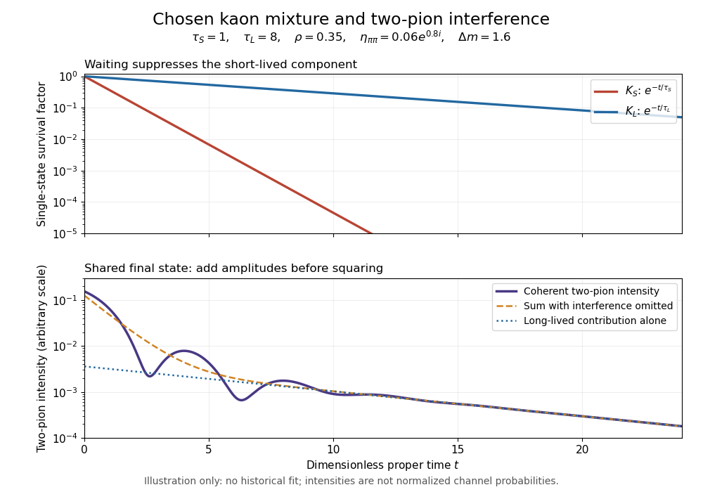

# Neutral-kaon two-pion decay time dependence

↑ **Parent:** [CP violation](cp-violation.md)

For a coherently prepared state proportional to $\rho|K_S\rangle+|K_L\rangle$, evolve each component with $\lambda_j=m_j-i\Gamma_j/2$. The [proper time](proper-time.md) is $t$, and $\hbar=1$. Since both components reach the same final state, their [decay amplitudes](decay-amplitude.md) add before squaring. Factoring out $|A_S|^2$ and a common beam normalization gives the two-[pion](pion.md) intensity

$$
I_{\pi\pi}(t)=|\rho|^2e^{-\Gamma_St}
+|\eta_{\pi\pi}|^2e^{-\Gamma_Lt}
+2e^{-(\Gamma_S+\Gamma_L)t/2}
\operatorname{Re}\!\left(\rho^*\eta_{\pi\pi}e^{-i\Delta m t}\right),
\qquad \Delta m=m_L-m_S.
$$

The last term is [quantum interference](quantum-interference.md). It vanishes upon averaging over an independently random preparation phase, but cannot be discarded from a coherent preparation. Summing the two positive contributions alone would lose the phase-sensitive information.

**[Figure 4](#image-chosen-kaon-lifetimes-and-coherent-two-pion-intensity). Chosen kaon lifetimes and coherent two-pion intensity**. Original dimensionless illustration with $\tau_S=1$, $\tau_L=8$, $\rho=0.35$, $\eta_{\pi\pi}=0.06e^{0.8i}$ and $\Delta m=1.6$. Upper curves are separate single-state survival factors; lower curves are intensities in an arbitrary common scale. This is not a historical fit or a normalized set of [decay channel](decay-channel.md) probabilities.

At late [proper time](proper-time.md), the short-lived contribution and the [quantum interference](quantum-interference.md) term die away, leaving the long-lived tail $|\eta_{\pi\pi}|^2e^{-\Gamma_Lt}$. Such a tail is easier to identify after the initially abundant short-lived component has disappeared. The useful experimental balance is between eliminating that component and retaining enough long-lived decays to observe a rare [decay channel](decay-channel.md).

## ↑ Ancestors (6)

1. [CP violation](cp-violation.md)
2. [Discrete symmetry in quantum field theory](discrete-symmetry-in-quantum-field-theory.md)
3. [Quantum field theory](quantum-field-theory-split.md)
4. [Branches of physics](branches-of-physics.md)
5. [Physics](physics-split.md)
6. [Codex Wiki](split.md)
