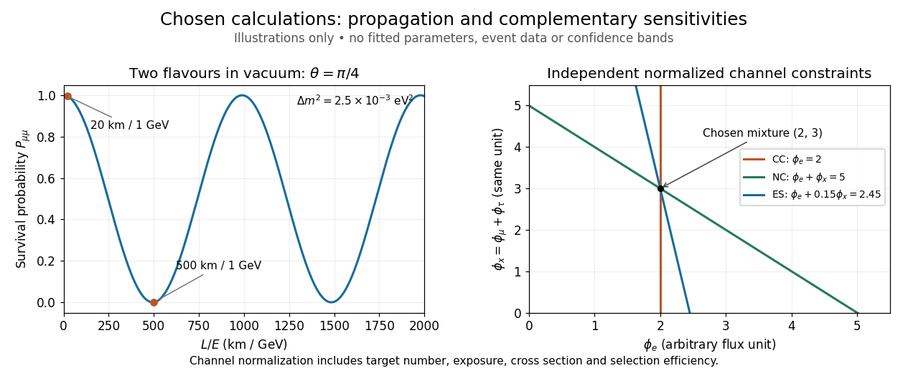

# Neutrino-flux sensitivity inversion

↑ **Parent:** [Sudbury Neutrino Observatory](sudbury-neutrino-observatory.md)

Why compare inferred [neutrino fluxes](neutrino-flux.md) rather than raw event counts? For channel $j$, exposure time $T$, target population $N_j$, [cross section](cross-section-physics.md) $\sigma_{j\alpha}$, and [detection efficiency](detection-efficiency.md) $\epsilon_{j\alpha}$ including reconstruction and selection, a forward model is

$$
\mathbb E[N_j]-B_j=T N_j^{\mathrm{target}}\sum_\alpha\int\phi_\alpha(E)\sigma_{j\alpha}(E)\epsilon_{j\alpha}(E)\,dE.
$$

Here $B_j$ is expected background; $N_j$ on the left counts events, while $N_j^{\mathrm{target}}$ counts targets. Distinct [cross sections](cross-section-physics.md), target numbers, thresholds and [detection efficiencies](detection-efficiency.md) prevent a direct CC/NC count ratio from being an [electron neutrino](electron-neutrino.md) fraction. Channel populations themselves can be correlated estimates from overlapping event patterns.

An original reduced [linear algebra](linear-algebra-split.md) model isolates the inference. Assume specified spectral shapes and divide each background-corrected channel rate by its own calibrated [electron neutrino](electron-neutrino.md) response. Put $\phi_x=\phi_\mu+\phi_\tau$ and let $r$ be the spectrum- and response-weighted non-electron/electron ES sensitivity ratio. Then

$$
\begin{pmatrix}y_{\mathrm{CC}}\\y_{\mathrm{NC}}\\y_{\mathrm{ES}}\end{pmatrix}
=\begin{pmatrix}1&0\\1&1\\1&r\end{pmatrix}
\begin{pmatrix}\phi_e\\\phi_x\end{pmatrix}.
$$

The equal $\mu$ and $\tau$ responses determine their sum, not their separate [neutrino fluxes](neutrino-flux.md). Changing the assumed spectra generally changes the integrated coefficients; with arbitrary unknown spectra this small [matrix](matrix.md) is insufficient.

Choose **illustrative inputs**, not historical measurements: $r=0.15$, $\phi_e=2$ and $\phi_x=3$, with every [neutrino flux](neutrino-flux.md) in the same arbitrary unit. The forward prediction is $(y_{\mathrm{CC}},y_{\mathrm{NC}},y_{\mathrm{ES}})=(2,5,2.45)$. CC and NC independently invert to $\phi_e=y_{\mathrm{CC}}=2$, $\phi_x=y_{\mathrm{NC}}-y_{\mathrm{CC}}=3$; substituting into ES returns $2+0.15(3)=2.45$. Alternatively, CC and ES give $\phi_x=(y_{\mathrm{ES}}-y_{\mathrm{CC}})/r=3$. Thus the third channel tests the response model and the inferred mixture.

**[Figure 6](#image-chosen-vacuum-survival-curve-and-complementary-neutrino-flux-constraints). Chosen vacuum survival curve and complementary neutrino flux constraints**. Original calculations only. Left: stipulated maximal two-flavour mixing and squared-mass splitting, with chosen paths at one GeV. Right: exact normalized-channel equations for chosen fluxes and ES sensitivity; lines are not experimental confidence bands.

CC alone admits any nonnegative $\phi_x$. CC and ES lose the second independent constraint when $r=0$; for small positive $r$, an ES-minus-CC error is amplified by $1/r$. With chosen independent errors $\sigma_{\mathrm{ES}}=\sigma_{\mathrm{CC}}=0.1$, their propagated [standard deviation](standard-deviation.md) is $\sqrt{0.1^2+0.1^2}/0.15\simeq0.943$. If CC and NC instead have those independent errors, the difference has [standard deviation](standard-deviation.md) $\sqrt{0.1^2+0.1^2}\simeq0.141$. Actual analyses must retain [covariances](covariance.md), including those introduced by statistical channel separation. Complementarity supplies information; calibration establishes what information each channel carries.

## ↑ Ancestors (7)

1. [Sudbury Neutrino Observatory](sudbury-neutrino-observatory.md)
2. [Kajita-McDonald neutrino flavor-conversion experiments](kajita-mcdonald-neutrino-flavor-conversion-experiments.md)
3. [Cherenkov detector](cherenkov-detector.md)
4. [Particle detector](particle-detector.md)
5. [Particle detection](particle-detection-split.md)
6. [Physics](physics-split.md)
7. [Codex Wiki](split.md)
