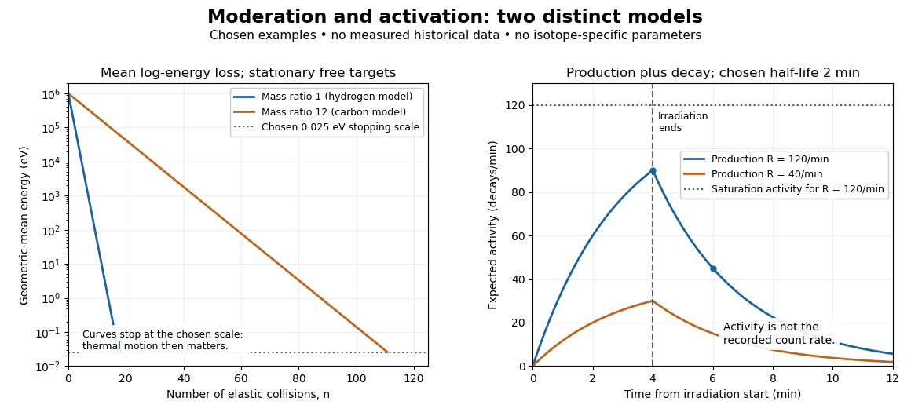

# Neutron

↑ **Parent:** [Nucleon](physics.md#nucleon)  
ⓦ [Wiki](https://en.wikipedia.org/wiki/Neutron)

The neutron is the electrically neutral spin-one-half baryon found with [protons](physics.md#proton) in most atomic nuclei.

A neutron is a [nucleon](physics.md#nucleon): it contributes to an [atomic nucleus](atomic-nucleus.md) without adding [electric charge](electric-charge.md). Its [spin one-half](angular-momentum-operator.md#spin-one-half) makes it a [fermion](tensor-product-of-quantum-systems.md#fermion), and it belongs to the [baryons](physics.md#baryon). Electrical neutrality does not mean an absence of interactions: a neutron can transfer [momentum](momentum.md) and [kinetic energy](energy.md#kinetic-energy) to an [atomic nucleus](atomic-nucleus.md), producing a charged [nuclear recoil](atomic-nucleus.md#nuclear-recoil) that a [particle detector](particle-detection.md#particle-detector) can register. This indirect route is central to [neutron detection by proton recoil](#neutron-detection-by-proton-recoil).

The beautiful feature of the [Chadwick neutron discovery experiment](#chadwick-neutron-discovery-experiment) is that an unseen projectile acquired a measurable [mass](classical-mechanics.md#mass) through the motion of things it struck. Penetration alone left competing explanations open; combining [nuclear recoils](atomic-nucleus.md#nuclear-recoil) from different target [masses](classical-mechanics.md#mass) supplied a much stronger test.

**Table of contents**

- [Prompt neutron](#prompt-neutron)
- [Delayed neutron](#delayed-neutron)
  - [Delayed neutron fraction](#delayed-neutron-fraction)
  - [Delayed neutron precursor](#delayed-neutron-precursor)
- [Neutron scattering](#neutron-scattering)
  - [Small-angle neutron scattering](#small-angle-neutron-scattering)
  - [Kiessig fringe](#kiessig-fringe)
  - [Neutron scattering length density](#neutron-scattering-length-density)
  - [Neutron spectroscopy](#neutron-spectroscopy)
  - [Neutron scattering kinematics](#neutron-scattering-kinematics)
    - [Perpendicular neutron recoil and phonon absorption](#perpendicular-neutron-recoil-and-phonon-absorption)
  - [Neutron diffraction](#neutron-diffraction)
    - [Nuclear neutron scattering length](#nuclear-neutron-scattering-length)
    - [Two-atom neutron diffraction selection](#two-atom-neutron-diffraction-selection)
  - [Inelastic neutron scattering](#inelastic-neutron-scattering)
    - [Triple-axis spectrometer](#triple-axis-spectrometer)
    - [Single-phonon neutron scattering model](#single-phonon-neutron-scattering-model)
- [Chadwick neutron discovery experiment](#chadwick-neutron-discovery-experiment)
- [Neutron detection by proton recoil](#neutron-detection-by-proton-recoil)
  - [Maximum elastic recoil energy fraction](#maximum-elastic-recoil-energy-fraction)
  - [Two-target recoil mass constraint](#two-target-recoil-mass-constraint)
- [Slow neutron](#slow-neutron)
  - [Thermal neutron](#thermal-neutron)
  - [Neutron moderation](#neutron-moderation)
    - [Moderator-to-fuel ratio](#moderator-to-fuel-ratio)
    - [Neutron moderator](#neutron-moderator)
    - [Mean logarithmic energy decrement](#mean-logarithmic-energy-decrement)
- [Neutron activation](#neutron-activation)
  - [Fermi slow-neutron activation experiment](#fermi-slow-neutron-activation-experiment)
  - [Neutron flux](#neutron-flux)
    - [Neutron fluence](#neutron-fluence)
  - [Neutron capture resonance](#neutron-capture-resonance)
  - [Neutron activation buildup and decay](#neutron-activation-buildup-and-decay)

## Prompt neutron

↑ **Parent:** [Neutron](neutron.md)

A [neutron](neutron.md) released on the short timescale associated with the fission event, rather than after a precursor radioactive transformation. Prompt describes emission timing, rather than the neutron speed after subsequent scattering.

## Delayed neutron

↑ **Parent:** [Neutron](neutron.md)

A [neutron](neutron.md) emitted following a radioactive transformation of a precursor, rather than promptly in the original [nuclear fission](physics.md#nuclear-fission). The waiting time reflects the precursor lifetime. It is distinct from the later detection of a prompt neutron after scattering or moderation.

### Delayed neutron fraction

↑ **Parent:** [Delayed neutron](#delayed-neutron)

The fraction of fission-related neutron production assigned to [delayed neutrons](#delayed-neutron) under the chosen averaging convention. Effective kinetics parameters can include spatial and spectral weighting; a small fraction can still have a large influence on population timescales.

### Delayed neutron precursor

↑ **Parent:** [Delayed neutron](#delayed-neutron)

A radioactive [fission product](physics.md#fission-product) whose decay chain can populate a neutron-emitting daughter state. A simplified kinetics model can replace many such species by one effective population and lifetime, losing the distinct decay-time spectrum.

## Neutron scattering

↑ **Parent:** [Neutron](neutron.md)  
ⓦ [Wiki](https://en.wikipedia.org/wiki/Neutron_scattering)

[Neutron scattering](#neutron-scattering) measures how a specimen changes the directions and [kinetic energies](energy.md#kinetic-energy) of incident [neutrons](neutron.md). [Neutron diffraction](#neutron-diffraction) uses the [elastic scattering](quantum-scattering.md#elastic-scattering) pattern to investigate [crystal structure](physical-chemistry.md#crystal-structure) and [magnetic order](electromagnetism.md#magnetic-order); [inelastic neutron scattering](#inelastic-neutron-scattering) uses [energy](energy.md) transfer to investigate excitations such as [phonons](quantum-ideal-gas-statistics.md#phonon) and [magnons](critical-phenomenon.md#magnon). The two measurements ask complementary questions: what arrangement repeats in space, and what disturbances can propagate through it?

The 1994 [Nobel Prize in Physics](nobel-prize-in-physics.md) recognized [Clifford Glenwood Shull](physicist.md#clifford-glenwood-shull)'s diffraction work and [Bertram Neville Brockhouse](physicist.md#bertram-neville-brockhouse)'s spectroscopy.[1994 award: diffraction and spectroscopy](physics-bibliography.md#the-nobel-prize-in-physics-1994-by-nobel-prize-outreach)

Nuclear scattering couples to [atomic nuclei](atomic-nucleus.md); magnetic scattering couples the [neutron](neutron.md)'s [magnetic moment](electromagnetism.md#magnetic-dipole-moment) to electronic [magnetic moments](electromagnetism.md#magnetic-dipole-moment). The latter underlies both [magnetic neutron diffraction](electromagnetism.md#magnetic-neutron-diffraction) and [magnon](critical-phenomenon.md#magnon) spectroscopy. An [atomic number](chemical-substance.md#atomic-number) is not a nuclear neutron scattering weight: the relevant coefficient in the elementary coherent model is the [nuclear neutron scattering length](#nuclear-neutron-scattering-length).

### Small-angle neutron scattering

↑ **Parent:** [Neutron scattering](#neutron-scattering)

A neutron-scattering technique using small momentum transfer to probe larger-scale structure. Contrast, background subtraction and the measured wave-number range determine which structural parameters can be inferred.

### Kiessig fringe

↑ **Parent:** [Neutron scattering](#neutron-scattering)

Thickness-dependent interference oscillation from reflections at the two sides of a film. At sufficiently large normal momentum transfer, the fringe spacing is approximately $2\pi/d$.

### Neutron scattering length density

↑ **Parent:** [Neutron scattering](#neutron-scattering)

The sum of nuclear coherent scattering lengths per unit volume, $\rho_b=\sum_j n_jb_j$. Matching it between media suppresses their ideal interface contrast.

### Neutron spectroscopy

↑ **Parent:** [Neutron scattering](#neutron-scattering)

### Neutron scattering kinematics

↑ **Parent:** [Neutron scattering](#neutron-scattering)

Treat the incident and outgoing [neutrons](neutron.md) as free [nonrelativistic particles](special-relativity.md#nonrelativistic-particle) outside the specimen. Their [wave vectors](elasticity-physics.md#wavevector), [de Broglie wavelengths](wave-function.md#de-broglie-wavelength), [momenta](momentum.md) and [kinetic energies](energy.md#kinetic-energy) obey

$$
k_i=\frac{2\pi}{\lambda_i},\qquad k_f=\frac{2\pi}{\lambda_f},\qquad
\mathbf p_i=\hbar\mathbf k_i,\qquad \mathbf p_f=\hbar\mathbf k_f,\qquad
E_{i,f}=\frac{\hbar^2 k_{i,f}^2}{2m_n}.
$$

Here $k_i=|\mathbf k_i|$, $k_f=|\mathbf k_f|$, $m_n$ is the [neutron](neutron.md) [mass](classical-mechanics.md#mass), and $\hbar=h/(2\pi)$ uses the [Planck constant](quantum-mechanics.md#planck-constant). Subtracting the outgoing projectile quantities from the incoming ones gives the [momentum transfer](quantum-scattering.md#momentum-transfer) and [energy](energy.md) delivered to the specimen:

$$
\Delta\mathbf p=\hbar\mathbf Q,\qquad
\mathbf Q=\mathbf k_i-\mathbf k_f,\qquad
\Delta E=E_i-E_f=\hbar\omega.
$$

Thus $\mathbf Q$ has units of inverse [length](physics.md#length), rather than [momentum](momentum.md). A positive $\omega$ means the specimen gains [energy](energy.md); negative $\omega$ means it supplies [energy](energy.md) to the [neutron](neutron.md). If the angle between incident and outgoing propagation directions is $2\theta$, the [law of cosines](euclidean-geometry.md#law-of-cosines) gives

$$
Q^2=k_i^2+k_f^2-2k_i k_f\cos(2\theta).
$$

Knowing the detector angle alone therefore leaves $Q$ undetermined unless the outgoing [energy](energy.md) is known or an [elastic scattering](quantum-scattering.md#elastic-scattering) assumption is justified.

For a reproducible unit conversion choose $m_n=1.67492750056\times10^{-27}\,\mathrm{kg}$, $h=6.62607015\times10^{-34}\,\mathrm{J\,s}$ and $1\,\mathrm{eV}=1.602176634\times10^{-19}\,\mathrm J$. The first is a recommended central value; the latter two conversions are exact.[2022 CODATA table: neutron mass, Planck constant and electron volt](chemistry-bibliography.md#fundamental-physical-constants-complete-listing-by-national-institute-of-standards-and-technology-and-others) With $1$ [ångström](physics.md#angstrom) equal to $10^{-10}\,\mathrm m$ and $1\,\mathrm{meV}=10^{-3}$ [electronvolts](electronegativity.md#electronvolt), substitution into $E=h^2/(2m_n\lambda^2)$ gives

$$
E\,[\mathrm{meV}]=\frac{81.8042}{\bigl(\lambda\,[\mathrm{\mathring A}]\bigr)^2}
=2.07212\bigl(k\,[\mathrm{\mathring A}^{-1}]\bigr)^2.
$$

Square brackets here mean the numerical value in the indicated unit. For an original chosen example, $\lambda_i=2$ [ångströms](physics.md#angstrom) and $\lambda_f=2.5$ [ångströms](physics.md#angstrom) give $E_i\simeq20.451\,\mathrm{meV}$, $E_f\simeq13.089\,\mathrm{meV}$ and $\hbar\omega\simeq7.362\,\mathrm{meV}$. At $2\theta=60^\circ$, $Q\simeq2.879\,\mathrm{\mathring A}^{-1}$. These values stipulate an allowed projectile geometry; they do not assert that any particular specimen has an excitation there.

#### Perpendicular neutron recoil and phonon absorption

↑ **Parent:** [Neutron scattering kinematics](#neutron-scattering-kinematics)

Define transfer gained by the [neutron](neutron.md) as $\mathbf Q=\mathbf k_f-\mathbf k_i$. If it is perpendicular to $\mathbf k_i$, expansion of the free-neutron [kinetic energy](energy.md#kinetic-energy) gives $E_f-E_i=\hbar^2Q^2/(2m_n)$. Absorbing one [phonon](quantum-ideal-gas-statistics.md#phonon) requires this positive [energy](energy.md) to equal $\hbar\omega$. A periodic [phonon](quantum-ideal-gas-statistics.md#phonon) branch may therefore intersect a nonperiodic recoil parabola in an extended-zone representation. The sign of $\mathbf Q$ is opposite to the common sample-transfer convention and must be declared.

### Neutron diffraction

↑ **Parent:** [Neutron scattering](#neutron-scattering)  
ⓦ [Wiki](https://en.wikipedia.org/wiki/Neutron_diffraction)

In [neutron diffraction](#neutron-diffraction), [coherent elastic scattering](quantum-scattering.md#coherent-elastic-scattering) adds [scattering amplitudes](quantum-scattering.md#scattering-amplitude) from regularly positioned scatterers. Since $E_f=E_i$, the [neutron scattering kinematics](#neutron-scattering-kinematics) gives $k_f=k_i=2\pi/\lambda$ and

$$
Q=\frac{4\pi}{\lambda}\sin\theta.
$$

For [lattice planes](physical-chemistry.md#lattice-plane) of [interplanar spacing](physical-chemistry.md#interplanar-spacing) $d_{\mathrm p}$, constructive addition requires $Q=2\pi n/d_{\mathrm p}$ along the plane normal. Equating these expressions proves [Bragg's law](quantum-scattering.md#bragg-s-law):

$$
2d_{\mathrm p}\sin\theta=n\lambda.
$$

For example, stipulate $d_{\mathrm p}=2$ [ångströms](physics.md#angstrom) and $\lambda=2$ [ångströms](physics.md#angstrom). The first [diffraction order](physical-optics.md#diffraction-order) has $\theta=30^\circ$ and detector deflection $60^\circ$. A peak position constrains a period; its [intensity](wave.md#intensity-physics) also depends on the [crystal basis structure factor](quantum-scattering.md#crystal-basis-structure-factor).

[Clifford Glenwood Shull](physicist.md#clifford-glenwood-shull) describes powdered [sodium chloride](chemical-substance.md#sodium-chloride), a [crystal](thermodynamics.md#crystal) [monochromator](optical-instrument.md#monochromator), and a shielded counter recording angular counts. Inserting [cadmium](chemical-substance.md#cadmium) measured background; substantial diffuse scattering complicated peak interpretation.[1994 lecture, pp. 100–103, Figs. 3–4](physics-bibliography.md#early-development-of-neutron-scattering-by-clifford-glenwood-shull)

Powdering supplies many [crystal](thermodynamics.md#crystal) orientations. Comparing the angular peaks with [Bragg's law](quantum-scattering.md#bragg-s-law) constrains [crystal structure](physical-chemistry.md#crystal-structure); a background estimate helps distinguish specimen peaks from unwanted counts. A two-axis diffraction instrument has no separate outgoing [energy](energy.md) analysis, so an angular pattern alone does not separate every inelastic contribution. The richer magnetic example, including a warm/cold comparison and its limits, is the [manganese monoxide neutron diffraction experiment](electromagnetism.md#manganese-monoxide-neutron-diffraction-experiment). Its extra peaks reveal [magnetic order](electromagnetism.md#magnetic-order) beyond the chemical periodicity; the associated [magnetic neutron diffraction](electromagnetism.md#magnetic-neutron-diffraction) model is developed there.

#### Nuclear neutron scattering length

↑ **Parent:** [Neutron diffraction](#neutron-diffraction)

The [nuclear neutron scattering length](#nuclear-neutron-scattering-length) is the effective [length](physics.md#length) coefficient for low-[energy](energy.md) nuclear [scattering amplitude](quantum-scattering.md#scattering-amplitude). For the elementary coherent calculation below, use a bound coherent coefficient $b_j$ for each site, and neglect absorption so that $b_j$ is real. This coefficient describes the [atomic nucleus](atomic-nucleus.md), including its [isotope](chemical-substance.md#isotope) and [nuclear spin](atomic-nucleus.md#nuclear-spin) dependence; it is not proportional to [atomic number](chemical-substance.md#atomic-number). Replacing nuclear coefficients by electronic [magnetic moments](electromagnetism.md#magnetic-dipole-moment) would describe a different scattering channel, with additional direction and spatial-distribution factors, as explained in [magnetic neutron diffraction](electromagnetism.md#magnetic-neutron-diffraction).

#### Two-atom neutron diffraction selection

↑ **Parent:** [Neutron diffraction](#neutron-diffraction)

Choose a one-dimensional [crystal](thermodynamics.md#crystal) with cell translation $a$ and two atoms per cell at $0$ and $d=a/2$. Here $d$ is an intracell displacement, distinct from the [interplanar spacing](physical-chemistry.md#interplanar-spacing) $d_{\mathrm p}$ above. In a single-scattering approximation, a row of $N$ cells has [scattering amplitude](quantum-scattering.md#scattering-amplitude)

$$
A_N(Q)=\left(b_1+b_2e^{iQd}\right)\sum_{r=0}^{N-1}e^{iQra}.
$$

The sum selects [reciprocal lattice](quantum-scattering.md#reciprocal-lattice) positions $Q_h=2\pi h/a$ as $N$ becomes large. At these positions, the two-site [crystal basis structure factor](quantum-scattering.md#crystal-basis-structure-factor) and its squared magnitude are

$$
F_h=b_1+(-1)^h b_2,\qquad
I_h\propto|F_h|^2=
\begin{cases}
(b_1+b_2)^2,&h\text{ even},\\
(b_1-b_2)^2,&h\text{ odd}.
\end{cases}
$$

Consequently $b_1=b_2=b$ gives even reflections of strength $4b^2$ and extinguishes the odd reflections. Choosing $b_1=b$, $b_2=b/2$ instead gives $9b^2/4$ and $b^2/4$: the odd/even ratio is $1/9$. Equal [atomic numbers](chemical-substance.md#atomic-number) would not establish equal $b_j$ if the [isotopes](chemical-substance.md#isotope) differ. The figure below plots these chosen coefficients, without assigning them to actual elements. Missing reflections can encode destructive [wave interference](physical-optics.md#interference-wave-propagation) within a cell, not the absence of matter at a site.

### Inelastic neutron scattering

↑ **Parent:** [Neutron scattering](#neutron-scattering)  
ⓦ [Wiki](https://en.wikipedia.org/wiki/Inelastic_neutron_scattering)

[Inelastic neutron scattering](#inelastic-neutron-scattering) resolves $E_i-E_f\ne0$. Through [conservation of energy](mathematical-physics.md#conservation-of-energy), a peak at positive $\hbar\omega$ identifies an allowed excitation [energy](energy.md); through [momentum conservation](momentum.md#momentum-conservation), its location in $\mathbf Q$ constrains the spatial variation of that excitation. A [phonon](quantum-ideal-gas-statistics.md#phonon) is a quantum of lattice vibration; a [magnon](critical-phenomenon.md#magnon) is a quantum of a [spin wave](critical-phenomenon.md#spin-wave). Their different couplings make [energy](energy.md) transfer alone insufficient to identify which was created.

[Bertram Neville Brockhouse](physicist.md#bertram-neville-brockhouse)'s [aluminium](chemical-substance.md#aluminium) experiment rotated a large single [crystal](thermodynamics.md#crystal), scanning analyzer angle for neutron groups. His [vanadium](chemical-substance.md#vanadium) comparison exposed the elastic resolution. Later [magnetite](chemical-substance.md#magnetite) measurements used a [magnetic field](magnetic-field.md) intensity test to identify [magnons](critical-phenomenon.md#magnon).[1994 lecture, pp. 115–121, Figs. 3–6](physics-bibliography.md#slow-neutron-spectroscopy-and-the-grand-atlas-of-the-physical-world-by-bertram-neville-brockhouse)

Successive orientations sample different [wave vectors](elasticity-physics.md#wavevector); analyzer settings distinguish outgoing [energies](energy.md). This supplies points on a [dispersion relation](dispersion-relation.md), rather than only an angular diffraction pattern. Finite resolution can merge neighboring excitations; background, multiple scattering and processes involving several [phonons](quantum-ideal-gas-statistics.md#phonon) can complicate interpretation. A lattice model is a testable explanation of selected features, not a guarantee that every spectral peak has the same origin.

#### Triple-axis spectrometer

↑ **Parent:** [Inelastic neutron scattering](#inelastic-neutron-scattering)  
ⓦ [Wiki](https://en.wikipedia.org/wiki/Triple-axis_spectrometry)

A [triple-axis spectrometer](#triple-axis-spectrometer) uses [Bragg's law](quantum-scattering.md#bragg-s-law) at an initial [crystal](thermodynamics.md#crystal) [monochromator](optical-instrument.md#monochromator) to select $\lambda_i$ and at a second analyzing [crystal](thermodynamics.md#crystal) to select $\lambda_f$. The sample sits between these selectors. The three axes refer to the [monochromator](optical-instrument.md#monochromator), sample and analyzer rotations. The final counter measures accepted counts; the analyzer's [wavelength](wave-equation.md#wavelength) selection makes those counts sensitive to outgoing [energy](energy.md) even when the counter does not measure each neutron's [energy](energy.md) directly.

**[Figure 1](#image-functional-routes-for-neutron-diffraction-and-triple-axis-energy-analysis). Functional routes for neutron diffraction and triple-axis energy analysis**. Original functional schematic, with illustrative bends rather than historical angles or distances. The upper route omits the analyzer; interpreting its peaks as elastic requires a physical assumption. The lower route selects both projectile energies. Neither route specifies a historical detector construction.

For a constant-$\mathbf Q$ scan, change incident or outgoing [energy](energy.md) while coordinating sample and analyzer settings so that $\mathbf k_i-\mathbf k_f$ stays fixed. Counts versus $E_i-E_f$ then probe excitations at one [momentum transfer](quantum-scattering.md#momentum-transfer). Changing only the analyzer angle generally changes both transferred quantities. Incident-beam monitoring, analyzer response and the instrumental resolution must enter quantitative interpretation; the diagram's arrows specify information flow, not an absolute [intensity](wave.md#intensity-physics) calibration.

#### Single-phonon neutron scattering model

↑ **Parent:** [Inelastic neutron scattering](#inelastic-neutron-scattering)

Consider an original ideal one-dimensional monatomic [harmonic oscillator](classical-mechanics.md#simple-harmonic-motion) chain with neighbor separation $a$, [mass](classical-mechanics.md#mass) $M$ and nearest-neighbor restoring coefficient $K>0$. Its displacement equation is

$$
M\ddot u_r=K(u_{r+1}+u_{r-1}-2u_r).
$$

Substitute the [normal mode](wave-equation.md#normal-mode) $u_r=u_0e^{i(qra-\omega t)}$. Since $e^{iqa}+e^{-iqa}-2=-4\sin^2(qa/2)$,

$$
\omega(q)=2\sqrt{K/M}|\sin(qa/2)|,\qquad
\varepsilon(q)=\hbar\omega(q)=\varepsilon_*|\sin(qa/2)|.
$$

Choose $a=4$ [ångströms](physics.md#angstrom) and $\varepsilon_*=10\,\mathrm{meV}$. This is one [acoustic phonon branch](quantum-ideal-gas-statistics.md#acoustic-phonon-branch), distinct from the two-atom elastic example. It has $\varepsilon(\pi/(2a))=5\sqrt2\,\mathrm{meV}$ and $\varepsilon(\pi/a)=10\,\mathrm{meV}$.

For coherent creation of one [phonon](quantum-ideal-gas-statistics.md#phonon) in a [crystal](thermodynamics.md#crystal), the excitation's [wave vector](elasticity-physics.md#wavevector) $q$ and the measured transfer obey $Q=G+q$, with $G$ a [reciprocal lattice](quantum-scattering.md#reciprocal-lattice) vector. To connect the [dispersion relation](dispersion-relation.md) to an illustrative [intensity](wave.md#intensity-physics), take zero [temperature](temperature.md), longitudinal displacements and the first interval $Q=q\in(0,\pi/a]$, choosing $G=0$. Expand the scattering phase to first order, $e^{iQ(ra+u_r)}\simeq e^{iQra}(1+iQu_r)$. The constant term supplies elastic scattering; the linear term creates one [phonon](quantum-ideal-gas-statistics.md#phonon). Its displacement matrix element is proportional to $1/\sqrt{\omega}$, so the squared amplitude has weight $Q^2/\varepsilon(Q)$, apart from common factors. Normalize this weight to one at $Q=\pi/a$:

$$
x=\frac{Qa}{\pi},\qquad
w(x)=\frac{x^2}{\sin(\pi x/2)},\qquad 0<x\leq1.
$$

The limit $w(0)=0$ follows from $\sin(\pi x/2)\sim\pi x/2$. Set $\sigma=0.4\,\mathrm{meV}$ and replace the ideal sharp line by a normalized [Gaussian function](calculus.md#gaussian-function):

$$
J(Q,\Delta E)=\frac{w(x)}{\sqrt{2\pi}\sigma}
\exp\!\left[-\frac{(\Delta E-\varepsilon(Q))^2}{2\sigma^2}\right].
$$

This chosen broadening illustrates readout width; it is not a measured resolution or a full spectrometer resolution function. Integrating over all $\Delta E$ gives $w(x)$. The small negative-[energy](energy.md) tail is a broadening artifact, not a zero-[temperature](temperature.md) phonon-annihilation signal.

**[Figure 2](#image-chosen-elastic-reflection-weights-and-a-single-phonon-dispersion-intensity-model). Chosen elastic reflection weights and a single-phonon dispersion/intensity model**. Original models, not experimental data. Left: positive reciprocal-lattice orders for the two-atom cell, omitting forward scattering. Middle: the separate monatomic-chain branch. Right: the same branch with normalized longitudinal one-phonon weights and chosen Gaussian broadening. Elastic and inelastic intensities have independent arbitrary normalizations.

These panels separate three kinds of information: allowed [reciprocal lattice](quantum-scattering.md#reciprocal-lattice) positions, cancellation within a [crystal basis structure factor](quantum-scattering.md#crystal-basis-structure-factor), and an excitation's [energy](energy.md) as a function of [wave vector](elasticity-physics.md#wavevector). The chain has no magnetic degrees of freedom, optical branches, damping or multi-[phonon](quantum-ideal-gas-statistics.md#phonon) processes. It illustrates how one excitation could be read; it proves nothing about the completeness of a real material's excitation spectrum.

## Chadwick neutron discovery experiment

↑ **Parent:** [Neutron](neutron.md)

[Walther Bothe](physicist.md#walther-bothe) and [Herbert Becker](physicist.md#herbert-becker) observed penetrating radiation from [beryllium](chemical-substance.md#beryllium) struck by [alpha particles](atomic-nucleus.md#alpha-particle) before [James Chadwick](physicist.md#james-chadwick)'s interpretation.[Section 1, page 692: Bothe and Becker](physics-bibliography.md#the-existence-of-a-neutron-by-james-chadwick)

[Irène Joliot-Curie](physicist.md#irene-joliot-curie) and [Frédéric Joliot](physicist.md#frederic-joliot) found that adding material containing [hydrogen](chemical-substance.md#hydrogen) increased [ionization](atomic-physics.md#ionization), interpreting the ejected [protons](physics.md#proton) as [Compton scattering](mathematical-physics.md#compton-scattering) recoils from extremely energetic [gamma rays](quantum-mechanics.md#gamma-ray). [James Chadwick](physicist.md#james-chadwick) tested this interpretation against [nuclear recoils](atomic-nucleus.md#nuclear-recoil) in other elements.[Page 312, opening paragraphs: Joliot-Curie observation and counter](physics-bibliography.md#possible-existence-of-a-neutron-by-james-chadwick)

The counter coupled a small [ionization chamber](physics.md#ionization-chamber) to an [amplifier](electrical-circuit.md#amplifier) and [oscillograph](physics.md#oscillograph): charged particles produced [ions](chemistry.md#ion), and the electrical [signal](electrical-engineering.md#signal) gave a deflection. With [Norman Feather](physicist.md#norman-feather), [James Chadwick](physicist.md#james-chadwick) also observed [nitrogen](chemical-substance.md#nitrogen) recoil tracks in a [cloud chamber](particle-detection.md#cloud-chamber).[Page 312: valve counter and Feather's expansion-chamber observations](physics-bibliography.md#possible-existence-of-a-neutron-by-james-chadwick)

The apparatus used [polonium](chemical-substance.md#polonium) on [silver](chemical-substance.md#silver) facing [beryllium](chemical-substance.md#beryllium) inside an evacuable vessel. [Paraffin wax](chemical-substance.md#paraffin-wax) before the [aluminium](chemical-substance.md#aluminium) counter window supplied recoil [protons](physics.md#proton); intervening [aluminium](chemical-substance.md#aluminium) screens measured their [particle range](particle-detection.md#particle-range). Deflections were photographed on bromide paper. The first counter contained air; later fillings included [hydrogen](chemical-substance.md#hydrogen), [helium](chemical-substance.md#helium), [nitrogen](chemical-substance.md#nitrogen), [oxygen](chemical-substance.md#oxygen) and [argon](chemical-substance.md#argon). Counts with wax absent included gas recoils; wax insertion added entering [protons](physics.md#proton). Thick lead between source and counter hardly changed the initial counts, testing penetration against the low background.[Section 2, pages 694–697; figures 1–2](physics-bibliography.md#the-existence-of-a-neutron-by-james-chadwick)

**[Figure 3](#image-from-penetrating-radiation-to-a-charged-recoil-signal-and-a-mass-inference). From penetrating radiation to a charged recoil signal and a mass inference**.

The diagram separates two routes to a [signal](electrical-engineering.md#signal): a [proton](physics.md#proton) entering from the wax and a [nuclear recoil](atomic-nucleus.md#nuclear-recoil) created inside the chamber [gas](thermodynamics.md#gas). Its lower row is a logical summary, rather than a reconstructed experimental trace. In either route the observed [ionization](atomic-physics.md#ionization) belongs to a charged secondary particle; identifying the incident radiation requires an additional collision model.

In the February letter, a [photon](quantum-mechanics.md#photon) interpretation requiring about $52\,\mathrm{MeV}$ for the [protons](physics.md#proton) predicted only about $0.4\,\mathrm{MeV}$ for [nitrogen](chemical-substance.md#nitrogen) recoils, below the observed [ionization](atomic-physics.md#ionization). Here $1\,\mathrm{MeV}=10^6$ [electronvolts](electronegativity.md#electronvolt). [James Chadwick](physicist.md#james-chadwick) proposed a neutral particle near the [proton](physics.md#proton) [mass](classical-mechanics.md#mass) and the [nuclear reaction](physics.md#nuclear-reaction)

$$
{}^{9}_{4}\mathrm{Be}+{}^{4}_{2}\mathrm{He}
\longrightarrow{}^{12}_{6}\mathrm{C}+{}^{1}_{0}n.
$$

These are the letter's approximate historical values, not a modern [mass](classical-mechanics.md#mass) determination.[Page 312: photon/nitrogen discrepancy and proposed reaction](physics-bibliography.md#possible-existence-of-a-neutron-by-james-chadwick)

Why compare two materials? A [gamma ray](quantum-mechanics.md#gamma-ray) is a [photon](quantum-mechanics.md#photon), so its incident [momentum](momentum.md) is $E_\gamma/c$, where $c$ is the [speed of light](special-relativity.md#speed-of-light). A slow massive projectile instead has [momentum](momentum.md) $mv$ and [kinetic energy](energy.md#kinetic-energy) $mv^2/2$. The relationship between incoming [momentum](momentum.md) and [energy](energy.md) therefore changes. An [elastic collision](classical-mechanics.md#elastic-collision) model must explain the recoil endpoints for both target [masses](classical-mechanics.md#mass) with the same incident projectile population. Calling the radiation neutral supplies no such agreement by itself.

The original measurements depended on [particle range](particle-detection.md#particle-range) calibration, material in the path, detector response and whether a recoil was fully stopped in the sensitive [gas](thermodynamics.md#gas). Large deflections alone need not specify a complete recoil [energy](energy.md). The calculations below expose the ideal collision assumptions behind the inference; applying them to a measured spectrum requires checking those assumptions.

## Neutron detection by proton recoil

↑ **Parent:** [Neutron](neutron.md)

In [neutron detection by proton recoil](#neutron-detection-by-proton-recoil), a neutron strikes a [hydrogen](chemical-substance.md#hydrogen) [atomic nucleus](atomic-nucleus.md), namely a [proton](physics.md#proton), and the moving [proton](physics.md#proton) produces detectable [ionization](atomic-physics.md#ionization). [Paraffin wax](chemical-substance.md#paraffin-wax) provides many [hydrogen](chemical-substance.md#hydrogen) targets. There are two distinct questions: how much [kinetic energy](energy.md#kinetic-energy) can a collision transfer, and how often does it occur? [Elastic collision](classical-mechanics.md#elastic-collision) kinematics answers the first. It does not determine a [collision cross-section](classical-mechanics.md#collision-cross-section) or a detector's efficiency.

For the following derivations the target is initially at rest in the laboratory but is free to recoil. Its [mass](classical-mechanics.md#mass) is finite. In particular a [proton](physics.md#proton) must not be treated as an immovable target. All massive particles are [nonrelativistic particles](special-relativity.md#nonrelativistic-particle), their translational [kinetic energies](energy.md#kinetic-energy) are $mv^2/2$, and the collision changes no internal state. Target binding and thermal motion are neglected relative to the incident [kinetic energy](energy.md#kinetic-energy). These assumptions suit an introductory description of fast-neutron [elastic collisions](classical-mechanics.md#elastic-collision); they do not cover every [neutron capture](physics.md#neutron-capture) or other [nuclear reaction](physics.md#nuclear-reaction).

### Maximum elastic recoil energy fraction

↑ **Parent:** [Neutron detection by proton recoil](#neutron-detection-by-proton-recoil)

Let a projectile have [mass](classical-mechanics.md#mass) $m$, incident [speed](classical-mechanics.md#speed) $v$, and incident [kinetic energy](energy.md#kinetic-energy) $E=mv^2/2$. The stationary target has [mass](classical-mechanics.md#mass) $M$. In a head-on [elastic collision](classical-mechanics.md#elastic-collision), the signed outgoing projectile [velocity](classical-mechanics.md#velocity) $v'$ and target [velocity](classical-mechanics.md#velocity) $u$ obey [momentum conservation](momentum.md#momentum-conservation) and [conservation of energy](mathematical-physics.md#conservation-of-energy):

$$
mv=mv'+Mu,\qquad
\frac12mv^2=\frac12mv'^2+\frac12Mu^2.
$$

Factor the second equation and eliminate $Mu=m(v-v')$. The nontrivial collision branch has $u=v+v'$, hence

$$
v'=\frac{m-M}{m+M}v,\qquad
u_{\max}=\frac{2m}{m+M}v,\qquad
\frac{T_{\max}}{E}=\frac{\tfrac12Mu_{\max}^2}{\tfrac12mv^2}
=\frac{4mM}{(m+M)^2}.
$$

This is the maximum over [scattering angles](quantum-scattering.md#scattering-angle), not the [energy](energy.md) of every recoil. To see the bound without assuming a head-on event, set the recoil [momentum](momentum.md) magnitude to $q$ and its laboratory angle to the incident direction to $\theta$. [Conservation of energy](mathematical-physics.md#conservation-of-energy) with outgoing projectile [momentum](momentum.md) $\boldsymbol p-\boldsymbol q$ gives

$$
\frac{p^2}{2m}=\frac{p^2+q^2-2pq\cos\theta}{2m}+\frac{q^2}{2M},
\qquad
q=\frac{2Mp\cos\theta}{m+M}.
$$

Thus $T=T_{\max}\cos^2\theta$ for a nonzero recoil, and the endpoint occurs at $\theta=0$.

For an original numerical example, stipulate $E=4\,\mathrm{MeV}$ and $m=m_p$, with $m_p$ the [proton](physics.md#proton) [mass](classical-mechanics.md#mass). Approximate [hydrogen](chemical-substance.md#hydrogen), [helium](chemical-substance.md#helium) and [nitrogen](chemical-substance.md#nitrogen) target [masses](classical-mechanics.md#mass) by $M=m_p$, $4m_p$ and $14m_p$ respectively. Their maximum fractions and recoil [energies](energy.md) are

$$
\begin{array}{c|c|c}
M/m_p&T_{\max}/E&T_{\max}\ (\mathrm{MeV})\\
1&1&4\\
4&16/25=0.64&2.56\\
14&56/225\simeq0.2489&224/225\simeq0.9956
\end{array}
$$

These stipulated values illustrate the approximation $m_n=m_p$; they are not measurements from 1932. With $m_pc^2\simeq938\,\mathrm{MeV}$, the incident ratio $E/(m_pc^2)\simeq0.0043$ gives $v/c\simeq0.092$, consistent with the [nonrelativistic limit](special-relativity.md#nonrelativistic-limit) used here. A million [electronvolts](electronegativity.md#electronvolt) is an [energy](energy.md) unit, whereas a [mass](classical-mechanics.md#mass) expressed in $\mathrm{MeV}/c^2$ requires the factor $c^2$ when inserted into an [energy](energy.md) equation.

The [hydrogen](chemical-substance.md#hydrogen) endpoint permits essentially complete transfer because the projectile and target [masses](classical-mechanics.md#mass) match. For a very heavy target, $M\gg m$, the fraction approaches $4m/M$, which is small: the target can take substantial [momentum](momentum.md) with little [kinetic energy](energy.md#kinetic-energy). The exact inequality follows from $(m-M)^2\geq0$, which implies $(m+M)^2\geq4mM$.

**[Figure 4](#image-recoil-energy-transfer-and-the-two-target-constraint-on-an-unseen-projectile-s-mass). Recoil energy transfer and the two-target constraint on an unseen projectile's mass**.

### Two-target recoil mass constraint

↑ **Parent:** [Neutron detection by proton recoil](#neutron-detection-by-proton-recoil)

A single recoil endpoint leaves a tradeoff between incident [speed](classical-mechanics.md#speed) and projectile [mass](classical-mechanics.md#mass). Two targets can remove the unknown incident [speed](classical-mechanics.md#speed). Assume both runs sample the same maximum projectile [speed](classical-mechanics.md#speed) $v$ and that single [elastic collisions](classical-mechanics.md#elastic-collision) reach the endpoint. For initially stationary target [masses](classical-mechanics.md#mass) $M_1<M_2$, let their maximum recoil [speeds](classical-mechanics.md#speed) be $u_1,u_2$. The [maximum elastic recoil energy fraction](#maximum-elastic-recoil-energy-fraction) calculation gives

$$
u_i=\frac{2m}{m+M_i}v,\qquad
R=\frac{u_1}{u_2}=\frac{m+M_2}{m+M_1},\qquad
m=\frac{M_2-RM_1}{R-1}.
$$

If [energies](energy.md) rather than [speeds](classical-mechanics.md#speed) are inferred, use $R=\sqrt{T_{1,\max}M_2/(T_{2,\max}M_1)}$. The [energy](energy.md) ratio itself is not the [speed](classical-mechanics.md#speed) ratio.

For the stipulated $4\,\mathrm{MeV}$ example, [hydrogen](chemical-substance.md#hydrogen) and [nitrogen](chemical-substance.md#nitrogen) give

$$
\frac{M_1}{m_p}=1,\qquad \frac{M_2}{m_p}=14,\qquad
R=\sqrt{\frac{4\times14}{224/225}}=\frac{15}{2},\qquad
\frac{m}{m_p}=\frac{14-15/2}{15/2-1}=1.
$$

The inferred [mass](classical-mechanics.md#mass) then determines $v=u_1(m+M_1)/(2m)$. Changing the assumed [mass](classical-mechanics.md#mass) to improve one recoil endpoint changes the prediction for the other: this is the constraining power of the comparison.

[James Chadwick](physicist.md#james-chadwick)'s June paper instead used approximate endpoints $u_p=3.3\times10^7\,\mathrm{m/s}$ and $u_N=4.7\times10^6\,\mathrm{m/s}$, obtaining $m/m_p\simeq1.15$; it allowed roughly ten percent uncertainty in $u_N$. This was a rough [mass](classical-mechanics.md#mass) comparison.[Section 3, pages 698–699: endpoint equations and uncertainty](physics-bibliography.md#the-existence-of-a-neutron-by-james-chadwick)

The inverse calculation has useful built-in checks. A positive finite [mass](classical-mechanics.md#mass) requires $1<R<M_2/M_1$. As $R$ approaches $1$, distinguishing large projectile [masses](classical-mechanics.md#mass) becomes difficult. Differentiation gives

$$
\frac{dm}{dR}=\frac{M_1-M_2}{(R-1)^2}.
$$

Uncertain recoil endpoints therefore produce an uncertain inferred [mass](classical-mechanics.md#mass); the collision model cannot turn imprecise range measurements into exact spectroscopy. If different target runs select different incident [energy](energy.md) groups, the common-$v$ cancellation also fails.

For comparison, [Compton scattering](mathematical-physics.md#compton-scattering) of a [photon](quantum-mechanics.md#photon) of [energy](energy.md) $E_\gamma$ from a stationary free target of [mass](classical-mechanics.md#mass) $M$ has the exact relativistic endpoint

$$
T_{\gamma,\max}=\frac{2E_\gamma^2}{Mc^2+2E_\gamma},\qquad
E_\gamma=\frac{T+\sqrt{T^2+2TMc^2}}{2}.
$$

This follows by combining [momentum conservation](momentum.md#momentum-conservation) with the target's relativistic [energy](energy.md), maximizing transfer when the [photon](quantum-mechanics.md#photon) reverses direction. Unlike the massive-projectile calculation, this equation does not approximate the incident [photon](quantum-mechanics.md#photon) as a [nonrelativistic particle](special-relativity.md#nonrelativistic-particle).

As a separate, explicitly hypothetical test, take $m_pc^2=938\,\mathrm{MeV}$ and target rest [energies](energy.md) $938\,\mathrm{MeV}$ and $14\times938\,\mathrm{MeV}$. To reproduce the stipulated [hydrogen](chemical-substance.md#hydrogen) recoil endpoint $T=4\,\mathrm{MeV}$, the [photon](quantum-mechanics.md#photon) would need $E_\gamma\simeq45.36\,\mathrm{MeV}$. The same [photon](quantum-mechanics.md#photon) would give the heavier target at most $0.311\,\mathrm{MeV}$, whereas the stipulated massive projectile gave $0.996\,\mathrm{MeV}$. This is the structure of a two-target discrimination, not a transcription of a 1932 measurement. Actual radiation can contain more than one [energy](energy.md) group or both [photons](quantum-mechanics.md#photon) and neutrons; a useful model must account for the observed endpoints and their origin together.

## Slow neutron

↑ **Parent:** [Neutron](neutron.md)

A slow [neutron](neutron.md) has low [kinetic energy](energy.md#kinetic-energy) relative to the fast [neutrons](neutron.md) commonly emitted in [nuclear reactions](physics.md#nuclear-reaction). The term covers an [energy](energy.md) range, rather than a single [speed](classical-mechanics.md#speed). A [neutron moderator](#neutron-moderator) transfers [kinetic energy](energy.md#kinetic-energy) to surrounding matter through collisions. Slowing a [neutron](neutron.md) can increase its chance of causing particular [neutron capture](physics.md#neutron-capture) reactions, even though each collision has reduced its [kinetic energy](energy.md#kinetic-energy). The [Fermi slow-neutron activation experiment](#fermi-slow-neutron-activation-experiment) made this surprising distinction experimentally visible.

### Thermal neutron

↑ **Parent:** [Slow neutron](#slow-neutron)

A thermal [neutron](neutron.md) belongs to a population approximately in [thermal equilibrium](thermal-equilibrium.md) with its surroundings. Such a population has a distribution of [kinetic energies](energy.md#kinetic-energy), not one fixed [energy](energy.md). The scale $k_B T$ uses the [Boltzmann constant](thermodynamics.md#boltzmann-constant) and [thermodynamic temperature](second-law-of-thermodynamics.md#thermodynamic-temperature); it is about $0.0259\,\mathrm{eV}$ at $300\,\mathrm K$. The mean translational [kinetic energy](energy.md#kinetic-energy) for a classical three-dimensional equilibrium population is $3k_B T/2$. Not every [slow neutron](#slow-neutron) has reached this equilibrium.

### Neutron moderation

↑ **Parent:** [Slow neutron](#slow-neutron)

[Neutron moderation](#neutron-moderation) reduces the [kinetic energy](energy.md#kinetic-energy) of fast [neutrons](neutron.md) through repeated collisions in a [neutron moderator](#neutron-moderator). In a simple [elastic collision](classical-mechanics.md#elastic-collision) model, [hydrogen](chemical-substance.md#hydrogen) is especially effective because a [proton](physics.md#proton) and a [neutron](neutron.md) have nearly equal [masses](classical-mechanics.md#mass): the [maximum elastic recoil energy fraction](#maximum-elastic-recoil-energy-fraction) can approach one. The [mean logarithmic energy decrement](#mean-logarithmic-energy-decrement) describes typical accumulated slowing, whereas the maximum transfer describes a single endpoint.

Slowing, absorption and escape compete. A material can remove [neutrons](neutron.md) by [neutron capture](physics.md#neutron-capture) before they become [thermal neutrons](#thermal-neutron), and some [neutrons](neutron.md) escape its boundaries. Describing a [neutron moderator](#neutron-moderator) therefore requires more than collision kinematics. Near [thermal equilibrium](thermal-equilibrium.md), target thermal motion can also give [energy](energy.md) back to a [neutron](neutron.md); the initially stationary target approximation must then be replaced.

#### Moderator-to-fuel ratio

↑ **Parent:** [Neutron moderation](#neutron-moderation)

An explicitly specified measure of moderator relative to fuel, for example hydrogen atoms per heavy-metal atom in a water-cooled fuel lattice. Atom, mass and volume ratios are distinct quantities. The ratio changes the competition between slowing down, absorption and leakage.

#### Neutron moderator

↑ **Parent:** [Neutron moderation](#neutron-moderation)  
ⓦ [Wiki](https://en.wikipedia.org/wiki/Neutron_moderator)

A material used for [neutron moderation](#neutron-moderation), such as [water](chemical-substance.md#water) or [paraffin wax](chemical-substance.md#paraffin-wax) in the [Fermi slow-neutron activation experiment](#fermi-slow-neutron-activation-experiment).

#### Mean logarithmic energy decrement

↑ **Parent:** [Neutron moderation](#neutron-moderation)

Consider a [nonrelativistic particle](special-relativity.md#nonrelativistic-particle) of [mass](classical-mechanics.md#mass) $m$ undergoing an [elastic collision](classical-mechanics.md#elastic-collision) with a stationary free target of [mass](classical-mechanics.md#mass) $M=Am$, where $A\geq1$. Assume the outgoing direction is uniformly distributed over solid angle in the [center of mass](classical-mechanics.md#center-of-mass) frame; this assumption concerns the [scattering angle](quantum-scattering.md#scattering-angle) distribution and need not hold for every target or [energy](energy.md). Let $\mu$ be the cosine of that frame's [scattering angle](quantum-scattering.md#scattering-angle). Transforming the outgoing [velocity](classical-mechanics.md#velocity) back to the laboratory gives

$$
x=\frac{E'}{E}=\frac{A^2+1+2A\mu}{(A+1)^2},\qquad
\alpha=\left(\frac{A-1}{A+1}\right)^2\leq x\leq1.
$$

The uniform distribution of $\mu$ on $[-1,1]$ makes $x$ uniform on $[\alpha,1]$. For $A>1$, integration yields

$$
\xi=\frac{1}{1-\alpha}\int_\alpha^1-\log x\,dx
=1+\frac{\alpha\log\alpha}{1-\alpha}.
$$

For equal [masses](classical-mechanics.md#mass), take the limit $\alpha\to0$: $\xi=1$. The [expected value](expected-value.md) of the fractional [energy](energy.md) after a collision is instead $\mathbb E[x]=(1+\alpha)/2$. These are different averages: averaging a [logarithm](calculus.md#logarithm) does not give the [logarithm](calculus.md#logarithm) of an average.

For independent collisions with the same distribution, the [logarithms](calculus.md#logarithm) of successive [energy](energy.md) ratios add. Thus

$$
\mathbb E[\log(E_n/E_0)]=-n\xi,\qquad
E_{\mathrm{geom}}=E_0e^{-n\xi},\qquad
n_{\mathrm{log}}=\frac{\log(E_0/E_*)}{\xi}.
$$

Here $E_{\mathrm{geom}}$ is the geometric-mean [energy](energy.md), and $n_{\mathrm{log}}$ is a characteristic collision count for reaching an [energy](energy.md) scale $E_*$. It is not an exact first-passage [expected value](expected-value.md). Individual histories fluctuate, and neither the time between collisions nor absorption is specified by this model.

In an original chosen example, set $E_0=10^6\,\mathrm{eV}$ and $E_*=0.025\,\mathrm{eV}$. Approximate [hydrogen](chemical-substance.md#hydrogen) by $A=1$ and [carbon](chemical-substance.md#carbon) by $A=12$. Then

$$
\begin{array}{c|c|c}
A&\xi&n_{\mathrm{log}}\\
1&1&17.50\\
12&0.15777&110.95
\end{array}
$$

These are illustrative model values, not measured collision counts from 1934. The [energy](energy.md) scale marks where neglected thermal motion matters; the calculation does not assert continued cooling to zero [energy](energy.md).

## Neutron activation

↑ **Parent:** [Neutron](neutron.md)  
ⓦ [Wiki](https://en.wikipedia.org/wiki/Neutron_activation)

[Neutron activation](#neutron-activation) is the production of [radioactivity](physics.md#radioactive-decay) by irradiating a material with [neutrons](neutron.md). One route is [neutron capture](physics.md#neutron-capture) producing an unstable [isotope](chemical-substance.md#isotope); other [nuclear reactions](physics.md#nuclear-reaction) can also produce unstable [atomic nuclei](atomic-nucleus.md). A specimen's later [radioactive decay](physics.md#radioactive-decay) provides a way to detect that a transformation occurred during irradiation. It does not by itself identify the product or reconstruct the incoming [neutron](neutron.md) [energy](energy.md) distribution.

This makes [neutron activation](#neutron-activation) a useful bridge between an invisible radiation field and a delayed measurement. The [neutron flux](#neutron-flux) and [collision cross-section](classical-mechanics.md#collision-cross-section) determine production; [radioactive decay](physics.md#radioactive-decay) and [detection efficiency](physics.md#detection-efficiency) determine what remains observable later. [Neutron activation buildup and decay](#neutron-activation-buildup-and-decay) keeps these stages separate.

### Fermi slow-neutron activation experiment

↑ **Parent:** [Neutron activation](#neutron-activation)

[Enrico Fermi](physicist.md#enrico-fermi)'s May 1934 report describes cylindrical specimens irradiated by a [radon](chemical-substance.md#radon)-[beryllium](chemical-substance.md#beryllium) [neutron](neutron.md) source, then placed around a thin-[aluminium](chemical-substance.md#aluminium)-wall [Geiger-Müller counter](particle-detection.md#geiger-counter) to record pulses per minute. The irradiation and counting were successive operations.[Radioactivity Induced by Neutron Bombardment, Nature 133, 757 (1934); specimen irradiation and subsequent counter readout](physics-bibliography.md#radioactivity-induced-by-neutron-bombardment-by-enrico-fermi)

The October paper by [Enrico Fermi](physicist.md#enrico-fermi), [Edoardo Amaldi](physicist.md#edoardo-amaldi), [Bruno Pontecorvo](physicist.md#bruno-pontecorvo), [Franco Rasetti](physicist.md#franco-rasetti) and [Emilio Segrè](physicist.md#emilio-segre) reports that interposed [paraffin wax](chemical-substance.md#paraffin-wax) increased [silver](chemical-substance.md#silver) activation; surrounding blocks enhanced it further, depending on geometry. [Water](chemical-substance.md#water) gave a comparable effect. A preparation without [beryllium](chemical-substance.md#beryllium) gave no effect, arguing against [gamma rays](quantum-mechanics.md#gamma-ray) alone. Oxygen-containing material without [hydrogen](chemical-substance.md#hydrogen) did not give a comparable enhancement, and not all activated elements responded alike. Repeated collisions with [hydrogen](chemical-substance.md#hydrogen) were proposed to slow the [neutrons](neutron.md).[Azione di sostanze idrogenate sulla radioattività provocata da neutroni. I, Ricerca Scientifica 5(2), 282–283 (1934); English translation no. 105b, pp. 761–762, observations (a)–(c) and interpretation](physics-bibliography.md#azione-di-sostanze-idrogenate-sulla-radioattivita-provocata-da-neutroni-i-by-enrico-fermi-and-others)

The University of Pisa's account of [Bruno Pontecorvo](physicist.md#bruno-pontecorvo)'s work with [Edoardo Amaldi](physicist.md#edoardo-amaldi) describes stronger [silver](chemical-substance.md#silver) activation on wood than on marble. This is a retrospective account; the October paper above directly documents the deliberate [paraffin wax](chemical-substance.md#paraffin-wax) and [water](chemical-substance.md#water) comparisons.[The scientist; September–October 1934 silver activation and wooden-table passage](physics-bibliography.md#the-scientist-by-the-bruno-pontecorvo-department-centre)

**[Figure 5](#image-silver-activation-as-a-delayed-measurement-of-the-response-to-neutron-irradiation). Silver activation as a delayed measurement of the response to neutron irradiation**. Original schematic separating irradiation, later counter readout, a historical comparison and the measurement model. The arrows show stages of inference, not a scale drawing of the apparatus.

To interpret this readout, compare an irradiated specimen with an unirradiated specimen or empty-counter background, using the same counting geometry. Compare irradiation conditions at matched irradiation durations, delays and counting windows. These are requirements of the measurement model, rather than a claim that every such control is documented in the short October letter. Otherwise ordinary [radioactive decay](physics.md#radioactive-decay) during transfer can imitate a change in activation. A persistent, decaying excess after irradiation supports an unstable product; neither a larger count nor a fitted [half-life](analysis.md#half-life) uniquely identifies an [isotope](chemical-substance.md#isotope).

In his 1938 Nobel lecture, [Enrico Fermi](physicist.md#enrico-fermi) distinguished single and superposed [exponential decay](analysis.md#exponential-decay) curves and described chemical separation to identify their carriers. His slowing interpretation connected [elastic collisions](classical-mechanics.md#elastic-collision) with enhanced capture. The lecture also described [neutron capture resonances](#neutron-capture-resonance), so its account cannot support a universal rule that slower always means more reactive.[Nobel Lectures, Physics 1922–1941; Artificial radioactivity produced by neutron bombardment, lecture delivered 12 December 1938; pp. 415, 417–418, 420–421](physics-bibliography.md#nobel-lectures-physics-1922-1941/artificial-radioactivity-produced-by-neutron-bombardment)

The 1934 assignments of some [uranium](chemical-substance.md#uranium) activities to elements beyond [uranium](chemical-substance.md#uranium) were mistaken interpretations, not a discovery of [nuclear fission](physics.md#nuclear-fission). The published lecture's later footnote explicitly calls for reexamining the transuranic assignments after evidence of splitting. Distinguish that correction from the lecture as delivered.[Nobel Lectures, Physics 1922–1941; Published lecture, p. 417 footnote correcting the transuranic interpretation; this note refers to subsequent evidence](physics-bibliography.md#nobel-lectures-physics-1922-1941/artificial-radioactivity-produced-by-neutron-bombardment)

### Neutron flux

↑ **Parent:** [Neutron activation](#neutron-activation)  
ⓦ [Wiki](https://en.wikipedia.org/wiki/Neutron_flux)

Let $n(E)\,dE$ be the number of [neutrons](neutron.md) per unit volume in an [energy](energy.md) interval. The scalar [neutron flux](#neutron-flux) per unit [energy](energy.md) is $\phi(E)=v(E)n(E)$, with $v(E)$ the [speed](classical-mechanics.md#speed). Its integral has units of inverse area per unit [time](classical-mechanics.md#time-in-physics). It counts path length traversed per volume per [time](classical-mechanics.md#time-in-physics), including all directions; it is not the signed current through an oriented surface.

For a small uniform specimen containing $N_T$ target [atomic nuclei](atomic-nucleus.md), a reaction-specific [collision cross-section](classical-mechanics.md#collision-cross-section) $\sigma_a(E)$ gives the expected production rate

$$
R=N_T\int_0^\infty\sigma_a(E)\phi(E)\,dE.
$$

Assume the incident field is little changed within the specimen, target depletion is negligible and each counted reaction creates the product of interest. If that product has a production branching fraction below one, include it in $\sigma_a$ or as an additional factor. A single [neutron activation](#neutron-activation) measurement supplies one weighted integral of an [energy](energy.md) distribution, not a unique reconstruction of that distribution.

For an original two-group example, stipulate response [collision cross-sections](classical-mechanics.md#collision-cross-section) $\sigma_s=10\sigma_f$. With the same total scalar [neutron flux](#neutron-flux) $\Phi$, changing from all fast [neutrons](neutron.md) to half slow and half fast changes $R/(N_T\sigma_f\Phi)$ from $1$ to $5.5$. No additional [neutrons](neutron.md) need be emitted by the source. The chosen factor ten is not a historical [silver](chemical-substance.md#silver) measurement.

For some capture reactions over a limited low-[energy](energy.md) interval, $\sigma_a\propto1/v$ is a useful approximation. At fixed [neutron flux](#neutron-flux), it gives increasing reaction probability per path length as [speed](classical-mechanics.md#speed) decreases. At fixed [neutron](neutron.md) number density, $\sigma_a v$ is constant in this approximation, so the rate per target is unchanged. A real [neutron moderator](#neutron-moderator) changes the local density, [energy](energy.md) distribution, escape and absorption together. Neither all [collision cross-sections](classical-mechanics.md#collision-cross-section) nor all [neutron activation](#neutron-activation) rates vary monotonically as $1/v$.

#### Neutron fluence

↑ **Parent:** [Neutron flux](#neutron-flux)

The time integral of scalar [neutron flux](#neutron-flux), with inverse-area units. Multiplication by a constant microscopic reaction [collision cross-section](classical-mechanics.md#collision-cross-section) gives a dimensionless exposure parameter. A single integrated exposure does not specify how the neutron energy distribution varied during irradiation.

### Neutron capture resonance

↑ **Parent:** [Neutron activation](#neutron-activation)

A [neutron capture resonance](#neutron-capture-resonance) is an [energy](energy.md) interval where a matching excited state of the combined [atomic nucleus](atomic-nucleus.md) enhances capture. Its [collision cross-section](classical-mechanics.md#collision-cross-section) can have a peak rather than a monotone dependence on [energy](energy.md). The [resonance pole](quantum-scattering.md#resonance-pole) description connects this to [quantum scattering](quantum-scattering.md). Slowing a [neutron](neutron.md) through such a region can first increase and then decrease a particular reaction response. The capture probability also competes with other reaction channels.

### Neutron activation buildup and decay

↑ **Parent:** [Neutron activation](#neutron-activation)

Let $\overline N$ be the [expected value](expected-value.md) of the number of radioactive product [atomic nuclei](atomic-nucleus.md), initially zero, produced at constant rate $R$. Let their [nuclear decay constant](physics.md#nuclear-decay-constant) be $\lambda>0$. Assume one product species, negligible target depletion and negligible capture by the product. During irradiation, production adds $R\,dt$ while [radioactive decay](physics.md#radioactive-decay) removes $\lambda\overline N\,dt$ in expectation. Multiplying the resulting [ordinary differential equation](differential-equation.md#ordinary-differential-equation) by $e^{\lambda t}$ gives

$$
\frac{d}{dt}(e^{\lambda t}\overline N)=Re^{\lambda t},\qquad
\overline N(t)=\frac{R}{\lambda}(1-e^{-\lambda t}),\qquad
\overline A(t)=R(1-e^{-\lambda t}).
$$

The expected [radioactive activity](physics.md#radioactive-activity) $\overline A=\lambda\overline N$ tends to the production rate $R$. This saturation is a balance of continuing production and [radioactive decay](physics.md#radioactive-decay), not exhaustion of target [atomic nuclei](atomic-nucleus.md).

If irradiation ends at $t_i$, let $s$ denote elapsed [time](classical-mechanics.md#time-in-physics) afterward. Setting the production term to zero gives

$$
\overline N_{\mathrm{after}}(s)=\frac{R}{\lambda}(1-e^{-\lambda t_i})e^{-\lambda s},\qquad
\overline A_{\mathrm{after}}(s)=R(1-e^{-\lambda t_i})e^{-\lambda s}.
$$

For [detection efficiency](physics.md#detection-efficiency) $\varepsilon$, constant background count rate $b$, delay $d$ and counting-window duration $\Delta$, integrating the expected count rate gives

$$
\mathbb E[C]=b\Delta+
\varepsilon\frac{R}{\lambda}(1-e^{-\lambda t_i})e^{-\lambda d}(1-e^{-\lambda\Delta}).
$$

This assumes at most one recorded pulse per product transformation and negligible counter losses. Detector response, branching fractions and background must be calibrated independently. Subtracting an estimated background does not remove its counting uncertainty. Several products give a sum of these terms with distinct [nuclear decay constants](physics.md#nuclear-decay-constant); a single [exponential decay](analysis.md#exponential-decay) fit can then mislead.

For a wholly stipulated example, choose $R=120\,\mathrm{min}^{-1}$, [half-life](analysis.md#half-life) $2\,\mathrm{min}$ and $t_i=4\,\mathrm{min}$. Then $\lambda=\log2/(2\,\mathrm{min})$, $\overline A(t_i)=90\,\mathrm{min}^{-1}$ and $\overline N(t_i)\simeq259.69$. Choose $\varepsilon=0.25$, $b=2\,\mathrm{min}^{-1}$ and $d=\Delta=2\,\mathrm{min}$. The result is

$$
\mathbb E[C]-b\Delta
=\frac{0.25\times120}{\log2/2}\times\frac34\times\frac12\times\frac12
\simeq16.23,\qquad
\mathbb E[C]\simeq20.23.
$$

The background contributes four expected counts. Multiplying the initial net count rate in that window by its duration would give $22.5$ net counts, overestimating the integrated $16.23$ because the product decays appreciably during counting. All these values and the following curves are original examples, not measured historical data or parameters assigned to a particular [silver](chemical-substance.md#silver) [isotope](chemical-substance.md#isotope).

**[Figure 6](#image-chosen-moderation-energy-curves-and-activation-buildup-followed-by-decay). Chosen moderation energy curves and activation buildup followed by decay**. Left: geometric-mean [neutron](neutron.md) [energy](energy.md) in the stationary-target [elastic collision](classical-mechanics.md#elastic-collision) model for target-to-projectile [mass](classical-mechanics.md#mass) ratios one and twelve. Right: expected [radioactive activities](physics.md#radioactive-activity) for chosen production rates and a two-minute [half-life](analysis.md#half-life); irradiation ends after four minutes. The figure separates [energy](energy.md) loss per collision from the production-and-decay balance.

## ↑ Ancestors (6)

1. [Nucleon](physics.md#nucleon)
2. [Baryon](physics.md#baryon)
3. [Hadron](physics.md#hadron)
4. [Subatomic particle](physics.md#subatomic-particle)
5. [Physics](physics.md)
6. [Codex Wiki](README.md)

## ← Incoming links (175)

- [Alpha decay](physics.md#alpha-decay)
- [Alpha particle](atomic-nucleus.md#alpha-particle)
- [Argon-40](chemical-substance.md#argon-40)
- [Atomic nucleus](atomic-nucleus.md)
- [Atomic number](chemical-substance.md#atomic-number)
- [Beryllium-10](chemical-substance.md#beryllium-10)
- [Beryllium-7](chemical-substance.md#beryllium-7)
- [Beta-minus decay](physics.md#beta-minus-decay)
- [Bethe stellar energy-production theory](stellar-astrophysics.md#bethe-stellar-energy-production-theory)
- [Boron-10](chemical-substance.md#boron-10)
- [Boron carbide](chemical-substance.md#boron-carbide)
- [Californium-252](chemical-substance.md#californium-252)
- [Carbon-13](chemical-substance.md#carbon-13)
- [Carbon-14](chemical-substance.md#carbon-14)
- [Chemical element](chemical-substance.md#chemical-element)
- [Criticality control in radioactive waste](engineering.md#criticality-control-in-radioactive-waste)
- [Delayed neutron](#delayed-neutron)
- [Delayed neutron-capture coincidence window](physics.md#delayed-neutron-capture-coincidence-window)
- [Deuterium](chemical-substance.md#deuterium)
- [Deuteron](atomic-nucleus.md#deuteron)
- [Dineutron](nuclear-force.md#dineutron)
- [Electric charge](electric-charge.md)
- [Elementary charge](electric-charge.md#elementary-charge)
- [Empirical evidence for nuclear shells](atomic-nucleus.md#empirical-evidence-for-nuclear-shells)
- [Even-even nucleus](atomic-nucleus.md#even-even-nucleus)
- [Extended-zone representation of a phonon dispersion](quantum-ideal-gas-statistics.md#extended-zone-representation-of-a-phonon-dispersion)
- [Fast fission](physics.md#fast-fission)
- [Fermi slow-neutron activation experiment](#fermi-slow-neutron-activation-experiment)
- [Fermi transition](physics.md#fermi-transition)
- [From renormalizability to electroweak predictions](perturbative-quantum-field-theory.md#from-renormalizability-to-electroweak-predictions)
- [Gargamelle](standard-model.md#gargamelle)
- [Helium-3](chemical-substance.md#helium-3)
- [Immobilisation of Higher Activity Wastes from Nuclear Reactor Production of 99Mo by M. W. A. Stewart and others](engineering.md#immobilisation-of-higher-activity-wastes-from-nuclear-reactor-production-of-99mo-by-m-w-a-stewart-and-others)
- [Inverse beta decay](physics.md#inverse-beta-decay)
- [Inverse beta decay threshold](physics.md#inverse-beta-decay-threshold)
- [Ion](chemistry.md#ion)
- [Isotope](chemical-substance.md#isotope)
- [Kajita-McDonald neutrino flavor-conversion experiments](particle-detection.md#kajita-mcdonald-neutrino-flavor-conversion-experiments)
- [Lederman-Schwartz-Steinberger two-neutrino beam experiment](particle-detection.md#lederman-schwartz-steinberger-two-neutrino-beam-experiment)
- [Lithium-7](chemical-substance.md#lithium-7)
- [Magic number](atomic-nucleus.md#magic-number)
- [Magnetic neutron diffraction](electromagnetism.md#magnetic-neutron-diffraction)
- [Mass number](chemical-substance.md#mass-number)
- [Muon capture](physics.md#muon-capture)
- [Neon-20](chemical-substance.md#neon-20)
- [Neon-21](chemical-substance.md#neon-21)
- [Neon-22](chemical-substance.md#neon-22)
- [Neon-22 neutron excess from nitrogen-14](physics.md#neon-22-neutron-excess-from-nitrogen-14)
- [Neutral current](standard-model.md#neutral-current)
- [Neutron activation](#neutron-activation)
- [Neutron activation buildup and decay](#neutron-activation-buildup-and-decay)
- [Neutron capture resonance](#neutron-capture-resonance)
- [Neutron drip line](atomic-nucleus.md#neutron-drip-line)
- [Neutron excess](physics.md#neutron-excess)
- [Neutron flux](#neutron-flux)
- [Neutron half-life effect on primordial helium](cosmology.md#neutron-half-life-effect-on-primordial-helium)
- [Neutron leakage](physics.md#neutron-leakage)
- [Neutron moderation](#neutron-moderation)
- [Neutron number](chemical-substance.md#neutron-number)
- [Neutron poison](physics.md#neutron-poison)
- [Neutron-proton radiative capture](nuclear-force.md#neutron-proton-radiative-capture)
- [Neutron scattering](#neutron-scattering)
- [Neutron scattering kinematics](#neutron-scattering-kinematics)
- [Neutron separation energy](atomic-nucleus.md#neutron-separation-energy)
- [Neutron Stern-Gerlach splitting](angular-momentum-operator.md#neutron-stern-gerlach-splitting)
- [Nickel–iron nuclear equilibrium ratio](physics.md#nickel-iron-nuclear-equilibrium-ratio)
- [Nitrogen-14](chemical-substance.md#nitrogen-14)
- [Nobel Prize in Physics in 1935](nobel-prize-in-physics.md#nobel-prize-in-physics-in-1935)
- [Nobel Prize in Physics in 1938](nobel-prize-in-physics.md#nobel-prize-in-physics-in-1938)
- [Nobel Prize in Physics in 1990](nobel-prize-in-physics.md#nobel-prize-in-physics-in-1990)
- [Nuclear binding energy](atomic-nucleus.md#nuclear-binding-energy)
- [Nuclear charge distribution](atomic-nucleus.md#nuclear-charge-distribution)
- [Nuclear Fermi gas model](quantum-ideal-gas-statistics.md#nuclear-fermi-gas-model)
- [Nuclear force](nuclear-force.md)
- [Nuclear mass defect](chemical-substance.md#nuclear-mass-defect)
- [Nuclear mean field](atomic-nucleus.md#nuclear-mean-field)
- [Nuclear radius scaling](atomic-nucleus.md#nuclear-radius-scaling)
- [Nuclear shell](atomic-nucleus.md#nuclear-shell)
- [Nuclear shell model](atomic-nucleus.md#nuclear-shell-model)
- [Odd-odd nucleus](atomic-nucleus.md#odd-odd-nucleus)
- [Oxygen-17](chemical-substance.md#oxygen-17)
- [Solution](past-exam-of-the-materials-science-course-of-the-university-of-cambridge/2019/paper-1.md#6/a/ii/solution)
- [Solution](past-exam-of-the-materials-science-course-of-the-university-of-cambridge/2019/paper-1.md#6/a/iii/solution)
- [Solution](past-exam-of-the-materials-science-course-of-the-university-of-cambridge/2019/paper-1.md#6/b/solution)
- [Solution](past-exam-of-the-mathematics-course-of-the-university-of-cambridge/2001/iii/paper-63.md#3/solution)
- [Solution](past-exam-of-the-mathematics-course-of-the-university-of-cambridge/2001/iii/paper-67.md#2/i/solution)
- [Solution](past-exam-of-the-mathematics-course-of-the-university-of-cambridge/2001/iii/paper-67.md#2/iii/solution)
- [Solution](past-exam-of-the-mathematics-course-of-the-university-of-cambridge/2002/iii/paper-42.md#4/solution)
- [Solution](past-exam-of-the-mathematics-course-of-the-university-of-cambridge/2003/iii/paper-45.md#1/solution)
- [Solution](past-exam-of-the-mathematics-course-of-the-university-of-cambridge/2003/iii/paper-55.md#3/solution)
- [Solution](past-exam-of-the-mathematics-course-of-the-university-of-cambridge/2004/iii/paper-45.md#1/solution)
- [Solution](past-exam-of-the-mathematics-course-of-the-university-of-cambridge/2005/ii/paper-1.md#10d/a/solution)
- [Solution](past-exam-of-the-mathematics-course-of-the-university-of-cambridge/2005/ii/paper-1.md#10d/b/solution)
- [Solution](past-exam-of-the-mathematics-course-of-the-university-of-cambridge/2005/iii/paper-61.md#2/solution)
- [Solution](past-exam-of-the-mathematics-course-of-the-university-of-cambridge/2005/iii/paper-74.md#4/i/solution)
- [Solution](past-exam-of-the-mathematics-course-of-the-university-of-cambridge/2005/iii/paper-74.md#4/ii/solution)
- [Solution](past-exam-of-the-mathematics-course-of-the-university-of-cambridge/2008/iii/paper-62.md#3/iv/solution)
- [Solution](past-exam-of-the-mathematics-course-of-the-university-of-cambridge/2008/iii/paper-62.md#3/v/a/solution)
- [Solution](past-exam-of-the-mathematics-course-of-the-university-of-cambridge/2008/iii/paper-62.md#3/v/b/solution)
- [Solution](past-exam-of-the-mathematics-course-of-the-university-of-cambridge/2008/iii/paper-62.md#3/v/c/solution)
- [Solution](past-exam-of-the-mathematics-course-of-the-university-of-cambridge/2008/iii/paper-62.md#3/v/solution)
- [Solution](past-exam-of-the-mathematics-course-of-the-university-of-cambridge/2008/iii/paper-73.md#4/i/solution)
- [Solution](past-exam-of-the-mathematics-course-of-the-university-of-cambridge/2009/iii/paper-63.md#3/a/solution)
- [Solution](past-exam-of-the-mathematics-course-of-the-university-of-cambridge/2009/iii/paper-63.md#3/b/solution)
- [Solution](past-exam-of-the-mathematics-course-of-the-university-of-cambridge/2010/ii/paper-3.md#15d/solution)
- [Solution](past-exam-of-the-mathematics-course-of-the-university-of-cambridge/2010/iii/paper-45.md#4/solution)
- [Solution](past-exam-of-the-mathematics-course-of-the-university-of-cambridge/2014/iii/paper-49.md#2/iii/solution)
- [Solution](past-exam-of-the-mathematics-course-of-the-university-of-cambridge/2015/iii/paper-44.md#4/solution)
- [Solution](past-exam-of-the-mathematics-course-of-the-university-of-cambridge/2016/iii/paper-308.md#3/solution)
- [Solution](past-exam-of-the-mathematics-course-of-the-university-of-cambridge/2017/iii/paper-308.md#3/solution)
- [Solution](past-exam-of-the-mathematics-course-of-the-university-of-cambridge/2018/iii/paper-308.md#2/solution)
- [Solution](past-exam-of-the-mathematics-course-of-the-university-of-cambridge/2019/iii/paper-310.md#2/c/solution)
- [Solution](past-exam-of-the-mathematics-course-of-the-year-2-of-the-natural-sciences-course-of-the-university-of-cambridge/2012/paper-1.md#2/solution)
- [Solution](past-exam-of-the-mphil-in-nuclear-energy-course-of-the-university-of-cambridge/2019/paper-ne1.md#4/b/i/solution)
- [Solution](past-exam-of-the-mphil-in-nuclear-energy-course-of-the-university-of-cambridge/2019/paper-ne4.md#2/a/solution)
- [Solution](past-exam-of-the-mphil-in-nuclear-energy-course-of-the-university-of-cambridge/2019/paper-ne4.md#3/a/solution)
- [Solution](past-exam-of-the-mphil-in-nuclear-energy-course-of-the-university-of-cambridge/2019/paper-ne4.md#3/b/solution)
- [Solution](past-exam-of-the-mphil-in-nuclear-energy-course-of-the-university-of-cambridge/2019/paper-ne4.md#3/c/solution)
- [Solution](past-exam-of-the-mphil-in-nuclear-energy-course-of-the-university-of-cambridge/2020/paper-ne2.md#2/a/solution)
- [Solution](past-exam-of-the-mphil-in-nuclear-energy-course-of-the-university-of-cambridge/2020/paper-ne3.md#2/d/solution)
- [Solution](past-exam-of-the-mphil-in-nuclear-energy-course-of-the-university-of-cambridge/2021/paper-ne1.md#1/e/solution)
- [Solution](past-exam-of-the-mphil-in-nuclear-energy-course-of-the-university-of-cambridge/2021/paper-ne1.md#2/a/solution)
- [Solution](past-exam-of-the-mphil-in-nuclear-energy-course-of-the-university-of-cambridge/2021/paper-ne1.md#2/b/solution)
- [Solution](past-exam-of-the-mphil-in-nuclear-energy-course-of-the-university-of-cambridge/2021/paper-ne1.md#2/c/solution)
- [Solution](past-exam-of-the-mphil-in-nuclear-energy-course-of-the-university-of-cambridge/2021/paper-ne1.md#2/e/solution)
- [Solution](past-exam-of-the-mphil-in-nuclear-energy-course-of-the-university-of-cambridge/2021/paper-ne1.md#2/f/iii/solution)
- [Solution](past-exam-of-the-mphil-in-nuclear-energy-course-of-the-university-of-cambridge/2021/paper-ne1.md#3/a/solution)
- [Solution](past-exam-of-the-mphil-in-nuclear-energy-course-of-the-university-of-cambridge/2021/paper-ne1.md#3/c/iii/solution)
- [Solution](past-exam-of-the-mphil-in-nuclear-energy-course-of-the-university-of-cambridge/2021/paper-ne1.md#4/a/solution)
- [Solution](past-exam-of-the-mphil-in-nuclear-energy-course-of-the-university-of-cambridge/2021/paper-ne1.md#4/d/solution)
- [Solution](past-exam-of-the-mphil-in-nuclear-energy-course-of-the-university-of-cambridge/2021/paper-ne1.md#4/e/solution)
- [Solution](past-exam-of-the-mphil-in-nuclear-energy-course-of-the-university-of-cambridge/2021/paper-ne4.md#3/c/solution)
- [Solution](past-exam-of-the-particle-and-nuclear-physics-course-of-the-university-of-cambridge/2012/paper-1.md#2/b/solution)
- [Solution](past-exam-of-the-particle-and-nuclear-physics-course-of-the-university-of-cambridge/2012/paper-1.md#2/c/solution)
- [Solution](past-exam-of-the-particle-and-nuclear-physics-course-of-the-university-of-cambridge/2013/paper-1.md#4/solution)
- [Solution](past-exam-of-the-particle-and-nuclear-physics-course-of-the-university-of-cambridge/2014/paper-1.md#2/a/solution)
- [Solution](past-exam-of-the-particle-and-nuclear-physics-course-of-the-university-of-cambridge/2014/paper-1.md#2/b/solution)
- [Solution](past-exam-of-the-particle-and-nuclear-physics-course-of-the-university-of-cambridge/2015/paper-1.md#2/b/solution)
- [Solution](past-exam-of-the-particle-and-nuclear-physics-course-of-the-university-of-cambridge/2015/paper-1.md#2/c/solution)
- [Solution](past-exam-of-the-particle-and-nuclear-physics-course-of-the-university-of-cambridge/2015/paper-1.md#4/i/solution)
- [Solution](past-exam-of-the-particle-and-nuclear-physics-course-of-the-university-of-cambridge/2015/paper-1.md#4/ii/solution)
- [Solution](past-exam-of-the-particle-and-nuclear-physics-course-of-the-university-of-cambridge/2016/paper-1.md#1/a/solution)
- [Solution](past-exam-of-the-particle-and-nuclear-physics-course-of-the-university-of-cambridge/2016/paper-1.md#2/b/solution)
- [Solution](past-exam-of-the-particle-and-nuclear-physics-course-of-the-university-of-cambridge/2016/paper-1.md#4/a/solution)
- [Solution](past-exam-of-the-particle-and-nuclear-physics-course-of-the-university-of-cambridge/2017.md#1/b/solution)
- [Solution](past-exam-of-the-particle-and-nuclear-physics-course-of-the-university-of-cambridge/2018.md#section-b/b2/solution)
- [Solution](past-exam-of-the-particle-and-nuclear-physics-course-of-the-university-of-cambridge/2019.md#section-b/4/solution)
- [Solution](past-exam-of-the-particle-and-nuclear-physics-course-of-the-university-of-cambridge/2021.md#section-a/3/solution)
- [Solution](past-exam-of-the-particle-and-nuclear-physics-course-of-the-university-of-cambridge/2021.md#section-b/6/a/solution)
- [Solution](past-exam-of-the-particle-and-nuclear-physics-course-of-the-university-of-cambridge/2022.md#section-a/1/solution)
- [Solution](past-exam-of-the-particle-and-nuclear-physics-course-of-the-university-of-cambridge/2022.md#section-a/2/solution)
- [Solution](past-exam-of-the-particle-and-nuclear-physics-course-of-the-university-of-cambridge/2022.md#section-b/4/a/solution)
- [Solution](past-exam-of-the-particle-and-nuclear-physics-course-of-the-university-of-cambridge/2022.md#section-b/6/e/solution)
- [Solution](past-exam-of-the-particle-astrophysics-course-of-the-university-of-cambridge/2015/paper-1.md#2/solution)
- [Solution](past-exam-of-the-physics-a-course-of-the-university-of-cambridge/2011/paper-1.md#section-c/c10/b/solution)
- [Solution](past-exam-of-the-physics-a-course-of-the-university-of-cambridge/2011/paper-1.md#section-c/c10/solution)
- [Solution](past-exam-of-the-physics-a-course-of-the-university-of-cambridge/2012/paper-1.md#section-b/b8/solution)
- [Solution](past-exam-of-the-physics-a-course-of-the-university-of-cambridge/2021/paper-1.md#section-a/3/solution)
- [Solution](past-exam-of-the-thermal-and-statistical-physics-course-of-the-university-of-cambridge/2012/paper-1.md#1/a/solution)
- [Perpendicular neutron recoil and phonon absorption](#perpendicular-neutron-recoil-and-phonon-absorption)
- [Point kinetics model](physics.md#point-kinetics-model)
- [Potassium-40](chemical-substance.md#potassium-40)
- [Prompt neutron](#prompt-neutron)
- [Quark-model constituent bookkeeping](physics.md#quark-model-constituent-bookkeeping)
- [Quark number sum rule](standard-model.md#quark-number-sum-rule)
- [Reactor coolant](engineering.md#reactor-coolant)
- [Shell-model prediction for yttrium-91 beta decay](physics.md#shell-model-prediction-for-yttrium-91-beta-decay)
- [Single-particle nuclear magnetic moment](atomic-nucleus.md#single-particle-nuclear-magnetic-moment)
- [Slow neutron](#slow-neutron)
- [SNO solar-neutrino flavor experiment](particle-detection.md#sno-solar-neutrino-flavor-experiment)
- [Spherical reaction-diffusion growth threshold](diffusion-equation.md#spherical-reaction-diffusion-growth-threshold)
- [Thermal neutron](#thermal-neutron)
- [Uranium-235](chemical-substance.md#uranium-235)
- [Valence-only proton and neutron structure-function moments](standard-model.md#valence-only-proton-and-neutron-structure-function-moments)
- [Zirconium alloy](chemical-substance.md#zirconium-alloy)
