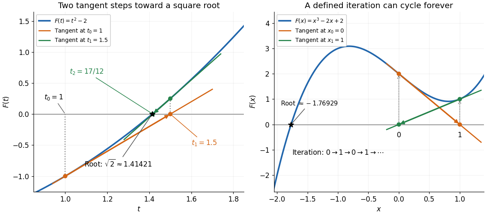

# Newton root-finding iteration

↑ **Parent:** [Numerical analysis](numerical-analysis-split.md)

The Newton root-finding iteration seeks a [zero of a function](zero-of-a-function.md) $F$ by repeatedly solving its [tangent line](tangent-line.md) approximation. At a current guess $t_r$ with [derivative](derivative.md) $F'(t_r)\ne0$, set

$$
0=F(t_r)+F'(t_r)(t_{r+1}-t_r),\qquad t_{r+1}=t_r-\frac{F(t_r)}{F'(t_r)}.
$$

Geometrically, follow the [tangent line](tangent-line.md) to the horizontal axis, then return to the [function graph](graph-of-a-function.md) for the next [tangent line](tangent-line.md). Close to a suitable [zero of a function](zero-of-a-function.md), the error becomes dramatically smaller.[Laurent Demanet, MIT 18.330, Chapter 4, §4.1, 2012](https://ocw.mit.edu/courses/18-330-introduction-to-numerical-analysis-spring-2012/5b325bfa56a599794c7196de926844b0_MIT18_330S12_Chapter4.pdf)

For a concrete [square root](square-root.md) calculation, take the [polynomial](polynomial-split.md) $F(t)=t^2-2$ and start at $t_0=1$. The [Newton root-finding iteration](newton-root-finding-iteration.md) becomes $t_{r+1}=(t_r+2/t_r)/2$, giving

$$
\begin{array}{c|c|c}
r&t_r&|t_r-\sqrt2|\\\hline
0&1&4.14214\times10^{-1}\\
1&1.5&8.57864\times10^{-2}\\
2&1.416666666667&2.45310\times10^{-3}\\
3&1.414215686275&2.12390\times10^{-6}\\
4&1.414213562375&1.59486\times10^{-12}
\end{array}
$$

The errors use the unrounded iterates. After the first step, each iterate overestimates $\sqrt2$, and the exact identity

$$
t_{r+1}-\sqrt2=\frac{(t_r-\sqrt2)^2}{2t_r}
$$

exhibits [quadratic convergence](quadratic-convergence.md): once close, the number of correct decimal digits roughly doubles per step. This speed makes the [Newton root-finding iteration](newton-root-finding-iteration.md) useful when accurate [derivatives](derivative.md) are available.

**[Figure 3](#image-newton-tangent-steps-toward-a-square-root-and-a-nonconvergent-two-cycle). Newton tangent steps toward a square root and a nonconvergent two-cycle**.

Global convergence requires additional care. For the [polynomial](polynomial-split.md) $F(x)=x^3-2x+2$, starting at $x_0=0$ gives $F(0)=2$, $F'(0)=-2$, hence $x_1=1$. Then $F(1)=1$, $F'(1)=1$ gives $x_2=0$. The sequence repeats $0,1,0,1,\ldots$ forever, although a real [polynomial root](root-of-a-polynomial.md) lies in $(-2,-1)$ by the [intermediate value theorem](intermediate-value-theorem.md). Neither point in the cycle is a [zero of a function](zero-of-a-function.md), and neither has zero [derivative](derivative.md). A maintained sign-changing interval and fallback [bisection method](bisection-method.md) can protect a root solver from unsuitable Newton steps.

**Table of contents**

- [Local quadratic convergence of Newton iteration](local-quadratic-convergence-of-newton-iteration.md)
- [Newton iteration in a Banach space](newton-iteration-in-a-banach-space.md)
  - [Frozen Newton correction for a fixed-point equation](frozen-newton-correction-for-a-fixed-point-equation.md)
  - [Quadratic Newton error bound in a Banach space](quadratic-newton-error-bound-in-a-banach-space.md)
- [Monotone Newton convergence for a strictly convex function](monotone-newton-convergence-for-a-strictly-convex-function.md)

## ↑ Ancestors (5)

1. [Numerical analysis](numerical-analysis-split.md)
2. [Analysis](analysis-split.md)
3. [Area of mathematics](area-of-mathematics.md)
4. [Mathematics](mathematics-split.md)
5. [Codex Wiki](split.md)

## ← Incoming links (12)

- [Bisection method](bisection-method.md)
- [Certified curve-plane intersection](certified-curve-plane-intersection.md)
- [Closest-point search on a subdivision curve](closest-point-search-on-a-subdivision-curve.md)
- [Local quadratic convergence of Newton iteration](local-quadratic-convergence-of-newton-iteration.md)
- [Monotone Newton convergence for a strictly convex function](monotone-newton-convergence-for-a-strictly-convex-function.md)
- [Newton root-finding iteration](newton-root-finding-iteration.md)
- [Solution](past-exam-of-the-mathematics-course-of-the-university-of-cambridge/2001/ia/paper-1/11d/ii/solution.md)
- [Solution](past-exam-of-the-mathematics-course-of-the-university-of-cambridge/2002/iii/paper-59/2/solution.md)
- [Solution](past-exam-of-the-mathematics-course-of-the-university-of-cambridge/2002/iii/paper-59/6/solution.md)
- [Solution](past-exam-of-the-mathematics-course-of-the-university-of-cambridge/2003/iii/paper-68/3/solution.md)
- [Solution](past-exam-of-the-mathematics-course-of-the-university-of-cambridge/2003/iii/paper-68/4/solution.md)
- [Quadratic convergence](quadratic-convergence.md)
