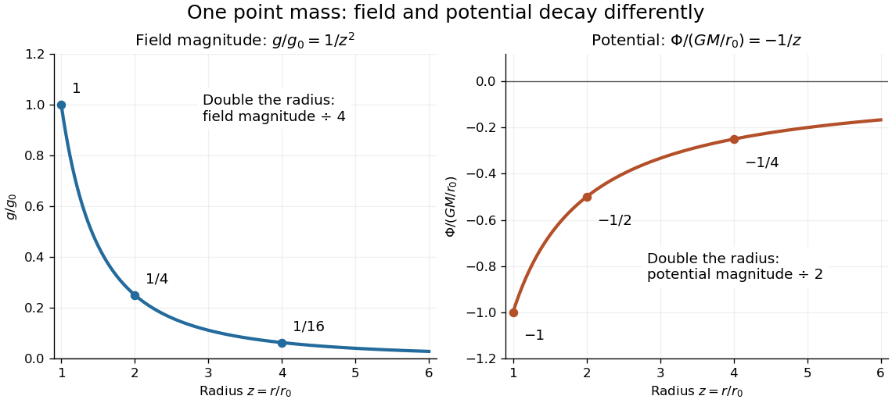

# Newtonian gravitational field

↑ **Parent:** [Newton's law of universal gravitation](newton-s-law-of-universal-gravitation-split.md)

The [Newtonian gravitational field](newtonian-gravitational-field.md) is the gravitational [force](force-split.md) per unit [mass](mass.md) of a [test particle](test-particle.md). For a [point mass](point-mass.md) $M$ at the origin,

$$
\mathbf g(\mathbf r)=\frac{\mathbf F}{m}=-\frac{GM}{r^3}\mathbf r,\qquad g(r)=|\mathbf g|=\frac{GM}{r^2}.
$$

The [test particle](test-particle.md)'s [mass](mass.md) cancels: different small [masses](mass.md) have the same [gravitational acceleration](gravitational-acceleration.md) at the same [position](position.md). In [SI](international-system-of-units.md), the [Newtonian gravitational field](newtonian-gravitational-field.md) has units $\mathrm{N\,kg^{-1}}=\mathrm{m\,s^{-2}}$. The same exterior expression holds for a spherically symmetric source, by the [spherical shell theorem](spherical-shell-theorem.md).

Choose a reference radius $r_0>0$, set $g_0=GM/r_0^2$, and use [nondimensionalization](nondimensionalization.md) with $z=r/r_0$. Then $g/g_0=z^{-2}$: at $z=1,2,4$, the magnitudes are $1,1/4,1/16$. This makes the spatial variation visible without specifying a planet. [OpenStax: inverse-square attraction and spherical sources](https://openstax.org/books/university-physics-volume-1/pages/13-1-newtons-law-of-universal-gravitation)

**[Figure 2](#image-normalized-newtonian-gravitational-field-and-point-mass-potential). Normalized Newtonian gravitational field and point-mass potential**. Doubling the radius quarters the magnitude of the [Newtonian gravitational field](newtonian-gravitational-field.md), but halves the magnitude of the negative [Newtonian gravitational potential](newtonian-gravitational-potential.md). Both curves approach zero as radius increases; the inward [gravitational acceleration](gravitational-acceleration.md) is minus the [gradient](gradient.md) of the [Newtonian gravitational potential](newtonian-gravitational-potential.md).

**Table of contents**

- [Gravitational field of an infinite plane sheet](gravitational-field-of-an-infinite-plane-sheet.md)
  - [Tidal water loading of a spring balance](tidal-water-loading-of-a-spring-balance.md)
- [Axial gravitational field of a uniform ring](axial-gravitational-field-of-a-uniform-ring.md)
- [Gravitational field of a finite uniform line segment](gravitational-field-of-a-finite-uniform-line-segment.md)
- [Gravitational field of an infinite uniform cylinder](gravitational-field-of-an-infinite-uniform-cylinder.md)
  - [Plumb-line deflection from cylindrical gravity](plumb-line-deflection-from-cylindrical-gravity.md)
  - [Diameter-rod oscillation in cylindrical gravity](diameter-rod-oscillation-in-cylindrical-gravity.md)
- [Gauss's law for gravity](gauss-s-law-for-gravity.md)
- [Uniform gravitational field in an off-center spherical cavity](uniform-gravitational-field-in-an-off-center-spherical-cavity.md)
  - [Cavity equilibrium destabilized by a second void](cavity-equilibrium-destabilized-by-a-second-void.md)
- [Newtonian gravitational stress tensor](newtonian-gravitational-stress-tensor.md)
  - [Gravitational stress contribution to angular-momentum transport](gravitational-stress-contribution-to-angular-momentum-transport.md)
- [Self-gravity](self-gravity.md)
- [Standard gravitational parameter](standard-gravitational-parameter.md)
- [Tidal tensor](tidal-tensor.md)
  - [Newtonian tidal eigenvalues outside a point mass](newtonian-tidal-eigenvalues-outside-a-point-mass.md)
  - [Corotating point-mass tidal field](corotating-point-mass-tidal-field.md)
  - [Point-mass tidal stretching and squeezing](point-mass-tidal-stretching-and-squeezing.md)
  - [Quadrupolar point-mass tidal potential](quadrupolar-point-mass-tidal-potential.md)
  - [Tidal disruption](tidal-disruption.md)
  - [Tidal force](tidal-force.md)
    - [Corotating tidal-disruption estimate for a uniform sphere](corotating-tidal-disruption-estimate-for-a-uniform-sphere.md)
    - [Tide](tide.md)
      - [Bay of Fundy](bay-of-fundy.md)
      - [Semidiurnal tide](semidiurnal-tide.md)
      - [Spring tide](spring-tide.md)
      - [Neap tide](neap-tide.md)
    - [Exact tidal acceleration between separated masses](exact-tidal-acceleration-between-separated-masses.md)
    - [Gravity magnitude versus tidal gradient](gravity-magnitude-versus-tidal-gradient.md)
    - [Love number](love-number.md)
  - [Gravity gradiometry](gravity-gradiometry.md)
    - [Atom-cloud gravity-gradient measurement](atom-cloud-gravity-gradient-measurement.md)
  - [Quadrupolar tidal forcing](quadrupolar-tidal-forcing.md)
- [Gravitational acceleration](gravitational-acceleration.md)
  - [Newtonian central configuration](newtonian-central-configuration.md)
    - [Homothetic gravitational motion](homothetic-gravitational-motion.md)
- [Gravitational constant](gravitational-constant.md)
  - [Gravitational mass degeneracy](gravitational-mass-degeneracy.md)
  - [Gravitational constant measurement sensitivity](gravitational-constant-measurement-sensitivity.md)
  - [Cold-atom measurement of the gravitational constant](cold-atom-measurement-of-the-gravitational-constant.md)
- [Poisson equation for Newtonian gravity](poisson-equation-for-newtonian-gravity.md)
  - [Dyadic spherical shells with inverse-radius density scaling](dyadic-spherical-shells-with-inverse-radius-density-scaling.md)
- [Newtonian gravitational potential](newtonian-gravitational-potential.md)
  - [Gravitational potential of a sinusoidal sheet](gravitational-potential-of-a-sinusoidal-sheet.md)
  - [Newtonian gravitational potential of a uniform solid sphere](newtonian-gravitational-potential-of-a-uniform-solid-sphere.md)
  - [Planetary quadrupole coefficient](planetary-quadrupole-coefficient.md)
    - [Oblate-quadrupole epicyclic precession](oblate-quadrupole-epicyclic-precession.md)
  - [Axisymmetric logarithmic gravitational potential](axisymmetric-logarithmic-gravitational-potential.md)
    - [Density positivity for an axisymmetric logarithmic potential](density-positivity-for-an-axisymmetric-logarithmic-potential.md)
  - [Power-law gravitational potential](power-law-gravitational-potential.md)
  - [Gravitational quadrupole potential of a point-mass binary](gravitational-quadrupole-potential-of-a-point-mass-binary.md)
  - [Flattened power-law gravitational potential](flattened-power-law-gravitational-potential.md)
    - [Density positivity for a flattened power-law potential](density-positivity-for-a-flattened-power-law-potential.md)
  - [Newtonian potential of a point mass](newtonian-potential-of-a-point-mass.md)
    - [Self-gravity in a thin spherical shell expansion](self-gravity-in-a-thin-spherical-shell-expansion.md)
    - [Gravitational potential of a truncated inverse-radius sphere](gravitational-potential-of-a-truncated-inverse-radius-sphere.md)
    - [Axisymmetric gravitational potential of a displaced cylindrical interface](axisymmetric-gravitational-potential-of-a-displaced-cylindrical-interface.md)
  - [Spherically symmetric potential](spherically-symmetric-potential.md)
- [Newtonian gravitational potential energy](newtonian-gravitational-potential-energy.md)
  - [Spherical binding-energy mass integral](spherical-binding-energy-mass-integral.md)
  - [Minimum-separation binding-energy bounds](minimum-separation-binding-energy-bounds.md)
    - [Negative-energy minimum-separation upper bound](negative-energy-minimum-separation-upper-bound.md)
- [Cavendish experiment](cavendish-experiment.md)
  - [Cavendish torsion balance](cavendish-torsion-balance.md)

## ↑ Ancestors (5)

1. [Newton's law of universal gravitation](newton-s-law-of-universal-gravitation-split.md)
2. [Classical mechanics](classical-mechanics-split.md)
3. [Branches of physics](branches-of-physics.md)
4. [Physics](physics-split.md)
5. [Codex Wiki](split.md)

## ← Incoming links (43)

- [Cavendish experiment](cavendish-experiment.md)
- [Cavity equilibrium destabilized by a second void](cavity-equilibrium-destabilized-by-a-second-void.md)
- [Circular orbit](circular-orbit.md)
- [Circular orbit as continuous free fall](circular-orbit-as-continuous-free-fall.md)
- [Dyadic spherical shells with inverse-radius density scaling](dyadic-spherical-shells-with-inverse-radius-density-scaling.md)
- [Exact tidal acceleration between separated masses](exact-tidal-acceleration-between-separated-masses.md)
- [Free fall](free-fall.md)
- [Galactic disk flaring](galactic-disk-flaring.md)
- [Galactic tide](galactic-tide.md)
- [Gauss's law for gravity](gauss-s-law-for-gravity.md)
- [Gravitational acceleration](gravitational-acceleration.md)
- [Gravitational constant](gravitational-constant.md)
- [Gravitational constant measurement sensitivity](gravitational-constant-measurement-sensitivity.md)
- [Gravitational mass](gravitational-mass.md)
- [Newtonian gravitational field](newtonian-gravitational-field.md)
- [Newtonian gravitational potential](newtonian-gravitational-potential.md)
- [Solution](past-exam-of-the-mathematics-course-of-the-university-of-cambridge/2001/ia/paper-4/11a/solution.md)
- [Solution](past-exam-of-the-mathematics-course-of-the-university-of-cambridge/2001/iii/paper-41/4/i/solution.md)
- [Solution](past-exam-of-the-mathematics-course-of-the-university-of-cambridge/2003/ia/paper-4/10e/solution.md)
- [Solution](past-exam-of-the-mathematics-course-of-the-university-of-cambridge/2006/iii/paper-73/4/a/solution.md)
- [Solution](past-exam-of-the-mathematics-course-of-the-university-of-cambridge/2012/iii/paper-59/1/solution.md)
- [Solution](past-exam-of-the-mathematics-course-of-the-university-of-cambridge/2012/iii/paper-59/2/solution.md)
- [Solution](past-exam-of-the-mathematics-course-of-the-university-of-cambridge/2013/iii/paper-56/1/solution.md)
- [Solution](past-exam-of-the-mathematics-course-of-the-university-of-cambridge/2014/iii/paper-54/2/a/solution.md)
- [Solution](past-exam-of-the-mathematics-course-of-the-university-of-cambridge/2017/iii/paper-316/4/i/solution.md)
- [Solution](past-exam-of-the-mathematics-course-of-the-university-of-cambridge/2019/ia/paper-4/9a/a/solution.md)
- [Solution](past-exam-of-the-mathematics-course-of-the-university-of-cambridge/2019/ia/paper-4/9a/b/solution.md)
- [Solution](past-exam-of-the-mathematics-course-of-the-university-of-cambridge/2021/iii/paper-347/1/a/solution.md)
- [Solution](past-exam-of-the-mathematics-course-of-the-university-of-cambridge/2022/ii/paper-3/37d/b/solution.md)
- [Solution](past-exam-of-the-physics-course-of-the-year-1-of-the-natural-sciences-course-of-the-university-of-cambridge/2016/paper-1/section-a/a5/solution.md)
- [Solution](past-exam-of-the-physics-course-of-the-year-1-of-the-natural-sciences-course-of-the-university-of-cambridge/2016/paper-1/section-b/b8/solution.md)
- [Solution](past-exam-of-the-physics-course-of-the-year-1-of-the-natural-sciences-course-of-the-university-of-cambridge/2016/paper-1/section-e/e15/a/solution.md)
- [Solution](past-exam-of-the-physics-course-of-the-year-1-of-the-natural-sciences-course-of-the-university-of-cambridge/2018/section-b/7/solution.md)
- [Solution](past-exam-of-the-physics-course-of-the-year-1-of-the-natural-sciences-course-of-the-university-of-cambridge/2018/section-e/15/b/solution.md)
- [Solution](past-exam-of-the-relativity-course-of-the-university-of-cambridge/2018/section-b/b4/solution.md)
- [Spherical mass profile for a flat rotation curve](spherical-mass-profile-for-a-flat-rotation-curve.md)
- [Standard gravitational parameter](standard-gravitational-parameter.md)
- [Stellar flyby](stellar-flyby.md)
- [Tidal force](tidal-force.md)
- [Tidal tensor](tidal-tensor.md)
- [Uniform gravitational field in an off-center spherical cavity](uniform-gravitational-field-in-an-off-center-spherical-cavity.md)
- [Vertical Jeans equation](vertical-jeans-equation.md)
- [Weightlessness](weightlessness.md)
