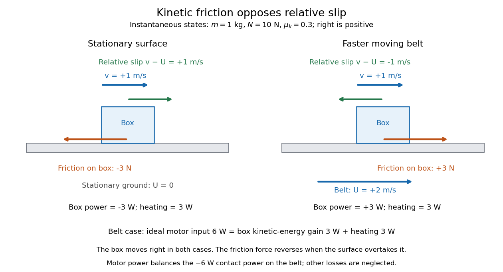
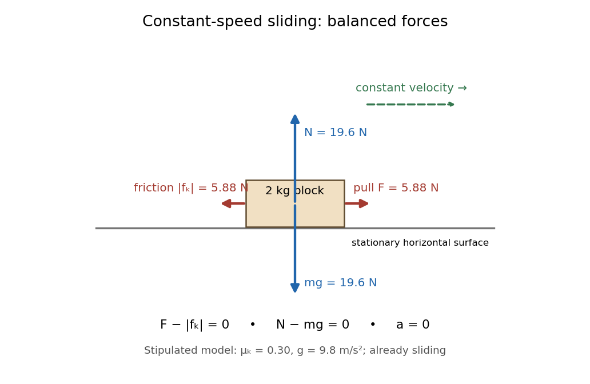

# Newtonian mechanics

↑ **Parent:** [Classical mechanics](classical-mechanics.md)

Newtonian mechanics describes motion using forces, masses and acceleration in [inertial frames](mathematical-physics.md#inertial-frame) with absolute time. It is the low-speed limit of [special relativity](special-relativity.md); for constant [proper acceleration](special-relativity.md#proper-acceleration) with $|at|\ll c$, relativistic [hyperbolic motion](special-relativity.md#hyperbolic-motion) reduces to $x\simeq at^2/2$.

**Table of contents**

- [Small-slope particle motion on a height graph](#small-slope-particle-motion-on-a-height-graph)
  - [Radial turning points for an inverse-square height well](#radial-turning-points-for-an-inverse-square-height-well)
- [Tangentially driven motion on an axisymmetric surface](#tangentially-driven-motion-on-an-axisymmetric-surface)
- [Friction](#friction)
  - [Coefficient of friction](#coefficient-of-friction)
  - [Lubricant](#lubricant)
  - [Kinetic friction](#kinetic-friction)
    - [Pressure-driven cork ejection](#pressure-driven-cork-ejection)
    - [Uniform-pressure friction torque on a circular contact](#uniform-pressure-friction-torque-on-a-circular-contact)
    - [Coefficient of kinetic friction](#coefficient-of-kinetic-friction)
      - [Constant-speed measurement of kinetic friction](#constant-speed-measurement-of-kinetic-friction)
      - [Load dependence of kinetic friction](#load-dependence-of-kinetic-friction)
      - [Corrections to a pulling measurement of kinetic friction](#corrections-to-a-pulling-measurement-of-kinetic-friction)
    - [Two-stage stopping under linear drag and dry friction](#two-stage-stopping-under-linear-drag-and-dry-friction)
  - [Contact slip](#contact-slip)
  - [Frictional heating](#frictional-heating)
- [Newton–Cartan theory](#newton-cartan-theory)
  - [Newton–Cartan gravitational connection](#newton-cartan-gravitational-connection)
    - [Newtonian tidal curvature](#newtonian-tidal-curvature)

## Small-slope particle motion on a height graph

↑ **Parent:** [Newtonian mechanics](newtonian-mechanics.md)

A particle constrained to the graph $z=h(x,y)$ has [kinetic energy](energy.md#kinetic-energy) $m[|\dot{\mathbf r}|^2+(\nabla h\cdot\dot{\mathbf r})^2]/2$ and [potential energy](energy.md#potential-energy) $mgh$. For a gently varying graph and velocities for which its geometric kinetic correction is higher order, the leading [Euler-Lagrange equations](analysis.md#euler-lagrange-equation) are the displayed planar gradient-force equations. Small slope alone at arbitrarily large speed or curvature does not justify discarding the normal inertial acceleration. For a radial height, the leading planar [angular momentum](momentum.md#angular-momentum) is conserved, allowing an [effective potential](mathematical-physics.md#effective-potential) reduction.

### Radial turning points for an inverse-square height well

↑ **Parent:** [Small-slope particle motion on a height graph](#small-slope-particle-motion-on-a-height-graph)

For the height profile $h(r)=r^{-2}-r^{-1}$, set $A=L^2+2g$ and use the planar small-slope model. Its [effective potential](mathematical-physics.md#effective-potential) per unit mass is $V_{\rm eff}=A/(2r^2)-g/r$. Release with negligible radial speed at $r_0$ gives $\mathcal E=A/(2r_0^2)-g/r_0$ and the displayed radial-speed law. A bounded trajectory requires $\mathcal E<0$, equivalently $r_0>A/(2g)$. The two positive turning radii are $r_0$ and $Ar_0/(2gr_0-A)$; they coincide at the circular solution $r_0=A/g$. Zero energy is marginal escape, not bounded motion.

## Tangentially driven motion on an axisymmetric surface

↑ **Parent:** [Newtonian mechanics](newtonian-mechanics.md)

Neglecting vertical acceleration and the vertical driving-force component, the radial normal reaction is $-Mg h'(r)$. A drive parallel to the horizontal velocity cancels when the radial acceleration equation is combined with $r_\phi/r$ times the azimuthal equation. For a prescribed path $r(\phi)$ this gives the displayed speed constraint. It describes the projected approximation, not arbitrary trajectories with substantial vertical motion.

// Target: classical-mechanics.bigb

## Friction

↑ **Parent:** [Newtonian mechanics](newtonian-mechanics.md)

[Friction](#friction) is a contact [force](force.md) tangent to the surfaces. [Kinetic friction](#kinetic-friction) opposes [contact slip](#contact-slip); [static friction](force.md#static-friction) maintains contact without [contact slip](#contact-slip), including [rolling without slipping](rigid-body-dynamics.md#rolling-without-slipping). The perpendicular contact component is the [normal force](force.md#normal-force). These two components answer different questions: how strongly the surfaces press together, and how strongly they resist sliding past one another.

The ideal Coulomb dry-contact model combines a bound on [static friction](force.md#static-friction) with a sliding law for [kinetic friction](#kinetic-friction). Its parameters are the [coefficient of static friction](force.md#coefficient-of-static-friction) and the [coefficient of kinetic friction](#coefficient-of-kinetic-friction); constant coefficients are an empirical approximation, rather than a consequence of [Newton's laws of motion](force.md#newton-s-laws-of-motion). Surface condition matters, and the static coefficient need not universally exceed the kinetic coefficient. [Feynman, Leighton and Sands, The Feynman Lectures on Physics I, §12-2: friction and the limits of the empirical law](https://www.feynmanlectures.caltech.edu/I_12.html#Ch12-S2)

The model's historical setting was practical machinery: Coulomb's _Théorie des machines simples_ investigated [friction](#friction) and the stiffness of ropes. The Académie's bibliography records its 1781 prize and its appearance in volume 10, pages 161–332, of the _Recueil des savants étrangers_. [Académie des sciences: Coulomb's published works](https://www.academie-sciences.fr/pdf/dossiers/Coulomb/Coulomb_pubd1.htm)

### Coefficient of friction

↑ **Parent:** [Friction](#friction)

The dimensionless ratio between an appropriate tangential [friction](#friction) [force](force.md) and normal load in a specified contact model. Static limiting and sliding coefficients differ, and nanoscale [adhesion](continuum-mechanics.md#adhesion) can invalidate a simple load-independent ratio.

### Lubricant

↑ **Parent:** [Friction](#friction)  
ⓦ [Wiki](https://en.wikipedia.org/wiki/Lubricant)

### Kinetic friction

↑ **Parent:** [Friction](#friction)

[Kinetic friction](#kinetic-friction) is [friction](#friction) during nonzero [contact slip](#contact-slip). For one-dimensional motion along a surface, choose right as positive and write $v$ for the body's contact-point [velocity](classical-mechanics.md#velocity) and $U$ for the surface's contact-point [velocity](classical-mechanics.md#velocity), both measured in the same [inertial frame](mathematical-physics.md#inertial-frame). The signed [relative velocity](classical-mechanics.md#relative-velocity) is $w=v-U$. The ideal Coulomb law for the tangential [force](force.md) on the body is

$$
f_k=-\mu_kN\operatorname{sgn}(v-U),\qquad v-U\ne0.
$$

Here $N\ge0$ is the magnitude of the [normal force](force.md#normal-force), $\mu_k\ge0$ is the [coefficient of kinetic friction](#coefficient-of-kinetic-friction), and $\operatorname{sgn}$ is the [sign function](foundations-of-mathematics.md#sign-function). Thus [kinetic friction](#kinetic-friction) opposes [contact slip](#contact-slip), which can differ from the body's direction of motion. In several tangential directions the same law reads $\mathbf f_k=-\mu_kN\mathbf w/|\mathbf w|$ for a nonzero tangential [relative velocity](classical-mechanics.md#relative-velocity) $\mathbf w$. The magnitude law is documented in [Ling, Sanny and Moebs, OpenStax University Physics 1, §6.2: static and kinetic friction](https://openstax.org/books/university-physics-volume-1/pages/6-2-friction).

For a stipulated toy model, take a nonrotating box with [mass](classical-mechanics.md#mass) $m=1\,\mathrm{kg}$, [normal force](force.md#normal-force) $N=10\,\mathrm N$, [coefficient of static friction](force.md#coefficient-of-static-friction) $\mu_s=0.5$, and [coefficient of kinetic friction](#coefficient-of-kinetic-friction) $\mu_k=0.3$. These are assumed model parameters, rather than measured properties of any particular pair of materials; the prescribed [normal force](force.md#normal-force) is consistent with horizontal support under $g=10\,\mathrm{m/s^2}$ and no other vertical [forces](force.md). On stationary ground, a box already sliding right has $f_k=-3\,\mathrm N$. With an applied horizontal [force](force.md) $F=6\,\mathrm N$ to the right, [Newton's second law](force.md#newton-s-second-law) gives $a=(F+f_k)/m=3\,\mathrm{m/s^2}$, for as long as rightward [contact slip](#contact-slip) persists.

Direction is clearer by comparing two instantaneous states of this same model. If the box has $v=1\,\mathrm{m/s}$ on stationary ground, $U=0$ and $w=+1\,\mathrm{m/s}$, so [kinetic friction](#kinetic-friction) acts left with magnitude $3\,\mathrm N$. If the box still has $v=1\,\mathrm{m/s}$ but a belt beneath it has $U=2\,\mathrm{m/s}$, then $w=-1\,\mathrm{m/s}$: [kinetic friction](#kinetic-friction) acts right with magnitude $3\,\mathrm N$, even while the box moves right.

**[Figure 1](#image-the-same-rightward-box-velocity-gives-opposite-friction-directions-on-stationary-ground-and-a-faster-moving-belt). The same rightward box velocity gives opposite friction directions on stationary ground and a faster moving belt**.

In the belt case, the [power](energy.md#power) delivered to the box is $P_{\mathrm{box}}=f_kv=+3\,\mathrm W$. With no other horizontal [force](force.md), its [kinetic energy](energy.md#kinetic-energy) therefore increases by the [work-energy theorem](energy.md#work-energy-theorem). By [Newton's third law](force.md#newton-s-third-law), the box exerts $-f_k$ on the belt, so the contact [power](energy.md#power) delivered to the belt is $P_{\mathrm{belt}}=-f_kU=-6\,\mathrm W$. Their sum is $-3\,\mathrm W$: [frictional heating](#frictional-heating) produces thermal [internal energy](internal-energy.md) at $3\,\mathrm W$. An ideal motor maintaining the prescribed belt [velocity](classical-mechanics.md#velocity) supplies $+6\,\mathrm W$ against this contact load, neglecting other losses, so its input divides into $3\,\mathrm W$ of box [kinetic energy](energy.md#kinetic-energy) and $3\,\mathrm W$ of [frictional heating](#frictional-heating). These are instantaneous rates, since the box's [velocity](classical-mechanics.md#velocity) subsequently changes. This balance follows directly from [power](energy.md#power) as [force](force.md) times [velocity](classical-mechanics.md#velocity) and [conservation of energy](mathematical-physics.md#conservation-of-energy); the power law is given in [Ling, Sanny and Moebs, OpenStax University Physics 1, §7.4: power](https://openstax.org/books/university-physics-volume-1/pages/7-4-power).

When [contact slip](#contact-slip) vanishes, including a transition to [rolling without slipping](rigid-body-dynamics.md#rolling-without-slipping), the nonzero-slip law no longer applies. Determine the required [static friction](force.md#static-friction) from the no-slip condition and the [equations of motion](classical-mechanics.md#equation-of-motion), then test its bound. Substituting $\operatorname{sgn}(0)=0$ into the sliding law would incorrectly exclude a nonzero [static friction](force.md#static-friction).

#### Pressure-driven cork ejection

↑ **Parent:** [Kinetic friction](#kinetic-friction)

A cylindrical plug of radius $a$, length $l$ and density $\rho$ is pushed outward by gauge pressure $P_g$. If its remaining contact length is $l-x$ and its constant radial contact pressure is $P_c$, the resisting [kinetic friction](#kinetic-friction) is $2\pi a(l-x)\mu P_c$. At the marginal initial condition $\pi a^2P_g=2\pi al\mu P_c$, the net outward force becomes $\pi a^2P_gx/l$. With mass $\rho\pi a^2l$,

$$
\ddot x=b^2x,\quad b=\frac1l\sqrt{\frac{P_g}{\rho}},\quad x(t)=\frac{v_0}{b}\sinh(bt),\quad \dot x^2=v_0^2+b^2x^2.
$$

Thus the exit speed at $x=l$ tends to $\sqrt{P_g/\rho}$ as $v_0\to0^+$. Exactly $v_0=0$ leaves the marginal configuration stationary, and the exit time $b^{-1}\operatorname{arsinh}(bl/v_0)$ diverges in that limit. An attached extra mass changes the acceleration but not the pressure-minus-friction work, if the contact geometry is unchanged.

#### Uniform-pressure friction torque on a circular contact

↑ **Parent:** [Kinetic friction](#kinetic-friction)

A flat circular contact of radius $a$ carrying total normal [force](force.md) $N$ has uniform [pressure](pressure.md) $p=N/(\pi a^2)$. In steady relative rotation, a ring of radius $s$ and thickness $ds$ experiences tangential [kinetic friction](#kinetic-friction) $dF=\mu p\,2\pi s\,ds$. Its resisting [torque](momentum.md#torque) is $d\tau=s\,dF$. [Integration](integral.md) from zero to $a$ gives $\tau_f=2\mu Na/3$. A different pressure distribution changes the result; for an axisymmetric distribution use $\tau_f=2\pi\mu\int_0^a p(s)s^2ds$.

#### Coefficient of kinetic friction

↑ **Parent:** [Kinetic friction](#kinetic-friction)

The [coefficient of kinetic friction](#coefficient-of-kinetic-friction) is the [dimensionless quantity](physics.md#dimensionless-quantity) $\mu_k=|f_k|/N$ for sliding contact with positive [normal force](force.md#normal-force) $N$ in the ideal [kinetic friction](#kinetic-friction) model. It characterizes the pair of contacting surfaces and their condition. A constant $\mu_k$ means the model neglects dependence on [contact slip](#contact-slip) speed; unlike the [coefficient of static friction](force.md#coefficient-of-static-friction), it specifies a sliding [force](force.md) magnitude rather than a no-slip upper bound.

The ratio compares the tangential [kinetic friction](#kinetic-friction) magnitude with the perpendicular [normal force](force.md#normal-force):

$$
\mu_k=\frac{|f_k|}{N},\qquad N>0,\quad |\mathbf w|>0.
$$

Here $\mathbf w$ is the tangential [relative velocity](classical-mechanics.md#relative-velocity) defining [contact slip](#contact-slip). Both numerator and denominator have the same [physical dimension](mathematical-physics.md#physical-dimension), so the [coefficient of kinetic friction](#coefficient-of-kinetic-friction) has no units. It belongs to a contact pair under specified conditions, rather than to one material alone. The [coefficient of static friction](force.md#coefficient-of-static-friction) instead describes the threshold $|f_s|_{\max}/N$ before [contact slip](#contact-slip); a pull required to start motion cannot be substituted for a sliding measurement.[§6.2, “Magnitude of Static Friction” and “Magnitude of Kinetic Friction”, equations 6.1–6.2; unitless coefficient and dependence on the two surfaces](physics-bibliography.md#university-physics-volume-1-by-william-moebs-and-others)

As an original model example, stipulate $\mu_k=0.30$ and [gravitational acceleration](newton-s-law-of-universal-gravitation.md#gravitational-acceleration) $g=9.8\,\mathrm{m/s^2}$. An already sliding, nonrotating block of total [mass](classical-mechanics.md#mass) $m=2\,\mathrm{kg}$ is pulled horizontally across a stationary horizontal surface at constant [velocity](classical-mechanics.md#velocity). With no other vertical [force](force.md), [Newton's second law](force.md#newton-s-second-law) gives $N=mg=19.6\,\mathrm N$. Zero horizontal [acceleration](classical-mechanics.md#acceleration) then requires a pulling [force](force.md) $F=|f_k|=\mu_kmg=5.88\,\mathrm N$. Doubling the total [mass](classical-mechanics.md#mass) to $4\,\mathrm{kg}$ gives $N=39.2\,\mathrm N$ and $F=11.76\,\mathrm N$. The [force](force.md) doubles while the [coefficient of kinetic friction](#coefficient-of-kinetic-friction) stays $0.30$ by assumption. These numbers are model predictions, not observations or a calibration for a particular material pair.

**[Figure 2](#image-original-horizontal-sliding-model-a-2-kg-block-has-balanced-forces-at-constant-speed-with-a-stipulated-kinetic-friction-coefficient-of-0-30). Original horizontal sliding model: a 2 kg block has balanced forces at constant speed with a stipulated kinetic friction coefficient of 0.30**.

A constant [coefficient of kinetic friction](#coefficient-of-kinetic-friction) is useful because one ratio can summarize many loads, as tested by [load dependence of kinetic friction](#load-dependence-of-kinetic-friction). It is an empirical approximation over a stated range of [normal forces](force.md#normal-force), [speeds](classical-mechanics.md#speed) and surface conditions. It implies no universal independence from [speed](classical-mechanics.md#speed) or apparent contact [area](differential-geometry.md#surface-area): a change of face or sliding regime can change the result. [Temperature](temperature.md), wear and lubrication are further conditions to report. [Newton's second law](force.md#newton-s-second-law) still applies when the constant-coefficient approximation fails.[§6.2, approximate empirical model; small nonzero speeds; exceptions for lubricated surfaces and high speeds; “Atomic-Scale Explanations of Friction”, apparent versus actual contact area](physics-bibliography.md#university-physics-volume-1-by-william-moebs-and-others)

##### Constant-speed measurement of kinetic friction

↑ **Parent:** [Coefficient of kinetic friction](#coefficient-of-kinetic-friction)

A force gauge reads the pulling [force](force.md). For horizontal straight-line sliding at constant [velocity](classical-mechanics.md#velocity), its reading equals the opposing [kinetic friction](#kinetic-friction) magnitude, provided these are the only horizontal [forces](force.md). For total supported [mass](classical-mechanics.md#mass) $m$, including added loads, $N=mg$, so a mean sliding reading $\overline F$ gives $\mu_k=\overline F/(mg)$. The important readout is the sustained sliding force after the starting peak; the peak belongs to the [static friction](force.md#static-friction) threshold.

The University of Mississippi's Experiment 6 uses a wooden block on a wooden plane, a triple-beam balance, added masses, and a dual-range 50 N force probe connected through LabPro to Logger Pro. Its procedure calibrates the probe with a $0.5\,\mathrm{kg}$ load on a hanger, entering the corresponding [force](force.md) in newtons, and measures the block's [mass](classical-mechanics.md#mass) separately. With the plane horizontal, it starts with $0.5\,\mathrm{kg}$ on the block and pulls horizontally at constant [speed](classical-mechanics.md#speed). The recorded [force](force.md) trace has a starting peak; the procedure selects the subsequent constant-force interval and takes its [mean](expected-value.md). It repeats with $0.5\,\mathrm{kg}$ increments up to $3\,\mathrm{kg}$ added, then plots sliding [force](force.md) against [normal force](force.md#normal-force) to estimate the [coefficient of kinetic friction](#coefficient-of-kinetic-friction) from the [slope](euclidean-geometry.md#slope).[Experiment 6, The Coefficient of Friction, PDF pp. 1–2: Equipment, Objectives, Procedure steps 1–7](physics-bibliography.md#experiment-6-the-coefficient-of-friction-university-of-mississippi-teaching-laboratory)

For a replication, check the gauge's zero with the string slack and its response to known [gravitational weights](force.md#weight-physics); zeroing alone does not check its scale. Keep the plane level, the pull parallel to it, and the block face and track region consistent. Specify the contacting materials and whether the surfaces are dry, cleaned or lubricated; repeat runs to see whether debris or wear changes the sliding [force](force.md). Verify constant [velocity](classical-mechanics.md#velocity) independently from [position](classical-mechanics.md#position) versus [time](classical-mechanics.md#time-in-physics), rather than assuming that a flat force trace proves zero [acceleration](classical-mechanics.md#acceleration). These are proposed measurement controls, not additional observations from the laboratory writeup. Record the selected interval, variation between runs and gauge resolution as sources of [measurement error](probability-and-statistics.md#measurement-error).

##### Load dependence of kinetic friction

↑ **Parent:** [Coefficient of kinetic friction](#coefficient-of-kinetic-friction)

Changing the added [mass](classical-mechanics.md#mass) while retaining the same contact pair and sliding [speed](classical-mechanics.md#speed) tests whether a constant [coefficient of kinetic friction](#coefficient-of-kinetic-friction) is a useful model. Compute $N=(m_{\mathrm{block}}+m_{\mathrm{added}})g$ for each level horizontal run, and plot the mean sliding [force](force.md) vertically against [normal force](force.md#normal-force) horizontally. The constant-coefficient prediction is a straight line through the origin; its [slope](euclidean-geometry.md#slope) is $\mu_k$. This extracts a ratio from several loads rather than relying on one reading.

**[Figure 3](#image-horizontal-wooden-block-force-probe-apparatus-and-original-load-model-19-6-n-and-39-2-n-normal-loads-predict-5-88-n-and-11-76-n-sliding-forces). Horizontal wooden-block force-probe apparatus and original load model: 19.6 N and 39.2 N normal loads predict 5.88 N and 11.76 N sliding forces**.

The apparatus sketch identifies the contact pair and horizontal pull used by the cited laboratory procedure. The plotted line and points are the original stipulated $\mu_k=0.30$ model from [coefficient of kinetic friction](#coefficient-of-kinetic-friction), not laboratory data. The two model points give

$$
\frac{\Delta |f_k|}{\Delta N}=\frac{11.76-5.88}{39.2-19.6}=0.30.
$$

In actual measurements, a [linear regression](linear-regression.md) $\overline F=b+\mu_kN$ can expose an unexplained [intercept](linear-regression.md#regression-intercept) $b$. A nonzero [intercept](linear-regression.md#regression-intercept) calls for checking the gauge zero, other resisting [forces](force.md) and the contact model; forcing the line through zero can hide those problems. Conversely, constant ratios within [measurement error](probability-and-statistics.md#measurement-error) support the approximation only over the loads, [speeds](classical-mechanics.md#speed) and surface conditions tested. A load sweep alone cannot establish independence from contact [area](differential-geometry.md#surface-area) or sliding [speed](classical-mechanics.md#speed); those require separate controlled variations.

##### Corrections to a pulling measurement of kinetic friction

↑ **Parent:** [Coefficient of kinetic friction](#coefficient-of-kinetic-friction)

For a block sliding right on a stationary horizontal plane, take rightward [acceleration](classical-mechanics.md#acceleration) $a$ as positive. A gauge reading $F$ for a pull at [angle](geometry-and-topology.md#angle) $\alpha$ above horizontal has horizontal component $F\cos\alpha$ and upward component $F\sin\alpha$. With no vertical [acceleration](classical-mechanics.md#acceleration) or other [forces](force.md), [Newton's second law](force.md#newton-s-second-law) gives

$$
N=mg-F\sin\alpha,\qquad F\cos\alpha-|f_k|=ma,
$$

and therefore

$$
\mu_k=\frac{F\cos\alpha-ma}{mg-F\sin\alpha}.
$$

This inference requires continued contact with $N>0$ and rightward [contact slip](#contact-slip), so its numerator must be nonnegative. An upward pull reduces [normal force](force.md#normal-force); a downward pull, represented by $\alpha<0$, increases it. The horizontal constant-[velocity](classical-mechanics.md#velocity) formula is the special case $\alpha=0$, $a=0$.

For the original $2\,\mathrm{kg}$, $\mu_k=0.30$ model, an upward pull at $\alpha=30^\circ$ maintaining constant [velocity](classical-mechanics.md#velocity) needs

$$
F=\frac{\mu_kmg}{\cos\alpha+\mu_k\sin\alpha}\simeq5.7873\,\mathrm N,\qquad N\simeq16.7064\,\mathrm N.
$$

Dividing this gauge reading by $mg$ would give about $0.2953$, rather than $0.30$: the gauge reads the full inclined [force](force.md), and the pull has changed the [normal force](force.md#normal-force).

Even with a horizontal pull, an accelerating measurement needs the $ma$ correction: $\mu_k=(F-ma)/(mg)$. In the same model, a horizontal $7.88\,\mathrm N$ pull produces $a=1\,\mathrm{m/s^2}$ while the block slides right; subtracting $ma=2\,\mathrm N$ recovers the $5.88\,\mathrm N$ [kinetic friction](#kinetic-friction). Dividing the uncorrected reading by $19.6\,\mathrm N$ instead gives about $0.4020$. Measure [acceleration](classical-mechanics.md#acceleration) in an [inertial frame](mathematical-physics.md#inertial-frame), along the sliding direction, over the same interval as the gauge reading. These corrections follow from the [force](force.md) balance, independently of whether the resulting [coefficient of kinetic friction](#coefficient-of-kinetic-friction) is constant across runs.

// Target: classical-mechanics.bigb

#### Two-stage stopping under linear drag and dry friction

↑ **Parent:** [Kinetic friction](#kinetic-friction)

For a body of mass $M$ initially at speed $U$, suppose the total resistance is [linear drag](fluid-mechanics.md#linear-drag) $\lambda u$ until speed $u_*>0$, followed by [kinetic friction](#kinetic-friction) $\mu Mg$ until rest. The first stage solves $M\dot u=-\lambda u$, giving duration $(M/\lambda)\log(U/u_*)$ and distance $(M/\lambda)(U-u_*)$. Constant deceleration in the second stage gives duration $u_*/(\mu g)$ and distance $u_*^2/(2\mu g)$. The stopping distance is finite because the switch removes the infinite exponential stopping time of pure linear drag.

### Contact slip

↑ **Parent:** [Friction](#friction)

[Contact slip](#contact-slip) is the tangential [relative velocity](classical-mechanics.md#relative-velocity) between the two material points instantaneously in contact. For a nonrotating box on a belt it is $w=v-U$; for a [rigid body](rigid-body-dynamics.md), use the [velocity](classical-mechanics.md#velocity) of its contact point, including the contribution from [angular velocity](rigid-body-dynamics.md#angular-velocity). Zero [contact slip](#contact-slip) defines [rolling without slipping](rigid-body-dynamics.md#rolling-without-slipping) at a rolling contact, even when the [center of mass](classical-mechanics.md#center-of-mass) moves.

### Frictional heating

↑ **Parent:** [Friction](#friction)

In the ideal [kinetic friction](#kinetic-friction) model, the loss of combined [mechanical energy](energy.md#mechanical-energy) of the two contacting bodies becomes thermal [internal energy](internal-energy.md) at rate

$$
\dot E_{\mathrm{thermal}}=-f_k(v-U)=\mu_kN|v-U|\ge0.
$$

This follows by adding the contact [powers](energy.md#power) $f_kv$ and $-f_kU$ from [Newton's third law](force.md#newton-s-third-law). It depends on [contact slip](#contact-slip), whereas the contact [power](energy.md#power) received by either body separately depends on its [velocity](classical-mechanics.md#velocity) in the chosen [inertial frame](mathematical-physics.md#inertial-frame). Thus positive [frictional heating](#frictional-heating) is compatible with increasing [kinetic energy](energy.md#kinetic-energy) of one body, as the moving-belt example in [kinetic friction](#kinetic-friction) shows. Heating need not cause a [temperature](temperature.md) rise if thermal [energy](energy.md) escapes by [heat transfer](heat.md#heat-transfer).

<h2 id="newton-cartan-theory">Newton–Cartan theory</h2>

↑ **Parent:** [Newtonian mechanics](newtonian-mechanics.md)  
ⓦ [Wiki](https://en.wikipedia.org/wiki/Newton–Cartan_theory)

Newton–Cartan theory describes [Newtonian mechanics](newtonian-mechanics.md) geometrically using absolute time, a degenerate spatial inverse metric, and a compatible torsion-free [affine connection](vector-bundle.md#affine-connection). It is not a theory with a nondegenerate Lorentzian metric. Gravitationally accelerated particles are geodesics of that connection, whose curvature measures tidal gravity.

<h3 id="newton-cartan-gravitational-connection">Newton–Cartan gravitational connection</h3>

↑ **Parent:** [Newton–Cartan theory](#newton-cartan-theory)

In Cartesian spatial coordinates and absolute time $t$, the [gravitational potential](newton-s-law-of-universal-gravitation.md#newtonian-potential-of-a-point-mass) $\Phi(t,x)$ determines an [affine connection](vector-bundle.md#affine-connection) by the displayed coefficients, all others zero. The [geodesic equation](riemannian-geometry.md#geodesic-equation) with affine time is $d^2x^i/dt^2=-\partial_i\Phi$. It preserves $dt$ and the spatial inverse metric $h^{ij}=\delta^{ij}$, reproducing freely falling [Newtonian mechanics](newtonian-mechanics.md) in a curved spacetime connection.

#### Newtonian tidal curvature

↑ **Parent:** [Newton–Cartan gravitational connection](#newton-cartan-gravitational-connection)

Using $[\nabla_c,\nabla_d]V^a=R^a{}_{bcd}V^b$, the [Newton–Cartan gravitational connection](#newton-cartan-gravitational-connection) has only the displayed Hessian components and their antisymmetric partners in the last two indices. The [geodesic deviation](riemann-curvature-tensor.md#geodesic-deviation) equation gives relative acceleration $-\partial_i\partial_j\Phi\,\delta x^j$. The [Poisson equation for Newtonian gravity](newton-s-law-of-universal-gravitation.md#poisson-equation-for-newtonian-gravity) is therefore $R_{ab}=4\pi G\rho\,(dt)_a(dt)_b$. A spatially uniform gravitational acceleration has zero tidal curvature even if the connection coefficients do not vanish in the original coordinates.

## ↑ Ancestors (4)

1. [Classical mechanics](classical-mechanics.md)
2. [Branches of physics](physics.md#branches-of-physics)
3. [Physics](physics.md)
4. [Codex Wiki](README.md)

## ← Incoming links (16)

- [Classical mechanics](classical-mechanics.md)
- [Free fall](newton-s-law-of-universal-gravitation.md#free-fall)
- [Inertial mass](classical-mechanics.md#inertial-mass)
- [Internal force](force.md#internal-force)
- [Newton–Cartan gravitational connection](#newton-cartan-gravitational-connection)
- [Newton–Cartan theory](#newton-cartan-theory)
- [Newton's third law](force.md#newton-s-third-law)
- [Solution](past-exam-of-the-mathematics-course-of-the-university-of-cambridge/2005/ia/paper-4.md#12c/solution)
- [Solution](past-exam-of-the-mathematics-course-of-the-university-of-cambridge/2005/ia/paper-4.md#3c/solution)
- [Solution](past-exam-of-the-mathematics-course-of-the-university-of-cambridge/2005/ia/paper-4.md#4c/solution)
- [Solution](past-exam-of-the-mathematics-course-of-the-university-of-cambridge/2009/iii/paper-54.md#1/solution)
- [Solution](past-exam-of-the-mathematics-course-of-the-university-of-cambridge/2010/ii/paper-3.md#10d/solution)
- [Solution](past-exam-of-the-mathematics-course-of-the-university-of-cambridge/2015/ia/paper-4.md#12c/solution)
- [Solution](past-exam-of-the-physics-course-of-the-year-1-of-the-natural-sciences-course-of-the-university-of-cambridge/2012/paper-1.md#section-b/b9/solution)
- [Solution](past-exam-of-the-relativity-course-of-the-university-of-cambridge/2018.md#section-b/b4/solution)
- [Rocket equation](momentum.md#rocket-equation)
