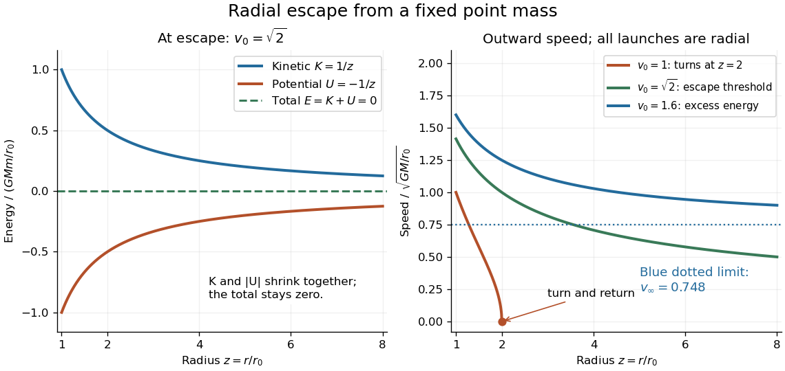

# Newtonian potential of a point mass

↑ **Parent:** [Newtonian gravitational potential](newtonian-gravitational-potential.md)

The [Newtonian potential of a point mass](newtonian-potential-of-a-point-mass.md) $M$ at the origin is

$$
\Phi(r)=-\frac{GM}{r},\qquad r>0,\qquad \Phi(\infty)=0.
$$

It is the free-space [Green function of the Laplacian](green-function-of-the-laplacian.md) with the normalization of the [Poisson equation for Newtonian gravity](poisson-equation-for-newtonian-gravity.md). Differentiating gives inward [gravitational acceleration](gravitational-acceleration.md) $-GM/r^2$. With $z=r/r_0$, the normalized [Newtonian gravitational potential](newtonian-gravitational-potential.md) is $\Phi/(GM/r_0)=-1/z$; at $z=1,2,4$ it equals $-1,-1/2,-1/4$.

For a radially outward launch from $r_0$, [conservation of mechanical energy](conservation-of-mechanical-energy.md) in the fixed-source [test particle](test-particle.md) approximation gives the minimum [escape velocity](escape-velocity.md):

$$
\frac{E}{m}=\frac{v_0^2}{2}-\frac{GM}{r_0}=0
\quad\Longrightarrow\quad v_{\mathrm{esc}}=\sqrt{\frac{2GM}{r_0}}.
$$

At this threshold the [speed](speed.md) tends to zero only at infinite separation. The model neglects air resistance, external [tidal forces](tidal-force.md), and [general relativity](general-relativity-split.md). [13.3 Gravitational Potential Energy and Total Energy](university-physics-volume-1-by-william-moebs-and-others/13-3-gravitational-potential-energy-and-total-energy.md)

A [circular orbit](circular-orbit.md) at $r_0$ instead requires tangential [speed](speed.md) $v_c=\sqrt{GM/r_0}$. Choosing units with $G=M=r_0=1$ gives $g_0=1$, $v_c=1$, and $v_{\mathrm{esc}}=\sqrt2\simeq1.41421$. A radial launch at [speed](speed.md) $1$ reaches $r=2$ and returns; the same [speed](speed.md) directed tangentially gives a [circular orbit](circular-orbit.md). [13.4 Satellite Orbits and Energy](university-physics-volume-1-by-william-moebs-and-others/13-4-satellite-orbits-and-energy.md)

**[Figure 11](#image-energy-balance-and-outward-radial-speeds-below-at-and-above-escape). Energy balance and outward radial speeds below, at, and above escape**. Left: at the [escape velocity](escape-velocity.md), positive [kinetic energy](kinetic-energy.md) exactly balances negative [Newtonian gravitational potential energy](newtonian-gravitational-potential-energy.md). Right: radial launches at normalized [speeds](speed.md) $1$, $\sqrt2$, and $1.6$ respectively turn at $r/r_0=2$, approach zero [speed](speed.md) at infinity, and retain a positive limiting [speed](speed.md). The plotted trajectories use a fixed source and the [test particle](test-particle.md) approximation.

## ↑ Ancestors (7)

1. [Newtonian gravitational potential](newtonian-gravitational-potential.md)
2. [Newtonian gravitational field](newtonian-gravitational-field.md)
3. [Newton's law of universal gravitation](newton-s-law-of-universal-gravitation.md)
4. [Classical mechanics](classical-mechanics-split.md)
5. [Branches of physics](branches-of-physics.md)
6. [Physics](physics-split.md)
7. [Codex Wiki](split.md)

## ← Incoming links (8)

- [Newtonian potential of a point mass](newtonian-potential-of-a-point-mass.md)
- [Solution](past-exam-of-the-mathematics-course-of-the-university-of-cambridge/2003/iii/paper-65/2/i/solution.md)
- [Solution](past-exam-of-the-mathematics-course-of-the-university-of-cambridge/2005/iii/paper-60/2/solution.md)
- [Solution](past-exam-of-the-mathematics-course-of-the-university-of-cambridge/2008/iii/paper-63/2/solution.md)
- [Solution](past-exam-of-the-mathematics-course-of-the-university-of-cambridge/2017/iii/paper-314/4/b/solution.md)
- [Solution](past-exam-of-the-mathematics-course-of-the-university-of-cambridge/2019/iii/paper-321/2/b/solution.md)
- [Solution](past-exam-of-the-mathematics-course-of-the-university-of-cambridge/2020/ii/paper-4/37d/iii/solution.md)
- [Static scalar perturbation of Minkowski spacetime](static-scalar-perturbation-of-minkowski-spacetime.md)
