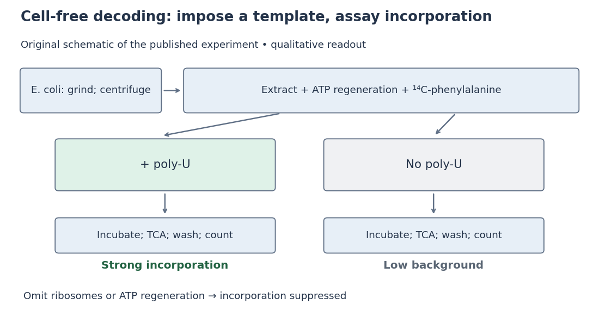

# Nirenberg and Matthaei experiment

↑ **Parent:** [Genetic code](genetic-code.md)  
ⓦ [Wiki](https://en.wikipedia.org/wiki/Nirenberg_and_Matthaei_experiment)

In 1961, [Marshall Warren Nirenberg](marshall-warren-nirenberg.md) and [J. Heinrich Matthaei](j-heinrich-matthaei.md) ground washed [Escherichia coli](escherichia-coli.md) and used [centrifugation](centrifugation.md) to prepare a [cell-free extract](cell-free-extract.md). Reactions at $35^\circ\mathrm{C}$ combined [ribosomes](ribosome.md), soluble components, [ATP](adenosine-triphosphate.md) regeneration and [phenylalanine](phenylalanine.md) carrying a $^{14}\mathrm{C}$ [isotope](isotope.md) label, with or without [polyuridylic acid](polyuridylic-acid.md), an [RNA](ribonucleic-acid.md) containing only U. After incubation, [trichloroacetic acid](trichloroacetic-acid.md) [precipitation](precipitation-chemistry.md), washing and counting [radioactive decay](radioactive-decay.md) detected label in insoluble material. Added [polyuridylic acid](polyuridylic-acid.md) strongly increased incorporation; removing [ribosomes](ribosome.md) or [ATP](adenosine-triphosphate.md) regeneration suppressed it. Product characterization supported a [phenylalanine](phenylalanine.md) [polypeptide](polypeptide.md).[pp. 1589–1590, Methods and Materials; p. 1592, Table 1 assay; pp. 1595–1600, Tables 6–9 and Figure 6](the-dependence-of-cell-free-protein-synthesis-in-e-coli-upon-naturally-occurring-or-synthetic-polyribonucleotides-by-marshall-warren-nirenberg-and-j-heinrich-matthaei.md)

**[Figure 14](#image-nirenberg-and-matthaei-experiment-preparation-comparison-and-readout). Nirenberg and Matthaei experiment: preparation, comparison and readout**. Original schematic; readout summarizes qualitative published observations.

The inference connects an imposed [RNA](ribonucleic-acid.md) template to a specific [amino acid](amino-acid.md) product. Yet repeated U alone cannot distinguish one-, two- or three-letter coding units: every possible group still contains only U. Neither triplet length nor the complete [genetic code](genetic-code.md) follows.[p. 1601, Discussion and Note added in proof: coding-unit length not established](the-dependence-of-cell-free-protein-synthesis-in-e-coli-upon-naturally-occurring-or-synthetic-polyribonucleotides-by-marshall-warren-nirenberg-and-j-heinrich-matthaei.md)

## ↑ Ancestors (7)

1. [Genetic code](genetic-code.md)
2. [Translation (biology)](translation-biology.md)
3. [Gene expression](gene-expression.md)
4. [Molecular genetics](molecular-genetics-split.md)
5. [Genetics](genetics-split.md)
6. [Biology](biology-split.md)
7. [Codex Wiki](split.md)

## ← Incoming links (3)

- [Codon](codon.md)
- [Nirenberg and Matthaei experiment](nirenberg-and-matthaei-experiment.md)
- [Trichloroacetic acid](trichloroacetic-acid.md)
