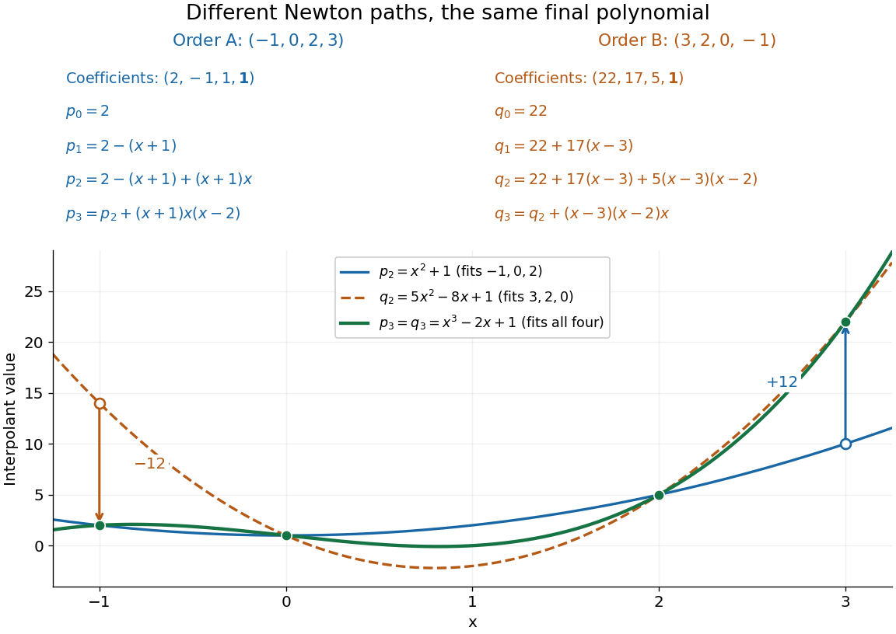

# Node order in Newton interpolation

↑ **Parent:** [Newton polynomial](newton-polynomial.md)

Reordering the [interpolation nodes](interpolation-node.md) changes the successive subsets used for the [divided differences](divided-difference.md) and the factors of the [Newton polynomial](newton-polynomial.md). The final [interpolation polynomial](interpolation-polynomial.md) remains unchanged in exact arithmetic. For $f(x)=x^3-2x+1$, reversing $(-1,0,2,3)$ gives $(3,2,0,-1)$ and values $(22,5,1,2)$. The successive [divided difference](divided-difference.md) columns are now

$$
\begin{aligned}
D_{i,1}&:\quad 17,\ 2,\ -1,\\
D_{i,2}&:\quad 5,\ 1,\\
D_{i,3}&:\quad 1.
\end{aligned}
$$

For example, the first second [divided difference](divided-difference.md) is $(2-17)/(0-3)=5$. The top row becomes $(22,17,5,1)$, giving

$$
\begin{aligned}
q_0(x)&=22,\\
q_1(x)&=22+17(x-3)=17x-29,\\
q_2(x)&=22+17(x-3)+5(x-3)(x-2)=5x^2-8x+1,\\
q_3(x)&=22+17(x-3)+5(x-3)(x-2)+(x-3)(x-2)x\\
&=x^3-2x+1=p_3(x).
\end{aligned}
$$

The earlier partial [interpolants](interpolant.md) differ because they fit different subsets: $p_2$ fits $-1,0,2$, whereas $q_2$ fits $3,2,0$. The highest [divided difference](divided-difference.md) is invariant because both complete top rows finish with the same set of four [interpolation nodes](interpolation-node.md); this is [symmetry of divided differences](symmetry-of-divided-differences.md).

**[Figure 4](#image-reversing-the-interpolation-nodes-changes-the-newton-construction-but-gives-the-same-final-polynomial). Reversing the interpolation nodes changes the Newton construction but gives the same final polynomial**.

This distinction is useful when checking a [divided difference table](divided-difference-table.md): permuting all the [interpolation nodes](interpolation-node.md) must preserve its final [divided difference](divided-difference.md), even though the intermediate entries change. It also explains why data can be appended in their arrival order. In [floating-point arithmetic](floating-point-arithmetic-split.md), the subtractions and divisions may accumulate different rounding errors in different orders; exact invariance describes the mathematical [polynomial](polynomial-split.md), rather than guaranteeing bit-for-bit equality of numerical results.

## ↑ Ancestors (9)

1. [Newton polynomial](newton-polynomial.md)
2. [Divided difference](divided-difference.md)
3. [Polynomial interpolation](polynomial-interpolation.md)
4. [Interpolation](interpolation-split.md)
5. [Numerical analysis](numerical-analysis-split.md)
6. [Analysis](analysis-split.md)
7. [Area of mathematics](area-of-mathematics.md)
8. [Mathematics](mathematics-split.md)
9. [Codex Wiki](split.md)

## ← Incoming links (1)

- [Symmetry of divided differences](symmetry-of-divided-differences.md)
