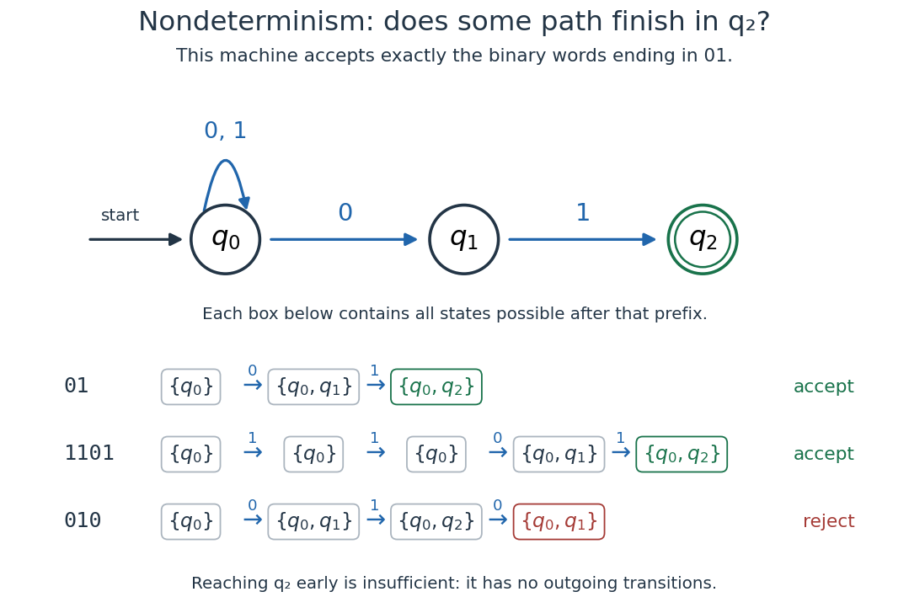

# Nondeterministic finite automaton

↑ **Parent:** [Finite-state machine](finite-state-machine.md)  
ⓦ [Wiki](https://en.wikipedia.org/wiki/Nondeterministic_finite_automaton)

A [nondeterministic finite automaton](nondeterministic-finite-automaton.md) allows a [set](set-split.md) of possible destinations for each [automaton state](automaton-state.md) and input symbol. Without the extra moves permitted in an [Epsilon-NFA](epsilon-nfa.md), replace the [DFA](deterministic-finite-automaton.md) [function](function-split.md) by $\Delta:Q\times\Sigma\to\mathcal P(Q)$, where $\mathcal P(Q)$ is the [power set](power-set.md). A [word](string.md) is accepted when at least one path consumes all its symbols and ends in an accepting [automaton state](automaton-state.md). These choices express [existential quantification](existential-quantification.md), not [probability](probability.md): no chance of choosing a particular path is assigned. One successful path suffices even if other paths fail.

Consider a three-state [NFA](nondeterministic-finite-automaton.md) accepting exactly the [words](string.md) of [binary digits](binary-digit.md) ending in $01$. Its initial [automaton state](automaton-state.md) $q_0$ loops on both $0$ and $1$; it also has an [automaton transition](automaton-transition.md) $q_0\xrightarrow{0}q_1$, followed by $q_1\xrightarrow{1}q_2$. Only $q_2$ is accepting, and all unlisted [automaton transitions](automaton-transition.md) are absent. Staying at $q_0$ skips an arbitrary beginning; leaving it guesses that the current zero starts the final two symbols.

**[Figure 4](#image-an-nfa-recognizing-words-ending-in-01-and-the-possible-automaton-states-after-each-symbol). An NFA recognizing words ending in $01$, and the possible automaton states after each symbol**.

The [word](string.md) $01$ accepts along $q_0\to q_1\to q_2$. The [word](string.md) $1101$ accepts along $q_0\to q_0\to q_0\to q_1\to q_2$. The [word](string.md) $010$ rejects: a path reaching $q_2$ after $01$ cannot consume the remaining zero, while the other paths end outside $q_2$. Thus finding $01$ somewhere is insufficient; it must occur at the end.

To simulate the [NFA](nondeterministic-finite-automaton.md) deterministically, retain the [set](set-split.md) $S$ of all currently possible [automaton states](automaton-state.md). The [powerset construction](powerset-construction.md) updates $S$ by taking the [union](set-union.md) of the destinations of its members. Here only $\{q_0\}$, $\{q_0,q_1\}$, and $\{q_0,q_2\}$ are reachable, although the full [power set](power-set.md) has eight members. Reading $010$ gives $\{q_0\}\to\{q_0,q_1\}\to\{q_0,q_2\}\to\{q_0,q_1\}$, which rejects. In general, an $N$-state [NFA](nondeterministic-finite-automaton.md) yields a [DFA](deterministic-finite-automaton.md) with at most $2^N$ [automaton states](automaton-state.md). Nondeterminism can simplify a description, while the [powerset construction](powerset-construction.md) keeps the memory finite.

The second generator checks all 511 [words](string.md) of up to eight [binary digits](binary-digit.md) against the direct test of whether their final two symbols are $01$. Exactly 127 accept, and only the three listed [sets](set-split.md) of [automaton states](automaton-state.md) occur. In particular, the [empty word](empty-word.md) rejects for this [NFA](nondeterministic-finite-automaton.md).

Michael O. Rabin and Dana Scott's 1959 paper studied [finite-state machines](finite-state-machine.md) as recognizers with finite internal memory. Its section 5 defines [NFAs](nondeterministic-finite-automaton.md) through successful paths, and theorem 11 proves their equivalence to [DFAs](deterministic-finite-automaton.md) by the [powerset construction](powerset-construction.md). This gives a historical source for the distinction between many possible paths and greater recognition power: [Rabin and Scott, Finite Automata and Their Decision Problems, pp. 120–121](https://www.cs.cmu.edu/~lblum/flac/Handouts_pdf/rs.pdf).

**Table of contents**

- [Epsilon-NFA](epsilon-nfa.md)
  - [Epsilon closure](epsilon-closure.md)
  - [Subset construction with epsilon transitions](subset-construction-with-epsilon-transitions.md)
- [Extended transition of a nondeterministic finite automaton](extended-transition-of-a-nondeterministic-finite-automaton.md)
  - [Witnessing sequence for a nondeterministic automaton](witnessing-sequence-for-a-nondeterministic-automaton.md)
- [Powerset construction](powerset-construction.md)
- [Brzozowski automaton](brzozowski-automaton.md)
  - [Irreducibility of the accessible subset automaton](irreducibility-of-the-accessible-subset-automaton.md)

## ↑ Ancestors (6)

1. [Finite-state machine](finite-state-machine.md)
2. [Formal language theory](formal-language-theory.md)
3. [Foundations of mathematics](foundations-of-mathematics-split.md)
4. [Area of mathematics](area-of-mathematics.md)
5. [Mathematics](mathematics-split.md)
6. [Codex Wiki](split.md)

## ← Incoming links (6)

- [Epsilon-NFA](epsilon-nfa.md)
- [Nondeterministic finite automaton](nondeterministic-finite-automaton.md)
- [Solution](past-exam-of-the-mathematics-course-of-the-university-of-cambridge/2013/iii/paper-20/1/solution.md)
- [Solution](past-exam-of-the-mathematics-course-of-the-university-of-cambridge/2014/iii/paper-21/2/ii/solution.md)
- [Solution](past-exam-of-the-mathematics-course-of-the-university-of-cambridge/2021/ii/paper-2/4f/solution.md)
- [Shuffle of formal languages](shuffle-of-formal-languages.md)
