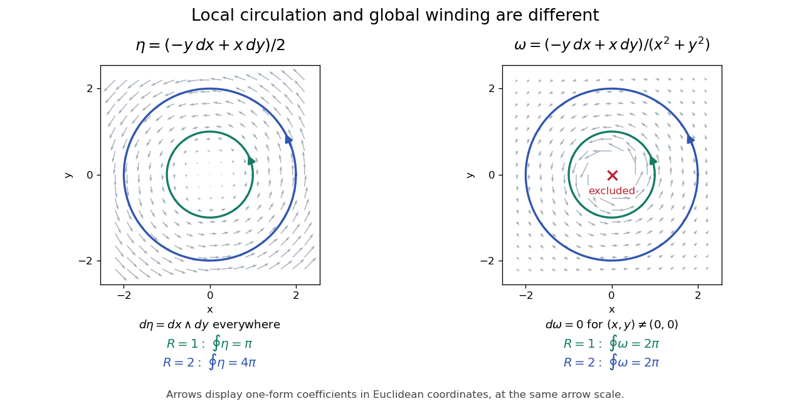

# Nonexact angular one-form

↑ **Parent:** [Closed differential form](closed-differential-form.md)

On the [punctured plane](punctured-complex-plane.md), this [one-form](one-form.md) is closed and locally the differential of the polar angle. Its [line integral](line-integral.md) around a closed curve is $2\pi$ times the [winding number](winding-number.md). A once-winding circle therefore has nonzero integral, proving that no global single-valued angle potential exists and the form is not an [exact differential form](exact-differential-form.md).

For a counterclockwise [circle](circle.md) of radius $R>0$, substitute $x=R\cos t$, $y=R\sin t$. The [pullback of a differential form](pullback-of-a-differential-form.md) is

$$
\omega=\frac{R^2(\sin^2t+\cos^2t)}{R^2}\,dt=dt,\qquad \oint\omega=\boxed{2\pi}.
$$

The radius cancels. In coordinates, $P=-y/(x^2+y^2)$ and $Q=x/(x^2+y^2)$ satisfy $\partial_xQ=\partial_yP$ away from the origin, so $d\omega=0$ there. The nonzero integral is a global obstruction to being an [exact differential form](exact-differential-form.md), not a nonzero local [exterior derivative](exterior-derivative.md).

**[Figure 2](#image-smooth-local-circulation-scales-with-enclosed-area-whereas-a-closed-angular-form-detects-winding-around-an-excluded-point). Smooth local circulation scales with enclosed area, whereas a closed angular form detects winding around an excluded point**.

Compare this with the smooth [one-form](one-form.md) $\eta=(-y\,dx+x\,dy)/2$ on the whole plane. Here $d\eta=dx\wedge dy$, and its integral around a radius-$R$ [circle](circle.md) is $\pi R^2$, the enclosed area. The [Generalized Stokes theorem](generalized-stokes-theorem.md) applies to the full disc for $\eta$. For $\omega$, that disc crosses the excluded origin, where the [one-form](one-form.md) is undefined. On an annulus the theorem applies, but its induced inner boundary is clockwise: the two integrals $2\pi$ and $-2\pi$ cancel. This explains exactly why closedness and nonzero circulation can coexist.

## ↑ Ancestors (8)

1. [Closed differential form](closed-differential-form.md)
2. [Closed and exact differential forms](closed-and-exact-differential-forms.md)
3. [Exterior derivative](exterior-derivative.md)
4. [Differential form](differential-form-split.md)
5. [Geometry and topology](geometry-and-topology-split.md)
6. [Area of mathematics](area-of-mathematics.md)
7. [Mathematics](mathematics-split.md)
8. [Codex Wiki](split.md)

## ← Incoming links (1)

- [Solution](past-exam-of-the-mathematics-course-of-the-university-of-cambridge/2004/ia/paper-3/10c/solution.md)
