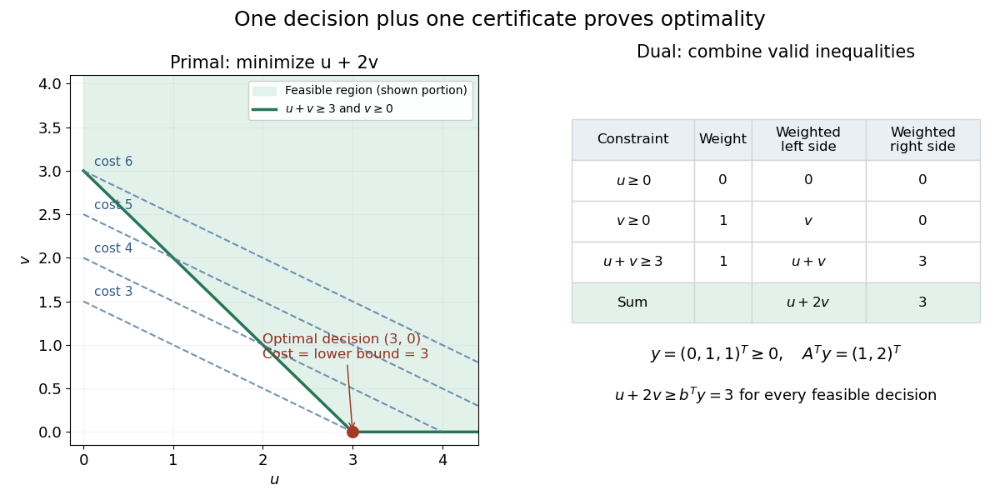

# Nonnegative-orthant optimality certificate

↑ **Parent:** [Conic dual problem](conic-dual-problem.md)

Consider the original [linear program](linear-programming-split.md)

$$
\min_{u,v}(u+2v)\qquad\text{subject to}\qquad u\geq0,\quad v\geq0,\quad u+v\geq3.
$$

One unit of $v$ costs twice as much as one unit of $u$, so $(u,v)=(3,0)$ is a plausible answer. To certify it, multiply the three [linear inequalities](linear-inequality.md) by $0,1,1$, respectively, and add:

$$
0u+v+(u+v)\geq0+0+3,\qquad\boxed{u+2v\geq3}.
$$

The proposed [feasible point](feasible-point.md) attains $3$, so its cost is the [global minimum](global-minimum.md).

In the [conic dual problem](conic-dual-problem.md) convention, the data and certificate are

$$
A=\begin{pmatrix}1&0\\0&1\\1&1\end{pmatrix},\quad
b=\begin{pmatrix}0\\0\\3\end{pmatrix},\quad
c=\begin{pmatrix}1\\2\end{pmatrix},\quad
K=\mathbb R_+^3,\quad
y=\begin{pmatrix}0\\1\\1\end{pmatrix}.
$$

Direct [matrix multiplication](matrix-multiplication.md) gives $A^Ty=c$ and $b^Ty=3$. At $x=(3,0)^T$, the [slack variable](slack-variable.md) is $s=(3,0,0)^T$, so $s^Ty=0$. The first [linear inequality](linear-inequality.md) has positive slack and zero multiplier; the two positively weighted [linear inequalities](linear-inequality.md) are tight. This is [complementary slackness](complementary-slackness.md).

**[Figure 5](#image-a-feasible-decision-and-a-weighted-inequality-certificate-meet-at-the-same-cost). A feasible decision and a weighted-inequality certificate meet at the same cost**. The shaded [feasible set](feasible-region.md) lies above $u+v=3$ in the [nonnegative orthant](nonnegative-orthant.md). Dashed lines show costs $u+2v=3,4,5,6$. The lowest attainable line touches $(3,0)$. The right panel verifies the [dual variable](dual-variable.md) $y=(0,1,1)^T$: its weighted constraint coefficients reproduce the [objective function](objective-function.md), and its weighted right-hand sides give the lower bound $3$.

The entire dual [feasible set](feasible-region.md) can also be read off: write $y=(1-r,2-r,r)^T$ with $0\leq r\leq1$. Then $A^Ty=c$ and $b^Ty=3r$. Maximizing this lower bound gives $r=1$. A point such as $r=1/2$ is still a valid certificate of the weaker bound $u+2v\geq3/2$.

## ↑ Ancestors (7)

1. [Conic dual problem](conic-dual-problem.md)
2. [Conic optimization](conic-optimization.md)
3. [Convex optimization](convex-optimization-split.md)
4. [Mathematical optimization](mathematical-optimization-split.md)
5. [Area of mathematics](area-of-mathematics.md)
6. [Mathematics](mathematics-split.md)
7. [Codex Wiki](split.md)

## ← Incoming links (1)

- [Conic primal-dual gap](conic-primal-dual-gap.md)
