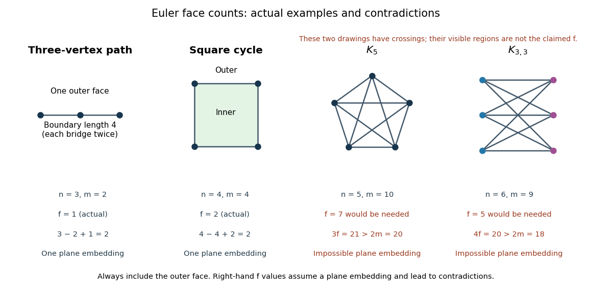

# Nonplanarity by edge counts

↑ **Parent:** [Planar graph edge bound](planar-graph-edge-bound.md)

The [complete graph](complete-graph.md) $K_5$ has $n=5$ and $m=\binom52=10$, exceeding the [planar graph edge bound](planar-graph-edge-bound.md) $3\cdot5-6=9$. Therefore it is not a [planar graph](planar-graph.md). The [complete bipartite graph](complete-bipartite-graph.md) $K_{3,3}$ has $n=6$ and $m=3\cdot3=9$. The general bound allows twelve [edges](edge-of-a-graph.md), but the [bipartite planar graph edge bound](bipartite-planar-graph-edge-bound.md) allows only eight, proving nonplanarity.

**[Figure 31](#plane-graph-face-counts-and-edge-obstructions). Actual plane-graph face counts compared with impossible face counts for the two complete-graph obstructions**.

These are necessary bounds, not a complete planarity test. For an original counterexample, subdivide every [edge](edge-of-a-graph.md) of $K_{3,3}$ once. The resulting [simple graph](simple-graph.md) is a [connected graph](connected-graph.md) with $n=15$, $m=18$, and is [bipartite](bipartite-graph.md): put all original [vertices](vertex-graph-theory.md) in one part and all nine new [vertices](vertex-graph-theory.md) in the other. Both inequalities hold, $18\leq39$ and $18\leq26$. Nevertheless, a crossing-free [graph drawing](graph-drawing.md) would let us trace each two-[edge](edge-of-a-graph.md) [graph path](path-in-a-graph.md) as one curve, producing an impossible embedding of $K_{3,3}$. The [graph subdivision](graph-subdivision.md) preserves this obstruction. [Kuratowski's theorem](kuratowski-s-theorem.md) supplies a stronger characterization than these counts.

## ↑ Ancestors (8)

1. [Planar graph edge bound](planar-graph-edge-bound.md)
2. [Euler formula for a connected planar graph](euler-formula-for-a-connected-planar-graph.md)
3. [Planar graph](planar-graph.md)
4. [Graph theory](graph-theory-split.md)
5. [Foundations of mathematics](foundations-of-mathematics-split.md)
6. [Area of mathematics](area-of-mathematics.md)
7. [Mathematics](mathematics-split.md)
8. [Codex Wiki](split.md)

## ← Incoming links (1)

- [Planar graph](planar-graph.md)
