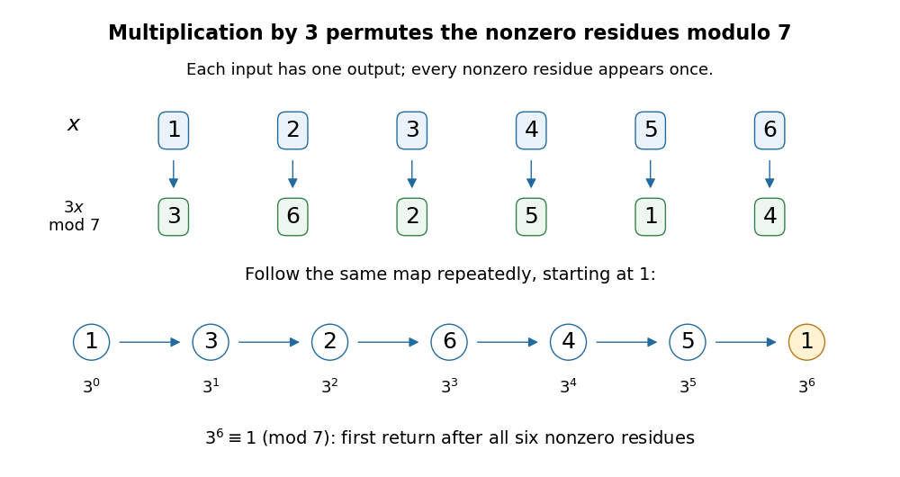
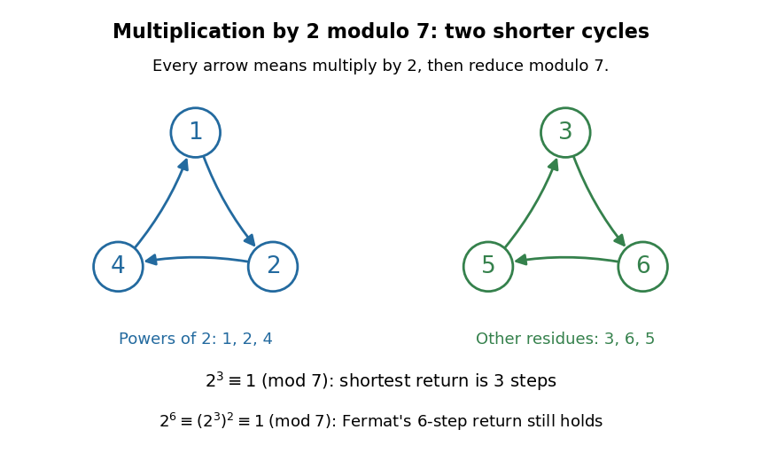

# Nonzero residue permutation

↑ **Parent:** [Fermat little theorem](fermat-little-theorem.md)

For a [prime number](prime-number-split.md) $p$ and $p\nmid a$, [multiplication](multiplication.md) by $a$ gives a [permutation](permutation.md) of the $p-1$ nonzero [residue classes](residue-class.md). For $a=3$ modulo seven, the representatives $1,2,3,4,5,6$ map to $3,6,2,5,1,4$: the same collection in a different order. Repeating this [permutation](permutation.md) from one visits all six representatives before returning.

**[Figure 21](#fermat-prime-residue-permutation). Multiplication by three modulo seven permutes all six nonzero residue classes**. The upper arrows show each input and its image. The lower arrows repeatedly apply the same [permutation](permutation.md) to one, displaying the powers $3^0,\ldots,3^6$ modulo seven. The highlighted final one is the first positive return, at [exponent](exponent.md) six.

For $a=2$ modulo seven, the [permutation cycles](permutation-cycle.md) are instead $(1,2,4)$ and $(3,6,5)$. The powers of two visit only the [permutation cycle](permutation-cycle.md) containing one, so their [multiplicative order](multiplicative-order.md) is three. Both [permutation cycles](permutation-cycle.md) return after three steps; applying the [permutation](permutation.md) six times still fixes every nonzero [residue class](residue-class.md). [Fermat's little theorem](fermat-little-theorem.md) guarantees a return at six, not that every base visits every nonzero [residue class](residue-class.md).

**[Figure 22](#fermat-prime-residue-short-cycles). Multiplication by two modulo seven gives two permutation cycles of length three**. Every arrow multiplies by two modulo seven. The left [permutation cycle](permutation-cycle.md) contains one and hence the powers of two. The right [permutation cycle](permutation-cycle.md) contains the other three nonzero [residue classes](residue-class.md). Their common length three divides $p-1=6$.

More generally, every [permutation cycle](permutation-cycle.md) of this map has length equal to the [multiplicative order](multiplicative-order.md) of $a$: starting at a nonzero [residue class](residue-class.md) $x$, a return means $a^kx\equiv x\pmod p$, and its [modular multiplicative inverse](modular-multiplicative-inverse.md) allows cancellation of $x$. Thus the $p-1$ nonzero [residue classes](residue-class.md) split into equal-length [permutation cycles](permutation-cycle.md), which also explains the [divisibility](divisibility-split.md) of the [multiplicative order](multiplicative-order.md) into $p-1$.

The product argument gives a short proof outline. Since [multiplication](multiplication.md) by $a$ is a [permutation](permutation.md) of the nonzero [residue classes](residue-class.md),

$$
\prod_{r=1}^{p-1}r\equiv\prod_{r=1}^{p-1}(ar)
=a^{p-1}\prod_{r=1}^{p-1}r\pmod p.
$$

Every factor is a [unit](unit-in-a-ring.md), so their product has a [modular multiplicative inverse](modular-multiplicative-inverse.md) and can be cancelled. This leaves $a^{p-1}\equiv1\pmod p$. The whole argument works for $p=2$, where the product is just one.[p. 2, proof of Theorem 1.1: the sets S and aS, product comparison and cancellation](euler%E2%80%99s-theorem-by-keith-conrad.md)

## ↑ Ancestors (5)

1. [Fermat little theorem](fermat-little-theorem.md)
2. [Number theory](number-theory-split.md)
3. [Area of mathematics](area-of-mathematics.md)
4. [Mathematics](mathematics-split.md)
5. [Codex Wiki](split.md)
