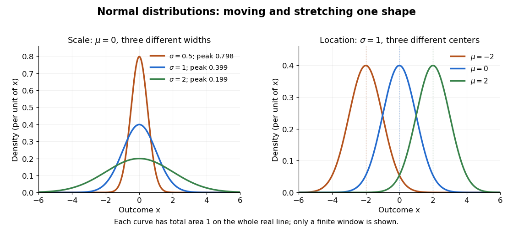

# Normal distribution

↑ **Parent:** [Probability distribution](probability-distribution-split.md)  
ⓦ [Wiki](https://en.wikipedia.org/wiki/Normal_distribution)

The [normal distribution](normal-distribution.md) is a [probability distribution](probability-distribution-split.md) on the [real line](real-line.md) with [mean](expected-value-split.md) $\mu$ and positive [standard deviation](standard-deviation.md) $\sigma$. Its [probability density function](probability-density-function.md) is

$$
f_X(x)=\frac{1}{\sigma\sqrt{2\pi}}\exp\left(-\frac{(x-\mu)^2}{2\sigma^2}\right),\qquad x\in\mathbb R,\quad\sigma>0.
$$

In the notation $X\sim N(\mu,\sigma^2)$, the second parameter is the [variance](variance-split.md) $\sigma^2$, not the [standard deviation](standard-deviation.md) $\sigma$. The [probability density function](probability-density-function.md) is symmetric about $\mu$, highest there, and integrates to one. These formulas and the parameter convention are given in [MIT 18.05, Reading 5c, §5: normal distributions](https://ocw.mit.edu/courses/18-05-introduction-to-probability-and-statistics-spring-2022/mit18_05_s22_class05-prep-c.pdf).

The [normal distribution](normal-distribution.md) is a [location-scale family](location-scale-family.md): if $Z$ is a [standard normal random variable](standard-normal-random-variable.md), then $X=\mu+\sigma Z$. Changing $\mu$ moves the center; changing $\sigma$ stretches the horizontal distances from it. The reciprocal factor $1/\sigma$ lowers the [probability density function](probability-density-function.md) as the curve widens, preserving total area. This is why one [standard normal distribution](standard-normal-distribution.md) suffices to calculate probabilities for the whole family. [NIST: normal density and location/scale parameters](https://itl.nist.gov/div898/handbook/eda/section3/eda3661.htm).

**[Figure 11](#image-normal-location-and-scale-change-the-center-and-width-while-preserving-total-area). Normal location and scale change the center and width while preserving total area**. Left: [normal distributions](normal-distribution.md) with [mean](expected-value-split.md) zero and [standard deviations](standard-deviation.md) $0.5,1,2$ have respective peak heights approximately $0.798,0.399,0.199$, but each has total area one on the whole [real line](real-line.md). Right: changing the [mean](expected-value-split.md) with [standard deviation](standard-deviation.md) one translates the curve. Both panels show a finite viewing window.

The height $f_X(x)$ is a [probability density function](probability-density-function.md) value, not $\mathbb P(X=x)$. For $a\leq b$, the [probability](probability.md) $\mathbb P(a\leq X\leq b)=\int_a^b f_X(x)\,dx$ is an area, and $\mathbb P(X=x)=0$ for every individual $x$. If $X$ is measured in some unit, $\mu$ and $\sigma$ use that unit, $\sigma^2$ uses its square, and $f_X$ uses its reciprocal; the [integral](integral-split.md) is a [dimensionless quantity](dimensionless-quantity.md). A change of measurement unit therefore changes the height without changing the [probability](probability.md). The area interpretation is developed in [MIT 18.05, Reading 5b: continuous random variables](https://ocw.mit.edu/courses/18-05-introduction-to-probability-and-statistics-spring-2022/mit18_05_s22_class05-prep-b.pdf).

The usefulness of the [normal distribution](normal-distribution.md) goes beyond its simple shape. Under the [central limit theorem](central-limit-theorem.md), sums of [independent and identically distributed](independent-and-identically-distributed-random-variables.md) [random variables](random-variable-split.md) with finite positive [variance](variance-split.md), after centering and scaling, approach the [standard normal distribution](standard-normal-distribution.md). Thus approximations by a [normal distribution](normal-distribution.md) can arise even when the individual [random variables](random-variable-split.md) have quite different [probability distributions](probability-distribution-split.md). The hypotheses matter: a model of [measurement error](measurement-error.md) still needs evidence that this approximation is appropriate. [MIT 18.05, Reading 6b, §5: standardization and the central limit theorem](https://ocw.mit.edu/courses/18-05-introduction-to-probability-and-statistics-spring-2022/mit18_05_s22_class06-prep-b.pdf). Exact closure under a [linear combination of independent normal random variables](linear-combination-of-independent-normal-random-variables.md) provides another reason the family is convenient.

Historically, the curve appeared in a different problem from fitting measurements. In the 1756 edition of _The Doctrine of Chances_, Abraham de Moivre reproduces work he dates to 12 November 1733 on approximating sums of [binomial distribution](binomial-distribution.md) [probabilities](probability.md) for equally likely success and failure; page 245 already gives the one-sided central area as $0.341344$. [De Moivre, The Doctrine of Chances, 1756, pp. 242–246](https://archive.org/details/doctrineofchance00moiv/page/243/mode/2up). In his 1809 _Theoria motus_, [Carl Friedrich Gauss](carl-friedrich-gauss.md) derived a [normal distribution](normal-distribution.md) for [measurement error](measurement-error.md) from a condition on the [arithmetic mean](arithmetic-mean.md), then connected maximizing its [likelihood](likelihood-function.md) to minimizing the sum of squared errors under that model, the principle behind [ordinary least squares](ordinary-least-squares.md). These are distinct contributions: approximating [binomial distribution](binomial-distribution.md) [probabilities](probability.md) and justifying an estimation rule. [Gauss, Theoria motus, 1809, §§177–179; Davis's 1857 English translation, pp. 258–260](https://archive.org/details/theoryofmotionof00gausrich/page/258/mode/2up).

For a short normalization check, substitute $z=(x-\mu)/\sigma$ in the [integral](integral-split.md) of $f_X$. The [Gaussian integral](gaussian-integral.md) gives $\int_{\mathbb R}e^{-z^2/2}\,dz=\sqrt{2\pi}$, so the total area is one. The [standard normal density](standard-normal-density.md) is an [even function](even-function.md), giving $\mathbb E[Z]=0$; [integration by parts](integration-by-parts.md) gives $\mathbb E[Z^2]=1$. Then [linearity of expectation](linearity-of-expectation.md) and the [variance](variance-split.md) scaling rule applied to $X=\mu+\sigma Z$ yield [mean](expected-value-split.md) $\mu$ and [variance](variance-split.md) $\sigma^2$.

**Table of contents**

- [Normality (statistics)](normality-statistics.md)
- [Gaussian characterization by independent sum and difference](gaussian-characterization-by-independent-sum-and-difference.md)
- [Normal density](normal-density.md)
- [Gaussian maximum](gaussian-maximum.md)
  - [Gaussian maximum bound without independence](gaussian-maximum-bound-without-independence.md)
- [Gaussian fourth moment](gaussian-fourth-moment.md)
- [Linear combination of independent normal random variables](linear-combination-of-independent-normal-random-variables.md)
- [Multivariate Gaussian distribution](multivariate-gaussian-distribution.md)
  - [Isserlis's theorem](isserlis-s-theorem.md)
    - [Gaussian even-moment pairing count](gaussian-even-moment-pairing-count.md)
  - [Linear combination of jointly normal random variables](linear-combination-of-jointly-normal-random-variables.md)
- [Mills ratio](mills-ratio.md)
  - [Two-term bounds for Mills ratio](two-term-bounds-for-mills-ratio.md)
  - [Inverse Mills ratio](inverse-mills-ratio.md)
- [Gaussian random variable](gaussian-random-variable.md)
  - [Gaussian series with square-summable coefficients](gaussian-series-with-square-summable-coefficients.md)
    - [Almost sure convergence criterion for an independent Gaussian series](almost-sure-convergence-criterion-for-an-independent-gaussian-series.md)
      - [Threshold stopping of an independent Gaussian series](threshold-stopping-of-an-independent-gaussian-series.md)
  - [Standard normal random variable](standard-normal-random-variable.md)
- [Moment-generating function of a normal distribution](moment-generating-function-of-a-normal-distribution.md)
  - [Complex Gaussian exponential moment](complex-gaussian-exponential-moment.md)
- [Gaussian noise](gaussian-noise.md)
- [Product of two independent standard normal random variables](product-of-two-independent-standard-normal-random-variables.md)
- [Half-normal distribution](half-normal-distribution.md)
  - [Radial-ratio independence of two half-normal variables](radial-ratio-independence-of-two-half-normal-variables.md)
- [Log-normal distribution](log-normal-distribution.md)
  - [Shifted lognormal distribution](shifted-lognormal-distribution.md)
  - [Truncated lognormal moment](truncated-lognormal-moment.md)
- [Stein's lemma (probability)](stein-s-lemma-probability.md)
  - [Stein risk identity for normal mean estimators](stein-risk-identity-for-normal-mean-estimators.md)
- [Standard normal distribution](standard-normal-distribution.md)
  - [Standard normal density](standard-normal-density.md)
  - [Moment-generating function of a standard normal variable](moment-generating-function-of-a-standard-normal-variable.md)
    - [Exponential moment of an absolute standard normal variable](exponential-moment-of-an-absolute-standard-normal-variable.md)
  - [Standard normal distribution function](standard-normal-distribution-function.md)
  - [Standard normal quantile](standard-normal-quantile.md)
  - [Standardization of a normal random variable](standardization-of-a-normal-random-variable.md)

## ↑ Ancestors (6)

1. [Probability distribution](probability-distribution-split.md)
2. [Probability theory](probability-theory-split.md)
3. [Probability and statistics](probability-and-statistics-split.md)
4. [Area of mathematics](area-of-mathematics.md)
5. [Mathematics](mathematics-split.md)
6. [Codex Wiki](split.md)

## ← Incoming links (408)

- [Accidental coincidence](accidental-coincidence.md)
- [Aperture photometry](aperture-photometry.md)
- [Atomless maxima on separated Brownian intervals](atomless-maxima-on-separated-brownian-intervals.md)
- [Autocorrelation](autocorrelation.md)
- [Availability curvature and equilibrium fluctuations](availability-curvature-and-equilibrium-fluctuations.md)
- [Bartlett correction for a normal variance with unknown mean](bartlett-correction-for-a-normal-variance-with-unknown-mean.md)
- [Between-person slope quantile](between-person-slope-quantile.md)
- [Binary Brownian drift filter](binary-brownian-drift-filter.md)
- [Box-Muller transform](box-muller-transform.md)
- [Brownian fluctuations exceed the square-root scale](brownian-fluctuations-exceed-the-square-root-scale.md)
- [Brownian increment](brownian-increment.md)
- [Brownian motion](brownian-motion-split.md)
- [Brownian paths are not uniformly continuous on the half-line](brownian-paths-are-not-uniformly-continuous-on-the-half-line.md)
- [Cameron-Martin theorem for a Gaussian measure](cameron-martin-theorem-for-a-gaussian-measure.md)
- [Central limit theorem](central-limit-theorem.md)
- [Charge lattice inference from oil drops](charge-lattice-inference-from-oil-drops.md)
- [Complementary error function](complementary-error-function.md)
- [Conditional and stationary AR1 likelihood estimators](conditional-and-stationary-ar1-likelihood-estimators.md)
- [Conditional geometric-average Asian option formula](conditional-geometric-average-asian-option-formula.md)
- [Delta bound in an arithmetic stock model](delta-bound-in-an-arithmetic-stock-model.md)
- [Deviance residual](deviance-residual.md)
- [Differentiable modification of a stationary Gaussian process](differentiable-modification-of-a-stationary-gaussian-process.md)
- [Differential entropy of a Gaussian law](differential-entropy-of-a-gaussian-law.md)
- [Distribution of an internally studentized Gaussian residual](distribution-of-an-internally-studentized-gaussian-residual.md)
- [Doppler-free absorption line model](doppler-free-absorption-line-model.md)
- [Edgeworth series](edgeworth-series.md)
- [Efficient score in independent-error regression](efficient-score-in-independent-error-regression.md)
- [EM for a missing observation in a Gaussian AR1 process](em-for-a-missing-observation-in-a-gaussian-ar1-process.md)
- [EM for an independent missing normal coordinate](em-for-an-independent-missing-normal-coordinate.md)
- [EM maximization step](em-maximization-step.md)
- [Equipartition theorem](equipartition-theorem.md)
- [Error function and the normal distribution](error-function-and-the-normal-distribution.md)
- [Exact Gaussian overflow constraint](exact-gaussian-overflow-constraint.md)
- [Excess kurtosis](excess-kurtosis.md)
- [Exponential martingale for Brownian motion](exponential-martingale-for-brownian-motion.md)
- [Exponential-mean confidence interval by pivot inversion](exponential-mean-confidence-interval-by-pivot-inversion.md)
- [Fieller's theorem](fieller-s-theorem.md)
- [Finite contamination bias of normal location](finite-contamination-bias-of-normal-location.md)
- [Finite-dimensional distribution](finite-dimensional-distribution.md)
- [Finite-record Fourier covariance bound](finite-record-fourier-covariance-bound.md)
- [Fixed-design nonparametric regression](fixed-design-nonparametric-regression.md)
- [Fixed exponential perturbation of a Gaussian empirical mean](fixed-exponential-perturbation-of-a-gaussian-empirical-mean.md)
- [Franck-Hertz repeated-loss collection model](franck-hertz-repeated-loss-collection-model.md)
- [Gaussian autoregressive conditional precision](gaussian-autoregressive-conditional-precision.md)
- [Gaussian autoregressive kernel variance correction](gaussian-autoregressive-kernel-variance-correction.md)
- [Gaussian effective bandwidth](gaussian-effective-bandwidth.md)
- [Gaussian integral](gaussian-integral.md)
- [Gaussian likelihood](gaussian-likelihood.md)
- [Gaussian limit of a Brownian exit skeleton](gaussian-limit-of-a-brownian-exit-skeleton.md)
- [Gaussian line-of-sight velocity distribution](gaussian-line-of-sight-velocity-distribution.md)
- [Gaussian linear mixed model](gaussian-linear-mixed-model.md)
- [Gaussian location minimax lower bound under absolute-error loss](gaussian-location-minimax-lower-bound-under-absolute-error-loss.md)
- [Gaussian log-rate correction to the Poisson trick](gaussian-log-rate-correction-to-the-poisson-trick.md)
- [Gaussian log-response model](gaussian-log-response-model.md)
- [Gaussian mixture distribution](gaussian-mixture-distribution.md)
- [Gaussian mixture Gibbs updates with independent priors](gaussian-mixture-gibbs-updates-with-independent-priors.md)
- [Gaussian noise](gaussian-noise.md)
- [Gaussian practical-null mixture](gaussian-practical-null-mixture.md)
- [Gaussian-prior Poisson log-effect conditional](gaussian-prior-poisson-log-effect-conditional.md)
- [Gaussian-process characterization of Brownian motion](gaussian-process-characterization-of-brownian-motion.md)
- [Gaussian process classification](gaussian-process-classification.md)
- [Gaussian random element](gaussian-random-element.md)
- [Gaussian random variable](gaussian-random-variable.md)
- [Gaussian random variable in a Banach space](gaussian-random-variable-in-a-banach-space.md)
- [Gaussian regression score](gaussian-regression-score.md)
- [Gaussian smoothing of an integer-valued distribution](gaussian-smoothing-of-an-integer-valued-distribution.md)
- [Gaussian two-coordinate Gibbs recursion](gaussian-two-coordinate-gibbs-recursion.md)
- [Gaussian variational energy for the harmonic oscillator](gaussian-variational-energy-for-the-harmonic-oscillator.md)
- [Heisenberg uncertainty relation](heisenberg-uncertainty-relation.md)
- [Hellinger distance between normal distributions](hellinger-distance-between-normal-distributions.md)
- [Higgs resonance resolution and background model](higgs-resonance-resolution-and-background-model.md)
- [History of Student's t-distribution](history-of-student-s-t-distribution.md)
- [Hoeffding inequality](hoeffding-inequality.md)
- [Identity link](identity-link.md)
- [Independent normal and inverse-gamma regression priors](independent-normal-and-inverse-gamma-regression-priors.md)
- [Infinite divisibility (probability)](infinite-divisibility-probability.md)
- [Influence function of a Huber location estimator](influence-function-of-a-huber-location-estimator.md)
- [Integrated Brownian motion](integrated-brownian-motion.md)
- [Inverse error function](inverse-error-function.md)
- [Kalman filter](kalman-filter.md)
- [Kolmogorov-Smirnov test](kolmogorov-smirnov-test.md)
- [Kurtosis](kurtosis.md)
- [Laplace distribution](laplace-distribution.md)
- [Large-deviation speed](large-deviation-speed.md)
- [Likelihood function](likelihood-function.md)
- [Lilliefors test](lilliefors-test.md)
- [Lindeberg-Feller central limit theorem](lindeberg-feller-central-limit-theorem.md)
- [Linear noise approximation](linear-noise-approximation.md)
- [Local maximum of Brownian motion](local-maximum-of-brownian-motion.md)
- [Log absolute value stabilization of a normal scale family](log-absolute-value-stabilization-of-a-normal-scale-family.md)
- [Log-normal distribution](log-normal-distribution.md)
- [Logistic-normal regression with autoregressive random effects](logistic-normal-regression-with-autoregressive-random-effects.md)
- [Lugannani-Rice saddlepoint tail approximation](lugannani-rice-saddlepoint-tail-approximation.md)
- [Lyapunov condition](lyapunov-condition.md)
- [Maximum likelihood estimation](maximum-likelihood-estimation-split.md)
- [Maxwell-Boltzmann distribution](maxwell-boltzmann-distribution.md)
- [Maxwell speed distribution](maxwell-speed-distribution.md)
- [Mehler formula for the Ornstein-Uhlenbeck semigroup](mehler-formula-for-the-ornstein-uhlenbeck-semigroup.md)
- [Mixture model](mixture-model.md)
- [Mode (statistics)](mode-statistics.md)
- [Narrow resonance and instrumental resolution](narrow-resonance-and-instrumental-resolution.md)
- [Nested measurements](nested-measurements.md)
- [Noncentral t-distribution](noncentral-t-distribution.md)
- [Nonlinear regression](nonlinear-regression.md)
- [Nonparametric statistics](nonparametric-statistics-split.md)
- [Normal approximation](normal-approximation.md)
- [Normal approximation to a compound Poisson aggregate](normal-approximation-to-a-compound-poisson-aggregate.md)
- [Normal density](normal-density.md)
- [Normal distribution](normal-distribution.md)
- [Normal likelihood with variance equal to squared mean](normal-likelihood-with-variance-equal-to-squared-mean.md)
- [Normal-location influence curves](normal-location-influence-curves.md)
- [Normal mean confidence interval and hypothesis test duality](normal-mean-confidence-interval-and-hypothesis-test-duality.md)
- [Normal mean confidence interval with known variance](normal-mean-confidence-interval-with-known-variance.md)
- [Normal-mean likelihood ratio with unknown variance](normal-mean-likelihood-ratio-with-unknown-variance.md)
- [Normal mean posterior with an exponential prior](normal-mean-posterior-with-an-exponential-prior.md)
- [Normal-normal credibility](normal-normal-credibility.md)
- [Normal Q-Q plot](normal-q-q-plot.md)
- [Normal scale mixture representation of Student t](normal-scale-mixture-representation-of-student-t.md)
- [Normality (statistics)](normality-statistics.md)
- [One-sided likelihood-ratio test for two normal variances](one-sided-likelihood-ratio-test-for-two-normal-variances.md)
- [Optimal bounded influence function for normal location](optimal-bounded-influence-function-for-normal-location.md)
- [Ordinary kriging](ordinary-kriging.md)
- [Ornstein-Uhlenbeck process](ornstein-uhlenbeck-process.md)
- [Ornstein-Uhlenbeck stationary initialization](ornstein-uhlenbeck-stationary-initialization.md)
- [Ornstein-Uhlenbeck transition distribution](ornstein-uhlenbeck-transition-distribution.md)
- [Parametric statistical model](parametric-statistical-model.md)
- [Partial F-test for nested linear models](partial-f-test-for-nested-linear-models.md)
- [Solution](past-exam-of-the-mathematical-and-computational-biology-course-of-the-university-of-cambridge/2025/paper-1/4/f/solution.md)
- [Solution](past-exam-of-the-mathematics-course-of-the-university-of-cambridge/2001/ib/paper-1/3d/solution.md)
- [Solution](past-exam-of-the-mathematics-course-of-the-university-of-cambridge/2001/ib/paper-4/3d/solution.md)
- [Solution](past-exam-of-the-mathematics-course-of-the-university-of-cambridge/2001/iii/paper-21/4/c/solution.md)
- [Solution](past-exam-of-the-mathematics-course-of-the-university-of-cambridge/2001/iii/paper-21/4/f/solution.md)
- [Solution](past-exam-of-the-mathematics-course-of-the-university-of-cambridge/2001/iii/paper-23/3/a/solution.md)
- [Solution](past-exam-of-the-mathematics-course-of-the-university-of-cambridge/2001/iii/paper-23/4/b/solution.md)
- [Solution](past-exam-of-the-mathematics-course-of-the-university-of-cambridge/2001/iii/paper-32/1/solution.md)
- [Solution](past-exam-of-the-mathematics-course-of-the-university-of-cambridge/2001/iii/paper-32/4/solution.md)
- [Solution](past-exam-of-the-mathematics-course-of-the-university-of-cambridge/2001/iii/paper-32/5/ii/solution.md)
- [Solution](past-exam-of-the-mathematics-course-of-the-university-of-cambridge/2001/iii/paper-32/6/iii/solution.md)
- [Solution](past-exam-of-the-mathematics-course-of-the-university-of-cambridge/2001/iii/paper-46/1/i/solution.md)
- [Solution](past-exam-of-the-mathematics-course-of-the-university-of-cambridge/2002/ib/paper-2/12h/solution.md)
- [Solution](past-exam-of-the-mathematics-course-of-the-university-of-cambridge/2002/iii/paper-29/3/solution.md)
- [Solution](past-exam-of-the-mathematics-course-of-the-university-of-cambridge/2002/iii/paper-29/6/solution.md)
- [Solution](past-exam-of-the-mathematics-course-of-the-university-of-cambridge/2002/iii/paper-36/1/i/solution.md)
- [Solution](past-exam-of-the-mathematics-course-of-the-university-of-cambridge/2002/iii/paper-38/5/solution.md)
- [Solution](past-exam-of-the-mathematics-course-of-the-university-of-cambridge/2002/iii/paper-38/6/i/solution.md)
- [Solution](past-exam-of-the-mathematics-course-of-the-university-of-cambridge/2002/iii/paper-51/2/solution.md)
- [Solution](past-exam-of-the-mathematics-course-of-the-university-of-cambridge/2003/ib/paper-2/12h/solution.md)
- [Solution](past-exam-of-the-mathematics-course-of-the-university-of-cambridge/2003/iii/paper-29/4/a/solution.md)
- [Solution](past-exam-of-the-mathematics-course-of-the-university-of-cambridge/2003/iii/paper-29/5/solution.md)
- [Solution](past-exam-of-the-mathematics-course-of-the-university-of-cambridge/2003/iii/paper-32/5/solution.md)
- [Solution](past-exam-of-the-mathematics-course-of-the-university-of-cambridge/2003/iii/paper-33/1/c/solution.md)
- [Solution](past-exam-of-the-mathematics-course-of-the-university-of-cambridge/2003/iii/paper-33/2/b/solution.md)
- [Solution](past-exam-of-the-mathematics-course-of-the-university-of-cambridge/2003/iii/paper-43/3/a/i/solution.md)
- [Solution](past-exam-of-the-mathematics-course-of-the-university-of-cambridge/2003/iii/paper-43/4/solution.md)
- [Solution](past-exam-of-the-mathematics-course-of-the-university-of-cambridge/2003/iii/paper-79/1/d/solution.md)
- [Solution](past-exam-of-the-mathematics-course-of-the-university-of-cambridge/2004/iii/paper-30/6/c/solution.md)
- [Solution](past-exam-of-the-mathematics-course-of-the-university-of-cambridge/2004/iii/paper-34/3/solution.md)
- [Solution](past-exam-of-the-mathematics-course-of-the-university-of-cambridge/2004/iii/paper-34/6/solution.md)
- [Solution](past-exam-of-the-mathematics-course-of-the-university-of-cambridge/2004/iii/paper-35/4/b/solution.md)
- [Solution](past-exam-of-the-mathematics-course-of-the-university-of-cambridge/2004/iii/paper-37/3/solution.md)
- [Solution](past-exam-of-the-mathematics-course-of-the-university-of-cambridge/2004/iii/paper-40/5/iv/solution.md)
- [Solution](past-exam-of-the-mathematics-course-of-the-university-of-cambridge/2004/iii/paper-43/1/ii/solution.md)
- [Solution](past-exam-of-the-mathematics-course-of-the-university-of-cambridge/2004/iii/paper-43/5/ii/solution.md)
- [Solution](past-exam-of-the-mathematics-course-of-the-university-of-cambridge/2004/iii/paper-67/2/d/solution.md)
- [Solution](past-exam-of-the-mathematics-course-of-the-university-of-cambridge/2005/ia/paper-2/11f/solution.md)
- [Solution](past-exam-of-the-mathematics-course-of-the-university-of-cambridge/2005/ii/paper-3/5i/b/solution.md)
- [Solution](past-exam-of-the-mathematics-course-of-the-university-of-cambridge/2005/iii/paper-34/1/d/solution.md)
- [Solution](past-exam-of-the-mathematics-course-of-the-university-of-cambridge/2005/iii/paper-34/3/b/solution.md)
- [Solution](past-exam-of-the-mathematics-course-of-the-university-of-cambridge/2005/iii/paper-35/3/solution.md)
- [Solution](past-exam-of-the-mathematics-course-of-the-university-of-cambridge/2005/iii/paper-36/1/b/solution.md)
- [Solution](past-exam-of-the-mathematics-course-of-the-university-of-cambridge/2005/iii/paper-36/1/c/solution.md)
- [Solution](past-exam-of-the-mathematics-course-of-the-university-of-cambridge/2005/iii/paper-41/1/solution.md)
- [Solution](past-exam-of-the-mathematics-course-of-the-university-of-cambridge/2005/iii/paper-41/3/i/solution.md)
- [Solution](past-exam-of-the-mathematics-course-of-the-university-of-cambridge/2005/iii/paper-41/3/iii/solution.md)
- [Solution](past-exam-of-the-mathematics-course-of-the-university-of-cambridge/2005/iii/paper-42/3/solution.md)
- [Solution](past-exam-of-the-mathematics-course-of-the-university-of-cambridge/2005/iii/paper-42/6/ii/solution.md)
- [Solution](past-exam-of-the-mathematics-course-of-the-university-of-cambridge/2005/iii/paper-43/2/solution.md)
- [Solution](past-exam-of-the-mathematics-course-of-the-university-of-cambridge/2005/iii/paper-44/4/c/solution.md)
- [Solution](past-exam-of-the-mathematics-course-of-the-university-of-cambridge/2005/iii/paper-47/1/solution.md)
- [Solution](past-exam-of-the-mathematics-course-of-the-university-of-cambridge/2005/iii/paper-47/2/solution.md)
- [Solution](past-exam-of-the-mathematics-course-of-the-university-of-cambridge/2005/iii/paper-47/3/b/i/solution.md)
- [Solution](past-exam-of-the-mathematics-course-of-the-university-of-cambridge/2005/iii/paper-47/3/b/iii/solution.md)
- [Solution](past-exam-of-the-mathematics-course-of-the-university-of-cambridge/2005/iii/paper-47/6/solution.md)
- [Solution](past-exam-of-the-mathematics-course-of-the-university-of-cambridge/2006/ib/paper-1/7c/solution.md)
- [Solution](past-exam-of-the-mathematics-course-of-the-university-of-cambridge/2006/ib/paper-3/16b/solution.md)
- [Solution](past-exam-of-the-mathematics-course-of-the-university-of-cambridge/2006/ib/paper-4/19c/solution.md)
- [Solution](past-exam-of-the-mathematics-course-of-the-university-of-cambridge/2006/ii/paper-4/5i/solution.md)
- [Solution](past-exam-of-the-mathematics-course-of-the-university-of-cambridge/2006/iii/paper-32/4/solution.md)
- [Solution](past-exam-of-the-mathematics-course-of-the-university-of-cambridge/2006/iii/paper-40/3/solution.md)
- [Solution](past-exam-of-the-mathematics-course-of-the-university-of-cambridge/2006/iii/paper-42/1/solution.md)
- [Solution](past-exam-of-the-mathematics-course-of-the-university-of-cambridge/2006/iii/paper-42/4/iii/solution.md)
- [Solution](past-exam-of-the-mathematics-course-of-the-university-of-cambridge/2006/iii/paper-46/1/a/solution.md)
- [Solution](past-exam-of-the-mathematics-course-of-the-university-of-cambridge/2007/ia/paper-2/4f/solution.md)
- [Solution](past-exam-of-the-mathematics-course-of-the-university-of-cambridge/2007/ib/paper-4/19c/i/solution.md)
- [Solution](past-exam-of-the-mathematics-course-of-the-university-of-cambridge/2007/ii/paper-1/5i/solution.md)
- [Solution](past-exam-of-the-mathematics-course-of-the-university-of-cambridge/2007/ii/paper-4/28j/solution.md)
- [Solution](past-exam-of-the-mathematics-course-of-the-university-of-cambridge/2007/iii/paper-33/4/a/solution.md)
- [Solution](past-exam-of-the-mathematics-course-of-the-university-of-cambridge/2007/iii/paper-35/5/solution.md)
- [Solution](past-exam-of-the-mathematics-course-of-the-university-of-cambridge/2007/iii/paper-43/2/solution.md)
- [Solution](past-exam-of-the-mathematics-course-of-the-university-of-cambridge/2007/iii/paper-48/3/solution.md)
- [Solution](past-exam-of-the-mathematics-course-of-the-university-of-cambridge/2007/iii/paper-48/6/b/i/solution.md)
- [Solution](past-exam-of-the-mathematics-course-of-the-university-of-cambridge/2007/iii/paper-70/2/solution.md)
- [Solution](past-exam-of-the-mathematics-course-of-the-university-of-cambridge/2007/iii/paper-80/3/b/i/solution.md)
- [Solution](past-exam-of-the-mathematics-course-of-the-university-of-cambridge/2008/ib/paper-3/8h/solution.md)
- [Solution](past-exam-of-the-mathematics-course-of-the-university-of-cambridge/2008/ii/paper-2/5j/solution.md)
- [Solution](past-exam-of-the-mathematics-course-of-the-university-of-cambridge/2008/iii/paper-34/6/solution.md)
- [Solution](past-exam-of-the-mathematics-course-of-the-university-of-cambridge/2008/iii/paper-39/4/ii/solution.md)
- [Solution](past-exam-of-the-mathematics-course-of-the-university-of-cambridge/2008/iii/paper-42/5/solution.md)
- [Solution](past-exam-of-the-mathematics-course-of-the-university-of-cambridge/2008/iii/paper-44/3/a/solution.md)
- [Solution](past-exam-of-the-mathematics-course-of-the-university-of-cambridge/2008/iii/paper-44/3/j/solution.md)
- [Solution](past-exam-of-the-mathematics-course-of-the-university-of-cambridge/2008/iii/paper-47/3/b/ii/solution.md)
- [Solution](past-exam-of-the-mathematics-course-of-the-university-of-cambridge/2008/iii/paper-47/5/a/ii/solution.md)
- [Solution](past-exam-of-the-mathematics-course-of-the-university-of-cambridge/2008/iii/paper-47/5/a/iii/solution.md)
- [Solution](past-exam-of-the-mathematics-course-of-the-university-of-cambridge/2009/ii/paper-1/13i/solution.md)
- [Solution](past-exam-of-the-mathematics-course-of-the-university-of-cambridge/2009/ii/paper-1/29j/c/solution.md)
- [Solution](past-exam-of-the-mathematics-course-of-the-university-of-cambridge/2009/ii/paper-3/27i/solution.md)
- [Solution](past-exam-of-the-mathematics-course-of-the-university-of-cambridge/2009/ii/paper-3/5i/solution.md)
- [Solution](past-exam-of-the-mathematics-course-of-the-university-of-cambridge/2009/ii/paper-4/29j/solution.md)
- [Solution](past-exam-of-the-mathematics-course-of-the-university-of-cambridge/2009/iii/paper-101/1/a/solution.md)
- [Solution](past-exam-of-the-mathematics-course-of-the-university-of-cambridge/2009/iii/paper-31/4/solution.md)
- [Solution](past-exam-of-the-mathematics-course-of-the-university-of-cambridge/2009/iii/paper-33/2/solution.md)
- [Solution](past-exam-of-the-mathematics-course-of-the-university-of-cambridge/2009/iii/paper-33/3/solution.md)
- [Solution](past-exam-of-the-mathematics-course-of-the-university-of-cambridge/2009/iii/paper-36/3/b/solution.md)
- [Solution](past-exam-of-the-mathematics-course-of-the-university-of-cambridge/2009/iii/paper-36/3/d/solution.md)
- [Solution](past-exam-of-the-mathematics-course-of-the-university-of-cambridge/2009/iii/paper-36/4/c/solution.md)
- [Solution](past-exam-of-the-mathematics-course-of-the-university-of-cambridge/2009/iii/paper-36/4/g/solution.md)
- [Solution](past-exam-of-the-mathematics-course-of-the-university-of-cambridge/2009/iii/paper-37/4/solution.md)
- [Solution](past-exam-of-the-mathematics-course-of-the-university-of-cambridge/2009/iii/paper-38/1/solution.md)
- [Solution](past-exam-of-the-mathematics-course-of-the-university-of-cambridge/2009/iii/paper-38/4/solution.md)
- [Solution](past-exam-of-the-mathematics-course-of-the-university-of-cambridge/2009/iii/paper-39/4/i/solution.md)
- [Solution](past-exam-of-the-mathematics-course-of-the-university-of-cambridge/2009/iii/paper-62/2/b/solution.md)
- [Solution](past-exam-of-the-mathematics-course-of-the-university-of-cambridge/2010/ia/paper-2/12f/a/solution.md)
- [Solution](past-exam-of-the-mathematics-course-of-the-university-of-cambridge/2010/ia/paper-2/12f/c/solution.md)
- [Solution](past-exam-of-the-mathematics-course-of-the-university-of-cambridge/2010/iii/paper-29/2/d/solution.md)
- [Solution](past-exam-of-the-mathematics-course-of-the-university-of-cambridge/2010/iii/paper-32/3/solution.md)
- [Solution](past-exam-of-the-mathematics-course-of-the-university-of-cambridge/2010/iii/paper-33/5/solution.md)
- [Solution](past-exam-of-the-mathematics-course-of-the-university-of-cambridge/2010/iii/paper-36/1/d/solution.md)
- [Solution](past-exam-of-the-mathematics-course-of-the-university-of-cambridge/2010/iii/paper-36/1/e/solution.md)
- [Solution](past-exam-of-the-mathematics-course-of-the-university-of-cambridge/2010/iii/paper-36/3/c/solution.md)
- [Solution](past-exam-of-the-mathematics-course-of-the-university-of-cambridge/2010/iii/paper-36/4/a/solution.md)
- [Solution](past-exam-of-the-mathematics-course-of-the-university-of-cambridge/2010/iii/paper-36/4/d/solution.md)
- [Solution](past-exam-of-the-mathematics-course-of-the-university-of-cambridge/2010/iii/paper-36/4/e/solution.md)
- [Solution](past-exam-of-the-mathematics-course-of-the-university-of-cambridge/2010/iii/paper-39/2/b/solution.md)
- [Solution](past-exam-of-the-mathematics-course-of-the-university-of-cambridge/2011/ii/paper-3/25k/iii/solution.md)
- [Solution](past-exam-of-the-mathematics-course-of-the-university-of-cambridge/2011/ii/paper-3/5j/solution.md)
- [Solution](past-exam-of-the-mathematics-course-of-the-university-of-cambridge/2011/ii/paper-4/13j/solution.md)
- [Solution](past-exam-of-the-mathematics-course-of-the-university-of-cambridge/2012/iii/paper-36/4/a/solution.md)
- [Solution](past-exam-of-the-mathematics-course-of-the-university-of-cambridge/2012/iii/paper-36/4/d/solution.md)
- [Solution](past-exam-of-the-mathematics-course-of-the-university-of-cambridge/2012/iii/paper-41/1/b/solution.md)
- [Solution](past-exam-of-the-mathematics-course-of-the-university-of-cambridge/2012/iii/paper-41/1/d/i/solution.md)
- [Solution](past-exam-of-the-mathematics-course-of-the-university-of-cambridge/2012/iii/paper-41/4/solution.md)
- [Solution](past-exam-of-the-mathematics-course-of-the-university-of-cambridge/2013/iii/paper-24/3/a/solution.md)
- [Solution](past-exam-of-the-mathematics-course-of-the-university-of-cambridge/2013/iii/paper-24/6/a/solution.md)
- [Solution](past-exam-of-the-mathematics-course-of-the-university-of-cambridge/2013/iii/paper-25/1/a/2/solution.md)
- [Solution](past-exam-of-the-mathematics-course-of-the-university-of-cambridge/2013/iii/paper-25/1/b/solution.md)
- [Solution](past-exam-of-the-mathematics-course-of-the-university-of-cambridge/2013/iii/paper-25/1/d/solution.md)
- [Solution](past-exam-of-the-mathematics-course-of-the-university-of-cambridge/2013/iii/paper-25/5/e/solution.md)
- [Solution](past-exam-of-the-mathematics-course-of-the-university-of-cambridge/2013/iii/paper-30/1/a/solution.md)
- [Solution](past-exam-of-the-mathematics-course-of-the-university-of-cambridge/2013/iii/paper-30/1/d/solution.md)
- [Solution](past-exam-of-the-mathematics-course-of-the-university-of-cambridge/2013/iii/paper-30/1/e/solution.md)
- [Solution](past-exam-of-the-mathematics-course-of-the-university-of-cambridge/2013/iii/paper-30/2/b/solution.md)
- [Solution](past-exam-of-the-mathematics-course-of-the-university-of-cambridge/2013/iii/paper-30/4/b/solution.md)
- [Solution](past-exam-of-the-mathematics-course-of-the-university-of-cambridge/2013/iii/paper-30/4/c/solution.md)
- [Solution](past-exam-of-the-mathematics-course-of-the-university-of-cambridge/2013/iii/paper-34/3/d/solution.md)
- [Solution](past-exam-of-the-mathematics-course-of-the-university-of-cambridge/2013/iii/paper-37/4/solution.md)
- [Solution](past-exam-of-the-mathematics-course-of-the-university-of-cambridge/2013/iii/paper-72/3/d/solution.md)
- [Solution](past-exam-of-the-mathematics-course-of-the-university-of-cambridge/2014/ia/paper-2/10f/solution.md)
- [Solution](past-exam-of-the-mathematics-course-of-the-university-of-cambridge/2014/iii/paper-26/4/2/solution.md)
- [Solution](past-exam-of-the-mathematics-course-of-the-university-of-cambridge/2014/iii/paper-32/1/a/ii/solution.md)
- [Solution](past-exam-of-the-mathematics-course-of-the-university-of-cambridge/2014/iii/paper-33/1/solution.md)
- [Solution](past-exam-of-the-mathematics-course-of-the-university-of-cambridge/2014/iii/paper-34/3/solution.md)
- [Solution](past-exam-of-the-mathematics-course-of-the-university-of-cambridge/2014/iii/paper-35/3/a/solution.md)
- [Solution](past-exam-of-the-mathematics-course-of-the-university-of-cambridge/2014/iii/paper-35/3/c/solution.md)
- [Solution](past-exam-of-the-mathematics-course-of-the-university-of-cambridge/2014/iii/paper-35/3/d/solution.md)
- [Solution](past-exam-of-the-mathematics-course-of-the-university-of-cambridge/2014/iii/paper-35/3/e/solution.md)
- [Solution](past-exam-of-the-mathematics-course-of-the-university-of-cambridge/2014/iii/paper-35/3/g/solution.md)
- [Solution](past-exam-of-the-mathematics-course-of-the-university-of-cambridge/2014/iii/paper-35/3/i/solution.md)
- [Solution](past-exam-of-the-mathematics-course-of-the-university-of-cambridge/2014/iii/paper-35/4/c/solution.md)
- [Solution](past-exam-of-the-mathematics-course-of-the-university-of-cambridge/2014/iii/paper-35/4/e/solution.md)
- [Solution](past-exam-of-the-mathematics-course-of-the-university-of-cambridge/2014/iii/paper-35/4/h/solution.md)
- [Solution](past-exam-of-the-mathematics-course-of-the-university-of-cambridge/2014/iii/paper-35/4/i/solution.md)
- [Solution](past-exam-of-the-mathematics-course-of-the-university-of-cambridge/2014/iii/paper-35/4/j/solution.md)
- [Solution](past-exam-of-the-mathematics-course-of-the-university-of-cambridge/2014/iii/paper-38/5/a/solution.md)
- [Solution](past-exam-of-the-mathematics-course-of-the-university-of-cambridge/2014/iii/paper-38/5/b/solution.md)
- [Solution](past-exam-of-the-mathematics-course-of-the-university-of-cambridge/2015/ii/paper-2/27k/ii/solution.md)
- [Solution](past-exam-of-the-mathematics-course-of-the-university-of-cambridge/2015/ii/paper-4/22j/b/solution.md)
- [Solution](past-exam-of-the-mathematics-course-of-the-university-of-cambridge/2015/ii/paper-4/4j/solution.md)
- [Solution](past-exam-of-the-mathematics-course-of-the-university-of-cambridge/2015/iii/paper-29/3/ii/solution.md)
- [Solution](past-exam-of-the-mathematics-course-of-the-university-of-cambridge/2015/iii/paper-30/6/a/solution.md)
- [Solution](past-exam-of-the-mathematics-course-of-the-university-of-cambridge/2015/iii/paper-37/1/a/i/solution.md)
- [Solution](past-exam-of-the-mathematics-course-of-the-university-of-cambridge/2015/iii/paper-37/2/b/solution.md)
- [Solution](past-exam-of-the-mathematics-course-of-the-university-of-cambridge/2015/iii/paper-37/2/e/ii/solution.md)
- [Solution](past-exam-of-the-mathematics-course-of-the-university-of-cambridge/2016/iii/paper-124/5/b/solution.md)
- [Solution](past-exam-of-the-mathematics-course-of-the-university-of-cambridge/2016/iii/paper-201/4/a/solution.md)
- [Solution](past-exam-of-the-mathematics-course-of-the-university-of-cambridge/2016/iii/paper-206/1/b/solution.md)
- [Solution](past-exam-of-the-mathematics-course-of-the-university-of-cambridge/2016/iii/paper-206/1/c/solution.md)
- [Solution](past-exam-of-the-mathematics-course-of-the-university-of-cambridge/2016/iii/paper-206/1/e/solution.md)
- [Solution](past-exam-of-the-mathematics-course-of-the-university-of-cambridge/2016/iii/paper-206/2/b/solution.md)
- [Solution](past-exam-of-the-mathematics-course-of-the-university-of-cambridge/2016/iii/paper-206/2/e/solution.md)
- [Solution](past-exam-of-the-mathematics-course-of-the-university-of-cambridge/2016/iii/paper-206/3/e/solution.md)
- [Solution](past-exam-of-the-mathematics-course-of-the-university-of-cambridge/2016/iii/paper-206/6/a/solution.md)
- [Solution](past-exam-of-the-mathematics-course-of-the-university-of-cambridge/2016/iii/paper-207/1/a/solution.md)
- [Solution](past-exam-of-the-mathematics-course-of-the-university-of-cambridge/2016/iii/paper-208/1/1/7/solution.md)
- [Solution](past-exam-of-the-mathematics-course-of-the-university-of-cambridge/2016/iii/paper-208/2/1/solution.md)
- [Solution](past-exam-of-the-mathematics-course-of-the-university-of-cambridge/2016/iii/paper-209/1/a/solution.md)
- [Solution](past-exam-of-the-mathematics-course-of-the-university-of-cambridge/2016/iii/paper-210/2/a/solution.md)
- [Solution](past-exam-of-the-mathematics-course-of-the-university-of-cambridge/2016/iii/paper-213/1/ii/solution.md)
- [Solution](past-exam-of-the-mathematics-course-of-the-university-of-cambridge/2017/ib/paper-2/8h/b/solution.md)
- [Solution](past-exam-of-the-mathematics-course-of-the-university-of-cambridge/2017/ii/paper-3/26k/c/solution.md)
- [Solution](past-exam-of-the-mathematics-course-of-the-university-of-cambridge/2017/ii/paper-3/26k/d/solution.md)
- [Solution](past-exam-of-the-mathematics-course-of-the-university-of-cambridge/2017/iii/paper-202/3/c/solution.md)
- [Solution](past-exam-of-the-mathematics-course-of-the-university-of-cambridge/2017/iii/paper-210/3/solution.md)
- [Solution](past-exam-of-the-mathematics-course-of-the-university-of-cambridge/2017/iii/paper-216/4/c/solution.md)
- [Solution](past-exam-of-the-mathematics-course-of-the-university-of-cambridge/2017/iii/paper-217/2/solution.md)
- [Solution](past-exam-of-the-mathematics-course-of-the-university-of-cambridge/2017/iii/paper-217/3/solution.md)
- [Solution](past-exam-of-the-mathematics-course-of-the-university-of-cambridge/2018/ii/paper-2/36a/b/ii/solution.md)
- [Solution](past-exam-of-the-mathematics-course-of-the-university-of-cambridge/2018/ii/paper-4/29k/a/solution.md)
- [Solution](past-exam-of-the-mathematics-course-of-the-university-of-cambridge/2018/iii/paper-201/4/a/solution.md)
- [Solution](past-exam-of-the-mathematics-course-of-the-university-of-cambridge/2018/iii/paper-201/4/c/solution.md)
- [Solution](past-exam-of-the-mathematics-course-of-the-university-of-cambridge/2018/iii/paper-201/4/d/solution.md)
- [Solution](past-exam-of-the-mathematics-course-of-the-university-of-cambridge/2018/iii/paper-201/5/b/solution.md)
- [Solution](past-exam-of-the-mathematics-course-of-the-university-of-cambridge/2018/iii/paper-201/5/c/solution.md)
- [Solution](past-exam-of-the-mathematics-course-of-the-university-of-cambridge/2018/iii/paper-202/4/iii/solution.md)
- [Solution](past-exam-of-the-mathematics-course-of-the-university-of-cambridge/2018/iii/paper-216/3/b/i/solution.md)
- [Solution](past-exam-of-the-mathematics-course-of-the-university-of-cambridge/2018/iii/paper-216/3/b/ii/solution.md)
- [Solution](past-exam-of-the-mathematics-course-of-the-university-of-cambridge/2018/iii/paper-218/1/b/solution.md)
- [Solution](past-exam-of-the-mathematics-course-of-the-university-of-cambridge/2019/ib/paper-1/7h/a/solution.md)
- [Solution](past-exam-of-the-mathematics-course-of-the-university-of-cambridge/2019/iii/paper-219/4/a/solution.md)
- [Solution](past-exam-of-the-mathematics-course-of-the-university-of-cambridge/2019/iii/paper-312/2/iii/solution.md)
- [Solution](past-exam-of-the-mathematics-course-of-the-university-of-cambridge/2019/iii/paper-350/1/c/solution.md)
- [Solution](past-exam-of-the-mathematics-course-of-the-university-of-cambridge/2019/iii/paper-350/2/b/solution.md)
- [Solution](past-exam-of-the-mathematics-course-of-the-university-of-cambridge/2019/iii/paper-350/3/b/solution.md)
- [Solution](past-exam-of-the-mathematics-course-of-the-university-of-cambridge/2020/ii/paper-3/29k/a/i/solution.md)
- [Solution](past-exam-of-the-mathematics-course-of-the-university-of-cambridge/2020/ii/paper-4/28j/solution.md)
- [Solution](past-exam-of-the-mathematics-course-of-the-university-of-cambridge/2021/ii/paper-1/28k/b/solution.md)
- [Solution](past-exam-of-the-mathematics-course-of-the-university-of-cambridge/2021/ii/paper-1/29j/c/solution.md)
- [Solution](past-exam-of-the-mathematics-course-of-the-university-of-cambridge/2021/iii/paper-220/2/a/ii/solution.md)
- [Solution](past-exam-of-the-mathematics-course-of-the-university-of-cambridge/2021/iii/paper-326/4/1/solution.md)
- [Solution](past-exam-of-the-mathematics-course-of-the-university-of-cambridge/2021/iii/paper-326/4/2/b/solution.md)
- [Solution](past-exam-of-the-mathematics-course-of-the-university-of-cambridge/2021/iii/paper-344/4/e/solution.md)
- [Solution](past-exam-of-the-mathematics-course-of-the-university-of-cambridge/2022/ii/paper-4/26g/solution.md)
- [Solution](past-exam-of-the-mathematics-course-of-the-university-of-cambridge/2023/ib/paper-4/17h/d/solution.md)
- [Solution](past-exam-of-the-mathematics-course-of-the-university-of-cambridge/2023/ii/paper-3/29k/c/solution.md)
- [Solution](past-exam-of-the-mathematics-course-of-the-university-of-cambridge/2023/ii/paper-4/14c/solution.md)
- [Solution](past-exam-of-the-mathematics-course-of-the-university-of-cambridge/2023/iii/paper-201/5/a/solution.md)
- [Solution](past-exam-of-the-mathematics-course-of-the-university-of-cambridge/2023/iii/paper-202/1/d/solution.md)
- [Solution](past-exam-of-the-mathematics-course-of-the-university-of-cambridge/2023/iii/paper-202/5/d/solution.md)
- [Solution](past-exam-of-the-mathematics-course-of-the-university-of-cambridge/2023/iii/paper-208/1/a/solution.md)
- [Solution](past-exam-of-the-mathematics-course-of-the-university-of-cambridge/2023/iii/paper-218/3/b/solution.md)
- [Solution](past-exam-of-the-mathematics-course-of-the-university-of-cambridge/2025/iii/paper-201/1/b/i/solution.md)
- [Solution](past-exam-of-the-mathematics-course-of-the-university-of-cambridge/2025/iii/paper-219/1/a/solution.md)
- [Solution](past-exam-of-the-mathematics-course-of-the-university-of-cambridge/2025/iii/paper-335/1/i/solution.md)
- [Solution](past-exam-of-the-mathematics-course-of-the-university-of-cambridge/2026/iii/paper-201/4/b/solution.md)
- [Solution](past-exam-of-the-mathematics-course-of-the-university-of-cambridge/2026/iii/paper-226/3/c/solution.md)
- [Solution](past-exam-of-the-mathematics-course-of-the-year-1-of-the-natural-sciences-course-of-the-university-of-cambridge/2002/paper-2/4/solution.md)
- [Solution](past-exam-of-the-mathematics-course-of-the-year-1-of-the-natural-sciences-course-of-the-university-of-cambridge/2008/paper-1/15/b/i/solution.md)
- [Solution](past-exam-of-the-physics-a-course-of-the-university-of-cambridge/2017/paper-1/section-a/5/solution.md)
- [Solution](past-exam-of-the-physics-a-course-of-the-university-of-cambridge/2019/paper-1/section-d/d13/a/solution.md)
- [Solution](past-exam-of-the-quantum-condensed-matter-course-of-the-university-of-cambridge/2004/section-b/b7/c/solution.md)
- [Solution](past-exam-of-the-soft-condensed-matter-course-of-the-university-of-cambridge/2012/paper-1/1/a/solution.md)
- [Solution](past-exam-of-the-systems-biology-course-of-the-university-of-cambridge/2024/paper-3/1/e/solution.md)
- [Solution](past-exam-of-the-systems-biology-course-of-the-university-of-cambridge/2024/paper-3/2/a/solution.md)
- [Solution](past-exam-of-the-systems-biology-course-of-the-university-of-cambridge/2024/paper-3/2/c/solution.md)
- [Solution](past-exam-of-the-systems-biology-course-of-the-university-of-cambridge/2024/paper-4/section-i/1-2/solution.md)
- [Solution](past-exam-of-the-thermal-and-statistical-physics-course-of-the-university-of-cambridge/2019/section-b/5/solution.md)
- [Photon-recoil lag correlation](photon-recoil-lag-correlation.md)
- [Pion decay at rest in emulsion](pion-decay-at-rest-in-emulsion.md)
- [Poisson cumulative probability at its growing mean](poisson-cumulative-probability-at-its-growing-mean.md)
- [Posterior covariance matrix](posterior-covariance-matrix.md)
- [Power-law velocity-correlation dispersion](power-law-velocity-correlation-dispersion.md)
- [Prior calibration for normal random-effect range](prior-calibration-for-normal-random-effect-range.md)
- [Probable error](probable-error.md)
- [Quantile endpoint at probability one](quantile-endpoint-at-probability-one.md)
- [Quantum variational principle](quantum-variational-principle.md)
- [Rank-one covariance spike](rank-one-covariance-spike.md)
- [Rare-outlier three-point distribution](rare-outlier-three-point-distribution.md)
- [Rayleigh radius from Gaussian components](rayleigh-radius-from-gaussian-components.md)
- [Recovery of a continuous Brownian integrand from short increments](recovery-of-a-continuous-brownian-integrand-from-short-increments.md)
- [Regression toward the mean](regression-toward-the-mean.md)
- [Reparameterization gradient](reparameterization-gradient.md)
- [Repeated-measurement latent signal model](repeated-measurement-latent-signal-model.md)
- [Scalar Gaussian Kalman recursion](scalar-gaussian-kalman-recursion.md)
- [Scalar static-state Kalman update](scalar-static-state-kalman-update.md)
- [Scaled deviance](scaled-deviance.md)
- [Simulated two-track invariant-mass example](simulated-two-track-invariant-mass-example.md)
- [Single-observation location minimax bound](single-observation-location-minimax-bound.md)
- [Small normal sample mean confidence interval](small-normal-sample-mean-confidence-interval.md)
- [Space-time harmonic functions along Brownian motion](space-time-harmonic-functions-along-brownian-motion.md)
- [Spatial Bernoulli infection model](spatial-bernoulli-infection-model.md)
- [Standard normal distribution](standard-normal-distribution.md)
- [Standard score](standard-score.md)
- [Stationary process](stationary-process.md)
- [Stratified log-rank statistic](stratified-log-rank-statistic.md)
- [Strong white noise](strong-white-noise.md)
- [Student t random-effect model](student-t-random-effect-model.md)
- [Studentized normal sample mean](studentized-normal-sample-mean.md)
- [Symmetric probability distribution](symmetric-probability-distribution.md)
- [Synthetic bimodal profile of a Bose gas](synthetic-bimodal-profile-of-a-bose-gas.md)
- [Time series](time-series-split.md)
- [Truncated normal distribution](truncated-normal-distribution.md)
- [Two-Gaussian mixture example](two-gaussian-mixture-example.md)
- [Uniform-alternative binomial Bayes factor](uniform-alternative-binomial-bayes-factor.md)
- [Unknown-variance risk estimation in a saturated Gaussian model](unknown-variance-risk-estimation-in-a-saturated-gaussian-model.md)
- [Variance-stabilizing transformation](variance-stabilizing-transformation.md)
- [Weak law of large numbers](weak-law-of-large-numbers.md)
- [Weakly stationary process](weakly-stationary-process.md)
- [Welch's t-test](welch-s-t-test.md)
- [White noise](white-noise.md)
