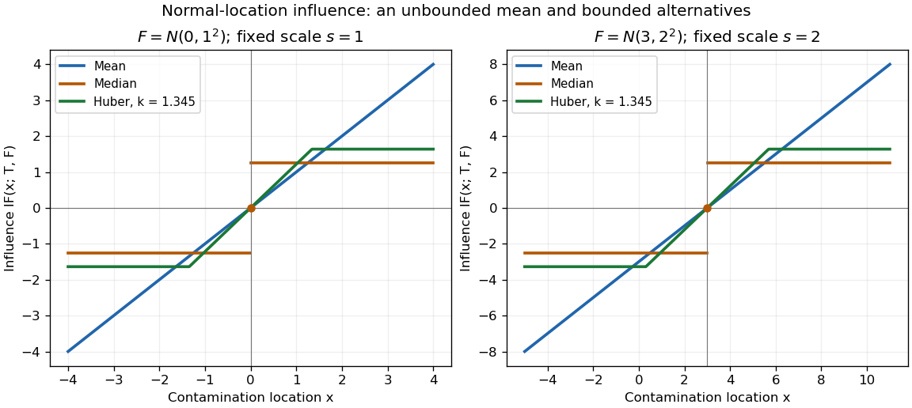

# Normal-location influence curves

↑ **Parent:** [Influence function](influence-function.md)

For $F=N(\mu,\sigma^2)$, put $z=(x-\mu)/\sigma$. The [influence function of the mean](influence-function-of-the-mean.md), [influence function of the sample median](influence-function-of-the-sample-median.md), and [influence function of a Huber location estimator](influence-function-of-a-huber-location-estimator.md) with fixed $s=\sigma$ are respectively

$$
\sigma z,\qquad \sigma\sqrt{\frac\pi2}\operatorname{sgn}(z),\qquad
\frac{\sigma\psi_k(z)}{2\Phi(k)-1}.
$$

The first grows without bound, the second jumps at the [median](median.md), and the third clips continuously. For $k=1.345$, $2\Phi(k)-1\simeq0.821375$ and the normalized Huber tail is about $1.63750\sigma$. This illustrates the [optimal bounded influence function for normal location](optimal-bounded-influence-function-for-normal-location.md) without asserting that this cutoff is optimal for every contamination model.

**[Figure 6](#image-mean-median-and-normalized-huber-influence-curves-for-two-normal-location-scale-models). Mean, median, and normalized Huber influence curves for two normal location-scale models**.

Both panels are theoretical [normal distributions](normal-distribution.md), with no sampled or observed data. Doubling $\sigma$ doubles the vertical [influence function](influence-function.md) scale and the horizontal clipping distance. Changing $\mu$ translates the curves. The isolated dot marks the actual [median](median.md) derivative at the center; connecting its two tails by a vertical segment would misrepresent that value. Bounded influence does not mean every small residual has less effect than on the [mean](expected-value.md): the central Huber slope is $1/(2\Phi(k)-1)>1$, a price paid for reducing sensitivity in the tails.

## ↑ Ancestors (7)

1. [Influence function](influence-function.md)
2. [Robust statistics](robust-statistics.md)
3. [Statistical inference](statistical-inference-split.md)
4. [Probability and statistics](probability-and-statistics-split.md)
5. [Area of mathematics](area-of-mathematics.md)
6. [Mathematics](mathematics-split.md)
7. [Codex Wiki](split.md)

## ← Incoming links (1)

- [Influence function](influence-function.md)
